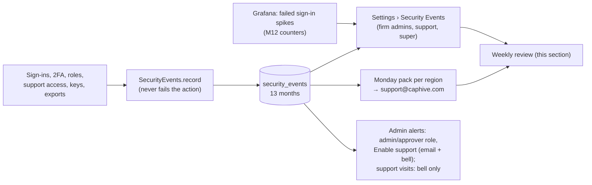

# Security Event Review Methodology

**Scope:** All systems that are in-scope for compliance (SOC 2) — i.e. systems that process,
store, or transmit customer/investor data, or that can affect the confidentiality, integrity,
or availability of those systems (production AWS account, production MySQL database and its
replicas, application servers, admin/support tooling, CI/CD and deployment pipelines, and
identity/access systems).
**Owner:** Engineering
**Review cadence:** Weekly log/event review; this methodology reviewed annually

## 1. Purpose

This document defines how CapHive regularly reviews security-relevant events on in-scope
systems to detect potential security incidents — unauthorized access, misuse, misconfiguration,
or anomalous activity — before they become breaches. It complements the
[Cybersecurity Risk Management Policy](cybersecurity_risk_management_policy.md), which covers
preventive controls; this document covers detective controls.

## 2. In-Scope Systems

| System | Why it's in scope |
|---|---|
| Production AWS account (825199636520) | Hosts production app, database, and customer data |
| Staging AWS account (174852986003) | May contain production-like/sanitized data, shared IAM patterns |
| Production MySQL database (primary + replicas) | Stores all customer, fund, and investor data |
| Application servers / app logs | Handle authentication, authorization, and data access |
| Admin & support tooling | Privileged access to customer data for support purposes |
| CI/CD pipeline | Can push code/config changes to production |
| Identity provider / IAM | Controls who can access the above |

## 3. Event Sources Reviewed

- **AWS GuardDuty** findings (threat detection on network/API activity).
- **AWS CloudTrail** logs (API calls, especially IAM changes, security group changes, and console
  logins).
- **Security Events (application)** — the append-only `security_events` trail (OWASP 2026-11 M11): every
  sign-in and refused sign-in through every door (website, two-factor, sign-in link, password reset, mobile app,
  API, region switch, mail add-in, connected app), two-factor and account changes, role and "Enable support"
  changes, CapHive support signing in as a client or switching into a firm, API keys, phones, connected apps and
  every export. Each row names the account, who did it, the firm, the IP and the door; kept 13 months. Read it in
  CapHive at **Settings › Security Events** (super users see every firm, including refused sign-ins on emails
  with no account) and in the **Monday pack** emailed to support@caphive.com per region
  (`SECURITY_EVENTS_WEEKLY_TO`, subject "[IN] Security events …" / "[US] …").
- **Application logs** — authorization denials (Pundit `NotAuthorizedError`), and the `[security_event]` warn
  lines written when an event could not be saved (queue and table both down).
- **Grafana dashboards/alerts** — anomalous traffic, error-rate spikes, unusual resource usage.
- **IAM / access logs** — new users, role/policy changes, root account usage, MFA status.
- **Database access logs** — for direct/manual access to the MySQL primary or replicas outside the
  application layer.

## 4. Review Process

1. **Weekly scheduled review** (engineering on-call or designated reviewer):
   - Triage any open GuardDuty findings; confirm each is resolved, a known false positive, or
     escalated (see Section 5).
   - Scan CloudTrail for IAM/security-group changes made outside of normal IaC (Pulumi) deploys.
   - Review Grafana alert history for the week — confirm each alert was actioned or explain why not.
   - Open Monday's Security Events pack (one per region). On **Failed sign-ins by account**, look for one
     account or address tried many times, or many accounts from one IP (credential stuffing). On **Access**,
     confirm each admin / approver role and support-access change was asked for. On **Support**, match each
     CapHive support session and firm switch to a ticket. Anything unexplained → filter Settings › Security
     Events by that account or IP for the detail, and escalate (Section 5).
   - Spot-check application logs for authorization denials against the same account, and for any
     `[security_event] lost` lines (an event that could not be saved — the line holds it).
   - Review any manual/direct access to the MySQL primary or replicas for the week and confirm it
     was authorized.
2. **Continuous/real-time review**: GuardDuty High/Critical findings and Grafana on-call alerts
   are reviewed as they fire, not held for the weekly batch (see triage SLAs in the
   [risk management policy](cybersecurity_risk_management_policy.md#3-threat-detection-aws-guardduty)).
3. **Documentation**: each weekly review is logged (reviewer, date, systems covered, findings,
   and disposition) to provide an audit trail.

How the application source reaches the weekly review:

## 5. Identifying & Escalating a Potential Incident

An event is treated as a **potential incident** if it shows any of:

- Access to customer/investor data outside expected patterns (e.g. bulk export, access from an
  unrecognized location/IP, access by a disabled or offboarded account).
- Unexpected IAM/security-group/network changes not tied to a tracked deployment.
- Repeated authentication or authorization failures suggesting brute-force or privilege escalation
  attempts.
- Any GuardDuty High/Critical finding not immediately explained by known, authorized activity.
- Any use of the AWS root account.

When identified:

1. The reviewer immediately notifies engineering leadership.
2. The event is documented (what was observed, affected systems/data, timeline).
3. The incident response process is triggered (see
   [risk management policy §7](cybersecurity_risk_management_policy.md#7-incident-response)).

## 6. Evidence Retention

- Weekly review records, GuardDuty findings, and CloudTrail logs are retained for at least 1 year
  to support audit and compliance evidence requests.
- Security Events rows are kept 13 months and then removed by a nightly job (`SecurityEventPurgeJob`); the
  Monday packs in the support@caphive.com mailbox are the longer-term copy if one is needed.
- Grafana alert history retention follows the configured Grafana data source retention window;
  alerts requiring longer-term evidence are exported and stored alongside the weekly review record.
