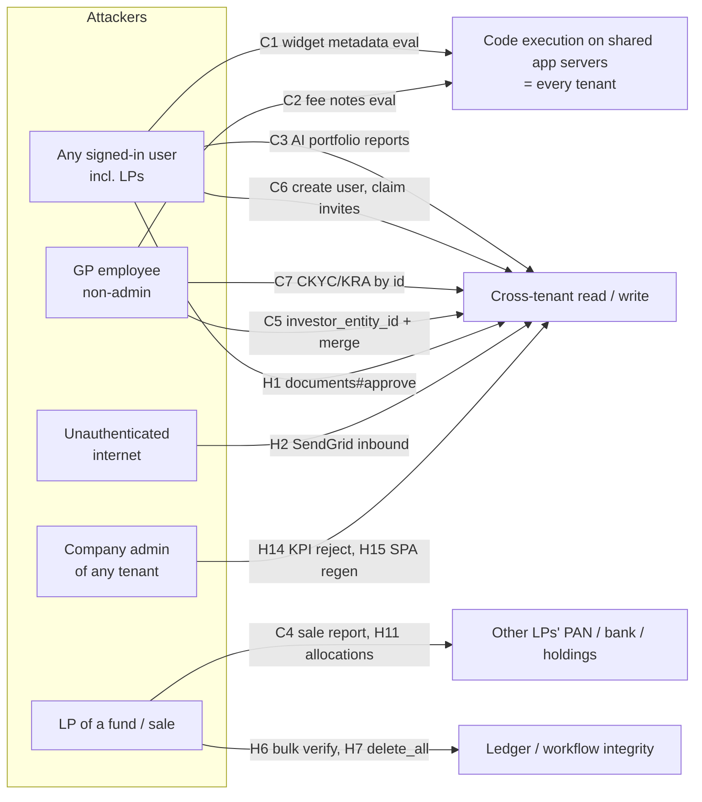

# Security Review — October 2026

> **Scope:** whole codebase, read-only. Focus: exploitable vulnerabilities, privilege escalation, cross-tenant
> (entity) and LP-vs-LP data leakage.
> **Method:** six parallel code-reading passes (core/misc controllers, funds/secondaries/startups controllers,
> Pundit policies, authentication/sessions, AI/MCP/LLM, code-execution/injection) + Brakeman + bundler-audit.
> Nothing was run against the app or a database.
> **Baseline:** items already fixed in `docs/security/security_review_2026_07.md`,
> `openspec/changes/fix-tenant-isolation-batch1/` and `fix-tenant-isolation-batch2/` are not repeated unless the
> fix is incomplete.
> **Verified column:** ✅ = re-read end to end by the reviewer consolidating this report; ◻ = traced by one
> review pass (controller → policy → model), not independently re-read. Line numbers are as of commit `ee84c8a1c0`.

## Contents
- [Overview](#overview)
- [Critical](#critical)
- [High](#high)
- [Medium](#medium)
- [Low / hardening](#low--hardening)
- [Dependencies](#dependencies)
- [Recurring root causes](#recurring-root-causes)
- [Suggested fix order](#suggested-fix-order)
- [Checked and found safe](#checked-and-found-safe)
- [Fix designs](#fix-designs)

---

## Overview

| Severity | Count |
|---|---|
| Critical | 7 |
| High | 19 + N8 = 20 |
| Medium | 29 + N1–N3, N5, N6 = 34 |
| Low / hardening | 14 + N4, N7 = 16 |

---

## Critical

| # | Title | Where | Who | Impact | Fix | ✓ |
|---|---|---|---|---|---|---|
| C1 | **Dashboard widget `metadata` is `eval`'d — any user, LPs included, gets code execution** | `dashboard_widget.rb:347,375`; permit `dashboard_widgets_controller.rb:134`; `DashboardWidgetPolicy#create?/update?` = `belongs_to_entity?` | Any signed-in user. `create` pins `entity_id` to the user's own entity, so the policy always passes | Arbitrary Ruby in the shared app process: credentials, `secret_key_base` (forge signed links), every tenant's data | Stop eval'ing metadata (store JSON, parse with `JSON.parse`). Short term: make `metadata` support-only in the policy | ✅ |
| C2 | **`SAFE_EVAL_REGEX` denylist is bypassable; C1 (July) is still open** | `application_record.rb:17-34` and every `eval(ApplicationRecord.safe_eval!(…))` site | Lowest writer: a fund employee with `:update` on a capital call/distribution edits `CallFee.notes` / `DistributionFee.notes` of an existing formula fee (`capital_calls_controller.rb` NESTED_ATTRIBUTES, `capital_distributions_controller.rb:211`). `FundFormula.formula`, `FormCustomField.meta_data`, `CustomNotification` ERB (`_mail.html.erb:3-9`, no guard at all) are support-only | Same as C1. Bypass classes not covered: reflective dispatch via `method(...)` + `.call` with a string-built name; `Rails.application.credentials`; `ActiveRecord::Base.connection.execute`/`exec_query` with string-built SQL; `unscoped`/`pluck`/`where` for cross-tenant ORM reads; `ObjectSpace`; `upsert_all` | Replace with a sandboxed evaluator (Dentaku or an AST allowlist, as `kpi_cumulative.rb:145` already does for numeric formulas). No denylist patch closes this. Remove the ERB path from CustomNotification (use `render_safe_body`) | ✅ (regex tested) |
| C3 | **AI Portfolio Reports have no tenant isolation** | `ai_portfolio_report_policy.rb` (every predicate `true`, `Scope#resolve` = `scope.all`); `ai_portfolio_reports_controller.rb:330` bare `find`; table has no `entity_id`; `AiReportSectionPolicy` delegates | Any signed-in user | List/read/export/edit/delete every firm's investment memos; `evaluation_folder_documents?portfolio_company_id=` returns any company's evaluation docs; upload docs into a victim tenant. **Plus** stored XSS: `save_collated_report` stores raw HTML rendered `html_safe` (`collated_report.html.erb:89`, `export_*`, `show.html.erb:109`), and `export_docx` runs `pandoc` on it without `--sandbox` (SSRF / local file read) | Add `entity_id`; real `belongs_to_entity?` predicates; authorize the portfolio company; sanitize HTML with the chat-kit `PermitScrubber`; `pandoc --sandbox` | ✅ |
| C4 | **Any LP in a secondary sale downloads every seller's PAN, bank account, IFSC and address** | `secondary_sales_controller.rb:174` `render "secondary_sales/#{params[:report]}"` (not allowlisted; M8 missed it); `SecondarySaleInvestorPolicy#report?` = `show?` | Any buyer/seller LP with an access right on the sale | `GET /secondary_sales/:id/report.xlsx?report=download` renders `download.xlsx.axlsx` (all approved offers + matched buyers' PII). `download?` (owner-only) is bypassed | `report?` → `owner?`/staff (as `FundPolicy#report?`); allowlist template names | ✅ |
| C5 | **Moving another firm's users into an entity of the attacker's choosing** | `investors_controller.rb:498` permits `investor_entity_id` (kept on update deliberately, `:423`); nothing validates it; `merge` (`:306`) → `UpdateInvestor.merge` (`update_investor.rb:60-63`) runs `employees.update_all(entity_id: new_investor.investor_entity_id)` | GP employee with investor update permission | Point stakeholder A at victim entity X, point B at an entity the attacker controls, merge A→B: all of X's users now belong to the attacker's entity (lockout / takeover of those accounts via company-admin actions). Linking also exposes `investor_entity` associations (e.g. `kpi_reports`) of X | Make `investor_entity_id` immutable after create (or support-only); never `update_all(entity_id:)` users in merge without verifying the entity relationship | ✅ |
| C6 | **Any signed-in user can create accounts with a chosen password and claim other tenants' pending investor invitations** | `Users::RegistrationsController#create` (no `authorize`; Devise controllers skip `verify_authorized`); sign-up params accept `password`; no `:confirmable`; `User#after_create :update_investor_access` links **every** `InvestorAccess` with that email, any tenant | Any signed-in user (LP or non-admin employee) | (a) In-tenant: full-permission user with a known password. (b) Cross-tenant: create `cfo@target-lp.com` before or after a GP grants it InvestorAccess → log in and see that LP's fund data | `authorize resource, :create?` (`UserPolicy`) in `create`; never accept a caller-chosen password for admin-created users; require email confirmation before `update_investor_access` links grants | ✅ |
| C7 | **CKYC/KRA government KYC data of any tenant's investors readable and deletable** | `kyc_datas_controller.rb:142-150` authorizes only the class, then `InvestorKyc.find(params[:investor_kyc_id])`; `KycDataPolicy#compare_ckyc_kra?/refresh?/send_ckyc_otp?/download_ckyc_with_otp?` = `user.enable_kycs` | Any GP user with KYC enabled | `GET /kyc_datas/compare_ckyc_kra?investor_kyc_id=N` returns PAN, DOB, addresses, phone, images; `refresh`/`send_ckyc_otp` trigger paid KRA calls and OTP SMS to other tenants' LPs; `DELETE /kyc_datas/:id` | Authorize the `InvestorKyc` record; make these predicates delegate to `Pundit.policy(user, record.investor_kyc).update?` | ✅ |

---

## High

| # | Title | Where | Who | Impact | Fix | ✓ |
|---|---|---|---|---|---|---|
| H1 | `documents#approve` has no authorization; folder branch ignores entity | `documents_controller.rb:10,240-248`; `document_approval_job.rb:45-51` | Any signed-in user | Approves another tenant's generated notices (capital call / distribution) in a folder tree by id, and with `notification=1` emails them to LPs. Also bypasses the `:approver` role in-tenant | `authorize Document, :approve?`; scope folder branch with `.where(entity_id:)` | ✅ |
| H2 | SendGrid inbound webhook is unauthenticated and writes into any tenant | `incoming_emails_controller.rb:3-6`; `IncomingEmail#set_owner` (`owner_type.camelize.constantize.find`); `deal_ingest_authenticator.rb:181` skips SPF/DKIM when `headers` is omitted | Internet | Forged emails + attachments filed as Documents on any investor/KYC/deal by sequential id, with a spoofed author; LLM summarisation cost | Secret in the Inbound Parse URL / basic auth checked with `secure_compare`; owner only from unguessable signed addresses; allowlist owner types | ✅ |
| H3 | Support-agent chat target loaded from any tenant | `support_agent_chats_controller.rb:144` `params[:chattable_type].constantize.find_by(id:)` | GP employee with a `PortfolioReportAgent` | Victim's pitch-document text is extracted into the attacker's LLM context (`portfolio_chat_provider.rb:39-43`) | Allowlist types; resolve via `policy_scope`; require target `entity_id` = agent's | ✅ (sink) |
| H4 | LP assistant `document_url` tool ignores document permissions | `lp_assistant/tools/document_url_tool.rb:73-115` | LP with approved access to a GP running the LP assistant | Signed URLs for any document owned by a fund/call/distribution the LP can see — incl. GP-internal and other LPs' notices | Resolve via `Pundit.policy_scope(user, Document)` | ◻ |
| H5 | LP assistant runs LLM-written raw SQL, scoped by regex | `lp_assistant/tools/run_query_tool.rb:85-150` | LP (controls the model directly) | Likely reads of other LPs' rows in the same GP and sensitive columns (PAN, bank, `json_fields`) — text checks don't prove every table is filtered | Fixed parameterised queries per skill, or DB views + restricted DB user | ◻ (Likely) |
| H6 | `bulk_actions` never authorizes the action | `with_bulk_actions.rb:5-29` (excluded from `verify_authorized`); jobs `CapitalRemittancesBulkActionJob`, `AllocationsBulkActionJob`, `OffersBulkActionJob`, `FundFormulasBulkActionJob` don't re-check; also `fund_formulas_controller.rb:82-86 enable_formulas` | LP / read-only employee | LP marks own remittance **verified**; LP verifies/unverifies every allocation in a sale; seller verifies own offer; LP disables a fund's allocation formulas | `authorize(model, :bulk_actions?)` in the concern; per-record policy check in each job (as `CapitalCallsBulkActionJob` does) | ◻ |
| H7 | `account_entries#delete_all` has no authorization | `account_entries_controller.rb:6,178-181`; `AccountEntryDeleteJob` | LP / read-only fund employee | LP soft-deletes own ledger; read-only employee deletes the whole fund ledger | `authorize AccountEntry, :delete_all?` (company admin + fund update); `destroy?` per row in the job | ◻ |
| H8 | `portfolio_scenarios#simple_scenario` shows any fund | `portfolio_scenarios_controller.rb:4,14-16` `Fund.find(params[:fund_id])`, excluded from `verify_authorized` | Any signed-in user | Any tenant's fund name, portfolio companies, per-company and fund IRR | `policy_scope(Fund).find` + `authorize` | ✅ |
| H9 | `master_fund_id` mass-assignable across tenants | `funds_controller.rb:599`; no same-entity validation; trusted by `FundPolicy#dashboard?`, `FeederMasterFundAccess`, `Fund#lp_ratios_fund` | Company admin | Attacker's LPs (and dashboards) see another firm's master fund holdings and ratios | `validate_parent_in_own_firm(:master_fund)`; support-only | ◻ |
| H10 | Remittance payments posted against another firm's remittance | `capital_remittance_payments_controller.rb:31-34,48-49,101` permits `capital_remittance_id`; policy checks `fund_id` only | Fund employee with create | Cross-tenant financial write: counter caches raise victim's `collected_amount`, `unverify_remittance` fires. Same gap likely on remittance `capital_call_id`/`investor_id`, fund unit `capital_commitment_id` | Validate `capital_remittance.fund_id == fund_id`; `attr_readonly :capital_remittance_id` | ◻ |
| H11 | LPs list every allocation in a sale; Ransack PAN/bank oracle | `allocations_controller.rb:17-45`; `ForInvestor.for_investor` branch 4 (Allocation has no `investor`); `Offer.ransackable_attributes` includes `PAN`, `bank_account_number`, `ifsc_code` | LP in a sale | Every participant's name/price/quantity; `q[offer_PAN_start]=…` reveals other sellers' PAN and bank numbers character by character | Investor branch limited to own offers/interests; drop PII from `ransackable_attributes` | ◻ |
| H12 | Gmail add-in OAuth start hands a 30-day token to any Apps Script URL | `gmail_addin_controller.rb:42,48-56` (`redirect_uri` check = host `script.google.com` + `path.include?('/usercallback')`) | Anyone who gets a signed-in user to click a link (GET, no state/nonce) | Victim's Doorkeeper token → mail API and `/mcp` read where MCP is enabled | Exact path match on the configured script id + `state` round-trip, or a real auth-code flow | ◻ |
| H13 | Web 2FA attempt counter lives in the cookie session | `two_factor_controller.rb:42-56,346`; cookie store; `/two_factor` not in Rack::Attack `AUTH_PATHS` | Attacker who has the password (TOTP / WhatsApp modes) | Replay the pre-failure cookie for unlimited guesses at 300 req / 5 min / IP | Server-side counter keyed by user + challenge (like `MobileSignIn`); per-user lockout; throttle `/two_factor` | ◻ |
| H14 | KPI approve / unapprove / reject across tenants | `kpi_policy.rb:46-56` (role + status only; role is global); `kpis_controller.rb` bare `Kpi.find`; `approve_all` takes `entity_id` from params | Company admin / approver of any tenant | Delete or approve another tenant's KPIs, in bulk | Add `belongs_to_entity?` (+ KPI report permission) | ◻ |
| H15 | RM users regenerate SPAs on any active sale | `secondary_sale_rm_policy.rb:56` `generate_spa?` = `record.active`; `import*?` = `true`; `template_id` → `Document.find` | Any `rm` user | Victim's SPAs destroyed and regenerated from an attacker template | `show? && record.active`; template must belong to the sale | ◻ |
| H16 | `EntityPolicy#report?` = `true` — bypasses the B1 fix | `entity_policy.rb:28`; `entities_controller.rb:21` | Any signed-in user | `GET /entities/<id>/report?report=edit` renders any entity's edit form: PAN, primary email, mailbox and KYC settings | `report?` → `update?`; allowlist report names | ◻ (two passes agree) |
| H17 | Report `user_id` mass-assignable → AI insight runs as another tenant's user | `reports_controller.rb:126` permits `user_id`, `url`, `notification_recipients`; `report_insight_runner.rb:41` uses `report.user` for `policy_scope` | User who can update a report, with the report-analysis agent enabled | Victim user's visible rows go to the LLM; insight stored in attacker's tenant and emailed to attacker | Drop `user_id`; validate `user.entity_id == entity_id` | ◻ |
| H18 | `FundBasePolicy::Scope` gives LPs staff-only fund records in lists | `fund_base_policy.rb:6` investor branch; `fund_reports_controller#index` (JSON includes `data`), `fund_formulas#index.json` (formula code); also CapitalCall, CapitalDistribution, FundUnitSetting, RatioFormula | LP of the fund | SEBI report data, formula source | Investor branch returns `none` where `show?` excludes LPs | ◻ |
| H19 | LPs self-verify / self-approve offers, interests and EOIs | `offers_controller.rb:177` (`verified`, `allocation_quantity`, `investor_id`, `user_id`); `interests_controller.rb:214-217` (`verified`, `final_agreement`, `escrow_deposited`); `expression_of_interests_controller.rb:147` (`approved`, `allocation_amount`) | Seller / buyer / LP | Bypasses verification and approval workflows; corrupts counters | Per-role `permitted_attributes`; investors never send workflow flags | ◻ |

---

## Medium

| # | Title | Where | Fix |
|---|---|---|---|
| M1 | July M9 part 2 still open: WhatsApp webhook unauthenticated (drives any user's WhatsApp agent by phone number); DocuSign and Digio branches of `signature_progress` unverified (forged "completed"/"voided"/"signed") — only Zoho is HMAC-checked | `users_controller.rb whatsapp_webhook`; `documents_controller.rb:13-31`, `EsignHelper.update_signature_progress` | WATI secret header; DocuSign Connect HMAC; Digio signature/basic auth |
| M2 | Open OAuth dynamic client registration; clients trusted by **name** (`MailAddinToken.issued?`, MCP allowlist); token introspection open to any client | `doorkeeper_openid_connect.rb:13`, `mail_addin_token.rb`, `mcp_controller.rb:133`, `doorkeeper.rb:29,39` | Gate registration; trust by `uid`; show redirect host on consent; restrict introspection |
| M3 | Password reset signs the user in and skips 2FA | `devise.rb:205`, `Users::PasswordsController` | `sign_in_after_reset_password = false` or route 2FA users to the challenge |
| M4 | Bearer / OAuth / MCP / devise-api tokens survive deactivation and password change | `with_authentication.rb:34-41`, `oauth_bearer_authenticator.rb:24-27`, `user.rb:283-307` | Check `active_for_authentication?`; revoke all token types on deactivate / password change |
| M5 | Support impersonation carried into the other region via `cross_site_link` (no mapping, 2FA or audit there) | `users_controller.rb:89-123,146-168` | Refuse when `session[:support_user_id]` is present |
| M6 | Account enumeration + no throttling on token endpoints (`/users/tokens/sign_in` distinct errors, devise-api sign-up live, `/users/password` "Email not found") | `rack_attack.rb:130`, `devise.rb:95` | Paranoid mode; disable devise-api sign-up; throttle `/users/tokens/*`, `/oauth/*` |
| M7 | Chats readable by any colleague in the entity (incl. company admin's assistant transcripts with tool results) | `chat_policy.rb` `show?` = `belongs_to_entity?`; `assistants_controller.rb:31 efficiency_report` | Require `user_id == current_user.id` (or company admin) |
| M8 | Cross-fund ratio runs read other firms' funds | `funds_controller.rb:236-247`, `FundRatiosScenarioJob#setup` | Intersect `fund_ids` / `portfolio_company_ids` with `policy_scope` |
| M9 | `template_id` loads any firm's document as a generation template | `capital_commitment_doc_job.rb:4`, `offer_spa_job.rb:4`, `interest_doc_job.rb:4`, `allocation_spa_job.rb:4` | Resolve through the model's templates / same `entity_id` |
| M10 | Unallowlisted `render params[...]` (M8 only partly applied) — `capital_commitments#report` (`:96-97`; `fund_reports/_*` partials self-load `FundReport.where(id: params[:fund_report_id])` unscoped), `documents#index` `params[:template]` (`:46`), `secondary_sales#offers/interests` (`:25,52`), `deal_investors/new`, `deal_activities/new`, `access_rights/new` `form_type`, `investment_opportunities/show` `template`, `entities/dashboard` `dashboard` | Explicit allowlists per action |
| M11 | Allocation `create` authorized on one sale, built into another firm's sale | `allocations_controller.rb:63-67` | Build first, then `authorize` |
| M12 | Kanban board contents readable across tenants | `kanban_cards_controller.rb:5,123` (`index`/`search` skip `authorize`) | `authorize kanban_board, :show?` |
| M13 | NDA signatory delete not scoped to the authorized config; unchecked folder | `nda_status_controller.rb:171,221` | `@nda_config.nda_signatories.find`; scope folder |
| M14 | Nudge form discloses other tenants' LP emails | `nudges_controller.rb:16`, `nudge.rb:32` | Check `policy(item).show?` before `pre_populate` |
| M15 | Write-before-authorize: `BoardsController#create`, `GridViewPreferencesController#create`; `configure_grids` unauthorized | `boards_controller.rb:65`; `grid_view_preferences_controller.rb:35,42,102` | Authorize parent, then save |
| M16 | Report builder ignores Pundit scope and AccessRights; `root_model` not validated (intra-tenant: fund-restricted employee reads every KYC/commitment/user) | `report_builder_query_engine.rb:51,133`; `report_builder_controller.rb:101,142` | Validate root against `ReportBuilderModelDiscovery.roots`; `policy_scope(root_class)` |
| M17 | Any employee self-grants document write via `Permission` | `permission_policy.rb:10-28`; `DocumentPolicy#update?` honours `allow_external?(:write)` | `create?` requires `owner_policy.update?` |
| M18 | Task templates global and writable by anyone (text/links injected into every tenant's generated tasks) | `task_template_policy.rb`; `WithNextSteps#task_templates` | Support-only writes; scope by entity |
| M19 | KPI report recompute / trigger open to any KPI user across tenants | `kpi_report_policy.rb` | `update?` + `belongs_to_entity?` |
| M20 | `PortfolioReportTemplatePolicy` has no tenant check | `portfolio_report_template_policy.rb:13-33` | Add `belongs_to_entity?` |
| M21 | `ExchangeRatePolicy#destroy?` = `true` | `exchange_rate_policy.rb:37` | Mirror `create?` |
| M22 | `IncomingEmailPolicy#create?` = `true`; `entity_id`/`owner_*` mass-assigned on create, `owner_*` on update | `incoming_email_policy.rb:16`; `incoming_emails_controller.rb:96,130` | Owner-firm check; pin entity from owner |
| M23 | LPs open fund-level account entries by id (`investor_check` passes when `record.investor.nil?`) | `application_policy.rb:214`; `AccountEntryPolicy#show?/explain?` | Require `record.investor.present?` for investor branch |
| M24 | `FundFormula#fund_id` reassignable after authorization | `fund_formula_policy.rb:26` | `attr_readonly :fund_id` / `validate_parent_in_own_firm(:fund)` |
| M25 | Any user clones any tenant's form type (incl. support-only Calculation fields) via GET | `form_type_policy.rb:64`; `form_types_controller.rb:24` | Restrict `clone?`; make it POST |
| M26 | Any employee destroys an `AggregatePortfolioInvestment` (cascades) or rewrites e-sign signer emails | `aggregate_portfolio_investment_policy.rb:145-155`; `e_signature_policy.rb:10-21` | Delegate to `FundPolicy#update?` / `DocumentPolicy#update?` |
| M27 | `TemplateDecorator#method_missing` `send`s method names parsed from GP-uploaded Sablon templates (`skip_*`, `to_s_*`, `compare_*`) — no-arg method calls such as `destroy` | `template_decorator.rb:64-90` | Allowlist callable methods |
| M28 | Mass-assignable child ids without same-tenant checks: Document `owner_id/owner_type`, Task `assigned_to_id`, InvestorKyc `investor_id`/`user_id`, FormCustomField `form_type_id`, AccessRight `access_to_investor_id`/`user_id` | see each controller's permit list | `attr_readonly` owner columns; validate parents with `validate_parent_in_own_firm` |
| M29 | `AiPolars` evals LLM output translated from `params[:query]` — currently unreachable (`AccountEntriesController#adhoc` raises first) but the route is live | `ai_polars.rb:55`; `account_entries_controller.rb:14` | Delete `AiPolars` and the `adhoc` route |

---

## Low / hardening

| # | Item | Where |
|---|---|---|
| L1 | `Shrine.presign_endpoint(:cache)` mounted unauthenticated at `/s3/params`, no size limit | `config/routes/misc.rb:18` |
| L2 | Doorkeeper and devise-api tokens stored in plaintext (the prod dump on the dev box holds live tokens) | `doorkeeper.rb`; `devise_api_tokens` |
| L3 | `POST /users/reset_password` sets a password without the current one; not limited to first login | `users_controller.rb` |
| L4 | `VULN_SCAN` / `SKIP_AUTHENTICITY_TOKEN` env vars disable CSRF globally, no production guard | `with_authentication.rb:67-69` |
| L5 | No CSP or permissions policy (initializers commented out); `config.hosts` unset; session cookie `domain: :all` (sent to every `*.caphive.com`) | `content_security_policy.rb`, `permissions_policy.rb`, `session_store.rb` |
| L6 | ActionCable `Connection` does no identification; Turbo stream names never expire; `:support_console_machine` is one global stream | `app/channels` |
| L7 | `GET /users/set_persona` changes state; failed `registrations#create` redirects with `params.to_unsafe_h` (password in URL) | routes; `registrations_controller.rb:21` |
| L8 | Log filters lack PAN / bank / Aadhaar keys | `filter_parameter_logging.rb` |
| L9 | `users_sync` HMAC replayable within 300 s (no nonce); Zoho webhook has no timestamp check | webhooks |
| L10 | Any user reorders any firm's deal activities (no authorize, CSRF skipped) | `deal_activities_controller.rb:5-6,158-160` |
| L11 | `BlogPolicy` all `true`; `RatioFormulaPolicy#show?` = `enable_funds` with unscoped `Fund.find`; `DealActivityPolicy::Scope` wider than `show?`; `FundReport` list JSON for LPs | policies |
| L12 | Smaller unscoped lookups: `deals#create clone_from_id`, `CallFee.where(id: fee_formula_ids)`, `fund_formulas#generate_formula` and `investor_kpi_mappings#generate` unauthorized (LLM cost), `WorkflowAutoAssignmentRulesController#set_workflow_template`, `investors#generate_reports` template id, `entities#search` lists all entity names | various |
| L13 | `CiWidget` `details`/`details_top`/`embed_script` rendered `html_safe` (incl. `_media.html.erb:19` in LP-facing previews) — GP-authored script runs in LP sessions on the app origin. Needs a product decision on whether embeds are intended; at minimum sandbox in an iframe | `ci_widgets/*.erb` |
| L14 | `*_type.constantize` on params (July L1/L2) still present in ~15 places (Brakeman) | `with_filter_params.rb:72`, `tasks_controller.rb:384`, `reports_controller.rb:24`, … |

---

## Dependencies

`bundle exec bundle-audit check --update`:

| Gem | Installed | Advisory | Exposure here | Action |
|---|---|---|---|---|
| rubyzip | 2.4.1 | CVE-2026-85396 path traversal (< 3.4.0) | Not reachable today: the app only reads entries in memory, never extracts to disk | Upgrade to ≥ 3.4.0 |
| puma | 6.6.1 | CVE-2026-47736 / 47737 (PROXY protocol v1) | PROXY protocol not enabled in `config/puma.rb` | Upgrade (`~> 7.2.1` or `>= 8.0.2`) |
| crass | 1.0.7 | CSS sanitizer bypass via bad URL tokenization | Via Loofah if `style` attributes are allowed through `sanitize` | Upgrade to ≥ 1.0.8 |
| selenium-webdriver | 4.10.0 | CVE-2023-5590 | Test only | Upgrade |

Brakeman: 129 warnings (28 ignored). The actionable ones are folded in above (C1/C2, M10, L14, H3). Command-injection hits are in `mobile/node_modules` and `cucumber_dashboard` (dev tooling, not deployed) or use internal paths only.

---

## Recurring root causes

1. **Authorization on the class, then a bare `find` by params id** — C7, H3, H8, M12, M13, M14. Pattern to enforce: load through `policy_scope(...)` and `authorize` the loaded record.
2. **Predicates that are a feature flag or `true`** — C3, H14, H15, H16, M18–M21, M25. A grep for `def \w+\?\n\s+(true|index\?|user\.enable_)` across policies finds most of them.
3. **Actions excluded from `verify_authorized`** — H1, H6, H7, H8, M12, M15, L10. Each exclusion should carry a reason; the list in each controller is the review checklist.
4. **Parent / tenant ids mass-assigned without a same-firm check** — C5, H9, H10, M24, M28. `attr_readonly :entity_id` protects only `entity_id`; every other parent id needs `validate_parent_in_own_firm` or `attr_readonly`.
5. **`ForInvestor` branch 4** (models without an `investor` association get every row of an accessible fund/sale) — H11, H18, M23.
6. **`eval` as a calculation engine** — C1, C2, M29.
7. **Webhooks without provider verification** — H2, M1.

---

## Suggested fix order

1. **C1** (one-line policy change stops the any-user RCE today), then **C2** (sandboxed evaluator).
2. **C6, C3, C7, C4, C5, H1** — each is a small, local change (add `authorize`, tighten a predicate, drop a permit key).
3. **H2, M1** webhooks; **H12, H13** token theft / 2FA.
4. The remaining High items, then Medium by root cause (fixing a root cause closes several rows at once).
5. Dependency upgrades (rubyzip, puma, crass) — independent, can go any time.

Each fix should get a `features/security/` scenario in the style of `tenant_isolation_batch1.feature` (attacker request → refused; owner request → allowed).

---

## Checked and found safe

- **MCP server:** every tool starts from `Pundit.policy_scope(@user, …)`; the ontology rejects unknown ransack keys, sorts, scopes and group_by; `aggregation_column_error` blocks SQL in sum/group fields; token-entity check (B4-5) holds.
- **Assistants / chat kit:** `ask`, `show`, `transcribe`, `generate_slides` accept only the user's own chat; `ChatStreamJob` attaches only the owner's documents; markdown sanitizer is a strict `PermitScrubber`.
- **Support console:** requires `:support` + enabled, unexpired `SupportClientMapping` + `enable_support` (the remote machine's own read-only enforcement is outside this repo).
- **Admin mounts:** Sidekiq::Web, sidekiq-cron, Blazer super-only; `Admin::*` support/super; letter_opener not mounted.
- **Doorkeeper:** PKCE forced, auth-code grant only, consent shown, SSL redirect URIs.
- **Magic link, cross-site login (L7 fixed via `SiteRegistry`), mobile API 2FA, token sign-in refusing 2FA users, signed-id shared links, phone change.**
- **Webhooks correctly verified:** SES/SNS, Grafana, Zoho, users_sync.
- **Documents / folders / doc shares / access rights / investor accesses / approvals / notes / reminders / custom notifications / import uploads / events / e-signatures / users / support client mappings / NDA configs / workflow instances / investor advisors / notifications / audits** controllers — authorization traced and correct, apart from the items above.
- **LP isolation between commitments** holds for CapitalCommitment, CapitalRemittance (+ payments), CapitalDistributionPayment, FundUnit, CommitmentAdjustment, ExcusedInvestor, ApprovalResponse, DealInvestor, Offer/Interest, DealingOrder.
- **SQL:** report builder sort keys, KPI report sorting, `TemplateDecorator` filters (M10 fix intact), `with_filter_params` — values parameterised, identifiers allowlisted.
- **Command execution:** soffice, pdftk, KPI CSV conversion use argv arrays; `Open3` string forms use internal paths only.
- **Deserialization:** no `Marshal.load` / unsafe `YAML.load` on user data. **SSRF:** HTTP clients target server-configured hosts. **Uploads:** MIME allowlist (no SVG); S3 keys namespaced by entity.
- **Group companies:** `parent_entity_id` not assignable anywhere.

---

# Fix designs

> **Status: DESIGN — awaiting approval. No code has changed yet.** Work happens on branch
> `fix/security-review-2026-10`. Each finding's row above gets "— FIXED" once its change and its
> `features/security/` scenarios land.
>
> **Data basis.** Usage counts below come from the local dev copy (port 3306, prod-derived but older
> and smaller than the current dump). Each design names the SELECT to re-run on the current prod copy
> before deploy.
>
> **Reading a card.** *Legitimate uses* = what really depends on today's behaviour. *Keeps working* =
> who still has access after the fix. *Changes* = what a real user will notice. *Decision* = an open
> product question for the owner. Test IDs: `-1…` = attack refused (fails on today's code),
> `-H` = happy path, `-X` = edge case.

## Model and schema changes needing approval

**No migrations are required** (unless C3 Option B is chosen). Every row below is a validation,
`attr_readonly` or callback on an existing model:

| Model | Change | Finding |
|---|---|---|
| `DashboardWidget` | `metadata` must be a plain literal | C1 |
| `AiReportSection`, `AiPortfolioReport` | `before_save` HTML sanitize; tenancy via `portfolio_company` (**or Option B: add `entity_id` column — migration**) | C3 |
| `Report` | owner must be in the report's firm when `user_id` changes; `root_model` on the discovery list | H17, M16 |
| `Fund` | `master_fund` same firm, not self | H9 |
| `CapitalRemittancePayment` | `attr_readonly :capital_remittance_id`; remittance in the same fund | H10 |
| `CapitalRemittance` | `attr_readonly :capital_call_id, :capital_commitment_id`; call/commitment in the same fund; same-firm investor | H10 |
| `FundUnit` | `attr_readonly :capital_commitment_id`; commitment in the same fund; same-firm investor | H10 |
| `FundFormula` | `attr_readonly :fund_id`; same-firm fund | M24 |
| `User` | `update_investor_access` links only own-firm unclaimed grants; `revoke_mobile_devices` → `revoke_bearer_credentials` | C6, M4 |
| `Document` | owner can't change once set; attach must be own firm | M28 |
| `Task` | assignee / creator in the task's firm (on change) | M28 |
| `InvestorKyc` | `attr_readonly :investor_id`; same-firm investor | M28 |
| `AccessRight` | `access_to_investor` same firm (`user_id` untouched) | M28 |
| `IncomingEmail` | owner in own firm (on change) | M22 |
| `TaskTemplate` | `help_link` must be http(s) | M18 |
| `CiWidget` | embed must be a single YouTube `/embed/` iframe | L13 |
| `Deal`, `CapitalCall`, `WorkflowAutoAssignmentRule`, `PortfolioReportDraft`, `FundRatioRunTemplate`, `PortfolioReportTemplate` | same-firm parent validations | L12, M8, M20 |

---|---|---|---|
| `DashboardWidget` | validation: `metadata` must be a plain literal hash | stop storing executable metadata | C1 |
| `AiReportSection`, `AiPortfolioReport` | `before_save` HTML sanitize | stored XSS choke point | C3 |
| `AiPortfolioReport` | **Option A:** tenancy from `portfolio_company.entity_id` (no migration) · **Option B:** add `entity_id` column + backfill | tenant isolation | C3 |
| `Report` | validation: owner must be in the report's firm when `user_id` changes | stop re-owning reports to other tenants' users | H17 |

---

## C1 — Dashboard widget metadata

**Legitimate uses.** The widget form (`metadata_form_controller.js`) builds the string as a Ruby
hash literal. Other writers: the xlsx importer (`import_dashboard_widget.rb`), `copy_lp_widgets` /
`LP_STARTER_METADATA`, `lib/tasks/dashboard_widgets.rake`, the LP portfolio demo seed. Twelve views read
`metadata_args`. **Real data: 153 of 153 stored metadata values are pure literals.** They contain only
hashes, symbols, strings, numbers, booleans, arrays and `%w[]`. There are no method calls or constants.
JSON/YAML cannot parse them (unquoted keys, single quotes, `%w`), but a literal parser can.

**Fix.**
1. A new `RubyLiteral.parse_hash(src)` module (`app/packs/core/base/models/concerns/ruby_literal.rb`).
   It parses with Prism and accepts only hash / array / string / symbol / integer / float /
   true / false / nil nodes. It builds the value without evaluating anything, and anything else raises
   `RubyLiteral::NotLiteral`. Duplicate keys resolve last-wins, as `eval` did.
2. `metadata_args` and `metadata_help_hash` use it. Both `eval` calls are removed. If a stored value
   is not a literal, the widget logs it and renders with defaults.
3. Model validation `metadata_must_be_literal` (on change), so the form and import show a clear error.

**Keeps working.** Every form, import, starter-layout and seed value, for GP users and LPs alike.
No policy change is needed, because nothing executes any more.
**Changes.** A non-literal metadata string is refused on save and ignored on render (0 rows today).
Side benefit: dashboards whose metadata contains words like "update" or "file" currently 500 on the
denylist. They will render.
**Decision.** None, if the prod check finds no non-literal rows.
**Prod check.** Export `id, metadata` from `dashboard_widgets` and run the parse-only checker.

| ID | Given | When | Then |
|---|---|---|---|
| C1-1 | GP admin on widget form | saves metadata `{title: 6 * 7}` | refused with the plain-values error |
| C1-2 | widget row with an expression stored via `update_column` | opens the widget | expression not run; widget shows defaults |
| C1-3 | LP user | creates own-entity widget with an expression | refused |
| C1-H | GP employee | fills dynamic fields (months, ratio names, condensed) and saves | dashboard renders with those args |
| C1-X1…X4 | `%w[...]`, duplicate keys, escaped quotes, blank / leading whitespace / trailing tab | render | same values as `eval` produced |
| C1-X5 | xlsx with one literal row and one expression row | import | literal saved, expression row reported |

File: `features/security/dashboard_widget_metadata_parse.feature`. Must keep passing:
`features/core/dashboard_widget_metadata.feature`, `features/fund/dashboard_widgets_import.feature`,
`features/fund/currency_dropdown_visibility.feature`, `features/funds/lp_portfolio/lp_company_dashboard.feature`.

---

## C3 — AI Portfolio Reports

**Legitimate uses.** Entry points:
- the investors list menu (`portfolio_report_agent` flag);
- the folder menu on a Portfolio Company folder (`portfolio_company_agent` flag);
- the new-report form;
- the evaluation-documents modal.

A report belongs to a firm only indirectly, through its `portfolio_company` (an `Investor` whose
`entity_id` is the GP firm). Its folder and template are created in that firm. Section HTML legitimately
contains tables, headings, inline `style`, web-source links and chart placeholders
(`div.chart-placeholder[data-chart-*]`). There are no images: chart-to-image now returns nil.
Also: **the new-report form lists Portfolio Companies from every tenant** (`new.html.erb:21`).

**Fix.**
1. **Policy** (`AiPortfolioReportPolicy`):
   - `Scope` joins `portfolio_company` and keeps the user's firm(s), Group Company children included.
   - `show?`, `update?`, `destroy?` = `parent_in_users_firms?(record.portfolio_company)`.
   - `create?` additionally checks the folder and the investment criteria template.
   - `AiReportSectionPolicy` already delegates, so it inherits the fix.
2. **Controllers.**
   - `set_report` and the eight section-controller lookups go through `policy_scope`.
   - `evaluation_folder_documents` / `upload_evaluation_documents` authorize the company *before*
     creating a folder. Today a GET creates folders in the victim's tenant.
   - The new form lists only the user's own firm's companies.
   - Section chart/regenerate use `portfolio_company.entity_id` instead of `analyst.entity_id`.
3. **XSS.** One `AiReportHtml.sanitize` service (a `PermitScrubber`, same pattern as `markdown_helper.rb`):
   - Allowed: headings, p, div, span, inline formatting, lists, tables, blockquote, a. Attributes:
     style / class / id / href / title / target / rel / colspan / rowspan / width, plus the three
     chart `data-*` attributes.
   - Stripped: img, iframe, object, link, script, style.
   - Applied at three points: `before_save` on both models, at the six view sinks (covers rows
     already stored), and on the three JSON `content` responses.
4. **Pandoc.** Called with an argv array. The HTML is sanitized first, so pandoc has nothing to fetch.
   **Do not add `--sandbox` yet:** the app-server AMI is Ubuntu 22.04 (pandoc 2.9, no `--sandbox`),
   and the flag would break every DOCX export.

**Keeps working.** Every user of the firm that owns the company (and its group parent) can still list,
view, edit, export and chat. Folder and new-form flows, the evaluation modal, uploads, charts, links
and styles all keep working.
**Changes.**
- Other tenants' reports, companies and folders are refused.
- The company dropdown shrinks to the user's own firm.
- Pasted img, script and event-handler HTML is stripped.
- Under Option A, a report whose company was deleted disappears.

**Decisions.**
- (1) Option A (no migration) or B (`entity_id` column)?
- (2) Should the policy also require the module flag? The UI uses two different flags.
- (3) Should creating a report require `InvestorPolicy#show?` on the company?
- (4) Upgrade pandoc on the AMI (to 24.04) so `--sandbox` can be added later?

**Prod check.** Report count, plus analyst / folder entity vs company entity mismatches.

| ID | Given | When | Then |
|---|---|---|---|
| C3-1…3 | Zeta's report | Artha user views / lists / saves / deletes | refused, unchanged |
| C3-4, 5 | Zeta's portfolio company | Artha user opens evaluation docs / uploads | refused; nothing created in Zeta |
| C3-6 | Zeta's section | Artha user updates it | refused |
| C3-7 | own report | section saved with img onerror + script | stored and shown without them; text kept |
| C3-8 | collated HTML with a local-file img | export DOCX | pandoc input has no img; export succeeds |
| C3-9 | Zeta's criteria template | Artha creates a report with it | refused |
| C3-H | own company with folder docs | create, view, edit section, export PDF / DOCX | all work; chart and web link survive |
| C3-X | new form | Artha user opens it | only Artha's companies listed |

File: `features/security/ai_portfolio_reports_isolation.feature`. Must keep passing:
`features/ai/ai_portfolio_reports/*.feature`, `features/ai_chat/floating_window.feature`.

---

## H3 — Support-agent chat target

**Legitimate uses.** The targets actually sent are:
- `Entity` (own firm);
- `Investor`;
- `User` (self — including an LP chatting with the GP's LP assistant, so target and agent are in
  different entities);
- `SupportAgent`;
- `AiPortfolioReport`;
- `Fund`.

Only `PortfolioChatProvider` reads target data. `PortfolioAssistantChatProvider` already checks the
target's entity.

**Fix.**
- `find_chattable` resolves the class with `safe_constantize`. It accepts only `ApplicationRecord`
  subclasses (parsing input; this ends the arbitrary `constantize`).
- `load_window` then calls `authorize @target, :show?`. Each record's own policy decides; a missing
  policy counts as refused.
- An unknown class or id falls back to the agent, as today.

**Keeps working.** Every target above for its legitimate user, including an LP chatting about themselves.
**Changes.** A target in another tenant → 403. **Ships with C3**, because the report policy's `show?`
is `true` until C3 lands.
**Decision.** Also restrict to a fixed type list? (`EntityPolicy#show?` is `true`, which is harmless
today because no provider reads Entity data.)

| ID | Given | When | Then |
|---|---|---|---|
| H3-1, 2 | Artha has a portfolio agent; Zeta report with folder docs | opens / creates a chat targeting it | refused; agent not called |
| H3-3 | — | target type `Kernel` / `ActiveRecord::Base` | falls back to the agent, no error |
| H3-H | own report | chats | answered |
| H3-X | LP on the GP's LP agent | target self → works; target another user | refused |

File: `features/security/support_agent_chat_target.feature`. Must keep passing:
`features/ai_chat/floating_window.feature`, `features/customer_support_agent/fm_user_chat.feature`.

---

## H4 — LP assistant `document_url`

**Legitimate uses.** The documents skill (SOAs, notices, data-room docs, fund reports). Its only caller
is `LpChatProvider`, on web and WhatsApp. The LP documents screen lists with
`Document.for_investor(user, entity)` and opens with `DocumentPolicy#show?`. **`DocumentPolicy` has no
`Scope`, so the review's suggested `policy_scope(Document)` would return nothing for LPs and break the
tool.** Real data: the tool today can hand out unapproved generated SOA drafts and Fund-owned templates.

**Fix.**
- The tool receives the user.
- It finds the document with `not_templates`, its entity and its owner type, keeps today's
  `accessible?` check, and **adds `Pundit.policy!(user, doc).show?`**. That is exactly the rule of the
  documents screen: approved-or-not-generated, private folders, access rights, advisor switch.

**Keeps working.** Every document the LP can open on the documents screen.
**Changes.**
- No URLs for drafts, private-folder docs, templates, or fund docs without the LP's access right.
- One existing test step changes setup: its "LP" is an FM user and must become a real LP user.

**Decision.** Add `CapitalDistributionPayment` / `CapitalRemittance` owners so payment advice resolves?
The skill promises it, but the tool rejects those owners today.

| ID | Given | When | Then |
|---|---|---|---|
| H4-1 | LP's own SOA, generated, not approved | URL requested | not accessible |
| H4-2…4 | fund template / private-folder doc / unreleased call doc | URL requested | not accessible |
| H4-H | approved SOA; data-room doc with access right | URL requested | URL returned |
| H4-X | another LP's SOA | URL requested | not accessible (as today) |

File: `features/security/lp_assistant_document_url.feature`. Must keep passing:
`features/ai/lp_assistant/lp_assistant.feature` (step setup updated).

---

## H5 — LP assistant SQL tool

**Legitimate uses.** Six skills over 14 tables, all using free-form text-to-SQL with example queries.
Fixed queries would remove the feature, so the fix scopes the *data*, not the SQL text.
`FmRunQueryTool` inherits helpers from this class.

**Why today's checks fail.** The checks match the SQL text, and each misses a case:
- a comma join after an alias;
- a parenthesised table in a JOIN;
- placeholders checked on unstripped SQL (a comment satisfies them);
- no investor filter required on per-LP tables;
- `investors` exposes `pan` and `json_fields`;
- `INTO`, `LOAD_FILE`, `SLEEP` are not blocked.

**Fix.**
1. **`LpQueryScope`** builds one CTE per allowed table *from ActiveRecord relations* for this LP:
   - `WITH funds AS (…), capital_commitments AS (…), … <model's SELECT>`.
   - A CTE name shadows the real table everywhere in the statement, subqueries included, in both
     MySQL 8 and SQLite. Scoping no longer depends on what the model wrote.
   - Per-table rules:
     - funds: the LP's funds;
     - commitments, remittances, distribution payments: own investor;
     - calls, distributions: the LP's funds;
     - portfolio holdings: visible ones only;
     - fund ratios: fund-level, visible holdings, or own commitments;
     - investors: own and visible portfolio companies, with **no pan / json_fields**;
     - valuations: visible companies;
     - documents: `Document.for_investor` minus templates;
     - folders: those of the visible documents.
   - Column lists are exactly what the skills document.
2. **Shared validation.**
   - Strip literals and comments.
   - Reject any identifier naming a real table outside the allowlist, plus `information_schema` /
     `mysql` / `performance_schema` / `sys`.
   - Reject a model-written `WITH`, `INTO`, `LOAD_FILE`, `SLEEP`, `BENCHMARK`, `GET_LOCK` and `@`.
   - Check placeholders on the stripped SQL.
3. **Execution.** A 5 s `MAX_EXECUTION_TIME` hint, inside a read-only transaction (MySQL).

**Keeps working.** Every documented skill query returns the same rows for that LP.
**Changes.** Queries that returned other LPs' rows now return only the LP's own. A forbidden column or
table returns an error, which the model reads before retrying.
**Decisions.**
- (1) Fix the skills' `'PortfolioCompany'` owner_type? Real rows use `Investor`, so those skill
  queries match nothing today.
- (2) Apply the same identifier ban to `FmRunQueryTool`? It has the same comma-join gap.
- (3) Ops: a dedicated MySQL user with SELECT on only these tables?

| ID | Given | When | Then |
|---|---|---|---|
| H5-1 | LP-A and LP-B in one fund | commitments query | only LP-A's rows |
| H5-2, 3 | — | comma-join / parenthesised join to `users` | rejected |
| H5-4 | LP-B has a PAN | select `pan` from investors | no other LP's PAN |
| H5-5 | — | `LOAD_FILE` / `INTO OUTFILE` | rejected |
| H5-H | each skill's first example query | run | executes (drift guard, like `mcp_ontology.feature`) |
| H5-X | hidden holding | portfolio query without the visibility placeholder | rejected / row absent |

File: `features/security/lp_assistant_run_query.feature`. Must keep passing:
`features/ai/lp_assistant/lp_assistant.feature`, `lp_assistant_portfolio_scope.feature`,
`features/customer_support_agent/*`.

---

## H17 — Report owner mass assignment

**Legitimate uses.** The report form posts hidden `entity_id` and `user_id`. `create` overwrites both;
`update` applies them. Insights run as `report.user`, both manually and in the scheduled
`DailyMorningJob`. Real data: 64 of 176 reports have an owner now in another firm. 59 of those
are support users who were switched into the firm when they created the report.

**Fix.**
1. Drop `user_id` / `entity_id` from `report_params` and the two hidden form fields.
2. `Report` validation: the owner must be in the report's firm, **only when `user_id` changes**, so the
   64 support-created reports stay editable.
3. `ReportInsightRunner` refuses to run when the owner is not in the report's firm.

   This also closes a live leak: a scheduled insight for a support-created report, run while that
   support user is switched into another tenant, pulls *that* tenant's rows into this tenant's
   email.

**Keeps working.** Creating reports, and editing name / prompt / recipients / schedule. Insights still
run for reports whose owner is in the firm.
**Changes.** Insights for reports whose owner left the firm, or whose support owner is switched
elsewhere, fail with "Report owner is no longer in this firm".
**Decisions.**
- (1) Manual runs as the clicker instead of the owner? Today any firm user borrows the owner's
  visibility.
- (2) How should a report be re-owned after its owner leaves?
- (3) Are arbitrary `notification_recipients` emails intended?

| ID | Given | When | Then |
|---|---|---|---|
| H17-1 | Artha report owned by Gita | update with a Zeta user id | owner unchanged |
| H17-2 | report whose owner is in another firm | insight job runs | fails with the message; no LLM call, no email |
| H17-H | company admin | edit recipients, generate insight | saved; insight generated |
| H17-X | support user switched in creates a report, then leaves | edit report name | saves |

File: `features/security/report_owner_mass_assignment.feature`. Must keep passing:
`features/ai/report_insight_agent.feature`, `features/core/report_builder/*`.

---

## C2 — Formula engine: allowlist-checked evaluation

**Approach.** Keep today's evaluation (same binding, same results), but run it only after the
formula's Prism parse tree passes an **allowlist** of the constructs real formulas use. The rule
changes from "block known-bad text" to "permit only known-good structure". Dentaku was considered and
rejected: all 173 evaluated formulas in the repo would need rewriting, and it changes integer-division
results.

**Design.**
- `app/packs/core/base/services/formula_sandbox.rb`, with `evaluate(text, binding, profile:, context:)`
  and `validate!(text, profile:, locals:)`.
- One profile per eval site, in `config/formula_sandbox.yml`. Each profile lists the node types,
  methods and constants that site needs. The lists are derived from a parse-only survey of every stored
  formula.
- The tree is parsed with the binding's local-variable names, so the checked tree is the tree that runs.
- Query roots stay pinned to the formula's own fund.
- Parse + check results are cached per (profile, text, locals): about 22 µs on a miss, 1–2 µs on a hit.
- Checked on save (model validation, replacing each `*_kosher?`) **and** at every evaluation, because
  imports, seeds and `update_columns` skip validations.
- Mode flag `FORMULA_SANDBOX=off|log|enforce`. `off` leaves production byte-identical.

**What changes at each site.**

| Site | Becomes |
|---|---|
| Dashboard widget metadata | literal parser, no evaluation (C1) |
| Allocation engine, run checks, call-fee formulas, Calculation custom fields, entity expense filter | sandbox profiles |
| `GeneratePortfolioNumbersForFund` field map | literal parser + allowed field list |
| KPI cumulative formulas | numeric evaluation over the parse tree, no `eval` (see N1) |
| `DistributionFee#calculate_formula`, `CustomNotification#render_erb_string`, `AiPolars` | deleted (no callers / M29) |
| `CustomNotification` ERB bodies | moved to the existing `{{placeholder}}` renderer, then `is_erb` dropped |

**Rollout.**
1. **Phase 0** (no formula result changes): the literal-parser, KPI and deletion items above, plus N2.
2. **Audit:** `rake formula_sandbox:audit` (dry-run by default; `EXECUTE=1` applies only mechanical
   rewrites, after a JSONL backup). It reports every stored formula the profiles would reject, by entity
   and site.
3. **Log mode in production** through at least one month-end and one quarter-end allocation run;
   re-run the audit weekly.
4. **Enforce**, then remove `safe_eval!` and the Brakeman ignores.

So far 4 repo formulas would be rejected. They are the sample workbook rows still using the pattern that
migration `20260904060000` already rewrote in the DB, and the same rewrite applies to the workbook
(`public/sample_uploads/allocate_account_entries/fund_formulas.xlsx`).

**Decisions.**
- (1) ~~The prod survey needs you.~~ **Done 2026-10-31** (above). The design passes could not read the current prod copy on 33066
  (access was refused). A SELECT-only export kit is ready to run with your own credentials:
  `/tmp/claude-1000/-home-thimmaiah-work-IRM/de9cc601-2b5a-4499-9740-24e72cf656a1/scratchpad/export_formulas.sql`
  plus the parse-only survey script `survey.rb` beside it.
- (2) What do real `portflio_expense_account_entry_filter` values look like? None exist in the repo.
- (3) How many `is_erb` notifications exist, and do any use loops or conditionals?
- (4) Keep the pinned `AccountEntry.where(fund_id: @fund.id)` form, or rewrite stored formulas to
  `@fund.account_entries.where(...)`?

**Prod survey (2026-10-31, parse-only, current prod copy).** 4,545 stored texts.

| Site | Rows | Result |
|---|---|---|
| Dashboard widget metadata | 201 | **199 pure literals; 2 already broken** (unterminated strings in `dashboard_widgets#143`, `#156`, so they fail to render today). The C1 parser covers the 199; the 2 render with defaults until someone closes the quote |
| Calculation custom fields | 34 | all pass the prototype |
| Call-fee formulas | 2 | both pass |
| Distribution-fee formulas | 0 | dead site confirmed: delete |
| Entity expense filter | **0** | no stored value: remove the eval site, or make it support-only with the sandbox (answers Decision 2) |
| KPI compute | 3 | names plus `+ - /`. The numeric fold after substitution covers them |
| ERB notifications | 8 (4 entities) | only **two** tags exist, `<%= @document.owner.investor_kyc.full_name %>` and `<%= @investor_kyc.full_name %>`. Map both to `{{placeholder}}`s and drop ERB (answers Decision 3) |
| Fund formulas | 4,297 | 3,382 pass the repo-seeded prototype; **917 rejected** (breakdown below) |

**The 917 rejected fund formulas.** The allowlist was seeded from repo samples only, so most rejections
are missing domain names, not unsafe code:
- **776 are rejected only for unknown method names.** There are 64 of them, all domain readers and
  associations: `fund_entries`, `feeder_fund_id`, `portfolio_investment_ids`, `for_parent_account_entries`,
  `capital_commitments`, `fund_units`, `master_fund`, `carry`, `compute_hurdle`, `catch_up`, …, plus
  `underscore`, `split`, `beginning_of_quarter`, `to_date`. Each name is reviewed and added to the
  profile, except where it opens cross-firm reach. `master_fund` / `feeder_fund` are safe once H9 keeps
  links in-firm.
- **~140 need a rule decision.** The engine gets these rules, then runs in **log mode** through a
  month-end and a quarter-end before enforcing:

  | Construct | Count | Rule |
  |---|---|---|
  | Constant query roots beyond the pinned five: `ExchangeRate`, `CapitalRemittance`, `CapitalDistribution`, `DistributionFee` | 68 | Add as pinned roots: `where(fund_id: @fund.id …)`, or `entity_id: @fund.entity_id` for `ExchangeRate` |
  | `PortfolioInvestment` / `CapitalRemittancePayment` / `CapitalDistributionPayment` `.where` **not pinned** to the fund | 34 | Review each: rewrite to pin (an EXECUTE=1 audit rewrite), or pin by entity |
  | LIKE bind values (`"%usd"`, `"Class B%"`) flagged as SQL | ~30 | Prototype bug: only the first `where` argument is SQL; later ones are bind values |
  | `return` | 16 | Allow `ReturnNode` (control flow only) |
  | Writes to `start_date` / `end_date` | 16 | Allow writes to *locals* of these names; keep `@fund` / `@start_date` / `@end_date` reserved |
  | `Time.zone`, `FormCustomField.to_name`, `ExchangeRate.get_rate` | 15 | Add as allowed (constant, method) pairs |
  | `joins` | 4 | Allow on pinned roots only |
  | `puts` | 4 | Allow as a no-op (debug output) |
  | Block-pass, `begin`, bare constants | ~10 | Review individually |

**Conclusion.** The allowlist approach holds on real data, and no stored formula needs anything that
can't be expressed safely. The work is extending the profiles from this survey. The survey output is in
the scratchpad (`sandbox_prod.txt`); formula text only, no tenant data.

**Tests** — `features/security/formula_sandbox.feature`:
- `C2-1…C2-6`: unsafe constructs are refused on save and at evaluation, including a formula written to
  look safe without its locals.
- `C2-7`: the audit is dry-run by default.
- `C2-8`: log mode logs a rejection and leaves the result unchanged.
- `C2-H1…H8`: the sample allocation funds still produce `generated_account_entries.xlsx`; call-fee,
  custom-field, run-check, widget, Calculation, explain and KPI results are identical.
- `C2-X1…X12`: edge cases (cache keyed by locals; Cumulate entry names are not treated as code; the
  existing syntax-error message is kept).

---

## New findings from the fix-design passes

| # | Severity | Title | Where | Fix |
|---|---|---|---|---|
| N1 | Medium | KPI cumulative formula check lets `**` through. The numeric regex permits repeated `*`, so a huge exponent can tie up a worker | `kpi_cumulative.rb:179` | numeric fold over the parse tree (C2 Phase 0) |
| N2 | Medium | Fund formula **name** is spliced into generated formula text. A name with a quote breaks generation today | `create_account_entry.rb:137,153,169` | pass the name as a binding local, never as text |
| N3 | Medium | `FundFormulaGenerator#fetch_examples` reads `FundFormula.where(name:)` across all tenants into the LLM prompt (cross-tenant leak + prompt-injection path) | `fund_formula_generator.rb` | scope examples to the user's entity (or curated global examples) |
| N4 | Low | `DocumentApprovalJob` rescue references an undefined `doc` (NameError inside the rescue) | `document_approval_job.rb:33,35` | `doc` → `document` (H1) |

---

## C5 — Stakeholder linked firm + merge

**Legitimate uses.**
- On create, the posted `investor_entity_id` is already overwritten by `Investor#update_name` (found or
  built from email / PAN). The form's hidden field is dead: its JS setter is commented out.
- After create the link changes in only three ways, none of which uses this param:
  - (a) an email change on a stakeholder with no users (`reassign_entity_on_email_change`);
  - (b) the support/super admin panel (`admin/investors`);
  - (c) console / model code.
- Audits, 2024–26: 38 link changes. 9 came with email changes, 27 had no actor, and 2 came from a
  signed-in edit (one by support).
- **Merge** de-duplicates two stakeholders of one fund that are the same real firm (20 merges ever). It
  must move users, because `InvestorAccess#ensure_entity_id` requires the user's entity to equal the
  stakeholder's linked firm.

**Fix.**
1. Drop `:investor_entity_id` from `investor_params` and the dead hidden field. The email-change and
   admin-panel paths are unaffected.
2. `UpdateInvestor.merge` moves users **only when both linked firms are LP-type firms known only to the
   merging fund** (`identity_private_to?`). Otherwise the fund data merges but the users stay, and the
   job's alert says "N contacts not moved — ask CapHive support to merge the entities". The support-only
   Entity merge (`allow_cross_entity: true`) is unchanged.

**Keeps working.** Edit and merge for users with `investor_update`, the admin-panel relink, the
email-change relink, and Entity merge.
**Changes.** For a merge whose linked firm is shared with another GP (historically 1 of 20), users are
not moved. A posted `investor_entity_id` is ignored.
**Decision.** In that shared case, should the merge **refuse entirely** instead of merging data only?

| ID | Given | When | Then |
|---|---|---|---|
| C5-1 | company admin | updates stakeholder with another firm's id | link unchanged |
| C5-2, 3 | linked firm shared with another GP (old or new side) | merge | users not moved; alert shows count |
| C5-H | both linked firms private LP firms | merge | user moved, sees merged commitment |
| C5-X | support | relinks in admin panel | saved, cascade runs |

File: `features/security/stakeholder_entity_link.feature`. Must keep passing:
`features/core/investors.feature` (Investor Entity Update, email-change scenarios),
`features/core/investor_access.feature`.

---

## C6 — User creation

**Legitimate uses.**
- Company menu → Users → New User. `UsersController#new` checks `UserPolicy#new?` (company admin or
  support), but the form posts to Devise `registrations#create`, which authorizes nothing.
- The admin chooses the initial password. **That is documented product behaviour**
  (`docs/user_guides/user_role_management_user_guide.md`).
- LP contacts are created another way, by `InvestorAccess#update_user`: random password,
  `system_created`, forced reset at first login. Existing users receive new GPs' invites through that
  method too, not through `after_create`.
- `after_create :update_investor_access` is only a fallback for grant rows without a user (12 of 4,399
  in prod). It crosses tenants only for **advisor-firm** accounts, which `ensure_entity_id` exempts.

**Fix.**
1. `Users::RegistrationsController#create`: `authorize resource, :create?` after `ensure_entity`.
   `UserPolicy#create?` = same-firm company admin, or support.
2. The failed-create redirect stops carrying the password: send `sign_up_params` without the password
   fields.
3. Sign-up permit list: drop `role` (no such attribute) and `entity_id` (`ensure_entity` sets it). Keep
   `entity_id` for super only if super still creates users in other firms.
4. `User#update_investor_access` links only grants **at the user's own firm** with no user yet:
   `InvestorAccess.where(email:, investor_entity_id: entity_id, user_id: nil)`.
5. **No `:confirmable`.** It would need four Devise columns, every existing user marked confirmed, and
   changes to onboarding email. Step 4 closes the claim without it.

**Keeps working.** Admins and support create staff with a password, as documented. LP contacts are
created by Stakeholder Users and imports. Existing users still receive new invites.
**Changes.** LP users and non-admin employees get Access Denied on POST /users (the UI never offered
it). A new advisor-firm account no longer picks up other firms' unclaimed grants.
**Decisions.**
- (1) Keep admin-chosen passwords, or mark admin-created users `system_created` so they must choose
  their own at first login (user guide update)?
- (2) Should the Stakeholder User CSV import also set `disallow_investor_advisor`, as the UI path does?

| ID | Given | When | Then |
|---|---|---|---|
| C6-1, 2 | LP user / non-admin employee | creates a user | denied, none created |
| C6-3 | advisor-firm admin; unclaimed grant for that email at another GP | creates the user | grant stays unlinked |
| C6-4 | admin, mismatched passwords | submits | redirect URL contains no password |
| C6-H | company admin | New User with password | created, can log in |
| C6-H2 | LP-firm admin; unclaimed grant at own linked firm | creates the user | grant linked |
| C6-X | support | creates a user | created |

File: `features/security/user_creation.feature`. Must keep passing: `features/core/user.feature`,
`features/core/investor_access.feature`, `features/security/user_email_locked.feature`,
`features/login/user_registration_edit.feature`, the investor-advisor import features.

---

## C7 — CKYC / KRA data

**Legitimate uses.** Everything is reached from the GP-side KYC page dropdown (View/Fetch CKYC, KRA,
Assign → compare), the refresh buttons and the OTP pages. Prod usage: 4 rows, 1 firm.

**Fix** (`KycDataPolicy`, parent-policy delegation):
- `compare_ckyc_kra?` = the KYC's `show?`.
- `refresh?`, `send_ckyc_otp?`, `download_ckyc_with_otp?` = `update?` (already the KYC's `create?`).
- `destroy?` = `update?` and not a successful fetch.
- In the controller, `compare_ckyc_kra` loads the KYC and authorizes a `KycData` built on it.
  `set_kyc_data` already authorizes the loaded record per action, so these rules now bite.
- The unused `fetch_ckyc_data?` is dropped.

**Keeps working.** The KYC firm's admins; employees who can see that KYC (refresh and OTP also need
create rights, as today); advisors with staff grants; support; an investor on their own KYC.
**Changes.** Other firms are denied. Same-firm employees whose KYC list hides that KYC are denied.
**Decision.** Should LP users be able to trigger paid CKYC/KRA calls on their own KYC (allowed today)?

| ID | Given | When | Then |
|---|---|---|---|
| C7-1…4 | firm B employee; firm A KYC with data | compare / refresh / send OTP / delete | denied; no PAN in body; no service call, no OTP |
| C7-5 | firm A employee limited to fund F; KYC only in fund G | compare | denied |
| C7-H, H2 | firm A admin / employee with KYC update + create | compare, refresh, OTP download | work |
| C7-X | successful fetch row | admin deletes | refused |

File: `features/security/kyc_data_access.feature`. Must keep passing: `features/misc/ckyc_kra.feature`,
`features/misc/kyc.feature`, `features/api/core_misc_json.feature`.

---

## H1 — Bulk document approval

**Legitimate uses.**
- The "Approve Generated Documents" page, and "Approve KYC Docs" on the KYC list (approvers only).
- No screen passes `parent_folder_id`.
- The single-document and bulk-action approvals already require `:approver`.
- Prod: 19,634 of 19,859 approvals were by approvers. The other 225 came through this unchecked page:
  one support user, and two company-admin advisors.

**Fix.**
- `DocumentPolicy#bulk_approve?` = approver employee with documents enabled, or support.
- `FolderPolicy#approve_documents?` = own firm and `bulk_approve?`.
- The controller authorizes one or the other for GET and POST. `approve` leaves the `verify_authorized`
  exclusion list.
- The job scopes the folder branch with `entity_id` (defence in depth). Also fixes N4.

**Keeps working.** The firm's approvers (including switched-in advisors holding the role) and support.
**Changes.** Company admins without the approver role can't bulk-approve here. They already can't approve
a single document.
**Decision.** Should company admin alone be enough? If yes, add it to **both** `approve?` and
`bulk_approve?` so they stay consistent.

| ID | Given | When | Then |
|---|---|---|---|
| H1-1 | non-approver employee | bulk approve | denied, still unapproved |
| H1-2, 3 | firm B approver | approve / open page with firm A's folder | denied; no email; folder name not shown |
| H1-4 | job run with entity B and A's folder | perform | nothing approved |
| H1-H, H2 | firm A approver | approve notices by date range / Approve KYC Docs | approved; journey progresses |
| H1-X, X2 | support / LP user | open page | allowed / denied |

File: `features/security/document_bulk_approve.feature`. Must keep passing: the capital-call and
distribution journey features, the evergreen folio KYC feature, `features/core/document_access.feature`.

---

## H2 — SendGrid inbound email

**Legitimate uses.**
- SendGrid Inbound Parse posts to `/incoming_emails/sendgrid` (dashboard config only; see
  `docs/modules/notifications/sendgrid_inbound_parse.md`).
- Owner addresses (`<type>.<id>@…`) appeared only in reply-to, and that was **removed on 2026-09-25**
  (b8fd493aa8). Only replies to older mail still arrive.
- Prod: 139 filed emails (InvestorKyc 109, ApprovalResponse 25, CapitalCommitment 3, Offer 2). The last
  arrived 2026-09-30. 39 of 139 senders are not known users of the owner's firm (LP colleagues,
  advisors).

**Fix.**
1. **Webhook token.** The controller accepts `params[:token]` or a Basic password and checks it with
   `secure_compare` against a credentials list (a list, so tokens can rotate). While
   `SENDGRID_INBOUND_ENFORCE` is off it only logs; once on, it returns 401. This follows the
   `GrafanaAlertsController#verify_token` pattern.
2. **Owner resolution.** `safe_constantize` must yield an `ApplicationRecord` that includes
   `WithIncomingEmail` (12 models).
3. **If addresses are published again**, add an HMAC tag per environment
   (`<type>.<id>.<tag>@…`). Untagged legacy addresses are accepted only until
   `INCOMING_EMAIL_LEGACY_UNTIL`.
4. **Author.** Credit a user only if they are staff or a stakeholder contact of the owner's firm;
   otherwise the system user.
5. **Deal ingest.** Fail authentication in production when headers are missing.

**Rollout (per environment; IN and US separately).**
1. Add the token to that environment's credentials and deploy with enforcement off.
2. Change that host's SendGrid URL to include the token.
3. Watch the "unauthenticated" log line for 48 h.
4. Turn on `SENDGRID_INBOUND_ENFORCE=1`. SendGrid retries non-2xx responses, so a misconfiguration
   delays mail rather than losing it.

**Keeps working.** SendGrid with the token; replies to old notification emails until the cutoff; add-in
filing (`incoming_emails#create`).
**Changes.**
- Posts without the token are refused (once enforced).
- Addresses naming other classes are not filed.
- Attachments are no longer credited to a spoofed sender.
- Legacy addresses stop working after the cutoff.

**Decisions.**
- (1) Retire owner addresses after a grace period (e.g. 90 days), or bring them back with signed tags?
- (2) During the grace period, require a known sender? That would have dropped 28% of real mail.

| ID | Given | When | Then |
|---|---|---|---|
| H2-1, 2 | enforcement on | post without / with wrong token | 401, nothing filed |
| H2-R | enforcement off | post without token | 200, warning logged |
| H2-H | valid token, legacy KYC address in grace | post with attachment | filed, document created |
| H2-3…6 | valid token | non-allowed class address / wrong tag / legacy after cutoff / sender from another firm | not filed / not credited |
| H2-7, 8 | previous token still listed / deal-ingest address | post | accepted / routed to deal ingest |

File: `features/security/sendgrid_inbound.feature` (the `post_to_sendgrid` step sends the token). Must
keep passing: `features/misc/incoming_email.feature`, `features/core/custom_notifications.feature`,
`features/misc/outlook_email_matcher.feature`, `features/deal/deal_update_agent_v2.feature`.

---

## H16 — `entities#report`

**Legitimate uses.** None. No `report_entity_path` exists anywhere. Its only use
(`dashboard/e_signatures`) was removed on 2025-10-28, and that template is gone.

**Fix.** Delete `EntitiesController#report`, `SAFE_REPORT_TEMPLATE`, the route
(`config/routes/core.rb:392`) and `EntityPolicy#report?`.

**Keeps working.** `/entities/:id` (B1 rules) and `/entities/:id/edit` (`update?`).
**Changes.** `/entities/:id/report` returns 404.

| ID | Given | When | Then |
|---|---|---|---|
| H16-1 | firm B user | opens firm A's report with `report=edit` | 404, no PAN / email |
| H16-2 | firm A admin | opens report | 404 |
| H16-H, H2 | firm A admin / unrelated user | edit page / profile page | edit form / public profile |

File: `features/security/entity_report.feature`. Must keep passing:
`features/security/tenant_isolation_batch2.feature`.

---

## H12 — Gmail add-in sign-in

**Legitimate uses.**
- The add-on (`addons/gmail/Code.gs:231-233,609-611`) always sends
  `https://script.google.com/macros/d/<its own script id>/usercallback?state=<state token>`.
- There is one Apps Script project per environment (`config/gmail_addins.yml`; script ids in the
  gitignored `.clasp.<env>.json`). Developers' test deployments have their own ids.

**Fix** (`gmail_addin_controller.rb`):
1. **Exact match.** The path must be `/macros/d/<id>/usercallback`, the id must be in that
   environment's credentials list (`gmail_addin.script_ids`; IN and US separate), and the only query
   key must be a non-blank `state`. Local dev also accepts `GMAIL_ADDIN_DEV_SCRIPT_IDS`.
2. **No token on a GET.** The GET renders a confirm page ("Connect CapHive Filing (Gmail) as …"). Its
   POST button (CSRF-protected) mints the token and redirects. Adds one route.
3. **`/mcp` refuses mail add-in tokens** (`McpController#authenticate_mcp!`).

**Rollout.** Ops copy each environment's script id into its credentials before deploy. The add-on code
does not change. Optionally run one week in log-only mode.
**Keeps working.** Gmail add-on users on the published projects, and existing tokens. Outlook is
untouched.
**Changes.** One extra click on the sign-in tab. Developer test deployments need their id listed. Mail
add-in tokens stop working on `/mcp`.
**Decision.** Should staging accept any script id, so developers can sideload?

| ID | Given | When | Then |
|---|---|---|---|
| H12-H | allowlisted id + state | GET then confirm POST | redirected to the add-on callback with token |
| H12-1, 2 | script id not on the list / altered path | GET | 400, no token created |
| H12-3 | valid URI | GET only | confirm page, no token created |
| H12-X | mail add-in token | call `/mcp` | 401 |

File: `features/security/mail_addin_oauth.feature`. Must keep passing:
`features/misc/outlook_email_matcher.feature`, `features/ai/mcp_server/mcp_transport.feature`.

---

## H13 — Web 2FA attempt counting

**Legitimate uses.** The web challenge keeps `otp_user_id` / `otp_failed_attempts` in the cookie
session. Mobile already counts server-side (`mobile_sign_in.rb:60-88`). Devise lockable can't help here:
a correct password resets its counter.

**Fix.**
1. **Per-challenge server counter.** `TwoFactorDispatch` sets `session[:otp_challenge_id]` (a UUID).
   `TwoFactorVerifier.record_failure` increments `web_2fa:<id>` in `Rails.cache` (10 min). Attempts =
   max(session count, server count), so today's test behaviour under `:null_store` is unchanged. The
   three enrollment-verify actions get the same counter; they have none today.
2. **Per-user lockout.** 10 misses per rolling hour, shared with mobile sign-in. At the limit,
   `lock_access!` sends Devise's unlock email.
3. **Rack::Attack.** 10 POSTs/min/IP on the two-factor paths.

**Keeps working.** Every user who gets a code right within 3 tries per login and under 10 misses an hour,
in all three modes (SMS, WhatsApp, authenticator).
**Changes.** 10 wrong codes in an hour locks the account and sends the unlock email. A replayed cookie no
longer resets the count.
**Decisions.** (1) Lock the account (which also blocks the password), or only refuse codes for the hour?
(2) Is 10 the right threshold?

| ID | Given | When | Then |
|---|---|---|---|
| H13-H | TOTP user | right code | signed in |
| H13-1 | cookie saved after the password step | 3 wrong codes, restore the cookie, try again | "Too many failed attempts" |
| H13-2 | 12 misses across 4 logins | — | locked, unlock email sent |
| H13-3 | 11 POSTs in 60 s from one IP | — | 429 |
| H13-X | 3 wrong enrollment-verify codes | — | back to sign-in |

File: `features/security/two_factor_attempts.feature` (`@cross-region-cache`). Must keep passing:
`features/login/two_factor_*.feature`, `features/mobile/mobile_sign_in.feature`,
`features/security/rack_attack_404_blocking*.feature`.

---

## Authentication and session — Medium / Low

| ID | Legitimate uses | Fix | Changes for real users | Decision | Tests (file) |
|---|---|---|---|---|---|
| **M1** webhooks | WATI → `users#whatsapp_webhook`; DocuSign and Digio → `documents#signature_progress`. Zoho is already HMAC-verified, with unsigned calls allowed only in local envs | Per-env shared secret in the callback URL, checked with `secure_compare`, following the Zoho pattern (accept unsigned only in `Rails.env.local?`). DocuSign Connect HMAC header verified when present. Optional: confirm Digio "signed" by fetching the signed doc (**changes an existing helper**). Roll out with `WEBHOOK_TOKEN_ENFORCE=false`, reconfigure each provider dashboard per env, then enforce. Mask the query in nginx logs | Untokened posts → 401 once enforced | Does WATI allow custom headers? Is DocuSign live? Which entities have their own Digio account? | M1-H/1/2/3/E · `webhook_auth.feature` |
| **M2** OAuth clients | Dynamic registration is used by Claude.ai and ChatGPT (HTTPS callbacks; loopback clients cannot register in prod today). The mail add-in is trusted by name. The MCP allowlist is by name (every Claude connection registers a new "Claude" app). Nothing calls introspection | `authorize_dynamic_client_registration` via a new `McpClientRegistry`: redirect URIs must match per-env patterns in `config/mcp_clients.yml`; no `urn:`/`http` outside dev; reserved names refused; registration throttled. Classify clients by **redirect**, not name, mapping legacy names for one release. `MailAddinToken.issued?` also requires the server-created app shape. Introspection off. Consent page shows the redirect host. **Ops check:** delete any "CapHive Mail Add-in" app the server didn't create | Unknown redirect hosts can't register. Admins pick client *kinds*. `/oauth/introspect` refuses | Gemini Enterprise redirect URI? Allow loopback (Claude Code) in prod? | M2-H/1/2/3/4/X · `features/api/oauth_clients.feature` |
| **M3** reset vs 2FA | Devise default sign-in after reset (`Users::PasswordsController`) | Override `sign_in_after_reset_password?` → `super && !resource.two_factor_enabled?` | 2FA users sign in (with 2FA) after a reset | Send them to the sign-in page, or straight to the code screen? | M3-H/1 · `password_reset_two_factor.feature` |
| **M4** tokens after deactivation | Web sessions and phones already end. devise-api, OAuth/MCP/mail and Profile API tokens don't. Entity deactivation uses `update_all`, which skips callbacks | **Check at use:** `active?` in `WithAuthentication` (devise-api) and `OauthBearerAuthenticator` (the `active` column, so a short lockout doesn't break integrations). **Revoke on password change:** extend `revoke_mobile_devices` → `revoke_bearer_credentials` (**`User` callback change**) | Deactivated users' API/MCP calls → 401 immediately. After a password change, connectors re-authorise | Revoke Profile API tokens on password change, or only on deactivation? | M4-H/1/2/3 · `features/api/token_revocation.feature` |
| **M5** cross-region while impersonating | Region switcher for multi-region users | `cross_site_link` refuses when `session[:support_user_id]` is set; switcher hidden | Support must sign into the other region themselves | — | M5-H/1 · `support_impersonation_region.feature` |
| **M6** enumeration and throttling | `/users/tokens/sign_in` and `refresh` are used (onboarding skill, runbooks). `sign_up` is unused | devise-api `paranoid` + `sign_up.enabled = false` (new `config/initializers/devise_api.rb`). Devise `config.paranoid = true`. Throttles: token sign-in 10/30 s per IP and 5/min per email; `/oauth/token`/`revoke`/`introspect` 60/min per IP | Forgot-password always says "If your email exists…". A wrong email answers like a wrong password | Is 60/min enough for vendor shared egress? | M6-H/1/2/3/4 · `features/api/token_endpoints.feature` |
| **L2** plaintext tokens | All Doorkeeper lookups go through `by_token`. Raw `.token` is read in `MailAddinToken.payload_for`, two test steps and one demo task | **Phase 1:** Doorkeeper `hash_token_secrets` / `hash_application_secrets` with `fallback: :plain` (rows are upgraded on use); drop `reuse_access_token`; `.token` → `.plaintext_token`. **Phase 2** (devise-api digests) gets its own design. **Now:** the dev prod-restore nulls token columns | App secrets shown only once at creation | Who owns the restore script? Schedule Phase 2? | L2-H/1/E · `features/api/token_hashing.feature` |
| **L3** set password without the current one | Only the first-login banner for `system_created` users | Refuse unless `current_user.reset_password?` and not impersonating; otherwise send to Devise's edit page (asks for the current password) | Non-first-login users use "change password" | — | L3-H/1/2 · `password_reset_two_factor.feature` |
| **L4** CSRF env switches | Nothing sets `VULN_SCAN`; `SKIP_AUTHENTICITY_TOKEN` is documented for local ngrok only | Honour the skip only in development; boot guard refuses it in production/staging. `VULN_SCAN` keeps only its exception-mail meaning | A staging scanner must log in like a browser | Is a staging DAST scan planned? | L4-H/1 · `csrf_switches.feature` |
| **L5** headers, hosts, cookie | Tenant subdomain redirects need the cross-subdomain cookie. Custom tenant domains are dynamic. Health checks. CSP inventory: importmap CDN, the listed script/font CDNs, Office JS, GTM/FB on website layouts, inline scripts and handlers in ~40 views, e-sign/help iframes. Mic, fullscreen and clipboard are used | **CSP report-only first** (nonce `script-src`, allowlist above, `report-uri /csp_reports`, a new throttled `CspReportsController`, `csp_meta_tag` in the 6 layouts). **Enforce now** only `object-src 'none'; base-uri 'self'; frame-ancestors 'self'` (not `form-action`: OAuth consent redirects off-site). **Permissions-Policy:** mic/fullscreen self, geolocation/usb/payment/sensors none. **`config.hosts`:** per-env `BASE_DOMAIN` + subdomains + cached custom domains; health checks excluded. **Cookie:** keep `domain: :all`; ops move Grafana off the cookie domain | Unknown `Host` → 403. Plugins blocked | Do e-sign iframes need camera? Which CSP report sink? Can Grafana move domains? | L5-H/1/2/3 · `security_headers.feature` |
| **L7** persona GET; password in URL | Persona picker auto-submits a GET form. New-user form | `set_persona` becomes POST (form + route). Failed create redirects without password params (shared with C6) | Admin re-types the password after a failed create | — | L7-H/1/2 · `persona_and_signup_redirect.feature` |
| **L8** log filters | Rails filters by substring, so a bare `pan` would hide `company_*` | Add anchored filters: `\Apan\z`, `bank_account_number`, `\Aifsc`, aadhaar, `\Abirth_date\z`, `pan_card_data`, `address_proof_data`, `bank_routing_info`, `virtual_bank_account`, passport | Values show `[FILTERED]` in logs, error mail and `inspect` | Which per-tenant `json_fields` keys hold PII? | L8-H/1 · `log_filters.feature` |
| **L9** webhook replay | `SyncApiClient` signs with a timestamp; retries mint a new event id. Zoho jobs have no dedupe | `users_sync`: claim the signature in the cache for 10 min (replay → 409) and refuse an UPSERT older than `last_synced_at`. Zoho: claim `sha256(body)` for 7 days, ignore events older than the last one applied | A byte-identical resend is ignored | Does `SyncApiClient` retry the same signed request in-process? | L9-H/1/2 · `webhook_auth.feature` |

**More findings from this pass** (added to the table above):

| # | Severity | Title | Fix |
|---|---|---|---|
| N5 | Medium | Anyone can self-register an OAuth app named "CapHive Mail Add-in" with the out-of-band redirect, and `MailAddinToken.issued?` would trust it | M2 (reserved names, shape check, ops cleanup) |
| N6 | Medium | `EntityDeactivationJob` uses `update_all(active: false)`, so phones of a deactivated entity's users stay signed in | M4 (check at use) |
| N7 | ~~Low~~ **Not an issue** | ~~Cookie-store sessions with `timeoutable` off: a saved session cookie never expires on the server~~ Wrong premise: `session_store.rb` sets `expire_after: 60.minutes`, enforced server-side (a replayed copy is refused at 61 min) | No change. `session_timeout.feature` N7-X pins the 60-minute expiry |

---

## H6 — Bulk actions

**Legitimate uses.**
- `WithBulkActions#bulk_actions` is reached on 10 routes and authorizes only through whatever `fetch_rows`
  happens to do. `ApplicationPolicy` has no `bulk_actions?`.
- **No LP-facing bulk action exists.** The LP zip download is `documents#download` / `folders#download`.
  The allocation bulk menu shows only for the sale owner.
- Every bulk-action feature runs as company admin.
- Corrections to the review:
  - **Offers:** LPs are already refused. The *staff* path probably 500s today (`permissioned_employee?`
    called on the class).
  - **`DocumentsBulkActionJob`** (Delete / Send / eSign) and **`InvestorKycsBulkActionJob`** are open to
    LPs too.

| Route | Who uses it | Job re-checks per record today? |
|---|---|---|
| capital_remittances (Verify, notification sent/unsent) | staff | no |
| fund_formulas (Enable/Disable) | staff | no |
| allocations (Verify/Unverify, Generate docs) | sale-owner staff | no |
| offers (Verify/Unverify) | staff | no |
| documents (Approve, eSign, Delete, Send) | staff (menu also renders for LPs) | Approve only |
| investor_kycs (Verify, links, reminders, AML, AI validation, bank verification) | staff | AI validation only |
| capital_calls, capital_distributions, fund_units, fund_ratios | staff | **yes** |

**Fix.**
1. **Concern.** First line: `authorize(controller_name.classify.constantize, :bulk_actions?)`. Remove
   `bulk_actions` from the three `verify_authorized` exception lists.
2. **Class-level rules.**
   - `FundBasePolicy#bulk_actions?` = `index? && !investor persona`.
   - `InvestorKycPolicy#bulk_actions?`: the same.
   - Offer and Allocation staff policies get a class-safe version: on a class, `enable_secondary_sale`;
     on a record, plus `permissioned_employee?(:update)`.
   - Investor versions stay `false`.
   - `DocumentPolicy` is unchanged; it relies on per-record checks.
3. **Per-record checks in each job**, mirroring `CapitalCallsBulkActionJob` (an action → predicate map,
   "Not authorized to …" failure):

   | Job | Action | Predicate |
   |---|---|---|
   | Remittances | verify | `verify?` |
   | Remittances | notification sent / unsent | `update?` |
   | Formulas | enable / disable | `enable_formulas?` |
   | Offers | verify / unverify / generate spa | record `bulk_actions?` |
   | Allocations | verify / unverify | `update?` |
   | Allocations | generate docs | `generate_docs?` |
   | Documents | delete | `destroy?` |
   | Documents | send | `send_document_notification?` |
   | Documents | eSign | `update?` |
   | KYCs | verify / unverify | `toggle_verified?` |
   | KYCs | links, reminders | `send_kyc_reminder?` |
   | KYCs | AML | `generate_new_aml_report?` |
   | KYCs | bank verification | `generate_docs?` (see Decision 1) |
4. **`enable_formulas`.** Load the fund and authorize `FundFormula.new(fund:)`, `:enable_formulas?`.
   Remove it from the exception list.
5. **Hardening.** The inverted `.blank?` at `with_bulk_actions.rb:10` means `bulk_action_job_prefix` is
   ignored today. Allowlist it before anyone "fixes" it, or a request param picks the job class.

**Keeps working.**
- Company admins: everything.
- Employees with update on the fund or sale: the same actions as the single-record buttons.
- Approvers: approve.
- Support: everything.

**Changes.**
- LPs and other investor personas get 403 on every bulk route except documents, where they get only rows
  they could act on one at a time.
- Read-only employees lose bulk verify and formula enable/disable (they get a per-row "Not authorized"
  email, as the call and distribution jobs already send).
- KYC bulk verify needs the approve permission, the same as the single toggle.
- **Offer bulk verify starts working for staff.**

**Decisions.**
- (1) Gate bank verification (a paid call) on KYC update or on approve?
- (2) Should offer bulk verify require the `:approver` role, like single `approve?`?

| ID | Given | When | Then |
|---|---|---|---|
| H6-1…6 | LP | bulk verify own remittance / verify allocations / disable formulas / `enable_formulas` / verify own KYC / delete a visible document | refused; nothing changed |
| H6-7 | read-only employee | bulk verify remittances | unchanged; "Not authorized" email |
| H6-H1, H2 | company admin | bulk verify remittances / Enable All | works (existing features) |
| H6-H3 | company admin | bulk verify offers | verified (500 today) |
| H6-X1 | update on fund A only | bulk disable A and B | only A disabled |

File: `features/security/bulk_actions_authorization.feature`. Must keep passing: `features/misc/kyc.feature`,
`capital_call_bulk_verify_remittances*.feature`, `capital_remittance_bulk_notification_sent.feature`,
`fund_import.feature`, `fund_ratio.feature`, `incremental_allocation_ui.feature`,
`secondaries/secondary_sale*.feature`, `bulk_query_*.feature`, `api/calls_distributions_bulk.feature`,
`api/import_pipeline.feature`.

---

## H7 — `account_entries#delete_all`

**Legitimate uses.**
- The "Delete Results" button on the filtered account-entries list (staff only, since LPs can't reach
  the list).
- Allocation re-runs delete their own rows, and the whole-fund wipe is `funds#delete_all` (company admin
  + fund update). So neither depends on this action.

**Fix.**
- `authorize AccountEntry, :delete_all?`, with `delete_all? = index?` (staff), and remove the action from
  the exception list.
- The job decides **per fund, not per row**: it keeps only funds in `policy_scope(Fund)` where
  `destroy?` holds, then deletes as today. It never scans account_entries to find the funds.
- The button is gated on the policy.

**Keeps working.** Company admins (all funds), employees with destroy on the fund (that fund), support.
**Changes.** LPs get 403. Read-only employees delete nothing. "All funds" deletes only from funds the user
can destroy in.
**Decision.** Company-admin only (like fund Delete All), or parity with single-row delete (the design)?

| ID | Given | When | Then |
|---|---|---|---|
| H7-1 | LP | delete_all on own fund | refused; entries remain |
| H7-2 | read-only employee | delete_all | nothing deleted |
| H7-H | company admin | delete results filtered by "Fee" | only those deleted |
| H7-X1 | destroy on A, read on B | delete_all for all funds | A's deleted, B's remain |

File: `features/security/account_entries_delete_all.feature`. Must keep passing:
`features/fund/account_entries_default_fund.feature`.

---

## H9 — `Fund#master_fund_id`

**Legitimate uses.**
- Prod: 14 feeders in 8 entities, **0 cross-entity**, 0 self-links.
- Company admins set it legitimately (3 audited creates), so support-only would break them.
- The form offers only same-entity master funds.

**Fix** (**Fund model, needs approval**): `validate { validate_parent_in_own_firm(:master_fund) }`, and
refuse `master_fund_id == id`.
**Keeps working.** Every existing link; linking within the firm.
**Changes.** Cross-firm and self links → 422. A Group Company can't link funds across two child entities
(0 exist).
**Decision.** None, unless a cross-manager master/feeder setup is planned. That would need an explicit
grant model.

| ID | Given | When | Then |
|---|---|---|---|
| H9-1, 2 | company admin, Zeta's fund | set it as master on update / create | 422 |
| H9-H | own master | link feeder | saved; feeder LP sees master portfolio |
| H9-X1, X2 | self link / clear master | save | 422 / saved |

File: `features/security/fund_parent_ids_same_firm.feature`. Must keep passing:
`master_fund_portfolio_access.feature`, `lp_folio_visibility.feature`, `lp_own_share.feature`,
`fund_import.feature`, `core/investors.feature:251`, and the features that hard-code
`master_fund_id=1` (`account_entries.feature:10`, `allocation_scratch_*`, `tracking_currency_job.feature`,
`change_tracking_currency.feature`).

---

## H10 — Parent ids on payments, remittances, fund units

**Legitimate uses.** Prod has **0** payments whose remittance is in another fund. There are 0
remittances whose call or commitment is in another fund, and 0 such fund units. There are 0 audited
changes of these parent ids, except 2 system changes of a remittance's `investor_id`. There are 216
legacy remittances whose investor differs from the commitment's investor; 212 are soft-deleted and 4 are
live, all within the same entity. Every code path that creates a payment copies `fund_id` from the
remittance. Transfers create new rows, and merges use `update_all`.

**Fix** (**three existing models, needs approval**):
- `CapitalRemittancePayment`: `attr_readonly :capital_remittance_id`; the remittance must be in the
  payment's fund.
- `CapitalRemittance`: `attr_readonly :capital_call_id, :capital_commitment_id`; call and commitment must
  be in the remittance's fund; `validate_parent_in_own_firm(:investor)`. A same-firm check, *not* "equals
  the commitment's investor", so the 4 legacy rows stay valid.
- `FundUnit`: `attr_readonly :capital_commitment_id`; the commitment must be in the unit's fund;
  same-firm investor.

With `load_defaults 7.0`, a changed read-only value is silently dropped (as `fund_id` is today). Moving to
7.1+ defaults would make same-value re-assignment in imports raise; note this for the upgrade.

**Keeps working.** UI create/edit, imports (including update-only), call-generated payments,
reconciliation, evergreen, transfers, merges.
**Changes.** A record can't point at a parent in another fund. An edit that tries to move it keeps the
original.
**Decision.** Does any support workflow move a payment between remittances by editing it? None appears
in audits.

| ID | Given | When | Then |
|---|---|---|---|
| H10-1 | Zeta's remittance | post a payment against it from own fund | 422; Zeta totals unchanged |
| H10-2, 3 | own payment / remittance | re-point to another remittance / Zeta's call | original kept; totals unchanged |
| H10-4 | Zeta commitment | create fund unit with it | 422 |
| H10-X1 | remittance of own other fund | payment with fund A, remittance of fund B | 422 |
| H10-H, X2, X3 | own data | create payment / re-import update-only / edit remittance notes | work |

File: `features/security/fund_parent_ids_same_firm.feature`. Must keep passing:
`fund_records_firm_policy.feature`, `fund_import.feature`, `api/import_pipeline.feature`,
`bulk_query_remittances.feature`, reconciliation-agent features, `evergreen/regression.feature`,
fund-unit transfer features.

---

## H18 — LPs listing staff-only fund records

**Legitimate uses.** No LP screen, mobile endpoint or feature lists FundReport, FundFormula,
CapitalCall, CapitalDistribution, FundUnitSetting or RatioFormula. The LP fund page loads commitments,
remittances, distribution payments, units, ratios, portfolio and documents. Call and distribution notice
visibility uses `owner_policy.show?`, not the scope. Results would change only for an LP's MCP
`list_capital_calls` / `list_capital_distributions` and for `fund_formulas#dependencies`.

**Fix.**
- Each of the six policies' `Scope` returns `none` for the investor persona (the pattern
  `FundRatioPolicy` / `FundUnitPolicy` already use). `FundBasePolicy` is unchanged, so every LP-facing
  model keeps its scope.
- `RatioFormulaPolicy#show?` = `permissioned_employee?`, which also closes a cross-tenant read via
  `set_fund`'s bare `Fund.find`.

**Keeps working.** Staff unchanged. LPs keep remittances, distribution payments, ratios, units,
commitments, documents, mobile home.
**Changes.** LPs and investor personas get empty lists for the six models, including the MCP list tools.
**Decisions.**
- (1) Should LPs list the calls and distributions they took part in (MCP / LP assistant)? If yes, use the
  narrower scope: calls via own remittances, distributions via own payments.
- (2) The RM branch has the same branch-4 widening. Restrict RMs too?

| ID | Given | When | Then |
|---|---|---|---|
| H18-1…6 | LP with access to fund F | list fund reports / formulas / calls / distributions / unit settings / ratio formulas (JSON) | empty |
| H18-7 | Zeta user | open F's ratio formula | refused |
| H18-8 | LP | formula dependencies | none shown |
| H18-X1 | advisor switched to investor | list calls | empty |
| H18-H1, H2 | LP / company admin | fund page / six lists | own data / full lists |

File: `features/security/lp_staff_only_fund_lists.feature`. Must keep passing: `advisor/*.feature`,
`tenant_isolation_batch2.feature`, `api/funds_json_api_lists.feature`,
`api/fund_unit_settings_json.feature`, `api/calls_distributions_bulk.feature`, `mobile/*`,
`mcp_ontology.feature`.

---

## Core / misc — Medium and Low

Test IDs carry this review's numbers. Files: `features/security/security_review_2026_10_medium.feature`
and `..._low.feature`. The July feature already uses M2/M3/M5, so the new IDs are kept distinct from
those.

**Corrections to the findings above:**
- **M28:** the `FormCustomField` `form_type_id` sub-item is already fixed. InvestorKyc `user_id` is not a
  column (sending it only 500s). **AccessRight `user_id` must not be restricted:** 1,730 of 4,613 user
  grants are legitimately cross-firm (advisors, support).
- **M27 is wider:** Sablon itself calls each segment of a merge field, so no prefix is needed. The real
  control is read-only rendering.
- **M18 is worse:** the template's `help_link` renders as a link (stored XSS in every tenant), and
  `action_link` drives a click on the victim's page.
- **M12** has a third site (`deal_investors#index` with boards). **M16** has a third `root_model` writer
  (`update_template`).

| ID | Legitimate uses (prod) | Fix | Changes | Decision |
|---|---|---|---|---|
| **M7** chats | Own-chat efficiency report; KPI Analysis tab; 9 chats | `ChatPolicy#show?` = own firm and (owner or company admin); `efficiency_report?` = `show?`; controller authorizes the loaded chat | Colleagues' chats 403; a missing chat gives 404, not 500 | Should admins read employees' transcripts? |
| **M12** kanban | Board filter / search / tags; 43 boards, 385 cards | `authorize kanban_board, :show?` in `kanban_cards#index`, `#search`, `deal_investors#index` (boards) | Foreign board 403 | — |
| **M13** NDA | Untag button, lazy summary, jobs; **0 rows** | `@nda_config.nda_signatories.find`; folder from the config's entity + `authorize :show?`; optional signatory validation | Foreign ids 404/403 | Limit to governed folders / approved LP users? |
| **M14** nudges | Only `/nudges/new` without an item; **0 rows** | `NudgePolicy#create?` adds own-firm item + `policy(item).show?`; authorize before `pre_populate` | Foreign item 403 before any email shows | Remove the prefill, or nudges entirely? |
| **M15** write-before-authorize | New Board sends own entity; Configure Grid from reports and form types (0 mismatched rows) | Board: build with own entity → authorize → save. Grid prefs: policy checks owner firm; new `configure_grids?`; authorize before save | Foreign writes 403, nothing persisted | Should `configure_grids` need company admin? |
| **M16** report builder | Stored roots are all on the discovery list | `root_class` resolved from `ReportBuilderModelDiscovery.roots` (+ `Report` validation). Engine takes `user:`; base = `policy_scope!(user, root)`; aggregators too; export job passes `report.user` (depends on H17) | Fund-restricted users' reports shrink to their funds | Should scheduled reports use the owner's current scope? Hide out-of-scope joined children even as aggregates (proposed: yes)? |
| **M17** Permission | Only `/permissions`; **0 rows** | `create?` adds `owner_policy.update?`; `show?` = grantor or owner updater | Read-only employees 403 | Remove Permission (and its unused `:consultant` side effect)? |
| **M18** task templates | **0 rows**; only "Generate Next Steps" | Scope: global + own firm (support all). Writes: support, or own-firm company admin. `with_next_steps` filters `entity_id: [nil, own]`. Validate `help_link` is `http(s)` | Non-support can't write global templates | Support-only writes? Allowlist `action_link`? |
| **M22** incoming email create | All 139 real rows came from SendGrid; HTML `new` form is broken | `create?` = own firm + owner firm + `owner_policy.update?`; `Model: validate_parent_in_own_firm(:owner)` on owner change; build fully, then authorize | Cross-firm owners refused | — |
| **M25** form type clone | URL-only support tool; 298 form types; 35 Calculation fields | `clone?` = support and can create in the destination; route becomes POST | GET 404; non-support refused | Require a live support mapping on the source? A CapHive template entity? |
| **M27** template rendering | Documented prefixes are all readers / associations | Wrap the one `render_to_file` (`document_generator_base.rb:35`) in `ActiveRecord::Base.while_preventing_writes`; replace every `send(attr)` with a `public_send` gated to plain reader names | A template expression that writes fails generation | Follow up with a read-only proxy for non-DB side effects? Run the full doc-gen set to find any template that relies on a writing reader |
| **M28** child ids | Document owner: 65 nil→owner attaches, 30 system re-owners (2024). Task assignee: 17 of 125 cross-firm (support / advisor switched in). KYC investor: create-only, 0 cross-firm. AccessRight investor: 0 of 135,749 cross-firm | Document: an owner once set can't change; attach must be own firm. Task: `validate_parent_in_own_firm(:assigned_to)` on change. InvestorKyc: `attr_readonly :investor_id` + same-firm; drop `user_id`/`kyc_data_id` from permitted attrs. AccessRight: same-firm `investor`. **(Validations on Document, Task, InvestorKyc, AccessRight — need approval)** | Listed in the Fix column; console re-owning must use `update_columns` | Should nil→owner attach require `owner_policy.update?`? What is the one unexplained cross-firm assignee? |
| **L1** presign endpoint | Uppy is the only client; **magic-link users (portco KPI, KYC) upload while signed out** | `UploadAccess.allowed?`: signed in, or a signed-id session within 2 h (set in `find_by_signed_id_for_user`). Route constraints on the three mounts; S3 `content_length_range` + upload `max_size` = `FileUploader::MAX_SIZE` (2 GB) | Anonymous → 404; > 2 GB refused up front | Is a 2 h window right? Add a per-user throttle? |
| **L6** ActionCable | 57 stream sites; magic-link pages subscribe too. `:support_console_machine` carries only a status badge, so **no change needed** | `Connection#connect`: warden user, or signed-id session user (L1), else reject. Disconnect sockets on logout / deactivate / password change | Anonymous sockets refused | Expire stream names too (proposed: defer)? |
| **L10** deal activity order | **No caller** since 2024 | Delete `update_sequences` (route, action, operation) and the uncalled GET `update_sequence` | Both URLs 404 | Any external client? None in the repo |
| **L11** blog / deal activities / ratio formulas | Blog: **0 rows**, no links. Deal activities lists. Ratio formula links from fund pages | Blog writes = support. `DealActivityPolicy::Scope`: admins / support / group see all; others limited to `policy_scope(Deal)`; `search` authorized. Ratio formula: `show?` = `permissioned_employee?`, `set_fund` via `policy_scope` | Restricted employees' activity lists shrink | Remove Blog? |
| **L12** small lookups | Clone deal (3, same firm); call-fee reuse **across funds of one entity is real**; generate formula (support); KPI mapping generate; workflow rules (0); portfolio report templates (0 drafts); entities search (stakeholder-name autocomplete) | Deal `clone_from` association + same-firm validation. `CallFee.where(id:, entity_id:)` + validation. `authorize FundFormula, :generate_formula?`. KPI mapping: scoped investor + `create? && permissioned_employee?(:create)`. Workflow template via `policy_scope` + same-firm validation. Template via the investor's portfolio reports. `entities#search` per Decision | Outsiders 403/404 / validation errors | `entities#search`: support-only, or employees with results limited to linked entities? |
| **L14** `*_type` params | Owner types actually stored in prod are enumerated per table | One helper `ApplicationRecord.model_class_from_param(name, allowed:)` (only `ApplicationRecord` subclasses, optional per-site list). ~15 sites switch to it, with lists from existing constants (`Note::OWNER_TYPES`, `KanbanBoard::OWNER_TYPES`, …) plus new ones from the prod values. Tasks board heading lookup scoped to own entity | Unknown types 404 instead of 500 | Is "any model" acceptable as the default for `with_owner_access` (it authorizes `show?` after)? |

| # | Severity | New finding | Fix |
|---|---|---|---|
| N8 | High | `support_agents#run` / `run_with_steps` and `SupportAgentJob` resolve `target_type` / `target_id` with no firm check. An admin of any tenant runs their agent over another tenant's investor, fund or entity; the victim's data goes into the LLM, and a report and document are created on the victim's record | Resolve via the L14 helper (`Investor InvestorKyc CapitalCall Fund Entity`); `SupportAgent#run_target` (not persisted) checked in `SupportAgentPolicy#run?` with `users_firm?`; the job refuses foreign targets |
| N9 | Medium | `Interest#set_defaults` / `Offer#set_custom_matching_vals` `eval("self.#{cmf}")` over the sale's stored `custom_matching_fields` (0 sales use it in prod) | **Fixed:** each name is read only as a column of the record (`self[field] if has_attribute?(field)`), never eval'd |

Tests: one `-1` (attack refused) and one `-H` (happy path) per item at least, as listed in each design
pass. Must keep passing: the feature files each pass named (chat, kanban/task, NDA, custom grid, report
builder, document, task, KYC, access rights, doc-gen, upload, live-update and deal-template features).

---

## C4 — `secondary_sales#report`

**Legitimate uses.** **None since Oct 2025.** The action was added for one value
(`dashboard/e_signatures`); commit 162c738c52 deleted that template and its link. Nothing in app/, mobile/
or features/ references `report_secondary_sale_path`. The Reports menu links to the offers and interests
completion reports, which are different actions.

**Fix.**
- Delete `SecondarySalesController#report`, its route (`routes/secondary.rb:40`) and `report?` from the
  dispatcher and the four role policies.
- Same file, M10: `offers` and `interests` render `params[:report]` against an allowlist of
  `%w[completion_report]` (the only value the UI sends).

**Keeps working.** Owner `download` (owner-only) and both completion reports.
**Changes.** `/secondary_sales/:id/report` returns 404.
**Decision.** `SecondarySaleRmPolicy#download?` = `show?`, so an RM with any access right downloads the
full PII sheet for every seller and buyer, not only mapped clients. Make it owner-only?

| ID | Given | When | Then |
|---|---|---|---|
| C4-1, 2 | buyer / seller in the sale | open the report with `download` / `payments` | 404, no PAN or bank data |
| C4-H | sale company admin | Offers Completion Report | renders |
| C4-X | seller | `download.xlsx` | refused (regression guard) |

File: `features/security/secondaries_isolation.feature`. Must keep passing: `secondary_sale.feature`,
`secondary_sale_access.feature`, `tenant_isolation_batch1.feature`.

---

## H11 — Allocations list + PII Ransack

**Legitimate uses.**
- LPs reach "All Allocations" from the sale page, and Allocations from their offer or interest page. The
  user guide says sellers and buyers see their own records, matching `AllocationInvestorPolicy#show?`.
- The Ransack keys the UI uses are names, prices, quantities, flags and ids. **None are PII.** PII is
  reachable only through the generic filter dropdown. No saved report uses PII keys.
- GP PAN lookup goes through the search box (`OfferIndex::SEARCH_FIELDS`, entity-filtered).

**Fix.**
1. `AllocationPolicy::Scope`, investor / holding branch: allocations where `offer_id` is in the user's
   offer scope **or** `interest_id` is in their interest scope. This reuses those scopes, so advisor and
   holding rules stay identical. Check it on dev MySQL (DISTINCT).
2. Remove PII from `ransackable_attributes`:
   - `Offer`: `PAN address bank_account_number bank_name bank_routing_info bank_verification_response ifsc_code demat`.
   - `Interest`: `PAN address bank_account_number ifsc_code demat email contact_name`.
   - This is needed even after step 1: a counterparty stays on the LP's own rows, so filtering by the
     other side's PAN is still an oracle.
3. `allocations_controller.rb:11` uses `policy_scope(SecondarySale).find`, and the bulk-actions partial
   reuses `@secondary_sale`. Today a foreign sale name shows in the breadcrumb.

**Keeps working.**
- GP: unchanged rows.
- RM: own branch, unchanged.
- Seller: own offers' allocations. Buyer: own interests'. Both roles: both sets.
- Sort by offer name still works.

**Changes.** An LP's All Allocations shows only their own rows. GP users lose PII fields in the generic
filter dropdown; the PAN search box is unchanged.
**Decision.** Do GP users need PII in the generic filter? If yes, keep it for firm users only via
Ransack `auth_object` (more invasive).

| ID | Given | When | Then |
|---|---|---|---|
| H11-1 | allocations A→B and C→D | seller A lists | only A→B |
| H11-2, 3 | same | buyer B filters by the other side's PAN / email | condition ignored |
| H11-4 | another tenant's sale | LP lists its allocations | 404, name not shown |
| H11-H | company admin | All Allocations, sort by offer | all rows, sort works |
| H11-X, X2 | seller-and-buyer LP / holding seller | lists | both rows / own rows |

File: `features/security/secondaries_isolation.feature`. Must keep passing:
`secondary_sale_allocation.feature`, `bulk_query_secondaries.feature`, `offer.feature`,
`interest.feature`, `secondary_sale_access.feature`.

---

## H15 (+M9 for secondaries) — RM sale actions and template ids

**Legitimate uses.**
- RMs act for mapped clients: Offers/Interests tabs, the "Upload Interests" button, investor pickers.
- Nothing links to sale-wide `generate_spa`: per-record docs use `generate_docs`.
- Every template id the UI sends is one of the sale's own templates (all 38 in prod).
- Prod RM usage: 2 users, 1 sale access right, 0 imports.

**Fix.**
- `SecondarySaleRmPolicy`:
  - `generate_spa?` = `false` (or `show? && record.active` if product keeps it);
  - `import_interests?` = `show? && record.active?`;
  - `import?` = `import_interests?`;
  - `import_offers?` = `false`.
- `OfferSpaJob`, `InterestDocJob`, `AllocationSpaJob`: templates and records resolved **through the
  sale** (`@secondary_sale.documents.where(owner_tag: …)`, `@secondary_sale.offers.where(id:)`). A
  foreign `template_id` gives "No templates found" and deletes nothing. This also fixes
  `InterestDocJob`'s `NameError` without a template id.

**Keeps working.** GP generation from the sale's own templates; RM viewing, offers, interests and
interest upload on sales they can see.
**Changes.** RMs can't run sale-wide SPA regeneration or import into sales they can't see.
**Decisions.**
- (1) Should RMs ever regenerate a whole sale's SPAs?
- (2) Restrict an RM's interest upload to mapped investors?
- (3) Should `ImportUploadPolicy#create?` dispatch per import type?
- (4) Is `SecondarySaleRmPolicy#send_notification?` = `show?` (RM emails all sellers) intended?

| ID | Given | When | Then |
|---|---|---|---|
| H15-1, 2 | RM without access on Zeta's sale | generate SPA / import interests | refused |
| H15-3, 4 | own sale | generate with Zeta's / another sale's template id | "No templates found"; existing SPA kept |
| H15-H, H2 | GP admin / RM with access | generate from own template / upload interests | works |
| H15-X | RM on an inactive sale | — | both predicates false |

File: `features/security/secondaries_isolation.feature`. Must keep passing:
`secondary_sale_access.feature`, `secondary_sale_allocation.feature`, `offer.feature`,
`secondary_sale.feature`.

---

## H19 — LP workflow flags (offers, interests, EOIs)

**Legitimate uses.**
- The rendered wizards (`_form_wizard`) never send `verified`, `allocation_quantity`, `interest_id`,
  `final_agreement` or `approved`.
- `escrow_deposited` is rendered only for the sale's firm, and `show_data_room` only for IO updaters.
- **Audits:** no investor or holding user ever changed these flags. All 677 cross-firm offer
  verifications were by 2 support users. The one investor-side `final_agreement` came from the
  legitimate `accept_spa` operation.
- Note: `verified` flipping on queues `OfferSpaJob`, so self-verify also triggers SPA generation.

**Fix.**
- Per-role `permitted_attributes`, using the `InvestorKycPolicy` pattern:
  - `SaleBasePolicy#firm_side?` is defined on the dispatcher, not delegated, because
    `SuperPolicy#method_missing` would return `true`. It is true only for the CompanyAdmin / Employee /
    Super dispatch, never with signed-id access. Support users dispatch to Employee, so the 675 support
    verifications keep working.
  - `OfferPolicy` / `InterestPolicy`: participant fields = what the wizards send; firm-only fields =
    `user_id entity_id verified allocation_quantity interest_id` (offers) and
    `… verified final_agreement escrow_deposited allocation_quantity` (interests).
  - Controllers permit `policy(...).permitted_attributes`.
- `offers#create` sets `user_id` / `entity_id` before authorize (mirrors `interests#create`).
- `OfferInvestorPolicy#create?` (today `true`) = the investor is in the user's own entity **and** at the
  sale's GP. This is the rule `offers#new` already uses.
- `ExpressionOfInterestPolicy`: participant vs firm lists. `allocate?` / `allocation_form?` =
  `!approved && permissioned_employee?(:update)`. The Data Room toggle in the view is gated on IO
  `update?`.

**Keeps working.** GP and support: unchanged fields. Sellers and buyers: edit quantity, price, PAN, bank,
address, signatories and documents on their own unverified records. RMs: participant fields plus
`investor_id`.
**Changes.** Workflow flags sent by LPs or RMs are silently dropped. An LP can't create an offer for an
outside investor. LPs lose the Data Room toggle on their own EOI.
**Decision.** `ExpressionOfInterestPolicy#approve?` also admits an LP user with the approver role (4 such
users in prod). Make approval firm-only?

| ID | Given | When | Then |
|---|---|---|---|
| H19-1, 2 | own unverified offer / interest | LP sends verified, allocation, escrow, final-agreement flags | unchanged; no SPA job |
| H19-3 | buyer | creates an offer for another investor | refused |
| H19-4, 5 | own unapproved EOI | LP sends approved / allocation / data room; calls allocate | unchanged / refused |
| H19-H…H3 | seller / sale admin / IO admin | edit PAN and bank / tick escrow / allocate EOI | saved |
| H19-X | another tenant's employee | sets verified on my offer | refused |

Files: `features/security/secondaries_isolation.feature`, `features/security/eoi_workflow_flags.feature`.
Must keep passing: `offer.feature`, `interest.feature`, `secondary_sale*.feature`,
`investment_opportunity.feature`, `tenant_isolation_batch1.feature` (S5).

---

## H14 — KPI approval

**Legitimate uses.** The portfolio company submits; the fund (the KPI's `entity_id`) reviews.
- The UI never sends `entity_id` to `approve_all`.
- `KpiReportPolicy#mark_reviewed?` already uses the right test, and `ShareholderPositionPolicy#approve?`
  already adds `belongs_to_entity?`.
- Prod: 3,662 of 3,894 approvals were by users of the KPI's own entity. The other 232 were by **2 support
  users**.

**Fix** (`KpiPolicy`): `approve?` / `unapprove?` (and `reject?`) = `approver? && status && fund_reviewer?`,
where `fund_reviewer? = belongs_to_entity?(user, record) || permissioned_employee?` (falls back to
support). In `approve_all`, the class-level authorize moves to the top, so it runs before the
reject-branch journey call. That call currently advances a foreign tenant's journey.

**Keeps working.** Fund admins and approvers on their own (and child-entity) KPIs; support (the 232).
**Changes.** Other-tenant admins and approvers are refused. LP users with the approver role (4 users) no
longer see Approve / Reject on shared KPIs.
**Decision.** Should support approve KPIs as themselves (today), or only via `login_as`?

| ID | Given | When | Then |
|---|---|---|---|
| H14-1, 3 | Artha's KPI, Zeta approver | approve / unapprove | refused, unchanged |
| H14-2, X | Artha pending KPIs / none pending with a journey | Zeta admin approve_all + reject with Artha's entity | refused; KPIs and journey unchanged |
| H14-4 | Artha LP user with approver role | open KPI | no button; request refused |
| H14-H, H2 | Artha approver / support | approve, reject | works |

File: `features/security/kpi_approval_isolation.feature`. Must keep passing: `kpi_approval.feature`,
`kpi_approve_all_job.feature`, `kpi_autofill_on_approval.feature`, `kpi_report_journey*.feature`,
`portco_kpi_workflow.feature`, `kpis.feature`, `api/kpi_reports_api.feature`,
`portfolio_report_kpi_vs_budget.feature`.

---

## H8 — `portfolio_scenarios#simple_scenario`

**Legitimate uses.** The only link is "Summary Scenario" on the scenarios page. That page is reached from
the Portfolio tab's Scenarios button, shown only if `policy(fund).update?`. No feature covers it.

**Fix.**
- `@fund = policy_scope(Fund).find(params[:fund_id]); authorize @fund, :update?`; the action leaves the
  exception list.
- The scenarios index heading uses `policy_scope(Fund).find_by`.
- Delete the dead `PortfolioScenarioPolicy#simple_scenario`.

**Keeps working.** Fund staff with update rights, and support.
**Changes.** Read-only employees and LPs who type the URL are refused; neither sees the button today.
**Decision.** Should read-only fund employees run the what-if? If yes, use `permissioned_employee?`,
never `FundPolicy#show?` (which admits LPs).

| ID | Given | When | Then |
|---|---|---|---|
| H8-1…3 | Zeta's fund / LP / read-only employee | open simple scenario | refused, no IRR shown |
| H8-H | fund company admin | Portfolio → Scenarios → Summary | renders |

File: `features/security/portfolio_scenario_isolation.feature`. Must keep passing: `fund_ratio.feature`.

**Secondaries bulk jobs (H6).** Allocations: verify / unverify → `update?`, generate docs →
`generate_docs?`. Offers: verify / unverify → record `bulk_actions?` (`update?` would block unverify),
generate SPA → `generate_docs?`, and fix its wrong arguments. LPs are refused per record. Tests
`H6-S1…S3`, `H6-SH`. **Decision:** may RMs bulk-verify their clients' offers?

**Pre-existing bugs found** (fix alongside, no dependency):
- `allocations#verify` raises (no `verify?`).
- `InterestPolicy` lacks `allocate?` / `allocation_form?`, so those actions raise.
- `InterestDocJob#templates` raises a `NameError` without a template id.
- `OffersBulkActionJob` "generate spa" passes the wrong arguments.

---

## Funds / KPI / portfolio — Medium and Low

| ID | Legitimate uses (prod) | Fix | Changes | Decision |
|---|---|---|---|---|
| **M8** cross-fund ratio runs | Pickers offer `policy_scope(Fund)`; 0 stored runs or templates | `FundRatiosScenarioJob#setup` resolves funds via `policy_scope!(user, Fund)` and **refuses** (not silently drops) inaccessible ids; the controller checks for immediate feedback; `FundRatioRunTemplate` validates `fund_ids ⊆ entity.funds` and same-firm `anchor_fund`. Portfolio-company ids are already scoped | A crafted id fails the run with a notification | Should a template whose funds exceed the triggering user's scope fail (proposed), or run on the intersection? |
| **M9** `template_id` (commitments; secondaries in H15) | Every UI id comes from the parent's own templates (107 fund, 27 sale, 7 commitment overrides) | Each job resolves `template_id` inside the parent's template set (fund Commitment Templates + this commitment's overrides; sale templates by tag); records via the parent. **Also `KycDocGenJob`** (same issue) | A foreign id → "No templates found" (today it can also delete same-named generated docs) | — |
| **M10** `render params[...]` | Exact UI values: `lp_statement`; `/e_signatures/e_signatures`; `completion_report`; access-right `document_form` / `investor_form` / `deals/access_rights_form`; `partial_to_use` `deals/access_rights_row`; IO template `light_simple`; list `index_group`; deal forms never send `form_type` | Frozen allowlist per site (controllers → 404 otherwise; views → default form). Remove the `params[:fund_report_id]` branches from the four `fund_reports/_*` partials (they load any report unscoped). Keep the `dashboard=` override: it is already allowlisted (`cxo/vc/fm/investor_dashboard`), and the stakeholder "Investments" link sends it | Other values 404 / default form | Does anyone hand-type `?template=` / `?dashboard=`? |
| **M11** allocation create | No link to `new_allocation`; allocations come from import / engine | Build from offer + interest first, then authorize. Drop `secondary_sale_id/offer_id/interest_id/entity_id` from the update permit (**also fixes: update can move an allocation into another sale**) | A foreign offer id is refused | Is manual allocation create still supported? |
| **M19** KPI recompute / trigger | Fund-side grid buttons; the periodic trigger has no UI and no schedule | Recompute predicates = `mark_reviewed?` (fund-only); `trigger_periodic_reports?` = support on a class, `mark_reviewed?` on a record; the controller authorizes the loaded record | Portco and other-tenant users can't recompute; only support fires the all-tenant trigger | Should read-only fund employees recompute? Delete the global trigger? |
| **M20** portfolio report templates | Exercised by the bulk portfolio report and packet features | `show?` = `index? && belongs_to_entity?`; `create?` = `show? && company_admin`; index authorizes the portfolio report; `set_portfolio_report` via `policy_scope`; validate the `style_document` firm | Other tenants refused | — |
| **M21** exchange-rate destroy | The only delete UI is policy-guarded | `destroy? = create?` | Cross-tenant and fund-restricted deletes refused | Deleting the `latest` row leaves the pair without a latest; acceptable? |
| **M23** fund-level account entries | **No LP path by id**; LP lists already exclude them; LP statements are generated documents | Drop `\|\| record.investor.nil?` from both investor branches of `ApplicationPolicy` (only AccountEntry has an optional investor today) | An LP opening a fund-level entry by id → 403 | — |
| **M24** `FundFormula#fund_id` | 4,297 formulas, 0 mismatched; copies create new rows | `attr_readonly :fund_id` + `validate_parent_in_own_firm(:fund)` (**model change**) | A posted `fund_id` on update is ignored | — |
| **M26** API destroy / e-sign update | 1,553 APIs (604 soft-deleted, so deletes are used); signers are mostly edited via document nested attributes | API: `destroy?` = `permissioned_employee?(:destroy)`, add-valuation / investment = `:update`. ESignature: `create?` = own firm + `DocumentPolicy#update?`; `update?` = that + not yet sent; drop `status` / `entity_id` from permit | Plain employees without fund or document rights lose these | Should API destroy refuse when a buy has attributions (as PI destroy does)? |
| **M29** `AiPolars` / `adhoc` | **None** (it raises before reaching eval; no view; no links) | Delete `ai_polars.rb`, the action, `adhoc?`, two routes, the brakeman entry | — | — |
| **L13** CiWidget HTML | 61 widgets; `embed_script` on 5, **all single YouTube `/embed/` iframes**; `details` uses only div / strong / ul / li / br / a | `CiWidget` validates the embed: one https iframe, host in `EMBED_HOSTS` (YouTube), `/embed/` path. Helper `ci_widget_embed` **rebuilds** the iframe from the parsed src (sandboxed, lazy) and never echoes stored HTML. Rich text → `sanitize` with a small tag list and no `style` (also takes the crass CSS path out of play) | Nothing visible today (all prod data passes) | Allow Vimeo / Loom? |

### Dependency upgrades (can ship independently)

| Gem | Change | What else moves | Code changes |
|---|---|---|---|
| rubyzip 2.4.1 → `~> 3.4` | Path-traversal fix | **roo** → ≥ 3.0 (only `Roo::Spreadsheet.open` is used); **remove `webdrivers`** (Cucumber runs on Playwright). `selenium-webdriver` is kept as a direct dependency at **4.52.0** (`require: false`), because `ScrapeSebi` (`app/packs/core/investors/models/scrape_sebi.rb`) requires it. That version is past the CVE. Removing it broke `report_builder#edit` in dev, which loads every model | `document_download_job.rb:49` `Zip::File::CREATE` → `create: true` (the only break). Verify Zip64-by-default output opens in Office for the DOCX/PPTX writers; else `suppress_extra_fields: true` |
| puma 6.6.1 → `~> 7.2, >= 7.2.1` | PROXY-protocol CVEs (not exposed today) | — | Rename `on_worker_boot` → `before_worker_boot`, `on_restart` → `before_restart` in `config/puma.rb` and `config/deploy/templates/puma.rb.erb`; verify prometheus_exporter instrumentation |
| crass 1.0.7 → 1.0.8 | CSS sanitizer fix | — | none |

Must keep passing: `features/core/document_download_job.feature`, `doc_gen.feature`,
`portfolio_report.feature`, `market_data/market_prices.feature`, the roo import features,
`template_fix_agent.feature`.

**Pre-existing bugs found** (fixed alongside): `KycDocGenJob` unscoped `template_id` (folded into M9);
allocation update moving sales (folded into M11); the periodic KPI trigger reaching every tenant (folded
into M19).

---

# Rollout and ops steps

Steps ops must take **per environment**. IN and US are independent: never share a token, script id
or URL between them.

| # | Finding | Step | When | If skipped |
|---|---|---|---|---|
| R1 | H12 | Add `gmail_addin.script_ids` to the credentials of staging, production IN and production US. Each environment gets only its own Apps Script id, from that environment's gitignored `addons/gmail/.clasp.<env>.json`. Developers set `GMAIL_ADDIN_DEV_SCRIPT_IDS` locally | **Before deploy** | Every new Gmail add-in sign-in returns 400 (existing tokens keep working) |
| R2 | H2 | Generate one token per environment and add it to that environment's credentials as `sendgrid_inbound.tokens: ["<token>"]`. Deploy with `SENDGRID_INBOUND_ENFORCE` unset | Before / at deploy | Nothing (enforcement is off) |
| R3 | H2 | SendGrid → Inbound Parse: set that host's URL to `https://sendgrid:<token>@<host>/incoming_emails/sendgrid` (Basic form, kept out of access logs). Watch `[SendgridInbound] unauthenticated` for 48 h, then set `SENDGRID_INBOUND_ENFORCE=1` and restart | After deploy | Webhook stays forgeable |
| R4 | H2 (found) | **Check:** `.env` sets `INCOMING_EMAIL_DOMAIN=prod.caphive.app` for **both** production IN and US, and the inbound-parse doc shows one host routing to `app.caphive.com`. So US owner addresses may be landing on IN. Confirm, and give US its own inbound domain and route | Separate ops task | Cross-region mail routing (pre-existing) |
| R5 | C1 | Fix the two already-broken widget rows (`dashboard_widgets#143`, `#156`: close the unterminated quote) through the widget form | Any time | Those two widgets keep rendering with defaults |
| R6 | C2 | Run `formula_sandbox:audit`, then run `FORMULA_SANDBOX=log` in production through a month-end and a quarter-end before setting `enforce` | Step 4 | — |
| R7 | M1 | Add `whatsapp.webhook_token` and `esign.webhook_token` (new random value per environment), and optionally `esign.docusign_connect_key`. Deploy with `WEBHOOK_TOKEN_ENFORCE` unset. Then set provider URLs: WATI `…/users/whatsapp_webhook?webhook_token=<t>`; Digio (platform **and every entity with its own Digio account**) and DocuSign Connect (HMAC on) `…/documents/signature_progress?webhook_token=<t>`. Mask query strings in nginx access logs. Watch `[WebhookToken] … accepted without authentication` for 48 h, then set `WEBHOOK_TOKEN_ENFORCE=1` | Before / after deploy | Webhooks stay forgeable |
| R8 | M2 / N5 | In each environment, delete any `oauth_applications` row named "CapHive Mail Add-in" that the server didn't create (the real one has redirect `urn:ietf:wg:oauth:2.0:oob` and `confidential=1`; the earliest id is the real one). Review rows named Claude / ChatGPT whose redirect isn't the vendor callback | After deploy | An impostor app could keep trusted status |
| R9 | M2 | Entities with a saved "Allowed AI Clients" list re-save the entity form, so the list is stored as client kinds. Legacy names match only until **2027-01-31**, including the ops demo entity's `["Paperclip"]` | Before 2027-01-31 | Those entities' allowlists stop matching |
| R10 | M2 | **Confirmed 2026-10-31:** the extra vendor callbacks in `config/mcp_clients.yml` (`https://claude.com/api/mcp/auth_callback`, `https://chatgpt.com/connector_platform_oauth_redirect`). They were added beyond the technical design | Before deploy | — |
| R11 | L2 | The dev prod-restore must blank `oauth_access_tokens.token/refresh_token`, `oauth_access_grants.token`, `devise_api_tokens.access_token/refresh_token` (owner to be decided) | Ongoing | Live tokens sit in dev copies |
| R12 | L5 | `config.hosts` enforcement is off until `ENFORCE_HOST_AUTHORIZATION=1`. Turn it on per environment after a staging smoke check (add odd hosts to `EXTRA_ALLOWED_HOSTS`). Watch CSP reports at `/csp_reports` before enforcing a full CSP | After deploy | Host-header protection stays off |
| R13 | Deps | rubyzip 3 writes Zip64 by default. Generate one DOCX (doc gen / portfolio report Word) and one PPTX (portfolio report PPT) and open them in desktop Word / PowerPoint (Windows if possible). Also open a document-download ZIP in Windows Explorer. If Office complains, pass `suppress_extra_fields: true` to the DOCX/PPTX `Zip::OutputStream` writers (XLSX is already covered by caxlsx) | Before deploy | Office may refuse generated files |

---

# Decisions taken (approved defaults; override any of them)

| Finding | Decision applied |
|---|---|
| C2 | Query roots in formulas must pin to `@fund.id` / `@fund.entity_id`. Formulas that pin via `capital_commitment.fund_id` / `.entity_id` (66) are fixed by `formula_sandbox:audit EXECUTE=1` (same results). Accepting `capital_commitment.*` as a pin instead is a one-line YAML change, if preferred. 18 formulas need a hand edit (10 master-fund reads in entity 6349, 2 computed-id reads in entity 6051, 6 already broken today). An unknown `FORMULA_SANDBOX` value acts as `log` |
| C3 | Option A (tenancy via `portfolio_company`, no migration); no module flag; no `--sandbox` until pandoc ≥ 2.15 |
| C5 | A shared linked firm → merge the data, don't move users, alert with the count |
| C6 | Admin-chosen initial passwords kept; no `:confirmable`. A super user without the support role can't create users in another firm |
| C7 | LPs can still act on their own KYC. An employee with KYC update but not create can start a CKYC fetch, but is refused at the OTP download |
| H1 | Bulk approve = approver employee or support (company admin alone is not enough) |
| H2 / M1 | Webhook verification is log-only until `SENDGRID_INBOUND_ENFORCE=1` / `WEBHOOK_TOKEN_ENFORCE=1`. HMAC address tags and the legacy cutoff are deferred |
| H6 | KYC bank verification gated on `generate_docs?`; offer bulk verify = update on the sale; RMs keep offer bulk verify |
| H7 | Delete Results = the single-entry Delete rule per fund |
| H8 | `update?` on the fund (support must use login-as for other firms) |
| H11 | PII removed from Ransack for everyone (GP PAN search box unchanged) |
| H12 | Staging accepts only listed script ids |
| H13 | Lock at 10 misses / rolling hour via Devise lockable (auto-unlock after 5 min, or by email) |
| H14 | Support approves KPIs as themselves |
| H15 | RM: no sale-wide SPA regeneration, no offer import |
| H18 | LPs list none of the six staff-only models (MCP list tools return empty for LPs) |
| H19 | EOI `approve?` unchanged |
| M2 | No loopback OAuth clients in prod. Legacy-name allowlists honoured until 2027-01-31. Extra vendor callbacks need confirming (R10) |
| M3 | 2FA users are sent to sign-in after a password reset |
| M4 | Profile API tokens revoked on deactivation only |
| M7 | Company admins can still read employees' chats |
| M10 | The `?dashboard=` override is **kept** (already allowlisted; used by the stakeholder "Investments" link) |
| M18 | Global task templates: support only; firm templates: that firm's company admins |
| M25 | Form type clone: support only, POST |
| L1 | Magic-link upload window: 2 h |
| L5 | `config.hosts` behind `ENFORCE_HOST_AUTHORIZATION=1`; full CSP report-only; cookie domain unchanged |
| L11 | Blog kept, writes support-only |
| L12 | `entities#search`: employees only, results limited to firms already linked as stakeholders |
| N7 | Not needed (see the follow-up row below) |
| C4 follow-up | RM `download?` is owner-only: RMs can't download the full sale PII sheet (they see their mapped clients on screen) |
| H19 follow-up | EOI `approve?` is firm-only (`permissioned_employee?(:update)` + approver); LP-side approvers no longer approve EOIs |
| H17 follow-up | A manual "Generate insight" reads with the **clicking user's** scope; scheduled runs use the report owner |
| N7 | **Withdrawn**: the 60-minute `expire_after` already ends idle sessions on the server, so a 12 h `:timeoutable` could never fire; the change was reverted (N7-X guards the expiry) |
| C7 follow-up | Starting a CKYC fetch needs KYC **create** rights, the same as the OTP download |
| H15 follow-up | RM interest uploads unchanged (any GP investor), as decided. Import authorization now uses the type's own predicate (`import_offers?` / `import_interests?`), so an RM can't upload offers |
| M2 / R10 | Confirmed: keep `https://claude.com/api/mcp/auth_callback` and `https://chatgpt.com/connector_platform_oauth_redirect` in `config/mcp_clients.yml` |
