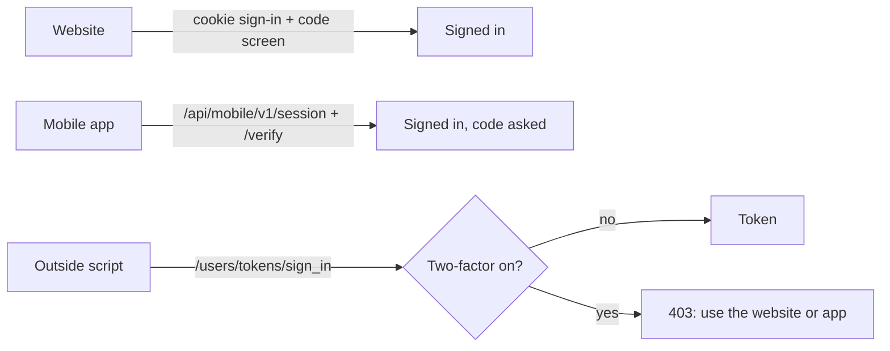
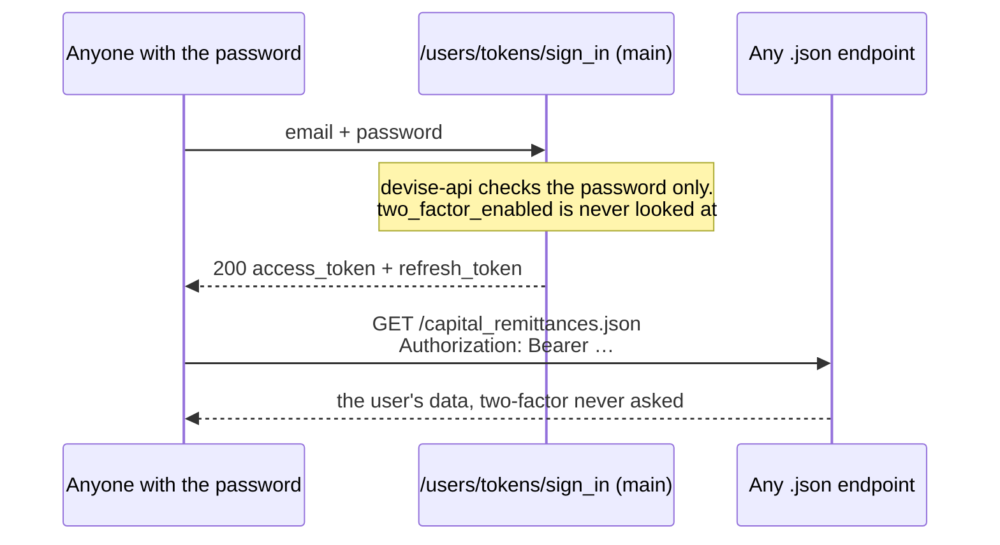
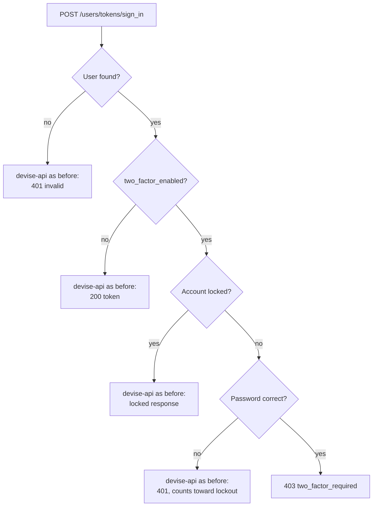
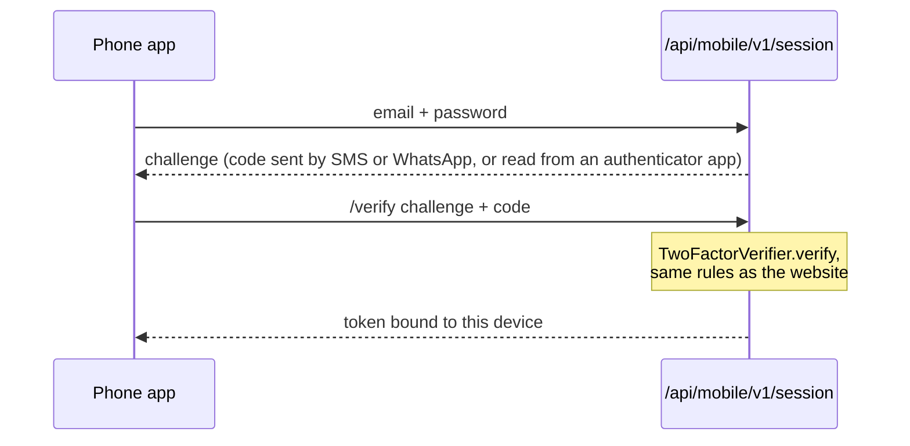
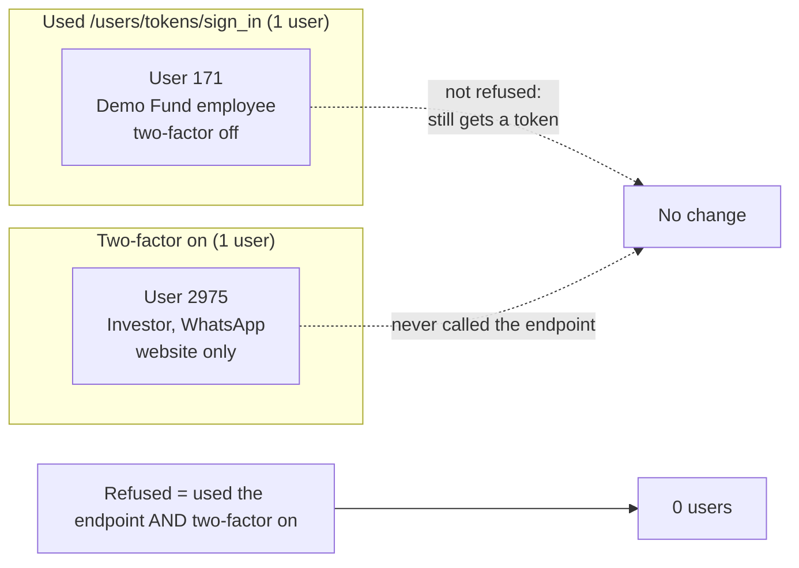

# `/users/tokens/sign_in` refuses two-factor users

**Change:** `feature/lp-mobile-app` (PR #1835), spec `openspec/changes/lp-mobile-app` (decision 3, worked examples X7, X22, X23)
**Checked against prod data:** 2026-10-17, prod copy dated 2026-10-16

## Summary

On this branch, `POST /users/tokens/sign_in` returns **403 `two_factor_required`** when a user has
two-factor login switched on **and** types the correct password. Every other case behaves exactly as
before.

This closes a gap: before the change, the token endpoint checked only the password, so a user with
two-factor on could get an API token without ever entering a code.

**No one in prod is affected.** The endpoint has been used twice, both times on one day by one user
who doesn't have two-factor on. The only two-factor user in prod has never called it.

Website sign-in for fund and LP users is unchanged.

**The mobile app is not affected either.** It never calls `/users/tokens/sign_in`. It signs in
through its own endpoint, `/api/mobile/v1/session`, which shows a two-factor user the code screen
and gives them a token once the code is checked. A user with two-factor on can use the app; they
enter their code as on the website. See [How a two-factor user gets a token now](#how-a-two-factor-user-gets-a-token-now).



## What the endpoint is

The `devise-api` gem gives the app a token login, separate from the website's cookie login:

- **Getting a token:** `POST /users/tokens/sign_in` with an email and password returns an
  `access_token` (valid 1 hour) and a `refresh_token`.
- **Using it:** any request that sends `Authorization: Bearer <token>` is treated as that user on
  **every** JSON endpoint. `WithAuthentication#authenticate_user!`
  (`app/packs/core/base/controllers/concerns/with_authentication.rb`) signs the user in from the
  token when that header is present, and never shows a two-factor screen.

Nothing in this codebase calls the endpoint. Before this branch, its only callers could be outside
scripts or integrations.

## Why it was a hole



**Example on `main`:** an investor has two-factor on, with codes sent by WhatsApp, and their
password leaks.

- **Website:** a stranger who types the password gets the code screen. The code goes to the
  investor's phone, so the stranger is stuck.
- **Token endpoint:** the same stranger posts to `/users/tokens/sign_in`, gets a token, and reads the
  investor's capital calls, documents and KYC as JSON. The code is never asked for.

Two-factor login protected the web pages only.

## What the change does

`Users::TokensController` (`app/packs/core/users/controllers/users/tokens_controller.rb`) replaces
devise-api's own controller, through `tokens: 'users/tokens'` in `config/routes.rb`.



**Why the refusal comes only after the password is checked:** a wrong password gets the same 401 as
before. So the endpoint never tells a password-guesser whether an account has two-factor on, and
failed attempts still count toward the account lockout.

The refusal body:

```json
{ "error": "two_factor_required",
  "error_description": ["Two-factor authentication is on for this account. Sign in with the CapHive website or app, which asks for your code."] }
```

### Examples

| # | Who | Request | `main` | This branch |
|---|---|---|---|---|
| 1 | User with two-factor **off** | correct password | 200 + token | **200 + token (same)** |
| 2 | User with two-factor **on** | correct password | 200 + token | **403 `two_factor_required`** |
| 3 | User with two-factor on | wrong password | 401 | 401 (same; counts toward lockout) |
| 4 | User with two-factor on, account locked | any password | locked response | same |
| 5 | User with two-factor on | `/users/tokens/refresh` with a token issued before deploy | 200, new token | **403 `two_factor_required`** |
| 6 | Any user | `/users/tokens/refresh` with a **mobile app's** token | 200 | **403 `use_mobile_refresh`** |

**Case 5, tokens that already exist:** they are not revoked.

- **Access token:** keeps working until it expires (1 hour).
- **Refresh token:** the next refresh is refused.

So an integration signing in as a two-factor user would keep working for up to about an hour after
deploy, then fail on its first refresh.

**Case 6:** the mobile app refreshes its own tokens through `/api/mobile/v1/session/refresh`, which
keeps the token tied to the phone. A refresh through the website's endpoint would leave the phone
holding a revoked token.

### How a two-factor user gets a token now

Only through the mobile app's sign-in, which asks for the code (checked by `TwoFactorVerifier`, under
the same rules as the website) and ties the token to one phone:



## Prod data check

These queries were run read-only against the prod copy (`mysql-restored`, port 33066,
`IRM_development`), whose newest user was created on 2026-10-16. The copy has 3,488 users, of
whom 258 signed in during the last 90 days.

### 1. Every token ever issued by the endpoint

| token | user | created | expiry | refreshed? | revoked? |
|---|---|---|---|---|---|
| 1 | 171 | 2026-06-25 15:52:36 | 1 hour | no | no |
| 2 | 171 | 2026-06-25 15:52:47 | 1 hour | no | no |

There are only two. They were issued 11 seconds apart to the same user and never refreshed, which
looks like someone trying the endpoint by hand, not a running integration. Both expired long ago.

### 2. Who that user is

| user | entity | role | two-factor | last web sign-in |
|---|---|---|---|---|
| 171 | Demo Fund (Angel Fund, id 69) | employee | **off** | 2026-10-16 |

Two-factor is off, so this user still gets a token exactly as on `main` (case 1).

### 3. Who has two-factor on

| user | entity | role | method | used the token endpoint? |
|---|---|---|---|---|
| 2975 | investor entity id 7300 | investor | WhatsApp | **never** |

This is the only user with two-factor on. They sign in on the website (last on 2026-08-11), where the
code is asked for. Before this change, anyone with their password could have skipped the WhatsApp
code through the token endpoint.

### How the two groups overlap



### Queries

```sql
-- Every token, who it belongs to, and whether it was refreshed
SELECT t.id, t.resource_owner_id AS user_id, t.created_at, t.expires_in, t.revoked_at,
       (t.previous_refresh_token IS NOT NULL) AS was_refreshed
FROM devise_api_tokens t;

-- Token users and two-factor users, side by side
SELECT u.id, u.entity_id, e.entity_type, u.curr_role,
       u.two_factor_enabled, u.two_factor_mode, u.current_sign_in_at
FROM users u LEFT JOIN entities e ON e.id = u.entity_id
WHERE u.id IN (SELECT resource_owner_id FROM devise_api_tokens)
   OR u.two_factor_enabled = 1;
```

## Conclusion

- **Nothing breaks on deploy.** No existing token belongs to a two-factor user, no refresh is in
  progress, and nothing has called the endpoint since 2026-06-25.
- **Worth keeping anyway.** Two-factor use is tiny today (one investor), but the mobile app
  encourages it. Each new two-factor user would otherwise be able to skip the code through this
  endpoint.
- **If an integration ever needs a token:** give it a dedicated service user with two-factor off.
  Don't turn two-factor off on a real person's account.

## FAQ

**Q: Does this change how fund or LP users sign in on the website?**
No. The website uses Devise's cookie sign-in (`Users::SessionsController`) and the two-factor screens
in `Users::TwoFactorController`, and neither changes on this branch. The two-factor rules moved into
`TwoFactorVerifier` so the website and the mobile app share them, but what the rules decide is
unchanged.

**Q: Can an LP with two-factor on use the mobile app?**
Yes. The app signs in through `/api/mobile/v1/session` (`MobileSignIn`), not the token endpoint. For
a two-factor user that endpoint returns a challenge instead of a token, so the app shows the code
screen. WhatsApp and SMS codes are sent, and authenticator codes are typed in. `/session/verify` then
checks the code with `TwoFactorVerifier`, the same rules as the website, and returns the token. This
is covered by `features/mobile/mobile_sign_in.feature` ("Sign in with an authenticator code", "A
wrong code then the right one", "Resending a text message code respects the cooldown").

**Q: Why not ask for the code on `/users/tokens/sign_in` instead of refusing?**
A code needs a challenge that survives between two requests (send the code, then check it). The
website keeps that in its session and the mobile app keeps it in a signed challenge token. The
devise-api endpoint has neither. Since nothing uses it with a two-factor account, refusing is simpler
and safer than building a third two-factor flow.

**Q: What happens to a two-factor user's token issued before the deploy?**
It isn't revoked. It works until it expires (1 hour), and then its refresh is refused with
`two_factor_required` (case 5). The prod check found no such tokens.

**Q: Could the 403 tell an attacker that an account has two-factor on?**
Only someone who already has the correct password ever sees it. A wrong password gets devise-api's
normal 401, and a locked account gets the normal locked response, so a password-guesser learns
nothing new.

**Q: Has the other region been checked?**
No. The prod copy is one region's database, and the data doesn't say which. Running the two queries
above against the other region's copy answers it.
