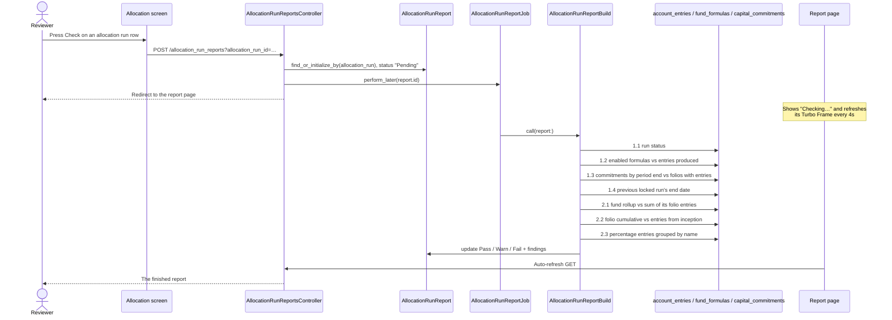

# Allocation Run Checker — technical

Business requirements: [docs/business_requirements/allocation_run_checker.md](../business_requirements/allocation_run_checker.md).

Sections 1 (did the run happen correctly) and 2 (do the numbers add up) are built.
Section 3 (do the numbers look reasonable) and the AI investigator are not.

## Pieces

| Piece | File |
|---|---|
| Report record | `app/packs/funds/funds/models/allocation_run_report.rb` |
| The checks | `app/packs/funds/funds/services/allocation_run_report_build.rb` |
| Background job | `app/packs/funds/funds/jobs/allocation_run_report_job.rb` |
| Controller | `app/packs/funds/funds/controllers/allocation_run_reports_controller.rb` |
| Policy | `app/packs/funds/funds/policies/allocation_run_report_policy.rb` |
| Report page | `app/packs/funds/funds/views/allocation_run_reports/` |
| Drill-down links | `app/packs/funds/funds/helpers/allocation_run_reports_helper.rb` |
| Entry point | the check button and status badge on `views/funds/allocate_form.html.erb` |
| Backfill | `lib/tasks/allocation_run_checker.rake` |
| Feature | `features/fund/allocation_run_checker.feature` |

One report per run (`allocation_run_reports` has a unique index on `allocation_run_id`).
Re-checking overwrites it, so the badge on the allocation screen is never stale.

Findings live in `json_fields`, not their own table: they are only ever read back as a whole
report, never queried across runs, and a run with thousands of outlier folios must not put
thousands of rows into a table nobody indexes. Each finding is capped at
`AllocationRunReport::MAX_ROWS_PER_FINDING` affected rows plus a count of the rest.

Rows are stored as a `columns` list plus `rows` of value arrays rather than as hashes,
because MySQL's `JSON` type reorders an object's keys — a report written as hashes would come
back with its columns shuffled, and shuffled differently from SQLite in the test environment.

The **Account Entries** button at the top of the report filters by `allocation_run_id` plus the
period end — the same filter the allocation screen's own per-row link uses, so both lead to the
same list. Entries from a run made before `ENTRY_TAGGING_STARTED_ON` carry no run id, so for
those the link comes back empty; that is also why the allocation screen only offers its link for
runs after that date.

The per-row drill-downs below are deliberately *not* filtered by run id. 2.2 in particular
reconciles folio cumulative rows, which `CumulateAccountEntries` inserts without one, and 2.2's
window runs from inception rather than within the run at all.

A finding also carries `filters`, one entry per row, each a list of `[field, predicate, value]`
triples for `ransack_query_params_multiple`. The report turns them into a link to the account
entries screen so a reviewer can go straight from "Setup Fee is out by 599" to the entries
behind it. The operation builds them, not the view, because only it knows each check's window:
2.1 spans the run's period, 2.2 runs from inception to the period end, 2.3 is the period end
alone, and 1.3 is one folio up to the period end. Dates go out in the database's own format so
a link does not depend on the reader's locale.

The report page has no stylesheet of its own — it is built from the theme's cards, alerts,
tables and badges, with the stat cards copying the shape used by the capital call reconciliation
panel.

## Flow



The worst finding decides the report: any `fail` makes it Fail, otherwise any `warn` makes it
Warn. `skipped` never changes the result. The report never touches the run — locking stays a
human decision, and the feature asserts that no account entry changes during a check.

## What each check actually compares

Every check deliberately reproduces the engine's own query rather than a tidier version of it.
The point is to detect drift between what the engine computed at run time and what is in the
ledger now, so a "cleaner" query would quietly stop matching.

| # | Compares | Notes |
|---|---|---|
| 1.1 | `allocation_runs.status == "Success"` | `RunFormulas` sets it only after every formula finished; any other value is the error that stopped it, and blank means it never got that far. |
| 1.2 | `FundFormula.enabled` for the run's `rule_for`/`tag_list` vs `distinct` `fund_formula_id` on the run's entries | Same scope as `RunFormulas#get_formulas`. |
| 1.3 | Commitments dated on or before the period end vs `distinct` `capital_commitment_id` on the run's entries | Same scope as `RunFormulas#get_commitments`, including the `sample_commitment_ids_for_allocation` fund custom field. |
| 1.4 | The run's `start_date` vs the previous locked run's `end_date + 1` | Also warns on an overlap with a locked run. |
| 2.1 | Each fund rollup vs the sum of the fund's non-cumulative entries for that name and entry type over the period | Mirrors `RollupAsFundAccountEntry#generate_fund_rollup`. The **folio side** is **not** scoped to this run's `allocation_run_id` (the rollup sums whatever is in the window, whoever put it there) and does **not** exclude fund-level rows (portfolio-investment entries carry no commitment and are part of that sum). The **rollup side** is restricted to `parent_id: nil` — see below. |
| 2.2 | Each folio cumulative vs the sum of that folio's non-cumulative entries **from inception** to the period end | Mirrors `CommitmentAccountEntry#rollup_account_entries`, which is a from-inception sum, not "last period plus this period's movement". The **cumulative side** is restricted to `parent_id: nil`; the **sum side** is not filtered at all beyond name/type/date, and in particular has no `generated` filter — the engine sums imported entries in too. |
| 2.3 | Entries with `entry_type` `"Percentage"` at the period end, grouped by name, vs 100 | An all-zero group is how `ComputeCustomPercentage` records a base field that summed to zero, so it is not a failure. |

### `parent_id: nil` is what makes 2.1 and 2.2 correct

A run writes several kinds of cumulative entry, and only one kind is the rollup these checks
reconcile. `RollupAsFundAccountEntry` and `CommitmentAccountEntry#rollup_account_entries` both
create their rows with no parent; everything else that writes a cumulative sets one:

- `GeneratePortfolioNumbersForFund` writes one row per portfolio company with no commitment,
  `cumulative: true`, `generated: true`, this run's id and this reporting date — the exact
  shape 2.1 looks for. Grouped by `(name, entry_type)` they would be added together and
  compared against folio entries that do not exist.
- `AllocateForPortfolioCompany` (`for_folios: false`) does the same whenever the formula's
  `meta_data_hash["cumulative"]` is `"true"`.
- `AllocateForPortfolioCompany-Folio` writes one row per portfolio company **per commitment**,
  all sharing a name and reporting date. Grouped by `capital_commitment_id`, 2.2 would add N
  portfolio companies together and compare the total against one folio's entries.

Each of those would fail a completely healthy run. Only the rollup steps write a cumulative
with no parent, so `parent_id: nil` is the discriminator — on the cumulative side only, since
the engine's own sums do include parented non-cumulative rows.

### Two things worth knowing

**2.2 is stronger than "previous cumulative plus this period's movement."** Because the engine
computes a cumulative from inception, checking it from inception is the same test where nothing
changed and a stronger one where something did — it also catches an entry back-dated into an
already-locked period, which the period-to-period form would miss.

**A run still at `Pending` is not reported as a failure.** `RunFormulas` sets `"Pending"` when
it starts and `"Success"` when it ends, so a run being checked mid-flight looks identical to one
whose worker died. Check 1.1 warns rather than fails, and every check below it is skipped —
reconciling a half-written ledger would bury the reviewer in failures that say nothing about the
run. `ctx[:ledger_complete]` carries this.

**2.2 cannot be scoped by `allocation_run_id`.** `CumulateAccountEntries` inserts folio
cumulative rows without one (only `BulkInsertData#generate_cumulative_ae` sets it), so these
rows are found by fund and period end, the way the engine itself looks them up.

## Where the badge lives, and why it is not its own column

The badge sits inside the **Status** cell rather than in a column of its own. That table's
DataTable is responsive by default (`data-controller="datatable"` on `allocate_form.html.erb`
with no `responsive` value, so `DatatableController#responsive` returns true), and DataTables
Responsive drops columns from the right when they do not fit. A thirteenth column pushes the
actions cell — Lock, Unlock, Rerun, Save as template, Account Entries, View Report and Check —
off screen, which is both a broken screen and a Cucumber failure that reads as "Unable to find
visible button".

Worth knowing: the table is one column away from hiding its own action buttons again. If a
column does have to be added, give the actions `<th>` the DataTables Responsive class `all` so
it is never the one dropped.

## Checking a run after the fact

Nothing is captured at run time. Every check recomputes from `account_entries`, `fund_formulas`,
`capital_commitments` and `allocation_runs` as they stand *now*, which is why a run can be
checked days or years after it finished, and re-checked as often as you like. It is also the
point: check 2.1 and check 2.2 are near-tautologies at the moment a run ends, and only become
interesting once the ledger has had time to drift underneath them.

Besides the Check button:

```
bundle exec rake allocation:check[RUN_ID]
bundle exec rake allocation:check_fund[FUND_ID]  FROM=2025-04-01 TO=2025-12-31
bundle exec rake allocation:check_entity[ENTITY_ID]  ONLY_UNCHECKED=true
```

`NOW=true` runs the checks in-process instead of queueing them; `DRY_RUN=true` lists what would
be checked. Reports are attributed to the entity's first company admin.

### What an old run can and cannot be checked for

Two of the columns the checks read did not always exist, so a run older than they are would be
judged on evidence that was never recorded. `setup` works this out from `created_at` and the
affected checks skip with an explanation instead of reporting a false failure.

| | Reads | Works for a run made before… |
|---|---|---|
| 1.1 | `allocation_runs.status` | 2024-07-28 (`20240728065555`): **no** — a NULL status then means the column did not exist, not that the run failed |
| 1.2, 1.3, 2.1 | `account_entries.allocation_run_id` | 2025-03-29 (`20250329041725`): **no** — untagged entries would read as every formula silent and every folio missed |
| 1.4 | `allocation_runs` only | any age |
| 2.2, 2.3 | the ledger by fund + period end | any age |

`AllocationRunReportBuild::STATUS_RECORDED_FROM` and `ENTRY_TAGGING_STARTED_ON` hold the two
dates. The allocation screen already draws the same 2025-03-29 line for its "Account Entries"
link (`allocate_form.html.erb:295`).

So an old run is safe to check, it just answers less — and what it still answers is the part
worth having. 2.2 reconciles each folio's cumulative against the entries beneath it from
inception, which is exactly the check that finds an entry back-dated into a period that was
closed years ago. A report where every check was skipped comes back as "Nothing to check"
rather than a green Pass (`AllocationRunReport#nothing_checked?`).

## Memory and query cost

`account_entries` is one of the largest tables in production, so:

- every check is an aggregate (`group(...).sum`) — no check loads entry rows into Ruby;
- 2.2 runs one grouped query per `(name, entry_type)` pair rather than one global group, so the
  result set is bounded by folio count instead of folios × names;
- 1.2 and 1.3 dedup in SQL (`distinct.pluck`), never in Ruby;
- findings are capped per check before they reach `json_fields`.

That is also why the checks run in a background job rather than in the request: a fund with a
long history takes long enough that a synchronous check would tie up a web worker.

## Not implemented, deliberately

- **Section 3** (movement tolerances, pro-rata share, negative-value and valuation-date checks).
  Every one of them needs per-fund configuration — which entry names mean NAV, fee, carry or
  units — that the system does not have.
- **The AI investigator, the runbook and the follow-up questions.** They only make sense once
  section 3 exists: sections 1 and 2 say exactly what is wrong, so there is nothing to explain.
- **A "was this a sample run?" check.** The engine's `sample` flag (which caps it at three
  folios) is not persisted on `allocation_runs`, so it cannot be told apart afterwards from a
  run that genuinely missed every other folio. Check 1.3 warns either way. Adding a `sample`
  column to `allocation_runs` would make this a real check.
- **Emailing the report.** The report is a page; nothing is sent.
