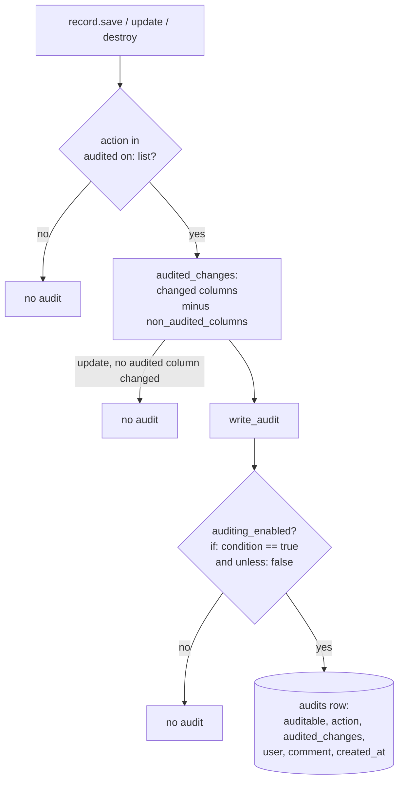
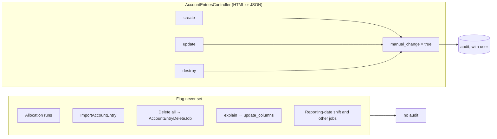
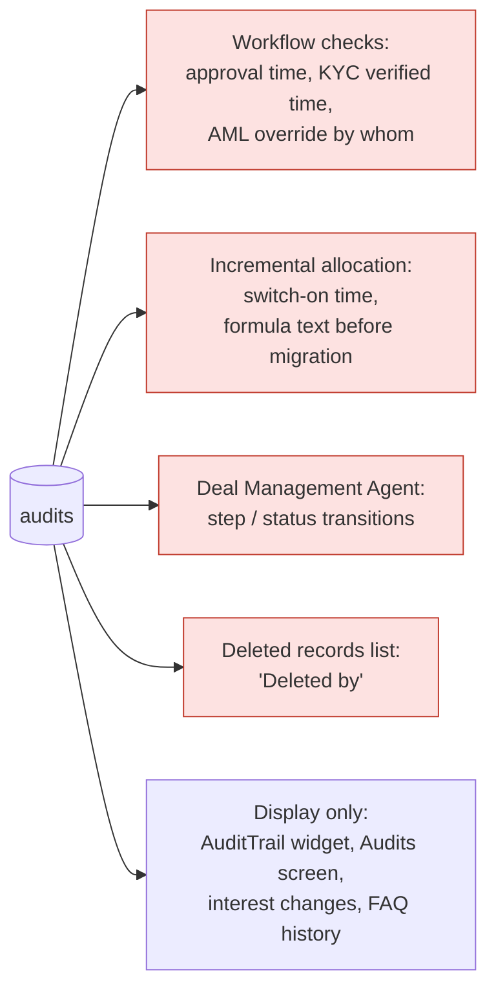
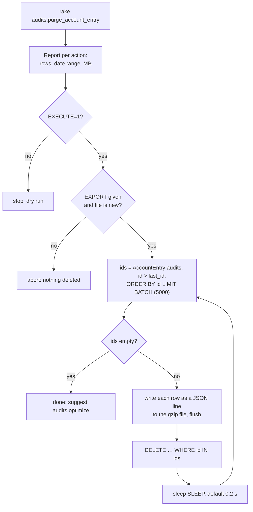

# The Audit Trail (`audits` table)

## Contents

1. Purpose
2. How an audit row is written
3. What is audited, and what deliberately is not
4. Audits the app reads back as data
5. Size and growth
6. Housekeeping tasks (`lib/tasks/audits.rake`)
7. Retention and archiving: how to think about it
8. Edge cases
9. FAQ

---

## 1. Purpose

The audit trail exists **for compliance and audit of the fund**. It answers questions like "who
changed this commitment, when, and from what to what". Its users are fund auditors, regulators,
and anyone resolving a dispute. People also see it in the app's audit-trail widget, but that's a
secondary use.

That purpose drives three rules:

- **Changes people make must be complete.** A change a person makes that leaves no audit is a gap
  in the evidence.
- **System-computed results are not audited row by row.** For a computed figure, the evidence is
  its inputs and method: the allocation run, the `FundFormula`s and the valuations. Those are
  audited themselves. Per-row audits of recompute output only bury the changes people made.
- **Records are kept for 7–10 years** (section 7). Nothing is deleted without a copy.

---

## 2. How an audit row is written

Every audited model includes `Trackable` (`app/packs/core/users/models/concerns/trackable.rb`).
It gives the model three things:

| What | From | Effect |
|---|---|---|
| Soft delete | `acts_as_paranoid` | `destroy` sets `deleted_at` |
| Versioning | `audited(...)` (gem `audited` 5.8) | create/update/destroy write a row to `audits` |
| Trail of child records | `has_associated_audits` | audits whose `associated` is this record |



### `Trackable` options

```ruby
Trackable.new(on: %i[create update destroy], audit_fields: nil, audit_except: nil, audit_if: nil, associated_with: nil)
```

| Option | Passed to `audited` as | Use it when | Example |
|---|---|---|---|
| `on:` | `on:` | Only some actions matter | `User` audits create and update |
| `audit_fields:` | `only:` | Only a few columns matter | `User`: name, email, phone, permissions, 2FA mode |
| `audit_except:` | `except:` | Most columns matter, but some are recomputed | `PortfolioInvestment` (section 3.2) |
| `audit_if:` | `if:` | Only some *sources* of change matter | `AccountEntry` (section 3.1) |
| `associated_with:` | `associated_with:` | The parent's trail should show this record's changes | `Document` → `owner` |

A model that passes none of the new options gets exactly the settings it had before.

**How the two filtering options behave:**
- **`except:`** An update that touches *only* excluded columns writes nothing
  (`auditor.rb#audit_update`). An update that also touches an audited column writes an audit
  containing just the audited columns.
- **`if:`** The gem checks it with `send(condition) == true` (`auditor.rb#run_conditional_check`).
  `nil`, `false` and `"1"` all mean "don't audit".
- If a model passes both `audit_fields` and `audit_except`, `audit_fields` wins, as it does inside
  the gem.

### Who is recorded

- **In a web request,** `Audited::Sweeper` records `current_user_or_support_user`
  (`config/initializers/audited.rb`).
- **In a background job,** `ApplicationJob` (`app/packs/core/base/jobs/application_job.rb`) captures
  the user who enqueued the job and replays it with `Audit.as_user`.

So **a user on an audit does not mean a person made the change by hand.** A recompute that a
person triggered carries that person's name.

---

## 3. What is audited, and what deliberately is not

### 3.1 AccountEntry: only changes made by hand

```ruby
# account_entry.rb
include Trackable.new(on: %i[create update destroy], audit_if: :manual_change)
attr_accessor :manual_change
```

`AccountEntriesController#create`, `#update` and `#destroy` set `manual_change = true`. Nothing else
does.



**Why the screen and not "has a user":** jobs carry the triggering user (section 2), so a bulk job
that moves `reporting_date` and `period` on hundreds of entries looked exactly like a hand edit.
Where the change came from is the only reliable signal.

**How the flag behaves:**
- It's a plain Ruby attribute that is never saved. Only the instance the controller holds has it,
  so a job or callback that loads the same entry again gets `nil`.
- A hand delete is audited and still only soft-deleted, because paranoia's `destroy` runs
  `before_destroy`, where `audit_destroy` lives.
- Only entries that weren't generated can be edited at all: `AccountEntryPolicy#update?` refuses
  `generated` entries. A hand edit therefore only happens on hand-made or uploaded entries. Any user
  allowed by the policy can delete either kind.
- Imports aren't audited row by row. Each imported entry carries `import_upload_id`, and the upload
  records who imported what and when.

| # | What happens | Audit? |
|---|---|---|
| A1 | User edits entry 42's notes on the edit screen | update audit (user, `notes`) |
| A2 | User adds an entry on the screen | create audit (every column) |
| A3 | User deletes entry 42 with the row's delete button | destroy audit; "Deleted by" shows the person |
| A4 | Allocation run creates or replaces 50,000 entries | none |
| A5 | A job shifts `reporting_date` on 300 entries | none |
| A6 | Import of 10,000 entries | none (`import_upload_id`) |
| A7 | "Delete all" on a filtered list | none (runs as a job) |
| A8 | JSON API `PATCH /account_entries/42.json` | update audit (same controller) |

### 3.2 PortfolioInvestment: computed values are not audited

```ruby
AUDIT_EXCLUDED_COMPUTED_COLUMNS = %w[
  fmv_cents instrument_currency_fmv_cents entity_currency_fmv_cents tracking_fmv_cents
  net_quantity net_amount_cents quantity_as_of_date
  cost_of_remaining_cents instrument_currency_cost_of_remaining_cents
  unrealized_gain_cents instrument_currency_unrealized_gain_cents gain_cents
  unrealized_price_effect_cents realized_price_effect_cents valuation_id
].freeze
include Trackable.new(audit_except: AUDIT_EXCLUDED_COMPUTED_COLUMNS)
```

**Why these columns:** they're outputs of `PortfolioComputations`. `compute_fmv` multiplies the
resolved price by the net quantity, and the cost, gain and quantity figures come from buys, sales
and attributions. `valuation_id` is whichever valuation the `PriceResolver` picked. The decision
that moves them, a new or changed valuation, is audited on `Valuation`.

**Measured on the prod dump:** 92,365 of 95,170 PI update audits in 2025, and 39,129 of 39,397 in
2026, changed only these columns. That's about 50–120 MB of disk a year, 7–12% of the table's
yearly growth.

| # | What happens | Audit? |
|---|---|---|
| P1 | A valuation triggers a recompute of 40 investments | none (the valuation has its own) |
| P2 | User changes `notes` | update audit with `notes` |
| P3 | User changes `quantity`; the save also moves `fmv_cents` … | update audit with **only** `quantity` |
| P4 | Investment deleted | destroy audit, full row |

P3 is the trade-off: the knock-on FMV isn't in the audit. It can be recomputed from the inputs.

### 3.3 Every other `Trackable` model

They audit create, update and destroy of all columns, or their `audit_fields`, as before.

---

## 4. Audits the app reads back as data

Some code takes a fact from `audits` because no column holds it. Deleting or archiving those
audits changes what the app *decides*, not just what it shows. Archiving (section 7) has to leave
these alone, or first move the fact into a proper column.



| Reader | Where | Reads | If the audit is missing |
|---|---|---|---|
| Capital call **Approve** | `capital_calls/workflow_checks/capital_call/approve_call.rb` | latest audit setting `approved` to true (last 20 updates) | the journey step is dated at its first evaluation, not the approval |
| Distribution **Approve** | `capital_distributions/workflow_checks/capital_distribution/approve_distribution.rb` | same | same |
| KYC **Verify** | `investor_kycs/workflow_checks/investor_kyc/support.rb#verified_at` | latest audit setting `submission_status` to `verified` | same |
| KYC **Clear AML match** | `investor_kycs/workflow_checks/investor_kyc/clear_aml_match.rb` | user on the audit that set `aml_manual_override` | the "overridden by" name is blank |
| Incremental allocation steps | `funds/services/incremental_allocation_steps.rb#audited_switch_at` | latest `FundFormula` audit with the migration comment | "switched on outside this page" |
| Incremental migration undo | `account_entry_allocation/incremental_migration.rb#migration_audits` | `FundFormula` audits with the migration, describe and rollback comments | **switching off does not restore the formulas**. The audit is the only copy of the old text. **Never purge these.** |
| Deal Management Agent | `support_agents/services/deal_management_agent.rb` | `DealInvestor` audits for `status` / `deal_activity_id` in the report window | transitions under-counted (the window is days long) |
| Deleted records list | `ApplicationController#deletion_users_for` | `destroy` audit of each soft-deleted row | "Deleted by" shows "System" |

**Worked example.** Call #812 is approved on 4 Mar 2026 at 10:12, which writes the audit
`{"approved" => [false, true]}`. The journey is first evaluated on 9 Mar, and the step shows
"Approved · 4 Mar 2026". `WorkflowEvaluator` stamps a step's `passed_at` only once, so a step that
has already passed keeps its date even if the audit later goes. Only records evaluated for the
first time after a purge are affected.

**Display only:**
- the `AuditTrail` component, shown on any show page with `?audit_trail=1`, and embedded in KYC,
  NAV and deal-investor pages
- the Audits screen with its Field History pivot
- secondary-interest changes
- FAQ entry history
- `AuditDownloadJob`

The Report Builder deliberately excludes audit associations
(`report_builder_model_discovery.rb`).

**Direction:** if the trail is purely for compliance, these facts belong in proper columns, so
that nothing in the app depends on the trail.

---

## 5. Size and growth

Prod dump, data to 2026-10-16:

| | Rows | Size |
|---|---|---|
| `audits` | 1,650,627 | 1.68 GB data + 0.40 GB indexes |
| …of which `AccountEntry` | 500,472 | 329 MB of `audited_changes` (308,802 creates and 181,306 destroys from 9–25 May 2024; 10,364 updates) |
| …of which `PortfolioInvestment` updates | 137,541 | 68 MB |
| `account_entries`, for comparison | 6.8M | 18.1 GB + 3.9 GB |

Rows written per year are flat: about 460k in 2024 (excluding the AccountEntry burst), 750k in
2025, and about 650k annualised in 2026, which is roughly 0.5 GB a year. The largest ongoing
sources are real user activity: `Document`, `CapitalRemittance`, `AccessRight` and
`CapitalDistributionPayment`. **Size is not a pressing problem.** Ten years at this rate is about
6 GB.

---

## 6. Housekeeping tasks (`lib/tasks/audits.rake`)

Run per environment on an app box. `production.in` and `production.us` are independent.

```
RAILS_ENV=production bundle exec rake audits:purge_account_entry                     # dry run
RAILS_ENV=production EXECUTE=1 EXPORT=/tmp/ae_audits.jsonl.gz bundle exec rake audits:purge_account_entry
RAILS_ENV=production bundle exec rake audits:optimize                                # dry run: size
RAILS_ENV=production EXECUTE=1 bundle exec rake audits:optimize                      # off-hours
```

### `audits:purge_account_entry`



- **Only `auditable_type = 'AccountEntry'`** is selected. No other model's audits can be touched.
- **`EXPORT` is mandatory with `EXECUTE=1`, and must be a new file.** Because of the 7–10-year
  retention, the purge is an archive step: every row is in the file before it is deleted. Keep the
  file with the fund records.
- **Each batch picks up after the last id deleted.** Batches never re-scan, the task touches only
  `audits` (never `account_entries`), and the pause between batches lets the replica keep up. On
  prod that's 500,472 rows in 101 batches.
- **After an interruption,** re-run with a **new** `EXPORT` path. It carries on from whatever is
  left, and the first file holds the rows already deleted.

### `audits:optimize`

InnoDB keeps the space freed by a delete inside the table for new rows, so a purge stops the file
growing but doesn't shrink it. `OPTIMIZE TABLE audits`, which InnoDB runs as an online
`ALTER TABLE … FORCE`, rebuilds the table and returns the space to the disk. It needs free disk
about the size of the table while it runs, so run it off-hours. The task prints the size before
and after, and only runs on MySQL.

---

## 7. Retention and archiving: how to think about it

**Requirement: 7–10 years of audit trail, for the fund.**

1. **Archive, don't delete.** With a 7–10-year obligation, cold storage (immutable, retrievable)
   replaces deletion. Retention is also a *maximum*: data-protection law (India's DPDP Act, GDPR
   for EU investors) can require deleting personal data afterwards. So the policy is "keep for N,
   then delete".
2. **The clock follows the fund, not the row.** Fund retention usually counts from wind-up, so a
   2024 audit of a fund that winds up in 2034 may be owed until about 2044. A rule like "archive or
   delete where `created_at` is older than N years" is wrong for compliance.
3. **The app has no wind-up date.** `funds` has only `first_close_date` / `last_close_date`, which
   are fundraising dates. A fund-level archive would need a wound-up date set by a person, as its
   trigger.
4. **Audits carry no `fund_id`, and none will be added** (decision, 2026-10-22). A fund's trail is
   worked out when it's needed, from the fund's own records:

   | Group (share of audits since 2025) | Examples | How the fund is found |
   |---|---|---|
   | Audited row has `fund_id` (48%) | CapitalRemittance, PortfolioInvestment, PortfolioAttribution, CapitalDistributionPayment, FundFormula | directly |
   | Through `owner` | Document, AccessRight, Folder | row by row |
   | Shared across funds | User, InvestorKyc, Valuation, Kpi, Entity | no single fund; needs its own rule, e.g. keep while any fund using it is inside retention |

   This is slow and can't fully trace audits of hard-deleted records. That's acceptable for a job
   that runs once per fund, offline.
5. **For now, keep everything in MySQL.** At about 0.5 GB a year, a full 10 years fits comfortably,
   and nothing has to be built. Revisit when growth or backup/restore time calls for it.
6. **When an archive is built, it should be:**
   - S3 in each environment's own region (IN data stays in IN)
   - Object Lock in compliance mode, retained until wind-up + N
   - a checksum manifest
   - searchable on request (Athena)
   - a package per fund, which is also what you'd hand the fund's auditor
7. **Completeness matters more than size.** `update_columns`, `update_all` and `delete_all` skip
   auditing. That's fine for system bookkeeping, but it's a gap if a person triggered the change.
   Sweep for such paths before relying on the trail as evidence.

**Open decisions for compliance:**
1. N (7 or 10), for IN and US.
2. When the clock starts: creation, end of relationship, or fund wind-up.
3. Whether retention is per fund or global.
4. How quickly archived data must be produced.
5. Whether deletion at end of retention is mandatory.
6. Whether system-generated changes must be audited or only changes people make. The current
   design assumes only changes people make, with system results evidenced by their inputs.

---

## 8. Edge cases

| # | Case | Outcome |
|---|---|---|
| E1 | Code outside the controller sets `manual_change = true` | Audited. Nothing does today; the flag is the contract. |
| E2 | `manual_change` set to `"1"` | Not audited: the gem compares with `== true`. The flag isn't in `account_entry_params`. |
| E3 | A hand edit fails validation | Nothing saved, no audit. |
| E4 | A model passes both `audit_fields` and `audit_except` | `only` wins. |
| E5 | Purge interrupted | Re-run with a new `EXPORT`; reusing a path is refused. |
| E6 | Not enough free disk for `OPTIMIZE` | Skip it; the freed space is still reused. |
| E7 | An `AccountEntry` restore | Never audited: paranoia restores with `update_columns`. |

Covered by `features/fund/account_entry_audit.feature` (A1–A5, P1–P3, R1–R5).

---

## 9. FAQ

**Q: Why isn't an allocation run's output audited?**
An allocation run writes or replaces tens of thousands of entries. The evidence for those figures
is the run itself (`AllocationRun`), the `FundFormula`s (audited) and the inputs. A per-row audit
adds nothing an auditor would use, and it once made up 30% of the table.

**Q: I edited an entry and the audit shows my name. A job also shows my name. What's the difference?**
A job that you triggered carries your name (`ApplicationJob`), but for `AccountEntry` it writes no
audit at all. An `AccountEntry` audit therefore always means a change made on the screen.

**Q: Why does a `PortfolioInvestment` audit show my quantity change but not the new FMV?**
FMV is recomputed from the quantity and the valuation, so the audit records your input, not the
derived value (section 3.2, P3).

**Q: Can old audits just be deleted to save space?**
No. They're kept 7–10 years for the fund (section 7). The only purge, `audits:purge_account_entry`,
refuses to run without writing a copy first, and the audits in section 4 must never be purged.

**Q: The `audits` table is 2 GB. Is that a problem?**
Not at current growth: about 0.5 GB a year, smaller than `account_entries` by an order of
magnitude. Revisit archiving when growth or backup/restore time calls for it (section 7).
