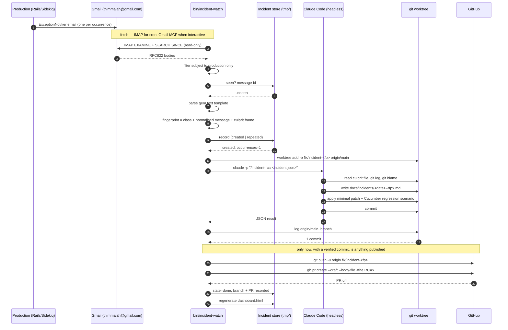

# Automated RCA from production exception emails

Production sends an `ExceptionNotifier` email. This system reads it, groups it with its
duplicates and roots out the cause. **It writes an RCA and stops — it changes no code.** You
read the RCA on the dashboard and press *Approve*; only then does it write the patch, add a
regression test and open a draft PR. Runs on a 30-minute cron.

## What the app already does

Two notifier paths are configured, and both are covered here:

| Path | Configured in | Subject looks like |
|---|---|---|
| Web requests (Rack middleware) | `config/application.rb:122` | `[Error] production:(app.caphive.com)funds#show (NoMethodError) "..."` |
| Sidekiq jobs (error handler) | `config/initializers/exception_notification.rb:22` | `[ERROR] production: (NoMethodError) "..."` |

Recipients come from the `ERROR_EMAIL` env var on the app servers. That mailbox is
**thimmaiah@gmail.com** — note this is *not* the claude.ai account email, so the Gmail
connector has to be authorized against it explicitly.

## Pipeline



The two fetch paths exist because they fail in different places:

- **IMAP** works unattended. It needs a Google app password, and it is what cron uses.
- **Gmail MCP** needs no password and is nicer to drive, but the connector is authenticated
  interactively inside Claude Code and is not reliably present in a cron or headless run.

Both hand identical input to `IncidentWatch::Parser`, so everything downstream is shared.

## Deduplication

A single production bug can send hundreds of emails a minute. Two layers stop that from
becoming hundreds of branches:

1. **Message level** — `tmp/incident_watch/seen_message_ids.json` records every Gmail message
   id already ingested. This is what lets the poll window (3 days) safely overlap the cron
   interval (30 minutes), and what makes re-running the triage skill free.
2. **Incident level** — a fingerprint of `exception_class` + normalised message + culprit
   frame. Normalising strips record ids, UUIDs, timestamps and object addresses, so
   `Couldn't find Fund with 'id'=123` and the same error for `id=456` are one incident with
   `occurrences: 2`, not two branches.

Only the transition to a *new* fingerprint dispatches an RCA. A repeat bumps the counter and
nothing else — production continuing to throw while a fix waits for review must not spawn a
second run.

## Setup

### Option A — IMAP (needed for the unattended cron)

**1. Create a Google app password** for **thimmaiah@gmail.com** at
<https://myaccount.google.com/apppasswords>. This requires 2-Step Verification to be on;
your normal account password will not work over IMAP. Google shows the password in four
groups of four — enter it **without the spaces**.

**2. Confirm IMAP is enabled** in Gmail → Settings → *Forwarding and POP/IMAP* → *Enable
IMAP*. It is off by default on some accounts, and the symptom is a login that succeeds but
a mailbox that cannot be selected.

**3. Write the credentials file.** Keep it out of the repo and readable only by you — the
poller reads it automatically, so nothing needs exporting and the password never appears in
your crontab:

```bash
mkdir -p ~/.config
printf 'INCIDENT_WATCH_IMAP_USER=thimmaiah@gmail.com\nINCIDENT_WATCH_IMAP_PASSWORD=abcdefghijklmnop\n' \
  > ~/.config/incident_watch.env
chmod 600 ~/.config/incident_watch.env
```

`config/incident_watch.env` inside the repo also works and is gitignored, but `~/.config` is
preferred. The tool warns if either file is group- or world-readable.

**4. Verify.** This proves the login, the mailbox, the sender/subject filters and the cron
prerequisites in one shot, and prints the most recent matching subjects with a verdict for
each, so you can see exactly what would and would not become an incident:

```bash
bundle exec ruby bin/incident-watch check
```

**5. Dry-run** against the real mailbox — writes nothing, dispatches nothing:

```bash
bundle exec ruby bin/incident-watch poll --dry-run
```

**6. Install the schedule.** `bin/incident-watch cron` prints the block to paste into
`crontab -e`. The installed entry runs every 30 minutes via `/bin/bash -lc`, which sources
your login profile so `mise`'s ruby and `claude` resolve — without that, polls would succeed
and silently never dispatch.

**7. First live run.** Consider starting with `--no-dispatch` in the crontab for a day so you
can see what gets recorded before any branches are created.

### Option B — Gmail MCP (interactive)

The connector is Google's remote server, `https://gmailmcp.googleapis.com/mcp/v1`
([setup guide](https://developers.google.com/workspace/gmail/api/guides/configure-mcp-server)).

It must be authorized **against thimmaiah@gmail.com** and granted
`https://www.googleapis.com/auth/gmail.readonly`. Without that scope every call returns
*"Request had insufficient authentication scopes"*; connected to the wrong account it
silently returns no alert threads, which is the more dangerous failure.

Then just run `/incident-triage` in a Claude Code session.

## Commands

```bash
bin/incident-watch serve --open          # dashboard with working buttons (Create PR, Ignore, Analyse)
bin/incident-watch publish <fp>          # push the branch and open its draft PR
bin/incident-watch ignore <fp> --reason "bad data" [--rule]   # mute an error
bin/incident-watch unignore <fp>         # un-mute it
bin/incident-watch check                 # verify credentials, filters and PATH before scheduling
bin/incident-watch dashboard --open      # regenerate the HTML dashboard and open it
bin/incident-watch logs <fp> -f          # watch an RCA run as it works
bin/incident-watch poll                  # fetch over IMAP, record, dispatch new incidents
bin/incident-watch poll --dry-run        # show what would be recorded, write nothing
bin/incident-watch poll --no-dispatch    # record only, review before running any RCA
bin/incident-watch list                  # what has been seen and its state
bin/incident-watch list --state=new      # queued but not yet analysed
bin/incident-watch show <fingerprint>    # the full incident record
bin/incident-watch dispatch <fp>         # run the RCA for one incident
bin/incident-watch dispatch --all        # run every incident still in state=new
bin/incident-watch ingest FILE|- ...     # ingest one email body (the Gmail MCP path)
bin/incident-watch selftest              # parse the bundled fixtures and assert
bin/incident-watch cron                  # print the crontab line
```

`poll` needs `bundle exec` (the `mail` gem decodes MIME). Everything else is stdlib only.
Rails is never booted, so a cron tick costs well under a second.

## The dashboard

A single self-contained HTML file, regenerated on every poll and every dispatch:

```
file:///home/thimmaiah/work/IRM/tmp/incident_watch/dashboard.html
```

It refreshes itself every 30 seconds, so leaving it open in a tab is enough. It shows:

- **Summary cards** — how many incidents are firing right now, awaiting analysis, being
  analysed, patched, or failed, plus the raw email count behind them.
- **"Firing in the last 30 minutes"** — rows seen inside that window get a red background and
  a `live` badge. This is the "is something on fire *now*" signal, and it is deliberately
  independent of state: an incident patched last week that started firing again five minutes
  ago is highlighted.
- **A progress indicator for in-flight RCA runs** — a `dispatched` incident shows an
  `analysing` pill and a bar tracking elapsed time against `dispatch.timeout_seconds`, with
  the minutes spelled out underneath. Because the page auto-refreshes, the bar advances while
  you watch, and a wedged run is obvious (bar near 100%) rather than just looking slow.
- **Branch / PR** — a **Review PR** button linking to the draft PR. The RCA itself is
  deliberately *not* duplicated here: it is the body of that PR, which is where you would
  read it before merging. When there is no PR (publishing failed, or it is disabled) the
  cell shows the `git show <branch>:<doc>` command instead, so the RCA is never unreachable.

There is no database and no server. The JSON store is already the source of truth and is
written atomically; at this scale a SQLite layer would add a schema and a migration path
without answering any question faster.

## Watching a run

Three logs answer three different questions:

| Log | Question it answers |
|---|---|
| `log/incident_watch.log` | What did the watcher do? Which incident, which branch, what outcome. This is cron's output. |
| `bin/incident-watch logs <fp>` | What is Claude Code actually doing, turn by turn? Works **while the run is in flight**. |
| `tmp/incident_watch/logs/<fp>.log` | Raw stdout/stderr of the `claude -p` process, teed as it ran. |

```bash
bin/incident-watch logs <fp>             # rendered transcript
bin/incident-watch logs <fp> -f          # follow until the run finishes
bin/incident-watch logs <fp> -n 40       # last 40 lines
bin/incident-watch logs <fp> --thinking  # include reasoning blocks (verbose)
bin/incident-watch logs <fp> --raw       # print the three underlying file paths
```

The transcript is Claude Code's own session file, at
`~/.claude/projects/<flattened-worktree-path>/<uuid>.jsonl`. It is namespaced by working
directory, so each incident's worktree gets its own; raw JSONL is unreadable, so the command
renders each tool call as `-> Bash <cmd>` / `-> Edit <file>` with a truncated result.

## Overlapping polls

A poll that dispatches can outlive the 30-minute cron interval: it runs up to
`max_per_poll` RCAs sequentially, each with a 30-minute budget, so a busy tick can take 90
minutes. `poll` therefore takes a non-blocking exclusive `flock` on
`tmp/incident_watch/poll.lock` for its whole lifetime, dispatch runs included. If a poll is
already running the next tick logs *"another poll is still running; skipping this tick"* and
exits 0 — skipped, not queued, and not an error. The lock is released when the process exits,
including when it is killed.

## Ignoring bad-data errors

Not every production exception is a defect. For the ones caused by bad data, two scopes:

```bash
# Mute this one incident.
bin/incident-watch ignore 6027c164 --reason "Legacy rows imported without a currency; OPS-412"

# Mute it AND every future occurrence of the same exception in the same place.
bin/incident-watch ignore 6027c164 --reason "..." --rule

bin/incident-watch ignore --list      # what is muted, and why
bin/incident-watch unignore 6027c164
```

`--rule` matters because a fingerprint changes the moment the culprit line moves — muting by
fingerprint alone means the same bad data re-opens a branch after the next refactor. Rules
match on `exception_class`, `location`, `message` and `culprit_path`; every field is a
case-insensitive regex and all the fields present must match. A rule with **no** matchers is
refused at load time rather than silently muting everything.

A reason is mandatory in both scopes. An unexplained muted incident is indistinguishable from
a bug in the matcher six months later.

Ignored incidents are still recorded and still count occurrences — you want to know bad data
is still generating errors — they are simply never analysed, and they are excluded from the
"firing in the last 30 minutes" signal.

## Two stages, with you in the middle

```
new  ──dispatch──▶  dispatched   stage 1: analysing, writes the RCA. No code touched.
                         │
                         ▼
                    analysed     ◀── STOPS HERE. Waiting for you.
                         │
                    (you approve)
                         │
                         ▼
                     patching    stage 2: writes the fix + Cucumber regression test
                         │
                         ▼
                       done      patch committed, draft PR opened
```

Plus `failed`, and `ignored` for bad data.

The two stages run different skills with different tool grants:

| Stage | Skill | May edit code? |
|---|---|---|
| 1 — analyse | `.claude/skills/incident-rca` | **No.** No `Edit` tool at all |
| 2 — patch | `.claude/skills/incident-patch` | Yes, after you approved |

Stage 1's promise is enforced, not just requested: the dispatcher checks the commit and marks
the incident `failed` if it touched anything outside `docs/incidents/`. Stage 2 requires a
*new* commit on top of the RCA one, so an approved run that produced nothing is failed rather
than published.

```bash
bin/incident-watch rca <fp>        # read it in the terminal
bin/incident-watch approve <fp>    # patch + PR
```

Or press **Read RCA** then **Approve → patch & PR** in `serve`.

## Stopping a run

Killing the dispatcher is **not** enough. Each run is spawned into its own process group so
the watchdog can take its whole tool tree down, which also means it outlives its parent:
Ctrl-C on `dispatch --all` stops the queue but leaves the in-flight Claude process running to
completion, spending tokens.

```bash
bin/incident-watch stop                       # stop whatever is running
bin/incident-watch stop <fp>
bin/incident-watch stop --all
bin/incident-watch stop <fp> --ignore "bad data"   # stop it and never retry it
```

It signals the whole process group, falls back to finding the process by command line if the
pid was not recorded, and resets the incident to `new` (not `failed` — you stopped it
deliberately). There is a **Stop** button on running rows in `serve` too.

## Incident lifecycle

`new` → `dispatched` → `analysed` → `patching` → `done`, plus `failed` and `ignored`.

`done` is not the model's word for it: the dispatcher asks git whether the branch actually
carries a commit that `origin/main` does not. A run that finished cleanly but produced no
commit is recorded as `failed`, with the reason.

## Safety properties

These are the reasons this is safe to leave on a timer:

- **Your working tree is never touched.** Every run happens in its own git worktree under
  `.claude/worktrees/incident-<fingerprint>`.
- **Your inbox is never touched.** The poller opens the mailbox with IMAP `EXAMINE`
  (read-only), so nothing is marked read or moved. Dedupe is entirely local. Set
  `mark_seen`/`apply_label` in `config/incident_watch.yml` if you would rather it flag mail.
- **The unattended Claude run cannot reach the network or the remote.** Its allowlist in
  `config/incident_watch.yml` grants exactly: read, edit, run cucumber/rubocop, and commit
  inside its own worktree. It has neither `git push` nor `gh`.
- **Publishing is done by the dispatcher, not the model, and only against evidence.** When
  `dispatch.open_pull_request` is true, the *Ruby* code pushes the branch and opens a
  **draft** PR — but only after `git log origin/main..<branch>` has confirmed a real commit
  exists. A run that produced no commit publishes nothing. Set it to false to keep every
  branch local.
- **A failed push is not a failed incident.** If the remote is unreachable or `gh` is not
  authenticated, the RCA and the branch survive on disk, the incident stays `done`, and the
  reason is recorded in `pr_error` and shown in red on the dashboard.
- **Storms are capped.** `dispatch.max_per_poll` (default 3) bounds concurrent runs; the rest
  stay `new` and go out on the next poll.
- **Timeouts are enforced.** A wedged run is killed by process group after
  `dispatch.timeout_seconds`.
- **Staging alerts are excluded** by `subject_pattern`, which matches production only.

## Reviewing the output

```bash
bin/incident-watch list
git log origin/main..fix/incident-<fp>
git diff origin/main...fix/incident-<fp>
```

The RCA lands at `docs/incidents/<date>-<fingerprint>-<slug>.md`. Read it before the diff —
it states the root cause, distinguishes trigger from cause, carries a sequence diagram of the
failure path, and lists other call sites with the same pattern that were deliberately left
alone.

When the root cause could not be established, the RCA is committed **without** a patch and is
marked `UNCONFIRMED`. That is the designed behaviour: a confident wrong patch costs more
review time than no patch.

## Files

| Path | Role |
|---|---|
| `bin/incident-watch` | CLI |
| `lib/incident_watch/parser.rb` | Parses the gem's text templates into a structured incident |
| `lib/incident_watch/store.rb` | Incident records, both dedupe layers, state machine |
| `lib/incident_watch/imap_source.rb` | Unattended Gmail fetch |
| `lib/incident_watch/dispatcher.rb` | Worktree + headless Claude run + outcome check + publish |
| `lib/incident_watch/dashboard.rb` | Renders the self-contained HTML dashboard |
| `lib/incident_watch/run_log.rb` | Renders Claude Code's transcript for a run |
| `lib/incident_watch/ignore_rules.rb` | Rules for exceptions that must never open a branch |
| `config/incident_watch_ignore.yml` | The ignore rules themselves (created on first use) |
| `lib/incident_watch/rca-cucumber` | Test wrapper staged into each run's worktree |
| `lib/incident_watch/fixtures/` | Sample emails and expectations for `selftest` |
| `config/incident_watch.yml` | Configuration |
| `~/.config/incident_watch.env` | IMAP credentials (chmod 600, outside the repo) |
| `.claude/skills/incident-rca/` | The RCA + patch instructions |
| `.claude/skills/incident-triage/` | The Gmail MCP fetch path |
| `tmp/incident_watch/` | State (gitignored) |

## Maintenance

The parser mirrors the text templates in `exception_notification 5.0.1`. If that gem is
upgraded, run `bin/incident-watch selftest` — the fixtures are copies of those templates and
will fail loudly if the format moved.
