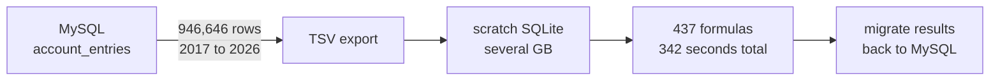
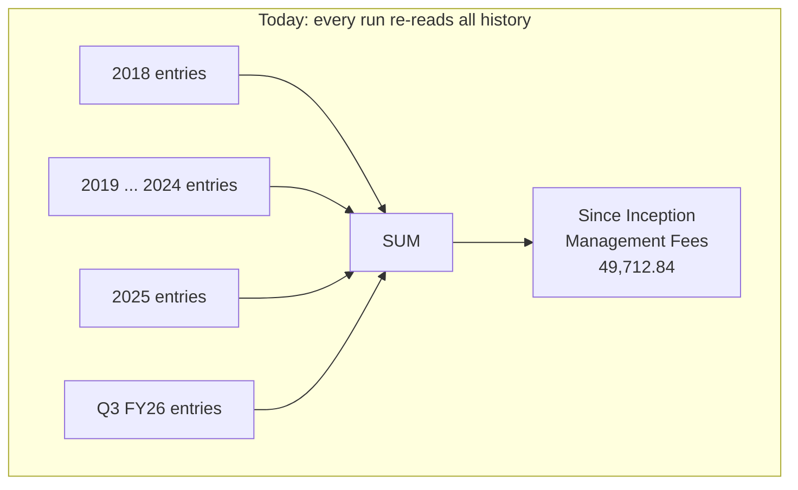
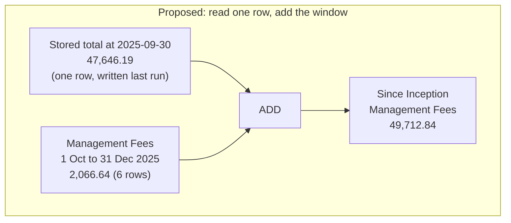
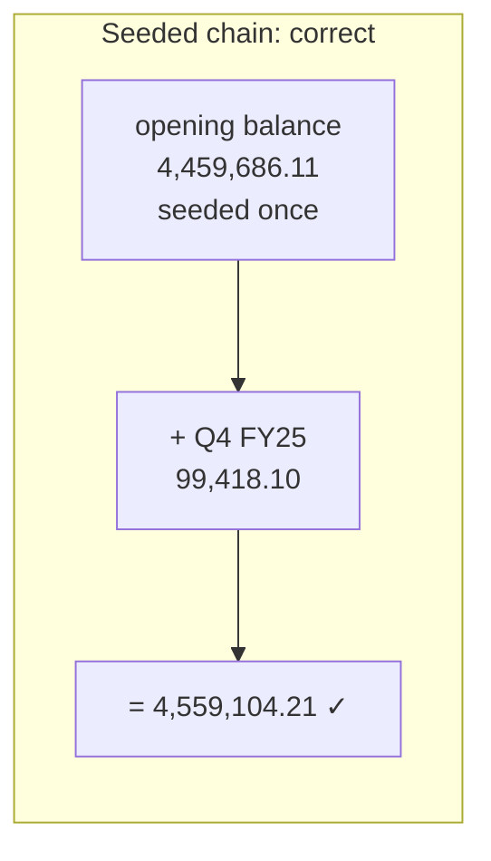
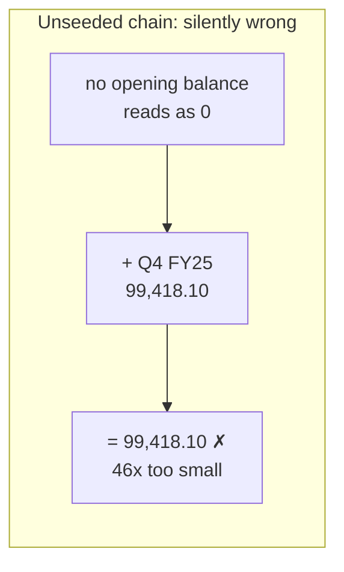

# Limiting allocation formulas to a few periods

Analysis of the 437 formulas on fund **321, Indium VI (Mauritius) Holdings Limited**
(entity 6349, master fund 319) against the allocation engine in
`app/packs/allocation_engine/account_entry_allocation/`.

All numbers below are measured from the development database loaded with real data
(MySQL on `127.0.0.1:33066`, schema `IRM_development`).

Status: **proposal.** No code or formula has been changed yet.

---

## TL;DR

**The problem.** Every allocation run copies 946,646 account entries going back to 2017 into
a scratch SQLite file, just to produce one quarter of numbers.

**The cause.** One helper method, `since_inception`, sums from the beginning of time. It is
the main thing forcing the full copy. Six other formulas do the same by hand.

**The fix.** Read last quarter's stored total and add only this quarter's movement. The
engine already does this in 45 other formulas, so we are propagating a proven pattern rather
than inventing one.

**Decisions already taken**

| Question | Decision |
| --- | --- |
| Edit 28 formulas, or change the helper once? | **Change the helper once** |
| Missing carry-forward value? | **Raise and fail the run** |

**Scope**

| Work | Count |
| --- | --- |
| Formulas needing a hand rewrite | 7 |
| Formulas fixed by the helper change alone | 27 |
| Formulas needing no change | 403 |

The 7 are the `Portfolio FMV` guard, the 5 tracking formulas, and sequence 303, which calls
the helper but also needs a hand edit.

**Expected saving:** 77% to 81% of the copy, depending on the run window.

**Three things the review turned up**

- **Runs are not quarters.** The run history shows ad-hoc windows of a few days, the same
  window re-run several times, and full regenerations from 2015. The design has to anchor on
  the previous *successful run*, not on "last quarter". See 1.3.
- **43 funds call `since_inception`**, not just this one. The helper change must be gated
  per fund. See 4.5.
- **Raise-and-fail does not cover everything.** The 45 formulas that are already
  incremental fall back to zero silently on a missing carry-forward, and two real cases of
  that were found. See 7.3.

---

## How to read this document

Every section below follows the same shape:

- **Summary** — one or two lines, what this section establishes.
- **Example** — a concrete case, with real numbers from the database wherever possible.
- **In plain terms** — bullets explaining why it matters.

---

## 1. The problem

### Summary

The allocation engine copies the fund's entire account-entry history into a scratch
database on every run, because one helper method needs it. The copy is the slow, bulky part.
The formulas themselves are fast.

### Example

Today, a run for the quarter ending 31 December 2025 does this:



Of those 946,646 rows, the quarter being reported on contributes a small fraction. The rest
is carried along so that `since_inception` can re-add numbers it already added last quarter.

### In plain terms

- The copy is driven by `script/load_sqlite3_from_mysql.sh`. Its `WHERE` clause for
  `account_entries` (lines 1037 to 1063) filters on **only** two things: `deleted_at IS NULL`
  and `fund_id IN (319, 321)`.
- **There is no date filter at all.**
- Formula execution is not the bottleneck. All 437 formulas together take 342 seconds, and
  the slowest single one takes 7.8 seconds.
- So the target is the copy, not the compute.

### 1.1 Measured scale

| Measure | Value |
| --- | --- |
| `account_entries`, whole table | 5,851,772 rows |
| `account_entries`, data + index | 19.9 GB |
| Rows copied per run (funds 319 + 321) | **946,646** |
| Of those, `generated = 1` | 935,248 (98.8%) |
| Of those, `generated = 0` | 11,398 (1.2%) |
| Distinct `reporting_date` values | 537 |
| Date range | 2017-12-31 to 2026-08-31 |

Split by fund:

| Fund | Rows | Distinct dates | Range |
| --- | --- | --- | --- |
| 319 (master) | 362,202 | 447 | 2018-09-27 to 2026-08-31 |
| 321 (feeder) | 584,444 | 532 | 2017-12-31 to 2026-08-07 |

**Two facts worth holding onto:**

- **98.8% of rows are generated.** They are recreated by the engine on every run. Only 1.2%
  are uploaded by people. This makes the retention rule in section 7 almost free.
- **Reporting dates are daily, not quarterly.** 537 distinct dates over nine years means
  entries land on transaction dates. So the retention rule has to name specific dates it
  computes from the data, never "keep the last N quarters".

### 1.2 The data is heavily skewed to recent periods

| Financial year (ends 31 March) | Rows | Share | Cumulative |
| --- | --- | --- | --- |
| FY2018 | 225 | 0.0% | 0.0% |
| FY2019 | 12,083 | 1.3% | 1.3% |
| FY2020 | 24,554 | 2.6% | 3.9% |
| FY2021 | 27,863 | 2.9% | 6.8% |
| FY2022 | 48,896 | 5.2% | 12.0% |
| FY2023 | 51,055 | 5.4% | 17.4% |
| FY2024 | 53,217 | 5.6% | 23.0% |
| FY2025 | 84,724 | 8.9% | 32.0% |
| FY2026 | 405,071 | 42.8% | 74.8% |
| FY2027 | 238,958 | 25.2% | 100.0% |

**In plain terms**

- Everything before FY2025 is only **23%** of the rows. Deleting ancient history alone is
  not the win it sounds like.
- FY2027, meaning dates after March 2026, is **25%** on its own. Those rows are in the
  *future* relative to most run windows.
- So the retention rule needs a **cap** as well as a lower bound. Cutting only the old end
  leaves most of the problem in place. See section 7.1.

### 1.3 How runs actually happen

**Summary:** the `allocation_runs` table shows this fund is not run quarter by quarter. It is
run for short ad-hoc windows, re-run repeatedly, and occasionally regenerated from inception.
Every part of the design that says "previous quarter" has to mean "previous successful run".

**Example** — the most recent runs on fund 321:

| Run id | Window | Status |
| --- | --- | --- |
| 3299, 3296, 3295 | 2026-08-01 to 2026-08-07 | Success, three times |
| 3292, 3279, 3276, 3274 | 2026-07-01 to 2026-07-31 | Success, four times |
| 3273 | 2026-07-01 to 2026-07-31 | **Error in Formula 8** |
| 3229 | 2026-07-18 to 2026-07-30 | **Error in Formula 8** |
| 3228, 3223, 3222 | 2026-07-15 to 2026-07-17 | Success |
| 3227, 3221 | 2026-07-01 to 2026-07-14 | Success |
| 3244 | **2015-01-01 to 2026-06-30** | NULL, a from-inception regeneration |
| 3237 ... 3220 | 2026-06-11 to 2026-06-30 | Success, six times |
| 3234, 3219, 3206 | 2026-06-09 to 2026-06-10 | Success |

**In plain terms**

- **Windows are arbitrary.** Two days, three days, a fortnight, a month. Nothing in the
  design may assume quarter boundaries.
- **The same window is re-run many times.** Each run deletes and regenerates the window, so
  the latest run wins. The carry-forward for a window is whatever the run that ended the day
  before wrote.
- **Nested windows happen.** July was run as three pieces and then as a whole month. The
  whole-month run's carry-forward is the June run's value, and it correctly overwrites the
  three pieces.
- **Regeneration from inception is a real workflow**, not an edge case. Run 3244 covers 2015
  to 2026. For such a run the window *is* all of history, nothing is trimmed, and there is
  legitimately no carry-forward. The raise must not fire here. See 8.3.
- **Failed runs exist.** Anchoring must use the `AllocationRun.successful` scope, which
  already exists.
- **Consequence for the anchor rule.** "The greatest `reporting_date` before the window" is
  the wrong definition of the previous run. If a window is skipped, that date lands on some
  unrelated transaction and the carry-forwards are not on it. Section 7 anchors on the run
  record instead.

---

## 2. The idea, in one picture

### Summary

Instead of re-adding every transaction since 2017, read the total the previous run already
wrote down, and add only what moved this quarter.

### Example





Same answer. Seven rows read instead of years of them.

### In plain terms

- A since-inception total has a useful property: it can be built one period at a time.
- `total(end of period N) = total(end of period N-1) + movement during period N`
- The first term is **one stored row**. The second term is **bounded to the run window**.
- Neither touches anything older than the previous period, so nothing older needs copying.

---

## 3. What the formulas actually need from history

### Summary

Only a handful of query shapes reach past the run window, and almost all of them read a
single row rather than scanning. Just **six** formulas do a genuine unbounded aggregate.

**Note:** the `Enabled` flag is ignored throughout this document. Ten formulas currently
carry `Enabled = No`, but that is temporary and they will be switched on, so all 437 are
treated as live.

### Example

Sweeping all 437 formulas for any beginless range (`<column>: ..<bound>`) and classifying
each by what terminates its query chain:

| Column | Terminator | Occurrences | Table read | Verdict |
| --- | --- | --- | --- | --- |
| `reporting_date` | `.last` | 46 | `account_entries` | single row, already the carry-forward idiom |
| `payment_date` | `.sum` | 17 | remittance and distribution payments | true aggregate, small table |
| `as_of` | `.last` | 6 | `exchange_rates` | single row, tiny table |
| `reporting_date` | `.sum` | 5 | `account_entries` | **true full-history aggregate, must be rewritten** |

Plus one more shape that uses keyword arguments rather than a range literal:

| Shape | Occurrences | Open-ended |
| --- | --- | --- |
| `total_amount(..., start_date:, end_date:)` | 65 | no |
| `total_amount(..., end_date:)` with no `start_date` | 1 | **yes**, sequence 303 |

### In plain terms

- **The 46 `.last` cases are not scans.** They end in `.order(:reporting_date).last`, which
  is one indexed row. They need that row to survive the trim, nothing more.
- **The 17 `payment_date` sums are real but harmless.** They read remittance and
  distribution payments from inception, in formulas like `Drawdown Net` (sequence 334). Those
  tables are tiny:

  | Table | Rows, whole database | Versus this fund's account entries |
  | --- | --- | --- |
  | `capital_remittance_payments` | 38,879 | 4.1% |
  | `capital_distribution_payments` | 28,325 | 3.0% |
  | `exchange_rates` | 7,016 | 0.7% |
  | `account_entries` (funds 319 + 321) | 946,646 | — |

  All three together are under 8% of one fund's account entries, and they are already copied
  whole. **The retention rule in section 7 applies to `account_entries` only.**
- **The 6 genuine aggregates are the whole problem.** Five are the "feeder investment
  tracking" family (section 6) and one is sequence 303 (section 4.6).

### 3.1 Breakdown by category

| # | Category | Formulas | Action | Section |
| --- | --- | --- | --- | --- |
| 1 | `since_inception(...)` direct callers | 28 | **Fixed by the helper change** | 4 |
| 2 | `Portfolio FMV` latest-date guard | 1 | **Rewrite** | 5 |
| 3 | "feeder investment tracking" open-ended sums | 5 | **Rewrite** | 6 |
| 4 | Already incremental (window + prior cumulative) | 45 | No change, retention only | 4.1 |
| 5 | As-of lookups (`get_account_entry_or_zero`) | 53 | No change, retention only | 7.2 |
| 6 | `@since_inception_x` variable references | 14 | No change | — |
| 7 | Open-ended `payment_date` sums | 17 | No change, small tables | 3 |
| 8 | Window-only | 296 | No change | — |

Categories overlap slightly, because one formula can use several shapes.

Five of the ten currently-disabled formulas need nothing at all:

| Sequence | Name | Why no change |
| --- | --- | --- |
| 193 | Drawdown Net tracking | open-ended `payment_date` sum, small table |
| 198 | Distribution as on date tracking | open-ended `payment_date` sum, small table |
| 200 | Net Current Assets before profit distribution to GP tracking | pure arithmetic over other results |
| 201 | ... converted to USD | as-of lookup on `exchange_rates` |
| 202 | Forex gain loss | as-of lookup inside the window |

---

## 4. The 28 `since_inception` callers

### Summary

`since_inception` ignores its start date and sums from the beginning of time. This one method
is what forces the full copy. Every formula that calls it **already stores its own answer**,
so the previous run's total is sitting in the table waiting to be reused.

### Example

Sequence 231 is *named* `Since Inception Management Fees`, and its formula is:

```ruby
capital_commitment.since_inception("Management Fees", nil, @start_date, @end_date)
```

The helper today:

```ruby
def since_inception(name, entry_type, _start_date, end_date, sqlite: true)
  entries = sqlite ? account_entries_sqlite : account_entries
  entries = entries.not_cumulative.where(name:) if name.present?
  entries = entries.where(entry_type:) if entry_type.present?
  entries.not_cumulative.where(reporting_date: ..end_date).sum(:amount_cents)
end
```

Note `_start_date` has an underscore. It is accepted and thrown away.

### In plain terms

- Every run re-derives a number the previous run already computed and saved.
- The saved number is an ordinary account entry, named after the formula.
- We are paying a full-table copy to avoid reading one row.

### 4.1 The pattern already exists in your data

**Summary:** 45 formulas are already written incrementally. We are copying their shape, not
inventing one.

**Example** — sequence 90, `Apportioned Deal Expense`:

```ruby
fund.account_entries_sqlite.for_portfolio_investments
  .for_pi_portfolio_company(portfolio_company.id)
  .where(name: fund_formula.name).not_cumulative
  .where(reporting_date: @start_date..@end_date).sum(:amount_cents)     # this period
+ (fund.account_entries_sqlite.fund_entries.cumulative
    .where(name: fund_formula.name, parent_type: "Investor",
           parent_id: portfolio_company.id, reporting_date: ..@end_date)
    .order(:reporting_date).last&.amount_cents || 0)                     # prior total
```

**In plain terms**

- Read it as *this period's movement, plus the closing balance the last run wrote*.
- The second half looks like a scan because of `reporting_date: ..@end_date`, but
  `.order(:reporting_date).last` makes it a single row.
- All 97 `AllocateForPortfolioCompany` formulas carry `cumulative=true` in their Metadata, so
  `AllocateForPortfolioCompany#build_entry` (line 93) writes these carry-forward rows every
  run. **The mechanism is already in production.**

### 4.2 Proof that the substitution is exact

**Summary:** verified against real data, to the last decimal place. This is not an
approximation.

**Example** — capital commitment **13947** on fund 321.

What is stored for `Since Inception Management Fees`:

| `reporting_date` | Stored amount |
| --- | --- |
| 2025-03-31 | 45,591.04 |
| 2025-06-30 | 46,430.66 |
| 2025-09-30 | 47,646.19 |
| 2025-12-31 | 49,712.84 |
| 2026-03-31 | 50,598.23 |
| 2026-06-30 | 51,164.15 |

The individual `Management Fees` entries inside the quarter 1 October to 31 December 2025:

| `reporting_date` | Amount |
| --- | --- |
| 2025-10-31 | 811.10 |
| 2025-10-31 | 2.03 |
| 2025-11-30 | 302.84 |
| 2025-11-30 | 0.76 |
| 2025-12-31 | 947.54 |
| 2025-12-31 | 2.37 |
| **Window total** | **2,066.64** |

Now the check, in raw `amount_cents` at full precision:

| Term | Value |
| --- | --- |
| Stored total at 2025-09-30 | 4,764,618.56488579 |
| Sum of `Management Fees` in the window | 206,665.14064510 |
| **Sum of the two** | **4,971,283.70553089** |
| Stored total at 2025-12-31 | 4,971,283.70553089 |

**Exact.** To get that figure today the engine sums every `Management Fees` entry back to
2018. Under the change it reads one row and sums six.

The window table above shows 2,066.64 because each row is rounded before adding; the precise
cents total is 2,066.65, which is why 47,646.19 + 2,066.64 appears one cent short of
49,712.84. The cents-level table is the authoritative check.

**A second example, where nothing moved.** Same commitment, `Since Inception Deal Income`:

| Term | Value |
| --- | --- |
| Stored total at 2025-09-30 | 8,667,975.10632210 |
| `entry_type = 'Deal Income'` in the window | *no rows* |
| Stored total at 2025-12-31 | 8,667,975.10632210 |

**In plain terms**

- The stored total is the same quantity, not a proxy. The previous run produced it with the
  identical call over the identical filter.
- The two ranges abut exactly. The stored row covers everything up to its date, the window
  starts the next day. Nothing is double counted or skipped.
- When nothing moved, SQL returns `NULL` rather than zero. ActiveRecord's `.sum` returns `0`,
  so the Ruby path is safe, but hand-written verification SQL is not.
- **No self-reference.** `Since Inception Management Fees` is stored with
  `cumulative = false`, so one might worry the old `since_inception` was summing its own
  output. It was not. The filter is an exact match on the name `Management Fees`, and the
  stored entry has a different name.
- **No self-reference through `entry_type` either.** Sequence 140 filters on
  `entry_type = "Deal Income"` with no name. Every `Since Inception ...` entry on this fund
  has `entry_type` of `Reporting` (10,750 rows) or `Carry` (450 rows), so none can be swept
  into that sum.

### 4.3 Naming: how the helper finds the stored total

**Summary:** the convention is `"Since Inception " + label`, and it holds for 27 of 28 cases.
It is already hard-coded in the engine, so it is not a fund-321 quirk.

**Example** — `create_account_entry.rb` line 133, in the `generate_ytd_qtly` path:

```ruby
ae.name = "Since Inception #{ae.name}"
...
formula = "capital_commitment.since_inception('#{fund_formula.name}', nil, @start_date, @end_date) + #{@variable_name}"
```

Checked against all 28 call sites on fund 321:

| Check | Result |
| --- | --- |
| Call sites parsed | 27 of 28 |
| `"Since Inception " + (name or entry_type)` exists as a stored formula | 27 of 27 |
| That derived name equals the calling formula's own name | 27 of 27 |

**In plain terms**

- For 27 formulas, the carry-forward entry is named exactly `"Since Inception " + label`,
  where label is the `name` argument, or the `entry_type` argument when `name` is nil.
- **A more robust rule is available:** the carry-forward entry is always the calling
  formula's *own* name. That holds for all 28 including the exception below, and it needs no
  string manipulation.
- The trade-off is that the helper does not currently know which formula is calling it. It is
  a method on `CapitalCommitment`, which has no reference to `fund_formula`.

### 4.4 The one exception, sequence 303

**Summary:** one formula passes an array of names and adds a second open-ended term. The
name-derivation rule cannot handle it, so it must be rewritten by hand.

**Example**

```ruby
capital_commitment.since_inception(
  ["Apportioned Expenses Management Fees",
   "Apportioned Expenses Fund Administrative Costs",
   "Apportioned Expenses Others",
   "Apportioned Expenses Management Fees Feeder",
   "Apportioned Expenses Fund Administrative Costs Feeder",
   "Apportioned Expenses Others Feeder"], nil, @start_date, @end_date)
- AccountEntrySqlite.total_amount(
    capital_commitment.account_entries.for_portfolio_investments
      .where(portfolio_investments: { portfolio_company_id: subtract_master_fund_ids }),
    name: [...], end_date: @end_date)          # <-- no start_date, so unbounded
```

**In plain terms**

- The `since_inception` call passes an **array**, so `"Since Inception " + label` produces
  nonsense. Using the calling formula's own name works, since the formula is named
  `Since Inception Apportioned Expenses`.
- The second term is the only open-ended `total_amount` in all 437 formulas. It subtracts a
  master-fund slice and is unbounded because `start_date` is omitted.
- **This formula needs a hand rewrite regardless of which helper approach is chosen.**

### 4.5 Blast radius of the helper change

**Summary:** you chose to change the helper once rather than edit 28 formulas. That is fewer
edits and gets Cucumber coverage, but `since_inception` is shared far beyond this fund.

**Example** — measured across the whole database:

| Measure | Value |
| --- | --- |
| Funds with formulas calling `since_inception(` | **43** |
| Funds using `generate_ytd_qtly` (auto-generates `since_inception` calls) | 8 |
| Formulas with `generate_ytd_qtly` set | 67 |

For comparison, fund 321 has `generate_ytd_qtly` set to **No on all 437 formulas**, so that
auto-generation path is inactive here but live on eight other funds.

**In plain terms**

- Changing `since_inception` unconditionally would affect **43 funds**, not one. With the
  raise in place their runs would fail rather than produce wrong numbers, but they would
  fail.
- Those other funds have **not** been analysed, and their carry-forward entries may not exist
  at all. Section 8 explains why a missing carry-forward is dangerous.
- **Recommendation: gate the new behaviour behind a per-fund flag**, for example
  `fund.json_fields["incremental_since_inception"]`. Then you get what you asked for, one
  code change and zero formula edits, with the blast radius held to fund 321 until each other
  fund is checked and opted in.
- This is worth an explicit decision. See the open questions.

### 4.6 Proposed helper shape

**Summary:** the helper gains a carry-forward lookup and a hard failure, gated by a flag.

**Example** — sketch, not final code:

```ruby
def since_inception(name, entry_type, start_date, end_date, sqlite: true)
  return since_inception_full(name, entry_type, end_date, sqlite:) unless fund.incremental_since_inception?

  source = sqlite ? account_entries_sqlite : account_entries

  # Legitimate first run: this commitment has nothing at all before the window,
  # so a full-history sum would also be zero. Nothing to carry forward.
  if source.not_cumulative.where(reporting_date: ...start_date).none?
    return window_movement(source, name, entry_type, start_date, end_date)
  end

  carry = source.not_cumulative
                .where(name: carry_forward_name(name, entry_type), reporting_date: ...start_date)
                .order(reporting_date: :desc, id: :desc).first
  raise AllocationEngine::MissingCarryForward, <<~MSG if carry.nil?
    No #{carry_forward_name(name, entry_type)} entry for commitment #{id} before #{start_date}.
    The chain has no opening balance. See docs/technical/incremental_allocation_history.md section 8.
  MSG

  carry.amount_cents + window_movement(source, name, entry_type, start_date, end_date)
end
```

**In plain terms**

- The helper **already receives** `start_date` as its third argument, and every one of the 28
  call sites passes `@start_date`. Today the parameter is named `_start_date` and ignored.
  The change is to use it. An earlier draft of this sketch reached for an instance variable
  that does not exist on `CapitalCommitment`; that was wrong.
- `since_inception_full` keeps today's behaviour verbatim, for the 42 other funds.
- The first-run exemption is per commitment and precise: if no non-cumulative rows exist
  before the window, a full-history sum would return zero too, so returning the window alone
  is exactly equivalent. This is what makes run 3244, the regeneration from 2015, work.
- The raise implements your decision on question 3. Section 8.3 covers why it must raise
  rather than return zero.
- **Contiguity is checked separately**, at the start of the run rather than inside the
  helper: the previous successful run's `end_date` must equal `start_date - 1.day`. See
  section 7.
- The full list of 28 sequences affected: 140, 213, 231, 234, 237, 240, 243, 246, 249, 252,
  255, 258, 261, 264, 267, 270, 273, 276, 279, 282, 285, 288, 291, 294, 297, 303, 310, 313.

---

## 5. The `Portfolio FMV` guard, sequence 22

### Summary

A guard clause that finds the newest FMV date across all history. It is a maximum, not a sum,
so there is nothing to carry forward. It also crashes on a trimmed copy.

### Example

**Before**

```ruby
last_account_entry_date = account_entry.capital_commitment.account_entries
  .where(name: "Portfolio FMV", reporting_date: ..@end_date)
  .order(:reporting_date).last.reporting_date;

raise SkipRule.new("not the latest account entry end date") if account_entry.reporting_date != last_account_entry_date;
```

**After**

```ruby
last_account_entry_date = account_entry.capital_commitment.account_entries
  .where(name: "Portfolio FMV", reporting_date: @start_date..@end_date)
  .maximum(:reporting_date);

raise SkipRule.new("no Portfolio FMV in window") if last_account_entry_date.nil?;
raise SkipRule.new("not the latest account entry end date") if account_entry.reporting_date != last_account_entry_date;
```

### In plain terms

- The formula only wants to skip rows that are not the most recent FMV. It does not need the
  history, just the newest date.
- `.last.reporting_date` has no safe navigation. On a trimmed copy with no `Portfolio FMV`
  row, it raises `NoMethodError` on `nil` instead of skipping cleanly.
- The rewrite is equivalent whenever the window contains at least one `Portfolio FMV` entry,
  which is true in any normal run. **This assumption should be confirmed** for the periods
  you intend to re-run.

---

## 6. The 5 "feeder investment tracking" formulas

### Summary

Sequences 194, 195, 196, 197, 199. The only formulas doing a true open-ended sum over
account entries. They are half-converted already, and they carry a defect that will corrupt
their own output from the second run onward.

### Example

Sequence 199, as it stands:

```ruby
capital_commitment.account_entries.for_portfolio_investments
  .where(portfolio_investments: { portfolio_company_id: portfolio_company_ids})
  .where(parent_id: PortfolioInvestment.where(fund_id: capital_commitment.fund_id).pluck(:id))
  .where(name: ["Portfolio bought excluding capital expense","Deal Expense Capitalized",
                "Deal Expense","Other Cost","Apportioned Expenses"])
  .not_cumulative
  .where(reporting_date: ..@end_date)                    # <-- open ended
  .sum(:tracking_amount_cents)
+ capital_commitment.get_account_entry_or_zero(fund_formula.name, @start_date).amount_cents
```

The last line carries forward this formula's own previous value. The block above it re-sums
all history. **Adding a cumulative total to a cumulative total double counts.**

Writing `S(d)` for the open-ended sum to date `d`, and `T(n)` for the stored value in period
`n`, with `T(n) = S(e_n) + T(n-1)`:

| Period | Stored value | Should be |
| --- | --- | --- |
| 1 | `S(e1)` | `S(e1)` |
| 2 | `S(e2) + S(e1)` | `S(e2)` |
| 3 | `S(e3) + S(e2) + S(e1)` | `S(e3)` |
| n | `S(e1) + ... + S(e_n)` | `S(e_n)` |

**The fix is one token:**

```ruby
  .where(reporting_date: @start_date..@end_date)   # was: ..@end_date
```

### In plain terms

- **The first run after enabling is correct**, because the carry-forward term is zero. Every
  run after that overstates. This will not be obvious when it starts.
- The one-token change does three things at once: corrects the compounding, bounds the scan,
  and makes these formulas match the house idiom from section 4.1.
- **These 5 are exempt from the bit-identical bar.** They have never produced an account
  entry. A query for `name = 'Amount Invested feeder investment tracking'` on fund 321
  returns zero rows. There is no historical output to reconcile, so this is the cheapest
  possible moment to fix them.
- **They still need a seed.** See section 8.
- One detail to confirm when they go live: they sum `tracking_amount_cents` while their
  carry-forward term reads `amount_cents` off the stored entry. That is only consistent if
  the stored entry's `amount_cents` holds the tracking total. Orthogonal to this work, but
  worth checking.

---

## 7. The retention rule

### Summary

The rule has two independent halves, and they are not equally justified.

- **The cap is essential.** It is the single biggest win and carries no risk.
- **The floor should not be a continuous range.** Keeping everything back to the start of the
  financial year is wasteful. Two thin anchor dates do the same job.

### Example

The rule, revised:

> Let `prev` = the `end_date` of the most recent **successful** `AllocationRun` for this
> fund whose `end_date` is strictly less than `@start_date`.
> Refuse to run if `prev != @start_date - 1.day` (a gap or overlap; see 9.2), unless there
> is no such run at all (a from-inception regeneration; see 8.3).
>
> Let `FY` = `start_of_financial_year_date(end_date)`, and
> `fy_anchor` = the `end_date` of the most recent successful run strictly before `FY`.
>
> Copy a row if **any** of these hold:
> - `generated = 0`, or
> - `@start_date <= reporting_date <= @end_date` (the window), or
> - `reporting_date = prev` (the previous run's carry-forwards), or
> - `reporting_date = fy_anchor` (the year-opening values), or
> - `cumulative = 1` and the row is the **latest** for its
>   `(name, parent_type, parent_id, capital_commitment_id)` before `@start_date`
>   (closes the gap in 7.3; at most 779 rows).

The measurements below were taken with `prev` and `fy_anchor` as plain dates. On this fund
the successful-run `end_date` and the greatest `reporting_date` coincide for the windows
measured, so the figures stand, but the run-record definition is the one to implement.

Measured against the 946,646 rows:

| Run window | Continuous floor to FY start | Window + 2 anchor dates |
| --- | --- | --- |
| Q3 FY26 (Oct to Dec 2025) | 66.1% saved | **81.4% saved** |
| Q4 FY26 (Jan to Mar 2026) | 52.8% saved | **77.9% saved** |
| Q1 FY27 (Apr to Jun 2026) | 77.1% saved | 77.1% saved |

The two coincide for Q1 FY27 only because the previous run date and the year anchor happen
to be the same date.

### In plain terms

- We never need a *range* of history. We need **specific rows**: last quarter's totals, and
  the year-opening totals. Everything between those two dates is dead weight.
- The third row shows the rule degrades gracefully. When the anchors coincide, it is simply
  the previous-run rule.

### 7.1 Why the cap is not optional

**Summary:** a quarter of the rows are dated after the run window, and no formula ever reads
them.

**Example** — the same financial-year floor, with and without a cap at `@end_date`:

| Rule, Q3 FY26 | Rows kept | Saving |
| --- | --- | --- |
| Financial-year floor, **no cap** | 684,980 | 27.6% |
| Financial-year floor, **with cap** | 320,899 | 66.1% |

**In plain terms**

- FY2027, meaning dates after March 2026, is 25% of the table on its own (section 1.2).
- Every date range in every formula is bounded above by `@end_date`. The sweep in section 3
  found only `@start_date..@end_date` and `..@end_date`, plus `total_amount` with an
  `end_date:` keyword. **Nothing reads beyond it.**
- So the cap is free correctness-wise and worth roughly 38 percentage points.

### 7.2 Why the previous run date alone is not enough

**Summary:** eight formulas ask for a value as of the **start of the financial year**, which
is a different and older row than the previous run's.

**Example** — the as-of dates requested across all 55 lookup call sites:

| As-of date | Call sites | Row it actually returns |
| --- | --- | --- |
| `@start_date` | 28 | the previous run's row |
| `@end_date` | 11 | a row inside the window |
| `@end_date.beginning_of_quarter` | 8 | a row inside the window |
| `@start_of_financial_year` | 8 | **a row from the end of the previous financial year** |

The eight that reach back a year are for `Ending NAV`, `Ending Unfunded Commitment`,
`Total Portfolio realized gain`, `Total Portfolio unrealized gain`, `Recallable Distribution`,
`Commitment non cash`, `Contribution as on date cash and non cash` and
`Distribution as on date cash and non cash adjustment`.

A typical one, `YTD Portfolio realized gain`:

```ruby
@total_portfolio_realized_gain
  - capital_commitment.get_account_entry_or_zero("Total Portfolio realized gain", @start_of_financial_year).amount_cents
```

Checked on the anchor date of 31 March 2025: seven of the eight names have rows there,
25 each. The eighth, `Distribution as on date cash and non cash adjustment`, has **no row at
all before 31 December 2025**, on any date. A full-history lookup would return zero for it
too, so the anchor rule matches today's behaviour exactly for that name.

**In plain terms**

- `get_account_entry_or_zero(name, date)` returns the latest row **at or before** that date.
- Asking as of 1 April 2025 therefore returns a row dated around 31 March 2025.
- A floor set at the previous run date, say 30 September 2025, drops that row. The lookup
  then reads **zero** and the year-to-date figure is silently wrong.
- This is the *only* reason the retention rule reaches back a year. One extra anchor date
  satisfies it, so there is no need for a continuous range.

### 7.3 The 40 sparse names, and why they do not matter

**Summary:** many names are not written on the previous run date. None of them is ever read
by an as-of lookup, so none needs retaining.

**Example** — of 317 distinct names present before the Q3 FY26 window, only 277 appear on
the previous run date of 30 September 2025. The 40 missing ones are not obscure:

| Name | Rows before the window | Last seen |
| --- | --- | --- |
| Legal and Professional Fees | 103,192 | 2025-09-25 |
| Fedbank Financial Services Limited | 21,840 | 2025-09-25 |
| Audit Fees | 17,492 | 2025-09-25 |
| Director Fees | 15,408 | 2025-09-25 |
| Travelling Expenses | 11,996 | 2025-09-25 |
| Bank Charges | 8,766 | 2025-09-25 |
| ... 34 more | | 2019-02-07 to 2025-09-25 |

Cross-checking those 40 against the 32 names that as-of lookups actually request:

| Check | Result |
| --- | --- |
| Names requested by as-of lookups | 32 |
| Names absent from the previous run date | 40 |
| **Overlap** | **0** |

That check was at the level of names. The same check at the level of the rows actually
looked up:

| Check | Before the window | On the anchor date | Missing |
| --- | --- | --- | --- |
| As-of lookups, per `(name, capital_commitment_id)` | 325 | 325 | **0** |
| Cumulative carry-forwards, per `(name, parent_type, parent_id)` | 779 | 777 | **2** |

The two missing cumulative keys are real:

| Name | Parent | Last written |
| --- | --- | --- |
| `Apportioned Expenses Others` | Investor 7315 | 2025-06-30 |
| `Apportioned Expenses Others` | Investor 7321 | 2025-06-30 |

They were written at the end of June but not at the end of September. On a trimmed copy
anchored at 30 September, the formula for those two parents reads its carry-forward with
`.order(:reporting_date).last&.amount_cents || 0` and gets **zero** instead of the June
value. Nothing raises, because this is the house idiom in the 45 already-incremental
formulas, not the helper.

**In plain terms**

- **Raise-and-fail protects the 28 helper calls. It does not protect the 45 formulas that
  were already incremental**, because those use `|| 0`. That is a gap in the decision as
  taken, and these two rows are a live example of it.
- Two keys out of 779 is small. But the class of failure is silent, so it is closed by rule
  rather than by hoping it stays small: the retention rule keeps the latest cumulative row
  per key before the window. That is at most 779 rows and is what the last clause in the
  section 7 rule does.
- Whether the formula even evaluates parents 7315 and 7321 in a Q3 run is unknown until it
  is run. It may have skipped them in September for a reason that recurs. The verification
  diff in section 10 will show either way.
- The 40 are **source** entries, the raw fees and portfolio-company lines that formulas sum
  over a window. They are never asked for by name as of a date.
- Their values are already baked into the carry-forward totals, which *are* written on the
  previous run date.
- They land on transaction dates like 25 September rather than the quarter end, which is why
  they fall outside a quarter-end anchor. That turns out to be harmless.
- **This was worth checking.** Had any of the 40 been read as-of, the anchor-date rule would
  have silently returned zero for it.

### 7.4 Keeping uploaded rows

**Summary:** keep every `generated = 0` row regardless of date. It costs 1.2% and removes a
whole class of risk.

**Example** — `Preferred Return uploaded`, used by sequences 372 and 373:

```ruby
capital_commitment.get_account_entry_or_zero("Preferred Return uploaded", @end_date).amount_cents
```

| Name | Rows | Earliest | Latest |
| --- | --- | --- | --- |
| `Preferred Return uploaded` | 24 | 2026-03-30 | 2026-03-30 |

**In plain terms**

- Nothing generates that name, so there is nothing to carry forward.
- All 24 rows sit on one upload date. Any run for a period after 30 March 2026 needs them,
  and an anchor-date rule would not include that date.
- Uploaded rows are only 11,398 of 946,646, or **1.2%** of the copy.
- Keeping all of them protects against every other uploaded name nobody has thought of.

### 7.5 What was considered and rejected

| Option | Rows kept, Q3 FY26 | Why not |
| --- | --- | --- |
| Window only | 107,492 (88.6% saved) | Breaks every carry-forward. The design depends on reading the predecessor. |
| Previous run date only | 142,635 (84.9% saved) | Breaks the 8 year-opening lookups in 7.2. |
| Latest row per key before the window | ~349,563 (63.1% saved) | Precise but **larger**. There are 242,071 distinct keys, many of them long-dead commitments and parents. |
| Continuous floor to FY start | 320,899 (66.1% saved) | Correct but carries ~145,000 rows between the two anchors that nothing reads. |
| **Window + 2 anchor dates + latest cumulative per key** | **175,894 + at most 779 (81.4% saved)** | **Chosen.** |

---

## 8. Seeding: where the chain starts

### Summary

An incremental chain needs a first link. Before the first trimmed run, the opening balance
must already be stored and correct. Without it, the numbers are not slightly wrong, they are
catastrophically wrong.

### Example

Here is the failure, with real numbers from commitment 13947.

Suppose we switch to incremental and run the quarter **ending 2025-03-31**. The predecessor
would be around 2024-12-31. But the earliest `Since Inception Management Fees` row on this
fund is **2025-03-31**, so no predecessor exists.

| Term | Value |
| --- | --- |
| Carry-forward found | **none**, so zero |
| `Management Fees` in the window (Jan to Mar 2025) | 99,418.10 |
| Incremental result | **99,418.10** |
| Correct answer (full history to 2025-03-31) | **4,559,104.21** |

**The answer would be 46 times too small.**





Every later quarter then inherits the error, because each one builds on the last.

### In plain terms

- **Seeding means writing the correct opening balance once**, so the chain has a valid first
  link.
- Two families need it: the 28 `since_inception` formulas (section 4) and the 5 tracking
  formulas (section 6).
- The 5 tracking formulas need it for a different reason. They have **never** run, so their
  chain has no links at all. Bounded to the window, their first run would report one
  quarter's movement where the intended meaning is since inception.

### 8.1 Two ways to seed

| Approach | How | Cost | Risk |
| --- | --- | --- | --- |
| **Run the old path once** | Run the period immediately before the first trimmed period using today's full-history code, letting it compute and store the true total | One full-history copy, once per fund | Low, it is exactly today's behaviour |
| **Backfill directly** | Compute the opening balance per commitment with a single `GROUP BY` in MySQL and insert the seed rows | No full copy at all | Must exactly match what the formula would have produced |

**Recommendation:** run the old path once. It is slower but it is self-evidently correct,
and it is a one-time cost.

### 8.2 Solve it once, not twice

**In plain terms**

- Both families need the same thing: *the correct total as of a given date, stored as an
  account entry, before incremental running begins*.
- Building one seeding mechanism that takes a fund, a date, and a list of carry-forward
  names is less work than two special cases, and it is reusable for the other 42 funds when
  they are opted in.
- It also gives you an operational tool for the restatement problem in section 9.1.

### 8.3 Why a missing seed must raise, not return zero

**Summary:** this is the decision you already took on question 3, and section 8's example is
exactly why it matters.

**In plain terms**

- `get_account_entry_or_zero` does what its name says. A missing row returns a zero-valued
  entry, not an error.
- On a trimmed copy, a missing carry-forward therefore produces the 99,418.10 above: a
  plausible-looking number that is wrong by a factor of 46.
- Nothing downstream would flag it. It would flow into NAV, into investor statements, and
  into reports.
- **Raising is the only safe behaviour.** A failed run is visible and cheap. A silently wrong
  NAV is neither.
- The raise needs one exemption, and it can be made precise: if a commitment has **no
  non-cumulative rows at all** before the window, a full-history sum would also be zero, so
  the window alone is exactly right. That covers a brand-new commitment and a regeneration
  from inception like run 3244, without weakening the check anywhere else.

---

## 9. Risks

### 9.1 Restatement ordering

**Summary:** today the engine self-heals after a back-dated edit. With carry-forward it does
not.

**Example**

- Someone back-dates an entry into the quarter ending 2025-06-30.
- **Today:** the next run of any later quarter re-reads all history and picks up the change.
- **With carry-forward:** the stored total for 2025-09-30 is now stale, and every later
  quarter inherits the error.

**In plain terms**

- After restating period `n`, periods `n+1` through latest must be re-run **in order**.
- You said restatements are rare but must still work, so this needs handling, not just
  documenting.
- Three options: **detect** it, by stamping each carry-forward entry with the period it
  covers and refusing to run when the predecessor is absent or does not abut `@start_date`;
  **automate** it, by having a restatement enqueue the forward re-runs; or **document** it as
  an operator procedure.
- Detection composes well with the raise-and-fail decision. The same guard catches both.

### 9.2 Gaps between runs

- If a period is skipped entirely, the carry-forward is older than `@start_date - 1.day`, and
  the entries in between sit in neither the carry-forward nor the window.
- The section 7 rule catches this before any formula runs: the previous successful
  `AllocationRun` must end exactly on `@start_date - 1.day`. A gap or an overlap refuses the
  run with a message naming both dates.
- The run history in 1.3 shows overlaps are routine (a month re-run over its own pieces), so
  the check must treat "previous successful run ending on `@start_date - 1.day`" as
  satisfied even when later runs also exist inside the window. Those are the ones being
  regenerated.

### 9.3 Runs do not land on quarter ends

- Stored dates for commitment 13947 include 2026-03-16, 2026-06-08 and 2026-06-10 alongside
  the quarter ends.
- So the lookup must ask for *the latest stored row strictly before the window*, never assume
  the predecessor sits on a quarter boundary.

### 9.4 Development reuse of the scratch file

- `RunFormulas#load_sqlite_db` skips the load in development when the scratch file already
  exists.
- Once the copy depends on the window, a cached file from a different window is wrong.
- The cache key must include the window and both anchors, or the shortcut must be dropped.

### 9.5 Periods before 2025-03-31

- Carry-forward entries only exist from 2025-03-31 on this fund.
- Either seed further back, or accept that earlier periods always use the full-history path.

---

## 10. Verification plan

1. Rake task that runs fund 321 for one period **twice**: once on the current full-history
   copy, once with the trim plus the helper change.
2. Diff every generated `account_entry` on `name`, `entry_type`, `reporting_date`,
   `capital_commitment_id`, `parent_type`, `parent_id`, `amount_cents`.
3. Require an empty diff, with one documented exemption: the 5 tracking formulas of section 6
   have no historical output to match, so they are checked against hand-computed values.
4. Record before and after scratch file size and copy duration.
5. Cover the run in Cucumber under `features/`, per project convention. No RSpec.

**Sequencing that matters**

- Suggested baseline window: `end_date = 2025-12-31`. It shows the largest saving of the
  three measured and has a full predecessor period available.
- Run the baseline **before** the 5 tracking formulas are enabled. Enabling them changes
  which entries exist, which would make the comparison meaningless.

---

## 11. Decisions and open questions

### Decided

| # | Question | Decision |
| --- | --- | --- |
| 1 | Edit 28 formulas, or change the helper once? | **Change the helper once** |
| 3 | Missing carry-forward value? | **Raise and fail the run** |

### Still open

1. **Gate the helper change behind a per-fund flag?** 43 funds call `since_inception` and
   have not been analysed. Strongly recommended. See 4.5.
2. **Seeding: run the old path once, or backfill directly?** Recommend running the old path
   once. See 8.1.
3. **Restatement handling:** detect, automate, or document? Detection composes with the
   raise-and-fail decision. See 9.1.
4. **Retention rule:** confirm the anchor-date rule in section 7. It replaces the earlier
   continuous-floor proposal and is worth roughly 15 to 25 further percentage points.
5. **The 5 tracking formulas:** confirm the compounding in section 6 is unintended, and that
   they are exempt from the bit-identical diff.
9. **The `|| 0` in the 45 already-incremental formulas.** Raise-and-fail does not reach
   them. Accept the latest-per-key retention clause as the protection, or also change those
   45 to raise? See 7.3.
10. **Contiguity refusal.** Confirm that refusing a run whose previous successful run does
    not end on `@start_date - 1.day` fits how operators actually work, given the ad-hoc
    windows in 1.3.
6. **`tracking_amount_cents` versus `amount_cents`** in those same 5. See section 6.
7. **Baseline window** for the section 10 diff. Suggest `end_date = 2025-12-31` on fund 321.
8. **`Portfolio FMV`:** confirm every re-run window contains at least one `Portfolio FMV`
   entry. See section 5.
