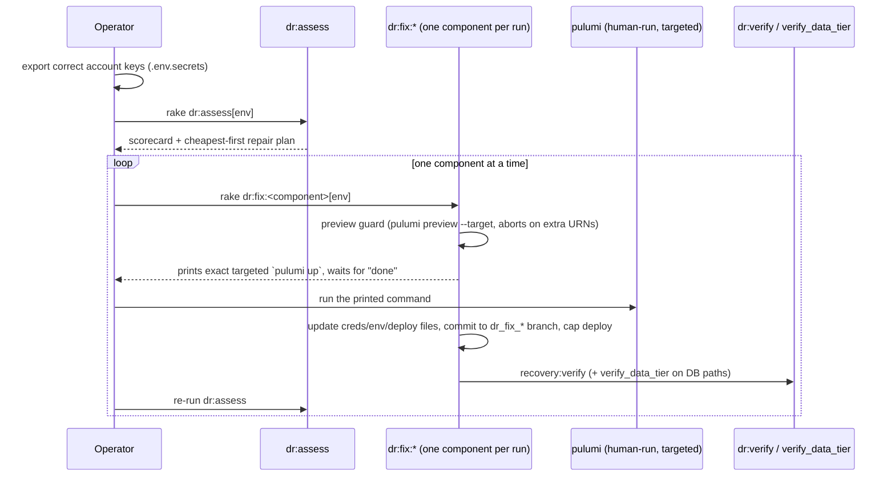
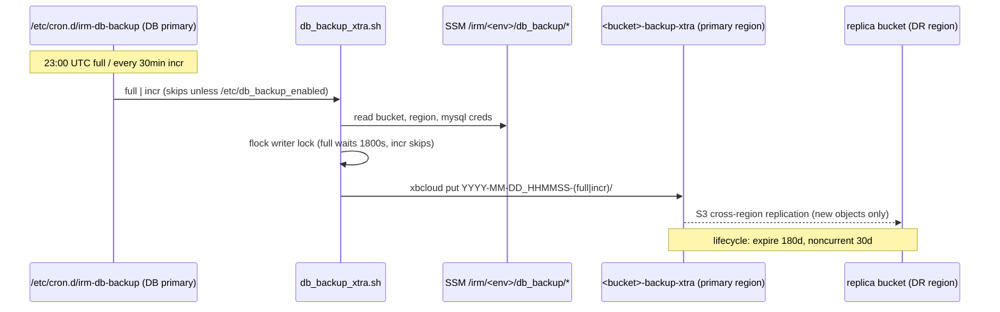

# Infrastructure Rake Task Reference

Every rake task (plus the sibling IRM-Infra scripts) used to provision, back up,
monitor, repair, and clean up the AWS infrastructure. Written 2026-08-31 from the
task sources in `lib/tasks/`.

Related docs: `docs/DR_GUIDE.md` (live-incident runbook),
`docs/DR_COMPONENT_RECOVERY.md` (single-component repair),
`lib/tasks/Caphive infra setup.md` (new-region setup),
`../IRM-Infra/PULUMI_STATE.md` (Pulumi state backend design).

---

## 1. Conventions that apply to almost every task

### Environments, accounts, credentials

| `env_name` | AWS account | Primary region | DR region | Pulumi stack | cap stage |
|---|---|---|---|---|---|
| `staging.in` | staging **174852986003** | ap-south-1 | ap-south-2 | `staging-<region>` | `staging_in` |
| `production.in` | prod **825199636520** | ap-south-1 | ap-south-2 | `production-<region>` | `production_in` |
| `production.us` | prod **825199636520** | us-east-1 | us-east-2 | `production-<region>` | `production_us` |

Staging and production are **separate AWS accounts with separate keys**. Two
credential paths exist and can disagree:

1. **Shell keys** (`AWS_ACCESS_KEY_ID`/`AWS_SECRET_ACCESS_KEY` exported in the
   terminal) — used by every `aws` CLI subprocess and by `pulumi`. The per-env
   key pairs live in `.env.secrets` (never committed).
2. **SDK credentials** from `config/credentials/<env_name>.yml.enc` — loaded by
   `rake aws:environment[env_name]`, which also `Dotenv.overload`s
   `.env.<env_name>` (so `AWS_REGION` etc. come from the env file).

`dr_account_guard!` (used by all `dr:*` tasks) verifies **both** paths resolve to
the environment's owning account before anything runs. For everything else, you
are responsible for exporting the right account's keys first.

**Rake namespace gotcha:** tasks in `aws_cleanup.rake`/`nat_gateway.rake` declare
`=> :environment` inside `namespace :aws`, which resolves to `aws:environment`
(no args), not Rails' `environment`. The task bodies re-invoke
`aws:environment[env_name]` with the real argument — always pass `env_name`.

### Safety legend used below

- **RO** — read-only against AWS/servers.
- **SC** — state-changing but bounded/idempotent.
- **DANGER** — destructive (deletes data/resources, causes outage, or loses IPs).

---

## 2. Quick reference

| Task | Purpose | Safety |
|---|---|---|
| `aws:dr_readiness[stack,variant,region,env]` | Pre-disaster readiness scorecard | RO |
| `dr:assess[env]` | Live incident triage scorecard + repair plan | RO with `ASSESS_READ_ONLY=true` |
| `dr:verify` / `dr:verify_data_tier` | Post-recovery smoke tests (run on app server) | RO |
| `s3:check_backup_freshness[env]` | Alert if xtrabackup buckets are stale | RO |
| `s3:check_latest_file` | Source→replica asset bucket parity | RO |
| `infra:report` | 7-day Grafana/Prometheus HTML health report | RO |
| `aws:nat:status[env]` | NAT gateway / private route health | RO |
| `aws:list_nat_gateways[env]` | Redundant NAT advice (~$32/mo each) | RO |
| `aws:get_latest_ami[tag,region,env]` | Look up newest baked AMI | RO |
| `aws:dr_verify_edge[stack,region]` | Pre-cutover ALB→DB probe | RO |
| `grafana:provision:save` | Snapshot live dashboards to repo | RO (writes local files) |
| `aws:environment[env]` | Load env file + credentials into process | RO |
| `aws:setup_pulumi_config[...]` | Refresh stack config (AMIs, region) | SC (config only) |
| `aws:provision_s3_buckets[env]` | Idempotent bucket/replication/lifecycle setup | SC (never overwrites existing rules) |
| `xtrabackup:seed_ssm_params[env,region]` | Seed `/irm/<env>/db_backup/*` SSM params | SC (idempotent) |
| `xtrabackup:generate_backup_script` | Template legacy backup script to `tmp/` | SC (local; contains secrets) |
| `aws:generate_prometheus_yml[env]` | Regenerate prometheus.yml from EC2 tags | SC (local file) |
| `dr:fix:prometheus_config[env]` | Push prometheus.yml to obs box + reload | SC |
| `grafana:provision[...]` | Upsert Grafana alerts/dashboards/users | SC (clobbers managed folder) |
| `deploy:notify_before` / `notify_after` | User-facing downtime notifications | SC |
| `aws:create_ami` / `copy_ami` / `create_and_copy_ami` | Bake/replicate AMIs (weekly path) | SC (+ AMI cleanup keeps newest 3) |
| `packer:build_env[...]` | Bake new AMIs from scratch | SC (billable EC2) |
| `packer:teardown_build_network[region]` | Delete the tagged packer-build VPC | SC (scoped) |
| `aws:manage_ssh[action,env,force]` | List/suspend/resume world-open SSH | list=RO, rest SC |
| `aws:nat:create[env]` | New NAT gateway + EIP + route | SC (new public IP!) |
| `dr:fix:app_server[env,host]` | Repair/rebuild one app server | SC → DANGER (rebuild) |
| `dr:fix:db_replica[env]` | Repair/rebuild replica | DANGER (wipes replica datadir) |
| `dr:fix:observability[env]` | Repair/rebuild Grafana/Prometheus box | SC |
| `dr:fix:nat[env]` | Recreate dead NAT (interactive) | SC after `yes` |
| `dr:fix:promote_replica[env]` | Promote replica to primary, RPO≈0 | DANGER (irreversible topology change) |
| `dr:fix:db_primary[env]` | Rebuild+restore primary, RPO≈1h | DANGER (data loss to last incremental) |
| `db:restore_all_remote[bucket,region]` | Restore primary+replica from S3 chain | DANGER (wipes both datadirs) |
| `db:restore_primary_remote` / `db:restore_replica_remote` | Single-box restore | DANGER |
| `db:reset_replication[server_id]` | Re-point replica at primary | SC |
| `xtrabackup:cleanup_old_backups[env]` | Chain-safe S3 backup pruning | RO dry-run; DANGER with `CONFIRM=1` |
| `aws:setup_infra[...]` | Full region build/DR: pulumi up → deploy → restore → verify | DANGER |
| `aws:dr_drill[...]` | Unattended DR drill (same blast radius) | DANGER (`CONFIRM_PRODUCTION=true` for prod) |
| `aws:dns_cutover[...]` | Route53 UPSERT to new ALB (interactive) | DANGER (customer-visible) |
| `aws:cleanup_snapshots[env]` | Delete EBS snapshots > `RETENTION_DAYS` (30) | DANGER unless `DRY_RUN=true` |
| `aws:cleanup_elastic_ips[env]` | Release unassociated EIPs | DANGER (IPs unrecoverable) |
| `aws:cleanup_unattached_volumes[env]` | Delete `available` EBS volumes | DANGER (irreversible) |
| `aws:cleanup_stopped_instances[env]` | Terminate stopped instances | DANGER (excluded from run_all) |
| `aws:run_all_cleanup[env]` | Snapshots+EIPs+volumes+NAT advice | DANGER unless `DRY_RUN=true` |
| `aws:cleanup_unused_security_groups[env]` | Delete SGs with no ENI (y/N prompt) | DANGER |
| `aws:cleanup_unused_vpcs_and_subnets[env]` | Delete empty subnets/VPCs (y/N prompt) | DANGER |
| `aws:setup_s3_glacier[env]` | **Replaces** lifecycle on `*backup*`/`*xtra*` buckets with 30d Glacier | DANGER (clobbers retention rules — see §5) |
| `aws:nat:delete[env]` | Delete NAT + release EIPs (interactive) | DANGER (kills private-subnet egress) |
| `nginx:switch[profile]` | Maintenance mode on/off (on app server) | DANGER (customer-visible) |
| `aws:grow_disk` | growpart+resize2fs on the box itself | SC (on-instance) |

---

## 3. Health & readiness (run these regularly)

### `rake "aws:dr_readiness[stack,env_variant,region,env_name]"` — RO
Quarterly/weekly readiness scorecard. Checks: backup freshness (primary+replica
buckets), DR-region AMIs exist and are ≤8 days old, the five
`/irm/<env>/db_backup/*` SSM params, `Pulumi.<stack>-<region>.yaml` completeness,
Pulumi backend reachability, EC2 key pair in the DR region, Route53 hosted zone,
local files (`.env.*`, credentials + key, sibling `../IRM-Infra`), and DR drill
recency from `docs/dr_drills.md` (warns past 100 days). Exits non-zero on any
hard failure, so it is cron/CI safe.

### `ASSESS_READ_ONLY=true rake "dr:assess[env_name]"` — RO
Live-environment triage: inventories the Pulumi stack, then probes ALB/target
health, each app server (nginx→puma→rails chain, sidekiq, xirr_py, disk), the
data tier via an app-server SSH hop (mysqld both boxes, ES/Redis containers,
backup-cron arming, replication status), NAT + outbound path from the DB box,
S3 bucket access, backup freshness, SSM params, observability box, DNS and
website hosts. Prints a ✅/⚠️/❌ scorecard and a ranked, cheapest-first repair
plan naming the exact `dr:fix:*` command. Without `ASSESS_READ_ONLY=true` it
auto-fixes only the trivial rung (restart dead sidekiq/containers on otherwise
healthy hosts). Sidekiq is restarted through `cap sidekiq:ensure_clean_restart`;
see [Process Supervision](process_supervision.md).

### `rake "s3:check_backup_freshness[env_name]"` — RO
Alerts when the xtrabackup buckets (primary **and** cross-region replica) are
stale, or when incrementals exist with no full (unrestorable chain). Also runs
hourly via sidekiq-cron in every env (`config/initializers/sidekiq.rb`).

### `rake infra:report` — RO
Builds `tmp/infra_report_<ts>.html` from Prometheus (via the Grafana datasource
proxy; `GRAFANA_URL`, `GRAFANA_PASS`, `WINDOW=7d`). Sections: infra
CPU/mem/disk/inodes, Rails 5xx/latency/queues/worker memory, MySQL
connections/slow queries/replication lag/deadlocks, plus peak-cause,
rate-of-change and job-correlation analyses. Green banner = healthy; a missing
section next to a blank table usually means a **failed Grafana query**, not a
quiet system. Run once per region (`GRAFANA_URL=https://graphana.caphive.us`
for US).

### Post-recovery: `dr:verify` and `dr:verify_data_tier` — RO, on an app server
`cap <stage> recovery:verify` / `cap <stage> partial:verify_data_tier`. The
first proves the stack serves (health endpoints through nginx, website, sidekiq
registration, pending migrations, restored-data freshness, DB-box checks,
replication round-trip). The second closes the Redis blind spot: `redis_check`
exercises Solid Cache (MySQL), so only `verify_data_tier` proves Sidekiq and
ActionCable point at a live Redis, and that the ES index exists.

---

## 4. Disaster recovery

### The workflow



Order of repair: **app server first** (DB/obs boxes only accept SSH from
`web-sg`), then data tier, then NAT, observability last. After any box
replacement run `dr:fix:prometheus_config[env]`.

### Choosing the DB repair

| Situation | Task | RPO | Cost |
|---|---|---|---|
| Replica broken, primary fine | `dr:fix:db_replica` | — | reads degrade during rebuild |
| Primary gone, replica healthy | `dr:fix:promote_replica` (type `promote`) | ≈0 | outage during switch; Redis/ES on old box lost; single-DB until replica rebuilt |
| Primary gone, replica unusable | `dr:fix:db_primary` (`CONFIRM_DATA_LOSS=true` if replica alive) | ≈1h | full outage; both datadirs restored from S3 |

After promote/primary rebuild: `rake chewy:reset` on an app server, re-drive
critical Sidekiq jobs, `s3:check_backup_freshness`, re-assess. After
`promote_replica`, **do not run a bare untargeted `pulumi up`** until the next
full DR (state points DB_HOST at the replica resource).

### Full region rebuild

`aws:setup_infra[stack,web,db,region,variant,env,branch]` — the 8-phase
orchestrator: pulumi config → `pulumi up` → rewrite credentials/env/deploy IPs →
commit+push → cap setup/deploy → maintenance mode → restore DB from S3 →
migrate → switch app → `recovery:verify` gate. DNS is **never** touched;
`aws:dns_cutover` is a separate, interactive, human decision, tested first with
`aws:dr_verify_edge`.

`aws:dr_drill[variant,region,env,stack]` runs the same path unattended, logs to
`docs/dr_runs/`, appends PASSED/FAILED to `docs/dr_drills.md`, and tears down
with `TEARDOWN=true`. Production drills require `CONFIRM_PRODUCTION=true`.

---

## 5. Backups (xtrabackup → S3)

### How backups actually run

Backups are **not** rake-scheduled. The DB AMI bakes `/etc/cron.d/irm-db-backup`:
nightly full at 23:00 UTC, incrementals every 30 min from 00:00–22:30, running
`/usr/local/bin/db_backup_xtra.sh` (config from SSM under
`/irm/<env>/db_backup/*` via the instance role). The script exits quietly unless
`/etc/db_backup_enabled` exists — only the restored **primary** is armed; the
replica must stay disarmed or two writers corrupt the chain. A `flock` writer
lock stops the 00:00 incr from basing itself on the previous full while the
23:00 full is still uploading.



### Restore chain

A restore = latest full + newest incremental after it. Restores are driven from
an app server (DB boxes only reachable from there):

- `rake "db:restore_all_remote[bucket,region]"` — canonical DR path (via
  `cap <stage> recovery:load_db_from_backups`). Restores primary and replica in
  parallel, arms the primary's backup cron, disarms the replica's, then
  `AwsUtils.reset_replication`. **Wipes both datadirs first.** The optional
  `bucket`/`region` args point at the DR-region replica bucket during a region
  loss.
- `db:restore_primary_remote` / `db:restore_replica_remote` — single-box
  variants. `db:reset_replication[server_id]` re-points replication only.
- `db:restore_primary_db` / `db:restore_replica_db` — legacy pre-baked-AMI path
  via `DbRestoreService`; avoid unless the AMI predates the baked script.

Prereqs: `KEYNAME` env + pem, traffic off (maintenance mode), intact chain in
the bucket. Follow with `cap recovery:migrate` before switching traffic back.

### Retention (target: 180 days) — enforced in two places

1. **S3 lifecycle** — applied by `aws:provision_s3_buckets` (expire 180d,
   noncurrent-version 30d, expired-delete-marker cleanup). It **never clobbers
   an existing lifecycle**, so a bucket provisioned under the old 90d default
   keeps 90d until fixed by hand.
2. **`rake "xtrabackup:cleanup_old_backups[env_name]"`** — chain-safe pruning.
   Dry-run by default; `CONFIRM=1` performs permanent version-ID deletes.
   Keeps every full inside the window **plus** the newest full at-or-before the
   cutoff (the base of the oldest in-window incrementals), never drops below
   `DB_BACKUP_MIN_KEEP_FULLS` (60) fulls, treats age as a hard floor, and
   audits the bucket's lifecycle — printing a 🚨 warning when lifecycle expiry
   is shorter than the retention it enforces. Cleans primary **and** replica
   buckets (deletes never replicate; `SKIP_REPLICA=1` to skip).
   **Nothing schedules it** — run it by hand or wire it into cron.

⚠️ **`aws:setup_s3_glacier` replaces the whole lifecycle config** on every
bucket whose name contains `backup`/`xtra` with a single 30-day Glacier
transition — wiping the 180d retention rules above. Do not run it against the
xtrabackup buckets.

### One-time setup per env × region

- `rake "xtrabackup:seed_ssm_params[env_name,region]"` — seed the five SSM
  params. SSM is regional: seed **every** region hosting DB instances,
  **including the DR region**, or a recovered box finds no config mid-DR.
- `rake "aws:provision_s3_buckets[env_name]"` — buckets, versioning,
  replication, CORS, lifecycle, encryption. Idempotent; never deletes.

---

## 6. AMIs and Packer

- Bake fresh AMIs: `rake "packer:build_env[prod,in,all]"` (`app`/`db`/`obs` to
  build one). Builds in a dedicated `packer-build-<region>` VPC (10.99.0.0/16);
  needs shell AWS keys + `MYSQL_ROOT_PASSWORD`. Even `packer:check` creates the
  build network as a side effect. Tear down with
  `rake "packer:teardown_build_network[region]"` (tag-scoped, safe).
- Weekly replicate path: `rake "aws:create_and_copy_ami[instance_name,dr_region,env]"`
  — snapshot the named instance, copy to the DR region, prune to newest 3 AMIs
  in both regions. `aws:dr_readiness` warns when DR-region AMIs are >8 days old.
- `aws:get_latest_ami` / `aws:copy_ami` / `aws:create_ami` /
  `aws:delete_old_amis` — building blocks (delete keeps newest 3, no prompt).

---

## 7. Cost & hygiene cleanup (`aws_cleanup.rake`, `nat_gateway.rake`)

All operate on **one region** (the one in `.env.<env_name>`); none prompt —
**`DRY_RUN=true` is the only safety net**. Always dry-run first:

```bash
DRY_RUN=true bundle exec rake "aws:run_all_cleanup[production.in]"
```

`run_all_cleanup` = snapshots older than `RETENTION_DAYS` (30) + unassociated
EIPs + `available` EBS volumes + NAT advice. It deliberately excludes
`cleanup_stopped_instances` (terminates!) and `setup_s3_glacier` (clobbers
lifecycle — see §5). SG/VPC cleanup tasks prompt y/N per run.

NAT: `aws:nat:status[env]` (RO) → `aws:nat:create[env]` / `aws:nat:delete[env]`.
Both locate resources by Pulumi tags hardcoded with a `production` suffix, so
they don't work against staging-named stacks. A new NAT gets a **new public
IP** — update any third-party allowlists. The DB boxes have no S3/SSM VPC
endpoints, so a dead NAT silently kills backups; `dr:fix:nat[env]` is the
guarded repair path.

`aws:manage_ssh[list|suspend|resume,env,force]` — audit/toggle world-open SSH
(22 ↔ 22222). "Suspend" only moves the port, it does not restrict CIDRs.

---

## 8. Observability

- `rake infra:report` — see §3.
- `rake "aws:generate_prometheus_yml[env]"` — regenerate scrape targets from
  EC2 tags (local file only); `rake "dr:fix:prometheus_config[env]"` pushes it
  to the observability box and reloads Prometheus.
- `rake grafana:provision` — full chain: contact points → notification policy →
  alert rules (deletes+recreates the managed folder) → dashboard patches →
  overview dashboard (fully regenerated — manual edits lost) → viewer users
  (resets existing passwords). Per-region: IN and US are separate Grafana
  instances (`GRAFANA_URL`). `grafana:provision:save` snapshots live dashboards
  to `config/initializers/observability/graphana/<region>/` without touching the
  server — run it before a first provision. Commit the resulting JSON.
- `rake grafana_provision` sub-tasks can be run individually:
  `contact_points`, `alert_rules`, `dashboards`, `overview_dashboard`,
  `viewer_users`.

---

## 9. Deploy-adjacent

- `deploy:notify_before` / `deploy:notify_after` — user-visible downtime
  notifications via Sidekiq; invoked by Capistrano, suppressed in DR with
  `SKIP_NOTIFICATION=true`.
- `nginx:switch[maintenance|IRM_<env>]` — maintenance mode toggle, on the app
  server, via `cap <stage> nginx:switch_maintenance` / `nginx:switch_app`.
- `aws:grow_disk` — run on an instance after resizing its EBS volume
  (hardcoded to `/dev/nvme0n1p1`).

---

## 10. IRM-Infra (sibling Pulumi repo)

One Python Pulumi project, six stacks (`staging|production` ×
`ap-south-1|ap-south-2|us-east-1`). Operated via the rake tasks above plus:

- `./check_drift.sh <stack>` — the drift detector: account guard →
  `pulumi refresh` → `pulumi preview --diff` (saved to `drift_reports/`) →
  unmanaged-resource scan (ACM certs / EBS volumes in AWS but absent from
  state). Read-only against AWS. Run after any manual console change.
- `migrate_state_to_s3.sh` — one-time-per-account Pulumi Cloud → S3 backend
  migration (designed in `PULUMI_STATE.md`; **not yet executed** — state still
  lives in Pulumi Cloud under a personal login, a known DR dependency).
- CI (`.github/workflows/ci.yml`) — py_compile, stack-config completeness,
  shellcheck. No AWS access.

**Standing rule for agent sessions: never `pulumi up`/`import`/`destroy` —
refresh + preview and report only.**

---

## 11. What runs automatically vs. by hand

| Concern | Automatic | Manual |
|---|---|---|
| DB backups | cron on DB primary (full 23:00, incr 30min) | — |
| Backup freshness alerting | hourly sidekiq-cron, all envs | `s3:check_backup_freshness[env]` |
| Asset bucket parity | hourly sidekiq-cron (prod only) | `s3:check_latest_file` |
| Backup retention | S3 lifecycle (if provisioned at 180d) | `xtrabackup:cleanup_old_backups` (unscheduled) |
| AMI bake/replicate | — | `aws:create_and_copy_ami` (weekly, by hand) |
| DR readiness | — | `aws:dr_readiness` (target: weekly) |
| DR drills | — | `aws:dr_drill` (target: quarterly; log in docs/dr_drills.md) |
| Drift detection | — | `../IRM-Infra/check_drift.sh <stack>` |
| Cost cleanup | — | `aws:run_all_cleanup` with `DRY_RUN=true` first |
| Infra health report | — | `infra:report` |
