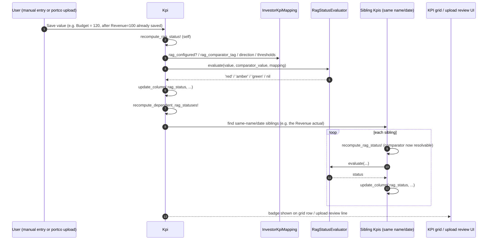

# KPI RAG Rules — Redesign

**Status:** All 5 phases implemented on `feature/kpi-rag-rules-redesign`. Not yet migrated/deployed
— someone with dev/staging DB access needs to run `rails db:migrate` to apply
`db/migrate/20260824090000_replace_rag_rules_with_structured_columns.rb` (this session hand-edited
`db/schema.rb`/`db/schema_test.rb` to match so Cucumber's `maintain_test_schema!` picks the new
columns up without that migrate step, but the real dev/staging MySQL DBs still need it run).
**Date:** 2026-08-24
**Scope:** `InvestorKpiMapping#rag_rules` and everything that reads or writes it — the
red/amber/green status a fund can configure per KPI to flag whether a reported value is on
track. Covers the data model, the evaluation logic, the authoring UI, and where the resulting
status should be shown.
**Related:** `docs/technical/kpi_portco_upload_validation_review.md` (the `rag_red` upload
warning this doc supersedes the design of), `docs/technical/kpi_cumulative_logic.md`.

---

## 1. Problem today

`rag_rules` is a JSON column on `investor_kpi_mappings`, authored via a raw 10-row textarea
(`app/packs/startups/kpis/views/investor_kpi_mappings/_form.html.erb:92-96`) containing a shape
like:

```json
{"ratio_rules": {"red": {"min": -Infinity, "max": 0.7}, "amber": {"min": 0.7, "max": 0.9}, "green": {"min": 0.9, "max": Infinity}}}
```

It is interpreted by **two independent, drifting implementations**:

- `Kpi#determine_rag_status_from_rules` (`app/packs/startups/kpis/models/kpi.rb:145-174`) —
  meant to persist `Kpi#rag_status`, comparing against any tagged report. **Its only caller
  anywhere in the codebase is a Cucumber step** (`features/step_definitions/kpi.rb:173`) — there
  is no controller action, job, or callback that runs it in the live product. This write path is
  effectively dead.
- `KpiWorkbookReader#plausibility_checks` (`app/packs/startups/kpis/services/kpi_workbook_reader.rb:1002-1021`)
  — a transient, non-persisted upload-time warning. Hardcoded to compare the Actual tag against a
  `'Budget'` tag specifically, and only ever checks for the literal string `'red'` — an `'amber'`
  band produces no signal at all.

Other issues (full detail in prior research, not repeated here):

- No validation on `rag_rules` — malformed JSON, non-numeric bounds (silently coerced to `0.0`
  via `.to_f`), and arbitrary/typo'd band keys all pass silently.
- The help text's own example (`-Infinity` / `Infinity` without quotes) is not valid JSON.
- `Kpi#rag_status`'s manual-override dropdown (`app/packs/startups/kpis/views/kpis/_form.html.erb:40-43`)
  offers `green`/`yellow`/`red` — `yellow` doesn't match `amber`, used everywhere else.
- The configured rule is never displayed outside the edit form — not on `show`, not on `index`,
  not anywhere a computed status would appear if one existed.
- The format only expresses "ratio of Actual to one other tagged value" — it cannot express a
  flat threshold on the value itself, a comparison against last year, or a fixed covenant limit
  (see §4).

**Net effect: a fund can spend time configuring `rag_rules` today and nothing downstream ever
shows a status.**

---

## 2. Goals

1. One evaluator, one source of truth — no duplicated interpretation logic.
2. A rule format that covers how funds actually use RAG (see §4), not just "ratio vs Budget."
3. A structured authoring form — no hand-typed JSON.
4. A status that is actually computed on every relevant write (manual entry or upload) and
   **visibly shown** somewhere a user looks, not just logged as a warning.
5. Fix the `amber`/`yellow` inconsistency and the invalid-JSON example as part of the rewrite.

---

## 3. Design

### 3.1 Three questions per KPI mapping

Real-world RAG rules (§4) reduce to three independent choices, not one JSON blob:

| Question | Options |
|---|---|
| **Direction** — which way is "good"? | Higher is better (Revenue, Margin, Runway) / Lower is better (Churn, Burn, Concentration) |
| **Comparator** — what is the value judged against? | Budget (same period) / Prior period (same KPI, e.g. last year) / A fixed limit (a plain number, e.g. a loan covenant) / None — judge the raw value directly (e.g. Margin %, NPS) |
| **Breakpoints** — where do the bands split? | Two numbers: the red cutoff and the green cutoff. Everything between is amber. |

This replaces the single nested `ratio_rules` JSON key and free-form band names with a fixed,
small shape — no arbitrary keys, no ambiguity about what's being compared.

### 3.2 Data model (as built)

Columns on `investor_kpi_mappings` (replacing `rag_rules`; see
`db/migrate/20260824090000_replace_rag_rules_with_structured_columns.rb`):

- `rag_direction` — enum, `higher_is_better` / `lower_is_better`
- `rag_comparator_tag` — string, nullable, default `"Budget"`. Blank means "judge the value
  directly, no comparator"; present means "compare as a ratio against the same-named KPI in a
  report carrying this tag."
- `rag_red_threshold`, `rag_green_threshold` — decimal(20,4), the two breakpoints (a ratio when
  there's a comparator tag, or a direct value when the tag is blank)

**Simplified from the original sketch during implementation:** the original draft had a
`rag_comparator` enum (`budget` / `prior_period` / `fixed_limit` / `none`) plus a separate
`rag_fixed_limit_value` column. Building it out, `fixed_limit` turned out to be redundant with
`none` — a covenant number (e.g. "red above 4.0x leverage") is just `rag_red_threshold` on a
flat value, nothing else needed. And `budget` vs `prior_period` turned out to both just mean
"compare against a same-named KPI carrying some tag" — the only real difference is which tag
string. So both collapsed into one free-text `rag_comparator_tag` field: a fund types whatever
tag their reports use ("Budget", "PriorYear", anything), and blank means flat-threshold mode.
This also resolves the §7 open question about what "prior period" means — it's not the
system's job to disambiguate; the fund's tag convention decides.

Two plain numeric breakpoints instead of three overlapping min/max hashes removes the
possibility of gapped/overlapping bands, the `-Infinity`/`Infinity` sentinel, and the
coerce-to-zero bug on bad input entirely. Model validation (`InvestorKpiMapping#rag_rules_kosher?`)
now rejects a mapping where direction/thresholds aren't set together, or where red/green are
equal or ordered inconsistently with direction — the "malformed rag_rules" failure mode from
Phase 1 is eliminated structurally, not just defended against.

### 3.3 Evaluation

A single evaluator (candidate name: `RagStatusEvaluator`, structured as a Trailblazer operation
per this repo's service-object convention) takes the actual value, the mapping's configuration,
and (when needed) the comparator value, and returns `'red'` / `'amber'` / `'green'` / `nil`
(nil when there isn't enough data yet, e.g. no Budget entered). Both the manual-entry save path
and the workbook-upload path call this one evaluator — no more parallel implementations.

### 3.4 When it runs

`Kpi#recompute_rag_status!` (`app/packs/startups/kpis/models/kpi.rb`) runs via `after_save`
whenever a KPI's value changes, resolving its comparator through the existing `find_tagged_kpi`
lookup. Because the comparator might be entered *after* the actual, a second callback,
`#recompute_dependent_rag_statuses!`, also fires on every value save and recomputes every other
same-name/same-date KPI (i.e. whichever tag it carries) — so saving a Budget figure after the
Actual already exists still updates the Actual's status, with no explicit user action. Both use
`update_column` to persist, so they never re-trigger each other's callbacks.

A zero-valued comparator still forces `'red'` unconditionally (matching the old
`set_rag_status_from_ratio` behavior) for the live path; the *upload* plausibility-warning path
keeps its own long-standing, more conservative choice of skipping the check entirely when the
comparator is missing or zero, rather than warning — these were already two different tradeoffs
before this rewrite and stayed that way.

### 3.5 Authoring UI

The JSON textarea in `investor_kpi_mappings/_form.html.erb` is replaced with four fields: a
comparator-tag **dropdown** (not free text — populated from `Budget` plus every distinct
`tag_list` value already used by that portfolio company's own `KpiReport`s, with an "Other"
option revealing a text input for a not-yet-used tag, reusing the same `otherselect` Stimulus
controller pattern the `category` field already uses on this form), a direction select, and two
threshold number inputs. Sourcing the dropdown from real tags in use — rather than a hardcoded
guess-list — means a typo can't silently produce a comparator tag that never matches anything.
A plain-language summary (`InvestorKpiMapping#rag_rule_summary`, e.g. *"Red below 70% of Budget ·
Green at or above 90%"*) renders back to the user both on that form and on `show`/`index`. The
form also links to the `RAG Status User Guide` (`docs/user_guides/kpi_rag_status_user_guide.md`,
served in-app at `/user_guides/kpi_rag_status_user_guide`), anchored to its setup section.

### 3.6 Display surfaces

- `InvestorKpiMapping#show` and the index row/table: render `rag_rule_summary` — previously
  `rag_rules` wasn't shown anywhere outside Edit.
- KPI reporting grid (`kpi_reports/_grid_view_table.html.erb`): a small colored badge
  (`red`/`amber`/`green`, styled via `KpisHelper#rag_status_badge_class`) next to each value that
  has a computed `rag_status`, following the same pattern as the existing "Pending" badge.
- Workbook upload review screen: the `rag_red`/`rag_amber` warning messages now name whichever
  comparator tag was actually used (not a hardcoded "budget"), and fire for the flat-threshold
  case too (previously upload-time RAG was Budget-only).

---

## 4. Worked examples (what this needs to express)

"Comparator" below is illustrative English for what `rag_comparator_tag` would hold — per §3.2
there's no separate enum for "Budget" vs "Prior period" vs "Fixed limit" any more, just a
free-text tag (or blank for flat/fixed-value thresholds, which is how "Fixed limit" rows are
actually expressed — the covenant number becomes `rag_red_threshold` directly).

| KPI | Direction | Comparator | Red / Green breakpoints | Covered by |
|---|---|---|---|---|
| Revenue | Higher is better | `Budget` tag | Red < 70% of budget · Green ≥ 90% | `kpis.feature` |
| Gross Margin % | Higher is better | None (flat) | Red < 40% · Green ≥ 55% | `kpi_rag_status_examples.feature` |
| Cash Runway (months) | Higher is better | None (flat) | Red < 6 · Green ≥ 12 | `kpi_rag_status_examples.feature` |
| Customer Churn % | Lower is better | `Budget` tag | Red > 1.5× budget · Green ≤ 1.0× | `kpi_upload_validation_extended.feature` |
| Net Burn | Lower is better | `Budget` tag | Red > 120% of budget · Green ≤ 100% | both feature files |
| Revenue Growth YoY % | Higher is better | `PriorYear` tag | Red < 10% growth · Green ≥ 20% | `kpi_rag_status_examples.feature` |
| Leverage Ratio (debt covenant) | Lower is better | None (flat; 4.0x is the threshold itself) | Red > 4.0x · Green < 3.6x | `kpi_rag_status_examples.feature` |
| NPS | Higher is better | None (flat) | Red < 0 · Green ≥ 30 | `kpi_rag_status_examples.feature` |
| CAC Payback (months) | Lower is better | None (flat) | Red > 18 · Green ≤ 12 | `kpi_rag_status_examples.feature` |
| Customer Concentration % | Lower is better | None (flat) | Red > 50% · Green ≤ 30% | `kpi_rag_status_examples.feature` |
| Headcount vs Budget | Lower is better | `Budget` tag | Red > 110% of budget · Green ≤ 100% | `kpi_upload_validation_extended.feature` |

Every row is now directly expressible and has a passing (unrun by this session — see the
Cucumber note below) scenario; none require a workaround.

---

## 5. Sequence — new flow



---

## 6. Phased rollout — all ✅ done

### Phase 1 — Consolidate the two evaluators (no schema change)
Extracted shared logic into `RagStatusEvaluator`, a Trailblazer operation both `Kpi` and
`KpiWorkbookReader` called into. The upload-side check started reacting to `amber` as well as
`red`. Fixed the `yellow`/`amber` mismatch on the manual-override dropdown. Superseded by Phase
2's rewrite of the evaluator's internals, but the consolidation (one evaluator, one caller
pattern) carried forward.

### Phase 2 — New data model
`rag_direction`, `rag_comparator_tag`, `rag_red_threshold`, `rag_green_threshold` columns added
(`db/migrate/20260824090000_replace_rag_rules_with_structured_columns.rb`; simplified from the
original 5-field sketch — see §3.2). Best-effort backfill from old `rag_rules` JSON included in
the same migration. `InvestorKpiMapping#rag_rules_kosher?` validates the new fields are set
together and consistently ordered for the chosen direction.

### Phase 3 — Live computation
`Kpi#recompute_rag_status!` + `#recompute_dependent_rag_statuses!`, wired via `after_save`
(§3.4). `rag_status` is now genuinely live — previously the only code path that ever set it was
a Cucumber step.

### Phase 4 — Structured UI + display surfaces
Textarea replaced with the four structured fields (§3.5) in
`investor_kpi_mappings/_form.html.erb`. `rag_rule_summary` rendered on `show.html.erb` and the
index table/row partial. RAG badge added to `kpi_reports/_grid_view_table.html.erb` via
`KpisHelper#rag_status_badge_class`.

### Phase 5 — Cleanup and tests
`rag_rules` JSON column removed (same migration as Phase 2). All Cucumber coverage across
`features/startup/kpis.feature`, `kpi_rag_status_examples.feature`, and
`kpi_upload_validation_extended.feature` rewritten against the new fields — including a scenario
that saves a comparator *after* the actual to prove the dependent-recompute cascade, and one that
proves invalid threshold ordering is rejected at the model layer. The "malformed hand-typed
rag_rules" edge case from Phase 1 was retired: it's no longer reachable, since the new fields are
typed/validated columns rather than free-form JSON.

---

## 7. Resolved / remaining open questions

- ~~Does the comparator mean same-period-last-year or MoM?~~ Resolved by making
  `rag_comparator_tag` a free-text tag (§3.2) — the fund's own tagging convention decides; the
  system doesn't need to know. **Partially revisited** by the PriorPeriod comparator (§8 below):
  for the common case of "judge this period against the immediately preceding one," the system
  now does resolve it — by DB order, not calendar arithmetic — rather than requiring the fund to
  maintain a duplicate tagged row purely to satisfy the RAG check.
- **Still open:** `Kpi#rag_status`'s manual-override dropdown (`views/kpis/_form.html.erb`) still
  exists, but a manual edit will be silently overwritten the next time that KPI's value or its
  comparator's value is saved (Phase 3's `after_save` always recomputes). Worth deciding whether
  the dropdown should be removed, or whether a manual override needs its own "pin" flag that
  suppresses recomputation — not addressed in this build.
- **Still open:** whether `rag_comparator_tag: none` (flat threshold) should be unified with the
  existing `lower_threshold`/`upper_threshold` plausibility-breach columns on the same model —
  they now overlap conceptually (both are "is this raw value in an acceptable range") but remain
  separate mechanisms.
- Trend-based rules ("flag red after N consecutive declining periods") remain out of scope, as
  before.

---

## 8. Addendum: prior-period comparator

Added after the Phase 1–5 build above, in response to a real gap: the `PriorYear` worked example
(§4) requires a fund to upload a *second*, separately-tagged report for the same `as_of` date
just to give the actual something to be judged against — duplicating a value that's typically
already sitting in the DB as last month's/quarter's/year's own actual report. This addendum adds
a way to judge a KPI against *itself*, one period back, using data that's already there.

### 8.1 What it is

`InvestorKpiMapping::PRIOR_PERIOD_COMPARATOR` (`"PriorPeriod"`) — a reserved value for
`rag_comparator_tag`, alongside real tag strings like `"Budget"`/`"PriorYear"` and blank
(flat-threshold mode). It means: *compare this KPI's value against the same KPI's own most
recent earlier report* — same `name`, same `tag_list` (so an Actual is only ever judged against
a prior Actual, never a Budget row), same `period` cadence, most recent `as_of` strictly before
this one.

Deliberately **not** period arithmetic: it does not compute "as_of minus one month" (or quarter,
or year) and look for a row at that exact date. It walks to whatever the immediately-preceding
row in the DB actually is, ordered by `as_of`. This keeps the same philosophy as the tag-based
comparators (§7's "the system doesn't need to know" resolution) — the fund's own reporting
cadence decides which dates exist; the comparator just asks "what came before this, in this
series," not "what calendar date should have come before this."

### 8.2 Implementation

- `InvestorKpiMapping#rag_comparator_prior_period?` — `rag_comparator_tag ==
  PRIOR_PERIOD_COMPARATOR`.
- `Kpi#find_prior_period_kpi` / `Kpi#find_next_period_kpi` (`app/packs/startups/kpis/models/kpi.rb`)
  — the backward and forward lookups, mirrors of each other.
- `Kpi#recompute_rag_status!` branches on `rag_comparator_prior_period?` before falling through to
  the existing `find_tagged_kpi` (same-`as_of`) path — the rest of the method, and
  `RagStatusEvaluator` itself, is unchanged; the evaluator never learns where `comparator_value`
  came from.
- `Kpi#recompute_dependent_rag_statuses!` also branches: the same-`as_of` sibling fan-out doesn't
  apply here (there's no sibling at the same date to find), so instead it recomputes only
  `find_next_period_kpi` — the one row that could newly have a comparator now that this one was
  saved. This covers backfill: if February's actual is entered before January's, February starts
  with no RAG status (no prior period yet), and saving January's actual afterwards cascades
  forward to recompute February's.
- `KpiWorkbookReader#plausibility_checks` (upload-time warning path) reuses `history_before`'s
  `prev` value — already computed for the denomination/jump checks on the same row — as the
  PriorPeriod comparator value, rather than issuing a second query.
- Mapping form (`investor_kpi_mappings/_form.html.erb`): offered as a fixed dropdown option
  ("Prior period (this KPI's own last report)"), listed separately from the tags sourced off
  `KpiReport.tag_list` so it can't collide with a fund that happens to use that literal string as
  a real tag.

### 8.3 What this does not change

- Tag-based comparators (`Budget`, `PriorYear`, any custom tag) work exactly as before — this is
  an additional `rag_comparator_tag` value, not a replacement.
- `RagStatusEvaluator` is untouched: `rag_comparator_tag.present?` is still the branch condition
  for "ratio against a comparator" vs. "judge the raw value," and `"PriorPeriod"` is non-blank, so
  it already takes the ratio branch with no evaluator change needed.
- Cross-period-type comparisons are still not possible: `find_prior_period_kpi` filters on
  `kpi_reports.period`, so a `month`-period KPI is never compared against a `quarter`-period row
  for the same name.

### 8.4 Approved-only, both directions

Building the PriorPeriod comparator surfaced a live gap in the original Phase 3 build: neither
`Kpi#recompute_rag_status!` nor its comparator lookup (`find_tagged_kpi`) checked `status` at
all, so an unapproved (staging) row could get a `rag_status` of its own, and — separately — could
be silently used as another KPI's comparator, ahead of a fund actually confirming the figure.
This wasn't a risk unique to PriorPeriod (`find_tagged_kpi` had the exact same gap from Phase 3
onward); PriorPeriod just made it obvious, since a fund's own prior report is far more likely to
have a pending unapproved re-upload sitting next to it than a same-`as_of` Budget row is. Fixed
in both directions:

- **A KPI is only ever judged if it's approved.** `recompute_rag_status!` returns early unless
  `approved?`, and — more importantly — the `after_save` trigger (`rag_recompute_trigger?`) is
  gated on `approved?` up front, so an unapproved row's value changing (the common case: every
  row of an import, before review) never even invokes recompute. This mirrors the grid's existing
  display convention (`kpi_reports/_grid_view_table.html.erb`): unapproved rows are hidden by
  default and only shown under `view_unapproved`, so an un-reviewed figure was never meant to
  carry a confident-looking flag in the first place.
- **A KPI is only ever used as a comparator if it's approved.** `find_tagged_kpi` and
  `find_prior_period_kpi` are both `Kpi.approved`-scoped now, matching what
  `KpiWorkbookReader#approved_index` (the upload-time path) had already been doing since Phase 1
  — the live and upload-time paths were quietly inconsistent on this point until now.
  `find_next_period_kpi` is deliberately **not** approved-scoped: it isn't a comparator lookup,
  it's "which dependent KPI might need recomputing" — that dependent's own `recompute_rag_status!`
  re-applies the approved-only rule to itself when it runs.
- **Approving a KPI can newly produce or unlock a status**, since `KpiApprover` approves by
  flipping `status`, not `value` (except when it's overwriting an already-approved record, which
  does change `value`). `rag_recompute_trigger?` fires on `saved_change_to_status?` as well as
  `saved_change_to_value?`, so: approving a KPI computes its own status for the first time if
  eligible, and approving a comparator (e.g. Budget, or an earlier PriorPeriod report) cascades
  forward via `recompute_dependent_rag_statuses!` to unlock whatever depends on it — without that
  dependent's own value needing to change again.
