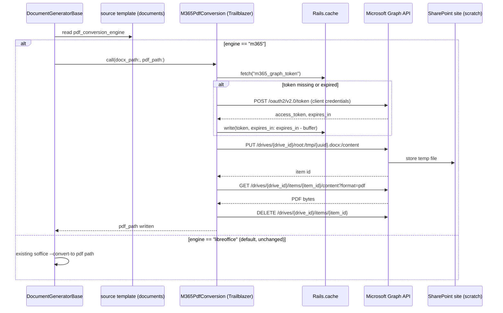

# M365 Graph API as a PDF conversion engine

Adds Microsoft Graph API as a second docx → PDF conversion path, alongside the
existing LibreOffice (`soffice --headless --convert-to pdf`) path in
`DocumentGeneratorBase#convert_to_accessible_pdf`. Routing is **per template**,
not global: most templates keep converting through LibreOffice unchanged; only
templates explicitly flagged for it are sent to M365 instead.

Background and why this is needed: `docs/notes/libreoffice_footnote_bug_options.md`
(LibreOffice's Writer layout engine misplaces footnotes anchored inside table
cells in long documents — reproduced independent of export filter, confirmed
against the real document via Word Online-equivalent rendering).

---

## Table of Contents

1. [Routing model](#routing-model)
2. [Setup task list](#setup-task-list)
3. [Design](#design)
4. [Testing checklist](#testing-checklist)
5. [Open questions](#open-questions)

---

## Routing model

A new column on `documents`, set on the **template** record (`template: true`),
read at generation time from the source template the generated document was
created from:

```ruby
# migration
add_column :documents, :pdf_conversion_engine, :string, default: "libreoffice", null: false
```

`DocumentGeneratorBase#convert_to_accessible_pdf` branches on
`doc_template.pdf_conversion_engine` (via `from_template`) before choosing a
conversion path. Every existing template defaults to `"libreoffice"` and is
completely unaffected — this is additive, not a replacement.

```ruby
def convert_to_accessible_pdf(file_name, template_name = nil, engine: "libreoffice")
  if engine == "m365"
    M365PdfConversion.call(docx_path: "#{file_name}.docx", pdf_path: "#{file_name}.pdf")
  else
    convert_via_libreoffice(file_name, template_name)   # existing soffice call, unchanged
  end
end
```

A template is opted in by a human, deliberately — e.g. Fireside/CA Fund IV
India, which is the one with the confirmed table-anchored-footnote defect —
not by any automatic detection. There's no dependency on the detection
safeguard from the earlier options doc; that idea was dropped in favor of
routing the small number of known-affected templates directly.

---

## Setup task list

Ordered; items 1–7 are one-time tenant setup and mostly outside engineering's
hands (need whoever administers the M365 tenant).

1. **Confirm the M365 plan includes SharePoint Online / OneDrive for
   Business with Graph API access.** Most standard business plans do, but
   this hasn't been verified for our tenant specifically.
2. **Provision a dedicated SharePoint site + document library** to act as
   conversion scratch space (e.g. `DocGenConversion`). Preferred over a
   dedicated mailbox/OneDrive — no user account to provision, offboard, or
   accidentally lock out, and it's easier to scope permissions tightly to.
3. **Register an Azure AD (Entra ID) app** in the tenant (`App registrations
   → New registration`). No redirect URI needed — this is a headless
   client-credentials client, not a user-facing login.
4. **Grant the app `Sites.Selected` application permission**, not the
   tenant-wide `Files.ReadWrite.All`. `Sites.Selected` plus an explicit grant
   scoped to just the one SharePoint site from step 2 means this app can
   never read any other site, mailbox, or OneDrive in the tenant even if the
   client secret leaks — worth the extra setup step given the documents
   involved are client fund/legal paperwork.
5. **Get tenant admin consent** for that permission — this is an admin-only
   action, can't be self-served by whoever registers the app.
6. **Create a client secret** for the app registration. Prefer a certificate
   over a secret if whoever manages the tenant is set up for it; otherwise a
   secret is fine. Either way, **note the expiry date somewhere durable** —
   secrets/certs expire (max 24 months) and there's no automatic renewal;
   this needs a calendar reminder or it becomes a silent production outage
   for M365-routed templates the day it lapses.
7. **Explicitly grant that one site's permissions to the app** via the Graph
   API `/sites/{site-id}/permissions` endpoint (this is the second half of
   `Sites.Selected` — admin consent in step 5 authorizes the permission
   *type*, this step authorizes it for *this specific site*).
8. **Add credentials to Rails**, both environments separately — staging and
   production are separate AWS accounts, so this is two separate
   `rails credentials:edit` runs, not one:
   ```yaml
   M365_TENANT_ID: "..."
   M365_CLIENT_ID: "..."
   M365_CLIENT_SECRET: "..."
   M365_DRIVE_ID: "..."   # the SharePoint site's drive id, resolved once via Graph Explorer
   ```
9. **Build `M365PdfConversion`** as a Trailblazer operation (see
   [Design](#design)) — matches the convention used for
   `CapitalCommitmentDocCreate` and similar; not a plain PORO.
10. **Add the `pdf_conversion_engine` migration** and the corresponding field
    to wherever templates are edited, gated to `template?` records.
11. **Wire `DocumentGeneratorBase#convert_to_accessible_pdf`** to branch on
    the flag.
12. **Route production exception alerts as usual** — no special-casing;
    Graph API failures should surface through the existing
    ExceptionNotifier pipeline like any other job failure, not fail silently
    or silently fall back to LibreOffice (see [Design](#design) for why).
13. **Test end-to-end in staging** against a copy of the actual Fireside/CA
    Fund IV India template — this is the document the whole investigation
    was based on, so it's the one to verify against before flipping the flag
    in production.
14. **Flip the flag on that one template in production**, verify the next
    real generated PDF by hand, then consider additional templates on a
    case-by-case basis.

---

## Design

### Sequence



### `M365PdfConversion` operation

Trailblazer step/left DSL, mirroring `CapitalCommitmentDocCreate`:

```ruby
class M365PdfConversion < Trailblazer::Operation
  step :fetch_access_token
  step :upload_docx
  step :request_pdf
  step :write_pdf_file
  step :cleanup_temp_file
  fail :cleanup_temp_file   # best-effort cleanup even on failure, doesn't swallow the error
end
```

Each Graph call goes through Faraday (already a dependency, used elsewhere in
the codebase) rather than adding a new HTTP client gem.

### Token caching

Matches the fix already recommended for the DocuSign JWT flow
(`docs/technical/docusign_code_review.md`, item 14) rather than a raw Redis
connection:

```ruby
Rails.cache.fetch("m365_graph_token", expires_in: 55.minutes) do
  # POST to the tenant token endpoint, client_credentials grant
end
```

Tokens are tenant-wide, not per-document — one cached token serves every
M365-routed conversion until it expires.

### No silent fallback on failure

If the Graph API call fails or times out, the job fails and alerts through
the existing ExceptionNotifier pipeline — it does **not** silently fall back
to LibreOffice for that document. Falling back silently would quietly
reintroduce the exact footnote-placement defect this whole path exists to
avoid, on a template specifically chosen because that defect matters for it.
A human should see the failure and decide, not get a document that looks
fine but silently reverted to the broken renderer.

### Least-privilege data handling

Only the docx bytes for a flagged template's generation run ever leave our
servers, and only as far as the one dedicated SharePoint site the app is
scoped to (`Sites.Selected`, not tenant-wide). The temp file is deleted
immediately after the PDF is retrieved — nothing is meant to persist in
SharePoint between conversions. Every other template's documents are
untouched by any of this and never leave our infrastructure.

---

## Testing checklist

- [ ] Client-credentials token fetch succeeds and is cached (verify a second
      call within the TTL doesn't hit the token endpoint again)
- [ ] Upload → convert → download round-trip on a small test docx
- [ ] Temp file is actually deleted from the SharePoint site after each run
      (spot-check the library, confirm nothing accumulates)
- [ ] Full round-trip against the real Fireside/CA Fund IV India template —
      confirm the footnote lands on the correct page in the resulting PDF
- [ ] A large (~140 page) document completes within the job's timeout
- [ ] Token expiry mid-run is handled (force an expired cache entry, confirm
      it re-fetches rather than failing)
- [ ] Graph API error (bad request, throttling, auth failure) surfaces as a
      job failure and alert, not a silent fallback or a swallowed exception
- [ ] `pdf_conversion_engine` defaults to `"libreoffice"` for every existing
      template — confirm nothing changes for templates that were never
      touched
- [ ] Staging and production credentials are both set (separate AWS
      accounts) before flipping the flag in either environment

---

## Open questions

- Certificate vs. client secret for the app registration — depends on what
  whoever administers the tenant is set up to issue and rotate.
- Whether Graph's synchronous `?format=pdf` conversion has a practical size/
  time ceiling worth knowing about before routing a very large template to
  it — worth checking against the largest real template during the staging
  test, not assuming it scales the same as the ~140-page sample.
- Who owns watching the client secret/certificate expiry date — needs an
  owner, not just a note in this doc.
