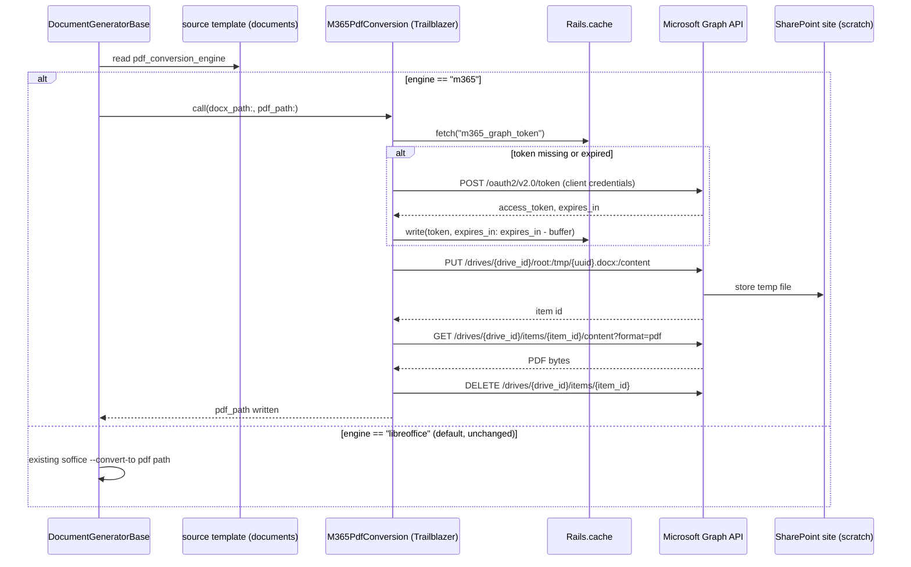

# M365 Graph API as a PDF conversion engine

Adds Microsoft Graph API as a second docx → PDF conversion path, alongside the
existing LibreOffice (`soffice --headless --convert-to pdf`) path in
`DocumentGeneratorBase#convert_to_accessible_pdf`. Routing is **per template**,
not global: most templates keep converting through LibreOffice unchanged; only
templates explicitly flagged for it are sent to M365 instead.

Background and why this is needed: `docs/notes/libreoffice_footnote_bug_options.md`
(LibreOffice's Writer layout engine misplaces footnotes anchored inside table
cells in long documents — reproduced independent of export filter, confirmed
against the real document via Word Online-equivalent rendering).

---

## Table of Contents

1. [Routing model](#routing-model)
2. [Setup task list](#setup-task-list)
3. [Environment isolation](#environment-isolation)
4. [Troubleshooting](#troubleshooting)
5. [Design](#design)
6. [Testing checklist](#testing-checklist)
7. [Open questions](#open-questions)

---

## Routing model

A new column on `documents`, set on the **template** record (`template: true`),
read at generation time from the source template the generated document was
created from:

```ruby
# migration
add_column :documents, :pdf_conversion_engine, :string, default: "libreoffice", null: false
```

`DocumentGeneratorBase#convert_to_accessible_pdf` branches on
`doc_template.pdf_conversion_engine` (via `from_template`) before choosing a
conversion path. Every existing template defaults to `"libreoffice"` and is
completely unaffected — this is additive, not a replacement.

```ruby
def convert_to_accessible_pdf(file_name, template_name = nil, doc_template: nil)
  engine = doc_template.blank? ? "libreoffice" : doc_template.pdf_conversion_engine
  case engine
  when "m365"
    convert_via_m365(docx_path, pdf_path)
  when "google_docs"
    convert_via_google_docs(docx_path, pdf_path)
  else
    convert_via_libreoffice(docx_path, pdf_path)   # existing soffice call, unchanged
  end
end
```

(`google_docs` is a separate, parallel engine — see
`docs/technical/google_docs_pdf_conversion.md` — not covered further in this
doc.)

A template is opted in by a human, deliberately — e.g. Fireside/CA Fund IV
India, which is the one with the confirmed table-anchored-footnote defect —
not by any automatic detection. There's no dependency on the detection
safeguard from the earlier options doc; that idea was dropped in favor of
routing the small number of known-affected templates directly.

### Setting the engine on a template

The field is intentionally not general-editor-facing: `_form.html.erb` only
renders "Template: PDF conversion engine" when
`document.template? && params[:debug].present?` — visit the template's edit
page with `?debug=1` in the URL (e.g.
`/documents/123/edit?debug=1`) to see and change it.
`DocumentsController#apply_pdf_conversion_engine!` enforces the same gate
server-side (the client-side check alone isn't a security boundary), and
carries a hidden `debug` field through the form submission so the value
you pick on the `?debug=1` GET actually survives the POST/PATCH — without
it, `params[:debug]` is absent on submit (`form_with`'s default action URL
has no query string) and the selection is silently dropped.

Once set to anything other than `"libreoffice"`, the document's show page
displays a "PDF Conversion Engine" row (visible to anyone who can already
see the rest of that card) so it's not a value hidden behind `?debug=1`
forever — only *changing* it requires the debug flag, not seeing it.

---

## Setup task list

This is the actual sequence that got a working tenant end to end (verified
2026-08-25 against a real Microsoft 365 Business Premium tenant), not a
theoretical plan — several steps below only exist because the "obvious"
approach silently failed. See [Troubleshooting](#troubleshooting) for the
specific error text each gotcha produces, so a future run can jump straight
to the fix instead of re-diagnosing from scratch.

### Admin portals used

Four distinct portals show up below, and confusing them (or not realizing
two names refer to the same one) is itself a real time sink. Each step is
tagged with which one it happens in:

| Tag | Portal | URL | What it's for here |
|---|---|---|---|
| **[M365 admin]** | Microsoft 365 admin center (this *is* "admin.microsoft.com" — same portal, not a separate one) | `admin.microsoft.com` | Billing/subscriptions, license assignment, users' Usage location, **Teams & groups** (the reliable way to add SharePoint site owners), Support tickets |
| **[Entra]** | Microsoft Entra admin center (Azure AD) | `entra.microsoft.com` | App registrations, API permissions + admin consent, client secrets, tenant/user directory objects |
| **[SharePoint admin]** | SharePoint admin center | `https://{tenant}-admin.sharepoint.com` | Creating sites; *not* the recommended place to manage site owners despite having its own picker for it (see [Troubleshooting](#troubleshooting)) |
| **[Graph Explorer]** | Microsoft Graph Explorer | `developer.microsoft.com/en-us/graph/graph-explorer` | Ad hoc Graph API calls (site/drive ID lookup, granting the app's site permission) using a signed-in human's delegated session |

1. **[M365 admin] Buy a real Microsoft 365 Business plan**, not a
   trial/developer-sandbox signup — the M365 Developer Program's free
   sandbox has its own acceptance criteria and is a dead end if rejected (a
   personal Microsoft account applying doesn't reliably qualify). A normal
   paid checkout (Business Premium, in our case — Standard would also work,
   anything with SharePoint Online) through `admin.microsoft.com` avoids
   that gate entirely, and you become Global Admin on the new tenant
   automatically.
2. **[M365 admin] Assign a license to at least one user before doing
   anything else.** `Billing → Your products` can show an "Active"
   subscription with **zero licenses assigned** — the checkout succeeding
   doesn't provision SharePoint by itself. Until a license is assigned to a
   real user, every Graph call against `/sites/*` fails with an opaque
   `spException`/`other` error that looks like a permissions problem but
   isn't. License assignment can itself fail with *"License assignment
   cannot be done for user with invalid usage location"* — fix by setting
   the user's **Usage location** (`Users → Active users → the user →
   Account`) before retrying.
3. **Expect real provisioning lag after each of the above** — not tied to
   one portal, this shows up as SharePoint not appearing under **[M365
   admin]**'s `All admin centers`, `https://<tenant>.sharepoint.com` not
   resolving (DNS error, not a login error), and Graph API calls returning
   `spException` **[Graph Explorer]**. All of these can just mean "still
   provisioning," not "misconfigured." This took anywhere from a few
   minutes to over an hour in practice. Re-test rather than assume
   something's broken.
4. **[SharePoint admin] Provision a dedicated SharePoint site** to act as
   conversion scratch space (e.g. `DevDocGen` for non-prod, `ProdDocGen`
   for production — see [Environment isolation](#environment-isolation)):
   `Sites → Active sites → Create → Team site` (or Communication site,
   either works — this is just a document library, no group/mailbox
   features are used).
5. **[Entra] Register an Azure AD (Entra ID) app** in the tenant (`App
   registrations → New registration`). No redirect URI needed — this is a
   headless client-credentials client, not a user-facing login.
6. **[Entra] Grant the app `Sites.Selected` application permission — under
   "Microsoft Graph," not the legacy "SharePoint" resource.** `Add a
   permission` shows *both* as separate options with an identically-named
   `Sites.Selected` permission; picking the wrong one costs nothing at
   consent time (it shows as granted, no error) but is a completely
   different resource than what a `graph.microsoft.com`-scoped access token
   carries, so every subsequent Graph call 401s with `spException` no matter
   how correct everything else is. Always pick **Microsoft Graph**. Do not
   use the tenant-wide `Files.ReadWrite.All` — `Sites.Selected` plus an
   explicit per-site grant (step 9) means this app can never read any other
   site, mailbox, or OneDrive in the tenant even if the client secret leaks,
   worth the extra step given the documents involved are client fund/legal
   paperwork.
7. **[Entra] Get tenant admin consent** for that permission (`Grant admin
   consent for Default Directory`) — admin-only, can't be self-served by
   whoever registered the app. Confirm it actually shows a green "Granted"
   status under the **Microsoft Graph** section specifically — a stale or
   never-completed consent here reproduces the same 401 as step 6's
   wrong-resource mistake.
8. **[Entra] Create a client secret** for the app registration. Prefer a
   certificate over a secret if whoever manages the tenant is set up for
   it; otherwise a secret is fine. Either way, **note the expiry date
   somewhere durable** — secrets/certs expire (max 24 months) and there's
   no automatic renewal; this needs a calendar reminder or it becomes a
   silent production outage for M365-routed templates the day it lapses.
9. **[Graph Explorer] Resolve the site ID and drive ID, then grant the app
   access to that one site**, using a signed-in admin's own delegated
   Graph Explorer session — *not* the app's own client-credentials token.
   The app's `Sites.Selected` token cannot look up any site (including
   root) until it's already been granted one, so bootstrapping the very
   first grant needs a human's session:
   ```
   GET  https://graph.microsoft.com/v1.0/sites/{tenant}.sharepoint.com:/sites/{SiteName}
   GET  https://graph.microsoft.com/v1.0/sites/{site-id}/drive
   POST https://graph.microsoft.com/v1.0/sites/{site-id}/permissions
        { "roles": ["write"], "grantedToIdentities": [{ "application": { "id": "{app-client-id}", "displayName": "{app-name}" } }] }
   ```
   The `POST` specifically requires the signed-in user's Graph Explorer
   session to have consented `Sites.FullControl.All` (delegated) —
   `Sites.ReadWrite.All` looks sufficient but 403s on this one call.

   Also: the admin account itself (or whichever user needs access) may need
   to be added as an **Owner** of the site before the first `GET` above
   succeeds — Global Admin doesn't imply content access to a private site.
   **[M365 admin] Add owners via `admin.microsoft.com` → Teams & groups →
   Active teams & groups → Teams & Microsoft 365 groups → the group backing
   the site (same name as the site) → Membership → Owners** — *not*
   **[SharePoint admin]**'s own Site owners/admins picker on the Active
   Sites page. Every SharePoint Team site is backed by a Microsoft 365
   group, and the M365 admin center's group-membership picker is a
   separate, meaningfully more reliable path to the same result than
   SharePoint admin center's own (see [Troubleshooting](#troubleshooting)).
10. **Add credentials to Rails**, per environment — dev/staging/test share
    one app+site, production has its own (see
    [Environment isolation](#environment-isolation) for why and exactly
    which `rails credentials:edit --environment ...` runs are needed):
    ```yaml
    M365_TENANT_ID: "..."
    M365_CLIENT_ID: "..."
    M365_CLIENT_SECRET: "..."
    M365_DRIVE_ID: "..."   # the SharePoint site's drive id, resolved in step 9
    ```
11. **Build `M365PdfConversion`** as a Trailblazer operation (see
    [Design](#design)) — matches the convention used for
    `CapitalCommitmentDocCreate` and similar; not a plain PORO.
12. **Add the `pdf_conversion_engine` migration** and the corresponding field
    to wherever templates are edited, gated to `template?` records.
13. **Wire `DocumentGeneratorBase#convert_to_accessible_pdf`** to branch on
    the flag.
14. **Route production exception alerts as usual** — no special-casing;
    Graph API failures should surface through the existing
    ExceptionNotifier pipeline like any other job failure, not fail silently
    or silently fall back to LibreOffice (see [Design](#design) for why).
15. **Run the `@m365_live` Cucumber suite** (see
    [Testing checklist](#testing-checklist)) against each environment whose
    credentials just changed — this is the fastest way to confirm every step
    above actually took effect, rather than waiting to find out via a real
    document generation failure.
16. **Flip the flag on the actual known-affected template in production**
    (Fireside/CA Fund IV India), verify the next real generated PDF by hand,
    then consider additional templates on a case-by-case basis.

---

## Environment isolation

Dev, staging, and test share one app registration and one SharePoint site;
production has its own of each, so a leaked non-prod secret can never touch
production fund/legal documents:

| | Dev / Staging / Test | Production |
|---|---|---|
| App registration | `CapHive - IN` | `CapHive - Prod` |
| SharePoint site | `DevDocGen` | `ProdDocGen` |
| `M365_CLIENT_ID` / `M365_CLIENT_SECRET` | shared across the three | dedicated, distinct values |
| `M365_DRIVE_ID` | `DevDocGen`'s drive | `ProdDocGen`'s drive |
| `M365_TENANT_ID` | same tenant | same tenant |

Each app registration only has a `Sites.Selected` grant on its *own* site
(step 9 above is per app-per-site, not transitive) — the prod app has no
access to `DevDocGen` and vice versa, even though both live in the same
Entra tenant.

Renaming a SharePoint site (e.g. the original scratch site `DocGenConversion`
being renamed to `DevDocGen`) does **not** change its underlying site/drive
GUIDs or invalidate an existing permission grant — no re-setup needed after
a rename, `M365_DRIVE_ID` keeps working as-is.

---

## Troubleshooting

Error text → what it actually means → the fix. Every row here was hit for
real during initial tenant setup.

| Symptom | Real cause | Fix |
|---|---|---|
| `{"error":{"code":"generalException",...,"innerError":{"code":"spException","innerError":{"code":"other"}}}}` on any `/sites/*` or `/drives/*` Graph call | Almost always one of: (a) no license assigned to any tenant user yet, (b) SharePoint still provisioning, (c) `Sites.Selected` was granted under the legacy "SharePoint" API resource instead of "Microsoft Graph" | Check Billing → Your products → license assigned to a real user; wait and retry if freshly provisioned; re-check API permissions are under **Microsoft Graph** specifically |
| `401` on `PUT .../drives/{id}/root:/.../content` even though the token issues fine and the site-permission `POST` returned a real object | Same wrong-API-resource gotcha as above — the site-level grant succeeding doesn't fix a `Sites.Selected` consent that lives on the wrong resource at the app-registration level | Entra admin center → App registrations → the app → API permissions → confirm `Sites.Selected` is listed under **Microsoft Graph (1)**, not a separate "SharePoint" section; if it's under SharePoint, add it fresh under Microsoft Graph and grant admin consent again |
| `admin.cloud.microsoft/Error/UnAuth?errorCode=100014`, *"Login is not supported for consumer users without business presence"* | The email being typed resolves to a **personal Microsoft account**, not the tenant's work/school identity — common when the same address was ever used to create a personal MSA before or during tenant signup | Use the tenant's `.onmicrosoft.com` UPN instead of the custom-domain address; or free the address from the personal account via `account.microsoft.com` → Sign-in preferences → remove/replace the alias |
| `"This username may be incorrect"` on a fresh sign-in, while an already-open tab with the same account works fine | Home Realm Discovery ambiguity / propagation lag for a brand-new tenant or domain, not a real credentials problem | Reuse the already-authenticated browser session (open a new tab from it) instead of a fresh login; if truly stuck, retry in a clean incognito window and watch for a "personal vs. work account" picker |
| SharePoint admin center's Add site owners/admins people-picker: *"An error occurred. Try again later."* | Transient backend issue with the people-picker specifically, independent of whether the rest of SharePoint is working | **Use a different admin surface instead of retrying**: `admin.microsoft.com` → **Teams & groups → Active teams & groups → Teams & Microsoft 365 groups** → select the group backing the site (same name as the site, e.g. `DevDocGen`) → **Membership → Owners → Add owners**. Every SharePoint Team site is backed by a Microsoft 365 group, and this group-membership picker is a separate, more reliable path to the same result than the SharePoint admin center's own Site owners/admins picker — worth trying this route first rather than retrying the flaky one. |
| `GET /sites/{id}` (delegated token) → `403 accessDenied`, but `GET /sites/root` succeeds with the same token | Global Admin doesn't imply content access to a specific *private* site — you're just not a member/owner of it yet | Add yourself as Owner via `admin.microsoft.com` → Teams & groups → Active teams & groups → the group backing the site → Membership → Owners (not the SharePoint admin center's picker — see the row above), then retry |
| `POST /sites/{id}/permissions` → `403 Forbidden` even with `Sites.ReadWrite.All` delegated consent | That specific call (granting another app access to a site) requires `Sites.FullControl.All`, not `ReadWrite.All` | Graph Explorer → Modify Permissions → consent `Sites.FullControl.All` → sign out/in to refresh the token → retry |
| Consenting a new delegated scope in Graph Explorer doesn't fix a subsequent call | Consent alone doesn't refresh the *current* session's token | Full sign-out/sign-in in Graph Explorer, not just clicking "Reload" next to the permission |
| `M365PdfConversion` raises `"conversion failed (302)"` | Graph's `?format=pdf` export always responds with a redirect to a pre-signed download URL, not the PDF bytes directly — a real bug in this codebase's Faraday usage (no redirect-following), fixed 2026-08-25 | Already fixed in `request_pdf` — if you see this again, check the fix wasn't reverted |

---

## Design

### Sequence



### `M365PdfConversion` operation

A single `step :convert` wraps the whole upload/convert/download/cleanup
sequence, rather than one Trailblazer step per Graph call — the Trailblazer
version pinned in this repo (0.11.1) has no `fail` DSL macro, so a plain
Ruby `begin/ensure` inside one step is what actually guarantees cleanup
runs on every exit path:

```ruby
class M365PdfConversion < Trailblazer::Operation
  step :convert

  def convert(ctx, docx_path:, pdf_path:, **)
    access_token = fetch_access_token
    item_id = upload_docx(docx_path, access_token)
    begin
      pdf_bytes = request_pdf(item_id, access_token)
      File.binwrite(pdf_path, pdf_bytes)
    ensure
      cleanup_temp_file(item_id, access_token)
    end
    true
  rescue StandardError => e
    ctx[:errors] = "M365 PDF conversion failed: #{e.message}"
    false
  end
end
```

Each Graph call goes through Faraday (already a dependency, used elsewhere in
the codebase) rather than adding a new HTTP client gem.

### Token caching

Matches the fix already recommended for the DocuSign JWT flow
(`docs/technical/docusign_code_review.md`, item 14) rather than a raw Redis
connection:

```ruby
Rails.cache.fetch("m365_graph_token", expires_in: 55.minutes) do
  # POST to the tenant token endpoint, client_credentials grant
end
```

Tokens are tenant-wide, not per-document — one cached token serves every
M365-routed conversion until it expires.

### No silent fallback on failure

If the Graph API call fails or times out, the job fails and alerts through
the existing ExceptionNotifier pipeline — it does **not** silently fall back
to LibreOffice for that document. Falling back silently would quietly
reintroduce the exact footnote-placement defect this whole path exists to
avoid, on a template specifically chosen because that defect matters for it.
A human should see the failure and decide, not get a document that looks
fine but silently reverted to the broken renderer.

### Least-privilege data handling

Only the docx bytes for a flagged template's generation run ever leave our
servers, and only as far as the one dedicated SharePoint site the app is
scoped to (`Sites.Selected`, not tenant-wide). The temp file is deleted
immediately after the PDF is retrieved — nothing is meant to persist in
SharePoint between conversions. Every other template's documents are
untouched by any of this and never leave our infrastructure.

---

## Testing checklist

Automated, via Cucumber, tagged `@m365_live` so they stay out of routine
runs (they hit the real Microsoft Graph API and need live credentials in
whichever environment runs them):

- [x] `features/m365_pdf_conversion.feature` — standalone health check,
      round-trips a sample docx through `M365PdfConversion` directly and
      fails loudly on any problem (missing/expired credentials, revoked
      license, Graph API error), not just a happy-path check. Run with:
      ```
      bundle exec cucumber --no-profile --tags @m365_live features/m365_pdf_conversion.feature
      ```
- [x] `features/core/doc_gen_m365.feature` — the same Investor Statement and
      Commitment Agreement flows as `features/core/doc_gen.feature`,
      duplicated with `pdf_conversion_engine=m365` set on the template, so
      the real `DocumentGeneratorBase → M365PdfConversion` path is exercised
      end to end, not just the operation in isolation.
- [x] Upload → convert → download round-trip verified manually against the
      real Fireside/CA Fund IV India template — footnote lands on the
      correct page (2026-08-25).
- [x] Temp file confirmed deleted from the SharePoint site after each run,
      success or failure — `cleanup_temp_file` runs inside an `ensure`.
- [x] Local scratch files (source `.docx`, downloaded `.pdf`) confirmed
      deleted after document generation completes — every
      `*DocGenerator#initialize` wraps `generate/upload` in `ensure cleanup`
      (`DocumentGeneratorBase#cleanup`, `FileUtils.rm_rf(@working_dir)`),
      independent of which conversion engine wrote into that directory.
- [x] `pdf_conversion_engine` defaults to `"libreoffice"` for every existing
      template — covered by the full `@doc_gen` suite passing unchanged.
- [x] Dev, staging, test, and both production regions all have credentials
      set, verified present (not just written) via a one-off `rails runner`
      check per environment before relying on any of them.

Still manual / not yet automated:

- [ ] A large (~140 page) document completes within the job's timeout.
- [ ] Token expiry mid-run is handled (force an expired cache entry, confirm
      it re-fetches rather than failing).
- [ ] Graph API error (bad request, throttling) surfaces as a job failure
      and alert, not a silent fallback or a swallowed exception — only the
      "missing/invalid credential" failure mode has been exercised for
      real so far.

---

## Open questions

- Certificate vs. client secret for the app registration — depends on what
  whoever administers the tenant is set up to issue and rotate.
- Whether Graph's synchronous `?format=pdf` conversion has a practical size/
  time ceiling worth knowing about before routing a very large template to
  it — worth checking against the largest real template during the staging
  test, not assuming it scales the same as the ~140-page sample.
- Who owns watching the client secret/certificate expiry date — needs an
  owner, not just a note in this doc.
