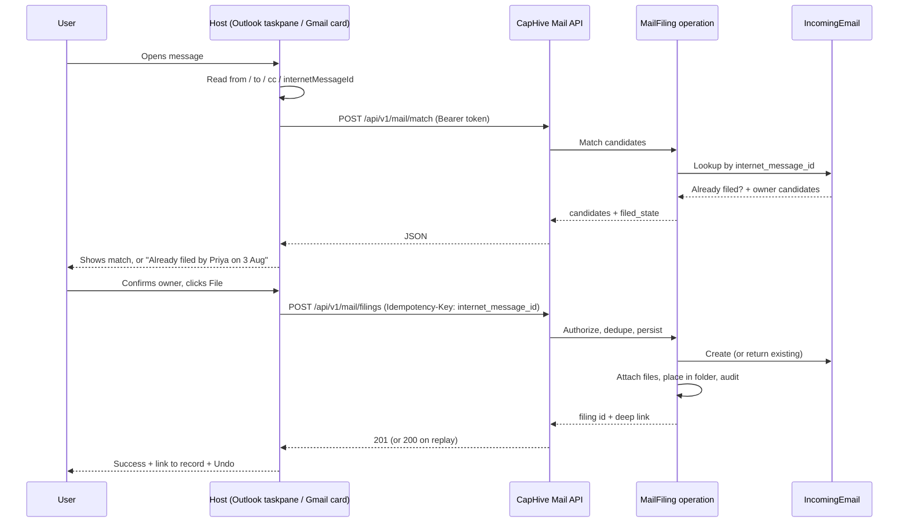
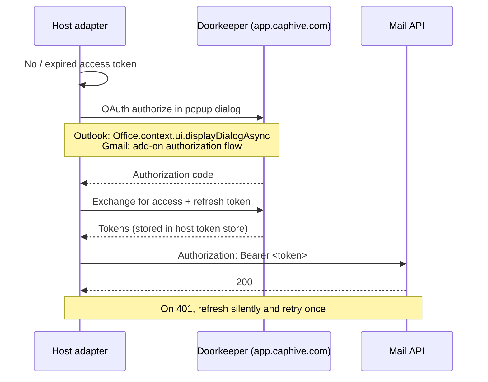

# Outlook & Gmail Add-in — Functional Review and Rewrite Plan

Status: review of the as-built code, ahead of a rewrite.
Neither add-in has been exercised against a real mailbox, so this review focuses on
**what will break the first time a real user tries it**, not on style.

---

## 1. What actually exists today

| Piece | Location | State |
|---|---|---|
| Outlook manifest (CapHive) | `public/manifests/caphive_outlook_addin.xml` | Checked in |
| Outlook manifest (AltConnects) | `public/manifests/altconnects_outlook_addin.xml` | Checked in |
| Taskpane host page | `app/packs/core/base/views/layouts/outlook_addin.html.erb` | Checked in |
| Taskpane body | `app/packs/core/base/views/outlook_addin/taskpane.html.erb` | Checked in |
| Taskpane JS | `public/assets/outlook_addin.js` | Checked in (static, unfingerprinted) |
| Taskpane controller | `app/packs/core/base/controllers/outlook_addin_controller.rb` | Checked in |
| Match API | `app/packs/misc/incoming_emails/controllers/email_matches_controller.rb` | Checked in |
| Filing API | `IncomingEmailsController#create` | Checked in |
| Matching logic | `app/packs/misc/incoming_emails/services/investor_email_matcher.rb` | Checked in |
| Gmail add-on source | `docs/gmail_plugin/Code.gs` (856 lines) | **On `origin/added_gmail_plugin` only — not merged to `main`** |
| Gmail add-on manifest | `docs/gmail_plugin/appsscript.json` | Same branch |

Both `origin/outlook_plugin` and `origin/added_gmail_plugin` are behind `main`. `main` holds
the current Outlook code; the Gmail add-on has never been merged, so it is invisible to
anyone working from `main`. It has been brought onto the rewrite branch for this review.

**Current code reuse between the two plugins: essentially zero.** They share only the two
HTTP endpoints (`/email_matches`, `/incoming_emails`). Everything else — auth, matching
payloads, dedup, body format, UI, error handling — is independently and *differently*
implemented, and the two now disagree about what gets stored for the same email.

---

## 2. Blockers — the add-in cannot work in production as written

### B1. Session auth cannot survive the Outlook iframe (fatal)

`OutlookAddinController` relies on `authenticate_user!`, i.e. the `_caphive_session`
cookie. Outlook loads the taskpane in a **cross-site iframe** (`outlook.office.com` →
`app.caphive.com`).

`config/initializers/session_store.rb` sets no `same_site` option, so Rails applies the
default **`SameSite=Lax`**. A `Lax` cookie is not sent on cross-site iframe subresource
requests. The very first `GET /outlook_addin/taskpane` therefore arrives unauthenticated
for every user, in every browser that enforces the default (all current Chrome/Edge, and
new Outlook is Edge WebView2).

The failure is not a clean error. Devise redirects to `/users/sign_in`, the iframe renders
the full `modernize` login layout, and the user is asked to log in inside a 320px pane.
The same cookie problem then blocks the login POST.

There is a second-order failure even when a session does exist: `expire_after: 60.minutes`.
After an hour the `fetch()` calls get an HTML redirect body, `response.json()` throws, and
the JS surfaces `Error matching investor: Unexpected token '<'` — with no re-auth path.

**Fix:** do not use session cookies. The app already runs Doorkeeper with OIDC
(`use_doorkeeper_openid_connect`, `/.well-known/oauth-authorization-server`). Both add-ins
should hold an OAuth access token and call a token-authenticated API.
`WithAuthentication#authenticate_user!` already branches on an `Authorization` header, so
the plumbing exists.

### B2. Both manifests share one add-in `Id` (fatal for the second tenant)

```
caphive_outlook_addin.xml     <Id>61f73634-8c8d-4c31-9a74-27960166699a</Id>
altconnects_outlook_addin.xml <Id>61f73634-8c8d-4c31-9a74-27960166699a</Id>
```

Outlook keys installed add-ins by `Id`. The two cannot coexist in one tenant, and
sideloading the second silently replaces the first. Every branded manifest needs its
own GUID.

### B3. `message_id` is given a value that does not fit and is not stable

The JS sends `message_id: item.itemId`. `item.itemId` is an **EWS item ID** — a long
base64 string (routinely 150–200+ chars, and larger on some tenants) that is
**mailbox-specific and changes when the item is moved between folders**.

- `incoming_emails.message_id` is `string` (255). On MySQL prod, a long EWS id is a
  `Data too long for column 'message_id'` 500, not a truncation.
- Even when it fits, it is useless as an identity key. The stable RFC 5322 identifier is
  `item.internetMessageId`, which the code already collects but never keys on.

### B4. Filing is not idempotent — duplicates are guaranteed

`IncomingEmailsController#create` has no duplicate check. (The SendGrid path does — it
checks `IncomingEmail.exists?(message_id:)`.) There is also no unique index on either id
column. Consequences on day one:

- User double-clicks, or clicks after a slow response → two rows.
- Two colleagues file the same thread → two rows, no warning.
- The taskpane never says "already filed", which is the single most-requested behaviour
  in any mail-filing add-in.

### B5. Outbound email cannot be filed at all

`InvestorEmailMatcher#initialize` accepts `to_emails:` and assigns `@to_emails` — and then
**never references it in `match`**:

```ruby
all_emails = ([@from_email] + @cc_emails).uniq.compact_blank
```

Matching is From + CC only. For any email the fund *sent* to an investor, the sender is
the fund manager and the investor is in To — so the match always returns `none`. Roughly
half of investor correspondence is outbound. The PRD
(`docs/product/outlook_plugin_design.md` §7) explicitly lists "sender, to, and cc".

The manifest compounds this: `<Rule xsi:type="ItemIs" ItemType="Message" FormType="Read" />`
with only a `MessageReadCommandSurface` extension point. There is no compose surface, so
filing at send time is not possible either.

### B6. The pane files the wrong email when the user changes selection

`initializeAddin()` reads `Office.context.mailbox.item` **once**, at load. In Outlook on
the web and new Outlook the taskpane **stays open when the user clicks a different
message**. Nothing re-reads the item, because
`Office.context.mailbox.addHandlerAsync(Office.EventType.ItemChanged, …)` is never wired.

Result: the pane keeps showing email A's subject and matched investor while the user is
reading email B, and "File to CapHive" files A. This is a silent data-integrity bug — the
user gets a green success message for the wrong action.

### B7. Attachments are never filed

`IncomingEmail#save_attachments` exists but is only called from the SendGrid path. The
add-in sends body text only. Filing an investor email without its side letter, wire
confirmation or signed subscription document defeats the purpose of the feature.

---

## 3. High-severity functional defects

### D1. HTML bodies will overflow the `body` column

`Office.CoercionType.Html` returns the complete HTML source — inline styles, quoted
history, base64 inline images. `incoming_emails.body` is `text` (64 KB on MySQL). Real
threads exceed that regularly. In strict mode that is a 500; otherwise silent truncation.
Needs `mediumtext` at minimum, plus sanitise-and-strip on write.

> **Pre-existing caveat found while fixing D1.** The committed `db/schema.rb` is
> adapter-neutral — it carries no `charset`, `collation` or `size:` options, because it
> has to load into SQLite for the test environment. Dumping directly from the MySQL
> connection *does* emit `t.text "body", size: :medium`, but the committed file records
> only `t.text "body"`.
>
> Consequence: a MySQL database built from `schema.rb` rather than migrated forward gets
> 64KB `TEXT`. This already affects all nine `mediumtext`/`longtext` columns in the
> database, including `action_text_rich_texts.body`. Migrated environments (dev, staging,
> prod) are correct; a from-scratch `db:schema:load` into MySQL is not. Out of scope here,
> but worth a separate fix.

### D2. `to` / `cc_emails` are `string` (255) and the add-in does not truncate

The SendGrid path defensively calls `params[:to].truncate(255)`. The add-in path joins the
full recipient list with commas and sends it raw. Any email with more than ~8 recipients
overflows the column.

### D3. `nil` subject crashes owner matching

`IncomingEmail#match_mailbox` calls `subject.strip` with no nil guard. Empty-subject emails
are common. (Only reachable on the SendGrid path today, since the add-in always sets
`entity`, but it is a live 500 on the shared model.)

### D4. Domain matching does a full table scan and is not escape-safe

```ruby
matches = investor_scope.where("primary_email LIKE ?", "%@#{from_domain}")
```

A leading `%` makes the index on `primary_email` unusable — every match request scans the
investor table. Additionally `from_domain` comes from an attacker-controllable `From`
header and `%`/`_` are not escaped, so `a_b.com` matches `axb.com`. Per the repo's
large-table hygiene rules this query should be rewritten against a normalised, indexed
domain column.

### D5. `fetchAllInvestors()` loads every investor into a `<select>`

`GET /outlook_addin/investors` returns the entire policy-scoped investor list with no
`limit`, no pagination and no search. For a real fund entity that is a multi-megabyte JSON
payload rendered into a dropdown inside a 320px pane. Needs a typeahead endpoint
(`?q=`, capped).

### D6. Wrong authorisation gate

Filing requires `authorize investor, :update?`. Read-only IR and compliance staff — the
people most likely to be filing correspondence — cannot file. `IncomingEmailPolicy#create?`
is unconditionally `true`, so the investor policy is the only real gate. Filing an email is
not an investor mutation and needs its own policy method.

### D7. Manifest defects that will fail AppSource review

- `<Permissions>ReadWriteItem</Permissions>` — the add-in only reads. Over-permissioned
  manifests are a standard rejection reason. Should be `ReadItem`.
- Icons point at `favicon.ico`. Outlook requires **PNG** at 16/32/80 px; `.ico` will not
  render in the ribbon.
- `FunctionFile` resid points at the taskpane URL. A `FunctionFile` must be an HTML page
  that loads Office.js and calls `Office.actions.associate`. Harmless today (nothing calls
  `ExecuteFunction`) but wrong.
- `DesktopFormFactor` only — no `MobileFormFactor`, so no Outlook mobile.
- `dev.altconnects.com` is hardcoded in a checked-in, shippable manifest.
- No `<WebApplicationInfo>` block, which is what makes Office SSO (`getAccessToken`)
  possible — the clean fix for B1.

### D8. Client-side robustness

- `document.querySelector('meta[name="csrf-token"]').content` throws `TypeError` when the
  session has expired (no meta tag on the redirect page).
- No guard for `Office.context.mailbox.item === null` (no message selected / reading pane
  off) → the whole add-in throws on init.
- `showError`/`showSuccess` interpolate server strings into `innerHTML` unescaped.
- The simulator branch ships in the production bundle. In a plain browser
  `document.getElementById('sim-from').value` throws, because the simulator controls only
  render under `Rails.env.development?`.
- **`public/assets/outlook_addin.js` was never committed to any branch.** `.gitignore`
  excludes `public/assets/*`, and `git log --all` for that path is empty — the task pane's
  entire client-side logic existed only as an untracked file on one developer's machine,
  served out of the Sprockets output directory. There was no reproducible way to deploy
  it, which on its own explains why the add-in was never exercised against a real mailbox.
  Being outside the asset pipeline, it was also unfingerprinted, so Outlook's embedded
  WebView would have cached it indefinitely and never picked up a fix.
- After a successful file the button stays disabled forever — no undo, no second filing,
  no link through to the record in CapHive.

### D9. Styling violates the repo's own conventions

A ~140-line `<style>` block lives in `outlook_addin.html.erb` and inline `style=` attributes
are scattered through `taskpane.html.erb`. Repo convention is SCSS files and shared
partials.

---

## 4. Gmail add-on (`docs/gmail_plugin/Code.gs`) — separate blockers

### G1. The sign-in card collects the user's CapHive password in a plaintext field (fatal)

`buildCard` renders two `CardService.newTextInput()` fields, `signin_email` and
`signin_password`, and `onSignIn` POSTs them to `/users/tokens/sign_in` (devise-api).

- **CardService has no password input type.** `TextInput` does not mask. The user's
  CapHive password is typed and displayed in clear text inside the Gmail sidebar.
- Collecting a third-party password inside a Workspace add-on is a standard **Marketplace
  and OAuth-verification rejection**.
- It bypasses SSO and MFA entirely. The app runs Doorkeeper OIDC; any user who signs in
  via an identity provider has no password to type and simply cannot use the add-on.
- `getDemoCredentials()` hardcodes `fm1@demofund.com` / `test12345` as source-level
  defaults.
- The returned token is written to `UserProperties` with no expiry tracking and no refresh.
  On any 401 the token is deleted and the user must retype their password.

### G2. It can only ever talk to the dev environment

```js
function getApiUrl() { return 'https://dev.altconnects.com'; }
```

The header comment instructs the installer to set a `CAPHIVE_API_URL` script property; the
code ignores it and returns a hardcoded dev host. `appsscript.json` reinforces this —
`urlFetchWhitelist: ["https://dev.altconnects.com/"]` and a dev-host `logoUrl`.

Meanwhile the cards hardcode `https://app.caphive.com/favicon.ico` for header images, so a
single add-on mixes prod and dev hosts. Installing against production requires editing
source.

`signInWithCredentials()` additionally builds `"https://dev.altconnects.com/" +
'/users/tokens/sign_in'` — a double slash. (Dead code; `onSignIn` has its own copy.)

### G3. Matching is deliberately crippled, then dead-ends with no way to file

```js
// Only send from_email so the server matches only the sender (not to/cc recipients).
var payload = { from_email: emailData.fromEmail, to_emails: [], cc_emails: [] };
```

The add-on extracts `toEmails` and `ccEmails` and then discards them. So Gmail matches on
sender alone — no CC-domain matching, and nothing at all for sent mail. Combined with
server bug **B5**, To-matching is doubly dead.

That would be survivable if the user could pick an investor manually. They cannot —
manual selection was deliberately removed:

> `// Manual investor selection UI has been removed.`

On `match_type: 'none'` — which G3 makes the *common* case — the card says "No matching
investor found" and offers only **a sign-in form to try a different account**. There is no
path to file the email. The Outlook pane at least falls back to a dropdown.

### G4. Signing in silently files the email

`onSignIn`, after storing the token, re-runs the match and — on a single match — **files
the email immediately**, before the user has seen or confirmed the target:

> `// If the server returned a single match, automatically file the email`

The user types a password to log in and an email is filed to a guessed investor, with no
confirmation step and no undo.

### G5. Identity keys are incompatible with the Outlook path

`fileEmail` sends `message_id: emailData.messageId`, where `messageId` is
`e.gmail.messageId` — a **Gmail-account-specific** id, not the RFC 5322 `Message-ID`.
`internet_message_id` is never sent by the Gmail path at all.

So the same email filed from Outlook and from Gmail produces two rows with unrelated,
mutually meaningless ids, and two Gmail users produce two more. Cross-client dedup is
impossible even once B4 is fixed.

### G6. The two clients store different content for the same email

Gmail sends `message.getPlainBody()`; Outlook sends `Office.CoercionType.Html`. The same
thread filed from the two clients yields structurally different records — one loses all
formatting, tables and links. Neither files attachments.

### G7. Over-broad OAuth scopes, hiding a latent runtime bug

`appsscript.json` requests both `gmail.addons.current.message.readonly` and
`gmail.readonly`. `gmail.readonly` is a **restricted scope** requiring a CASA security
assessment to list on the Marketplace — significant time and cost.

Only the current-message scope is needed. The reason the broad scope is there:
`extractEmailData` correctly calls `GmailApp.setCurrentMessageAccessToken(accessToken)`,
but the action handlers (`onFileEmailClick`, `onFileEmailMultiSelect`, `onPasteToken`,
`onSignIn`) call `GmailApp.getMessageById(messageId)` in a fresh execution context
**without** setting the token first. They only work because full-mailbox read is granted.
Drop the restricted scope — as a Marketplace listing requires — and every filing action
breaks.

### G8. Legacy manifest format

`appsscript.json` uses the deprecated top-level `"gmail"` key rather than the `"addOns"`
structure of a Google Workspace Add-on, has no `homepageTrigger`, and does not pin
`runtimeVersion: "V8"` (the source is ES5 throughout).

### G9. Development leftovers

- `getCommonHeaders()` always sends `ngrok-skip-browser-warning` and
  `bypass-tunnel-reminder`.
- `onPasteToken` is a live handler, but no card renders a `paste_token` input — it is
  unreachable.
- `signInWithCredentials()` and `getDemoCredentials()` are never called.
- `testApiConnection()` probes `/outlook_addin/investors`, which the Gmail add-on never
  otherwise uses.
- `buildErrorCard` interpolates raw exception text — including HTML error-page bodies —
  into `TextParagraph`, which accepts only a small HTML subset. An unescaped `<` corrupts
  card rendering.

### G10. Deployed by copy-paste, from `docs/`

The source lives under `docs/gmail_plugin/` with manual instructions to open
script.google.com and paste the file in. No clasp, no CI, no deployment versioning.
Whatever is running today cannot be verified against this source.

---

## 5. Test coverage is effectively zero

`features/misc/outlook_email_matcher.feature` exercises `InvestorEmailMatcher` directly.
It never touches a controller, the auth path, or the JS.

The "API - File email" scenario is vacuous — the step definition constructs an
`IncomingEmail` by hand and then asserts against a hash it made up in the same step:

```ruby
@incoming_email = IncomingEmail.create!(...)
@api_response = { success: true }
```

```ruby
Then('the API response should be successful') do
  expect(@api_response[:success]).to be true
end
```

No API is called. The scenario cannot fail.

---

## 6. Rewrite plan — one shared core, two thin host adapters

The goal is that everything worth testing lives in Rails, and each host adapter is a small
translation layer that reads a message from its host and renders that host's native UI.

### 6.1 What is shared (all of it in Rails)

**A single versioned mail-filing API**, host-agnostic and token-authenticated via the
existing Doorkeeper server:

| Endpoint | Purpose |
|---|---|
| `POST /api/v1/mail/match` | from/to/cc → ranked owner candidates **+ already-filed state** |
| `GET  /api/v1/mail/owners?q=` | capped typeahead across filable owners |
| `POST /api/v1/mail/filings` | idempotent file, keyed on `internet_message_id` + owner |
| `POST /api/v1/mail/filings/:id/attachments` | attachment upload |
| `DELETE /api/v1/mail/filings/:id` | undo |

**A `MailFiling` Trailblazer operation** (per repo convention for new services) owning:
match → resolve owner → dedupe → persist → attachments → folder placement → audit.

**`InvestorEmailMatcher` rewritten** to use To as well as From and CC, to match against an
indexed domain column instead of a leading-wildcard `LIKE`, and to return already-filed
state alongside candidates.

**Owner is polymorphic** — `incoming_emails.owner` already supports deals and portfolio
companies. The API should expose that; only the current plugin hardcodes investors.

**One Cucumber suite** against the API covers both plugins.

### 6.2 What is host-specific

Gmail add-ons cannot render arbitrary HTML — the UI is Google's CardService JSON — so the
UI layer genuinely cannot be shared. Everything behind it can be.

**Outlook** — an Office.js taskpane (~150 lines): read the item, wire `ItemChanged`,
render, call the API.

**Gmail** — the existing `Code.gs` keeps its CardService structure but sheds everything
that duplicates or contradicts the server: the password sign-in card (→ OAuth), the
hardcoded host (→ script property), the emptied `to_emails`/`cc_emails` (→ send them), the
removed manual selection (→ restore, backed by the shared typeahead endpoint), the
auto-file-on-sign-in behaviour (→ always confirm), and `getPlainBody()` (→ HTML, matching
Outlook). Target is roughly 300 lines, down from 856.

Both then send identical payloads keyed on the same `internet_message_id`, so an email
filed from either client is the same record.

### 6.3 Shared filing flow



### 6.4 Auth flow (shared by both hosts)



### 6.5 Suggested sequencing

Outlook goes first and proves the shared core against a real mailbox; Gmail then rides the
same API with no server changes.

1. **Data layer** — widen `body` to `mediumtext`, widen/normalise `to` and `cc_emails`,
   add a unique index on `(entity_id, internet_message_id, owner_type, owner_id)`, add an
   indexed domain column for matching.
2. **Shared API + `MailFiling` operation + policy method**, with Cucumber coverage.
3. **Matcher rewrite** — To-matching, indexed domain match, already-filed state.
4. **Outlook adapter rewrite** — OAuth, `ItemChanged`, attachments, typeahead, undo,
   fingerprinted asset; manifest fixed (unique GUIDs, `ReadItem`, PNG icons,
   `WebApplicationInfo`, mobile form factor, per-tenant host substitution).
5. **Validate against a real Outlook mailbox** before touching Gmail.
6. **Gmail adapter** — `Code.gs` rewritten against the same API; `appsscript.json` moved to
   the `addOns` format, restricted scope dropped, host from a script property; source moved
   out of `docs/` and deployed via clasp.
7. **Compose-mode / sent-mail filing** once read-mode is proven.

---

## 7. Testing without Outlook or Gmail

Three levels, cheapest first. Only the third needs a tunnel or a real mailbox.

### 7.1 Browser simulator (no Outlook at all)

Run the app and open **`/outlook_addin/taskpane`** in a normal browser tab. Office.js
reports no host, so the pane loads its simulator adapter instead and shows a panel where
you type the message — From, To, CC, subject, Message-ID, HTML body, and real file
attachments.

Everything below the host boundary is the same code the add-in runs in Outlook: matching,
the already-filed check, filing, attachment upload and undo all go through
`/api/v1/mail/*` for real. Only the four Office.js calls (read item, read body, read
attachments, sign in) are swapped.

- **Sign in:** log in to CapHive in another tab first, then click *Sign in to CapHive*.
  The simulator fetches a token from `/outlook_addin/oauth_start.json`, which is
  session-authenticated and disabled in production. The token is kept in `localStorage`.
- **Testing the wrong-email bug:** change the From/subject fields and click *Load this
  message*. That fires the same handler `ItemChanged` fires in Outlook, which is what the
  pane previously ignored.
- **Testing idempotency:** file the same Message-ID twice — the second returns
  `already_filed`, and the pane says so instead of claiming a fresh filing.
- **Testing the no-Message-ID path:** clear the Message-ID field. Two such emails must
  both file, and neither may report the other as a duplicate.

The simulator panel is rendered only outside production, and the JS activates it only when
the layout sets `window.CAPHIVE_SIMULATOR`.

### 7.2 API directly

Needs no client at all. Mint a token and drive the endpoints:

```bash
bin/rails runner 'u = User.first; puts MailAddinToken.issue_for(u).token'

TOKEN=<the token>
curl -X POST localhost:3000/api/v1/mail/match \
  -H "Authorization: Bearer $TOKEN" -H 'Content-Type: application/json' \
  -d '{"from_email":"investor@example.com","to_emails":["gp@fund.com"],
       "internet_message_id":"<demo-1@example.com>"}'
```

`match` → `filings` → `filings` again (expect `already_filed: true`) → `match` again
(expect `filed: true`) → `DELETE /filings/:id` covers the whole contract.

### 7.3 The real hosts

Neither of the levels above proves the host integration — Office.js item reading, the
dialog channel, CardService rendering. That still needs:

- **Outlook:** a public HTTPS URL (the app runs plain HTTP on :3000 locally, so a tunnel is
  required), the host substituted into `config/outlook_addins.yml`, `rake outlook:manifests`,
  and the manifest sideloaded.
- **Gmail:** `clasp push` from `addons/gmail`, plus `CAPHIVE_API_URL` set to a host Google's
  servers can reach.

---

## 8. Documentation to correct alongside the rewrite

- `docs/user_guides/gmail_addon_user_guide.md` documents a Marketplace listing and an
  install flow for an add-on that is not merged, not listed, and currently points at the
  dev environment. It should not ship until the add-on does.
- `docs/gmail_plugin/README.md` and `QUICKSTART.md` document the copy-paste deployment and
  the script-property configuration that `getApiUrl()` ignores.
- `docs/product/outlook_plugin_design.md` §7 states matching priority as domain-first with
  a direct-email fallback. The code does the reverse (InvestorAccess first, then domain).
  The code's order is the better one; the PRD is stale.
