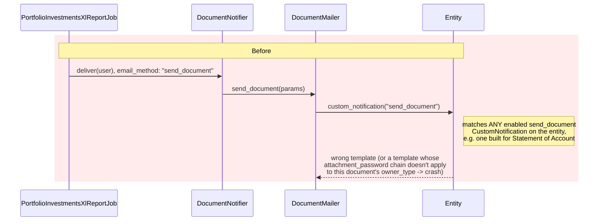
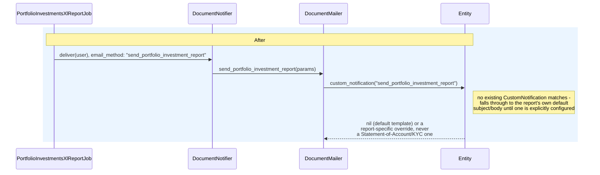

# Portfolio Investment Report Email: Isolating It from `send_document`

## Context

`PortfolioInvestmentsXlReportJob` generates the Portfolio Investment Report, saves it as a
`Document`, and emails it to the requesting user via `DocumentNotifier` → `DocumentMailer`, using
`email_method: "send_document"` — the same email_method used whenever *any* document is manually
shared with a user (`Document#show`'s "Send" action, etc.).

`entity.custom_notification(email_method)` (`WithCustomNotifications#custom_notification`,
`app/packs/core/notifications/models/concerns/with_custom_notifications.rb`) resolves a
`CustomNotification` override purely by `email_method` — it has no awareness of *what kind* of
document is being sent, or of `Document#owner_type`. `.last` (highest id) wins among an entity's
enabled matches. This surfaced two real bugs on a local entity that had a `CustomNotification`
configured for Statement of Account emails (`for_type: "Send Document"`,
`attachment_password: "investor_kyc.PAN"`, subject "Statement of Accounts"):

1. **Crash.** `ApplicationMailer#password_protect_attachment` (`app/packs/core/base/mailers/application_mailer.rb:351`)
   evaluates `attachment_password` as a dotted method chain against `document.owner`:
   `methods.inject(model, &:send)`. For a Statement of Account, `document.owner` is a
   `CapitalCommitment`, which has `belongs_to :investor_kyc` (singular) — the chain resolves fine.
   For the Portfolio Investment Report, `document.owner` is an `Investor` (portfolio company),
   which only has `has_many :investor_kycs` (plural, no singular reader) → `NoMethodError:
   undefined method 'investor_kyc' for an instance of Investor`. The mailer action raised before
   ever reaching `mail(...)`, so nothing was delivered (silently, in a background job) — including
   in dev, where the raise happens before `letter_opener` ever gets a message to render.
2. **Wrong content once the crash was fixed.** With `password_protect_attachment` off, the email
   *did* send — but with the Statement of Accounts template's subject ("Statement of Accounts")
   and body, because that record was still the `.last` enabled `send_document` `CustomNotification`
   on the entity. The Portfolio Investment Report email had no way to avoid inheriting whatever
   generic `send_document` template happened to exist.

Both are symptoms of the same design gap: `send_document` is shared indiscriminately across
every kind of document. The fix is to stop the report from using that shared email_method at all.

## Before / After

## Changes

- **`app/packs/funds/portfolios/jobs/portfolio_investments_xl_report_job.rb`** — `email_method`
  changed from `"send_document"` to `"send_portfolio_investment_report"`.
- **`app/packs/core/documents/mailers/document_mailer.rb`** — new `send_portfolio_investment_report`
  action, structurally identical to `send_document` (still calls `pw_protect_attach_file`, so an
  entity *can* opt into password protection for this email_method specifically), but with its own
  subject (`"Portfolio Investment Report - #{entity.name}"`) and its own view.
- **`app/packs/core/documents/views/document_mailer/send_portfolio_investment_report.erb`** — new
  template, same structure as `send_document.erb` (custom-notification override, else default copy,
  else "View Report" button), with report-specific default text.
- **`app/packs/core/notifications/models/custom_notification.rb`** — `email_methods` (line ~129),
  used to populate the "For Notification" dropdown when creating a `CustomNotification` with
  `for_type: "Send Document"`, was previously hardcoded to `%w[send_document]`. Added
  `send_portfolio_investment_report` so an entity can deliberately configure an override for this
  email_method through the normal `/custom_notifications` UI. `mailer_classes` already resolves
  `for_type == "Send Document"` to `[DocumentMailer]` unconditionally, so no change was needed
  there for `PLACEHOLDERS`/mailer resolution to work for the new method.

No migration — `email_method` is a free-text string column with only a length validation.

## Why this is scoped as a new email_method, not a document-type check

An earlier approach considered tagging the generated document (e.g. via `tag_list`) and branching
inside `send_document.erb` on `document.portfolio_investment_report?`. That was rejected: `tag_list`
is a user-editable, searchable field shown on the document's own page and indexed into
Elasticsearch — repurposing it as an internal type marker pollutes that UI/search surface, and the
underlying entity-wide `send_document` `CustomNotification` collision (any future "generic" document
send could just as easily collide with an unrelated `CustomNotification` again) would remain
unaddressed for every other document type. Giving the report its own `email_method` fixes the
actual defect (indiscriminate `email_method` matching) rather than papering over one instance of it,
and follows the existing pattern other notifiers already use (e.g. `adhoc_kyc_notification` vs.
`adhoc_fund_notification` on `Fund`, both distinct email_methods on shared owner_type).

## Verification

Confirmed locally end-to-end (Sidekiq worker + `letter_opener`): re-running the job now delivers
`[development] Portfolio Investment Report - Demo Fund` with the report-specific body and a "View
Report" button, no longer picking up the unrelated Statement of Accounts `CustomNotification`
(id 108, entity 157) that previously both crashed the send (via its
`attachment_password: "investor_kyc.PAN"`) and, once that was disabled, hijacked the email content.

## Follow-up / known gaps (not addressed here)

- The same indiscriminate-matching design gap in `WithCustomNotifications#custom_notification`
  (email_method-only lookup, `.last` tiebreak, no owner_type awareness) still applies to every other
  document sent via the generic `send_document` email_method. This change only isolates the
  Portfolio Investment Report from it; a `CapitalCommitment`-owned document and an `Offer`-owned
  document sent via plain `send_document` can still collide with each other on any entity that has
  more than one enabled `CustomNotification` for that email_method.
- `CustomNotification` id 108 on entity 157 had `password_protect_attachment` disabled directly in
  the local dev database as an unblocking step — this is local data only, not a code fix, and the
  same misconfiguration (an `investor_kyc.PAN` password chain applied entity-wide, formerly also
  matching the Portfolio Investment Report before this change) may exist in other environments.

## Related: feature test coverage added for recent UI commits

While investigating this area, feature tests were also added for three unrelated UI commits that
had no test coverage:

- **`565f44b2` (investment instrument "For" field)** —
  `features/fund/investment_instrument_form.feature` /
  `features/step_definitions/investment_instrument_form_steps.rb`. Covers the generic
  `/investment_instruments/new` page offering an unlocked portfolio-company dropdown, and a page
  opened from a specific portfolio company locking that dropdown *and* still submitting the correct
  `portfolio_company_id` — the field is rendered `disabled`, so without the form's companion
  `hidden_field`, a disabled `<select>` wouldn't be posted at all and the save would silently drop
  the association.
- **`ff061a73` / `5bef0565`** (removed the full "Clone" action, renamed "Create With Fees" to
  "Replicate Distribution") — new scenario in `features/fund/capital_distributions.feature` checking
  both the distribution show page and the distributions list row for "Replicate Distribution"
  present / "Clone" absent. This also caught and fixed a **real regression**: the pre-existing
  "Create With Fees copies only the fee rows..." scenario had a stale
  `click_on("Create With Fees")` step left over from before the rename, which would have failed the
  next time the full suite ran (`features/step_definitions/capital_distribution.rb`).
