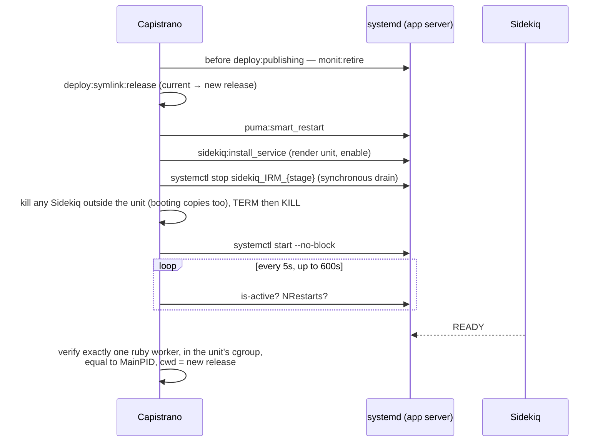

# Process Supervision: Puma and Sidekiq under systemd

**Status:** live on staging and `main` (#1696 Sidekiq on systemd, #1698 monit retired), September 2026.
**Scope:** app servers — how Puma and Sidekiq are started, stopped, restarted, verified on deploy
and alerted on.

## Problem

After some deploys Sidekiq was left in a state where **jobs were not processed but no Grafana
alert fired**, usually with a second Sidekiq process on the box.

Sidekiq had four uncoordinated launchers, each finding "the" Sidekiq by regex on the command line:

| Launcher | How it found Sidekiq |
|---|---|
| monit (`sidekiq_IRM_env.conf.erb`) | `matching 'sidekiq .* '` |
| `@reboot` cron entry (`config/schedule.rb`) | didn't check |
| daily restart cron entry | `pkill -9 -f '^sidekiq [0-9]'`, then relaunch |
| Capistrano (`sidekiq_stop.sh` + start + "exactly one worker" check) | `pgrep -f '^sidekiq '` |

Sidekiq changes its process title as it boots. While Rails loads, the title is Bundler's
`…/bin/sidekiq -e production`; only once booted does it become `sidekiq 8.1.7 IRM [0 of 8 busy]`.
A copy that was still booting matched monit's regex but **not** the stop script's or the deploy
check's, so it survived the stop, was not counted, and finished booting after Capistrano had
declared success — leaving two workers, typically one that could not run jobs (e.g. its release
directory deleted by `deploy:cleanup`). Separately, monit's asynchronous CLI (`monit monitor` is
acted on at the next 60s poll) could start a copy of its own after the deploy's check had passed.

"Sidekiq Down" stayed green throughout: it only checks that some Sidekiq on each host pushes
process metrics, and that metrics thread keeps running whether or not the process fetches jobs.

Puma had the same overlap in a milder form — systemd unit plus a monit pidfile check that could
launch a second Puma during a restart.

## Design

**One supervisor per service: systemd.** systemd tracks a unit by cgroup, not by name, so a
second copy cannot be started by construction; `systemctl stop` is synchronous; `Type=notify`
lets "started" mean "ready". monit, the `@reboot` Sidekiq entry, the `pkill` cron and
`capistrano-sidekiq` are gone.

| Service | Unit | Template | Boot start |
|---|---|---|---|
| Puma | `puma_IRM_{stage}` | `config/deploy/services/puma_IRM_env.service.erb` | enabled by `IRM:setup` and `monit:retire` |
| Sidekiq | `sidekiq_IRM_{stage}` | `config/deploy/services/sidekiq_IRM_env.service.erb` | enabled by `sidekiq:install_service` |

On top of that, the deploy **proves** the result rather than assuming it (stray sweep + cgroup,
MainPID and release checks), and two new alerts cover the failure class that "Sidekiq Down" is
blind to.

## Sidekiq

systemd is the **only** thing that starts, stops or restarts Sidekiq. There is no monit check,
no `@reboot` cron entry and no Capistrano-launched process.

| | |
|---|---|
| Unit | `sidekiq_IRM_{stage}` — template `config/deploy/services/sidekiq_IRM_env.service.erb`, installed to `/etc/systemd/system/` |
| Installed by | `sidekiq:install_service` on every deploy (re-renders the template; `daemon-reload` only when it changed) and after `IRM:setup` |
| Boot start | `systemctl enable` (replaces the old `@reboot` cron entry) |
| Logs | `/home/ubuntu/IRM/shared/log/sidekiq.log` (`StandardOutput=append:`) |
| Daily restart | `config/schedule.rb`: `sudo timeout 900 systemctl restart sidekiq_IRM_{stage}` at ~7:20am local, output in `/home/ubuntu/sidekiq_restart.log` |
| Manual control | `cap <stage> sidekiq:restart` (same as `ensure_clean_restart`) / `cap <stage> sidekiq:stop`; on the box `sudo systemctl status\|restart\|stop sidekiq_IRM_{stage}` |
| Threads | 8: default capsule 5, `single-threaded` 1 (serial/doc_gen/ai_checks), `db_restore` 1, `canary` 1 — the proctitle reads `[N of 8 busy]` |

### Unit settings and why

| Setting | Why |
|---|---|
| `Type=notify` | Sidekiq's `bin/sidekiq` sends `READY` on its `:startup` event, so the unit only turns `active` once Rails has booted. |
| `ExecStart=/bin/bash -lc 'unset WATCHDOG_PID; source /home/ubuntu/.rvm/scripts/rvm && rvm use default >/dev/null && cd /home/ubuntu/IRM/current && exec bundle exec sidekiq -e {stage}'` | Every step hands over its PID (`exec`, Bundler loads sidekiq in-process), so **ruby is the unit's main PID**. `rvm default do` is deliberately not used — it forks. Paths are hardcoded because systemd expands `$VAR` in `ExecStart` itself. |
| `KillMode=mixed`, `TimeoutStopSec=60` | Stop sends SIGTERM to Sidekiq only; it drains in-flight jobs for its 25s timeout and requeues the rest, and only then is the rest of the cgroup SIGKILLed. With the default `control-group`, job child processes (LibreOffice, pandoc) would be killed at once. |
| `WatchdogSec=120` | Sidekiq pings every 60s from a dedicated thread; systemd restarts the process only if the whole VM is wedged. |
| `Restart=always`, `RestartSec=10`, `StartLimitIntervalSec=0` | Never gives up — Sidekiq depends on Redis/MySQL on other hosts. |
| `TimeoutStartSec=600` | A fresh app server measured up to ~3.5 min to boot. |
| `EnvironmentFile=-/etc/environment`, `MALLOC_ARENA_MAX=2` | `RAILS_MASTER_KEY` lives in `/etc/environment` (services get no pam_env); the arena cap limits RSS fragmentation. |
| `NotifyAccess=all`, `unset WATCHDOG_PID` | Safety net so Sidekiq still starts if some step ever forks; the deploy's MainPID check then fails loudly. |

### Deploy flow



- **Stray sweep.** The process pattern `^sidekiq |bin/sidekiq( |$)|exec sidekiq( |$)` matches Sidekiq
  at every stage of its life — booted (`sidekiq 8.1.7 IRM [0 of 8 busy]`), booting (Bundler's title
  `…/bin/sidekiq -e staging`) and launcher shells — but not `tail -f sidekiq.log` or `grep`. The
  old scripts matched only the booted form, which is how a still-booting duplicate slipped through.
  A sweep that finds anything logs `sidekiq: N process(es) running outside sidekiq_IRM_{stage}`.
- **Readiness wait fails fast** (instead of blocking on `systemctl start`, which can hang while a
  crash-looping unit keeps its start job open): `failed to start`, `crashed while booting and
  systemd is restarting it` (NRestarts went up), or `was not ready after 600s`. Each prints
  `systemctl status` and the last 40 lines of `sidekiq.log`. systemd keeps retrying afterwards;
  `sudo systemctl stop sidekiq_IRM_{stage}` halts it.
- **Success line:** `sidekiq: 1 worker (pid N) is sidekiq_IRM_{stage}'s main process, running /home/ubuntu/IRM/releases/<ts>`.
- **Maintenance mode** (`nginx:switch_maintenance`) runs `sidekiq:stop`. On a box without the unit
  (not deployed since the switch) it falls back to `monit unmonitor` plus the stray sweep.
- **DR / `dr:assess` / `dr:fix:app_server`** use the same `sidekiq:ensure_clean_restart`.

## Puma

| | |
|---|---|
| Unit | `puma_IRM_{stage}` (`Restart=always`, `RestartSec=1`) |
| Socket | `/home/ubuntu/IRM/shared/tmp/sockets/IRM-puma.sock` |
| Config | `config/deploy/templates/puma.rb.erb` (4 workers × 16 threads, `preload_app!`) |
| Deploy restart | capistrano3-puma's `after deploy:published → puma:smart_restart` (`systemctl restart`) |
| DR restart | `puma:ensure_clean_restart` after `nginx:switch_app` — `fuser -k` on the socket, then `systemctl restart` |
| Maintenance | `nginx:switch_maintenance` runs `puma:stop` |

## Reboots and log rotation

`config/schedule.rb` reboots app servers every Saturday at 01:00 UTC (6:30am IST; Friday evening
in the US), after logrotate at 00:50.

- **Shutdown:** `sudo reboot` stops both units through systemd, so Sidekiq drains in-flight jobs
  (`KillMode=mixed`, up to 60s) instead of being killed as a cron/monit-launched process was.
- **Boot:** both units are enabled and start by themselves. Nothing in the `every :reboot` block
  starts Puma or Sidekiq any more — only `prometheus_exporter` and the `xirr_py` container. Sidekiq
  retries until Redis/MySQL on the DB box are reachable (`Restart=always`).
- **Alerts around the reboot:** the canary gap (reboot plus a Sidekiq boot of up to ~3.5 min) stays
  under the 10-minute "Sidekiq Canary Stale" threshold. "Sidekiq Down" can briefly fire, as it could
  before this change: `prometheus_exporter` is back within seconds, Sidekiq only after Rails boots.
- **Logs:** logrotate (`config/deploy/logrotate.conf`) uses `create`, not `copytruncate`, so a running
  Sidekiq keeps appending to the rotated file until it is restarted. The 01:00 reboot and the daily
  restart reopen `sidekiq.log`.
- On the IN schedule the daily Sidekiq restart (01:50 UTC) follows 50 minutes after the Saturday
  reboot; the second restart is redundant but harmless.

## Retiring monit

`monit:retire` (`config/deploy.rb`) runs **before `deploy:publishing`** on every deploy and after
`IRM:setup`, so it precedes the symlink switch and both restarts. On each app server it:

1. Does nothing if `monit.service` doesn't exist.
2. **Refuses** if `puma_IRM_{stage}.service` is missing — monit could be Puma's only supervisor there
   (run `IRM:setup` first).
3. Enables the Puma unit (boot start no longer has monit as a fallback).
4. `systemctl disable --now monit` (synchronous).
5. **Kills any process holding Puma's socket that is not in the Puma unit** (TERM, then KILL after
   30s). monit started Puma with `sudo -iu ubuntu`, and pam_systemd moves a `sudo -i`/`su -` login
   into its own session scope — so a monit-launched Puma is *not* in `monit.service`'s cgroup and
   survives monit stopping. Left alone it would keep the socket and serve the old release while the
   systemd Puma crash-loops. (A monit-launched Sidekiq is cleared by Sidekiq's stray sweep.)
6. Removes `/etc/monit/conf.d/{puma,sidekiq}_IRM_{stage}.conf` and the sandbox drop-in
   `/etc/systemd/system/monit.service.d/`.

monit is **disabled, not purged**: `apt-get` would contend for the dpkg lock with
unattended-upgrades, and a disabled unit stays down across package upgrades. The app-server Packer
template (`config/deploy/templates/packer/appserver.ami.pkr.hcl`) no longer installs monit; AMIs
made by snapshotting a deployed server inherit the disabled state.

## Monitoring and alerts

Rules live in `config/initializers/observability/grafana_provision.yml` (mirrored in `alerts.yml`).

| Alert | Expression | Catches |
|---|---|---|
| Sidekiq Down | `sum(up{job="rails_app"}) - count(count by(hostname)(ruby_rss{type="sidekiq"})) > 0` for 2m | No Sidekiq process pushing metrics on a host. Blind to a process that is alive but not fetching jobs. |
| **Sidekiq Canary Stale** | `time() - max(ruby_sidekiq_canary_last_run_timestamp_seconds) > 600` for 2m, NoData = alerting | No job has actually *run* for 10 minutes. `SidekiqCanaryJob` runs every minute on its own `canary` capsule, so busy job threads can't delay it. Cannot catch a Sidekiq pointed at the wrong Redis (the canary would be enqueued there too). |
| **Sidekiq Duplicate Workers** | `max(count by(hostname)(ruby_rss{type="sidekiq"})) > 1` for 5m | More than one Sidekiq process on a host — something outside the unit launched one. |
| Queue Latency / Depth / Dead / Retry, Cannot Reach Redis, Memory | see the rules file | Backlog, failures, Redis fetch errors, RSS leaks. |

**Provisioning.** `grafana:provision:alert_rules` pushes every rule in the file (deletes and recreates
the folder); it cannot skip one. IN (`graphana.caphive.com`) and US (`graphana.caphive.us`) are
separate Grafana instances with their own Prometheus, selected by `GRAFANA_URL`. Provision a region
only after the code is deployed there **and** the canary metric exists — check in Explore that
`time() - max(ruby_sidekiq_canary_last_run_timestamp_seconds)` returns a value under ~120. Otherwise
"Sidekiq Canary Stale" fires immediately on NoData.

```bash
GRAFANA_URL=https://graphana.caphive.com GRAFANA_PASS=… bundle exec rake grafana:provision:alert_rules
```

## Troubleshooting

| Symptom | Check / fix |
|---|---|
| Is Sidekiq healthy? | `sudo systemctl status sidekiq_IRM_{stage}` → `active (running)`; `systemctl show -p MainPID --value sidekiq_IRM_{stage}` equals the pid in `ps auxw \| grep '[s]idekiq'` |
| `ps` shows `…/bin/sidekiq -e {stage}` instead of `sidekiq 8.1.7 IRM [...]` | Still booting (high CPU, a few seconds old). If it persists for minutes the unit shows `activating` — read `shared/log/sidekiq.log`. |
| Two Sidekiq processes / Duplicate Workers alert | `pgrep -af '[s]idekiq'`; `cat /proc/<pid>/cgroup` — the one without `sidekiq_IRM_{stage}.service` is the stray. `cap <stage> sidekiq:restart` (filter with `HOSTS=`) kills it and restarts cleanly. |
| Canary Stale but process up | Stuck shutdown, wedged, or running from a deleted release: `readlink /proc/<pid>/cwd` (`(deleted)`), Sidekiq Busy page, `sidekiq.log`; then `cap <stage> sidekiq:restart`. |
| Deploy fails `crashed while booting` | The release's Sidekiq can't boot (credentials, env, Redis host). Fix and redeploy, or roll back. |
| Deploy fails `MainPID … is not the worker` | `ExecStart`'s exec chain forked (e.g. an rvm change); stops would not drain jobs. Fix the unit template. |
| Daily restart didn't happen | `/home/ubuntu/sidekiq_restart.log` (`restarted` or `restart failed or timed out`). |

## Rollout checklist

1. Deploy one region at a time. First deploy per box may log
   `sidekiq: N process(es) running outside sidekiq_IRM_production` and/or
   `monit: N puma process(es) outside puma_IRM_production` — expected leftovers being cleared.
2. Confirm on the box: `systemctl is-active monit` → `inactive`;
   `systemctl show -p MainPID --value sidekiq_IRM_production` matches the Sidekiq pid; the deploy log
   has the `1 worker (pid N) is sidekiq_IRM_production's main process` line.
3. In that region's Grafana, confirm the canary metric exists, then provision alert rules for that
   region only.
4. Later: rebake the app-server AMI; once every region is deployed, drop `sidekiq:stop`'s
   unit-less fallback.

## Files

| File | Role |
|---|---|
| `config/deploy/services/sidekiq_IRM_env.service.erb` | Sidekiq systemd unit |
| `config/deploy/services/puma_IRM_env.service.erb` | Puma systemd unit |
| `config/deploy.rb` | `sidekiq:install_service`, `sidekiq:ensure_clean_restart`, `sidekiq:stop`, `monit:retire`, hooks |
| `config/schedule.rb` | Daily Sidekiq restart via `systemctl` |
| `config/initializers/sidekiq.rb` | `canary` capsule, `SidekiqCanaryJob` cron registration |
| `app/packs/core/base/jobs/sidekiq_canary_job.rb` | Canary job + `ruby_sidekiq_canary_last_run_timestamp_seconds` gauge |
| `config/initializers/observability/grafana_provision.yml`, `alerts.yml` | Alert rules |
| `config/deploy/templates/packer/appserver.ami.pkr.hcl` | AMI without monit |
| `features/core/sidekiq_process_management.feature` | Crontab has no Sidekiq launcher and restarts via systemctl; canary is cron-registered |

## Related

- [Infrastructure Deployment & Upgrade Guide](infrastructure_deployment.md) — deploy phases and process management summary
- [DR Guide](../DR_GUIDE.md) — first-boot services on recovered app servers
- [DR Component Recovery](../DR_COMPONENT_RECOVERY.md) — Sidekiq/Puma rungs of the repair ladder
- [Infra rake tasks](infra_rake_tasks.md) — `dr:assess` auto-restart of Sidekiq
- `config/initializers/observability/README.md` — full alert catalogue
