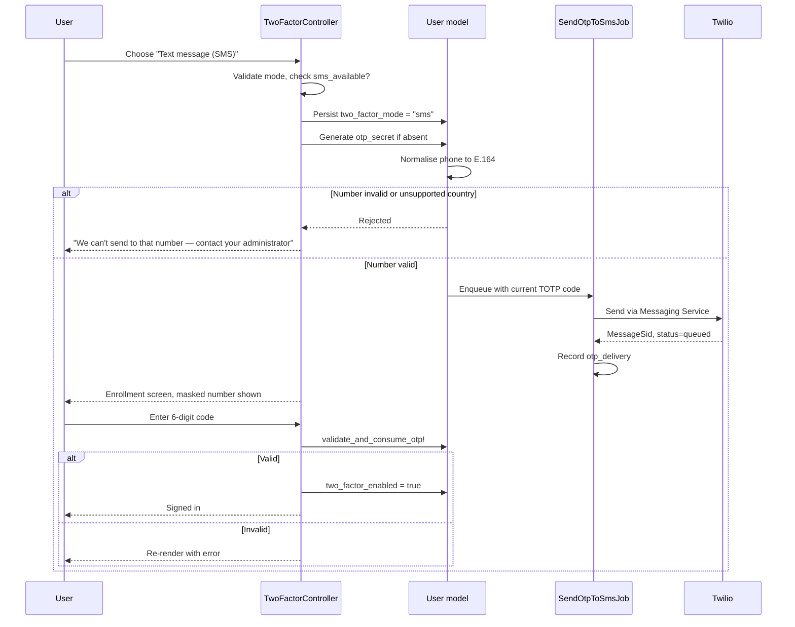
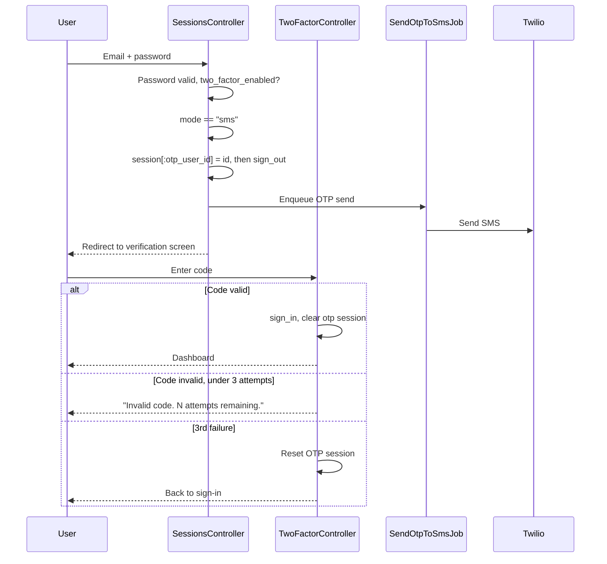
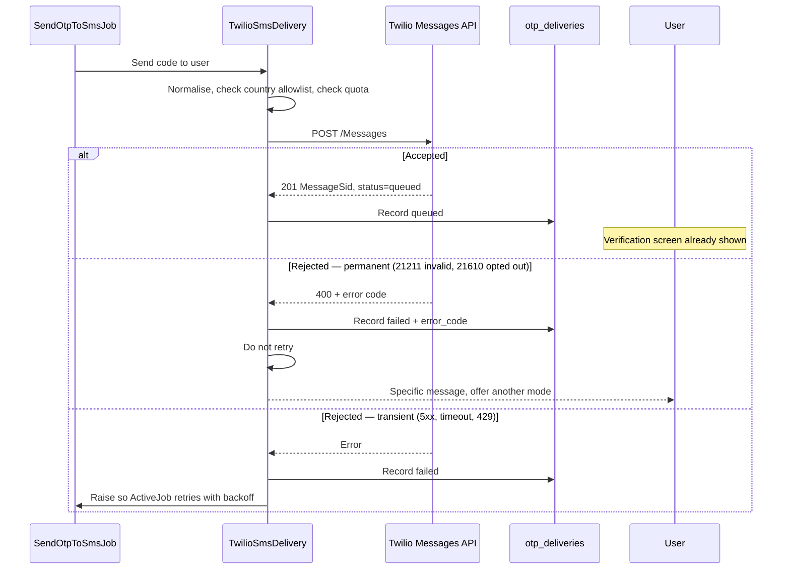
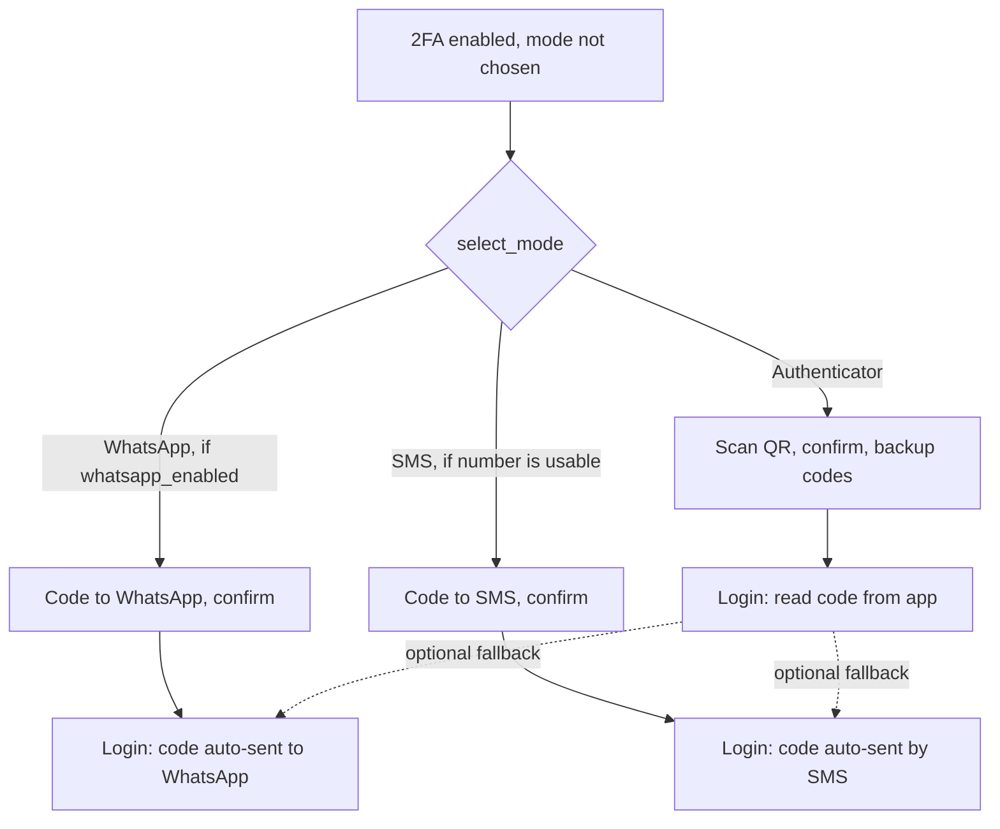

# Twilio SMS OTP — Design

**Status:** Implemented, **using Twilio Verify** — see [section 17](#17-appendix-switching-to-twilio-verify), which supersedes the Messages API recommendation in [section 2](#2-the-central-decision-reuse-totp-or-use-twilio-verify). Sections 3–15 describe the Messages API build and remain accurate wherever they are not about the code itself (normalisation, eligibility, rate limiting, rollout). The Messages API implementation is tagged `sms-messages-api-v1`.
**Scope:** Add SMS as a third two-factor delivery mode alongside WhatsApp and authenticator apps. **US destinations only at launch**, widened by configuration rather than by deploy. **OTP only** — no notifications, alerts or any other traffic over SMS.
**Related:** [`two_factor_authentication.md`](two_factor_authentication.md), [`notifications_system.md`](notifications_system.md)

---

## Table of Contents

1. [Why SMS, and why third](#1-why-sms-and-why-third)
2. [The central decision: reuse TOTP, or use Twilio Verify](#2-the-central-decision-reuse-totp-or-use-twilio-verify)
3. [Twilio account and sender model](#3-twilio-account-and-sender-model)
4. [Data model changes](#4-data-model-changes)
5. [Component changes](#5-component-changes)
6. [Flows](#6-flows)
7. [Phone number normalisation — an existing gap](#7-phone-number-normalisation--an-existing-gap)
8. [TOTP drift vs SMS latency](#8-totp-drift-vs-sms-latency)
9. [Abuse and cost control](#9-abuse-and-cost-control)
10. [Delivery outcomes and logging](#10-delivery-outcomes-and-logging)
11. [Backup codes — parked](#11-backup-codes--parked)
12. [Failure modes and fallbacks](#12-failure-modes-and-fallbacks)
13. [Security considerations](#13-security-considerations)
14. [Rollout](#14-rollout)
15. [Testing strategy](#15-testing-strategy)
16. [Decisions and remaining questions](#16-decisions-and-remaining-questions)
17. [Appendix: switching to Twilio Verify](#17-appendix-switching-to-twilio-verify)

---

## 1. Why SMS, and why third

Today a user picks between two modes at `select_mode`:

| Mode | Delivery | Gate | Backup codes |
|---|---|---|---|
| `whatsapp` | WATI `code_verification` template | `users.whatsapp_enabled` | None |
| `authenticator` | TOTP app, out of band | Always available | 8, generated at enrollment |
| `sms` | Twilio **Verify** ([§17](#17-appendix-switching-to-twilio-verify)) | A usable mobile number | None — [parked](#11-backup-codes--parked) |

WhatsApp covers markets where it is ubiquitous (India, Brazil, much of SEA). It does not cover LPs and fund staff in the US, where WhatsApp penetration among institutional finance users is low and a WhatsApp business message from a fund administrator reads as suspicious. Those users currently have exactly one option — install an authenticator app — which is the option this codebase just had to write an onboarding guide for because it has real drop-off.

**The US deployment is the entire launch target.** CapHive already runs a separate deployment per country, so this is a decision about which env file gets the flag rather than a new dimension of configuration. It simplifies several things sharply: A2P 10DLC is the only registration regime in play, India's DLT template pre-registration does not apply, and E.164 normalisation only has to be right for `+1` on day one. See [section 3](#3-twilio-account-and-sender-model) for why the destination is nonetheless checked separately from the deployment.

SMS is the fallback that needs no app and no platform account. It is also the weakest of the three (SIM swap, SS7 interception, carrier-side visibility of the code), which is why it is being added third and why the mode-selection copy should rank it below the other two rather than presenting it as an equal choice.

**Design principle throughout: SMS is an accessibility affordance, not a security upgrade.** Nothing in this design should make SMS the default for a user who could use an authenticator app.

---

## 2. The central decision: reuse TOTP, or use Twilio Verify

This is the decision everything else hangs off, so it comes first.

Twilio offers two relevant products:

| | **Messages API** (`/Messages`) | **Verify API** (`/Verifications`) |
|---|---|---|
| Who generates the code | We do | Twilio does |
| Who stores/expires it | We do | Twilio does |
| Verification | Local | An API round trip per attempt |
| Fraud controls | We build them | Fraud Guard, geo rules, built-in rate limits included |
| Pricing | Per SMS segment + carrier fees | Per successful verification (higher unit, includes the SMS) |
| Channel reuse | SMS only, unless we add more | SMS, voice, email, WhatsApp, TOTP under one API |

**Original recommendation: Messages API, reusing the existing TOTP secret. This was later reversed — see [section 17](#17-appendix-switching-to-twilio-verify).** The reasoning below is kept because it is still the honest account of the trade-off, and because it names the one thing the switch had to solve: which system checks the code.

The reason is consistency, not cost. WhatsApp mode already works this way — `send_otp_via_whatsapp` calls `current_otp` and ships the *same rolling TOTP code* out of band, and `Users::TwoFactorController#create` validates every mode through one path (`validate_and_consume_otp!`, then backup codes). Adding Verify would introduce a second, parallel notion of "what is a valid code right now", with its own expiry, its own replay protection and its own failure modes, sitting next to the one we already have. Every downstream feature — backup codes, the "send code via WhatsApp" cross-over button on the login screen, the 3-strikes lockout, the magic-link path — would need to learn which of the two systems a given user is on.

Reusing TOTP means SMS mode is, structurally, WhatsApp mode with a different transport. `sms_mode?` sits beside `whatsapp_mode?`; `SendOtpToSmsJob` mirrors `SendOtpToWhatsappJob`; the controller branches identically. That is a genuinely small change to a flow that is already security-sensitive and already tested.

The cost of this choice is that we own the anti-abuse controls Verify would have given us. [Section 9](#9-abuse-and-cost-control) is therefore not optional scope — it is the price of this decision, and it should be built in the same change, not deferred.

The strongest argument the other way would have been voice-call fallback, which is nearly free under Verify and awkward under the Messages API. **Voice is explicitly out of scope**, so that argument does not apply and the recommendation stands unqualified.

**What actually triggered the reversal** was not volume but setup cost: the Messages API needs a purchased number and an A2P 10DLC brand and campaign registration taking days to weeks, none of which Verify requires. The migration was as contained as predicted — the delivery service, a new checker, and the verification branch. [Section 17](#17-appendix-switching-to-twilio-verify) records what changed.

---

## 3. Twilio account and sender model

**One Twilio account, owned and managed by CapHive.** Decided. This mirrors the existing WhatsApp integration, where the `code_verification` WATI template is explicitly a single shared platform template rather than per-entity. Per-tenant Twilio subaccounts would mean each fund administrator registering their own A2P 10DLC brand and campaign — weeks of onboarding per tenant, for a login SMS.

The consequence is that **CapHive absorbs the cost centrally**; there is no per-tenant pass-through. That removes the need to attribute spend to an entity, which is why `otp_deliveries` carries no `entity_id` ([section 4](#4-data-model-changes)) — and it moves the whole weight of cost control onto the platform-level guards in [section 9](#9-abuse-and-cost-control), since no tenant sees a bill that would make them notice abuse first.

**Use a Messaging Service, not a bare `From` number.** A Messaging Service gives us, without extra code:

- a sender pool with geographic matching, so a US recipient gets a US number and an Indian recipient an Indian sender
- sticky sender, so a returning user sees the same number
- Alphanumeric Sender ID where the destination country supports it (much of Europe), which reads far better than an unknown number
- centralised opt-out handling (STOP/UNSTOP), which is a legal requirement we should not be hand-rolling

**A2P 10DLC registration is a prerequisite, not a detail.** US traffic requires brand and campaign registration; unregistered traffic is filtered or surcharged into uselessness. It takes days to weeks and must start before the code does. **Register the campaign as a 2FA / OTP use case** — because SMS carries nothing but OTPs ([section 16](#16-decisions-and-remaining-questions), decision 8), the campaign can be declared narrowly, which earns higher throughput and materially lower carrier filtering than a mixed or marketing campaign. Sending anything else down this account later would breach the registered use case, so "OTP only" is a commitment to the carriers, not just an internal scoping choice. India's DLT regime does not apply at launch, but note that the day it does, the message wording has to be registered *verbatim* before first send — so the copy in [section 9](#9-abuse-and-cost-control) should be treated as fixed rather than something to tune later.

### Enablement and destination are two different axes

CapHive runs a **separate deployment per country** — `.env.production.us` (`CURRENT_SITE=US`) and `.env.production.in` (`CURRENT_SITE=IN`), with matching staging environments. That shapes both controls, and they are not the same control:

| Question | Answered by | Where set |
|---|---|---|
| Is SMS two-factor switched on here at all? | `SMS_OTP_ENABLED` | Per-deployment env file |
| May we dial *this particular number*? | Twilio **Geo Permissions** | Twilio console, account-wide |

**Enablement is per deployment.** Setting `SMS_OTP_ENABLED=true` in `.env.production.us` turns SMS on for the US deployment and nowhere else. That is the launch: US first, and the IN deployment simply never has the flag set. It doubles as the kill switch — one variable, one restart, feature gone.

> **AMENDED — the app-side destination allowlist has been removed.**
>
> As designed, `SmsDeliverable.allowed_countries` derived the permitted destinations from `CURRENT_SITE`: the US deployment texted only `+1` numbers, the IN deployment only `+91`. That rule refused real users. A US-deployment account whose stored number is Indian is ordinary rather than suspicious, and such a user saw no SMS option at all with nothing on screen explaining why — the failure was silent at exactly the moment it needed to be legible.
>
> `sms_available?` now asks only whether the number is a valid mobile. `allowed_countries` is gone; `SmsDeliverable.default_region` still derives the libphonenumber parsing region from `CURRENT_SITE`, which is all that variable governs now.
>
> **What this costs, stated plainly.** SMS pumping is priced by *destination*, not by which server sent the message — the attacker's payout comes from terminating traffic on an expensive route. The removed check was the app-side half of a deliberately redundant pair, and the half that refused at **enrollment**, on a screen where the user could still pick another mode. Twilio's Geo Permissions is now the *only* bound on where this application dials, which changes it from a backstop into a load-bearing control:
>
> * **Geo Permissions must be widened to match**, or a user enrols in SMS here and is then locked out — Twilio rejects the send, and SMS mode issues no backup codes.
> * Every country left enabled in Geo Permissions is a country this application will dial. Narrow it to the destinations the tenant base actually uses; that setting is now doing the work two controls used to.
>
> `OtpSmsRateLimiter` (per destination number, per user, per IP) is unchanged, and remains the control that sees a pumping pattern spread across accounts.

**Credentials** join the existing `WHATSAPP_*` keys in Rails credentials:

| Key | Where | Purpose |
|---|---|---|
| `TWILIO_ACCOUNT_SID` | credentials | Account identifier |
| `TWILIO_AUTH_TOKEN` | credentials | API auth. Outbound only — there is no inbound endpoint to sign. |
| `TWILIO_MESSAGING_SERVICE_SID` | credentials | Sender pool |
| `SMS_OTP_ENABLED` | env | On/off for this deployment. Set in `.env.production.us` at launch; absent elsewhere. Default `false`. |

With no inbound endpoint, the auth token is used only for outbound calls, so rotation has a single blast radius: sends stop until the new token is deployed. Worth noting in the runbook, but simpler than it would be with a signature-validated callback sharing the same secret.

---

## 4. Data model changes

Deliberately minimal. No new code storage: the TOTP secret already in `users.otp_secret` is the source of truth.

### `users` — no new column

**The phone number is the entitlement.** A user may choose SMS when the number already on their record normalises to a valid mobile E.164 number in an allowed country. If they have a usable number and they pick SMS, we send. Nothing is stored to record that.

This is a deliberate departure from `whatsapp_enabled`, and the asymmetry is justified. WhatsApp requires the number to be *registered on WhatsApp*, which we cannot determine from our own data, so a human has to assert it and a column is the only place to put that assertion. SMS has no such precondition — a valid mobile number is, by itself, the whole entitlement. Any stored boolean would be a second, staler copy of a fact the phone number already carries, and the failure mode of a stale copy is a user who cannot log in.

The model therefore gains one derived predicate, `sms_available?`: phone present, normalises to valid E.164, is a mobile line, and the country is in the allowlist. It is computed on every call, never persisted, and is the single place every other component asks. See [section 7](#7-phone-number-normalisation--an-existing-gap).

Two consequences to be honest about:

- **It must be cheap enough to call on render.** The mode-selection screen calls it to decide whether to offer SMS. That rules out a Twilio Lookup API call in the predicate — normalisation and validity must be answered locally from libphonenumber metadata. Any network check belongs at enrollment confirmation only, never in the predicate. [Section 7](#7-phone-number-normalisation--an-existing-gap)
- **It removes the per-user admin gate entirely.** Previously an administrator had to switch a user on. Now every user in the database with a plausible US mobile number is a potential send target the moment the entity flag is on. This is the right call for usability and it materially widens the abuse surface — see [section 9](#9-abuse-and-cost-control), which is now the *only* thing standing between the send endpoint and the bill.

`two_factor_mode` gains a third accepted value, `"sms"`. It is a plain nullable string today with the accepted values enforced in `Users::TwoFactorController#select_mode_post`, so this is a one-line widening of an allowlist rather than a schema change — but it is also the only thing standing between a bad value and a user who can never complete login, so it is worth a model-level inclusion validation at the same time.

`users.phone` and `users.call_code` are reused as-is and become load-bearing for login availability, which they have never been before. See [section 7](#7-phone-number-normalisation--an-existing-gap).

### `otp_deliveries` (new)

`WhatsappLog` exists but is bound to `notification` and `entity`, which an OTP send has neither of — the user is signed out and no `Notification` record is involved. A dedicated table:

| Column | Purpose |
|---|---|
| `user_id` | Who it was for |
| `channel` | `sms` now; `whatsapp` if we backfill that path later |
| `to_number_digest` | Hashed destination — see below |
| `provider_message_id` | Twilio `MessageSid`. Recorded so support can look a message up in Twilio's console or API on demand. |
| `status` | Outcome of the send call: `queued` (accepted) or `failed`. These are the only two values that exist — see [section 10](#10-delivery-outcomes-and-logging). |
| `error_code` | Twilio error code when the send call was rejected |
| `segments` | Segment count, computed locally from the message body — a code that splits into two segments doubles the cost |
| `purpose` | `enrollment` or `login`, so enrollment failures can be surfaced differently |
| `created_at`, `updated_at` | |

**No `entity_id`.** CapHive owns the Twilio account and absorbs the cost centrally ([section 3](#3-twilio-account-and-sender-model)), so there is nothing to attribute per tenant. `user_id` reaches the entity by association if a support question ever needs it. Add the column only if cost pass-through is introduced later.

**Store a digest of the destination number, not the number.** This table will be queried by support staff debugging "I didn't get my code", and a plaintext phone-number log keyed by user is a standing privacy liability for no operational gain — matching on a digest answers "did we send to the number on file" just as well. The last three digits may be stored in clear to make support conversations possible, matching what `masked_phone_with_call_code` already shows users.

**Never store the code.** Not hashed, not truncated. It is a live credential for its validity window.

Retention: 90 days, then purge. Add to whatever purge schedule the audit tables use.

---

## 5. Component changes

No file needs to be rewritten; every change is additive and parallels an existing WhatsApp path.

| Component | Change |
|---|---|
| `TwoFactorAuthenticatable` | Add `sms_mode?`. Add an SMS analogue of `ensure_otp_secret_and_send_whatsapp!` and `send_otp_via_whatsapp`. Add E.164 normalisation (section 7). |
| `SendOtpToSmsJob` (new) | Mirrors `SendOtpToWhatsappJob`, but guards on `sms_available?` — the derived predicate — rather than a stored flag. Re-check at send time, not only at enrollment: a number can be edited between the two. |
| `TwilioSmsDelivery` (new) | Trailblazer operation per the project convention (`step`/`left` DSL, as `CapitalCallCreate`). Steps: validate destination → check quota → send → record delivery → handle failure. Quota and logging belong here rather than in the job so they cannot be bypassed by a second caller. |
| `Users::TwoFactorController` | Accept `"sms"` in `select_mode_post`. Add `enroll_sms` / `verify_sms_enrollment` mirroring the WhatsApp pair. Add `send_sms` mirroring `send_whatsapp`, with the stronger throttling of section 9. |
| `Users::SessionsController#create` | Third branch: `sms_mode?` → send, then `new_two_factor_path`. |
| `UsersController` (magic-link login) | The same branch, in the parallel block around line 173. **This is the easiest thing to miss** — the mode dispatch is duplicated between password login and magic-link login today, and a mode added to only one of them produces a user who can log in one way and not the other. |
| Routes | `enroll_sms`, `verify_sms_enrollment`, `send_sms` inside the existing `resource :two_factor` block. No inbound route — nothing calls us. |
| Views | An SMS option on `select_mode`; a new `enroll_sms` screen; a resend affordance on `new`. |
| `docs/user_guides/two_factor_authentication_user_guide.md` | Extend the comparison table and add an SMS setup section. |

The duplicated mode-dispatch block is worth extracting to one place as part of this change — it now has three branches and two copies, and the copies have already drifted once (the WhatsApp branch wraps its send in `connected_to(role: :writing)` in one copy and not the other).

---

## 6. Flows

### 6.1 Enrollment



The enrollment screen must show the masked destination (`masked_phone_with_call_code`, as the WhatsApp screen does) so a user with a stale number on file discovers it here rather than at their next login, when they will be locked out.

### 6.2 Login



Note the send is enqueued *before* the redirect but runs asynchronously — the user can reach the verification screen before the SMS arrives. The screen copy should say the code is on its way rather than that it has been sent.

### 6.3 Send outcome

Everything below happens on the send request itself.



`queued` means Twilio accepted the message, not that a handset received it — see [section 10](#10-delivery-outcomes-and-logging) for why that gap is acceptable.

### 6.4 Where SMS sits among the modes



The dotted fallbacks are the existing "send code via WhatsApp" button on the login screen for authenticator-mode users. **Extending that to SMS is in scope.** An authenticator user who has lost their phone but kept their number gets a route in that does not burn a backup code.

It mirrors the WhatsApp behaviour: the button appears for an `authenticator_mode?` user whenever `sms_available?` is true, and posts to the same rate-limited send path. A user who is both WhatsApp-enabled and has a usable mobile number sees both buttons.

Two consequences worth stating plainly rather than discovering later:

- **It caps that user's effective security at SMS strength.** Someone who deliberately chose the strongest mode now has a weaker door beside it. That is already true of the WhatsApp button, so this is consistency rather than a new exposure — but it means "I use an authenticator app" no longer implies "SMS cannot get into my account". **With no per-user flag there is no longer a way to opt an individual out** — the only lever is the entity flag, which is all-or-nothing for the tenant. If a single high-risk user needs authenticator-only, that capability does not exist under this design and would have to be added.
- **It widens the abuse surface.** Every user with a usable mobile number becomes a valid target for the send endpoint, not just users who chose SMS mode. The [section 9](#9-abuse-and-cost-control) limits must be keyed on the user and the destination number regardless of mode, not scoped to `sms_mode?` users.

---

## 7. Phone number normalisation — an existing gap

`User#phone_with_call_code` concatenates `call_code` and `phone` with no separator and no `+` — for the Demo Fund test user it yields `9177777777`. `SendOtpToWhatsappJob` then calls `delete_prefix("+")` on that, which is a no-op, because WATI wants exactly that bare-digits form.

Twilio requires E.164: a leading `+`, country code, subscriber number, no spaces, no punctuation, 15 digits maximum. So the format the codebase produces today is precisely the format Twilio rejects.

Neither `phone` nor `call_code` has any format validation. Real production data will therefore contain leading zeros (`+44 07700...` — the trunk prefix must be stripped for E.164), embedded spaces and hyphens, numbers already carrying a `+`, and call codes stored either as `91` or `+91`.

The design needs a normalisation step, applied at enrollment and again before every send, that:

- strips whitespace and punctuation
- removes a national trunk prefix where the country code implies one
- rejects rather than guesses when the result is not plausibly E.164
- is idempotent, so a number already normalised passes through unchanged

**Use a library, not a regex.** Trunk-prefix rules, valid lengths and mobile-vs-landline ranges are per-country and change; `phonelib` wraps Google's libphonenumber metadata and is the standard answer. A hand-rolled version will be wrong for the UK, Italy and most of Africa.

US-only launch is *not* a reason to skip this. `+1` is among the simpler formats, but the data already in `users.phone` was entered under no validation at all and will contain `(415) 555-0134`, `415-555-0134`, `1 415 555 0134` and `+14155550134` for the same subscriber. Normalisation is needed on day one for that reason alone; using a library rather than a US-shaped regex is what stops the first non-US tenant from being a rewrite.

The default region for parsing a number that arrives without a country code comes from the deployment (`CURRENT_SITE`), not a hardcoded `US` — the IN deployment must read a bare local number as Indian.

**Validate at enrollment, not only at send.** A user who cannot receive the enrollment code cannot enable SMS mode, which is the correct outcome — the failure is contained to a screen where they can still pick another mode. A number that only fails at *login* time produces a locked-out user and a support ticket. Twilio's Lookup API can additionally confirm the number is a mobile line and currently reachable; it costs a fraction of a cent per check and is worth spending at enrollment only.

This normalisation is useful beyond SMS and should live on the model, not in the Twilio operation.

---

## 8. TOTP drift vs SMS latency

**Decision: leave `otp_allowed_drift` at the default. No widening for v1.** This section documents the risk being accepted and what carries the load instead.

`validate_and_consume_otp!` accepts a code within `otp_allowed_drift` of the current 30-second step. Nothing in this codebase configures that value, so it is devise-two-factor's default of 30 seconds — a code is valid for roughly 30 to 60 seconds from generation, depending where in the step it was issued.

For authenticator mode that is correct and standard: the user reads a live code off their phone. For WhatsApp it has been survivable because delivery over data is usually sub-second. **SMS is not comparable.** Carrier queuing and A2P filtering routinely add 5–30 seconds and occasionally minutes. A user on a slow route can receive a code that has already expired, type it carefully, and be told it is wrong.

Keeping the default is defensible for a US-only launch — domestic 10DLC delivery is normally a few seconds, and the pathological latencies are mostly an international-routing phenomenon. But it is an accepted risk, not a non-issue, and it should be measured rather than assumed.

### What carries the load instead

**Resend is the real mitigation, and it works because the code is TOTP.** A resend does not reissue a stale code — it ships whatever `current_otp` returns at that moment, so the message the user receives second is valid from the instant it is generated. A user whose first code arrived too late presses resend and gets a live one. This falls out of the [section 2](#2-the-central-decision-reuse-totp-or-use-twilio-verify) decision for free, and it is why the drift question is a UX problem rather than a correctness one.

That places real weight on the resend affordance:

- It must be **prominent** on the verification screen, not tucked into a footer, and the copy should tell users a late code may be rejected and to request another rather than retyping.
- **The three-strikes lockout is the sharp edge.** A user who patiently types three late codes is bounced to sign-in having done nothing wrong. Worth considering whether an expired-but-well-formed code should count toward the three at all — it is indistinguishable from a wrong code with the current API, which is itself an argument for revisiting drift later.
- **The rate limits must not block the first resend.** [Section 9](#9-abuse-and-cost-control) proposes 1 send per 60 seconds per number, and the escalating delay starts at 30 seconds. If a code takes 45 seconds to arrive, the user needs a resend at ~60 seconds and must not be refused. These two controls have to be tuned together — a per-number window that blocks the legitimate first resend converts a latency annoyance into a lockout.

### Measure it

`otp_deliveries` gives sends; the verification path gives successes. The ratio of SMS-mode sends to successful first-attempt verifications is the signal, and it should be watched from the pilot onward. A materially worse rate than WhatsApp mode is the trigger to revisit.

### If it needs revisiting

| Option | Effect | Assessment |
|---|---|---|
| Raise `otp_allowed_drift` globally | Every mode gets a longer window | Rejected outright — weakens authenticator mode, which has no latency problem, to fix one that does |
| Raise drift for out-of-band modes only | Longer window where delivery is not instant | **The first thing to try** if measurement shows a problem. The validation call site already knows the mode. 90–120 seconds covers the large majority of SMS delivery. The trade is explicit: 120 seconds is four TOTP steps, so an intercepted code stays usable four times longer — acceptable given the SMS threat model already concedes interception, and `validate_and_consume_otp!` burns the timestep on success so a code cannot be replayed. |
| Anchor a code to send time in `otp_deliveries` | Exact control of validity | The second code model [section 2](#2-the-central-decision-reuse-totp-or-use-twilio-verify) exists to avoid |
| Twilio Verify | Twilio owns expiry, defaults to 10 minutes | The reason to revisit Verify later |

Related: the user-facing copy should not promise "changes every 30 seconds" for SMS mode — that describes the authenticator experience, and here it invites a user to wait for the next code rather than use the one they have.

---

## 9. Abuse and cost control

**This section is load-bearing.** Choosing the Messages API over Verify ([section 2](#2-the-central-decision-reuse-totp-or-use-twilio-verify)) means we do not inherit Twilio's fraud controls, so we build them. WhatsApp OTPs cost fractions of a cent through a gated business account; SMS costs real money per message on routes an attacker chooses, which makes the send endpoint a direct financial liability rather than merely a nuisance.

### The threat

**SMS pumping (toll fraud).** An attacker with a block of premium-rate numbers in a high-tariff destination drives OTP sends to them and takes a cut of the termination fee. It needs no account and no credentials — only a reachable endpoint that sends an SMS to an attacker-supplied number. Victims have absorbed six-figure bills in days.

The existing WhatsApp send endpoint shows the shape of the exposure: `send_whatsapp` is a POST with `verify_authenticity_token` skipped, reachable without being signed in, gated only by `session[:otp_user_id]`, and rate-limited by `session[:otp_whatsapp_sent_at]` — **a value in the attacker's own cookie.** Clearing cookies resets the 30-second cooldown. That is tolerable for WhatsApp; replicated for SMS it is a funded attack surface.

Note also that this design never lets the attacker choose the destination directly: the number comes from `users.phone`, so pumping requires accounts whose phone numbers the attacker controls. That materially reduces the risk but does not remove it — self-registration, compromised accounts, or a tenant admin creating users with attacker-supplied numbers all reopen it.

### Controls, in order of importance

1. **Server-side rate limiting, keyed independently on destination number, user id, and client IP.** In `Rails.cache`/Redis, never in the session. All three keys matter and none substitutes for the others — see below.
2. **Per-user daily cap** — order 10 sends per 24 hours. Beyond it, offer backup codes and an administrator contact rather than another SMS.
3. **Rack::Attack throttle on the send path.** The initialiser already throttles `logins/ip` at 10 per 30 seconds and has the `AUTH_PATHS` skip-list; the SMS send route needs its own, tighter rule and must **not** be added to `AUTH_PATHS`.
4. **Twilio Geo Permissions.** Disable every destination country the tenant base does not actually use. This is a dashboard setting and is the single highest-leverage control — it makes the expensive destinations unreachable regardless of application bugs.
5. **Spend alerting.** Twilio usage triggers at daily and monthly thresholds, routed to the same place production exception alerts go. With no delivery callback there is no per-row price ([section 10](#10-delivery-outcomes-and-logging)), so this is the primary spend signal — count sends per day from `otp_deliveries` and alert on deviation, and rely on Twilio's own usage triggers for the monetary threshold.
6. **Escalating delay rather than hard refusal** — 30 s, then 60 s, then 300 s between sends for the same user. Preserves the experience for the user whose first SMS genuinely got lost, while making bulk driving useless.
7. **Cap segments.** The message must fit one GSM-7 segment (160 characters). A template that tips into two segments doubles the bill silently.

### The per-number limit, in detail

Of the three rate-limit keys this is the one that actually stops toll fraud, and it is the one most likely to be left out — it is the least intuitive, because it limits something the user does not own.

**Why per-user is not enough.** Per-user limits assume the attacker is constrained by accounts. They are not. Pumping is economic: the payout is per message delivered to *the attacker's number*, so the attacker's incentive is to point as many accounts as they can obtain at one payout number. Ten accounts under a 10/day per-user cap is 100 messages a day to a single premium number, and every one of those accounts looks perfectly well-behaved in isolation. Only a key on the destination sees the pattern.

**What the key is.** The normalised E.164 number, hashed — the same `to_number_digest` stored on `otp_deliveries` ([section 4](#4-data-model-changes)). Hashing matters here beyond privacy: the cache key is derived material, so a cache dump does not become a phone-number list.

Normalise *before* hashing, always. `+14155550134`, `(415) 555-0134` and `1-415-555-0134` must produce one key. A limiter keyed on the raw stored string is trivially defeated by re-saving the same number in a different format, and this is the single most likely implementation bug in the whole feature.

**Suggested limits**, to be tuned against real traffic:

| Window | Limit | Rationale |
|---|---|---|
| 60 seconds | 1 | One code in flight per number. A genuine resend is the escalating-delay path (control 6), not a second concurrent code. |
| 1 hour | 5 | Covers a bad signal day: several login attempts, a couple of lost messages, a re-enrollment. |
| 24 hours | 10 | Matches the per-user cap. A number legitimately needing more than ten codes a day has a different problem. |
| 30 days | 50 | The one that catches slow, patient pumping under every shorter window. |

The 30-day window is the one that will feel excessive and is the one worth keeping. Toll fraud that stays under a daily cap is still profitable if it runs for a month; nothing shorter than a monthly counter sees it.

**Counting attempts, not successes.** Increment before the send, not after, and increment even when the send fails. Otherwise a number that reliably errors becomes free to hammer, and errored sends still cost — carriers bill some rejections, and each attempt is a queue slot and an API call.

**Shared numbers are the false-positive case.** Two users on one number is not a fraud signal by itself: a couple sharing a phone, or a small fund where an assistant's number is on several records. The limits above give a shared number several codes an hour, which is enough. If real traffic shows legitimate collisions hitting the cap, raise the hourly window before weakening the monthly one.

**Behaviour on trip.** Refuse the send and say so — never silently drop, which produces a user waiting for a message that will never come. Offer backup codes and the administrator contact instead, exactly as the per-user cap does. Do **not** report which limit was hit or when it resets: that turns the limiter into an oracle for probing the thresholds. One generic "we can't send another code right now" covers all three keys.

**Log every trip.** A per-number limit tripping repeatedly for numbers spread across unrelated tenants is the actual detection signal for pumping, and it is the earliest one available — earlier than the Twilio bill, and earlier than anyone reports a problem. It should be alertable, not merely logged.

### Message content

One segment, no links, name the product, state the code and that staff will never ask for it. Something of the shape: *"123456 is your CapHive verification code. It expires in 2 minutes. CapHive will never ask you for this code."*

No URLs — carrier filtering treats links in A2P traffic as spam signal, and a link in an OTP message trains users into exactly the behaviour phishing exploits. Where the destination country requires a registered template (India DLT), the wording must match the registration exactly, so agree it before registering.

---

## 10. Delivery outcomes and logging

**Twilio is used to send, and nothing else.** There is no inbound endpoint of any kind, so this feature adds no publicly reachable write path to the application.

Everything we learn about a message, we learn from the response to the send request.

### What the send call tells us

The failures that permanently block a specific user come back synchronously as HTTP 400s:

| Error | Meaning | Response to the user |
|---|---|---|
| `21211` | Invalid `To` number | "That number doesn't look reachable — contact your administrator." Offer another mode. |
| `21610` | Recipient has replied STOP | "You've opted out of texts from us. Reply START to the last message you received from us, then try again." |
| `21612` | Route not reachable from this sender | As for invalid, plus suggest another mode. |

The opt-out case is the one that most needed catching — a user who once replied STOP silently receives nothing, forever. It comes back on the send call, so we act on it in the same request that discovered it.

Permanent errors are recorded and **not retried**. Transient failures (5xx, timeout, 429) are recorded and re-raised so ActiveJob retries with backoff.

A successful send returns `queued`, meaning Twilio accepted the message — not that a handset received it. **That gap is accepted.** The user is sitting on the verification screen and will press resend within thirty seconds if nothing arrives, which makes them a faster and more reliable delivery sensor than any receipt we could collect.

### What we monitor instead

Carrier filtering (`30007`) is the one failure that matters and is not visible on the send call. It is a signal about our account rather than about any one user — it means the sender pool or the 10DLC registration is being filtered and *everyone* is about to stop receiving codes. Twilio's Messaging Insights reports filtering rates and error breakdowns, and account-level Alert Triggers notify on error-rate thresholds, so this is watched in the Twilio console rather than in our database.

Support handling a "never got the code" report reads the `otp_deliveries` row to confirm we sent and to which number (by digest), and can fetch the message from Twilio's API by `provider_message_id` if the final status genuinely matters. Rare and manual, by design.

### Logging discipline

`SendOtpToWhatsappJob` currently logs the destination phone number in clear at info level on every send. Do not copy that. Log the user id and the `otp_deliveries` row id; the number is reachable through the digest when genuinely needed.

---

## 11. Backup codes — parked

**SMS mode generates no backup codes.** Parked as too much scope for v1.

That leaves the modes consistent in a way the earlier draft did not: the authenticator mode issues 8 codes because the app is the only thing that can produce a code, while both out-of-band modes (WhatsApp, SMS) rely on the delivery channel and fall back to an administrator. Two rules instead of three.

| Mode | Self-service recovery |
|---|---|
| `authenticator` | 8 backup codes, issued once at enrollment |
| `whatsapp` | None — administrator reset |
| `sms` | None — administrator reset |

### What this costs, stated plainly

A user in SMS mode who loses access to their number **cannot get back in without an administrator.** The realistic triggers are a lost or stolen phone, a SIM swap, a number ported between carriers, or travel on a swapped SIM. A phone number is meaningfully less recoverable than a WhatsApp account — WhatsApp restores to a new device on the same number, whereas losing the number itself is terminal — so SMS mode carries a slightly higher lockout risk than WhatsApp mode does for the same absence of codes.

Three things follow, and they are cheap:

- **The user guide must say so** before they choose SMS, not after they are locked out. The mode-selection copy should state that SMS has no backup codes and recovery means contacting an administrator.
- **Administrator reset must be a real, documented path**, not tribal knowledge. It already has to exist for WhatsApp mode; confirm it is documented and that support knows it, because SMS will increase its use.
- **The authenticator fallback works the other way too.** A user in SMS mode who has also set up an authenticator app is not covered by this design (mode is single-valued), but a user in authenticator mode with a usable number gets SMS as a fallback ([section 6.4](#64-where-sms-sits-among-the-modes)) — so the strongest configuration remains authenticator mode, which does have codes.

### Unparking

The machinery all exists — `generate_backup_codes!`, `consume_backup_code!`, the display screen, and a verification path that already tries backup codes for every mode. Enabling it later is roughly one call and a redirect in the SMS enrollment action, plus copy. Revisit if administrator-reset volume becomes a support cost. The same change would sensibly cover WhatsApp mode at the same time.

---

## 12. Failure modes and fallbacks

| Failure | Behaviour | Notes |
|---|---|---|
| Twilio API unreachable | Job raises, ActiveJob retries with backoff | The user is already on the verification screen; the resend button is their manual retry |
| Twilio API returns an error | Record on `otp_deliveries`; retry transient errors only | Retrying a `21211` invalid-number forever is pointless and costs a queue slot each time. Permanent errors (`21211`, `21610`, `21612`) must not be retried. |
| Number invalid at enrollment | Block enrollment, keep the user on mode selection | Contained failure — they can still pick another mode |
| Number invalid at login | User is locked out, administrator reset required | The reason enrollment-time validation matters — with no backup codes there is no self-service route back |
| Code arrives after expiry | Rejected as invalid | **Accepted risk** — drift stays at the default. The user resends, which ships a currently-valid code. [Section 8](#8-totp-drift-vs-sms-latency) |
| User opted out via STOP | Send call rejected with `21610` | Caught synchronously, surfaced explicitly — [section 10](#10-delivery-outcomes-and-logging) |
| Rate limit hit | Refuse, point at the administrator | Never silently drop; a send that appears to succeed and does not is the worst outcome. SMS mode has no backup codes to fall back on ([section 11](#11-backup-codes--parked)), so the administrator is the only route. |
| Sidekiq backed up | SMS arrives late, may expire | Consider a dedicated high-priority queue for OTP sends — a login-blocking message should not queue behind report generation |

That last row is worth acting on: `SendOtpToWhatsappJob` runs on `queue_as :default`, sharing a queue with bulk document and report jobs. An OTP is latency-critical in a way almost nothing else in the system is.

---

## 13. Security considerations

- **SMS is the weakest mode.** SIM swap, SS7 interception, and lock-screen previews all apply. The mode-selection copy should say so plainly rather than presenting three equal options, and administrators should be able to disable SMS for an entity whose risk posture rules it out.
- **The TOTP validity window is unchanged.** No drift widening, so SMS codes are no longer-lived than authenticator codes and this design weakens nothing about the existing verification path ([section 8](#8-totp-drift-vs-sms-latency)). The cost is landing on the user as an occasional rejected-late-code, not on the security model.
- **The send endpoint is unauthenticated by necessity** — the user is mid-2FA and signed out. It is gated only by `session[:otp_user_id]`. It must never accept a destination number, a user id, or anything else from the request body; the number comes from the record identified by the session and nowhere else.
- **No inbound endpoint.** Twilio is called, never calls us ([section 10](#10-delivery-outcomes-and-logging)), so this feature adds no publicly reachable write path at all.
- **Never log the code.** Not in application logs, not in `otp_deliveries`, not in job arguments that Sidekiq will persist and display in its web UI — note that the code is passed as a job argument today, which means it is visible in the Sidekiq dashboard for the life of the job record. Worth fixing for both channels: pass the user id and derive the code inside the job.
- **Enumeration.** Responses on the send path must not reveal whether a number is valid, registered, or reachable — the same acknowledgement regardless.
- **The existing session-based cooldown is not a security control** and should not be presented as one in review.

---

## 14. Rollout

Gate on `SMS_OTP_ENABLED` in the deployment's env file. Deployments are already per country, so setting it in `.env.production.us` and nowhere else *is* the US launch. There is no per-entity permission flag and no per-user column ([section 4](#4-data-model-changes)): if the switch is on for the deployment and a user's stored number is usable, they may choose SMS.

One Twilio account owned by CapHive carries the traffic and absorbs the cost ([section 3](#3-twilio-account-and-sender-model)), so a per-tenant toggle would express nothing the deployment flag does not. It also matters that the thing being guarded against is a runaway bill: that is not a situation anyone wants to resolve by flipping flags tenant by tenant, and one variable plus a restart turns the feature off for the whole deployment.

The trade-off, stated plainly: within a deployment there is no staged rollout and no way to enable SMS for one pilot tenant. Every tenant in that deployment gets it at once.

Per project convention, any new flag is **appended to the end** of the `flag` array — inserting mid-array shifts every subsequent bit and silently corrupts stored bitmasks for every existing record.

No tenant has a compliance objection to SMS as a second factor, which is what makes a single global switch acceptable — there is no tenant that must be excluded.

Suggested sequence:

1. Twilio account, Messaging Service, and A2P 10DLC brand + campaign registration started — this gates everything and has the longest lead time. Geo Permissions set to US only at the same time.
2. Schema, normalisation, and the delivery operation, behind a flag that is off everywhere.
3. Switch on in `.env.staging.us`. Verify enrollment, login, resend, the authenticator-mode SMS fallback button, and the rate limits on real US handsets across at least two carriers — 10DLC filtering behaviour differs between them. Watch Messaging Insights for filtering rather than waiting on per-message receipts.
4. Switch on in `.env.production.us`. Every tenant in that deployment gets it at once, so watch `30007` filtering rates and daily spend closely over the first days and be ready to unset the variable.
5. Steady state. The IN deployment stays off until India's DLT registration is done and its own decision is taken; revisit the per-tenant question only if a tenant asks to be excluded.

No backfill and no migration of existing users: everyone stays on their current mode until they choose otherwise. Nothing about this change alters behaviour for a user who does not select SMS.

---

## 15. Testing strategy

Cucumber only, per project convention — no RSpec.

Because the code is TOTP, tests read the expected value straight off the user record with `current_otp`, exactly as `features/step_definitions/two_factor_steps.rb` does for WhatsApp. There is no need to intercept the message body.

- A `@stub-twilio` tag mirroring the existing `@stub-whatsapp`, stubbing the HTTP call and recording what would have been sent.
- Enrollment: happy path, invalid code, and the SMS option hidden when the stored number is blank, unparseable, a landline, or outside the allowlist — one scenario per reason.
- SMS enrollment completes **without** issuing backup codes, and lands on the dashboard rather than the backup-codes screen ([section 11](#11-backup-codes--parked)).
- Login: happy path, three-strikes lockout, resend, resend blocked by cooldown.
- Both login entry points — password *and* magic link ([section 5](#5-component-changes) explains why the magic-link path is the easy one to miss).
- The authenticator-mode SMS fallback button: present when the number is usable, absent when not, and subject to the same rate limits as an SMS-mode user.
- Rate limiting: cap reached returns a refusal and no send is recorded.
- ~~Destination allowlist: a non-US number is refused at enrollment with the mode still selectable.~~ **Amended** — a valid non-US mobile is now offered SMS like any other; only an unusable number (invalid, or a landline) hides the mode. Covered by `features/login/two_factor_sms.feature`.
- Synchronous send failures: `21610` (opted out) and `21211` (invalid number) each record a failed delivery, are not retried, and surface their own message rather than a generic one.
- Normalisation: a table-driven scenario over real-world formats — leading zeros, embedded spaces, an already-`+`-prefixed number, a call code stored with and without `+`.

Pin `entity_type` in fixtures, as the existing 2FA features do.

---

## 16. Decisions and remaining questions

### Resolved

| # | Question | Decision | What it changed |
|---|---|---|---|
| 1 | Launch markets | **US deployment only** | `SMS_OTP_ENABLED` set in `.env.production.us` and nowhere else. A2P 10DLC is the only registration regime in play; no India DLT. ~~Allowed destinations derive from `CURRENT_SITE`~~ — **amended**: the app-side destination allowlist was removed, and Twilio Geo Permissions is now the only bound on destinations. [§3](#3-twilio-account-and-sender-model) |
| 2 | Any tenant compliance objection to SMS? | **No** | Makes a single global switch acceptable — no tenant needs excluding. [§14](#14-rollout) |
| 3 | Who absorbs the cost? | **Single Twilio account managed by CapHive**, cost absorbed centrally | No `entity_id` on `otp_deliveries`; no per-tenant pass-through. Also means no tenant will notice abuse on their bill first, so the platform guards in [§9](#9-abuse-and-cost-control) are the only line of defence. [§3](#3-twilio-account-and-sender-model), [§4](#4-data-model-changes) |
| 4 | SMS fallback for authenticator-mode users? | **Yes**, mirroring the existing WhatsApp button | In scope. Caps that user's effective security at SMS strength, and widens the abuse surface to every user with a usable number rather than only SMS-mode users. [§6.4](#64-where-sms-sits-among-the-modes) |
| 5 | Voice fallback? | **No** | Removes the one strong argument for Twilio Verify; the Messages API recommendation stands unqualified. [§2](#2-the-central-decision-reuse-totp-or-use-twilio-verify) |
| 6 | Backup codes for SMS mode | **Parked** | SMS mode issues none, matching WhatsApp. Leaves the modes on two rules rather than three, but means a lost or ported SIM has no self-service recovery — administrator reset only. [§11](#11-backup-codes--parked) |
| 7 | Per-user opt-in column for SMS | **Not needed — no such column** | Eligibility is derived from the phone number (`sms_available?`), never stored. Removes the per-user admin gate entirely, so [§9](#9-abuse-and-cost-control) is the only remaining guard — and removes any way to opt one individual out. [§4](#4-data-model-changes) |
| 8 | Scope of SMS usage | **OTP only** | No notifications or other traffic. Lets the 10DLC campaign register as a 2FA/OTP use case, which carries better throughput and lower carrier filtering than a mixed or marketing campaign. |
| 9 | Inbound delivery receipts | **None** | Twilio is used to send, nothing more. The failures that permanently block a user (`21211`, `21610`, `21612`) come back synchronously; carrier filtering is watched in Twilio's console. No public write endpoint. [§10](#10-delivery-outcomes-and-logging) |
| 11 | Per-tenant enablement | **Not needed — per-deployment env switch** | `SMS_OTP_ENABLED` applies to every tenant in that deployment. No entity permission flag, no separate country variable. Deployments are already per country, so the env file is the natural boundary. Costs the staged per-tenant rollout. [§14](#14-rollout) |
| 10 | Widen the TOTP drift window for SMS? | **No, not for v1** | Default 30s drift stays. Resend carries the load — because the code is TOTP, a resend always ships a currently-valid code. Measure first-attempt success and revisit if it lags WhatsApp mode. [§8](#8-totp-drift-vs-sms-latency) |

### Still open

**Retrofit backup codes to WhatsApp mode?**

With SMS backup codes parked, both out-of-band modes now behave the same — no codes, administrator reset on loss — so the asymmetry that prompted this question is gone and it is no longer urgent. It remains true that a WhatsApp or SMS user who loses their channel has no self-service route back, and that `generate_backup_codes!`, `consume_backup_code!` and the display screen already exist. Worth revisiting together with SMS backup codes if administrator-reset volume becomes a support cost.

**Can a single high-risk user be forced to authenticator-only?**

Dropping the per-user flag (decision 7) means the entity flag is the only lever, and it is all-or-nothing for the tenant. If a tenant asks for one executive to be barred from SMS, that capability does not exist under this design. Not blocking — but it is the kind of request an institutional LP makes, and the answer today would be "no".

---

## 17. Appendix: switching to Twilio Verify

**Status: done.** This section was written to cost the reversal before committing to it; the switch was then made. Restore point for the Messages API implementation: tag **`sms-messages-api-v1`**.

What shipped matches the plan below, with one addition worth recording: WhatsApp and authenticator modes are provably untouched. The only change to shared code is one branch in `Users::TwoFactorController#create`, guarded on `session[:otp_code_channel]`, which is set exclusively on SMS send paths. `verify_enrollment` and `verify_whatsapp_enrollment` still call `validate_and_consume_otp!` exactly as before, and the full login suite passes at 87 scenarios.

### Why this is back on the table

Section 2 chose the Messages API for consistency: one code model across all three modes. That reasoning is unchanged. What changed is that the *setup* cost became concrete rather than theoretical — buy a number, create a Messaging Service, register an A2P 10DLC brand and campaign, wait days to weeks — and none of it is done yet. The switching cost is at its lowest it will ever be, because no number has been bought and nothing is in production.

### What Verify gives us

| | Messages API (built) | Verify |
|---|---|---|
| Sender | You buy and register a number | Twilio-managed pool |
| A2P 10DLC | **You register** brand + campaign | Twilio's pool is pre-registered; you do none *unless* you attach your own sender |
| Code lifetime | 30–60s (TOTP window) | ~10 min, configurable |
| Check attempts | Our 3-strikes | 5 per verification, configurable |
| Fraud controls | `OtpSmsRateLimiter`, ours | Fraud Guard + per-service limits, plus ours |
| Message body | Ours, one GSM-7 segment | Twilio's template, configured in console |
| Pricing | Per segment + rental + registration | Per verification |

**Confirm the 10DLC position against current Twilio documentation before committing.** It is the main reason to switch and Twilio has revised these policies more than once.

The quiet win is code lifetime. [Section 8](#8-totp-drift-vs-sms-latency) documents an accepted risk: a TOTP code is valid 30–60 seconds and SMS routinely takes longer, so a late code is rejected and a user who patiently retypes three of them is bounced to sign-in. Verify's ~10 minute window **removes that risk entirely**, along with the resend affordance built to compensate for it.

### What changes in the code

Unchanged — and this is most of it:

- `SmsDeliverable` — normalisation, E.164, country allowlist, eligibility. Untouched.
- `OtpSmsRateLimiter` — still wanted. Verify has its own limits, but a verification still costs money, and Verify's controls are per-service, not per-destination-number across our whole estate.
- `TwoFactorDispatch`, the mode plumbing, the views, `SMS_OTP_ENABLED`, the Rack::Attack rule, backup-code policy, the undeliverable refusal path.

Replaced or amended:

| Component | Change |
|---|---|
| `TwilioSmsDelivery` | Rewritten. `verify.v2.services(SID).verifications.create(to:, channel: "sms")` replaces `messages.create`. No body, no segment counting, no `sender_params` — Verify owns the template. Keep the country check, the rate limiter and the `OtpDelivery` record. |
| New: a verification checker | `verification_checks.create(to:, code:)` returning approved/pending. This is the piece that does not exist today. |
| `SendOtpToSmsJob` | Stops deriving `current_otp`. Verify generates the code; we never see it. |
| `Users::TwoFactorController` | The real work — see below. |
| `otp_deliveries` | `segments` becomes meaningless (drop or leave null). `provider_message_id` holds a Verify SID (`VE…`) rather than a Message SID (`SM…`); rename or widen the comment. |
| Credentials | `TWILIO_VERIFY_SERVICE_SID` (`VA…`) replaces `TWILIO_MESSAGING_SERVICE_SID`. No number to buy. |
| Message copy | Moves from `MESSAGE_TEMPLATE` into the Verify service config in the console. The no-links decision in [section 9](#9-abuse-and-cost-control) still applies — it just lives somewhere else. |

### The one genuinely hard part

`Users::TwoFactorController` calls `validate_and_consume_otp!` in **four places**, and today that is correct for every mode because WhatsApp and SMS both carry the same rolling TOTP value. Under Verify an SMS code is a Verify code and an authenticator code is TOTP, so those four call sites must dispatch to the right system.

Three of the four are easy — they are mode-specific already (`verify_sms_enrollment` is Verify, `verify_whatsapp_enrollment` and `verify_enrollment` stay TOTP).

The fourth is `#create`, the login verification, and it is genuinely ambiguous: **an authenticator-mode user with the "Text me a code" fallback can hold either kind of code.** They pressed the button, so the code in their hand came from Verify — but the same form field also accepts the TOTP code from their app, and a backup code.

The fix is to record which system last issued a code:

```
session[:otp_last_channel] = "verify"   # set when a Verify send is made
```

`#create` then checks Verify when that is set, TOTP otherwise, and backup codes as it does now. Session state, no extra cost, deterministic.

**Do not solve it by trying both.** Each Verify check consumes one of the five attempts on that verification and is a network round trip, so probing Verify on every failed TOTP entry would burn a user's real attempts on guesses that were never Verify codes in the first place.

Also note `#create`'s 3-strikes counter now sits in front of Verify's own 5-attempt limit. They should not fight: keep ours at 3 and let it be the binding one.

### Migration and rollout

No data migration. `two_factor_mode` values are unchanged, `otp_secret` stays (it is still needed if a user later switches to authenticator mode), and no user re-enrols. The switch is a deploy plus a credential change.

Enrolled sms-mode users move from TOTP-over-SMS to Verify-over-SMS with no action — their next login just uses the new path.

### Effort

Roughly a day of focused work: one service rewritten, one added, ~40 lines of controller dispatch, a small migration, the `@stub-twilio` support file rewritten against the Verify API shape, and the SMS feature updated. The existing 24 scenarios largely survive — what they assert (eligibility, refusals, rate limits, lockout handling) is channel-agnostic. The exceptions are the three that reach into the message body: "should contain the current code", "should fit in one segment", and the code-entry steps that read `@twilio.last_code`. Under Verify we never see the code, so the stub has to mint one and the steps read it from there.

### Recommendation

If time-to-launch is the binding constraint, switch — it removes the number purchase, the 10DLC registration and the whole [section 8](#8-totp-drift-vs-sms-latency) latency risk in one move.

If the authenticator SMS fallback matters, weigh it against the session-channel complexity above; that is the only place the "one code model" argument still has real force, and the mitigation is a session key rather than anything structural.
