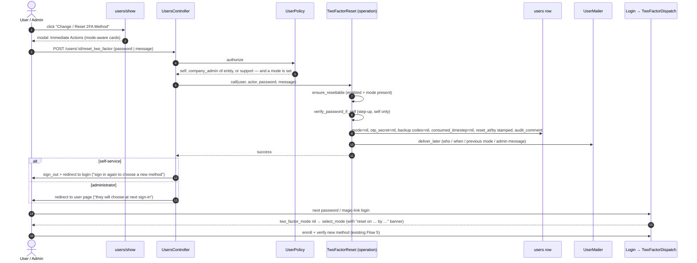

# Two-Factor Authentication (2FA) via WhatsApp + Authenticator App

**Date:** 2026-06-26
**Status:** Draft

## Overview

Add two-factor authentication to the IRM platform using the `devise-two-factor` gem. Users can authenticate via either:

1. **Authenticator app** (Google Authenticator, Authy, etc.) — TOTP-based, works offline
2. **WhatsApp delivery** — current TOTP code sent via existing WhatsApp Business API

Both methods use the same underlying TOTP secret. The user chooses their preferred method at each login.

## Design Decisions

| Decision | Choice | Rationale |
|----------|--------|-----------|
| Gem | `devise-two-factor` | Battle-tested TOTP, backup codes, Devise integration |
| OTP algorithm | TOTP (RFC 6238) | Industry standard, supports authenticator apps natively |
| WhatsApp delivery | Generate current TOTP code server-side | Same secret, same verification — no separate OTP system |
| 2FA flag | New `two_factor_enabled` column | Independent of existing `whatsapp_enabled` notification flag |
| Phone number | Existing `phone` + `call_code` on User | Already present, used by WhatsApp notification system |
| API tokens | Bypass 2FA | API tokens are already a second factor (something you have) |
| OAuth/Doorkeeper | Bypass 2FA | OAuth tokens are scoped and short-lived |

## Database Changes

### Migration: Add 2FA columns to `users`

| Column | Type | Default | Purpose |
|--------|------|---------|---------|
| `two_factor_enabled` | `boolean` | `false` | Master switch — when false, existing login flow is unchanged |
| `otp_secret` | `text` | `nil` | Encrypted TOTP shared secret (encrypted at rest via Rails `encrypts`) |
| `otp_backup_codes` | `text` | `nil` | JSON array of bcrypt-hashed backup codes (8 codes) |
| `consumed_timestep` | `integer` | `nil` | Anti-replay: last TOTP timestep consumed |

No new table needed — all state lives on the `users` row.

## Redirect Behavior

All post-authentication redirects follow Devise's standard `after_sign_in_path_for(resource)` pattern, which checks `stored_location_for(:user)` (set by `authenticate_user!` when a user tries to access a protected URL while unauthenticated). This ensures users are sent back to their intended destination after completing 2FA.

The `session[:user_return_to]` (set by Devise) must be **preserved through the 2FA interstitial** — it is not cleared until after successful 2FA verification and `sign_in` call.

## Authentication Flows

### Flow 1: Password Login (with 2FA)

```
User → POST /users/sign_in (email + password)
  │
  ├─ Password invalid
  │   └─ "Invalid Email or password" (existing Devise behavior)
  │
  └─ Password valid
      ├─ user.two_factor_enabled? == false
      │   └─ sign_in(user) → redirect (existing Devise after_sign_in_path_for, unchanged)
      │
      └─ user.two_factor_enabled? == true
          ├─ user.otp_secret.blank?
          │   └─ Generate otp_secret → redirect to /users/two_factor/enroll
          │      (First-time setup: scan QR code with authenticator app)
          │
          └─ user.otp_secret.present?
              ├─ session[:otp_user_id] = user.id
              ├─ session[:otp_expires_at] = 5.minutes.from_now
              └─ redirect to /users/two_factor/new
                 (Do NOT call sign_in yet — session[:user_return_to] is preserved)
```

### Flow 2: Magic Link Login (with 2FA)

```
User → GET /users/no_password_login?signed_id=...
  │
  ├─ signed_id invalid/expired
  │   └─ "Invalid login link" (existing behavior)
  │
  └─ signed_id valid → user found
      ├─ user.two_factor_enabled? == false
      │   └─ sign_in(user) → redirect (existing flow, unchanged)
      │
      └─ user.two_factor_enabled? == true
          ├─ session[:otp_user_id] = user.id
          ├─ session[:otp_expires_at] = 5.minutes.from_now
          └─ redirect to /users/two_factor/new
             (session[:user_return_to] is preserved from the magic link flow)
```

### Flow 3: 2FA Verification

```
User → GET /users/two_factor/new
  │
  ├─ session[:otp_user_id] missing or expired
  │   └─ redirect to login page
  │
  └─ session valid → render code entry form
      ┌─────────────────────────────────────────┐
      │  Two-Factor Authentication               │
      │                                         │
      │  Enter the 6-digit code from your        │
      │  authenticator app, or click below to    │
      │  receive it via WhatsApp.                │
      │                                         │
      │  [____|____|____|____|____|____]         │
      │                                         │
      │  [Verify]                                │
      │                                         │
      │  ─── or ───                              │
      │  [Send code via WhatsApp]                │
      │                                         │
      │  Use a backup code instead?              │
      └─────────────────────────────────────────┘

User submits code → POST /users/two_factor
  │
  ├─ Code valid (validate_and_consume_otp!)
  │   ├─ sign_in(user)
  │   ├─ clear session[:otp_user_id]
  │   ├─ set session_token cookie (existing behavior)
  │   └─ redirect to after_sign_in_path_for(user)
  │      (respects stored_location_for(:user) — sends user back to their
  │       original destination, e.g. /offers/123)
  │
  ├─ Backup code valid
  │   ├─ Consume backup code (remove from list)
  │   ├─ sign_in(user)
  │   └─ redirect to after_sign_in_path_for(user)
  │
  └─ Code invalid
      ├─ Increment failed_attempts counter (session-based)
      ├─ 3+ failed attempts → clear session → redirect to login
      └─ Show error: "Invalid code. X attempts remaining."
```

### Flow 4: WhatsApp Delivery

```
User clicks "Send code via WhatsApp" → POST /users/two_factor/send_whatsapp
  │
  ├─ Rate limit check (1 send per 30 seconds, session-based)
  │   └─ If exceeded: "Please wait before requesting another code"
  │
  └─ OK to send
      ├─ code = user.otp_code  (current TOTP code from devise-two-factor)
      ├─ SendOtpToWhatsappJob.perform_later(user.id, code)
      │   └─ Uses existing WhatsappGeneralNotification.send_session_message
      │      to deliver: "Your IRM verification code is: #{code}. It expires in 30 seconds."
      └─ "Code sent! Check your WhatsApp messages."
```

### Flow 5: Enrollment (First-time 2FA Setup)

```
User → GET /users/two_factor/enroll
  │
  ├─ session[:otp_user_id] missing
  │   └─ redirect to login
  │
  └─ Render enrollment page:
      ┌─────────────────────────────────────────┐
      │  Set Up Two-Factor Authentication        │
      │                                         │
      │  1. Install an authenticator app like    │
      │     Google Authenticator or Authy.       │
      │                                         │
      │  2. Scan this QR code:                   │
      │     ┌─────────────────────────────┐      │
      │     │      [QR CODE IMAGE]        │      │
      │     └─────────────────────────────┘      │
      │                                         │
      │     Or enter this key manually:          │
      │     XXXX XXXX XXXX XXXX                  │
      │                                         │
      │  3. Enter the 6-digit code from your     │
      │     app to confirm:                      │
      │     [____|____|____|____|____|____]      │
      │                                         │
      │  [Confirm & Enable 2FA]                  │
      └─────────────────────────────────────────┘

User submits code → POST /users/two_factor/verify_enrollment
  │
  ├─ Code valid
  │   ├─ user.update(two_factor_enabled: true)
  │   ├─ Generate 8 backup codes → display once
  │   ├─ sign_in(user)
  │   └─ redirect to after_sign_in_path_for(user)
  │
  └─ Code invalid
      └─ Show error, allow retry
```

## Resetting the two-factor method

Until this flow existed, `two_factor_mode` was written exactly once
(`Users::TwoFactorController#select_mode_post`, reachable only while the mode was nil) and
nothing cleared it. A user who picked WhatsApp could never move to an authenticator app,
and a lost phone meant a developer editing the row.

**Design: reset to "none", choose again at next login.** A reset does NOT disable 2FA and
does NOT switch modes in place. It clears the method and lets the *existing* enrollment
flow do the rest — `TwoFactorDispatch` already routes nil-mode users to `select_mode`, so
the login path needed no change.

| Column                    | After reset                | Why                                                          |
|---------------------------|----------------------------|--------------------------------------------------------------|
| `two_factor_mode`         | `nil`                      | Next login → mode selection                                  |
| `otp_secret`              | `nil`                      | Old authenticator entry / in-flight WhatsApp codes die       |
| `otp_backup_codes`        | `nil`                      | Minted against the old secret                                |
| `consumed_timestep`       | `nil`                      | Replay guard for the old secret — kept, it rejects the first code of the new one |
| `two_factor_enabled`      | **unchanged**              | 2FA is never silently switched off                           |
| `two_factor_reset_at`     | now                        | Mode-selection banner + email say when                       |
| `two_factor_reset_by_id`  | actor's `users.id`         | Banner/email say "by you" vs "by your administrator"         |

Two entry points, one operation (`TwoFactorReset`, Trailblazer), one route
(`POST /users/:id/reset_two_factor`), one policy method (`UserPolicy#reset_two_factor?`):

* **Self-service** — "Change 2FA Method" on the user's own page. The operation re-checks
  the password (step-up: a hijacked session must not be able to weaken the second factor)
  and the controller signs the user out immediately so they go straight to mode selection.
* **Administrator** — "Reset 2FA Method" on a colleague's page (company admin of the same
  entity, or support). No password check; the admin's own session + policy is the gate.
  Optional message is included in the email to the user.

Both open the same "Immediate Actions" modal (`users/_reset_two_factor_modal`, styled by
`custom/action_summary_modal.scss`, same pattern as the KYC "Request Updates" popup) that
spells out every consequence before the button becomes active. Every reset writes an audit
row (`two_factor_mode` is now in `User`'s audited fields, with an `audit_comment` naming
the actor) and sends `UserMailer#two_factor_reset`.



Feature coverage: `features/login/two_factor_method_reset.feature`.

## Components

### Model Concern: `TwoFactorAuthenticatable`

**File:** `app/packs/core/users/models/concerns/two_factor_authenticatable.rb`

Wraps `devise-two-factor` methods and adds IRM-specific behavior:

```ruby
module TwoFactorAuthenticatable
  extend ActiveSupport::Concern

  included do
    devise :two_factor_authenticatable
    encrypts :otp_secret
    # otp_secret_column, otp_backup_codes_column from devise-two-factor
  end

  def send_otp_via_whatsapp
    code = otp_code  # current TOTP code
    SendOtpToWhatsappJob.perform_later(id, code)
  end

  def generate_backup_codes!
    codes = 8.times.map { SecureRandom.hex(4).upcase.insert(4, '-') }
    hashed = codes.map { |c| BCrypt::Password.create(c) }
    update!(otp_backup_codes: hashed.to_json)
    codes  # return plaintext for one-time display
  end

  def consume_backup_code!(code)
    codes = JSON.parse(otp_backup_codes || '[]')
    remaining = codes.reject do |hashed|
      BCrypt::Password.new(hashed) == code
    end
    update!(otp_backup_codes: remaining.to_json)
    remaining.size != codes.size  # true if consumed
  end
end
```

### Controller: `Users::TwoFactorController`

**File:** `app/packs/core/users/controllers/users/two_factor_controller.rb`

| Action | Method | Path | Purpose |
|--------|--------|------|---------|
| `new` | GET | `/users/two_factor/new` | Show code entry form |
| `create` | POST | `/users/two_factor` | Verify code and sign in |
| `enroll` | GET | `/users/two_factor/enroll` | Show QR code setup page |
| `verify_enrollment` | POST | `/users/two_factor/verify_enrollment` | Confirm enrollment with test code |
| `send_whatsapp` | POST | `/users/two_factor/send_whatsapp` | Send current code via WhatsApp |
| `backup_codes` | GET | `/users/two_factor/backup_codes` | Show backup codes after enrollment |

### Job: `SendOtpToWhatsappJob`

**File:** `app/packs/core/users/jobs/send_otp_whatsapp_job.rb`

```ruby
class SendOtpToWhatsappJob < ApplicationJob
  def perform(user_id, code)
    user = User.find(user_id)
    return unless user.phone.present?

    message = "Your IRM verification code is: #{code}. It expires in 30 seconds."

    WhatsappGeneralNotification.send_session_message(
      whatsapp_number: user.phone_with_call_code,
      message: message
    )
  end
end
```

### Views

| View | Path |
|------|------|
| Code entry | `app/packs/core/users/views/users/two_factor/new.html.erb` |
| Enrollment | `app/packs/core/users/views/users/two_factor/enroll.html.erb` |
| Backup codes | `app/packs/core/users/views/users/two_factor/backup_codes.html.erb` |

### Routes

```ruby
# Within resources :users block:
resource :two_factor, only: [:new, :create], controller: 'users/two_factor' do
  get  :enroll, on: :collection
  post :verify_enrollment, on: :collection
  post :send_whatsapp, on: :collection
  get  :backup_codes, on: :collection
end
```

### Modified Files

| File | Change |
|------|--------|
| `app/packs/core/users/models/user.rb` | Include `TwoFactorAuthenticatable` concern, add `devise :two_factor_authenticatable` |
| `app/packs/core/users/controllers/users/sessions_controller.rb` | Intercept `create` for 2FA check |
| `app/packs/core/users/controllers/users_controller.rb` | Intercept `no_password_login` for 2FA check |
| `config/routes.rb` | Add 2FA routes |
| `app/packs/core/base/controllers/concerns/with_authentication.rb` | Ensure 2FA session is respected |

## Backward Compatibility

| Scenario | Behavior |
|----------|----------|
| `two_factor_enabled` is `false` (default) | Existing login flow — completely unchanged |
| `two_factor_enabled` is `true`, `otp_secret` is `nil` | Redirect to enrollment on next login |
| User has `whatsapp_enabled` for notifications | Independent feature — no impact |
| API token authentication | Bypasses 2FA (tokens are already a second factor) |
| OAuth/Doorkeeper flows | Bypasses 2FA |
| Cross-site login | Bypasses 2FA (signed token is already verified) |
| Support user impersonation | Bypasses 2FA (support user already authenticated) |
| Existing RSpec/Cucumber tests | All pass unchanged — they test `two_factor_enabled == false` path |

## Security Considerations

| Concern | Mitigation |
|---------|------------|
| Brute force OTP | Max 3 failed attempts per session, then redirect to login |
| Replay attack | `consumed_timestep` prevents reusing the same TOTP code (cleared whenever a new `otp_secret` is minted — codes for the retired secret can no longer verify) |
| Session hijacking (2FA page) | `session[:otp_user_id]` is short-lived (5 min), cleared on success |
| WhatsApp interception | TOTP code is valid for only 30 seconds |
| Lost authenticator app | 8 backup codes (each single-use, stored bcrypt-hashed) |
| OTP secret at rest | Encrypted via Rails `encrypts` |
| Rate limiting (WhatsApp) | 1 send per 30 seconds per session |

## WhatsApp Integration Details

The existing `WhatsappGeneralNotification` class provides two delivery methods:

### Primary: Session Message (user has active WhatsApp session)

```ruby
WhatsappGeneralNotification.send_session_message(
  whatsapp_number: user.phone_with_call_code,
  message: "Your IRM verification code is: 123456"
)
```

This sends a plain text message via `POST /api/v1/sendSessionMessage/{number}?messageText=...`. Works for users who have messaged the business within the last 24 hours.

### Fallback: Template Message (no active session)

For users who have never messaged the business (or whose session expired), we use a template message:

```ruby
WhatsappGeneralNotification.send_message(
  endpoint: entity_setting.fetch_whatsapp_endpoint,
  token: entity_setting.fetch_whatsapp_token,
  template_name: entity_setting.fetch_whatsapp_template(:otp_verification),
  whatsapp_number: user.phone_with_call_code,
  entity_name: entity.name,
  message: "Your verification code is: 123456",
  link: ""
)
```

This requires an OTP-specific template (`otp_verification`) to be configured in the entity's WhatsApp templates. The `SendOtpToWhatsappJob` will attempt session message first, and fall back to template message if the session message fails with a "no active session" error.

## Testing Strategy

| Layer | What to test |
|-------|-------------|
| Model | `otp_code` generation, `validate_and_consume_otp!`, backup code generation/consumption |
| Controller | 2FA interception on password login, magic link login, code verification, enrollment |
| Integration | Full login flow with 2FA enabled, WhatsApp delivery, backup code recovery |
| Existing tests | Verify no regression — all pass with `two_factor_enabled: false` |

## Future Considerations

- **Remember device:** Allow trusted devices to skip 2FA for 30 days (store cookie with signed user + device fingerprint)
- **SMS fallback:** Add SMS delivery alongside WhatsApp using same TOTP code
- **Admin enforcement:** Allow entity admins to require 2FA for all users in their entity
- **Recovery flow:** Self-service recovery via email if all backup codes are consumed
