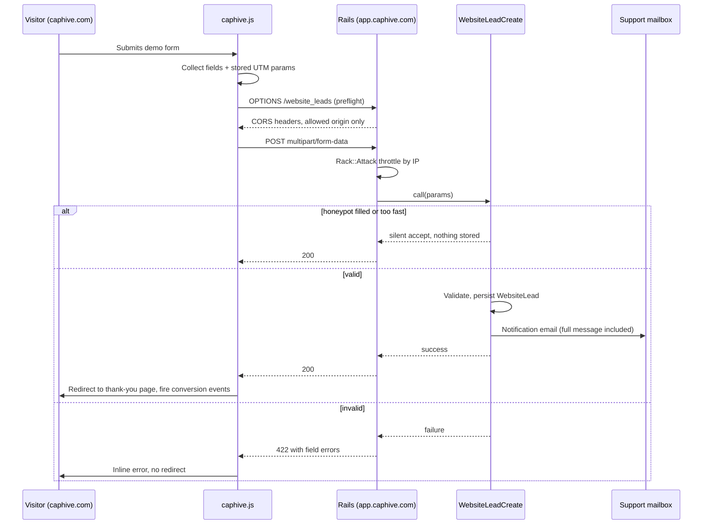

# Website Lead Capture — Implementation Note

**Status:** Specified, not built. Hand to an implementing agent or developer.
**Goal:** Capture demo requests from the public marketing site into our own database, with **no login**, instead of routing them through a third-party form service.
**Effort:** Roughly half a day.
**Prerequisite row:** A1 in [`docs/marketing/us_gtm_prerequisites.md`](../marketing/us_gtm_prerequisites.md) — currently the highest-value blocker in the GTM plan.

---

## 1. Why This, and Why It Works

Today the demo form composes an email in the visitor's own mail client. Nothing reaches us unless they then choose to send it, and anyone who abandons at that step is invisible. That is what this replaces.

The **client side already exists** — `public/website/assets/js/caphive.js` (~lines 193–280) posts `FormData` via `fetch()` to whatever URL sits in `window.CAPHIVE.formEndpoint`, then redirects to the thank-you page and fires the analytics conversion events. It falls back to the old mail-client behaviour while that value is blank. **Do not rewrite the client.** This note only specifies the receiving end; when it is live, set `formEndpoint` in `website_src/_partials/site_config.html.erb` and rebuild.

**Why an app-side endpoint is possible at all.** `lib/middleware/website.rb:94-96` returns 405 for any non-GET request, and in production nginx serves the apex directly from `public/website` — but **both only apply to requests whose Host is in `WEBSITE_HOSTS`**. A POST to `app.caphive.com` is not such a request: the middleware passes it straight through to Rails. So this needs no middleware change and no nginx change. It is an ordinary cross-origin POST from the static site to the app host.

Two stacks, two origin pairs:

| Stack | Website origin | App host |
|---|---|---|
| India | `caphive.com`, `www.caphive.com` | `app.caphive.com` |
| US | `caphive.us`, `www.caphive.us` | `app.caphive.us` |

---

## 2. What to Capture, and Why Each Field

The form (`website_src/pages/contact.html`) submits `name`, `firm`, `email`, `role` (select), `message` (textarea). The JS additionally forwards the five UTM parameters it captured on landing.

| Field | Source | Why it is worth storing |
|---|---|---|
| `name`, `email` | form (required) | The lead. Email is the only field that must be well-formed. |
| `firm` | form (required) | Lets us match the submission against the Form ADV target list before replying. |
| `role` | form | Selects which persona sequence and talk track to use — CFO, COO or IR (`us_gtm.md` §2.2). |
| `message` | form (optional) | **The highest-value field.** It is the prospect's pain in their own words, and it is what makes the configure-first demo possible (`us_gtm.md` §4.1 step 4). Never truncate it in the notification. |
| `utm_source`, `utm_medium`, `utm_campaign`, `utm_content`, `utm_term` | JS | Channel attribution. The §5 kill criteria in the GTM plan cannot be evaluated without this. |
| `referrer`, `landing_page` | JS or headers | Which content page produced the lead — the published blog articles are the outbound proof assets, so knowing which ones convert directs future writing. |
| `submitted_at` | server | Server clock, never client-supplied. |
| `request_ip`, `user_agent` | server | Abuse control only. See §5 on retention. |

Store the raw payload alongside the parsed columns if that is cheap — form fields drift, and an unparsed field is better than a lost one.

**Accept `multipart/form-data`.** The client posts `FormData`, not JSON. A JSON-only endpoint will silently reject every real submission.

---

## 3. Endpoint Design

- **Route:** `POST /website_leads`, declared outside any authenticated scope. Add `OPTIONS` for the CORS preflight.
- **Controller:** mirror `app/packs/core/base/controllers/public_guides_controller.rb`, which is the established login-less pattern in this codebase. It opts out of all three app-wide filters, and this endpoint needs the same three:

```ruby
# Nothing here reads or writes tenant data, so the app-wide filters are opted out of:
# authentication, Pundit's authorize check, and subdomain -> tenant resolution.
skip_before_action :authenticate_user!
skip_before_action :set_current_entity
skip_after_action  :verify_authorized
# Required for a cross-origin POST that carries no session. Safe here only because
# the endpoint is unauthenticated and writes solely to its own table — there is no
# user context that could be forged. Do not copy this onto anything that reads
# tenant data.
skip_before_action :verify_authenticity_token
```

- **Service:** a Trailblazer operation (`WebsiteLeadCreate`) using the `step`/`left` DSL, following `CapitalCallCreate`. Validation, persistence and notification are separate steps.
- **CORS:** allow **only** the website origins for this stack, method `POST`, no credentials. Do not use a wildcard.
- **Response:** `200` with a small JSON body on success, `422` on validation failure. The client redirects to the thank-you page on success and shows an inline error otherwise.
- **Storage:** a new `website_leads` table. Note it is **not** tenant-scoped — these records have no `entity_id`, which is unusual in this codebase. Any future admin view of them must therefore be gated on the `:support` / `:super` roles rather than on tenancy.
- **Notification:** email to the monitored support address (`SUPPORT_EMAIL_FROM` / `SUPPORT_EMAIL_TO`) so prerequisite row A2 — an alert within five minutes — passes. Include the full `message` field.

---

## 4. Flow



---

## 5. Abuse, Spam and Data Protection

This is a public, unauthenticated, CSRF-exempt write endpoint — the only one of its kind in the app. Treat the controls below as part of the feature, not hardening to add later.

1. **Honeypot field** — a hidden input real users never fill. If populated, return `200` and store nothing. Responding with an error tells the bot what to change.
2. **Time-to-submit check** — reject (silently, as above) anything submitted within ~2 seconds of page render.
3. **Rack::Attack throttle** — the app already has `config/initializers/rack_attack.rb`. Add a rule for this path, roughly 5 submissions per IP per hour. Real demand is a handful per month.
4. **Length caps on every field**, enforced server-side. `message` is free text from strangers.
5. **No CAPTCHA initially.** It adds friction to a low-volume, high-value form. Revisit only if spam actually arrives.
6. **Retention.** `request_ip` and `user_agent` are personal data collected for abuse control, so keep them only as long as that purpose requires and say so in the privacy policy. The lead fields themselves are ordinary business-contact data.
7. **Escape everything in the notification email.** The `message` field is attacker-controlled and lands in a human's inbox.

---

## 6. Tests (Cucumber — this project does not use RSpec)

| Scenario | Expected |
|---|---|
| Valid multipart submission from an allowed origin | `200`, one `WebsiteLead` row, notification delivered |
| UTM parameters present | Persisted on the record |
| Missing or malformed email | `422`, no row created |
| Honeypot filled | `200`, **no** row created, no email |
| Submitted under the time threshold | `200`, no row created |
| Request from a disallowed origin | No permissive CORS headers returned |
| Sixth submission from one IP within the hour | Throttled |
| Oversized `message` | Rejected cleanly, no 500 |

Cucumber runs with the `:inline` ActiveJob adapter, so assert on `ActionMailer::Base.deliveries` rather than enqueued jobs. The test environment is SQLite while dev and production are MySQL — keep any raw SQL dialect-portable.

---

## 7. Confirm Before Building

1. **One endpoint or two?** The India and US stacks are separate deployments. Simplest is each serving its own origin; confirm leads do not need to pool in one place.
2. **Where do leads get read?** An admin index is not specified here. Without one they live only in email — acceptable to start, but decide deliberately.
3. **Privacy policy update** for the IP/user-agent retention in §5.
4. **Should a lead auto-create anything downstream** (a CRM record, a task)? Recommendation: no, not initially. Keep the public write path as small as possible.
