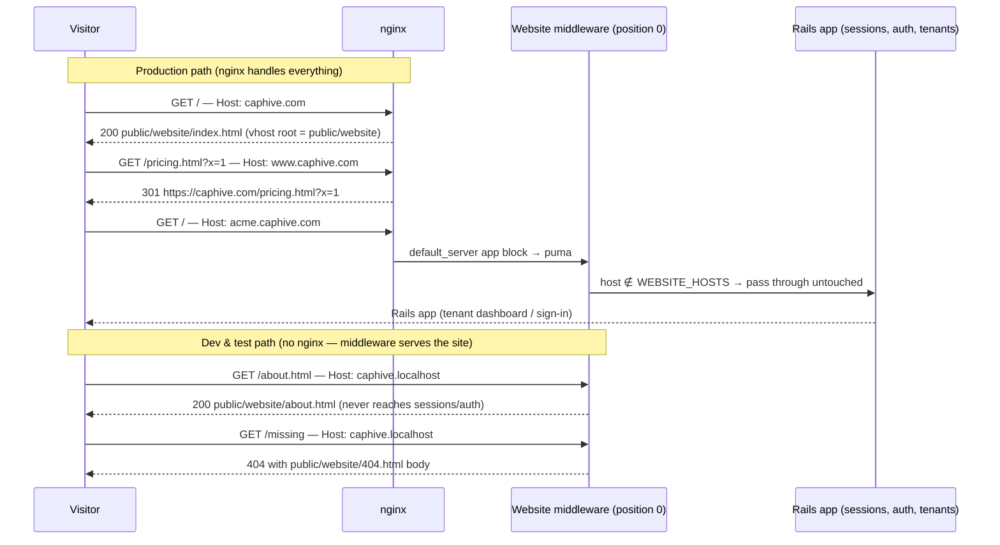
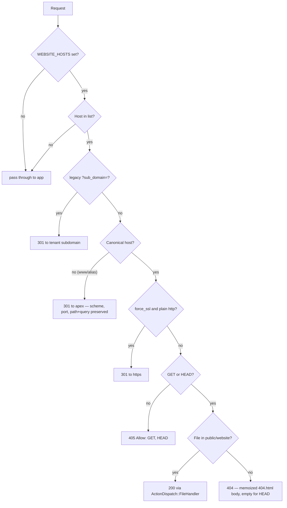

# Website Serving (apex domain → static site from `public/website/`)

## Problem

The static website lives in a separate repo (`../caphive.com` — ~24 flat
HTML pages, one shared CSS file, one shared JS file, `robots.txt`, `sitemap.xml`,
`404.html`; **all internal links are relative**, so the site works from any
subdirectory). We want:

| Host | Serves |
|---|---|
| `caphive.com` (apex) | Static website |
| `www.caphive.com` | `301` → `https://caphive.com/...` |
| `app.caphive.com`, `acme.caphive.com`, … (any subdomain) | Rails app, exactly as today |

Today the apex just dumps visitors on the tenant sign-in page (tenant resolution in
`WithAuthentication#set_current_entity` finds no entity for a blank subdomain).

## Why the site cannot simply be dropped into `public/`

Two layers serve `public/` for **every** hostname, so a top-level `public/index.html`
would hijack `/` on all tenant subdomains:

1. **Rails** — `config.public_file_server.enabled` defaults to `true` in production,
   and `ActionDispatch::Static` mounts with `index: "index"`.
2. **nginx** — `config/deploy/templates/nginx_conf.erb` has a single catch-all
   `server` block with `root .../current/public;` and
   `try_files $uri/index.html $uri @puma_...;`.

There is a second, sneakier collision: the website pages link
`assets/css/caphive.css` relatively, which on the apex resolves to
`/assets/css/caphive.css` — and nginx's `location ^~ /assets/` block serves that
prefix from sprockets' `public/assets/` output and would return **404 without ever
reaching puma**.

Both problems are solved by putting the site in a subdirectory (`public/website/`) and
adding a **host-aware layer** in front.

## Design: two layers, one directory

The site is copied into `public/website/` (git-tracked, ships with every Capistrano
release). Two independent layers decide when to serve it:

1. **nginx `server` block (production/staging)** — a dedicated vhost for the apex
   with `root .../current/public/website`. Pure static serving; puma never sees
   website traffic; the `/assets/` collision disappears because the vhost root
   *is* the site directory. A second tiny vhost 301s `www` → apex.
2. **Rack middleware `Website` (all environments)** — host-gated static file
   handler inserted at **position 0** of the middleware stack. It powers
   development and Cucumber (where nginx doesn't exist) and acts as a production
   fallback if a request ever slips past nginx.

### Request flow



## The middleware (`lib/middleware/website.rb`)

Plain Rack middleware (mirrors the existing `lib/middleware/log_404s.rb` pattern),
registered by `config/initializers/website.rb` with
`config.middleware.insert_before(0, Website)`.

**Strictly opt-in via `ENV["WEBSITE_HOSTS"]`** — comma-separated hostnames; the
**first entry is the canonical apex**, every other listed host 301s to it. Unset ⇒
the middleware is a one-line pass-through no-op.

Why opt-in rather than deriving from `BASE_DOMAIN`: development and the whole
Cucumber suite run on host `localhost` with `BASE_DOMAIN=localhost:<port>` — any
derivation would hijack every dev browser request and every test. It also cleanly
handles the US stack (`caphive.us`), where the .com-branded content should *not*
appear: the variable is simply not set there.

Per-request logic:



Implementation choices:

- **`ActionDispatch::FileHandler`** (the class `ActionDispatch::Static` itself uses)
  rooted at `Rails.public_path.join("website")` with `index: "index"` — gives
  percent-decoding + `clean_path_info` **path-traversal protection**, correct MIME
  types, `Range` support, `/` → `index.html` and **extensionless resolution**
  (`/about` → `about.html`) for free.
- **Redirects preserve scheme, explicit port, path and query** — a hardcoded
  `https://apex` target would be unreachable in dev (`:3001`, no TLS listener).
  Behind the ALB, `X-Forwarded-Proto` keeps redirects on `https`.
- **Legacy `?sub_domain=` links**: old notification emails link to the bare domain
  with `?sub_domain=<tenant>`; the middleware forwards them to the tenant
  subdomain exactly as `WithAuthentication#set_current_entity` used to (value
  validated against `[a-z0-9-]+` before it is reflected into a redirect).
- **force_ssl parity**: the middleware short-circuits before
  `ActionDispatch::SSL`, so it re-implements the two behaviors that matter for a
  public page — an http→https redirect and an HSTS header (deliberately *without*
  `includeSubDomains`: the apex must not dictate policy for tenant hosts).
- **Cache-Control**: `public, max-age=300` for HTML; `public, max-age=86400` for
  `/assets/*`. The website assets are **unfingerprinted**, so never `expires max`
  (a stale-forever CSS file would survive redesigns).
- **404s**: served with the website `404.html` body and a real `404` status. The
  body is **memoized in memory** (scanner floods cost a hash lookup, not disk
  I/O) and guarded (a missing `404.html` degrades to a plain body, not an
  unrescued `Errno::ENOENT`). HEAD responses carry no body — the middleware sits
  above `Rack::Head`, so it strips it itself.
- **Position 0 trade-offs**: website requests short-circuit before
  `ActionDispatch::Session::CookieStore` (the shared `domain: :all` session cookie
  is never set for anonymous brochure traffic) and before `Log404s`/`Rack::Attack`
  (scanners hammering the apex can't poison the per-IP 404 counters that guard the
  app). The flip side — apex traffic also bypasses Rack::Attack's
  blocklist/throttle — is accepted: misses are answered from memory, hits are
  plain static reads, and production serves the apex from nginx anyway.

## nginx changes (`config/deploy/templates/nginx_conf.erb`)

The template is rendered by `ERB.new(template).result(binding)` inside the
Capistrano `IRM:setup` task (`config/deploy.rb`), so its binding is the Capistrano
DSL — the app's `.env` files are **not** loaded there. Parameterization is therefore
a Capistrano variable:

```ruby
# config/deploy/production_in.rb
set :website_domain, "caphive.com"
```

Template edits, all guarded by `<% if fetch(:website_domain, nil) %>` so stages
without the variable render **byte-identical** to today:

1. The existing app `server` block becomes `listen 80 default_server;` — explicit,
   so ALB health checks (which arrive with `Host: <target-ip>`) and every tenant
   subdomain keep landing on the app once a second vhost exists. (These boxes run
   only the IRM config — `IRM:setup` removes the stock `default` site — so no
   other vhost competes for the `default_server` claim.)
2. New **apex vhost**: `server_name caphive.com; root .../current/public/website;`
   with `try_files $uri $uri.html $uri/index.html =404;` (the `$uri.html`
   candidate keeps extensionless URLs working exactly like the Rails
   `FileHandler` does in dev/test), `error_page 404 /404.html;`, dynamic `gzip on`
   for css/js/svg/xml, `expires 1d` on `/assets/`, `405` for non-GET/HEAD, and the
   same legacy `?sub_domain=<tenant>` → tenant-subdomain 301 the middleware
   performs. `robots.txt` / `sitemap.xml` / `404.html` come out host-correct for
   free because the vhost root is the site directory.
3. New **www vhost**: `return 301 https://caphive.com$request_uri;` — `https://`
   is explicit because the ALB terminates TLS and nginx only ever listens on `:80`.

Rollout: `cap production_in IRM:setup` re-uploads the conf, then
`sudo nginx -t && sudo nginx -s reload`.

## Content workflow (`rake website:sync`)

The `../caphive.com` repo remains the **source of truth**. `public/website/` is a
mirror and must never be hand-edited:

```
rake website:sync   # rsync -av --delete ../caphive.com/ public/website/
                      #   (excludes .git, .claude, SITE.md)
git add public/website && git commit
```

Override the source path with `WEBSITE_SRC=/path/to/caphive.com` if the checkout
lives elsewhere. The `--delete` flag keeps the mirror exact — files removed from
the website repo disappear from `public/website/` on the next sync.

## Configuration summary

| File | Change |
|---|---|
| `.env.production.in` | `WEBSITE_HOSTS=caphive.com,www.caphive.com` |
| `.env.development` | commented example: `# WEBSITE_HOSTS=caphive.localhost,www.caphive.localhost` |
| `.env.production.us`, staging | deliberately untouched (opt in later if wanted) |
| `config/deploy/production_in.rb` | `set :website_domain, "caphive.com"` |

Dev testing: uncomment the `.env.development` line and browse
`http://caphive.localhost:3001` — browsers resolve `*.localhost` to loopback per
RFC 6761, so no `/etc/hosts` edit is needed. `http://localhost:3001` still reaches
the app.

## Testing (Cucumber, `@website`)

Playwright cannot assert status codes or observe 301s, so the feature drives the
full middleware stack with a `Rack::Test` client that sets an explicit `Host`
header per request — the same precedent as
`features/step_definitions/rack_attack_404_steps.rb`. An `Around('@website')`
hook in `features/support/website.rb` sets
`WEBSITE_HOSTS=caphive.test,www.caphive.test` for the scenario and restores it
after (`.test` avoids any interaction with the suite's `BASE_DOMAIN=localhost:<port>`).

Scenarios in `features/misc/website.feature`:

1. Apex `/` → 200 with website index content
2. Apex `/about.html` → 200; `/about` (extensionless) → 200
3. Apex `/assets/css/caphive.css` → 200 `text/css` — regression guard for the nginx `/assets/` collision
4. Apex `/robots.txt` + `/sitemap.xml` → website versions, not the app's `public/robots.txt`
5. Apex unknown path and `../` traversal attempts → 404 with the website 404 body; HEAD 404s have an empty body
6. `www` → apex 301s preserving path + query, an explicit port, and the incoming scheme (http stays http, `X-Forwarded-Proto`-style https stays https)
7. Legacy `?sub_domain=acme` link on the apex → 301 to `acme.<apex>` with path + query intact
8. Host `localhost` → app behavior unchanged (sign-in redirect; app 404s do **not** get the website body)
9. POST to the apex → 405
10. Control: `WEBSITE_HOSTS` unset → apex-like host falls through to the app

## Prerequisites & follow-ups outside this repo

The Rails/nginx changes are **inert until DNS points the apex at the ALB**, so they
can merge and deploy first. Then, in `../IRM-Infra`:

- **ACM cert**: currently `*.caphive.com` only — a wildcard does *not* cover the
  bare apex. Add `caphive.com` as a SAN and reissue.
- **Route53**: A/ALIAS records for `caphive.com` and `www.caphive.com` → the ALB.
- **ALB**: confirm the 443 listener forwards those hosts to the app target group.

Known/accepted trade-offs:

- **Maintenance mode**: `config/deploy/templates/maintenance` is a catch-all vhost,
  so flipping maintenance takes the website down with the app. Acceptable
  for now; the website `server` block can later be replicated into that template.
- **GET/HEAD only on the apex is intended**: the brochure site has no writable
  endpoints, so anything previously POSTing to bare-domain URLs (instead of
  `app.caphive.com`) now gets `405`. No known integration does this; new webhook
  or API registrations must use a subdomain host.
- **Apex traffic bypasses Rack::Attack** (see the middleware trade-offs above) —
  accepted because misses answer from memory and production uses nginx.
- Website repo pre-launch TODOs live in its own `SITE.md` (missing `og.png`,
  unreviewed legal templates, contact form still `mailto:`).
