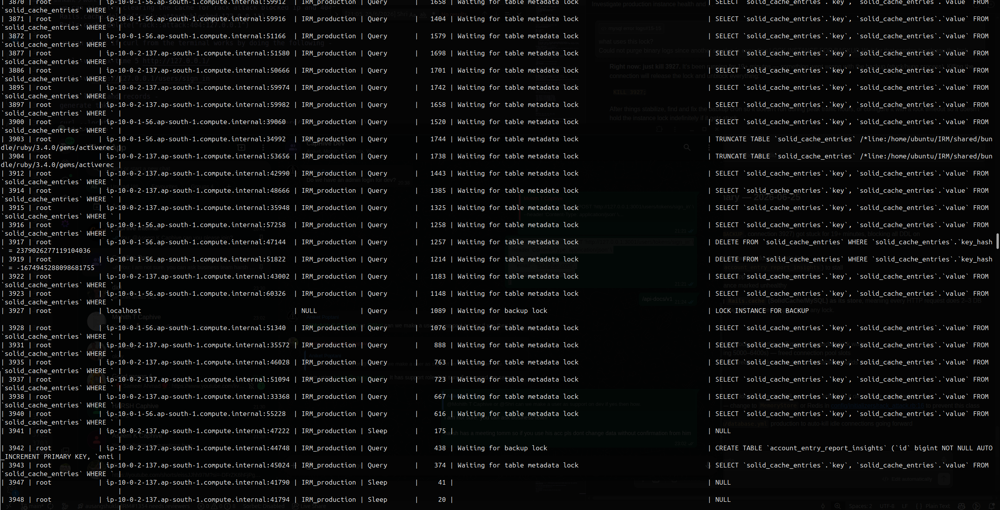
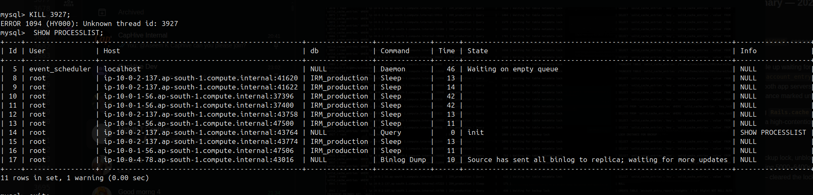

# Rack Attack & DB Lock Investigation

## Rack Attack Issues

- Rack Attack blocks IP `127.0.0.1` after too many 404s
- Rack Attack fires lots of `solid_cache_entries` queries — these were taking 50s, which is too long, indicating some issue with the DB or the query
- Removing Rack Attack solves the blocked issue but it's not the root cause

### Clearing Rack Attack Cache

```ruby
Rails.cache.delete("rack::attack:blocked:127.0.0.1")
Rails.cache.delete("rack::attack:404:127.0.0.1")
```

---

## Debugging Steps

### Check if curl from the terminal works

```bash
curl -v --max-time 5 http://127.0.0.1/

curl -v http://127.0.0.1/users/sign_in
```

### Check login and records

**Generate token:**

```bash
curl --location --request POST 'http://app.caphive.com/users/tokens/sign_in' \
--header 'Content-Type: application/json' \
--data-raw '{
    "email": "<email>",
    "password": "<password>"
}'
```

**Use the token to get funds:**

```bash
curl --location 'http://app.caphive.com/funds.json' \
--header 'Authorization: <token>'
```

---

## MySQL Debugging

Checking MySQL error logs can also provide useful info.

**Log into MySQL:**

```bash
mysql -uroot -p
```

**Show all currently running queries:**

```sql
SHOW PROCESSLIST;
```

This shows all queries currently running and their status. Useful for identifying long-running queries causing blocking.

**Kill long-running sleep queries:**

```sql
SELECT CONCAT('KILL ', id, ';') FROM information_schema.processlist WHERE command='Sleep' AND time>500 AND db='IRM_production';
```

**Kill a specific query:**

```sql
KILL <process_id>;
```

> `SHOW PROCESSLIST;` shows the `process_id` in the first column.

---

## Root Cause

The main culprit was the `LOCK INSTANCE FOR BACKUP` lock, which was being held for a long time due to a backup process. Terminating it resolved the issue.

- Backups happen every 30 mins (incremental) and at 11 PM IST (full backup)
- Why the backup caused the issue is not clear yet
- Due to the lock, when deploying the latest code the migration also got stuck, causing even more issues

---

## Processlist: Before & After

### Before



### After



---
