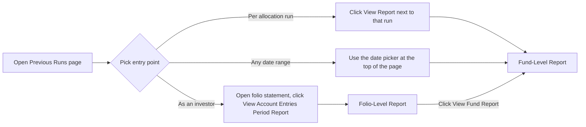

# Account Entries Period Report User Guide

The **Account Entries Period Report** gives you a readable summary of everything that happened in a fund — or in one investor's folio — over a chosen date range. Instead of filtering a raw transaction grid, you get totals, a breakdown by entry type, a trend versus prior periods, and (optionally) a plain-language narrative explaining what the numbers mean.

No technical background is needed; everything below is explained in fund-operations terms.

---

## Table of Contents

1. [What the Report Shows](#what-the-report-shows)
2. [Fund-Level vs. Folio-Level](#fund-level-vs-folio-level)
3. [Opening the Report](#opening-the-report)
4. [Choosing the Date Range](#choosing-the-date-range)
5. [Reading the Fund-Level Report](#reading-the-fund-level-report)
6. [Reading the Folio-Level Report](#reading-the-folio-level-report)
7. [AI Commentary](#ai-commentary)
8. [Who Can See What](#who-can-see-what)
9. [Frequently Asked Questions](#frequently-asked-questions)

---

## What the Report Shows

Every fee, capital call, distribution, and adjustment posted to a fund or an investor's folio is recorded as an **account entry**. Over a quarter or a year these can run into the hundreds or thousands of individual lines — useful for bookkeeping, but hard to read at a glance.

This report answers the questions that actually come up when reviewing a period:

- What happened in total, and how many entries made up that total?
- What's the composition — how much was fees, how much was distributions, how much was capital calls?
- Is this period normal, or unusually high/low compared to recent history?
- Can I see the individual entries behind any of these numbers?

The report is generated on the fly whenever you open it — there's nothing to "run" and wait for, and nothing gets out of date. Changing the date range simply re-summarises a different slice of the same underlying entries.

---

## Fund-Level vs. Folio-Level

| | Fund-level report | Folio-level report |
|---|---|---|
| Scope | Every entry in the fund for the period — across all investors, plus fund-only entries (e.g. fees charged before being allocated to investors) | One investor's folio only |
| Who sees it | Fund managers and other employees with access to the fund | Fund managers, plus the investor who owns that folio |
| Typical use | Quarter-end review of everything the fund generated | Answering an investor's question about their own activity, or letting them self-serve |

The two are linked: from the fund-level report you can drill into any folio for the same date range, and from a folio report you can jump back to the fund-level view.

---

---

## Opening the Report

There are three ways in:

1. **From a specific allocation run** — on the fund's **Previous Runs** page, click **View Report** next to any run. The report opens pre-filled with that run's own start and end dates, so you can immediately sanity-check what the run generated.
2. **For any date range, without a run** — at the top of the same **Previous Runs** page, pick a start date and end date and click **View Account Entries Report**. Useful for periods that weren't produced by an allocation run at all (imports, manual adjustments).
3. **From an investor's folio statement** — a **View Account Entries Period Report** link on the folio statement opens that investor's folio-level report directly. This is also how an investor can view their own report if they have portal access.

---

## Choosing the Date Range

Both the fund-level and folio-level report have a **start date** and **end date** field at the top, with a **View Report** button to re-run the summary for a new range.

If you open the report without specifying dates, it defaults to a single day — the most recent date that has actual activity recorded (it skips dates that only hold running-balance checkpoints, so you don't land on a report that looks empty). You can widen the range to a full quarter, year, or any custom window at any time.

---

## Reading the Fund-Level Report

Top to bottom, the fund-level report shows:

1. **Header** — fund name and the date range being reported on.
2. **Summary KPIs** — four cards: total amount for the period, number of entries, how many distinct folios had activity, and how many distinct entry types appeared.
3. **Breakdown by Entry Name** — a donut chart showing the total amount split by entry type (e.g. Management Fee, Capital Call, Distribution), so you can see the period's composition at a glance.
4. **Trailing-Period Trend** — a column chart tracking the top entry types (by size) over the last several quarters leading up to the end date, so you can tell whether this period is in line with history or stands out.
5. **Detail** — a paginated table of the individual entries behind the summary, for when you need to verify a total against source records.

---

## Reading the Folio-Level Report

The folio-level report mirrors the fund-level one, scoped to a single investor:

1. **Header** — investor name, folio number, and the date range.
2. A **View Fund Report** link back to the fund-level report for the same dates.
3. **Summary KPIs**, **Breakdown by Entry Name**, and **Trailing-Period Trend** — the same three sections as the fund-level report, but counting only this folio's entries.
4. **Detail** — every entry for this folio in the period, listed directly (no pagination needed at this scale).

---

## AI Commentary

Each section of the report (except the detail table) can carry a short AI-written narrative underneath it, explaining what the numbers show in plain language — and flagging anything that looks unusual compared to recent history. For example: *"Management Fee is 42% above its trailing 4-quarter average."*

- **On demand only**: commentary never generates just from opening the report — you (or, for their own folio, an investor) request it for any individual section using the **Generate** button. This keeps opening or refreshing the report fast, with no background AI calls firing on every page load.
- **While it's working**: after clicking **Generate**, you'll see "Generating AI commentary… refresh in a moment" until it's ready.
- **Manual refresh**: once a section has commentary, the same button becomes **Regenerate**, letting you force a fresh narrative at any time — for example after a re-run changes that period's figures and the existing narrative no longer matches the numbers.
- **Turning it off entirely**: there's a fund-level setting, **Enable AI commentary on Account Entries Reports**, found on the fund's edit form, that controls whether AI commentary is offered for this fund's reports at all.
- **What it covers**: descriptive commentary on the section's numbers, plus any anomalies flagged against the trailing-period history — each anomaly names the metric, how far it deviated, and a one-line explanation.

---

## Who Can See What

| Report | Visible to |
|---|---|
| Fund-level | Employees with access to the fund (not investors, even if they have portal access to the fund) |
| Folio-level | Employees with access to the fund, **and** the investor who owns that specific folio |

An investor can generate or regenerate AI commentary only for their own folio's report — they can't trigger commentary on a fund-level report they aren't permissioned to see.

---

## Frequently Asked Questions

**Does the report change the underlying entries?**
No. It's a read-only summary — nothing about the entries themselves is modified by viewing or refreshing the report.

**Can I export the report?**
Not yet — this is an in-app, interactive view only.

**Why might the period default to a single day instead of a quarter?**
The report opens on the most recent date with real activity unless you specify a range — widen the start date yourself to cover a full quarter or year.

**Why is there no AI commentary for a section?**
Commentary only appears once someone clicks **Generate** for that section — it never generates on its own. Click **Generate**, and if you've already clicked it, refresh the page after a moment while it finishes.

**Can I trust the commentary's anomaly flags as the final word?**
Treat them as a starting point for review, not a substitute for judgement — they're based purely on the trailing-period history available in the data and don't know about one-off events (a known one-time fee, for instance) unless you note that yourself.

**I regenerated commentary but it still looks the same — did it work?**
Regeneration replaces the narrative even if the numbers haven't changed, so an unchanged result usually means the new narrative agreed with the old one. If it's still showing "Generating…" after a while, refresh the page again.
