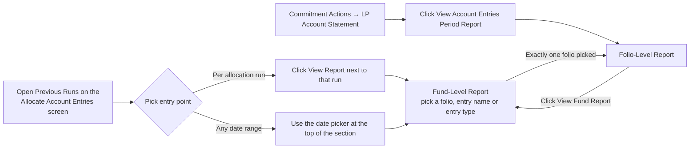

# Account Entries Period Report User Guide

The **Account Entries Period Report** gives you a readable summary of everything that happened in a fund — or in one investor's folio — over a chosen date range. Instead of filtering a raw transaction grid, you get totals, a breakdown by entry type, a trend versus prior periods, and (optionally) a plain-language narrative explaining what the numbers mean.

> **Where to find it:** Sidebar → [**Funds → Funds**](/funds) → open the fund → **Actions → Account Entries → Allocate Account Entries** → **View Account Entries Report** (or the **View Report** icon on a run) in **Previous Runs**, which opens the fund-level report. The folio report opens from a commitment's **Actions → LP Account Statement**. Needs employee access to the fund; the allocation screen itself needs fund update rights.

No technical background is needed; everything below is explained in fund-operations terms.

---

## Table of Contents

1. [What the Report Shows](#what-the-report-shows)
2. [Fund-Level vs. Folio-Level](#fund-level-vs-folio-level)
3. [Opening the Report](#opening-the-report)
4. [Choosing the Date Range](#choosing-the-date-range)
5. [Reading the Fund-Level Report](#reading-the-fund-level-report)
6. [Reading the Folio-Level Report](#reading-the-folio-level-report)
7. [AI Commentary](#ai-commentary)
8. [Who Can See What](#who-can-see-what)
9. [Frequently Asked Questions](#frequently-asked-questions)
10. [Related Guides](#related-guides)

---

## What the Report Shows

Every fee, capital call, distribution, and adjustment posted to a fund or an investor's folio is recorded as an **account entry**. Over a quarter or a year these can run into the hundreds or thousands of individual lines — useful for bookkeeping, but hard to read at a glance.

This report answers the questions that actually come up when reviewing a period:

- What happened in total, and how many entries made up that total?
- What's the composition — how much was fees, how much was distributions, how much was capital calls?
- Is this period normal, or unusually high/low compared to recent history?
- Can I see the individual entries behind any of these numbers?

The report is generated on the fly whenever you open it — there's nothing to "run" and wait for, and nothing gets out of date. Changing the date range simply re-summarises a different slice of the same underlying entries.

---

## Fund-Level vs. Folio-Level

| | Fund-level report | Folio-level report |
|---|---|---|
| Scope | Every entry in the fund for the period — across all investors, plus fund-only entries (e.g. fees charged before being allocated to investors) | One investor's folio only |
| Who sees it | Fund managers and other employees with access to the fund | Fund managers, plus the investor who owns that folio |
| Typical use | Quarter-end review of everything the fund generated | Answering an investor's question about their own activity, or letting them self-serve |

The two are linked: picking exactly one folio in the fund-level report's **Investor / Folio** filter switches to that folio's report for the same date range, and from a folio report you can jump back to the fund-level view.

---

---

## Opening the Report

There are three ways in:

1. **From a specific allocation run** — in **Previous Runs** on the fund's **Actions → Account Entries → Allocate Account Entries** screen, click **View Report** next to any run. The report opens pre-filled with that run's own start and end dates and limited to that run's entries (banner "This report is limited to allocation run #…"), so you can sanity-check what the run generated.
2. **For any date range, without a run** — at the top of the same **Previous Runs** section, pick a start date and end date and click **View Account Entries Report**. Useful for periods that weren't produced by an allocation run at all (imports, manual adjustments).
3. **From a commitment's LP Account Statement** — open the commitment, choose **Actions → LP Account Statement** and click **View Account Entries Period Report** to open that folio's report directly. The commitment's Actions menu needs fund update rights, so investors have no menu path to it; an investor can open their own folio report only if someone shares the report's direct link with them.

The fund-level report shows nothing but a "Pick at least one…" prompt until you choose at least one **Investor / Folio**, **Entry Names** or **Entry Types** filter — including when you arrive from a run's **View Report**.

---

## Choosing the Date Range

Both the fund-level and folio-level report have a **start date** and **end date** field at the top, with a **View Report** button to re-run the summary for a new range. The fund-level report also has the **Investor / Folio**, **Entry Names** and **Entry Types** filters (at least one is required); picking exactly one folio switches to that folio's report. A range longer than 731 days is shortened to end on your end date, with a warning.

If you open the report without specifying dates, it defaults to a single day — the most recent date that has actual activity recorded (it skips dates that only hold running-balance checkpoints, so you don't land on a report that looks empty). You can widen the range to a full quarter, year, or any custom window at any time.

---

## Reading the Fund-Level Report

Top to bottom, the fund-level report shows:

1. **Header** — fund name and the date range being reported on.
2. **Summary KPIs** — three cards: **Entry Count**, **Folios Touched** and **Distinct Entry Names**.
3. **Breakdown by Entry Name** — a donut chart showing the total amount split by entry type (e.g. Management Fee, Capital Call, Distribution), so you can see the period's composition at a glance.
4. **Trailing-Period Trend** — a column chart tracking the top entry types (by size) over the last several quarters leading up to the end date, so you can tell whether this period is in line with history or stands out.
5. **Detail** — a paginated pivot of folios against entry names and dates, for when you need to verify a total against source records.

---

## Reading the Folio-Level Report

The folio-level report mirrors the fund-level one, scoped to a single investor:

1. **Header** — investor name, folio number, and the date range.
2. A **View Fund Report** link back to the fund-level report for the same dates.
3. **Summary KPIs**, **Breakdown by Entry Name**, and **Trailing-Period Trend** — the same three sections as the fund-level report, but counting only this folio's entries.
4. **Detail** — a table of every entry for this folio in the period (Reporting Date, Name, Entry Type, Amount).

---

## AI Commentary

Each section of the report (except the detail table) can carry a short AI-written narrative underneath it, explaining what the numbers show in plain language — and flagging anything that looks unusual compared to recent history. For example: *"Management Fee is 42% above its trailing 4-quarter average."*

- **On demand only**: commentary never generates just from opening the report — you (or, for their own folio, an investor) request it for any individual section using the **Generate** button. This keeps opening or refreshing the report fast, with no background AI calls firing on every page load.
- **While it's working**: after clicking **Generate**, you'll see "Generating AI commentary… refresh in a moment" until it's ready.
- **Manual refresh**: once a section has commentary, the same button becomes **Regenerate**, letting you force a fresh narrative at any time — for example after a re-run changes that period's figures and the existing narrative no longer matches the numbers.
- **Turning it off**: there's a fund-level setting, **Enable AI commentary on Account Entries Reports**, found on the fund's edit form. When it is off, a section without commentary shows "AI commentary is disabled for this report", but the **Generate** button is still displayed.
- **What it covers**: descriptive commentary on the section's numbers, plus any anomalies flagged against the trailing-period history — each anomaly names the metric, how far it deviated, and a one-line explanation.

---

## Who Can See What

| Report | Visible to |
|---|---|
| Fund-level | Employees with access to the fund (not investors, even if they have portal access to the fund) |
| Folio-level | Employees with access to the fund, **and** the investor who owns that specific folio |

In practice the fund-level entry points (**View Account Entries Report**, **View Report**) sit on the **Allocate Account Entries** screen, which needs fund update rights; employees with read-only fund access can still open the report through a direct link shared by a colleague.

An investor can generate or regenerate AI commentary only for their own folio's report — they can't trigger commentary on a fund-level report they aren't permissioned to see.

---

## Frequently Asked Questions

### Navigation and getting there

**Where do I find the Account Entries Period Report in CapHive?**
Sidebar → [**Funds → Funds**](/funds), open the fund, then **Actions → Account Entries → Allocate Account Entries**. At the top of the **Previous Runs** section pick a start and end date and click **View Account Entries Report**, which opens the fund-level report. See [Opening the Report](#opening-the-report).

**How do I open the report for the entries one allocation run generated?**
On the same **Previous Runs** list click the green **View Report** icon on the run's row. The report opens with that run's dates and a banner "This report is limited to allocation run #…", so only entries that run created are counted.

**How do I open the folio-level report for one investor?**
Open the fund's **Commitments** tab, open the commitment, then **Actions → LP Account Statement** and click **View Account Entries Period Report**. It opens that folio's report. You can also pick exactly one folio in the fund-level report's **Investor / Folio** filter, which switches to the folio report.

**How do I get back from a folio report to the fund-level report?**
Click **← View Fund Report** at the top right of the folio report's filter card; it keeps the same dates.

**I can't see View Account Entries Report or View Report. Why?**
Both sit on the fund's **Allocate Account Entries** screen, which needs update rights on the fund, and are shown only if you are an employee with access to the fund (or a company admin). Account entries must also be enabled for your entity for the **Account Entries** sub-menu to appear. Employees with read-only fund access can still open the report through a direct link shared by a colleague.

### Using and managing the report

**How do I run the fund-level report?**
Set **Start Date** and **End Date**, choose at least one **Investor / Folio**, **Entry Names** or **Entry Types**, and click **View Report**. Until one of those filters is chosen the page only shows a prompt, because a fund's full ledger is too large to load unfiltered. See [Choosing the Date Range](#choosing-the-date-range).

**How do I filter the report to certain entries?**
Use the multi-select **Entry Names** and **Entry Types** filters (they offer only names and types that exist in the date range) and **Investor / Folio** to limit it to chosen folios, then click **View Report**. Filters combine: an entry must match every filter you set.

**How do I change the date range?**
Edit **Start Date** and **End Date** at the top of the report and click **View Report** again. A range longer than 731 days (about 24 months) is shortened to end on your end date, with a yellow message saying so.

**Can I export the report?**
Not yet; it is an in-app, interactive view only. For a downloadable list use the account entries list (**Actions → Account Entries → Fund Account Entries**) or the run's **Account Entries** icon on **Previous Runs**.

**Is there anything to create, edit or delete?**
No. The report is calculated from existing account entries each time you open it. The only stored items are the AI commentary texts, which you replace with **Regenerate**; to change the numbers, change the account entries or re-run the allocation.

**How do I turn AI commentary on or off for a fund?**
Edit the fund (**Actions → Edit Fund**) and tick or untick **Enable AI commentary on Account Entries Reports**. When it is off, a section with no commentary shows "AI commentary is disabled for this report"; the **Generate** button is still displayed. See [AI Commentary](#ai-commentary).

**Who can see the report?**
Fund-level: employees with access to the fund and company admins, never investors. Folio-level: the same employees plus the investor who owns that folio. See [Who Can See What](#who-can-see-what).

### Why use the period report

**Why should I use the Account Entries Period Report?**
A quarter can produce thousands of account entries. The report turns them into counts, a breakdown by entry name, a trailing-quarter trend and a folio-by-entry detail grid, so you can check a close or answer an investor question without exporting and pivoting the raw ledger yourself.

**What can I do with it that the account entries list cannot?**
See the composition of a period at a glance, compare the top entry names against the previous four quarters, isolate exactly what one allocation run generated, and get an AI narrative that flags unusual movements, all for any date range up to 24 months.

**What goes wrong if I skip reviewing a period?**
An allocation formula that produced an unexpected amount, a missing fee line or a folio with no entries can go unnoticed until investor statements or ratios built on those entries are sent out.

**Who typically uses this report?**
Fund accountants and operations staff reviewing a close or an allocation run, and investor-relations staff answering folio-level questions.

### What happens when I …

**What happens when I click View Report?**
The summary, charts and detail are recalculated from the account entries that match the dates and filters, excluding running-balance (cumulative) entries. Nothing is saved, nobody is notified and no entries change. Choosing exactly one folio on the fund report switches you to that folio's report.

**What happens when I click Generate or Regenerate on a section?**
The section is marked pending and a background job asks the entity's configured AI model to describe that section and flag anomalies against the trailing history. The text is stored for that fund (or folio), section and exact date range, replacing any earlier text, and the page shows "Generating AI commentary… refresh in a moment" until it is ready.

**Who is notified when AI commentary is ready?**
Only the user who clicked, by an in-app alert: "AI commentary for "…" is ready." or a red alert if generation failed. No email is sent and investors are not notified, even for a folio report.

**What happens if I pick a very wide date range?**
Ranges over 731 days are shortened to the last 731 days before the end date, with a warning. If the database still stops the query for taking too long, you are sent back to the fund page with a message asking you to narrow the dates or filter to specific folios or entry names.

**What happens to commentary when the numbers change later?**
The stored text stays as it was; it is not refreshed automatically. Click **Regenerate** after a re-run or new entries so the narrative matches the current figures.

### Troubleshooting and edge cases

**Does the report change the underlying entries?**
No. It's a read-only summary; nothing about the entries themselves is modified by viewing or refreshing the report.

**Why might the period default to a single day instead of a quarter?**
Without dates the report opens on the most recent reporting date that has non-cumulative activity, with the start date equal to the end date. Widen the start date yourself to cover a full quarter or year.

**The fund report only says "Pick at least one Investor / Folio, Entry Name, or Entry Type". Why?**
That is expected: the fund-level report never loads the whole ledger. Choose a folio, entry name or entry type and click **View Report**; this applies even when you arrived from a run's **View Report** icon.

**Why is there no AI commentary for a section?**
Commentary only appears once someone clicks **Generate** for that section; it never generates on its own. Commentary is stored per exact date range, so changing either date shows a different (possibly empty) set. If you already clicked, refresh after a moment.

**Can I trust the commentary's anomaly flags as the final word?**
Treat them as a starting point for review, not a substitute for judgement. They are based only on the trailing-period history in the data and don't know about one-off events (a known one-time fee, for instance) unless you account for that yourself.

**I regenerated commentary but it still looks the same. Did it work?**
Regeneration replaces the narrative even if the numbers haven't changed, so an unchanged result usually means the new narrative agreed with the old one. If it still shows "Generating…" after a while, refresh the page; a red "AI commentary failed to generate" means you should click **Generate** again.

**Why do some folios or entry names not appear in the filters?**
**Entry Names** and **Entry Types** list only values with entries in the chosen date range (and in the chosen allocation run, if any). **Investor / Folio** lists every commitment in the fund.

**Can an investor open their own folio report?**
Yes, the folio report allows the investor who owns the folio. However the **LP Account Statement** link is only in the commitment's **Actions** menu, which needs fund update rights, so an investor has no menu path and must be sent the report's direct link by someone who can open it.

## Related Guides

- [Allocation Run Templates](allocation_run_templates_user_guide) — running the closes whose entries this report summarises.
- [Generate Multiple Account Entries](generate_account_entry_multiple_user_guide) — creating entries that then appear in the report.
- [Formula Dependencies](formula_dependencies_user_guide) — tracing the formulas behind an unexpected entry amount.
- [Capital Commitments](capital_commitments_user_guide) — the folios the folio-level report is built on.
- [LLM Configuration](llm_configuration_guide) — the AI model the commentary uses.
