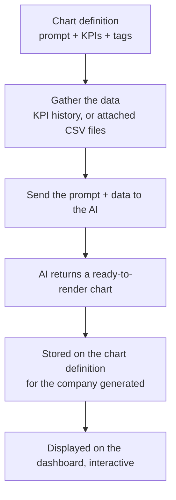

# Agent Charts User Guide

Agent Charts lets fund managers create AI-generated charts for their portfolio companies without writing any code. You describe the chart you want in plain English, point it at your KPI data, and the system produces a fully interactive visualisation for each relevant portfolio company.

> **Where to find it:** Sidebar → [**Stakeholders → Agent Charts**](/agent_charts), also under **Stakeholders → View Stakeholders** → **Actions → Agent Charts**. Create one with **New Chart**; generate it from a portfolio company's page via **Misc → Generate AI Charts**. Creating, editing and generating chart definitions needs the *company_admin* role.

**What it enables:**

- **Instant visual analysis** — turn months of KPI data into a Revenue trend, margin breakdown, or growth chart in seconds.
- **Consistent reporting across the portfolio** — define a chart once and generate it for every portfolio company that matches a tag (e.g. all D2C companies, all Ecommerce companies). Each company gets its own version populated with its own data.
- **No manual chart building** — no spreadsheets, no BI tools. Write a prompt like "line chart showing Revenue and EBITDA over 12 months" and the AI produces the chart for you.
- **Dashboard integration** — generated charts embed directly into the Portfolio Company Dashboard as widgets, visible to anyone with dashboard access.
- **Always up to date** — regenerate any chart at any time to reflect the latest KPI data. Generation always runs on demand; there is no automatic or scheduled generation.

## Table of Contents

1. [Prerequisites](#1-prerequisites)
2. [Creating an Agent Chart](#2-creating-an-agent-chart)
3. [Tag-Based Filtering](#3-tag-based-filtering)
4. [Generating Charts](#4-generating-charts)
   - [From a Portfolio Company page](#41-from-a-portfolio-company-page)
   - [From the Agent Chart detail page](#42-from-the-agent-chart-detail-page)
   - [Automatic and Scheduled Generation](#43-automatic-and-scheduled-generation)
5. [Understanding Status](#5-understanding-status)
6. [Viewing a Generated Chart](#6-viewing-a-generated-chart)
7. [Embedding in a Dashboard](#7-embedding-in-a-dashboard)
8. [Controlling Chart Height](#8-controlling-chart-height)
9. [Creating a Standard Set of Charts](#9-creating-a-standard-set-of-charts)
10. [Sample Chart Definitions](#10-sample-chart-definitions)
11. [Frequently Asked Questions](#11-frequently-asked-questions)
12. [How It Works](#12-how-it-works)

---

---

## 1. Prerequisites

Before creating Agent Charts, ensure the following are in place:

### KPI Data
- Portfolio companies must have KPI data uploaded (via the KPI upload flow or API).
- KPI names used in a chart definition must match **standard KPI names** configured in *Investor KPI Mappings* for the entity (e.g. `Revenue`, `EBITDA`, `Net Sales`).
- KPI data should cover the number of periods you intend to chart (e.g. if you want 12 months of Revenue, at least 12 monthly KPI reports must exist).

### Portfolio Company Tags
- For charts that target a specific segment (e.g. only D2C companies), the portfolio companies must be tagged accordingly.
- Tags are set on the portfolio company's edit page in the **Tag List** field (comma-separated, e.g. `D2C,beauty`).
- Charts with no tag apply to **all** portfolio companies.

### AI Model
- An AI model must be configured for the entity (Company menu (house icon, top right) → **Agents** → **LLM Keys**). Agent Charts uses your company's configured model and keys.

---

## 2. Creating an Agent Chart

Navigate to Sidebar → **Stakeholders → Agent Charts** and click **New Chart**.

| Field | Required | Description |
|---|---|---|
| **Title** | Yes | Display name shown on dashboards and the generation page. Keep it unique: the form does not enforce this, but a dashboard widget picks the most recently created chart with that title, and an Upload row with an existing title fails. |
| **Prompt** | Yes | Plain-English description of the chart. Be specific: mention chart type, axes, datasets, units, and any formatting preferences. |
| **KPI Names (optional)** | No | Multi-select from KPIs configured for your entity. The job fetches only these KPIs as data for the LLM. Leave blank if using document data instead. |
| **For** | No | Number of periods + period type (Month / Quarter / Half Year / Year / YTD) to fetch. E.g. `12 Months` fetches the 12 most recent monthly KPI reports. |
| **Document names** | No | Comma-separated names of CSV documents attached to portfolio companies. The job fetches these files and passes them to the LLM instead of (or in addition to) KPI data. |
| **Tags (optional)** | No | Comma-separated tags. If set, the chart only applies to portfolio companies whose tag list overlaps. Leave blank to apply to all portfolio companies. |
| **Chart Height (px, optional)** | No | Canvas height in pixels. Overrides the default 420 px. Can also be set per dashboard widget. |

### Writing a Good Prompt

The prompt is the most important field. The AI receives your prompt together with the actual data, so you do not need to repeat the data in the prompt — focus on how the chart should look.

**Include in your prompt:**
- Chart type: `line chart`, `bar chart`, `stacked bar chart`, `doughnut chart`, etc.
- What each dataset represents: `one line for Revenue, one for EBITDA`
- X-axis labels: `use months as labels`, `use financial year labels`
- Y-axis units: `values in INR Cr`, `percentages on the Y axis`
- Any special formatting: `add a YoY growth label on each bar`, `use green for positive values`

**Example — good prompt:**
> Line chart showing Revenue and EBITDA over time. Use months as labels on the X axis, values in INR Cr on the Y axis. Include two datasets: one for Revenue (green) and one for EBITDA (blue).

**Example — vague prompt (avoid):**
> Show me the KPIs.

---

## 3. Tag-Based Filtering

Tags are the mechanism that controls which portfolio companies a chart applies to.

| Chart `tag_list` | Portfolio company `tag_list` | Chart applies? |
|---|---|---|
| *(blank)* | anything | Yes — untagged charts apply to every company |
| `D2C` | `D2C,beauty` | Yes — at least one tag overlaps |
| `D2C` | `Ecommerce` | No — no overlap |
| `beauty,skincare` | `skincare` | Yes — `skincare` overlaps |
| `D2C` | *(blank)* | No — the company has no tags |

When you open **Generate AI Charts** on a portfolio company, only the charts that pass this filter are shown — so the list is always relevant to that specific company.

---

## 4. Generating Charts

Chart generation is a background job — it queues immediately and runs asynchronously. You (only the user who clicked Generate) see an on-screen alert when each chart finishes (or fails); nothing is emailed or kept if you were not online.

> **Note:** In the current version, generating a chart for one company replaces the charts stored for every other company on that definition, so after **Generate for All** only the last company processed keeps its chart. Regenerate for the company whose dashboard you are about to show.

### 4.1 From a Portfolio Company Page

This is the most common way to generate charts for a single portfolio company.

1. Open any Portfolio Company record.
2. Click the **Misc** dropdown (top-right of the page).
3. Select **Generate AI Charts**.
4. You will see the **Generate AI Charts** page showing all applicable charts grouped by tag. Each row shows:
   - Chart title (links to the detail page)
   - KPI names used
   - Full prompt text
   - Status badge: **Ready** (green) / **Pending** (grey) / **Failed** (red)
   - A **Generate** or **Regenerate** button
5. Click **Generate** on an individual chart to queue just that one, or use **Generate All (N)** at the top to queue every applicable chart at once.
6. After queuing, you are redirected back to the portfolio company page. Watch for the on-screen completion or error alerts.

> **Tip:** "Ready" means a spec already exists for this portfolio company. Clicking Regenerate will overwrite it. The Generate All button shows how many existing specs will be overwritten.

### 4.2 From the Agent Chart Detail Page

Use this when you want to generate a chart for multiple portfolio companies at once, or to inspect the stored spec.

1. Navigate to Sidebar → **Stakeholders → Agent Charts** and click any chart title.
2. The detail page shows the chart's configuration and a **Generate Charts** form.
3. The multi-select dropdown lists all portfolio companies matching the chart's tag filter.
4. Select one or more companies and click **Generate for Selected**, or click **Generate for All (N)** to queue every matching company (see the note above: only the last company processed keeps its chart).
5. To view an already-generated chart, use the **Charts** dropdown and select a portfolio company — the chart renders inline on the same page.

### 4.3 Automatic and Scheduled Generation

There is none. Charts are generated only when someone clicks **Generate**, **Regenerate**, **Generate All**, **Generate for Selected** or **Generate for All**. The Portfolio Company Agent (**Run Portfolio Company Agent**) and its schedules do not generate Agent Charts.

---

## 5. Understanding Status

Each chart has a single status reflecting its last generation attempt across all portfolio companies:

| Status | Meaning |
|--------|---------|
| **Draft** | Never generated, or a generation attempt is in progress (each attempt sets Draft first). Editing the prompt or KPI settings does not change the status. |
| **Ready** | The chart has been generated successfully for at least one company. |
| **Failed** | The last attempt hit an error. The chart's detail page shows the error message. |

A chart can be **Ready** while still missing for some companies. The status reflects the most recent company attempted, and because each successful generation currently replaces the charts stored for other companies, only the company generated last is guaranteed to have a chart.

---

## 6. Viewing a Generated Chart

After a chart has been generated for a portfolio company:

1. Go to Sidebar → **Stakeholders → Agent Charts** and open the chart.
2. Click the **Charts** dropdown and select the portfolio company name.
3. The chart renders immediately below — no page reload needed.
4. Alternatively, use the **Generate AI Charts** page on the portfolio company (Misc → Generate AI Charts) — charts with **Ready** status have their spec stored and will render in the dashboard widget.

The chart is fully interactive — hover for tooltips, click legend items to toggle datasets, and so on.

---

## 7. Embedding in a Dashboard

Agent Charts are displayed on the **Portfolio Company Dashboard** via the **Agent Chart** widget.

### Adding the Widget

1. Go to Company menu (house icon, top right) → **Dashboard Widgets**.
2. Click **New Dashboard Widget** (choose **Dashboard name** *Portfolio Company Dashboard*) or edit an existing one.
3. Set **Widget Type** to `Agent Chart`.
4. In the **Widget Configuration** section, set:

| Metadata Field | Description |
|---|---|
| **Title** | The exact title of the AgentChart to display (must match the Title field on the chart record). |
| **Height** | Optional canvas height in pixels for this widget instance. Overrides the chart's own height setting. |

5. Set **Size** (width): `Medium` (half width) works well for most charts; `XL` for full-width.
6. Fill **Tags** (required — the widget's display label). Set **Tag List** if this widget should only appear for portfolio companies with specific tags.
7. Save. The widget will appear on the dashboard and automatically load the chart for the current portfolio company.

### How the Widget Resolves the Chart

- The widget finds the chart by its title within your entity.
- It loads that chart for the company currently being viewed, when the dashboard is opened.
- If the chart hasn't been generated for this company (or its stored chart was replaced by a later generation for another company), the widget area stays empty. Generate it from the company's **Misc → Generate AI Charts** page.
- If no chart with that title exists, the widget shows "No Chart with title … found for this investor."

---

## 8. Controlling Chart Height

Chart height can be set at two levels, with the more specific one winning:

| Level | Where to set it | Field |
|---|---|---|
| **Per widget** (most specific) | Dashboard Widget edit page → Widget Configuration | `Height` (number, px) |
| **Per chart** | Agent Chart edit page | `Chart Height (px)` |
| **Default** | Automatic fallback | 420 px |

Setting height at the chart level applies everywhere that chart is shown. Setting it at the widget level overrides it for just that dashboard widget instance — useful when the same chart is embedded in different sized cards on different dashboards.

---

## 9. Creating a Standard Set of Charts

When onboarding a new fund or entity, you'll usually want the same set of standard charts (Revenue & EBITDA trend, margin breakdown, growth, and so on) created in one go rather than one at a time.

Your administrator can bulk-create a standard library of chart definitions for an entity. This is safe to repeat — any chart whose title already exists for the entity is skipped, so existing charts are never duplicated or overwritten. Once created, the charts behave exactly like ones you build by hand: generate them per company, embed them on dashboards, and refine the prompts as needed.

If you have a preferred standard set you'd like rolled out to every new entity, share the chart titles and prompts with your administrator and they can add them to the standard library. The [Sample Chart Definitions](#10-sample-chart-definitions) below are a good starting point.

---

## 10. Sample Chart Definitions

The following are production-tested examples. Use them as templates when creating new charts.

### Line Chart — Revenue & EBITDA Trend (monthly, tag-filtered)

| Field | Value |
|---|---|
| Title | Revenue & EBITDA Trend |
| Prompt | Line chart showing Revenue and EBITDA over time. Use months as labels on the X axis, values in INR Cr on the Y axis. Include two datasets: one for Revenue and one for EBITDA. |
| KPI Names | Revenue, EBITDA |
| For | 12 Months |
| Tags | Ecommerce |
| Chart Height | 380 |

---

### Stacked Bar Chart — Gross Profit vs COGS (quarterly)

| Field | Value |
|---|---|
| Title | Gross Profit vs COGS Breakdown |
| Prompt | Stacked bar chart comparing Revenue, COGS, and Gross Profit per period. Labels are quarters. Show three datasets side by side so the fund manager can see margin compression or expansion at a glance. |
| KPI Names | Revenue, COGS, GROSS PROFIT |
| For | 8 Quarters |
| Tags | D2C |

---

### Bar + Line Combo — Contribution Margin Analysis (all companies)

| Field | Value |
|---|---|
| Title | Contribution Margin Analysis |
| Prompt | Bar chart with two datasets: Revenue and Contribution. Overlay a line for Contribution Margin % if possible, otherwise show it as a third bar dataset. Use quarters as labels. |
| KPI Names | Revenue, Contribution, Contribution Margin |
| For | 8 Quarters |
| Tags | *(blank — applies to all portfolio companies)* |

---

### Bar Chart — Annual Revenue Growth (with YoY label)

| Field | Value |
|---|---|
| Title | Annual Revenue Growth |
| Prompt | Bar chart showing Net Sales for each financial year. Sort labels chronologically (oldest to newest). Add a label on each bar showing the year-on-year growth percentage if data allows. |
| KPI Names | Net Sales, Revenue |
| For | 5 Annual |
| Tags | Ecommerce |

---

### Multi-KPI Dashboard — Beauty & Skincare (multi-tag)

| Field | Value |
|---|---|
| Title | Skincare & Beauty KPI Dashboard |
| Prompt | Multi-dataset bar chart comparing Revenue, EBITDA, and Contribution for the last 6 months. Use months as X axis labels. |
| KPI Names | Revenue, EBITDA, Contribution |
| For | 6 Months |
| Tags | beauty,skincare *(both tags — company must have at least one)* |

---

## 11. Frequently Asked Questions

### Navigation and getting there

**Where do I find Agent Charts in CapHive?**
Sidebar → [**Stakeholders → Agent Charts**](/agent_charts). The same page is linked from Sidebar → [**Stakeholders → View Stakeholders**](/investors) → **Actions → Agent Charts**. There is no "AI" menu; the list shows every chart definition for your company with **New Chart**, **Download**, **Upload** and **Filter** buttons.

**How do I open the Generate AI Charts page for one portfolio company?**
Open the stakeholder whose **Category** is *Portfolio Company*, click **Misc** (top right) → **Generate AI Charts**. The menu item is only shown on Portfolio Company stakeholders. See [From a Portfolio Company Page](#41-from-a-portfolio-company-page).

**Where do I see a generated chart?**
On the chart's detail page use the **Charts** dropdown and pick a company, or add an **Agent Chart** widget to the Portfolio Company Dashboard (stakeholder page → **Misc → Dashboard**). See [Viewing a Generated Chart](#6-viewing-a-generated-chart).

**Where do I set which AI model is used?**
Company menu (house icon, top right) → [**Agents**](/support_agents) → [**LLM Keys**](/support_agents/llm_keys), where the company's provider keys and default model are configured. Agent Charts uses your company's configured model and keys. Needs the *company_admin* role.

**Who can create and generate Agent Charts?**
Creating, editing, deleting and generating from the [Agent Charts](/agent_charts) list needs the *company_admin* role; for everyone else that list is empty. A company's **Generate AI Charts** page instead needs permission to update that stakeholder, and any employee can view a chart's detail page and dashboard widgets. Company admins grant roles from Company menu → [**User**](/users).

### Creating, updating and managing agent charts

**How do I create an Agent Chart?**
On [**Agent Charts**](/agent_charts) click [**New Chart**](/agent_charts/new), fill **Title** and **Prompt**, pick **KPI Names (optional)** and the **For** period count and type, optionally add **Document names**, **Tags (optional)** and **Chart Height (px, optional)**, then save. See [Creating an Agent Chart](#2-creating-an-agent-chart).

**How do I edit an Agent Chart?**
Open the chart and click **Edit**. Change the prompt, KPIs, period, tags or height and save; then regenerate for the companies whose chart you want refreshed.

**How do I delete an Agent Chart?**
Open the chart and click **Delete**, then confirm. This removes the definition together with every company's stored chart; there is no undo.

**How do I generate a chart for several portfolio companies at once?**
On the chart's detail page, in the **Generate Charts** card, select companies and click **Generate for Selected**, or click **Generate for All (N)** to queue every company that matches the chart's tags. See [From the Agent Chart Detail Page](#42-from-the-agent-chart-detail-page).

**How do I generate every applicable chart for one company?**
On the company's **Misc → Generate AI Charts** page, click **Generate All (N)** at the top, or **Generate** / **Regenerate** on a single chart. See [Generating Charts](#4-generating-charts).

**How do I bulk create chart definitions?**
Click **Upload** on [**Agent Charts**](/agent_charts) (it opens the import form with import type *AgentChart*). The **Sample** file link on that page is currently missing, so build the sheet yourself: it carries **Title**, **Status** (use `draft`), **Prompt** and **Document Ids** (document names) only, so add KPI names, tags and height afterwards with **Edit**. A row whose title already exists for your company fails instead of updating. **Download** exports the list to Excel.

**How do I put an Agent Chart on a dashboard?**
Company menu → [**Dashboard Widgets**](/dashboard_widgets) → **New Dashboard Widget**, choose **Dashboard name** *Portfolio Company Dashboard* and **Widget Type** *Agent Chart*, set **title** to the chart's exact Title (and optionally **height**), fill **Tags** (the widget's label) and save. See [Embedding in a Dashboard](#7-embedding-in-a-dashboard).

### Why use Agent Charts

**Why should I use Agent Charts?**
They turn KPI history into consistent, interactive charts for every portfolio company without spreadsheets or BI tools: you define a chart once in plain English and generate it per company with that company's own data.

**What can I do with Agent Charts that I cannot do otherwise?**
Describe any Chart.js-style visual (trend, stacked bar, combo, doughnut) in words, target it at a segment of companies with tags, feed it KPI data or attached CSV documents, and embed the result on the Portfolio Company Dashboard next to other widgets.

**What happens if I don't set up any Agent Charts?**
Nothing else breaks. A company's **Generate AI Charts** page explains that no charts match its tags and shows a **Create an agent chart** button, and Agent Chart dashboard widgets show "No Chart with title … found for this investor."

**Who typically uses Agent Charts?**
Company admins and portfolio-monitoring teams who design the standard chart library and generate it after KPI uploads; fund managers and IC members then consume the charts on the Portfolio Company Dashboard.

### What happens when I …

**What happens when I save a new Agent Chart?**
A chart definition is saved for your company with status **Draft** and you are taken to its detail page. Nothing is generated and no AI call is made until you click a Generate button. No one is notified.

**What happens when I edit a chart's prompt or KPIs?**
Only the definition changes. The status and the charts already stored for companies are left as they are, so dashboards keep showing the old chart until you regenerate it.

**What happens when I click Generate?**
A background job is queued and you are redirected (to the company page, or back to the chart). For each company it fetches the chosen KPIs for the most recent **For** periods (or the named CSV documents), sends them with your prompt to your company's AI model, and stores the returned chart. Your KPI data leaves CapHive for the AI provider.

**Who is notified when generation finishes?**
Only the user who clicked Generate, through an on-screen alert in CapHive: one per company-and-chart ("Chart … generated for portfolio company …" or "Error generating chart …") and a final "chart generation completed" message. No email is sent, and the alert is not kept in your inbox if you were not online.

**What happens to the chart's status during generation?**
Each attempt sets the chart to **Draft**, then **Ready** on success or **Failed** with the error text on failure. Status is one value for the whole definition, so it reflects the most recent company attempted. See [Understanding Status](#5-understanding-status).

**What happens when generation fails for a company?**
The chart's status becomes **Failed**, the **Error** field on the detail page shows the reason, you get an error alert, and the job carries on with the next company. A company with neither KPI data for the selected names nor matching CSV documents always fails with "No data sources … available".

**What happens to other companies' charts when I generate for one company?**
In the current version, each successful generation saves only the company just generated and replaces the charts previously stored for other companies on that definition. After **Generate for All**, only the last company processed keeps its chart, so regenerate for the company whose dashboard you are about to show.

**What happens when I delete a chart that is used on a dashboard?**
The definition and its stored charts are removed permanently. Any Agent Chart widget pointing to that title then shows "No Chart with title … found for this investor." until you re-create a chart with the same title and generate it.

**Does anything regenerate charts automatically?**
No. Generation runs only when someone clicks **Generate**, **Regenerate**, **Generate All**, **Generate for Selected** or **Generate for All**. The Portfolio Company Agent does not generate Agent Charts, and there is no schedule for them.

### Troubleshooting and edge cases

**The chart was generated but looks wrong (wrong chart type, missing datasets, etc.).**
Edit the Agent Chart and make the prompt explicit about chart type, axis labels, units and dataset names, then regenerate for the affected company. See [Sample Chart Definitions](#10-sample-chart-definitions) for prompts that work well.

**The chart shows "Failed" status. What should I check?**
Open the chart's detail page and read the **Error** field. Common causes: the **KPI Names** don't match the KPIs uploaded for that company (the picker lists standard names from *Investor KPI Mappings*), no KPI reports exist with the chosen **For** period type, or the prompt was too complex for the AI to return a valid chart.

**The Generate AI Charts page shows 100+ charts for one portfolio company. Why so many?**
Charts with blank **Tags** apply to every portfolio company, so all of them appear. Add specific tags to each chart definition to narrow which companies it applies to. See [Tag-Based Filtering](#3-tag-based-filtering).

**A chart I expected is missing from a company's Generate AI Charts page.**
The company's **Tag List** must share a tag with the chart's **Tags**; a company with no tags only sees untagged charts. Matching is a text-contains match, so a company tag `D2C` also matches a chart tagged `D2C-Beauty`.

**I generated a chart but the dashboard widget still shows nothing.**
The widget loads the chart for the company being viewed only. Check that company shows **Ready** on its **Generate AI Charts** page; if you generated other companies afterwards, its stored chart may have been replaced, so regenerate it. Also confirm the widget's **title** exactly matches the chart's Title.

**Why don't I see Generate buttons or the Generate Charts card?**
The **Generate Charts** card, **Edit** and **Delete** on the chart's detail page are shown only to *company_admin* users. The company's **Misc → Generate AI Charts** page opens only if you can update that stakeholder; ask a company admin for the role or permission.

**Can I use the same chart definition for multiple types of portfolio companies?**
Yes. Use a comma-separated tag list (e.g. `beauty,skincare`); the chart applies to any company matching at least one tag. Leave tags blank to apply it to every portfolio company.

**How do I regenerate a chart with updated KPI data?**
Open the company's **Misc → Generate AI Charts** page and click **Regenerate** next to the chart, or **Generate All** to refresh every applicable chart. Each run fetches the latest KPI data at that moment.

**The chart is too tall and overflows the dashboard widget.**
Set **Chart Height (px, optional)** on the chart to a smaller value (e.g. 300–380), or set **height** on just that dashboard widget; the widget value wins. See [Controlling Chart Height](#8-controlling-chart-height).

**Can I have different chart configurations for different dashboards?**
Yes. Create separate Agent Chart records with different prompts, KPI selections or periods, then add one Agent Chart widget per chart, each pointing to a different Title.

**Can two charts have the same title?**
The form does not stop you, but avoid it: the dashboard widget picks the most recently created chart with that title, and an **Upload** row with an existing title fails.

**How long does generation take?**
Each company-and-chart pair is one AI request, typically 10–30 seconds depending on the provider and data volume. Jobs run in the background, so you can leave the page and watch for the on-screen alert.

**Which KPI periods are sent to the AI?**
The most recent **For** number of KPI reports for that company with the chosen period type (default 12 Month), ordered by date, and only the selected KPI names. If fewer reports exist, only those are sent.

## 12. How It Works

Behind the scenes, generating a chart follows a simple pipeline:

Each chart definition is **reusable** — the same prompt can be generated for every portfolio company that matches its tags. In the current version, however, regenerating for one company clears the charts stored for the other companies on that definition.

## Related Guides

- [Dashboard Widgets](dashboard_widgets_user_guide) — add the Agent Chart widget to the Portfolio Company Dashboard.
- [KPI Management & Workbook Upload](kpi_upload_user_guide) — upload and approve the KPI data charts are built from.
- [KPI Parent-Child Mapping](kpi_parent_child_mapping_user_guide) — the standard KPI names the chart's KPI picker lists.
- [KPI Flexible Charts](kpi_flexible_charts_user_guide) — build charts by hand from the KPI grid instead of by prompt.
- [LLM Configuration](llm_configuration_guide) — set the AI provider keys and model used for generation.
- [Portfolio Company Agent](agents/portfolio_company_agent_user_guide) — monitors KPI and document compliance for the same companies.
