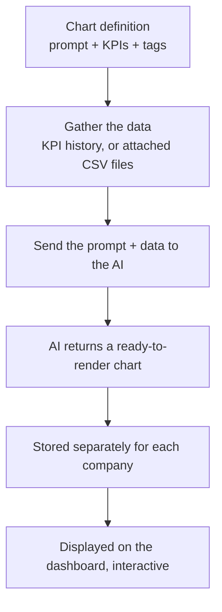

# Agent Charts User Guide

Agent Charts lets fund managers create AI-generated charts for their portfolio companies without writing any code. You describe the chart you want in plain English, point it at your KPI data, and the system produces a fully interactive visualisation — automatically, for every relevant portfolio company at once.

**What it enables:**

- **Instant visual analysis** — turn months of KPI data into a Revenue trend, margin breakdown, or growth chart in seconds.
- **Consistent reporting across the portfolio** — define a chart once and generate it for every portfolio company that matches a tag (e.g. all D2C companies, all Ecommerce companies). Each company gets its own version populated with its own data.
- **No manual chart building** — no spreadsheets, no BI tools. Write a prompt like "line chart showing Revenue and EBITDA over 12 months" and the AI produces the chart for you.
- **Dashboard integration** — generated charts embed directly into the Portfolio Company Dashboard as widgets, visible to anyone with dashboard access.
- **Always up to date** — regenerate any chart at any time to reflect the latest KPI data. Schedules can be configured to run generation automatically.

## Table of Contents

1. [Prerequisites](#1-prerequisites)
2. [Creating an Agent Chart](#2-creating-an-agent-chart)
3. [Tag-Based Filtering](#3-tag-based-filtering)
4. [Generating Charts](#4-generating-charts)
   - [From a Portfolio Company page](#41-from-a-portfolio-company-page)
   - [From the Agent Chart detail page](#42-from-the-agent-chart-detail-page)
   - [Via the Portfolio Company Agent (scheduled)](#43-via-the-portfolio-company-agent-scheduled)
5. [Understanding Status](#5-understanding-status)
6. [Viewing a Generated Chart](#6-viewing-a-generated-chart)
7. [Embedding in a Dashboard](#7-embedding-in-a-dashboard)
8. [Controlling Chart Height](#8-controlling-chart-height)
9. [Creating a Standard Set of Charts](#9-creating-a-standard-set-of-charts)
10. [Sample Chart Definitions](#10-sample-chart-definitions)
11. [FAQ](#11-faq)
12. [How It Works](#12-how-it-works)

---

---

## 1. Prerequisites

Before creating Agent Charts, ensure the following are in place:

### KPI Data
- Portfolio companies must have KPI data uploaded (via the KPI upload flow or API).
- KPI names used in a chart definition must match **standard KPI names** configured in *Investor KPI Mappings* for the entity (e.g. `Revenue`, `EBITDA`, `Net Sales`).
- KPI data should cover the number of periods you intend to chart (e.g. if you want 12 months of Revenue, at least 12 monthly KPI reports must exist).

### Portfolio Company Tags
- For charts that target a specific segment (e.g. only D2C companies), the portfolio companies must be tagged accordingly.
- Tags are set on the portfolio company's edit page in the **Tag List** field (comma-separated, e.g. `D2C,beauty`).
- Charts with no tag apply to **all** portfolio companies.

### AI Model
- An AI model must be configured for the entity (Admin → LLM Configuration). Agent Charts uses whichever model is set as the entity's default.

---

## 2. Creating an Agent Chart

Navigate to **AI → Agent Charts → New Agent Chart**.

| Field | Required | Description |
|---|---|---|
| **Title** | Yes | Display name shown on dashboards and the generation page. Must be unique per entity. |
| **Prompt** | Yes | Plain-English description of the chart. Be specific: mention chart type, axes, datasets, units, and any formatting preferences. |
| **KPI Names** | No | Multi-select from KPIs configured for your entity. The job fetches only these KPIs as data for the LLM. Leave blank if using document data instead. |
| **For** | No | Number of periods + period type (Month / Quarter / Half Year / Year / YTD) to fetch. E.g. `12 Months` fetches the 12 most recent monthly KPI reports. |
| **Document Names** | No | Comma-separated names of CSV documents attached to portfolio companies. The job fetches these files and passes them to the LLM instead of (or in addition to) KPI data. |
| **Tags** | No | Comma-separated tags. If set, the chart only applies to portfolio companies whose tag list overlaps. Leave blank to apply to all portfolio companies. |
| **Chart Height (px)** | No | Canvas height in pixels. Overrides the default 420 px. Can also be set per dashboard widget. |

### Writing a Good Prompt

The prompt is the most important field. The AI receives your prompt together with the actual data, so you do not need to repeat the data in the prompt — focus on how the chart should look.

**Include in your prompt:**
- Chart type: `line chart`, `bar chart`, `stacked bar chart`, `doughnut chart`, etc.
- What each dataset represents: `one line for Revenue, one for EBITDA`
- X-axis labels: `use months as labels`, `use financial year labels`
- Y-axis units: `values in INR Cr`, `percentages on the Y axis`
- Any special formatting: `add a YoY growth label on each bar`, `use green for positive values`

**Example — good prompt:**
> Line chart showing Revenue and EBITDA over time. Use months as labels on the X axis, values in INR Cr on the Y axis. Include two datasets: one for Revenue (green) and one for EBITDA (blue).

**Example — vague prompt (avoid):**
> Show me the KPIs.

---

## 3. Tag-Based Filtering

Tags are the mechanism that controls which portfolio companies a chart applies to.

| Chart `tag_list` | Portfolio company `tag_list` | Chart applies? |
|---|---|---|
| *(blank)* | anything | Yes — untagged charts apply to every company |
| `D2C` | `D2C,beauty` | Yes — at least one tag overlaps |
| `D2C` | `Ecommerce` | No — no overlap |
| `beauty,skincare` | `skincare` | Yes — `skincare` overlaps |
| `D2C` | *(blank)* | No — the company has no tags |

When you open **Generate AI Charts** on a portfolio company, only the charts that pass this filter are shown — so the list is always relevant to that specific company.

---

## 4. Generating Charts

Chart generation is a background job — it queues immediately and runs asynchronously. You will receive an in-app notification when each chart finishes (or fails).

### 4.1 From a Portfolio Company Page

This is the most common way to generate charts for a single portfolio company.

1. Open any Portfolio Company record.
2. Click the **Misc** dropdown (top-right of the page).
3. Select **Generate AI Charts**.
4. You will see the **Generate AI Charts** page showing all applicable charts grouped by tag. Each row shows:
   - Chart title (links to the detail page)
   - KPI names used
   - Full prompt text
   - Status badge: **Ready** (green) / **Pending** (grey) / **Failed** (red)
   - A **Generate** or **Regenerate** button
5. Click **Generate** on an individual chart to queue just that one, or use **Generate All (N)** at the top to queue every applicable chart at once.
6. After queuing, you are redirected back to the portfolio company page. Check the in-app notification bell for completion or error alerts.

> **Tip:** "Ready" means a spec already exists for this portfolio company. Clicking Regenerate will overwrite it. The Generate All button shows how many existing specs will be overwritten.

### 4.2 From the Agent Chart Detail Page

Use this when you want to generate a chart for multiple portfolio companies at once, or to inspect the stored spec.

1. Navigate to **AI → Agent Charts** and click any chart title.
2. The detail page shows the chart's configuration and a **Generate Charts** form.
3. The multi-select dropdown lists all portfolio companies matching the chart's tag filter.
4. Select one or more companies and click **Generate for Selected**, or click **Generate for All** to queue every matching company.
5. To view an already-generated chart, use the **Charts** dropdown and select a portfolio company — the chart renders inline on the same page.

### 4.3 Via the Portfolio Company Agent (Scheduled)

If the **Portfolio Company Agent** is enabled for the entity, it can run chart generation automatically on a schedule.

1. On a Portfolio Company page, open the **Misc** dropdown and click **Run Portfolio Company Agent**.
2. The agent generates all applicable charts for that company at once. To avoid noise, it sends a single summary notification rather than one per chart.
3. For fully automated runs, configure the agent's schedule in **Admin → Support Agents**.

---

## 5. Understanding Status

Each chart has a single status reflecting its last generation attempt across all portfolio companies:

| Status | Meaning |
|--------|---------|
| **Draft** | Never generated, or reset after you edited the prompt or KPI settings. |
| **Ready** | The chart has been generated successfully for at least one company. |
| **Failed** | The last attempt hit an error. The chart's detail page shows the error message. |

A chart can be **Ready** while still missing for some companies — it's generated and stored separately for each company, and each generation is independent.

---

## 6. Viewing a Generated Chart

After a chart has been generated for a portfolio company:

1. Go to **AI → Agent Charts** and open the chart.
2. Click the **Charts** dropdown and select the portfolio company name.
3. The chart renders immediately below — no page reload needed.
4. Alternatively, use the **Generate AI Charts** page on the portfolio company (Misc → Generate AI Charts) — charts with **Ready** status have their spec stored and will render in the dashboard widget.

The chart is fully interactive — hover for tooltips, click legend items to toggle datasets, and so on.

---

## 7. Embedding in a Dashboard

Agent Charts are displayed on the **Portfolio Company Dashboard** via the **Agent Chart** widget.

### Adding the Widget

1. Go to **Admin → Dashboard Widgets** and find the Portfolio Company Dashboard for your entity.
2. Click **New Widget** or edit an existing one.
3. Set **Widget Type** to `Agent Chart`.
4. In the **Widget Configuration** section, set:

| Metadata Field | Description |
|---|---|
| **Title** | The exact title of the AgentChart to display (must match the Title field on the chart record). |
| **Height** | Optional canvas height in pixels for this widget instance. Overrides the chart's own height setting. |

5. Set **Size** (width): `Medium` (half width) works well for most charts; `XL` for full-width.
6. Set **Tags** (display filter) if this widget should only appear for portfolio companies with specific tags.
7. Save. The widget will appear on the dashboard and automatically load the chart for the current portfolio company.

### How the Widget Resolves the Chart

- The widget finds the chart by its title within your entity.
- It loads that chart for the company currently being viewed, when the dashboard is opened.
- If the chart hasn't been generated for this company yet, the widget shows a placeholder prompting you to generate it.

---

## 8. Controlling Chart Height

Chart height can be set at two levels, with the more specific one winning:

| Level | Where to set it | Field |
|---|---|---|
| **Per widget** (most specific) | Dashboard Widget edit page → Widget Configuration | `Height` (number, px) |
| **Per chart** | Agent Chart edit page | `Chart Height (px)` |
| **Default** | Automatic fallback | 420 px |

Setting height at the chart level applies everywhere that chart is shown. Setting it at the widget level overrides it for just that dashboard widget instance — useful when the same chart is embedded in different sized cards on different dashboards.

---

## 9. Creating a Standard Set of Charts

When onboarding a new fund or entity, you'll usually want the same set of standard charts (Revenue & EBITDA trend, margin breakdown, growth, and so on) created in one go rather than one at a time.

Your administrator can bulk-create a standard library of chart definitions for an entity. This is safe to repeat — any chart whose title already exists for the entity is skipped, so existing charts are never duplicated or overwritten. Once created, the charts behave exactly like ones you build by hand: generate them per company, embed them on dashboards, and refine the prompts as needed.

If you have a preferred standard set you'd like rolled out to every new entity, share the chart titles and prompts with your administrator and they can add them to the standard library. The [Sample Chart Definitions](#10-sample-chart-definitions) below are a good starting point.

---

## 10. Sample Chart Definitions

The following are production-tested examples. Use them as templates when creating new charts.

### Line Chart — Revenue & EBITDA Trend (monthly, tag-filtered)

| Field | Value |
|---|---|
| Title | Revenue & EBITDA Trend |
| Prompt | Line chart showing Revenue and EBITDA over time. Use months as labels on the X axis, values in INR Cr on the Y axis. Include two datasets: one for Revenue and one for EBITDA. |
| KPI Names | Revenue, EBITDA |
| For | 12 Months |
| Tags | Ecommerce |
| Chart Height | 380 |

---

### Stacked Bar Chart — Gross Profit vs COGS (quarterly)

| Field | Value |
|---|---|
| Title | Gross Profit vs COGS Breakdown |
| Prompt | Stacked bar chart comparing Revenue, COGS, and Gross Profit per period. Labels are quarters. Show three datasets side by side so the fund manager can see margin compression or expansion at a glance. |
| KPI Names | Revenue, COGS, GROSS PROFIT |
| For | 8 Quarters |
| Tags | D2C |

---

### Bar + Line Combo — Contribution Margin Analysis (all companies)

| Field | Value |
|---|---|
| Title | Contribution Margin Analysis |
| Prompt | Bar chart with two datasets: Revenue and Contribution. Overlay a line for Contribution Margin % if possible, otherwise show it as a third bar dataset. Use quarters as labels. |
| KPI Names | Revenue, Contribution, Contribution Margin |
| For | 8 Quarters |
| Tags | *(blank — applies to all portfolio companies)* |

---

### Bar Chart — Annual Revenue Growth (with YoY label)

| Field | Value |
|---|---|
| Title | Annual Revenue Growth |
| Prompt | Bar chart showing Net Sales for each financial year. Sort labels chronologically (oldest to newest). Add a label on each bar showing the year-on-year growth percentage if data allows. |
| KPI Names | Net Sales, Revenue |
| For | 5 Annual |
| Tags | Ecommerce |

---

### Multi-KPI Dashboard — Beauty & Skincare (multi-tag)

| Field | Value |
|---|---|
| Title | Skincare & Beauty KPI Dashboard |
| Prompt | Multi-dataset bar chart comparing Revenue, EBITDA, and Contribution for the last 6 months. Use months as X axis labels. |
| KPI Names | Revenue, EBITDA, Contribution |
| For | 6 Months |
| Tags | beauty,skincare *(both tags — company must have at least one)* |

---

## 11. FAQ

**Q: The chart was generated but looks wrong — wrong chart type, missing datasets, etc.**
A: Edit the AgentChart and refine the prompt to be more explicit. Regenerate for the affected portfolio company. The more specific the prompt (chart type, axis labels, units, dataset names), the better the result. See the [Sample Chart Definitions](#10-sample-chart-definitions) for examples of effective prompts.

**Q: The chart shows "Failed" status. What should I check?**
A: Open the Agent Chart detail page and look at the **Error** field for a description of what went wrong. The most common causes are:
- The KPI names on the chart don't match the KPI names uploaded for that portfolio company. Check *Investor KPI Mappings* to confirm the exact names in use.
- No KPI data exists for the period you selected (e.g. you requested 12 months but only 3 months of data have been uploaded).
- The prompt was too complex or ambiguous for the AI to produce a valid chart. Try simplifying or breaking it into two separate charts.

**Q: The Generate AI Charts page shows 100+ charts for one portfolio company. Why so many?**
A: Charts with a blank tag filter apply to every portfolio company. If you have many untagged charts, they all appear. Add specific tags to each chart definition to narrow down which companies each chart is relevant for.

**Q: I generated a chart but the dashboard widget still shows a placeholder.**
A: The widget loads the chart for the current portfolio company specifically. Make sure you generated the chart for that company (not just for a different one). The status on the Generate AI Charts page for that company should show **Ready** before the widget will display it.

**Q: Can I use the same chart definition for multiple types of portfolio companies?**
A: Yes — use a comma-separated tag list (e.g. `beauty,skincare`). The chart applies to any portfolio company that matches at least one of those tags. Leave the tag blank to apply to every portfolio company regardless of tags.

**Q: How do I regenerate a chart with updated KPI data?**
A: Open the portfolio company's **Misc → Generate AI Charts** page and click **Regenerate** next to the chart. This queues a new generation job that fetches the latest KPI data. Alternatively, use **Generate All** to refresh every applicable chart at once.

**Q: The chart is too tall and overflows the dashboard widget.**
A: Set the **Chart Height (px)** field on the Agent Chart edit page to a smaller value (e.g. 300–380 px). If you only want to adjust height for one specific dashboard widget without affecting the chart elsewhere, set the **Height** field in the dashboard widget's Widget Configuration instead.

**Q: Can I have different chart configurations for different dashboards?**
A: Yes. Create separate Agent Chart records with different prompts, KPI selections, or period ranges. Then add one Agent Chart widget per dashboard, each pointing to a different chart title via the Widget Configuration **Title** field.

**Q: How long does generation take?**
A: Each chart is generated in the background with a single AI request, typically finishing within 10–30 seconds depending on the AI provider and data volume. You'll get an in-app notification when it's done — the page doesn't need to stay open.

**Q: Can I schedule charts to regenerate automatically?**
A: Yes — enable the **Portfolio Company Agent** for your entity (Admin → Support Agents) and configure its schedule. When it runs, it regenerates all applicable agent charts for each portfolio company automatically.

---

## 12. How It Works

Behind the scenes, generating a chart follows a simple pipeline:

Each chart definition is **reusable** — the same prompt can be generated for every portfolio company that matches its tags. Each company's chart is stored separately, so regenerating for one company never affects another.
