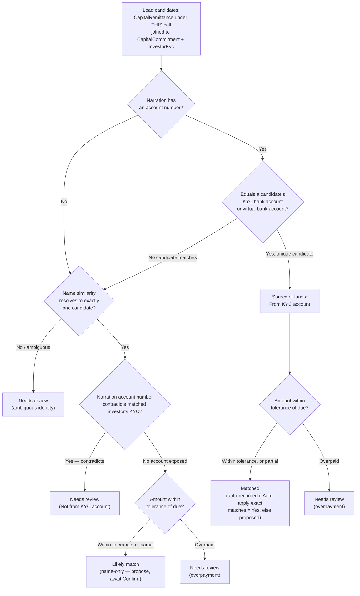

# Remittance Reconciliation Agent — User Guide

The Remittance Reconciliation Agent reconciles an uploaded bank statement (xlsx) against **one Capital Call's** outstanding remittances. It reads every deposit narration on the statement, works out which investor it belongs to, checks whether the amount and the sending account line up with what's expected, and sorts each deposit into one of five outcomes — from an unambiguous match it can record automatically, down to a deposit it can't place at all. It never touches a call's units or verification status on its own; it only proposes and, optionally, records payments for you to review.

## Table of Contents

1. [What This Agent Does](#1-what-this-agent-does)
2. [Inputs](#2-inputs)
3. [Enabling the Agent](#3-enabling-the-agent)
4. [Accessing and Running the Agent](#4-accessing-and-running-the-agent)
5. [Scheduling](#5-scheduling)
6. [Where to Find the Output](#6-where-to-find-the-output)
7. [Understanding the Report](#7-understanding-the-report)
8. [Reviewing and Confirming Deposits](#8-reviewing-and-confirming-deposits)
9. [Where It Can Fail](#9-where-it-can-fail)
10. [FAQ](#faq)

---

## 1. What This Agent Does

The agent works on one **Capital Call** per run — never a whole Fund. A fund with three open calls needs three separate runs, one statement upload each, because remittances are already generated per call and this keeps the pool of investors a deposit could belong to small and unambiguous. When you upload a statement, it:

1. **Ingests the statement** — reads every sheet of the uploaded xlsx workbook (a statement can cover more than one bank account/sheet, e.g. ICICI and Axis in the same file).
2. **Parses every narration** — identifies which bank issued each sheet (from the sheet header and the IFSC codes embedded in the narrations) and runs a bank-specific parser to pull out the depositor's name, account number (when the bank's format exposes one), and whether the row is the fund's own internal money movement (an FD maturity, a loan credit) rather than an investor payment.
3. **Loads the call's candidates** — every `CapitalRemittance` under this call, joined to its `CapitalCommitment` and that investor's KYC record. Nothing outside this call is ever loaded as a candidate.
4. **Scores and buckets each deposit** on three independent signals:
   - **Identity** — first tries to match the narration's account number against the investor's registered KYC bank account, then against the fund's own virtual bank account for that commitment; if no account number is present (or none matches), falls back to name similarity against the call's candidates.
   - **Source of funds** — whenever the narration exposes an account number, checks it against the matched investor's KYC bank account, independent of how identity was resolved. A contradiction is always flagged and always caps the result at "Needs review," no matter how well the name and amount otherwise line up.
   - **Amount** — compares the deposit to the remittance's due amount, within a configurable tolerance. A shortfall beyond tolerance is a **partial payment** (recorded for what actually arrived, the remittance keeps the balance due); an excess beyond tolerance is always **Needs review**, since a surplus might belong to a different call the agent can't see from a single-call run.
5. **Applies exact matches** — when the "Auto-apply exact matches" setting is Yes, every unambiguous match automatically creates a real payment record. Every other outcome is proposed only — nothing is written for it until you confirm it.
6. **Emails the summary** — optionally sends the run's results (tier counts, every funding-source discrepancy, every deposit needing review) to a configured recipient.
7. **Saves the report** — the full deposit-by-deposit breakdown is saved to this call's Reconciliation tab, so you can review and act on it there.

### How a deposit's outcome is decided

Every non-internal deposit runs through the same decision path — identity first, then source-of-funds, then amount — and the weakest signal always wins:

A couple of things worth noting about this path:

- **Source-of-funds is checked before amount, and its result is final** — a contradiction sends the deposit to Needs review regardless of what the amount check would otherwise have said.
- **A name-only match can never become "Matched," even with a perfect amount.** Without an account number to verify, the best it can reach is "Likely match" — this is deliberate, not a gap.
- **"No account exposed" and "confirmed" both continue to the amount check** — the difference between them is only the source-of-funds tag the deposit ends up carrying, not which branch of the amount logic it takes.

## 2. Inputs

### Configuration fields (Edit page)

| Field | Type | Default | What it controls |
|---|---|---|---|
| Tolerance (absolute) | Number | `500` | The maximum shortfall or excess (in fund currency) still treated as an exact amount match. Set to absorb the wire/correspondent-bank charges that routinely get deducted in transit — a deposit landing a few hundred short of the due amount is the single most common "almost exact" pattern, not an anomaly. |
| Tolerance (%) | Number | `0` | A percentage tolerance, OR'd with the absolute tolerance — either one passing is enough. Leave at 0 to rely on the absolute tolerance alone (the default). |
| Name similarity threshold | Number | `0.90` | The minimum similarity score (0–1) a name-only match must clear before it's accepted automatically as a "Likely match." Only relevant when the narration exposes no account number to check directly. |
| Auto-apply exact matches | Select (Yes/No) | `No` | **The kill switch.** When No, even unambiguous "Matched" deposits are only proposed — you confirm each one (or use Confirm all Matched) rather than the agent recording payments on its own. Every fund starts here; you switch it to Yes deliberately, once you trust the matching for that fund. Every other outcome (Likely match, Needs review, No match) is *always* proposal-only, regardless of this setting. |
| AI-assisted name matching | Select (Yes/No) | `No` | Reserved for a future phase. The setting is stored but currently has no effect on a run — leave it at the default. |
| Email report after run | Select (Yes/No) | `Yes` | When Yes, the run summary is emailed to the address below after each run. |
| Notify email | Text | (blank) | Recipient for the reconciliation summary email. Leave blank to skip the email even when "Email report after run" is Yes. |

There is no configuration field for the bank statement itself — it's uploaded fresh on every run, from the Capital Call page, not stored on the agent.

### Setup checklist and warnings

The agent's **General** tab shows a yellow warning banner whenever setup would undermine a run. For this agent it flags:

- **Both tolerance fields empty.** With neither set, the run falls back to the ₹500 absolute default — the banner tells you this explicitly so you can set it deliberately if this fund's typical wire-fee shortfall is different.
- **"Email report after run" set to Yes with a blank Notify email** — the report would never be emailed.
- **Either Yes/No toggle that has never been given a value** — an unset toggle counts as off, which silently skips that behaviour (most importantly, an unset "Auto-apply exact matches" behaves exactly like No).

### Other data inputs

| Input | Source | Notes |
|---|---|---|
| Bank statement (xlsx) | Uploaded each time you run the agent, through the Run Reconciliation modal on the Capital Call page — not through the agent's own configuration page. | One or more sheets per file (e.g. one per bank account). Every run needs its own fresh upload; there's no recurring or pre-attached statement. |
| This call's remittances | Existing CapHive data | The candidate pool — every `CapitalRemittance` under the selected call, and only that call. |
| Investor KYC bank account numbers | Existing CapHive data | The primary identity signal, and the target of the source-of-funds check. |
| Each commitment's virtual bank account (if configured) | Existing CapHive data | A secondary identity signal — few funds configure this, so most identity resolution runs through the KYC account or name matching instead. |
| Existing payments fund-wide | Existing CapHive data | Used to detect a bank reference already recorded — on this call (skipped as a duplicate) or on a different call of the same fund ("Recorded on another call"). |
| The fund's recorded exchange rate (for a foreign-currency folio) | Existing CapHive data | Used to convert the fund-currency deposit into the folio's currency. If no rate is on file for the payment date, the payment is refused rather than recorded with a made-up or zero folio amount. |

## 3. Enabling the Agent

This agent is turned on or off using a feature toggle on the entity's Support Agents settings. An administrator enables it from **Admin → Edit Entity → Support Agents section**. It's provisioned under the **Finance** category.

The upload option ("Run Reconciliation") only appears in a Capital Call's Actions dropdown once this toggle is enabled **and** you have update permission on the fund. If the flag is off, the menu item is still shown, but greyed out and locked, with a tooltip explaining why.

Confirming, reassigning, or bulk-confirming a proposed deposit uses the same permission as running the agent (update on the fund). **Undo** additionally requires destroy permission on the fund, since it deletes a payment record.

## 4. Accessing and Running the Agent

There's no generic "Run Now" button for this agent on the Support Agents index — running it always requires uploading a statement for one specific call, so it has its own upload modal reachable only from that call.

1. Navigate to the **Capital Call's show page**.
2. Open the **Actions** dropdown. If the feature is enabled for your entity and you have update rights on the fund, click **Run Reconciliation**.
3. The modal asks for the **bank statement (xlsx)** — this is the only required upload.
4. Submit the run.

Behind the scenes, the uploaded workbook is saved as a Document owned by the capital call (named "Bank Statement") before reconciliation actually starts. That order matters in your favor: the statement stays on file even if a later step fails or has to be retried.

Once submitted, a live step-by-step progress panel streams back: **Initialize → Ingest Statement → Parse Narrations → Load Candidates → Score & Bucket → Apply Exact Matches → Email Report → Save Report**. The agent always runs against the one call you triggered it from — there's no "run for every open call" option (running it in bulk, or on a schedule, processes nothing by design; see [Scheduling](#5-scheduling)).

## 5. Scheduling

Not supported. Reconciliation is inherently tied to a one-off statement upload for one call, so there's no default schedule and no recurring-run option — you run it on demand each time a new statement covering this call's deposits arrives from the bank. A batch or scheduled run of this agent (from the Support Agents index, or an `AgentSchedule`) deliberately processes nothing, rather than guessing which call a statement belongs to.

## 6. Where to Find the Output

- **Reconciliation tab** on the Capital Call's own show page — shows the latest report's results as one table, one row per deposit on the statement, each tagged with its outcome and carrying its own Confirm / Reassign / Undo actions. A row of stat cards at the top (Matched, Likely match, Needs review, No match, Internal, Not from KYC account) doubles as a filter for the table below. If no reconciliation has ever been run for this call, the tab tells you to use Actions → Run Reconciliation instead of showing an empty table.
- **Email** — if "Email report after run" is Yes and "Notify email" is filled in, a summary is sent after each run. The subject line itself tells you the outcome at a glance: `[RECON BLOCKED]` when the run couldn't complete (no statement, or an unreadable one), `[RECON REVIEW]` when there's at least one funding-source discrepancy or a deposit needing review, or `[RECON OK]` when everything matched cleanly.
- **Payments** — every deposit an Exact match auto-applied (or that you confirmed manually) becomes a real `CapitalRemittancePayment`, visible from the remittance it was recorded against. **The agent never marks a remittance as verified** — a payment being recorded is not the same thing as a controller signing off that the call is settled; verification stays a separate, human step.
- **Report history** — a new report is saved on every run and tied to the capital call; older runs aren't overwritten, though the Reconciliation tab always shows the latest one.

## 7. Understanding the Report

Each deposit row in the report carries:

- **Outcome tag** — one of five, shown with the internal tier name in parentheses since the underlying data uses the shorter form:
  - **Matched** (`exact`) — identity is certain (the sender's account number matches this investor's KYC account or assigned virtual account) and no other remittance on this call could be the one. Says nothing about the amount by itself — see the amount tag alongside it.
  - **Likely match** (`probable`) — identity by name only; the narration carried no sender account to check directly. Always proposed for you to confirm, never recorded automatically.
  - **Needs review** (`needs_review`) — something contradicts or is ambiguous: a sender account that differs from the investor's KYC account, an overpayment beyond tolerance, or an identity the agent couldn't resolve to exactly one candidate.
  - **No match** (`no_match`) — no remittance on this call matches the depositor at all. Use Reassign to pick the investor or folio it actually belongs to.
  - **Internal** (`internal`) — the fund's own money moving (an FD maturity, a loan credit), not an investor payment. Excluded from matching entirely.
- **Amount tag** (when relevant) — **Partial payment** (less than due arrived, confirming records exactly what came in and the remittance keeps the shortfall as due), **Overpayment** (more than due arrived — the surplus may belong to a different call; check before confirming), or **Amount unreadable** (the statement row had no readable amount, so nothing could be compared).
- **Source-of-funds tag** — **From KYC account** (the sender's account is the investor's own registered account) or **Not from KYC account** (funds came from somewhere else — a joint or family account, a corporate treasury, or a genuine error; verify before confirming). No tag at all means the narration exposed no account number to check, which is common and not itself a red flag.
- **Payment status** (once a payment exists) — **Payment recorded** (created here, or already existed on this call before this run — Undo removes it), **Recorded on another call** (a payment with this same bank reference already exists on a *different* call of this fund — nothing can be recorded here; undo it there first if it actually belongs to this call), or **Payment failed** (recording the payment itself failed — the reason is shown under the tags, most commonly a missing exchange rate for a foreign-currency folio).
- **Reasoning** — a plain-language note explaining the outcome (e.g. the exact account/name match found, the shortfall or surplus amount, the KYC contradiction). This is what makes every match auditable — you're never just told "matched," you're told why.
- **Source pointers** — the exact sheet, row number, and raw narration text the deposit came from, and a link through to the matched remittance/folio when one exists.

The report-level rollup shows **tier counts** (how many landed in each outcome) and a **discrepancy count** (how many had a source-of-funds contradiction, regardless of tier).

## 8. Reviewing and Confirming Deposits

The Reconciliation tab is a worked queue, not just a report — most of the value comes from acting on it directly:

- **Confirm** — available on any deposit that resolved to exactly one remittance and hasn't already been recorded. Records a payment for the deposit's actual amount (not necessarily the due amount — a partial or overpayment is recorded as-is, and you'll see that spelled out in the confirmation prompt before you submit). If the deposit has a funding-source discrepancy, the confirmation prompt says so explicitly — the agent doesn't hide the warning just because you're the one confirming.
- **Confirm all Matched** — a bulk action for every "Matched" deposit still waiting on confirmation, shown as a single button with a count when there's at least one. Only appears when "Auto-apply exact matches" is No (with it set to Yes, Matched deposits are already recorded by the time you see the report).
- **Reassign** — available on any unrecorded, non-internal deposit (typically "No match," but also useful if the agent's proposed match is wrong). Type an investor name or folio number into the searchable field and submit; the same lookup the CSV payment importer uses.
- **Undo** — available on any deposit with a recorded payment, provided you have destroy permission. Deletes the payment (subject to the same unit-allocation guard as deleting any payment manually — if units have already been allocated against it, Undo is blocked) and returns the deposit to the review queue.

None of these actions ever mark the underlying remittance as verified — that stays a deliberate, separate step for a controller.

## 9. Where It Can Fail

- **No statement uploaded, or the workbook can't be read.** The run records a blocking issue and stops before scoring anything — you'll see this reflected in the report and, if email is on, an `[RECON BLOCKED]` subject line.
- **A funding-source discrepancy always caps the result at Needs review**, even when the name and amount are a perfect match. This is deliberate — the agent never auto-resolves a contradiction between the sender's account and the investor's KYC record, no matter how strong the other signals are.
- **An overpayment beyond tolerance is always Needs review**, and the agent never tries to guess whether the surplus belongs to a different call — reconciliation is strictly single-call, permanently, so a deposit that overpays this call's due amount is reported plainly as an overpayment for you to investigate (typically: apply the correct portion here, and handle the rest as a separate manual entry or a reconciliation run against the other call).
- **A deposit's identity can't be pinned to exactly one candidate.** If the account number matches nobody, and the name similarity is ambiguous (below threshold, or too close between two candidates), the deposit lands in Needs review or No match rather than being force-matched to a guess.
- **No account number in the narration.** Several bank export formats (notably Axis's, and IMPS/cheque-clearing entries generally) never expose a sender account number at all. This isn't itself a red flag — the source-of-funds check is simply skipped for that row (shown as unverifiable, no tag) — but it does mean identity can only ever be resolved by name for those rows, capping them at "Likely match" rather than "Matched."
- **A bank reference already used elsewhere.** Re-running the agent on the same or an overlapping statement never creates a duplicate payment on this call. But if that same reference is already recorded on a *different* call for this fund, the deposit shows "Recorded on another call" and nothing can be recorded here — you'd need to undo it there first if it genuinely belongs to this call.
- **A foreign-currency folio with no exchange rate on file for the payment date.** The payment is refused outright (never recorded with an invented or zero folio-currency amount), and shows as "Payment failed" with the reason. Add the missing exchange rate, then retry via Confirm.
- **Auto-apply left at the default (No).** If deposits you expected to be recorded automatically are instead sitting in "Matched" awaiting confirmation, check the "Auto-apply exact matches" setting — every fund starts with this off.
- **A blank Notify email with "Email report after run" set to Yes.** The email step is simply skipped, with no error raised on that run — so a blank recipient field looks identical to everything working fine.
- **"AI-assisted name matching" set to Yes has no effect yet.** This setting is reserved for a future phase and is currently read nowhere — don't expect it to change matching behavior today.

## FAQ

**Q: I uploaded a statement but nothing happened / the run says it couldn't complete.**
A: Check that the file actually attached before you submitted, and that it's a genuine, non-empty xlsx workbook. A workbook with no readable sheets stops the run before any scoring happens.

**Q: A deposit is "Matched" but wasn't recorded as a payment automatically. Why?**
A: "Auto-apply exact matches" is set to No for this agent (the default for every fund). Use **Confirm** on the row, or **Confirm all Matched** to clear every pending one at once, or switch the setting to Yes on the agent's Edit page if you want future Matched deposits to record themselves.

**Q: A deposit shows "Not from KYC account." What should I do?**
A: This means the sender's account number doesn't match the investor's registered KYC bank account. It's not automatically wrong — it could be a joint account, a family member, or a corporate treasury paying on the investor's behalf — but it's never silently accepted. Verify the actual source with the investor (or your compliance process) before confirming the payment.

**Q: A deposit came in short / over the amount due. What happens if I confirm it?**
A: A **partial** payment is recorded for exactly the amount that arrived; the remittance keeps the balance as still due. An **overpayment** is recorded for the full amount received, and the remittance's status reflects the surplus — the agent doesn't split it against another call, so if the extra belongs elsewhere, that's a manual follow-up.

**Q: Why does a deposit show "Recorded on another call"?**
A: A payment with the exact same bank reference already exists on a different capital call for this fund. The agent treats this as already handled and won't record it again here — if you believe it truly belongs to this call, undo the payment on the other call first, then re-run or Reassign here.

**Q: Confirming a deposit failed with a payment error.**
A: The most common cause is a foreign-currency folio with no exchange rate on file for the payment's date — add the missing rate and try Confirm again. The specific reason is always shown under the row's tags.

**Q: Why didn't I get an email after the run?**
A: Either "Email report after run" is set to No, or "Notify email" is blank. Both need to be set together on the agent's Edit page.

**Q: Can I run this for a whole fund at once, or on a schedule?**
A: No. This agent is deliberately scoped to one capital call per run, tied to a manual statement upload — a fund with several open calls needs one run per call. There's no batch or scheduled mode.
