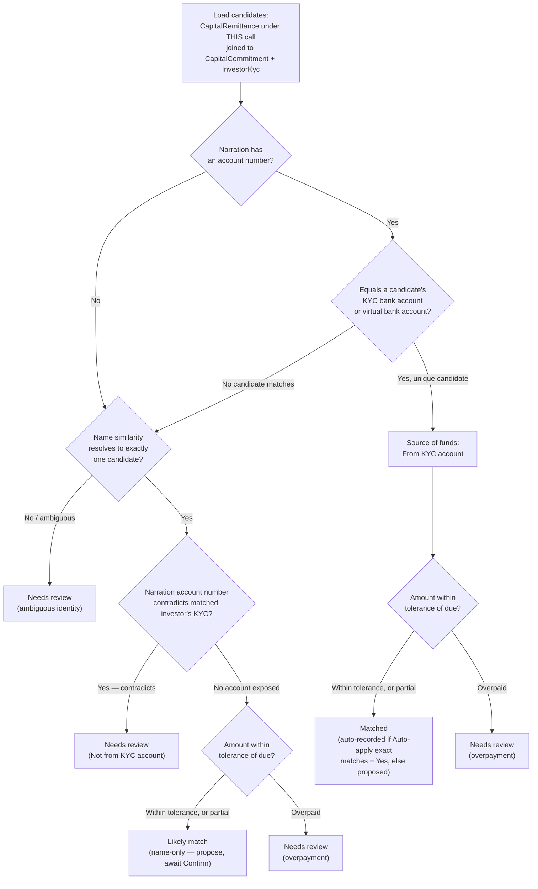

# Remittance Reconciliation Agent — User Guide

The Remittance Reconciliation Agent reconciles an uploaded bank statement (xlsx) against **one Capital Call's** outstanding remittances. It reads every deposit narration on the statement, works out which investor it belongs to, checks whether the amount and the sending account line up with what's expected, and sorts each deposit into one of five outcomes — from an unambiguous match it can record automatically, down to a deposit it can't place at all. It never allocates units or marks a remittance verified; it only proposes and, optionally, records payments for you to review — and, like any payment, each one it records or undoes marks that remittance as not verified.

> **Where to find it:** Sidebar → [**Funds → Funds**](/funds) → open the fund → **Calls** tab → open the call → **Actions → Run Reconciliation** to upload a bank statement; results appear on the call's **Reconciliation** tab, and settings live under Company menu (house icon, top right) → [**Agents**](/support_agents) → **Remittance Reconciliation**. Needs update permission on the fund and the `capital_remittance_reconciliation_agent` entity flag.

## Table of Contents

1. [What This Agent Does](#1-what-this-agent-does)
2. [Inputs](#2-inputs)
3. [Enabling the Agent](#3-enabling-the-agent)
4. [Accessing and Running the Agent](#4-accessing-and-running-the-agent)
5. [Scheduling](#5-scheduling)
6. [Where to Find the Output](#6-where-to-find-the-output)
7. [Understanding the Report](#7-understanding-the-report)
8. [Reviewing and Confirming Deposits](#8-reviewing-and-confirming-deposits)
9. [Where It Can Fail](#9-where-it-can-fail)
10. [Frequently Asked Questions](#frequently-asked-questions)

---

## 1. What This Agent Does

The agent works on one **Capital Call** per run — never a whole Fund. A fund with three open calls needs three separate runs, one statement upload each, because remittances are already generated per call and this keeps the pool of investors a deposit could belong to small and unambiguous. When you upload a statement, it:

1. **Ingests the statement** — reads every sheet of the uploaded xlsx workbook (a statement can cover more than one bank account/sheet, e.g. ICICI and Axis in the same file).
2. **Parses every narration** — identifies which bank issued each sheet (from the sheet header and the IFSC codes embedded in the narrations) and runs a bank-specific parser to pull out the depositor's name, account number (when the bank's format exposes one), and whether the row is the fund's own internal money movement (an FD maturity, a loan credit) rather than an investor payment.
3. **Loads the call's candidates** — every `CapitalRemittance` under this call, joined to its `CapitalCommitment` and that investor's KYC record. Nothing outside this call is ever loaded as a candidate.
4. **Scores and buckets each deposit** on three independent signals:
   - **Identity** — first tries to match the narration's account number against the investor's registered KYC bank account, then against the fund's own virtual bank account for that commitment; if no account number is present (or none matches), falls back to name similarity against the call's candidates.
   - **Source of funds** — whenever the narration exposes an account number, checks it against the matched investor's KYC bank account, independent of how identity was resolved. A contradiction is always flagged and always caps the result at "Needs review," no matter how well the name and amount otherwise line up.
   - **Amount** — compares the deposit to the remittance's due amount, within a configurable tolerance. A shortfall beyond tolerance is a **partial payment** (recorded for what actually arrived, the remittance keeps the balance due); an excess beyond tolerance is always **Needs review**, since a surplus might belong to a different call the agent can't see from a single-call run.
5. **Applies exact matches** — when the "Auto-apply exact matches" setting is Yes, every unambiguous match automatically creates a real payment record. Every other outcome is proposed only — nothing is written for it until you confirm it.
6. **Emails the summary** — optionally sends the run's results (tier counts, every funding-source discrepancy, every deposit needing review) to a configured recipient.
7. **Saves the report** — the full deposit-by-deposit breakdown is saved to this call's Reconciliation tab, so you can review and act on it there.

### How a deposit's outcome is decided

Every non-internal deposit runs through the same decision path — identity first, then source-of-funds, then amount — and the weakest signal always wins:

A couple of things worth noting about this path:

- **Source-of-funds is checked before amount, and its result is final** — a contradiction sends the deposit to Needs review regardless of what the amount check would otherwise have said.
- **A name-only match can never become "Matched," even with a perfect amount.** Without an account number to verify, the best it can reach is "Likely match" — this is deliberate, not a gap.
- **"No account exposed" and "confirmed" both continue to the amount check** — the difference between them is only the source-of-funds tag the deposit ends up carrying, not which branch of the amount logic it takes.

## 2. Inputs

### Configuration fields (Edit page)

| Field | Type | Default | What it controls |
|---|---|---|---|
| Tolerance (absolute) | Number | `500` | The maximum shortfall or excess (in fund currency) still treated as an exact amount match. Set to absorb the wire/correspondent-bank charges that routinely get deducted in transit — a deposit landing a few hundred short of the due amount is the single most common "almost exact" pattern, not an anomaly. |
| Tolerance (%) | Number | `0` | A percentage tolerance, OR'd with the absolute tolerance — either one passing is enough. Leave at 0 to rely on the absolute tolerance alone (the default). |
| Name similarity threshold | Number | `0.90` | The minimum similarity score (0–1) a name-only match must clear before it's accepted automatically as a "Likely match." Only relevant when the narration exposes no account number to check directly. |
| Auto-apply exact matches | Select (Yes/No) | `No` | **The kill switch.** When No, even unambiguous "Matched" deposits are only proposed — you confirm each one (or use Confirm all Matched) rather than the agent recording payments on its own. Every fund starts here; you switch it to Yes deliberately, once you trust the matching for that fund. Every other outcome (Likely match, Needs review, No match) is *always* proposal-only, regardless of this setting. |
| AI-assisted name matching | Select (Yes/No) | `No` | Reserved for a future phase. The setting is stored but currently has no effect on a run — leave it at the default. |
| Email report after run | Select (Yes/No) | `Yes` | When Yes, the run summary is emailed to the address below after each run. |
| Notify email | Text | (blank) | Recipient for the reconciliation summary email. Leave blank to skip the email even when "Email report after run" is Yes. |

There is no configuration field for the bank statement itself — it's uploaded fresh on every run, from the Capital Call page, not stored on the agent.

### Setup checklist and warnings

The agent's **General** tab shows a yellow warning banner whenever setup would undermine a run. For this agent it flags:

- **Both tolerance fields empty.** With neither set, the run falls back to the ₹500 absolute default — the banner tells you this explicitly so you can set it deliberately if this fund's typical wire-fee shortfall is different.
- **"Email report after run" set to Yes with a blank Notify email** — the report would never be emailed.
- **Either Yes/No toggle that has never been given a value** — an unset toggle counts as off, which silently skips that behaviour (most importantly, an unset "Auto-apply exact matches" behaves exactly like No).

### Other data inputs

| Input | Source | Notes |
|---|---|---|
| Bank statement (xlsx) | Uploaded each time you run the agent, through the Run Reconciliation modal on the Capital Call page — not through the agent's own configuration page. | One or more sheets per file (e.g. one per bank account). Every run needs its own fresh upload; there's no recurring or pre-attached statement. |
| This call's remittances | Existing CapHive data | The candidate pool — every `CapitalRemittance` under the selected call, and only that call. |
| Investor KYC bank account numbers | Existing CapHive data | The primary identity signal, and the target of the source-of-funds check. |
| Each commitment's virtual bank account (if configured) | Existing CapHive data | A secondary identity signal — few funds configure this, so most identity resolution runs through the KYC account or name matching instead. |
| Existing payments fund-wide | Existing CapHive data | Used to detect a bank reference already recorded — on this call (skipped as a duplicate) or on a different call of the same fund ("Recorded on another call"). |
| The fund's recorded exchange rate (for a foreign-currency folio) | Existing CapHive data | Used to convert the fund-currency deposit into the folio's currency. If no rate is on file for the payment date, the payment is refused rather than recorded with a made-up or zero folio amount. |

## 3. Enabling the Agent

This agent is turned on or off by the `capital_remittance_reconciliation_agent` support-agent flag on your entity, which CapHive support sets. The agent record itself must also exist and be enabled — **Setup All Agents** on Company menu (house icon, top right) → **Agents** creates it under the **Finance** category.

The upload option ("Run Reconciliation") appears in a Capital Call's Actions dropdown only when you have update permission on the fund. If the flag is off, or the agent record is missing or disabled, the menu item is shown greyed out and locked with the tooltip "Remittance Reconciliation Agent is not enabled. Enable it under Support Agents, or contact support", and the call's **Reconciliation** tab is hidden.

Confirming, reassigning, or bulk-confirming a proposed deposit uses the same permission as running the agent (update on the fund). **Undo** additionally requires destroy permission on the fund, since it deletes a payment record.

## 4. Accessing and Running the Agent

The **Run Now** button on the agent's page does nothing useful — running it always requires uploading a statement for one specific call, so it has its own upload modal reachable only from that call.

1. Navigate to the **Capital Call's show page**.
2. Open the **Actions** dropdown. If the feature and the agent are enabled for your entity and you have update rights on the fund, click **Run Reconciliation**.
3. The modal asks for the **bank statement (xlsx)** — this is the only required upload.
4. Submit the run.

Behind the scenes, the uploaded workbook is saved as a Document owned by the capital call (named "Bank Statement") before reconciliation actually starts. That order matters in your favor: the statement stays on file even if a later step fails or has to be retried.

Once submitted, a live step-by-step progress panel streams back: **Initialize → Ingest Statement → Parse Narrations → Load Candidates → Score & Bucket → Apply Exact Matches → Email Report → Save Report**. The agent always runs against the one call you triggered it from — there's no "run for every open call" option (running it in bulk, or on a schedule, processes nothing by design; see [Scheduling](#5-scheduling)).

## 5. Scheduling

Not supported. Reconciliation is inherently tied to a one-off statement upload for one call, so there's no default schedule and no recurring-run option — you run it on demand each time a new statement covering this call's deposits arrives from the bank. A batch or scheduled run of this agent (from the Support Agents index, or an `AgentSchedule`) deliberately processes nothing, rather than guessing which call a statement belongs to.

## 6. Where to Find the Output

- **Reconciliation tab** on the Capital Call's own show page — shows the latest report's results as one table, one row per deposit on the statement, each tagged with its outcome and carrying its own Confirm / Reassign / Undo actions. A row of stat cards at the top (Matched, Likely match, Needs review, No match, Internal, Not from KYC account) doubles as a filter for the table below. If no reconciliation has ever been run for this call, the tab tells you to use Actions → Run Reconciliation instead of showing an empty table.
- **Email** — if "Email report after run" is Yes and "Notify email" is filled in, a summary is sent after each run. The subject line itself tells you the outcome at a glance: `[RECON BLOCKED]` when the run couldn't complete (no statement, or an unreadable one), `[RECON REVIEW]` when there's at least one funding-source discrepancy or a deposit needing review, or `[RECON OK]` when everything matched cleanly.
- **Payments** — every deposit an Exact match auto-applied (or that you confirmed manually) becomes a real `CapitalRemittancePayment`, visible from the remittance it was recorded against. **The agent never marks a remittance as verified** — a payment being recorded is not the same thing as a controller signing off that the call is settled. In fact, every payment recorded (or undone) marks that remittance as **not verified**, so verification stays a separate, human step after reconciliation.
- **Report history** — a new report is saved on every run and tied to the capital call; older runs aren't overwritten, though the Reconciliation tab always shows the latest one.

## 7. Understanding the Report

Each deposit row in the report carries:

- **Outcome tag** — one of five, shown with the internal tier name in parentheses since the underlying data uses the shorter form:
  - **Matched** (`exact`) — identity is certain (the sender's account number matches this investor's KYC account or assigned virtual account) and no other remittance on this call could be the one. Says nothing about the amount by itself — see the amount tag alongside it.
  - **Likely match** (`probable`) — identity by name only; the narration carried no sender account to check directly. Always proposed for you to confirm, never recorded automatically.
  - **Needs review** (`needs_review`) — something contradicts or is ambiguous: a sender account that differs from the investor's KYC account, an overpayment beyond tolerance, or an identity the agent couldn't resolve to exactly one candidate.
  - **No match** (`no_match`) — no remittance on this call matches the depositor at all. Use Reassign to pick the investor or folio it actually belongs to.
  - **Internal** (`internal`) — the fund's own money moving (an FD maturity, a loan credit), not an investor payment. Excluded from matching entirely.
- **Amount tag** (when relevant) — **Partial payment** (less than due arrived, confirming records exactly what came in and the remittance keeps the shortfall as due), **Overpayment** (more than due arrived — the surplus may belong to a different call; check before confirming), or **Amount unreadable** (the statement row had no readable amount, so nothing could be compared).
- **Source-of-funds tag** — **From KYC account** (the sender's account is the investor's own registered account) or **Not from KYC account** (funds came from somewhere else — a joint or family account, a corporate treasury, or a genuine error; verify before confirming). No tag at all means the narration exposed no account number to check, which is common and not itself a red flag.
- **Payment status** (once a payment exists) — **Payment recorded** (created here, or already existed on this call before this run — Undo removes it), **Recorded on another call** (a payment with this same bank reference already exists on a *different* call of this fund — nothing can be recorded here; undo it there first if it actually belongs to this call), or **Payment failed** (recording the payment itself failed — the reason is shown under the tags, most commonly a missing exchange rate for a foreign-currency folio).
- **Reasoning** — a plain-language note explaining the outcome (e.g. the exact account/name match found, the shortfall or surplus amount, the KYC contradiction). This is what makes every match auditable — you're never just told "matched," you're told why.
- **Source pointers** — the exact sheet, row number, and raw narration text the deposit came from, and a link through to the matched remittance/folio when one exists.

The report-level rollup shows **tier counts** (how many landed in each outcome) and a **discrepancy count** (how many had a source-of-funds contradiction, regardless of tier).

## 8. Reviewing and Confirming Deposits

The Reconciliation tab is a worked queue, not just a report — most of the value comes from acting on it directly:

- **Confirm** — available on any deposit that resolved to exactly one remittance and hasn't already been recorded. Records a payment for the deposit's actual amount (not necessarily the due amount — a partial or overpayment is recorded as-is, and you'll see that spelled out in the confirmation prompt before you submit). If the deposit has a funding-source discrepancy, the confirmation prompt says so explicitly — the agent doesn't hide the warning just because you're the one confirming.
- **Confirm all Matched** — a bulk action for every "Matched" deposit still waiting on confirmation, shown as a single button with a count when there's at least one. Only appears when "Auto-apply exact matches" is No (with it set to Yes, Matched deposits are already recorded by the time you see the report).
- **Reassign** — available on any unrecorded, non-internal deposit (typically "No match," but also useful if the agent's proposed match is wrong). Pick or type a value in the field (its suggestions list "folio – investor" pairs for this call) and submit. The submitted value is resolved only as a **Folio No** or **Virtual Bank Account** on this fund — an investor name alone won't resolve — and the call must already have a remittance for that folio.
- **Undo** — available on any deposit with a recorded payment, provided you have destroy permission. Deletes the payment (subject to the same unit-allocation guard as deleting any payment manually — if units have already been allocated against it, Undo is blocked) and returns the deposit to the review queue.

None of these actions ever mark the underlying remittance as verified — each one that records or deletes a payment marks it as not verified, and verification stays a deliberate, separate step for a controller.

## 9. Where It Can Fail

- **No statement uploaded, or the workbook can't be read.** The run records a blocking issue and stops before scoring anything — you'll see this reflected in the report and, if email is on, an `[RECON BLOCKED]` subject line.
- **A funding-source discrepancy always caps the result at Needs review**, even when the name and amount are a perfect match. This is deliberate — the agent never auto-resolves a contradiction between the sender's account and the investor's KYC record, no matter how strong the other signals are.
- **An overpayment beyond tolerance is always Needs review**, and the agent never tries to guess whether the surplus belongs to a different call — reconciliation is strictly single-call, permanently, so a deposit that overpays this call's due amount is reported plainly as an overpayment for you to investigate (typically: apply the correct portion here, and handle the rest as a separate manual entry or a reconciliation run against the other call).
- **A deposit's identity can't be pinned to exactly one candidate.** If the account number matches nobody, and the name similarity is ambiguous (below threshold, or too close between two candidates), the deposit lands in Needs review or No match rather than being force-matched to a guess.
- **No account number in the narration.** Several bank export formats (notably Axis's, and IMPS/cheque-clearing entries generally) never expose a sender account number at all. This isn't itself a red flag — the source-of-funds check is simply skipped for that row (shown as unverifiable, no tag) — but it does mean identity can only ever be resolved by name for those rows, capping them at "Likely match" rather than "Matched."
- **A bank reference already used elsewhere.** Re-running the agent on the same or an overlapping statement never creates a duplicate payment on this call. But if that same reference is already recorded on a *different* call for this fund, the deposit shows "Recorded on another call" and nothing can be recorded here — you'd need to undo it there first if it genuinely belongs to this call.
- **A foreign-currency folio with no exchange rate on file for the payment date.** The payment is refused outright (never recorded with an invented or zero folio-currency amount), and shows as "Payment failed" with the reason. Add the missing exchange rate, then retry via Confirm.
- **Auto-apply left at the default (No).** If deposits you expected to be recorded automatically are instead sitting in "Matched" awaiting confirmation, check the "Auto-apply exact matches" setting — every fund starts with this off.
- **A blank Notify email with "Email report after run" set to Yes.** The email step is simply skipped, with no error raised on that run — so a blank recipient field looks identical to everything working fine.
- **"AI-assisted name matching" set to Yes has no effect yet.** This setting is reserved for a future phase and is currently read nowhere — don't expect it to change matching behavior today.

## Frequently Asked Questions

### Navigation and getting there

**Where do I run the Remittance Reconciliation Agent?**
From the capital call itself: Sidebar → [**Funds → Funds**](/funds), open the fund, click the **Calls** tab, open the call, then **Actions → Run Reconciliation**. There is no useful **Run Now** on the Agents page, because every run needs a bank statement for one call. See [Accessing and Running the Agent](#4-accessing-and-running-the-agent).

**Where do I see the reconciliation results?**
On the same capital call page, in the **Reconciliation** tab. It shows the latest run's deposits with stat cards (Matched, Likely match, Needs review, No match, Internal, Not from KYC account) that filter the table, and each row's **Confirm**, **Reassign** or **Undo** action. See [Where to Find the Output](#6-where-to-find-the-output).

**Where do I configure the agent?**
Company menu (house icon, top right) → [**Agents**](/support_agents) → **Remittance Reconciliation** card in the Finance category → **Edit** on the **General** tab. That page holds the tolerances, name threshold, auto-apply switch and email settings. See [Inputs](#2-inputs).

**Run Reconciliation shows a lock icon. Why?**
The item is locked with the tooltip "Remittance Reconciliation Agent is not enabled. Enable it under Support Agents, or contact support" when the `capital_remittance_reconciliation_agent` entity flag is off, or the agent record is missing or disabled. Ask CapHive support to enable the flag, then run **Setup All Agents** on the [Support Agents](/support_agents) page.

**I can't see Run Reconciliation or the Reconciliation tab at all. Why?**
Both need update permission on the fund (the same right used to edit the call). Without it the agent items are hidden from the call's **Actions** menu and the **Reconciliation** tab is not shown; ask a fund admin for an access right with update permission.

**Who can confirm, reassign and undo deposits?**
**Confirm**, **Confirm all Matched** and **Reassign** need the same update permission on the fund as running the agent. **Undo** also needs destroy permission on the fund, because it deletes a payment. Editing the agent's settings needs the **company_admin** role.

### Running and managing reconciliations

**How do I run a reconciliation?**
On the call page choose **Actions → Run Reconciliation**, read the **Run Remittance Reconciliation** summary, choose the file under **Bank Statement (xlsx)** and click **Run Reconciliation**. A progress panel then shows Initialize, Ingest Statement, Parse Narrations, Load Candidates, Score & Bucket, Apply Exact Matches, Email Report and Save Report.

**What file does the agent accept?**
One `.xlsx` workbook per run; the upload field only accepts xlsx. It can contain several sheets, one per bank account (for example ICICI and Axis in the same file). CSV, xls and PDF statements must be converted to xlsx first.

**How do I confirm a proposed deposit?**
On the **Reconciliation** tab click **Confirm** on the row; the confirmation prompt states the exact payment, including any partial, overpayment or source-of-funds warning, before it records anything. See [Reviewing and Confirming Deposits](#8-reviewing-and-confirming-deposits).

**How do I confirm every Matched deposit at once?**
Click **Confirm all Matched (N)** above the table. It appears only when Matched deposits are still unrecorded, which happens when **Auto-apply exact matches** is No.

**How do I move a deposit to the right investor?**
In the row's **Reassign** box pick or type the investor / folio ("Pick investor / folio" suggests every remittance on this call) and click **Reassign**. The value is resolved to a folio number or virtual bank account on this fund, and the call must already have a remittance for that folio.

**How do I undo a payment the agent or I recorded?**
Click **Undo** on the row and confirm "Undo this payment?". The payment is deleted and the deposit returns to its review section; Undo is refused if units have already been allocated against that payment.

**How do I turn on automatic recording of exact matches?**
On the agent's **Edit** page set **Auto-apply exact matches** to Yes and save. Only Matched deposits are ever recorded automatically; Likely match, Needs review and No match always wait for you.

**How do I get the run summary by email?**
On the agent's **Edit** page set **Email report after run** to Yes and enter an address in **Notify email**. Both are needed; with a blank address the email step is skipped silently.

**Can I reconcile a whole fund or schedule the agent?**
No. Each run covers one capital call and one uploaded statement, so a fund with three open calls needs three runs. Scheduled runs and **Run Now** on the Agents page deliberately process nothing. See [Scheduling](#5-scheduling).

### Why use remittance reconciliation

**Why should I use the Remittance Reconciliation Agent?**
Matching bank deposits to capital call remittances by hand means reading every narration, guessing the investor and typing payments one by one. The agent parses the whole statement, proposes the investor and remittance for each deposit with its reasoning, and records the payments you approve in bulk, so collections are updated in minutes instead of hours.

**What does it let me do that I could not do otherwise?**
It checks every deposit's sending account against the investor's KYC bank account, flags third-party funding, spots partial payments and overpayments against the due amount, and prevents a bank reference from being recorded twice across the fund. Every match carries a written reason, giving an audit trail for each payment.

**Who typically uses it?**
Fund operations and finance teams who receive bank statements during a capital call's collection window, with a controller reviewing Needs review and Not from KYC account deposits before confirming.

**What happens if I keep recording payments manually instead?**
Nothing breaks, but you lose the source-of-funds check, the duplicate-reference protection across calls and the per-deposit reasoning, and payments are only as accurate as whoever keyed them in.

### What happens when I...

**What happens when I click Run Reconciliation?**
The workbook is saved as a document named "Bank Statement" on the capital call, a background job runs the steps, and a new report appears on the **Reconciliation** tab. If **Auto-apply exact matches** is Yes, payments are created for Matched deposits; otherwise nothing is recorded. You get an in-app alert when it finishes, and the summary email goes only to **Notify email**.

**What happens when I confirm a deposit?**
A capital remittance payment is created for the amount that actually arrived, with the bank reference, so the remittance's collected amount rises and any shortfall stays due. Recording a payment marks that remittance as not verified, and investors are not notified at this point; payment notifications only go out after the remittance is verified, if the call has them switched on.

**What happens when I click Undo?**
The payment is deleted, the remittance's collected amount falls back, the remittance is marked not verified, and the deposit returns to its review section on the tab. The deleted payment cannot be restored, but you can **Confirm** or **Reassign** the deposit again.

**What happens when I reassign a deposit?**
The deposit is matched to the remittance for the folio you chose and a payment is recorded for it at once, exactly as **Confirm** would; the row shows a **Reassigned** badge. If the folio has no remittance on this call, nothing is recorded and you see an alert.

**What happens if I run the same statement twice?**
No duplicate payments are created: a bank reference already recorded on this call shows **Payment recorded** with **Undo**, and one recorded on another call of the fund shows **Recorded on another call**. A new report is saved each time and the tab shows the latest.

**Does the agent ever mark remittances as verified or allocate units?**
No. Verification and unit allocation stay separate, manual steps on the call. Every payment the agent records leaves the remittance unverified until someone verifies it.

### Troubleshooting and edge cases

**I uploaded a statement but nothing happened / the run says it couldn't complete.**
Check that the file attached before you submitted and that it is a genuine, non-empty xlsx workbook. A missing or unreadable workbook stops the run before scoring, and the email subject, if enabled, starts with `[RECON BLOCKED]`.

**A deposit is "Matched" but wasn't recorded as a payment automatically. Why?**
**Auto-apply exact matches** is No for this agent, the default for every fund (an unset value also counts as No). Use **Confirm** on the row or **Confirm all Matched**, or switch the setting to Yes on the agent's **Edit** page for future runs.

**A deposit shows "Not from KYC account." What should I do?**
The sender's account number does not match the investor's registered KYC bank account. It may be a joint account, a family member or a corporate treasury paying on the investor's behalf, but it is never accepted silently; verify the source with the investor or your compliance process before confirming.

**A deposit came in short / over the amount due. What happens if I confirm it?**
A **partial** payment is recorded for exactly the amount that arrived and the remittance keeps the balance as due. An **overpayment** is recorded for the full amount received; the agent does not split it against another call, so if part belongs elsewhere, adjust it manually.

**Why does a deposit show "Recorded on another call"?**
A payment with the same bank reference already exists on a different capital call of this fund, and references must be unique within a fund. If it truly belongs to this call, undo the payment on the other call first, then **Reassign** or re-run here.

**Confirming a deposit failed with a payment error.**
The most common cause is a foreign-currency folio with no exchange rate on or before the payment date; the message names the currencies. Add the rate under Company menu (house icon, top right) → [**Exchange Rates**](/exchange_rates) and click **Confirm** again.

**Why didn't I get an email after the run?**
Either **Email report after run** is No or **Notify email** is blank; both must be set on the agent's **Edit** page. The email is also skipped if sending fails, which is recorded as a warning on the report.

**A deposit with a perfect amount is only a "Likely match". Why?**
The narration carried no sender account number, so identity came from the name alone, and a name-only match can never be Matched. This is common for Axis exports and IMPS or cheque entries; confirm it after a quick check.

**Does "AI-assisted name matching" improve results?**
Not yet. The setting is stored but not read by any step, so switching it to Yes has no effect.

## Related Guides

- [Capital Calls](../capital_calls_user_guide) — the call page, remittances and verification this agent works on.
- [Support Agents](../support_agents_user_guide) — the Agents page, setup and the shared run and progress panels.
- [Capital Commitments](../capital_commitments_user_guide) — folios and virtual bank accounts used for Reassign.
- [Investor KYC](../investor_kyc_user_guide) — the KYC bank accounts behind the source-of-funds check.
- [Fund Units](../fund_units_user_guide) — unit allocation, which blocks Undo once done.
- [Tracking Currency](../tracking_currency_guide) — exchange rates needed for foreign-currency folios.
- [RTA Reconciliation Agent](rta_reconciliation_agent_user_guide) — the fund-level reconciliation against RTA statements.
