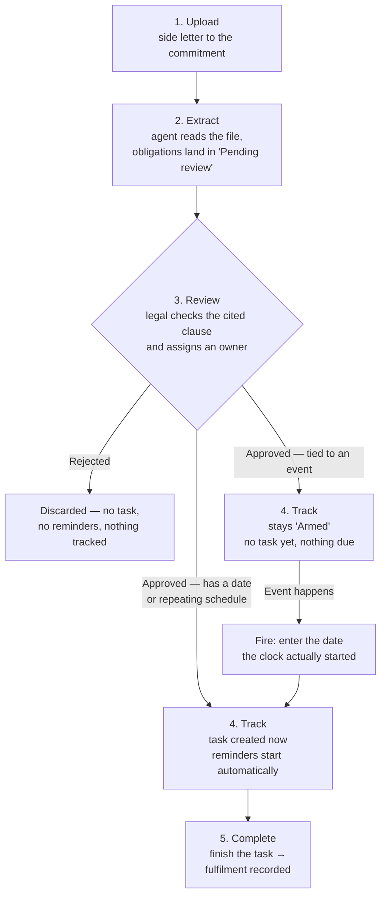

# Side Letter Obligations Agent — User Guide

## What it does

Side letters create commitments your team must honour — quarterly reports for one
investor, fee arrangements for another, co-investment rights for a third. This agent
reads the side letter attached to each commitment, pulls out every obligation with the
exact clause it came from, and lines them all up for your legal team to review.

Once an obligation is approved, the system takes over the calendar: date-driven
obligations become tracked tasks (repeating automatically where the side letter calls
for it), and the owner gets an email before the due date, on the due date, and again
if it slips — escalating to your chosen team if something stays overdue.

Nothing goes live without a human saying so. Every extracted obligation waits in a
review queue where legal can approve it, correct it, or reject it. An obligation the
agent cannot tie to a specific clause in the document is discarded, never shown.

## Setting it up

1. **Enable the agent** for your firm (your administrator or CapHive support can do this),
   then run the agent setup so it appears on your Support Agents page.
2. On the agent's edit page, set:
   - **Side letter document name** — the name your side letters are usually uploaded
     under on each commitment (for example, "Side Letter"). This name is offered in
     the document dropdown on every commitment, so picking it is the easiest way to
     have a side letter recognised.
   - **Auto-extract on upload** — choose Yes if you want extraction to run the moment
     a side letter is uploaded; leave No to run it manually.
   - **Default reminder lead time** — how many days before a due date the first
     reminder goes out.
   - **Overdue escalation cadence** — how often overdue items are re-raised.
   - **Notify tag** — the team (by employee tag) that receives alerts for obligations
     without a named owner, and all overdue escalations.

## How the agent recognises a side letter

You do not have to rename your files to fit the agent. A document on a commitment
counts as a side letter if **any** of the following is true:

- It is **named** with the side letter document name set on the agent (the name
  offered in the commitment's document dropdown).
- It is **tagged** "Side Letter" or "SideLetter" — capitalisation does not matter,
  and the tag can sit alongside others. Tags go in the Tags box on the document,
  so a file called "SD - Amendment 3.pdf" tagged `legal, side letter` is picked up.
- It is the document you nominated when you **recorded the side letter by hand**
  on the commitment. In that case the file can be named and tagged anything at all,
  because you have already pointed at it.

Tagging is the most flexible option if your firm has its own file-naming
conventions. Uploading a file that is neither named nor tagged, with no side letter
recorded against it, is the one case the agent cannot see.

**File format:** both PDF and Word (`.doc`/`.docx`) side letters are supported, along with most
other common office formats — the agent reads the document directly rather than requiring a
particular format. There's nothing to convert before uploading.

## Day-to-day flow

1. **Upload** the executed side letter to the investor's commitment — either pick the
   configured document name from the dropdown, or tag the document "Side Letter".
2. **Extract** — run the agent for one commitment or the whole fund. Extracted
   obligations appear as "Pending review" in the Obligation Matrix.
3. **Review** — legal opens the matrix, checks each obligation against the cited
   clause, assigns an owner, and approves or rejects it. Items flagged
   "Changed on re-extraction" mean an amended side letter altered something that was
   previously approved.
4. **Track** — from here the path splits depending on what kind of obligation it is:
   - An obligation with a **date or a repeating schedule** (a quarterly report, a
     one-off deliverable) becomes a task on the task board immediately, with
     reminders running automatically.
   - An obligation tied to an **event, not a date** (notify on a key-person departure,
     offer a co-investment right) has nothing to schedule yet, so it stays visible as
     **"Armed"** — approved and waiting, but no task and no reminders until something
     actually happens. When the event occurs, someone **fires** it: enters the date the
     clock actually started, and a task is created on the spot, due-date reminders and
     all.
5. **Complete** — finishing the task records the fulfilment, building an audit trail
   of who fulfilled what, when, and how. You can also record a fulfilment directly on
   the obligation page, attaching evidence if you have it.

### Example: a dated obligation (recurring)

LP Alpha's side letter requires a quarterly ESG report within 45 days of each
quarter-end.

1. **Upload** — the executed side letter is added to LP Alpha's commitment, tagged
   "Side Letter."
2. **Extract** — the agent reads it and creates a "Pending review" obligation:
   *Reporting — Quarterly ESG report, cited to Section 4.3(b), due 45 days after each
   quarter-end.*
3. **Review** — legal checks the clause matches, assigns the IR team as owner, and
   approves it.
4. **Track** — because this is calendar-driven, approval immediately creates a
   repeating task. For Q3 2026 (quarter-end September 30), that's a task due
   **October 14**, and it will regenerate every quarter without anyone re-entering it.
   Seven days before the due date (the default lead time), IR gets a reminder email;
   another goes out if the 14th arrives and it's still open.
5. **Complete** — IR sends the report and marks the task done. That logs a fulfilment
   ("Q3 2026 ESG report sent via portal," dated, with the person's name) — and the
   cycle quietly repeats itself for Q4.

### Example: an armed obligation (event-triggered)

LP Delta's side letter requires the GP to notify LP Delta within 5 business days if
a key person leaves the firm.

1. **Upload** and **2. Extract** happen the same way, producing a "Pending review"
   obligation: *Notice — Key person departure, cited to Section 7.1, notify within 5
   business days of the event.*
3. **Review** — legal assigns Legal as owner and approves it. There's no date to
   schedule, so nothing happens yet.
4. **Track** — the obligation shows up in the matrix with an **"Armed"** badge. It sits
   there, quietly correct, for as long as no key person leaves — months or years,
   possibly. No task, no reminder, nothing to miss because there's nothing due.
   Six months later, a key person actually does leave, on March 2. Legal opens the
   obligation and **fires** it, entering March 2 as the triggering date. That creates a
   task due 5 business days out — **March 9** — with the same reminder emails a dated
   obligation would get.
5. **Complete** — Legal sends the notice and marks the task done, recording the
   fulfilment. The obligation itself goes back to sitting "Armed," ready for the next
   time a key person leaves.

## The Obligation Matrix

The matrix is the single view of every side letter obligation across all investors in
a fund: type, owner, next due date, and status. Filter it by obligation type, owning
team, due date range, review status, or MFN relevance. It is available from the
agent's page and as its own screen.

## Alerts

- **Upcoming** — sent to the obligation's owner ahead of the due date, using the lead
  time set on the obligation.
- **Due today** — sent on the due date.
- **Overdue** — repeated on the escalation cadence and copied to the notify tag team.

Each person receives one consolidated email per day listing everything that needs
their attention, worst first. Every alert sent is logged against the obligation.

## Good to know

- Setting an obligation's reminder lead time to zero suppresses the early reminder;
  due-today and overdue alerts still go out.
- Waiving an obligation removes its open tasks but keeps the history of what was
  already fulfilled.
- Re-running extraction after an amendment never overwrites approved obligations —
  changes arrive as new items for review.
- MFN-relevant obligations can be flagged during review so counsel can assess them
  across investors; the comparison dashboard is planned for a later release.
- If a side letter you uploaded produced nothing, check that the document is named
  or tagged as above, and that auto-extract on upload is switched on. You can always
  run extraction by hand from the side letter's page — it is safe to re-run.
