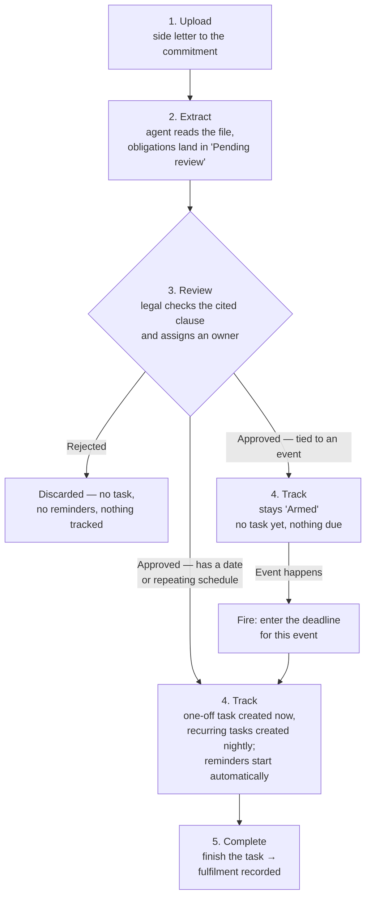

# Side Letter Obligations Agent — User Guide

## What it does

Side letters create commitments your team must honour — quarterly reports for one
investor, fee arrangements for another, co-investment rights for a third. This agent
reads the side letter attached to each commitment, pulls out every obligation with the
exact clause it came from, and lines them all up for your legal team to review.

> **Where to find it:** Sidebar → [**Funds → Funds**](/funds) → open the fund → **Commitments** tab → open the commitment → **Side Letters** card (**Add**, or open a side letter → **Extract Obligations**); the [**Obligation Matrix**](/side_letter_obligations) has its own page, and settings are under Company menu (house icon, top right) → [**Agents**](/support_agents) → **Side Letter Obligations**. Needs the `side_letter_obligation_agent` entity flag; changes need the Company Admin role.

Once an obligation is approved, the system takes over the calendar: date-driven
obligations become tracked tasks (recurring ones are generated automatically each
period by a nightly job), and the owner gets an email before the due date, on the due date, and again
if it slips — escalating to your chosen team if something stays overdue.

Nothing goes live without a human saying so. Every extracted obligation waits in a
review queue where legal can approve it, correct it, or reject it. An obligation the
agent cannot tie to a specific clause in the document is discarded, never shown.

## Setting it up

1. **Enable the agent** for your firm (CapHive support sets the `side_letter_obligation_agent`
   flag), then run **Setup All Agents** so it appears on your Agents page, and make sure an LLM
   key exists under **Agents → LLM Keys** for extraction.
2. On the agent's edit page, set:
   - **Side letter document name** — the name your side letters are usually uploaded
     under on each commitment (for example, "Side Letter"). This name is offered in
     the document dropdown on every commitment, so picking it is the easiest way to
     have a side letter recognised.
   - **Auto-extract on upload** — choose Yes if you want extraction to run the moment
     a side letter is uploaded; leave No to run it manually.
   - **Default reminder lead time** — how many days before a due date the first
     reminder goes out.
   - **Overdue escalation cadence** — how often overdue items are re-raised.
   - **Notify tag** — the team (by employee tag) that receives alerts for obligations
     without a named owner, and all overdue escalations. If it is blank (or no employee
     carries the tag), those alerts go to your company admins instead.
   - **Source type** — `capital_commitments` (the default, side letters on commitments) or
     `portfolio_investments` (investment agreements such as an SHA on portfolio investments).
   - **Investment document tag** — when the source type is `portfolio_investments`, the tag
     (for example `SHA`) that marks the documents to read.

## How the agent recognises a side letter

You do not have to rename your files to fit the agent. A document on a commitment
counts as a side letter if **any** of the following is true:

- It is **named** with the side letter document name set on the agent (the name
  offered in the commitment's document dropdown).
- It is **tagged** "Side Letter" or "SideLetter" — capitalisation does not matter,
  and the tag can sit alongside others. Tags go in the Tags box on the document,
  so a file called "SD - Amendment 3.pdf" tagged `legal, side letter` is picked up.
- It is the document you nominated when you **recorded the side letter by hand**
  on the commitment. In that case the file can be named and tagged anything at all,
  because you have already pointed at it.

Tagging is the most flexible option if your firm has its own file-naming
conventions. Uploading a file that is neither named nor tagged, with no side letter
recorded against it, is the one case the agent cannot see.

**File format:** the document file is passed straight to the AI model, so which formats can
be read depends on the provider behind the agent's **AI Model**. PDF works with the default
Gemini model; Word (`.doc` or `.docx`) support is not guaranteed — if a Word side letter returns
nothing, upload a PDF copy.

## Day-to-day flow

1. **Upload** the executed side letter to the investor's commitment — either pick the
   configured document name from the dropdown, or tag the document "Side Letter".
2. **Extract** — click **Extract Obligations** on a side letter's page to run one
   commitment, or **Run Now** on the agent page to run every matching commitment in your
   entity (not just one fund). Extracted obligations appear as "Pending review" in the
   Obligation Matrix.
3. **Review** — legal opens the matrix, checks each obligation against the cited
   clause, assigns an owner, and approves or rejects it. Items flagged
   "Changed on re-extraction" mean an amended side letter altered something that was
   previously approved.
4. **Track** — from here the path splits depending on what kind of obligation it is:
   - An obligation with a **date or a repeating schedule** (a quarterly report, a
     one-off deliverable) is scheduled on approval: a one-off dated obligation becomes a
     task on the task board immediately, while a recurring one gets a repeating schedule
     whose tasks the nightly task generator creates. Reminders run automatically.
   - An obligation tied to an **event, not a date** (notify on a key-person departure,
     offer a co-investment right) has nothing to schedule yet, so it stays visible as
     **"Armed"** — approved and waiting, but no task and no reminders until something
     actually happens. When the event occurs, someone **fires** it: enters the **Deadline**
     the side letter gives for that event, and a task due on that date is created on the
     spot, due-date reminders and all. An obligation can only be fired once.
5. **Complete** — finishing the task records the fulfilment, building an audit trail
   of who fulfilled what, when, and how. You can also record a fulfilment directly on
   the obligation page, attaching evidence if you have it.

### Example: a dated obligation (recurring)

LP Alpha's side letter requires a quarterly ESG report within 45 days of each
quarter-end.

1. **Upload** — the executed side letter is added to LP Alpha's commitment, tagged
   "Side Letter."
2. **Extract** — the agent reads it and creates a "Pending review" obligation:
   *Reporting — Quarterly ESG report, cited to Section 4.3(b), due 45 days after each
   quarter-end.*
3. **Review** — legal checks the clause matches, assigns the IR team as owner, and
   approves it.
4. **Track** — because this is calendar-driven, approval creates a repeating
   schedule, and the nightly task generator creates each quarter's task from it. For Q3
   2026 (quarter-end September 30), that's a task due **October 14**, and a new one is
   generated every quarter without anyone re-entering it.
   Seven days before the due date (the default lead time), IR gets a reminder email;
   another goes out if the 14th arrives and it's still open.
5. **Complete** — IR sends the report and marks the task done. That logs a fulfilment
   ("Q3 2026 ESG report sent via portal," dated, with the person's name) — and the
   cycle quietly repeats itself for Q4.

### Example: an armed obligation (event-triggered)

LP Delta's side letter requires the GP to notify LP Delta within 5 business days if
a key person leaves the firm.

1. **Upload** and **2. Extract** happen the same way, producing a "Pending review"
   obligation: *Notice — Key person departure, cited to Section 7.1, notify within 5
   business days of the event.*
3. **Review** — legal assigns Legal as owner and approves it. There's no date to
   schedule, so nothing happens yet.
4. **Track** — the obligation shows up in the matrix with an **"Armed"** badge. It sits
   there, quietly correct, for as long as no key person leaves — months or years,
   possibly. No task, no reminder, nothing to miss because there's nothing due.
   Six months later, a key person actually does leave, on March 2. Legal works out the
   deadline — 5 business days later, **March 9** — opens the obligation, **fires** it and
   enters March 9 as the **Deadline**. That creates a task due on March 9, with the same
   reminder emails a dated obligation would get.
5. **Complete** — Legal sends the notice and marks the task done, recording the
   fulfilment. Once fired, the obligation shows **Waive** instead of **Fire** and cannot
   be fired again, so a later key-person departure needs a new obligation.

## The Obligation Matrix

The matrix is the single view of every side letter obligation across all investors:
type, owner, next due date, and status. Filter it by fund, obligation type, owner team,
review status, legal category, due date range (from/until) or stakeholder. The
[full-screen matrix](/side_letter_obligations) has no sidebar entry; reach it from the agent's
**Obligation Matrix** tab or the **Obligation Matrix** link on a side letter's page.

## Alerts

- **Upcoming** — sent to the obligation's owner ahead of the due date, using the lead
  time set on the obligation.
- **Due today** — sent on the due date.
- **Overdue** — repeated on the escalation cadence and copied to the notify tag team.

Each person receives one consolidated email per day listing everything that needs
their attention, worst first. Every alert sent is logged against the obligation.

## Good to know

- Setting an obligation's reminder lead time to zero suppresses the early reminder;
  due-today and overdue alerts still go out.
- Waiving an obligation removes its open tasks but keeps the history of what was
  already fulfilled.
- Re-running extraction after an amendment never overwrites approved obligations —
  changes arrive as new items for review.
- MFN-relevant obligations can be flagged during review so counsel can assess them
  across investors; the comparison dashboard is planned for a later release.
- If a side letter you uploaded produced nothing, check that the document is named
  or tagged as above, and that auto-extract on upload is switched on. You can always
  run extraction by hand from the side letter's page — it is safe to re-run.

---

## Frequently Asked Questions

### Navigation and getting there

**Is the Side Letter Obligations agent actually available in CapHive?**
Yes. The agent, the side letter pages, the Obligation Matrix, review, fire, waive, fulfilment and daily due-date alerts are all built. It is licensed per entity, so the screens below only appear once CapHive support enables the `side_letter_obligation_agent` flag for you.

**Where do I find a commitment's side letters?**
Sidebar → [**Funds → Funds**](/funds), open the fund, click the **Commitments** tab and open the commitment. The **Side Letters** card lists each side letter with its extraction status, obligation count, pending reviews and open tasks; click a side letter's document name to open its page.

**Where is the Obligation Matrix?**
Open any side letter's page and click **Obligation Matrix**, or open the agent (Company menu (house icon, top right) → [**Agents**](/support_agents) → **Side Letter Obligations**) and use its **Obligation Matrix** tab → **Open Full Matrix**. The [full matrix](/side_letter_obligations) has no sidebar entry. See [The Obligation Matrix](#the-obligation-matrix).

**Where is the list of all side letters?**
Click **All Side Letters** on any side letter's page, or open the [side letters list](/side_letters) directly. It lists investor, fund, document, executed date, extraction status and obligation count for every side letter in your entity.

**Where do I configure the agent?**
Company menu (house icon, top right) → [**Agents**](/support_agents) → **Side Letter Obligations** card (Ops category) → **Edit** on the **General** tab. The page has **General**, **Schedule**, **Execution History** and **Obligation Matrix** tabs. See [Setting it up](#setting-it-up).

**Who can see and use side letters and obligations?**
With the flag on, company admins and employees of your entity can view side letters, obligations and the matrix. Adding or editing side letters, extracting, adding, editing, approving, rejecting, firing, waiving, reverting and recording fulfilments all need the **company_admin** role; investors never see any of it.

**I can't see the Side Letters card on a commitment. Why?**
Either the `side_letter_obligation_agent` flag is off for your entity, or you are not a company admin or employee (for example an investor or advisor login). Ask CapHive support to enable the flag.

### Creating, updating and managing side letters and obligations

**How do I set the agent up?**
After CapHive support enables the flag, click **Setup All Agents → Run Setup** on the [**Agents**](/support_agents) page, then on the agent's **Edit** page set **Side letter document name**, **Auto-extract on upload**, **Default reminder lead time (days)**, **Overdue escalation cadence (days)** and **Notify tag**. An LLM key under [**Agents → LLM Keys**](/support_agents/llm_keys) is also needed for extraction.

**How do I add a side letter to a commitment?**
Upload the executed side letter to the commitment as a document, named with the **Side letter document name** (offered in the commitment's document dropdown) or tagged "Side Letter". To point at a file with any name, click **Add** on the commitment's **Side Letters** card and pick the **Commitment**, **Side letter document** and **Executed on** date. See [How the agent recognises a side letter](#how-the-agent-recognises-a-side-letter).

**How do I extract obligations from one side letter?**
Open the side letter's page and click **Extract Obligations**, read the summary and click **Extract Obligations** in the window. If **Auto-extract on upload** is Yes, extraction also starts by itself when a matching document is uploaded to the commitment.

**How do I extract obligations for every commitment at once?**
Click **Run Now** on the agent's **General** tab. It runs extraction for every commitment in your entity that has a matching side letter document or a recorded side letter, as one batch.

**How do I review an extracted obligation?**
In the matrix or on a side letter's **Obligations** tab, open the obligation, check the **Source Clause**, set an owner, then click **Approve** or **Reject**. Obligations can only be edited while they are **Pending review**.

**How do I correct an obligation before approving it?**
Click **Edit** on a pending obligation (or its title in the matrix) and change the title, type, source clause, legal category, description, trigger, owner, due date or lead time, then click **Save**. Approved obligations cannot be edited.

**How do I add an obligation the AI missed?**
Click **Add Obligation** above the matrix (on the [full matrix](/side_letter_obligations) or a side letter's page), fill in the form and save. It joins the same **Pending review** queue as extracted obligations.

**How do I fire an event-triggered obligation?**
Open the approved obligation showing the **Armed** badge, click **Fire**, enter the **Deadline** the side letter gives you for this event, and click **Fire Obligation**. A task due on that deadline is created at once.

**How do I record that an obligation was fulfilled?**
Complete its task on the side letter's **Covenant Tasks** tab or the task board, or use **Record fulfillment** on the obligation page (Date, How was it fulfilled?, Period, optional evidence) and click **Record**. Both are logged in the obligation's **Fulfillment History**.

**How do I stop tracking an obligation?**
Click **Waive** on an approved, active obligation and confirm **Waive Obligation**. If it was waived by mistake, click **Revert** and confirm **Revert to Active**.

**Can I delete a side letter or an obligation?**
There is no delete button for either. Reject an obligation that is still pending review, and waive one that is already approved.

**How do I change when alerts go out?**
**Default reminder lead time (days)** sets the lead time for newly extracted obligations, and each obligation's own **Lead (days)** can be changed while it is pending. **Overdue escalation cadence (days)** controls how often overdue items are re-sent; the daily alert run is on the **Schedule** tab (07:00 Asia/Kolkata by default).

### Why use the Side Letter Obligations agent

**Why should I use the Side Letter Obligations agent?**
Side letter promises (bespoke reports, fee terms, notices, co-investment rights) are easy to forget because they sit in PDFs no one re-reads. The agent turns each letter into a reviewed list of obligations tied to the exact clause, then puts dated ones on the task board with reminders, so nothing is missed.

**What does it let me do that I could not do otherwise?**
See every investor's obligations in one filterable matrix, keep a legal review gate before anything goes live, get consolidated reminder and escalation emails, track event-driven promises until they are needed, and keep an audit trail of who fulfilled what and when.

**Who typically uses it?**
Legal and compliance teams review and approve obligations; investor relations, finance and operations staff own and complete the resulting tasks; a company admin maintains the settings.

**What happens if I don't use it?**
Side letters stay as documents on commitments with no extracted obligations, tasks or alerts, and tracking relies on people remembering each clause. Nothing else in CapHive depends on the agent.

### What happens when I...

**What happens when I click Extract Obligations?**
The side letter is sent to the AI, which lists obligations with their source clauses; anything it cannot tie to a clause is dropped. New items are saved as **Pending review**, the side letter's extraction status updates, and no tasks or alerts are created until someone approves them.

**What happens when I re-extract an amended side letter?**
Pending obligations are refreshed in place, approved ones are never overwritten, and an approved obligation whose content changed arrives as a new pending item marked **Changed on re-extraction**. Rejected items are not recreated. Only the newest matching document on the commitment is read.

**What happens when I approve an obligation?**
It must have an owner user or team, otherwise approval fails with "An owner (user or team) is required before approval". A one-off dated obligation gets a task immediately; a recurring one gets a repeating schedule whose tasks are created by the nightly task generator; an event-triggered one becomes **Armed** with no task.

**What happens when I reject an obligation?**
It is marked rejected and never creates tasks or alerts, and later re-extraction does not bring it back. No one is notified.

**What happens when I fire an armed obligation?**
A compliance task is created with your deadline and assigned to the obligation's owner, the daily alert run starts watching it, and completing it records a fulfilment. After the first fire the obligation shows **Waive** instead of **Fire**, so a repeat event needs a new obligation.

**What happens when I waive or revert an obligation?**
Waiving deletes its open tasks, stops alerts and marks it waived, while completed tasks and fulfilment history stay. Reverting sets it back to active, recreates the recurring schedule or a missing one-off task, and alerts resume.

**Who gets notified, and when?**
The daily scheduled run sends each recipient one consolidated email and in-app notification: owners get upcoming (within the lead time), due-today and overdue items. Ownerless items and overdue escalations go to employees tagged with **Notify tag**, or to company admins when the tag is blank; each alert is logged so it is not repeated the same day.

**Does anything go to investors?**
No. Extraction, review, tasks and alerts are internal to your team; the agent does not email investors or show obligations on the investor portal.

### Troubleshooting and edge cases

**A side letter I uploaded produced nothing. Why?**
Check that the document is on the commitment (not a fund or folder) and is named with **Side letter document name** or tagged "Side Letter", and that **Auto-extract on upload** is Yes. Otherwise open the side letter page and click **Extract Obligations**; it is safe to re-run.

**Approve fails with "An owner (user or team) is required before approval".**
Edit the pending obligation and set an owner user or **Owner (team)** on the full edit form, save, then approve again.

**I approved a quarterly obligation but see no task yet. Why?**
Recurring obligations create a repeating schedule on approval, and the nightly task generator creates the actual tasks, starting from the obligation's due date. Check the side letter's **Covenant Tasks** tab the next day.

**No reminder emails are arriving.**
Confirm **Enable scheduled runs for this agent** is ticked on the **Schedule** tab (setup turns it on), that the obligation is approved with a dated task, and that its **Lead (days)** is above zero if you expect an early reminder. Owners without a user fall back to **Notify tag** or company admins.

**Can the agent read Word side letters?**
The document file is passed straight to the AI model, so what can be read depends on the provider behind your **AI Model**. PDF works with the default Gemini model; if a Word file returns nothing, upload a PDF copy.

**Can it track investment agreements (SHA/SSA) instead of side letters?**
Yes. Set **Source type** to `portfolio_investments` and **Investment document tag** (for example `SHA`) on the agent's **Edit** page; extraction then reads tagged documents on portfolio investments instead of commitments.

**Can I filter the matrix for MFN obligations?**
Not yet. The matrix filters by fund, type, owner team, review status, legal category, due date range and stakeholder; MFN is recorded on each obligation but the cross-investor MFN view is planned for a later release.

## Related Guides

- [Support Agents](../support_agents_user_guide) — setup, LLM keys, the Schedule tab and run history shared by all agents.
- [Capital Commitments](../capital_commitments_user_guide) — the commitment page where side letters are uploaded.
- [Document Management](../document_management_user_guide) — naming and tagging documents so they are recognised.
- [Tasks](../tasks_user_guide) — the task board where covenant tasks are completed.
- [LLM Configuration](../llm_configuration_guide) — the provider key used to read side letters.
- [Investors (Stakeholders)](../investors_user_guide) — the investors whose commitments carry side letters.
