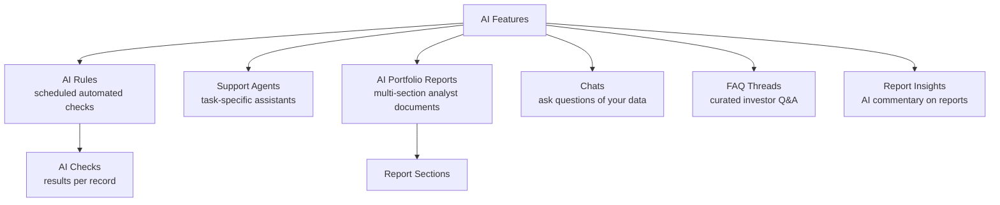
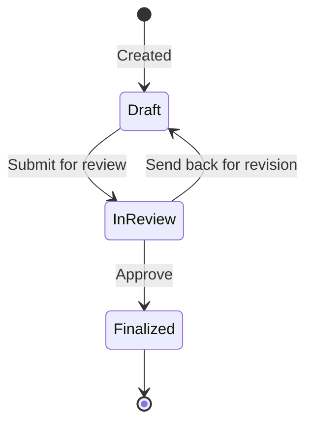

# AI Features User Guide

CapHive includes a suite of AI-powered features for automating compliance checks, generating portfolio reports, answering investor questions, and monitoring portfolio companies. This guide covers each one: AI Rules, Support Agents, AI Portfolio Reports, and Chats & FAQs.

> For choosing the underlying AI model and entering API keys, see the **LLM Configuration Guide**.

---

## Table of Contents

1. [The AI Features at a Glance](#the-ai-features-at-a-glance)
2. [AI Rules](#ai-rules)
3. [AI Checks (Rule Results)](#ai-checks-rule-results)
4. [Support Agents](#support-agents)
5. [Scheduling and Monitoring Agents](#scheduling-and-monitoring-agents)
6. [AI Portfolio Reports](#ai-portfolio-reports)
7. [Report Sections](#report-sections)
8. [Investment Criteria Templates](#investment-criteria-templates)
9. [The Report Lifecycle](#the-report-lifecycle)
10. [Chats](#chats)
11. [FAQs](#faqs)
12. [Report Insights](#report-insights)
13. [Worked Example](#worked-example)
14. [Frequently Asked Questions](#frequently-asked-questions)

---

## The AI Features at a Glance

| Term | Meaning |
|------|---------|
| **AI Rule** | A recurring automated check run against your records. |
| **AI Check** | The result of running a rule on one record. |
| **Support Agent** | An AI assistant configured for a specific task. |
| **AI Portfolio Report** | A multi-section analyst report on a portfolio company. |
| **Investment Criteria Template** | Your firm's scoring criteria for the Investment Fit section. |
| **Chat** | A conversation where you ask questions of your data. |
| **FAQ Thread** | A curated Q&A topic published to investors. |

---

## AI Rules

**AI Rules** are automated checks that run on a schedule against your records. Each rule says what to check, which kind of record to check, and how often.

### Creating a rule

Go to **[Entity] → AI Rules → New**.

| Field | Notes |
|-------|-------|
| **Rule** | A plain-English description of the check (e.g. "Verify the tax ID matches the name on the KYC document"). |
| **Rule Type** | Compliance, Investor Relations, or Investment Analyst. |
| **Applies To** | The kind of record to check (see below). |
| **Schedule** | When to run. |
| **Enabled** | Activate or deactivate. |
| **Tags** | Searchable labels. |

### What it can check

Rules can run against funds, capital commitments, distributions, capital calls/remittances, individual and non-individual KYC, portfolio investments, and aggregate portfolio positions.

### When it runs

| Schedule | When |
|----------|------|
| **End of Day** | Daily. |
| **End of Month** | Last day of each month. |
| **End of Quarter** | Last day of March, June, September, December. |
| **End of Year** | Last day of the financial year. |

You can also run a rule immediately with **Run Now**.

---

## AI Checks (Rule Results)

Each time a rule runs, it produces an **AI Check** for every matching record, storing the outcome and a result message, and linking back to both the rule and the record. Review them under **AI Rules → Checks** to find records that failed a compliance or data-quality rule; failures can feed notifications or approval workflows.

---

## Support Agents

**Support Agents** are AI assistants set up for specific operational tasks. Each has a type that determines what it does.

### Creating an agent

Go to **[Entity] → Support Agents → New**.

| Field | Notes |
|-------|-------|
| **Name** | A display name. |
| **Agent Type** | One of the types below. |
| **Enabled** | Active or inactive. |
| **Model** | Which AI model to use (falls back to the entity default). |
| **Chat Enabled** | Whether this agent offers a conversational chat. |

### Agent types

| Agent | What it does |
|-------|--------------|
| **KYC Onboarding** | Checks KYC completeness and compares uploaded documents against the form data. |
| **Portfolio Company** | Analyses a company's data, KPIs, and news. |
| **Fund Stats** | Computes and interprets fund-level statistics. |
| **Portfolio Report** | Helps draft portfolio report sections. |
| **Call Notice** | Assists with generating and reviewing capital-call notices. |
| **Cash Flow Assistant** | Analyses and interprets fund cashflow data. |

---

## Scheduling and Monitoring Agents

Each agent can run automatically on a schedule, against its configured scope (the whole entity, a fund, or individual records). Set this up under **Support Agent → Schedule**.

Every run is recorded in an **execution log** with start/end times, success or failure, the result or error, and the inputs used — view these under **Support Agent → Execution Logs** to monitor health and troubleshoot. For chat-enabled agents, conversation history is also kept.

---

## AI Portfolio Reports

An **AI Portfolio Report** is a structured, multi-section analyst document on a portfolio company. It blends your internal data (KPIs, financials, valuations) with current information from the web to produce a thorough due-diligence or monitoring report.

### Creating a report

Go to **[Entity] → AI Portfolio Reports → New**.

| Field | Notes |
|-------|-------|
| **Portfolio Company** | The company the report covers. |
| **Analyst** | The user responsible. |
| **Investment Criteria Template** | Optional scoring criteria for the Investment Fit section. |
| **Status** | Draft → In Review → Finalized. |

All the standard sections are created automatically when you create the report.

---

## Report Sections

A report includes a set of sections. Some pull in current external information from the web, and some can auto-generate charts from your data.

| Section | Uses web search | Can include charts |
|---------|:--------------:|:------------------:|
| Investment Fit Evaluation | | |
| Company Overview | ✓ | |
| Key Products & Services | ✓ | ✓ |
| Financial Snapshot | | ✓ |
| Market Size & Target | ✓ | ✓ |
| Recent Updates & Developments | ✓ | |
| Custom Charts | | |
| Founders & Shareholders | ✓ | ✓ |
| Raise History, Valuations & Funding Trend | ✓ | ✓ |
| SWOT Analysis | ✓ | |
| Competition Analysis | ✓ | |
| Key Risks | ✓ | |
| Operational Red Flags | ✓ | |
| Negative News | ✓ | |
| AML/KYB Check | | |
| Investment Ask | | ✓ |

Each section has its own status and can be generated or regenerated independently, so you can refine the report section by section before finalising.

---

## Investment Criteria Templates

An **Investment Criteria Template** captures your firm's investment thesis as scoring criteria used in the **Investment Fit Evaluation** section, so every report is assessed consistently.

Go to **[Entity] → Investment Criteria Templates → New**, define your criteria (e.g. "Must have recurring revenue", "Team size over 10"), set a weight for each, and attach the template when creating a report.

---

## The Report Lifecycle

- **Draft** — the analyst generates and edits sections.
- **In Review** — submitted for approval; can be sent back.
- **Finalized** — locked and ready to share.

---

## Chats

**Chats** let you ask questions of your organisation's data in plain language — funds, investors, KPIs, portfolio investments — and, for capable agents, search uploaded documents. The AI can also take actions such as querying data and producing a structured output or presentation.

Go to **[Entity] → Chats → New** to start one. Which topics are available depends on the AI model configured and the features enabled for your entity. See the **LLM Configuration Guide** for model setup.

---

## FAQs

**FAQ Threads** are curated Q&A topics you can publish to the investor portal. Unlike ad-hoc chats, they're structured and reusable — investors browse them in their portal without starting a conversation. Manage them under **[Entity] → FAQ Threads**.

---

## Report Insights

**Report Insights** are AI-generated comments on specific report sections or dashboards, surfaced inline to highlight anomalies, trends, or notable changes. View them under **Reports → [Report] → Insights**.

---

## Worked Example

Standing up automated KYC checks and a portfolio report:

1. **AI Rule:** create a Compliance rule "Confirm the tax ID on file matches the KYC document", applies to **Individual KYC**, schedule **End of Day**. Click **Run Now** to test — each KYC gets an **AI Check** with a pass/fail result you can review under Checks.
2. **AI Portfolio Report:** for *Helios Robotics*, create a report and attach your **Investment Criteria Template**. Generate the Company Overview and Competition sections (which pull in current web information), tidy the wording, then move the report to **In Review** and **Finalized**.
3. **Chat:** ask "Which of our portfolio companies grew revenue more than 30% last quarter?" and get an answer drawn from your KPI data.

---

## Frequently Asked Questions

**How do I choose which AI model the features use?**
They use the entity's default AI model (set in Entity Settings). See the LLM Configuration Guide.

**Can I run an AI Rule without waiting for its schedule?**
Yes — open the rule and click **Run Now** to check all matching records immediately.

**How many sections does an AI Portfolio Report have?**
The full standard set is created automatically; generate each independently and edit before finalising.

**Can I customise the Investment Fit checks?**
Yes — create an Investment Criteria Template and attach it to the report.

**What data can Chat use?**
Your structured data (funds, investors, KPIs, investments) and, for enabled agents, uploaded documents.

**Can investors see Chats and FAQs?**
FAQ Threads can be published to the portal. Chats are internal by default, though chat-enabled agents can expose a conversation to investors depending on configuration.

**How do I stop a rule that runs too often?**
Set it to disabled — the next scheduled run is skipped.
