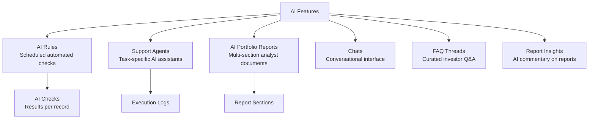
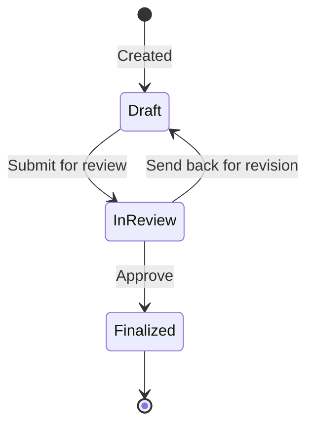

# AI Features User Guide

CapHive includes a suite of AI-powered features for automating compliance checks, generating portfolio reports, answering investor queries, and monitoring portfolio companies. This guide covers all AI sub-features: AI Rules, Support Agents, AI Portfolio Reports, and Chats/FAQs. For configuring the underlying LLM provider and model selection, see the **LLM Configuration Guide**.

---

## Table of Contents

1. [Key Concepts](#key-concepts)
2. [AI Features Overview](#ai-features-overview)
3. [AI Rules](#ai-rules)
4. [AI Checks (Rule Results)](#ai-checks-rule-results)
5. [Support Agents](#support-agents)
6. [Agent Types](#agent-types)
7. [Agent Scheduling](#agent-scheduling)
8. [Agent Execution Logs](#agent-execution-logs)
9. [AI Portfolio Reports](#ai-portfolio-reports)
10. [Report Sections](#report-sections)
11. [Investment Criteria Templates](#investment-criteria-templates)
12. [AI Portfolio Report Lifecycle](#ai-portfolio-report-lifecycle)
13. [Chats](#chats)
14. [FAQs](#faqs)
15. [Report Insights](#report-insights)
16. [Key Fields Reference](#key-fields-reference)
17. [Frequently Asked Questions](#frequently-asked-questions)

---

## Key Concepts

| Term | Meaning |
|---|---|
| **AI Rule** | A recurring automated check run against business records |
| **AI Check** | The result of a single rule execution for one record |
| **Support Agent** | A specialised AI agent configured for a specific task type |
| **Agent Schedule** | Cron-like schedule for automatic agent runs |
| **AI Portfolio Report** | A multi-section analyst report on a portfolio company |
| **Report Section** | One content block in a portfolio report (e.g. SWOT, Competition) |
| **Investment Criteria Template** | Custom scoring criteria used in Investment Fit evaluation |
| **Chat** | A conversational AI session within the platform |
| **FAQ Thread** | A curated Q&A thread for investor questions |

---

## AI Features Overview

---

## AI Rules

**AI Rules** are automated checks that run on a schedule against records in your entity. Each rule specifies:
- What to check (the rule description)
- Which type of record to check
- How often to run it

### Creating an AI Rule

Navigate to **[Entity] → AI Rules → New**.

| Field | Options / Notes |
|---|---|
| **Rule** | A natural-language description of what the AI should check (e.g. "Verify that the PAN number matches the name on the KYC document") |
| **Rule Type** | Compliance / Investor Relations / Investment Analyst |
| **For Class** | The record type to run against (see table below) |
| **Schedule** | When to run |
| **Enabled** | Toggle to activate/deactivate |
| **Tags** | Searchable labels |

### Supported Record Types

| For Class | What it checks |
|---|---|
| `AggregatePortfolioInvestment` | Aggregate portfolio metrics |
| `CapitalCommitment` | Commitment-level compliance or data quality |
| `CapitalDistribution` | Distribution completeness |
| `CapitalRemittance` | Remittance verification |
| `Fund` | Fund-level data and compliance |
| `IndividualKyc` | Individual KYC completeness and validity |
| `NonIndividualKyc` | Corporate/trust KYC |
| `PortfolioInvestment` | Portfolio company investment data |

### Schedule Options

| Schedule | When it runs |
|---|---|
| `End of Day` | Daily at day end |
| `End of Month` | Last day of each month |
| `End of Quarter` | Last day of March, June, September, December |
| `End of Year` | Last day of the fiscal year |

---

## AI Checks (Rule Results)

When a rule runs, it creates an **AI Check** for each matching record:
- Stores the check status and result
- Links polymorphically to both the rule and the target record (parent and owner)
- Results are available in the **AI Rules → Checks** tab

Review checks to identify records that failed a compliance or data quality rule. Failed checks can trigger notifications or approval workflows.

---

## Support Agents

**Support Agents** are AI assistants configured for specific operational tasks. Each agent has a type that determines its behaviour.

### Creating a Support Agent

Navigate to **[Entity] → Support Agents → New**.

| Field | Notes |
|---|---|
| **Name** | Display name (max 30 chars) |
| **Agent Type** | One of the 6 supported types |
| **Enabled** | Active/inactive toggle |
| **Model** | LLM model to use (falls back to entity default, then `DEFAULT_MODEL` env var) |
| **Chat Enabled** | Whether a conversational chat interface is exposed for this agent |

---

## Agent Types

| Agent Type | Purpose |
|---|---|
| `KycOnboardingAgent` | Validates KYC completeness; checks document uploads against form data using AI extraction |
| `PortfolioCompanyAgent` | Analyses portfolio company data, KPIs, and news |
| `FundStatsAgent` | Computes and interprets fund-level statistics and metrics |
| `PortfolioReportAgent` | Assists in drafting portfolio report sections |
| `CallNoticeAgent` | Assists with capital call notice generation and review |
| `CashFlowAssistantAgent` | Analyses and interprets fund cashflow data |

---

## Agent Scheduling

Each support agent can have one **AgentSchedule** record that defines when it runs automatically:
- Schedule is cron-based
- The agent runs against its configured scope (entity, fund, or individual records)
- Execution results are stored in **Agent Execution Logs**

Navigate to **Support Agent → Schedule → Configure** to set up recurring runs.

---

## Agent Execution Logs

Each agent run creates an **AgentExecutionLog** with:
- Start/end timestamps
- Status (success / failure)
- Output or error message
- Input parameters

View logs at **Support Agent → Execution Logs** to monitor agent health and debug failures.

**AgentChatSession** and **AgentChatMessage** records store the conversation history for chat-enabled agents.

---

## AI Portfolio Reports

An **AI Portfolio Report** is a structured multi-section analyst document for a portfolio company. It combines internal data (KPIs, financials, valuations) with web-searched external information to produce a comprehensive due diligence or monitoring report.

### Creating a Report

Navigate to **[Entity] → AI Portfolio Reports → New**.

| Field | Notes |
|---|---|
| **Portfolio Company** | The investor (Portfolio Company category) this report covers |
| **Analyst** | The user responsible for the report |
| **Investment Criteria Template** | Optional: custom scoring criteria for Investment Fit |
| **Status** | draft → in_review → finalized |

On creation, all 16 default sections are created automatically.

---

## Report Sections

Each report contains sections from the following list. Sections marked with a web search icon use current external information.

| Section | Web Search | Chart Eligible |
|---|---|---|
| Investment Fit Evaluation | | |
| Company Overview | ✓ | |
| Key Products & Services | ✓ | ✓ |
| Financial Snapshot | | ✓ |
| Market Size & Target | ✓ | ✓ |
| Recent Updates & Developments | ✓ | |
| Custom Charts | | |
| Founders & Shareholders | ✓ | ✓ |
| Raise History, Valuations & Funding Trend | ✓ | ✓ |
| SWOT Analysis | ✓ | |
| Competition Analysis | ✓ | |
| Key Risks | ✓ | |
| Operational Red Flags | ✓ | |
| Negative News | ✓ | |
| AML/KYB Check | | |
| Investment Ask | | ✓ |

Each section has an independent status (`draft` / `in_review` / `finalized`) and can be regenerated individually.

**Web Search sections** use a live web search at generation time to include current information about the company, market, and competitors.

**Chart Eligible sections** can auto-generate visual charts from data extracted from uploaded documents.

---

## Investment Criteria Templates

An **Investment Criteria Template** defines custom scoring criteria for the **Investment Fit Evaluation** section. This allows your firm's specific investment thesis to be applied consistently across all portfolio reports.

Navigate to **[Entity] → Investment Criteria Templates → New**.
- Define criteria (e.g. "Must have recurring revenue", "Team size > 10")
- Set weights for each criterion
- Apply the template when creating a portfolio report

---

## AI Portfolio Report Lifecycle

- **Draft** — initial state; analyst generates and edits sections
- **In Review** — submitted for approval; may be sent back to draft
- **Finalized** — locked; ready for distribution

---

## Chats

The **Chats** feature provides a conversational interface for querying your entity's data using natural language.

Key models:
- **Chat** — a conversation session
- **Message** — an individual message in the conversation
- **Model** — the LLM model configuration used for the chat
- **Tool Call** — an AI-initiated action within a conversation (e.g. querying data)
- **AiPresentation** — a generated presentation or structured output from a chat

Navigate to **[Entity] → Chats → New** to start a conversation. Available chat topics depend on the entity's configured LLM model and enabled features.

For LLM model selection and API key configuration, see the **LLM Configuration Guide**.

---

## FAQs

**FAQ Threads** provide a curated Q&A interface for investors. Unlike ad-hoc chats, FAQ threads are structured topics that can be published to the investor portal.

Navigate to **[Entity] → FAQ Threads** to create and manage threads. Investors can browse FAQs in their portal without starting a new chat session.

---

## Report Insights

**Report Insights** provide AI-generated commentary on specific report sections or dashboards. They are surfaced inline within reports to highlight anomalies, trends, or notable changes.

Navigate to **Reports → [Report] → Insights** to view AI commentary on report data.

---

## Key Fields Reference

### AI Rule

| Field | Description |
|---|---|
| `rule` | Natural language check description |
| `rule_type` | compliance / investor_relations / investment_analyst |
| `for_class` | Target record type |
| `schedule` | end_of_day / end_of_month / end_of_quarter / end_of_year |
| `enabled` | Active/inactive |
| `tags` | Searchable labels |

### Support Agent

| Field | Description |
|---|---|
| `name` | Agent display name |
| `agent_type` | One of 6 types |
| `enabled` | Active/inactive |
| `chat_enabled` | Whether chat interface is active |
| `chat_model` | LLM model for chat (from json_fields.chat_config) |

### AI Portfolio Report

| Field | Description |
|---|---|
| `portfolio_company_id` | Investor (Portfolio Company) record |
| `analyst_id` | Responsible user |
| `status` | draft / in_review / finalized |
| `investment_criteria_template_id` | Optional scoring template |

---

## Frequently Asked Questions

**Q: How do I configure which LLM model AI Rules use?**
AI Rules use the entity's default LLM model configured in **Entity Settings → Default LLM Model**. See the LLM Configuration Guide for model setup.

**Q: Can I run an AI Rule immediately without waiting for its schedule?**
Yes. Navigate to the rule and click **Run Now** to trigger an immediate execution against all matching records.

**Q: How many sections does an AI Portfolio Report have by default?**
All 16 section types are created automatically. You can generate each section independently and customise the content before finalising.

**Q: Can I customise what the Investment Fit Evaluation checks?**
Yes. Create an **Investment Criteria Template** and attach it to the report. The template's criteria are used to score the company against your investment thesis.

**Q: What data sources does the Chat feature use?**
Chats can query your entity's structured data (funds, investors, KPIs, portfolio investments) and, for enabled agents, can search uploaded documents via DocQuestion extraction.

**Q: Can investors see AI Chats and FAQ Threads?**
FAQ Threads can be published to the investor portal. Chats are internal by default, but chat-enabled Support Agents can expose a conversational interface to investors depending on configuration.

**Q: How do I stop an AI Rule that is running too frequently?**
Set `enabled = false` on the rule to deactivate it immediately. The next scheduled run will be skipped.
