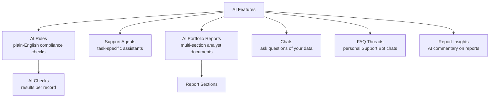
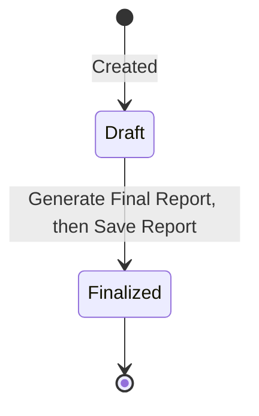

# AI Features User Guide

CapHive includes a suite of AI-powered features for automating compliance checks, generating portfolio reports, answering investor questions, and monitoring portfolio companies. This guide covers each one: AI Rules, Support Agents, AI Portfolio Reports, and Chats & FAQs.

> **Where to find it:** AI Rules and Checks are under the top-right [**Company menu → Compliance Rules**](/ai_rules) and [**Compliance Checks**](/ai_checks?filter=true) (needs Compliance enabled for your entity); Support Agents and LLM keys under [**Company menu → Agents**](/support_agents); [**Chats**](/chats) and [**AI Portfolio Reports**](/ai_portfolio_reports) have no menu link; the Support Bot via the robot icon in the top bar. Creating rules, agents and chats needs the **company_admin** role.

> For choosing the underlying AI model and entering API keys, see the **LLM Configuration Guide**.

---

## Table of Contents

1. [The AI Features at a Glance](#the-ai-features-at-a-glance)
2. [AI Rules](#ai-rules)
3. [AI Checks (Rule Results)](#ai-checks-rule-results)
4. [Support Agents](#support-agents)
5. [Scheduling and Monitoring Agents](#scheduling-and-monitoring-agents)
6. [AI Portfolio Reports](#ai-portfolio-reports)
7. [Report Sections](#report-sections)
8. [Investment Criteria Templates](#investment-criteria-templates)
9. [The Report Lifecycle](#the-report-lifecycle)
10. [Chats](#chats)
11. [FAQ Threads (Support Bot)](#faq-threads-support-bot)
12. [Report Insights](#report-insights)
13. [Worked Example](#worked-example)
14. [Frequently Asked Questions](#frequently-asked-questions)

---

## The AI Features at a Glance

| Term | Meaning |
|------|---------|
| **AI Rule** | A plain-English check you run against your records. |
| **AI Check** | The result of running a rule on one record. |
| **Support Agent** | An AI assistant configured for a specific task. |
| **AI Portfolio Report** | A multi-section analyst report on a portfolio company. |
| **Investment Criteria Template** | Your firm's scoring criteria for the Investment Fit section. |
| **Chat** | A conversation where you ask questions of your data. |
| **FAQ Thread** | A private conversation with the CapHive Support Bot. |

---

## AI Rules

**AI Rules** are automated checks that run against your records when you trigger a compliance check run. Each rule says what to check, which kind of record to check, and which schedule group it belongs to.

### Creating a rule

Go to [**Company menu → Compliance Rules → New Rule**](/ai_rules/new).

| Field | Notes |
|-------|-------|
| **Name** | A short name for the rule. |
| **Rule** | A plain-English description of the check (e.g. "Verify the tax ID matches the name on the KYC document"). |
| **Rule Type** | Compliance, Investor Relations, or Investment Analyst. Only **Compliance** rules are executed by a compliance check run. |
| **For** | The kind of record to check (see below). |
| **Schedule** | The schedule group the rule belongs to. |
| **Enabled** | Activate or deactivate. |
| **Tags** | Searchable labels. |

### What it can check

Rules can run against funds, capital commitments, distributions, capital calls/remittances, individual and non-individual KYC, portfolio investments, and aggregate portfolio positions.

### When it runs

Rules do not run on a timer. The **Schedule** is a grouping label you can pick when you run checks, so you can run, for example, all month-end rules together:

| Schedule | Typically run |
|----------|------|
| **End of Day** | Daily. |
| **End of Month** | At each month end. |
| **End of Quarter** | At the end of March, June, September, December. |
| **End of Year** | At the end of the financial year. |

To run rules, open a fund and choose **Actions → Run Compliance Check**, pick the record types, **Schedule** and **Rule type** (or leave them as **All**) and click **Run Checks Now**.

---

## AI Checks (Rule Results)

Each time a rule runs, it produces an **AI Check** for every matching record, storing the outcome and a result message, and linking back to both the rule and the record. Review them under [**Company menu → Compliance Checks**](/ai_checks?filter=true) to find records that failed a compliance or data-quality rule; failures can feed notifications or approval workflows.

---

## Support Agents

**Support Agents** are AI assistants set up for specific operational tasks. Each has a type that determines what it does; the [Support Agents User Guide](support_agents_user_guide) covers the full list.

### Creating an agent

Go to [**Company menu → Agents**](/support_agents), open the **New Support Agent** dropdown and pick the agent type. **Setup All Agents** on the same page creates the standard set in one go.

| Field | Notes |
|-------|-------|
| **Name** | A display name. |
| **Agent Type** | Chosen from the **New Support Agent** dropdown, e.g. one of the types below. |
| **Enabled** | Active or inactive. The agent can only run once CapHive has also enabled that agent type for your entity. |
| **AI Model** | Which AI model to use. Required; only models from providers with a saved key are listed. |
| **Enable Chat Assistant** | Whether this agent offers a conversational chat. |

### Agent types

| Agent | What it does |
|-------|--------------|
| **KYC Onboarding** | Checks KYC completeness and compares uploaded documents against the form data. |
| **Portfolio Company** | Analyses a company's data, KPIs, and news. |
| **Fund Stats** | Computes and interprets fund-level statistics. |
| **Portfolio Report** | Helps draft portfolio report sections. |
| **Call Notice** | Assists with generating and reviewing capital-call notices. |
| **Cash Flow Assistant** | Analyses and interprets fund cashflow data. |

---

## Scheduling and Monitoring Agents

Each agent can run automatically on a schedule. Open the agent from **Company menu → Agents**, set this up on its **Schedule** tab and click **Save Schedule**.

Every run is recorded in an **execution log** with its trigger (manual or scheduled), start/end times, status, and the result or error — view these on the agent's **Execution History** tab to monitor health and troubleshoot. For chat-enabled agents, conversation history is also kept.

---

## AI Portfolio Reports

An **AI Portfolio Report** is a structured, multi-section analyst document on a portfolio company. It blends your internal data (KPIs, financials, valuations) with current information from the web to produce a thorough due-diligence or monitoring report.

### Creating a report

Open [**AI Portfolio Reports**](/ai_portfolio_reports) (there is no menu link) and click **New Report**.

| Field | Notes |
|-------|-------|
| **Portfolio Company** | The company the report covers. |
| **Report date** | The date the report is prepared for. |
| **Investment Criteria Template** | **Use existing template** or **Create new template** for the Investment Fit section. |

Click **Create Report**. The report starts in **Draft** with you as the analyst, and all the standard sections are created automatically; open each section and use **Regenerate with AI** to generate its content.

---

## Report Sections

A report includes a set of sections. Some pull in current external information from the web, and some can auto-generate charts from your data.

| Section | Uses web search | Can include charts |
|---------|:--------------:|:------------------:|
| Investment Fit Evaluation | | |
| Company Overview | ✓ | |
| Key Products & Services | ✓ | ✓ |
| Financial Snapshot | | ✓ |
| Market Size & Target | ✓ | ✓ |
| Recent Updates & Developments | ✓ | |
| Custom Charts | | |
| Founders & Shareholders | ✓ | ✓ |
| Raise History, Valuations & Funding Trend | ✓ | ✓ |
| SWOT Analysis | ✓ | |
| Competition Analysis | ✓ | |
| Key Risks | ✓ | |
| Operational Red Flags | ✓ | |
| Negative News | ✓ | |
| AML/KYB Check | | |
| Investment Ask | | ✓ |

Each section has its own status and can be generated or regenerated independently, so you can refine the report section by section before finalising.

---

## Investment Criteria Templates

An **Investment Criteria Template** captures your firm's investment thesis as scoring criteria used in the **Investment Fit Evaluation** section, so every report is assessed consistently.

Open [**Investment Criteria Templates**](/investment_criteria_templates) (no menu link), or choose **Create new template** on the **New Report** form. Give it a **Template Name** and fill in the **Evaluation Criteria** as name and value pairs (e.g. "Team & Leadership" — "Founder experience >10 years"), then attach the template when creating a report.

---

## The Report Lifecycle

- **Draft** — the analyst generates and edits sections.
- **Finalized** — set when you click **Save Report** on the collated report; **Edit** is disabled and the saved text is used for PDF and Word export. There is no action to send a finalized report back to draft.

---

## Chats

**Chats** let you ask questions of your organisation's data in plain language — funds, investors, KPIs, portfolio investments — and, for capable agents, search uploaded documents. The AI answers by querying your data with read-only tools.

Open [**Chats**](/chats) and click **New Chat** to start one; chats can also be opened in context, for example from a KPI report's details panel. Which topics are available depends on the AI model configured and the features enabled for your entity. See the **LLM Configuration Guide** for model setup.

---

## FAQ Threads (Support Bot)

**FAQ Threads** are your personal conversations with the CapHive **Support Bot**, which answers questions about using the platform. Click the robot icon (tooltip **Support Bot**) in the top bar to open [**Support Conversations**](/faq_threads) and click **New Chat** to start one. Threads are private to your login and are not shown to other users or to investors.

---

## Report Insights

**Report Insights** are AI-generated analyses of a report, highlighting anomalies, trends, or notable changes. Open Sidebar → [**Funds → Reports**](/reports), then click a report card's **AI Analysis** badge or open the report and use **AI Analyses → View Report Analyses**.

---

## Worked Example

Standing up automated KYC checks and a portfolio report:

1. **AI Rule:** create a Compliance rule "Confirm the tax ID on file matches the KYC document", applies to **Individual KYC**, schedule **End of Day**. Open the fund and choose **Actions → Run Compliance Check** to test — each KYC gets an **AI Check** with a pass/fail result you can review under **Compliance Checks**.
2. **AI Portfolio Report:** for *Helios Robotics*, create a report and attach your **Investment Criteria Template**. Generate the Company Overview and Competition sections (which pull in current web information), tidy the wording, then click **Generate Final Report** and **Save Report** to finalise it.
3. **Chat:** ask "Which of our portfolio companies grew revenue more than 30% last quarter?" and get an answer drawn from your KPI data.

---

## Frequently Asked Questions

### Navigation and getting there

**Where do I find AI Rules in CapHive?**
Click the house icon at the top right to open the **Company menu**, then choose [**Compliance Rules**](/ai_rules). The entry only appears when Compliance is enabled for your entity (`enable_compliance`); if it is missing, ask CapHive support to enable it. Only users with the **company_admin** role see rules in the list; other users see an empty page. See [AI Rules](#ai-rules).

**Where do I see AI Check results?**
[**Company menu → Compliance Checks**](/ai_checks?filter=true). Use **View Checklist** for a pass/fail summary, **View Details** for the full result messages, and **Download** for an Excel export. Any user of the entity with Compliance enabled can view checks. See [AI Checks (Rule Results)](#ai-checks-rule-results).

**Where do I find Support Agents?**
[**Company menu → Agents**](/support_agents). If the menu item is greyed out with a lock icon, no agents have been enabled for your entity yet; contact support. See [Support Agents](#support-agents) and the [Support Agents User Guide](support_agents_user_guide) for per-agent details.

**How do I open AI Portfolio Reports?**
There is no sidebar entry; open [**AI Portfolio Reports**](/ai_portfolio_reports) directly and click **New Report**. You can also start a report from a documents folder: Sidebar → [**Documents**](/documents), open a Portfolio Company's folder that already contains documents, and choose **Create AI Portfolio Report** from the folder's dropdown (needs the Portfolio Company agent enabled). See [AI Portfolio Reports](#ai-portfolio-reports).

**How do I get to Investment Criteria Templates?**
Open [**Investment Criteria Templates**](/investment_criteria_templates) (no menu link). You can also create a template inline while creating a report: on the **New Report** form choose **Create new template**, give it a **Template Name** and fill in the **Evaluation Criteria**. See [Investment Criteria Templates](#investment-criteria-templates).

**How do I open Chats?**
Open [**Chats**](/chats) and click [**New Chat**](/chats/new). Chats are also opened in context, for example from a KPI report's details panel, which pre-fills the record the chat is about. See [Chats](#chats).

**Where are the Fund Assistant and the other AI assistants?**
Sidebar → [**Funds → Funds**](/funds) has a [**Fund Assistant**](/assistants/assistant?assistant_type=FundAssistant) button above the fund list, and each fund page has its own **Fund Assistant** button next to **Actions**. Stakeholder (investor) pages and capital commitment pages have equivalent assistant buttons. A locked, greyed button means the assistant is not enabled for your entity; contact support.

**Where is the Support Bot (FAQ Threads)?**
Click the robot icon (tooltip **Support Bot**) in the top bar next to notifications; it opens [**Support Conversations**](/faq_threads) in a new tab, where **New Chat** starts a conversation. The icon only shows for fund entities where the support bot has been configured by CapHive. See [FAQ Threads (Support Bot)](#faq-threads-support-bot).

**Where do I find Report Insights?**
Sidebar → [**Funds → Reports**](/reports). On a report card click the **AI Analysis** badge, or open the report and use [**AI Analyses → View Report Analyses**](/report_insights?report_id=...). The button is locked when the Report Analysis agent is not enabled for your entity. See [Report Insights](#report-insights).

**Where are Agent Charts?**
Sidebar → [**Stakeholders → Agent Charts**](/agent_charts). This lists the charts generated by chat-enabled agents so you can download them as Excel.

**Where do I enter AI provider keys and pick the default model?**
[**Company menu → Agents**](/support_agents) → [**LLM Keys**](/support_agents/llm_keys) button. The page has a **Default LLM Model** dropdown and one **API Keys** card per provider with **Save Keys**. It is only shown to **company_admin** users. See the [LLM Configuration Guide](llm_configuration_guide).

### Creating, updating and managing

**How do I create an AI Rule?**
**Company menu → Compliance Rules** → [**New Rule**](/ai_rules/new). Fill in **For** (the record type), **Name**, **Rule Type**, the plain-English **Rule**, optional **Tags**, a **Schedule** bucket and tick **Enabled**, then **Save**. Requires the **company_admin** role. See [Creating a rule](#creating-a-rule).

**How do I edit or delete an AI Rule?**
Open the rule from the Compliance Rules list (**Show**) and use **Edit** or **Delete** on its page; **Edit** is also on each row of the list. Deleting a rule does not delete the AI Checks it already produced; they stay on the Compliance Checks page without a rule link.

**How do I run a rule now instead of waiting for the schedule?**
Open a fund (Sidebar → **Funds → Funds**, then the fund) and choose [**Actions → Run Compliance Check**](/ai_checks/run_checks?parent_type=Fund&parent_id=...). The **Run Checks** form lets you pick which record types (**For classes**), which **Schedule** bucket and which **Rule type** to run; leave them as **All** to run everything, then click **Run Checks Now**. The same **Run Compliance Check** button appears at the top of the Checks list when it is opened for a specific record.

**Do AI Rules run automatically on their schedule?**
No. The **Schedule** on a rule (End of Day, End of Month, End of Quarter, End of Year) is a grouping label, not a timer: CapHive has no background job that runs compliance rules on its own. Use **Run Compliance Check** and choose the matching **Schedule** bucket to run that group whenever you want (for example at month end).

**Which rule types actually run?**
Only rules with **Rule Type = Compliance** are executed. **Investor Relations** and **Investment Analyst** rules can be saved and listed but are skipped when checks are run, so choose Compliance for any rule you want results from.

**What permission do I need to manage rules and checks?**
Viewing rules and checks requires Compliance to be enabled for your entity. Creating, editing and deleting rules requires the **company_admin** role; ask your entity administrator to grant it under [**Company menu → User**](/users). Running checks needs Compliance enabled and access to the fund or record.

**How do I create a Support Agent?**
**Company menu → Agents** → **New Support Agent** and pick the agent type from the dropdown. Give it a **Name**, **Description**, **Category**, tick **Enabled**, optionally **Enable on Demand Run** and **Enable Chat Assistant**, choose an **AI Model**, and **Save**. **Setup All Agents** on the same page creates the standard set in one go. Creating or editing agents requires the **company_admin** role. See [Creating an agent](#creating-an-agent).

**How do I edit, run or delete a Support Agent?**
Open the agent from the Agents page. The **General** tab has **Edit**, **Run Now** and **Delete**; the **Schedule** tab sets automatic runs (**Save Schedule**); the **Execution History** tab lists every run. See [Scheduling and Monitoring Agents](#scheduling-and-monitoring-agents).

**How do I create an AI Portfolio Report?**
[**AI Portfolio Reports**](/ai_portfolio_reports) → **New Report**. Choose the **Portfolio Company** and **Report date**, then either **Use existing template** or **Create new template** for the Investment Fit criteria, and click **Create Report**. All standard sections are created for you; open the report and use **Regenerate with AI** on each section as needed. See [Creating a report](#creating-a-report).

**How do I edit, finalise or delete an AI Portfolio Report?**
On the reports list each row has **Open** (the collated report, enabled once the report is no longer Draft), **Edit** (opens the section editor, disabled once Finalized) and **Delete**. To finalise, click **Generate Final Report** on the report page, review the collated text and click **Save Report**. See [The Report Lifecycle](#the-report-lifecycle).

**How do I export an AI Portfolio Report?**
Open the collated report (**Open** on the list, or **Generate Final Report** on the report page) and use the export menu to download it as **PDF** or **Word**.

**How do I create, edit or delete a Chat?**
[**Chats**](/chats) → **New Chat**, give it a name and start asking. Chats can be created, renamed and deleted only by users with the **company_admin** role; other users can open and read only the chats they created themselves. See [Chats](#chats).

**Can I bulk import or export AI Rules?**
There is no import. The Compliance Rules page has a **Download** button that exports the rules list to Excel; the Checks page also has **Download** for the results.

### Why it matters and what you can do with it

**Why should I use AI Rules and Checks?**
They turn one-off manual reviews into repeatable, auditable checks: every KYC, commitment, call, distribution and portfolio investment is tested against the same plain-English rules, and each result is stored as an AI Check that links back to the rule and the record with the data the AI looked at. That gives you an evidence trail for compliance reviews and catches data-quality problems before they reach investors.

**What do Support Agents let me do?**
Each agent automates one operational job, such as checking KYC completeness, monitoring portfolio companies, computing fund statistics, or reviewing call notices, and can run on a schedule or on demand. Chat-enabled agents also let you ask questions in plain language, and their answers are grounded in your entity's data.

**What happens if I don't set up an LLM key?**
Agents, chats and portfolio reports need an AI provider key. Without one the **AI Model** dropdown on the agent form is empty (so an agent cannot be saved, because a model is required), the agent pages show a configuration warning and runs fail. Set keys under [**Company menu → Agents → LLM Keys**](/support_agents/llm_keys); see the [LLM Configuration Guide](llm_configuration_guide).

**What happens if I skip AI checks and review manually?**
Nothing breaks, but there is no stored evidence that a record was reviewed, reviews are only as consistent as the person doing them, and problems surface only when someone happens to look. Running the checks before a close, a call or a distribution gives you a written pass/fail with an explanation for every record in one pass.

**Who typically uses these features?**
Compliance and operations staff use AI Rules and Checks; fund managers and analysts use Support Agents, Chats and Portfolio Reports; investor-relations teams use Report Insights to add commentary to investor reports. All require a fund-manager (employee) login; setup actions need the **company_admin** role.

### What happens when I…

**What happens when I save a new AI Rule?**
The rule is stored for your entity and appears in the Compliance Rules list and its Excel download. Nothing runs and no one is notified; checks are only produced when someone triggers **Run Compliance Check**. Disabled rules are skipped by every run.

**What happens when I click Run Compliance Check on a fund?**
A background job walks the fund and every record type you selected (commitments, remittances, distributions, KYCs, portfolio investments), and for each record runs every enabled Compliance rule for that record type (filtered by the Schedule bucket if you chose one). Each rule/record pair produces one **AI Check** with a yes/no status, an explanation and an audit log of the data used. You see progress and "checks completed" toasts in-app; no emails are sent and no other user is notified.

**What happens if a rule errors while running?**
The run retries that rule up to three times, shows an error toast to the user who triggered the run, and moves on to the next rule; no AI Check is written for a rule that fails all three attempts. Fix the rule wording or the record and run again.

**What happens when I delete an AI Rule or an AI Check?**
Deleting a rule removes it permanently; its existing checks remain on the Compliance Checks page, now with no rule link. Deleting a check removes that single result permanently; re-run the checks to regenerate it. Neither action notifies anyone and neither can be undone.

**What happens when I create a Support Agent (or use Setup All Agents)?**
The agent record is stored and appears on the Agents page under its **Category**, with a **Disabled** badge if CapHive has not enabled that agent type for your entity. **Setup All Agents** creates the standard agents that are missing and never overwrites the settings of ones you already have. No run happens and no one is notified.

**What happens when I click Run Now on an agent?**
A run is queued in the background and an execution log is written with trigger type "manual"; it appears in the agent's **Execution History** tab with status, duration and a summary. You get in-app toasts as it progresses; if it fails or partially succeeds you also receive an email, and CapHive support is alerted internally. Any reports the agent produces appear on the agent's report tabs (for example **Fund Reports** or **Portfolio Reports**).

**What happens when I save a Schedule on an agent?**
A schedule record is stored with its frequency, run time and timezone. A poller runs every 10 minutes and, when the next run time has passed, writes an execution log with trigger type "scheduled" and starts the run; retries follow your **Retry on Failure** and **Retry Interval** settings. The **Notification Recipients** receive an email and an in-app notification for each outcome you ticked under **Notify When**; if no recipients are chosen, no one is notified.

**What happens when I delete a Support Agent?**
The agent and its schedule are removed permanently and its card disappears from the Agents page; deletion is refused once the agent has reports, execution logs or chat sessions. No one is notified and it cannot be undone; to pause an agent, untick **Enable scheduled runs for this agent** on its **Schedule** tab.

**What happens when I create an AI Portfolio Report?**
A report in **Draft** status is created for the chosen portfolio company with you as the analyst, and all standard sections are created empty with web search off. No content is generated until you open a section and click **Regenerate with AI** (or **Regenerate with web search**), and no one is notified.

**What happens when I click Save Report on the collated report?**
The collated text is stored and the report's status becomes **Finalized**. On the reports list **Edit** is then disabled and **Open** shows the collated version; PDF and Word export use the saved text. No notification is sent.

**What happens when I delete an AI Portfolio Report?**
The report and all of its sections and generated charts are removed permanently after you confirm; there is no undo. Documents in the company's folder are not affected.

**What happens when I send a message in a Chat?**
Your message is saved on the chat and a background job streams the AI answer back into the page; the model may call tools to query your funds, stakeholders, KPIs and documents before answering. Only you (and company admins, who can see every chat in the entity) can read the conversation; no notification is sent.

**What happens when I start a Support Bot conversation?**
**New Chat** creates a personal thread for you under **Support Conversations**; each message is answered by the CapHive support assistant in the background. Threads are private to your login and are not visible to other users or to investors.

**What happens when I click Generate Analysis on a report?**
A **Report Insight** record is created for the report and a background job writes the AI commentary into it; you get an in-app alert when it is ready and can read it under **AI Analyses → View Report Analyses**. If the report has notifications switched on, a "Key Insights" summary email is also sent to the report's recipients and CC list; otherwise no email goes out.

### Existing questions and troubleshooting

**How do I choose which AI model the features use?**
Each agent can have its own **AI Model**; anything without one uses the entity's **Default LLM Model**, set on [**Company menu → Agents → LLM Keys**](/support_agents/llm_keys). See the [LLM Configuration Guide](llm_configuration_guide).

**Can I run an AI Rule without waiting for its schedule?**
Yes, and this is the only way rules run. Use **Actions → Run Compliance Check** on a fund page, or the **Run Compliance Check** button on a record's Checks list, to run the matching rules immediately.

**How many sections does an AI Portfolio Report have?**
The full standard set listed in [Report Sections](#report-sections) is created automatically; generate each independently and edit before finalising.

**Can I customise the Investment Fit checks?**
Yes. Create an [Investment Criteria Template](/investment_criteria_templates) (or one inline on the New Report form) and attach it to the report.

**What data can Chat use?**
Your structured data (funds, stakeholders, KPIs, investments) and, for enabled agents, uploaded documents.

**Can investors see Chats and FAQ Threads?**
No. Chats and the [Support Bot conversations](/faq_threads) are internal to fund-manager users. Investors (stakeholders) can only interact with an AI agent if an **LP Assistant** agent is enabled for your entity and they have approved investor access; that chat appears on their portal dashboard.

**How do I stop a rule from being included in runs?**
Open the rule, click **Edit** and untick **Enabled**. Disabled rules are skipped by every **Run Compliance Check**; existing checks are kept.

**I can't see Compliance Rules or Compliance Checks in the Company menu.**
The entries only appear when Compliance is enabled for your entity. Contact CapHive support to enable it.

**The Compliance Rules page is empty although rules exist.**
The rules list is only populated for users with the **company_admin** role; other roles see an empty list even though the checks page works. Ask an administrator to grant the role, or to manage the rules for you.

**The Agents entry in the Company menu is greyed out.**
No agent type is enabled for your entity yet; agents are licensed per entity by CapHive. Contact CapHive support to enable the agents you need, after which a company admin can use **Setup All Agents**.

**Run Now is greyed out on an agent.**
That agent type is not enabled for your entity, and the **General** tab shows a red **Disabled** badge. Only CapHive support can enable it, so contact them.

**I cannot save an agent because the AI Model list is empty.**
No provider key is configured yet. Go to **LLM Keys**, paste at least one provider key and click **Save Keys**; the models for that provider then appear in the **AI Model** dropdown.

**A check failed. What do I do with it?**
Open the check from **Compliance Checks** to read the result message, fix the underlying record (for example the KYC document or commitment), then re-run the check with **Run Compliance Check**. Failed checks can also be routed into approval workflows; see the [Approvals User Guide](approvals_user_guide).

**Can I undo a finalized report?**
Not from the screen: there is no "send back to draft" action, and the list disables **Edit** once a report is Finalized. You can still export it, or delete it and create a new report for the same company. An **In Review** status exists on the record but is not used by the current screens.

**Who gets notified when an agent run fails?**
For scheduled runs, the users chosen under **Notification Recipients** on the agent's **Schedule** tab, provided **Notify on failure** is ticked (email plus in-app notification). For manual **Run Now** runs, the user who clicked the button is emailed. In both cases CapHive support receives an internal alert, and every run is visible in the **Execution History** tab.

**Why does the Support Bot icon not appear for me?**
It only shows for users whose entity is a fund and only after CapHive has configured the support assistant for the installation. Investor logins never see it. Use **Company menu → User Guides** or contact support instead.

## Related Guides

- [Support Agents](support_agents_user_guide) — per-agent setup, schedules, execution logs and notifications.
- [LLM Configuration Guide](llm_configuration_guide) — entering provider keys and choosing the default model.
- [Customer Support Agent](customer_support_agent_user_guide) — the in-app chat assistant that answers from the user guides.
- [Agent Charts](agent_charts_user_guide) — charts produced by chat-enabled agents and how to export them.
- [Approvals](approvals_user_guide) — routing failed compliance checks into approval workflows.
- [Investor KYC](investor_kyc_user_guide) — the KYC records that compliance rules and the KYC agents check.
- [Report Builder](report_builder_user_guide) — the reports that Report Insights add AI commentary to.
- [Connect Claude via MCP](mcp_server/user_guide_mcp_connect_claude) — querying the same data from an external AI client.
