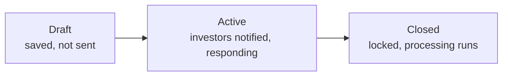
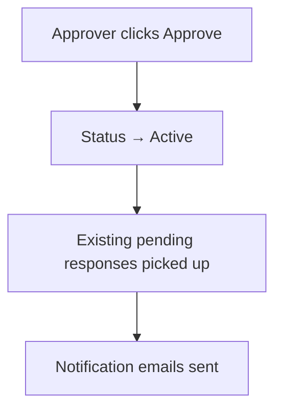
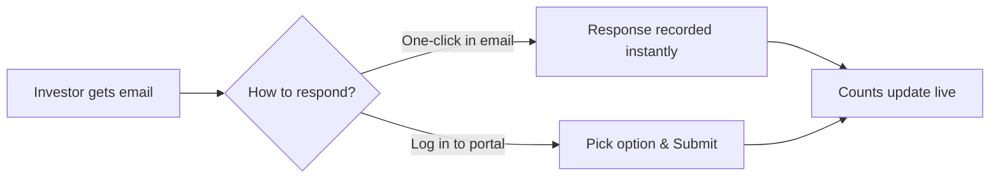

# Approvals User Guide

The **Approvals** system gives you a structured way to collect consent or decisions from investors — drawdown consents, amendment votes, policy sign-offs, and the like. You create an approval request, set a deadline and the response options, then activate it to notify investors. They respond from the portal or with one click from the email (no login needed), and you watch the responses come in live.

> **Where to find it:** Sidebar → [**Stakeholders → Approvals**](/approvals), then [**New Approval**](/approvals/new); for a fund-linked approval use the fund page's **Actions → Fund Approval**. Needs the *Approvals* permission (`enable_approvals`) on both your company and your login, and only users with the **Approver** role can activate (**Approve**) an approval.

This guide covers the whole flow for fund managers, plus what the investor sees.

---

## Table of Contents

1. [What an Approval Is](#what-an-approval-is)
2. [Who Does What (Roles)](#who-does-what-roles)
3. [The Approval Lifecycle](#the-approval-lifecycle)
4. [Creating an Approval](#creating-an-approval)
5. [Tracking Responses](#tracking-responses)
6. [Sending Reminders](#sending-reminders)
7. [Closing an Approval](#closing-an-approval)
8. [What the Investor Sees](#what-the-investor-sees)
9. [Email Notifications](#email-notifications)
10. [Linking an Approval to a Fund or Deal](#linking-an-approval-to-a-fund-or-deal)
11. [Custom Fields](#custom-fields)
12. [Worked Example](#worked-example)
13. [Frequently Asked Questions](#frequently-asked-questions)

---

## What an Approval Is

An approval is a request for a yes/no (or multi-option) decision from a set of investors, with a deadline and a full audit trail of who responded, how, and when. It's the right tool whenever you need documented investor consent.

---

## Who Does What (Roles)

| Role | What they can do |
|------|------------------|
| **Fund Admin** | Create, edit, and delete approvals; manage access and documents; close approvals; send reminders. |
| **Approver** | Everything a fund admin can do, **plus** activate (approve) an approval to send it out. |
| **Investor** | View approvals shared with them and submit or update their response before the deadline. |

> The Approvals feature must be enabled for your account. If you don't see the menu, ask your administrator.

---

## The Approval Lifecycle

| State | What it means |
|-------|---------------|
| **Draft** | Saved but not yet sent. Pending responses already exist for investors with access, but nobody is notified. Editable until the due date. |
| **Active** | Activated by an Approver. Investors are notified and can respond. Still editable until closed or the deadline passes. |
| **Closed** | Locked — no further changes or responses. Any follow-on processing runs (e.g. writing approved amounts onto a fund's commitments). Close is only possible on or before the due date. |

---

## Creating an Approval

The approval page guides you through six steps: **Set up → Add access → Add documents → Activate → Track responses → Send reminders.**

### Step 1 — Set up

Go to **Approvals → New Approval** and complete:

| Field | Required | What it does |
|-------|----------|--------------|
| **Title** | Yes | The request name (e.g. "Q1 2026 Drawdown Consent"). |
| **Due Date** | Yes | The deadline for responses (defaults to 7 days out). From the day after, portal responses, edits, activation, reminders and **Close** are all blocked. |
| **Response Status** | Yes | The choices investors see, comma-separated. Default `Approved,Pending,Rejected` — customise freely (e.g. `Yes,No,Abstain`). |
| **Details** | No | The body of the request — terms, instructions, reference text. |
| **Show KYCs in Approval** | No | Displays the investor's KYC details (name, ID) in the email and response page, to confirm identity at the point of consent. |
| **Enable response links in email** | No | Adds one-click response buttons to the email so investors can respond without logging in. The links are securely signed and expire 7 days after the email is sent; they do not check the due date or whether the approval is closed. |

Save — the approval is now in **Draft**. In the background a pending response is created for every stakeholder who already has access (one per commitment for a fund-linked approval).

### Step 2 — Add access

Access controls who can see and respond. On the **Access Rights** tab, grant access to a stakeholder (investor), a stakeholder category or stakeholders with a tag (a category or tag is expanded into one access right per stakeholder at that moment). Each new access right creates a pending response for every newly covered stakeholder. An approval created from a fund (**Actions → Fund Approval**) copies the fund's access rights once, when it is created; investors added to the fund later are **not** picked up — add them on the approval's own **Access Rights** tab.

### Step 3 — Add documents

On the **Documents** tab, upload supporting files (offering memoranda, consent forms). These are attached to the notification email, with optional password protection.

### Step 4 — Activate

When ready, an **Approver** clicks **Approve**. You'll be reminded to confirm investors are in the access list. On confirmation, the approval becomes **Active** and notification emails go out to every stakeholder with a pending response (the responses were already created when the approval was saved and access was granted). Stakeholders given access after activation get a pending response and the email straight away.

> Activation requires the **Approver** role — a standard admin role can't activate.

---

## Tracking Responses

The **Responses** tab shows:

- **Summary cards** per option (e.g. Approved: 12, Pending: 5, Rejected: 2, All: 19). Click a card to filter.
- A **response table** with investor name, tags, who responded, a colour-coded status badge, and the last-updated time.
- Per-row actions: **Show**, **Edit** (when editable), and a **Quick Response** option.

Response counts update automatically as investors reply. Click **Download** on this tab to export the responses to Excel.

---

## Sending Reminders

If some investors haven't responded and the deadline hasn't passed, click **Send Reminder** and confirm. A fresh reminder email is sent to everyone still pending. Reminders are available only while the approval is **Active** and before the due date.

---

## Closing an Approval

Click **Close** and confirm. **Close** is available only up to and including the due date, so close the approval on or before that day. The approval is **locked** — no edits, no new responses. If it's linked to a fund, the follow-on processing runs automatically: each response's `approved_amount` custom field is written onto the investor's existing commitment (it does not create commitments).

> A closed approval can't be reopened — create a new one if you need more responses.

---

## What the Investor Sees

Investors see only approvals shared with them (and for which they have approved portal access).

**In the portal:** open **Approvals**, click one to see its title, deadline, description, KYC details (if enabled), and a form to submit or update their response. They pick a non-pending option and click **Submit**; the response is stamped with the time and their name. They can change it from the portal until the due date.

**From the email (no login):** if response links are enabled, the email has one-click buttons for each option. Clicking one records the response instantly and shows a confirmation page. The link is signed and expires 7 days after the email was sent; it does not check the due date or whether the approval is closed, and it still works if the email is forwarded (the response is recorded for the original recipient).

---

## Email Notifications

| When | Goes to |
|------|---------|
| Approval activated | All investors with a pending response. |
| Reminder sent | Investors still pending. |
| Investor responds | The investor (a confirmation of their recorded choice). |

Each approval can use a **custom notification template** to override the subject and body, control whether the link and details show, and attach password-protected documents. Without a custom template, a standard email is sent with the title, description, KYC section (if enabled), response buttons (if enabled), and a "View Approval" button.

---

## Linking an Approval to a Fund or Deal

An approval can be tied to a **fund** by creating it from the fund page (**Actions → Fund Approval**). Deal-linked approvals are not supported — for a deal, create a standalone approval and grant access to the deal's stakeholders directly. When linked to a fund:

- Each response is associated with the investor's specific **folio** (commitment) in that fund, not just the investor.
- The fund's access list is copied onto the approval once, when it is created; investors added to the fund later must be added on the approval's **Access Rights** tab.
- On close, each response's approved amount is written onto the matching commitment, together with its share of the total approved amount.

---

## Custom Fields

Approvals and responses support **custom fields** set up at the organisation level, letting you capture extra structured data on the form — for example "Committed Amount" or "Investment Vehicle".

---

## Worked Example

You need drawdown consent from a fund's investors:

1. **Set up:** create "Q1 2026 Drawdown Consent", due in 10 days, options `Approved, Rejected`, with **Show KYC** and **response links in email** both on.
2. **Add access:** create it from the fund page (**Actions → Fund Approval**) — the fund's access rights are copied in and a pending response is created per commitment.
3. **Add documents:** attach the drawdown notice.
4. **Activate:** the Approver clicks **Approve** — every investor gets an email with one-click Approved / Rejected buttons.
5. **Track:** the Responses tab fills in live — Approved 14, Pending 4, Rejected 1.
6. **Remind:** two days before the deadline, click **Send Reminder** for the 4 still pending.
7. **Close:** on the due date itself — the last day **Close** is available — click **Close**. Because it's linked to the fund, each investor's approved amount is written onto their existing commitment automatically. (If you wait until the day after the deadline, the approval can no longer be closed.)

---

## Frequently Asked Questions

### Navigation and getting there

**Where do I find Approvals in CapHive?**
Sidebar → [**Stakeholders → Approvals**](/approvals). The page lists every approval of your company, newest first; click one to open its page with the **Responses**, **Documents**, **Access Rights**, **Notification** and (for company admins with workflow templates) **Workflow** tabs.

**How do I create an approval for a fund's investors?**
Sidebar → [**Funds → Funds**](/funds), open the fund, then **Actions → Fund Approval**. This opens the new-approval form already linked to the fund, so the fund's access list is copied onto the approval and one response is created per commitment (folio). See [Linking an Approval to a Fund or Deal](#linking-an-approval-to-a-fund-or-deal).

**Where do investors find approvals?**
Investors see [**Approvals**](/approvals) in their own sidebar once an approval is shared with them and their Investor Access is approved. Clicking one shows the title, **Due By** date, details, any documents and a response form. See [What the Investor Sees](#what-the-investor-sees).

**I can't see Approvals in the sidebar. Why?**
The menu item appears only when the *Approvals* permission (`enable_approvals`) is on for your company and on your own login. Ask your company administrator to switch it on for your user (Company menu → [**User / Company Employees**](/users)), or CapHive support to enable it for the company.

**How do I get the Approver role?**
A company admin opens Company menu → [**User / Company Employees**](/users), edits your user and adds **approver** in the **Roles** field. Without it you can create, edit, close and remind, but the **Approve** button does not appear. See [Who Does What (Roles)](#who-does-what-roles).

### Creating, updating and managing approvals

**How do I create an approval?**
On the [**Approvals**](/approvals) page click **New Approval**, fill in **Title**, **Due Date** (defaults to 7 days out), **Response Status** (the comma-separated options, default `Approved,Pending,Rejected`), any custom fields and **Details**, tick **Show KYCs in Approval** or **Enable response links in email** if wanted, and save. The approval starts as a draft. See [Creating an Approval](#creating-an-approval).

**How do I choose which investors receive the approval?**
Open the approval → **Access Rights** tab and grant access to a stakeholder (investor), a stakeholder category or stakeholders with a tag. A category or tag is expanded into one access right per stakeholder at that moment. For a fund-linked approval the fund's access rights are copied in automatically when the approval is created.

**How do I attach documents to an approval?**
Open the approval → **Documents** tab and upload the files. Every document on the approval is attached to the activation and reminder emails, password-protected if the approval's custom notification asks for it.

**How do I activate (send) an approval?**
A user with the **Approver** role opens the approval and clicks **Approve**, then confirms the prompt "Please check that investors are added to access rights before approving". The button only shows before the due date, while the approval is not closed and not yet approved. See [Step 4 — Activate](#step-4--activate).

**How do I edit an approval?**
Open it and click **Edit**. Editing is allowed only until the due date passes and before the approval is closed; after that the **Edit**, **Delete**, **Access Rights** and **Notification** controls disappear.

**How do I record a response on behalf of an investor?**
On the **Responses** tab click **Edit** on the investor's row and choose an option other than Pending, or use **New Approval Response** to add a response for a stakeholder who has none. Both are allowed only until the due date. The response is saved with your name as the responder.

**How do I send a reminder?**
Open an activated approval and click **Send Reminder**, then confirm. The button only shows once the approval has been approved and before the due date. See [Sending Reminders](#sending-reminders).

**How do I close an approval?**
Open it and click **Close**, then confirm. **Close** is available only up to and including the due date, so close it on or before that day. See [Closing an Approval](#closing-an-approval).

**How do I delete an approval?**
Open it and click **Delete**, then confirm. Deletion is allowed only before the due date passes and before the approval is closed.

**How do I export responses?**
On the **Responses** tab click **Download** to get an Excel file with one row per response: investor, category, tags, contact name, email and phone, status, updated date, KYC count and any response custom fields.

**How do I customise the approval email?**
Open the approval → **Notification** tab and create a custom notification. It overrides the subject and body of the activation, reminder or response email, and can password-protect the attached documents. Without one, the standard email is used. See [Email Notifications](#email-notifications).

### Why use approvals

**Why should I use Approvals rather than collecting consent by email?**
Every investor's decision is stored against the approval with who responded and when, you see live counts per option, reminders go only to those still pending, and closing a fund approval writes approved amounts onto the commitments. Email replies give you none of that and leave no structured audit trail.

**What can I use an approval for?**
Any documented decision from a set of stakeholders: drawdown or amendment consents, LPAC votes, policy or side-letter sign-offs, extension requests. Options are free text, so `Yes,No,Abstain` or `Consent,Object` work as well as the default.

**Who typically uses Approvals?**
Fund operations and investor-relations teams create approvals and manage access and documents, a designated **Approver** (often a partner or compliance officer) releases them, and stakeholders (investors) respond from the portal or the email. Company admins assign workflow templates when an internal review is needed first.

**What happens if I don't add access rights before activating?**
No responses exist, so **Approve** sends nothing. You can still add access afterwards (before the due date): each new stakeholder gets a pending response and, because the approval is already active, an email straight away.

### What happens when I …

**What happens when I save a new approval?**
The approval is created as a draft (not approved) with its own documents folder. In the background, a fund-linked approval copies the fund's access rights, and a pending response is created for every stakeholder with access (one per commitment for a fund). No one is notified yet.

**What happens when I add access rights to an approval?**
Each access right triggers response generation: a pending response is created for every newly covered stakeholder who has none. If the approval is already approved, those stakeholders' users (approved Investor Access, subscribed to "Approval" or to all topics) get an in-app notification and an email "Approval required: <title>" at once.

**What happens when an Approver clicks Approve?**
The approval is marked approved (active) and a background job sends every stakeholder with a pending response an in-app notification and an email "Approval required: <title>", with the approval's documents attached and one-click response links if enabled. Each response is flagged as notified so it is not emailed twice. There is no un-approve.

**What happens when I click Send Reminder?**
All pending responses are reset to "not notified" and a background job emails their stakeholders' users "Reminder For Approval required: <title>" with the documents attached, plus an in-app notification. Investors who already responded are not contacted.

**What happens when an investor responds?**
The response is saved with the chosen status, the responder and the time, the option counts on the **Responses** tab update, and the investor's users get a confirmation notification and email "<status> for <title>". They can change it again until the due date. Pending cannot be chosen as a response.

**What happens when I close an approval?**
The approval is locked, so it can no longer be edited, deleted, approved or reminded, and its **Access Rights** and **Notification** tabs are hidden. For a fund-linked approval, each response's `approved_amount` custom field is written onto the matching commitment together with its share of the total approved amount. No one is notified, and it cannot be reopened.

**What happens when I delete an approval?**
The approval and its responses are soft-deleted and disappear from the [**Approvals**](/approvals) list for you and your investors. No one is notified. There is no restore screen, so ask CapHive support if it was deleted by mistake.

**What happens when the due date passes?**
Nothing is sent automatically. From the next day the approval can no longer be edited, deleted, approved, closed or reminded, and investors can no longer submit or change a response from the portal. Close fund approvals on or before the due date so the approved amounts are recorded.

### Troubleshooting and edge cases

**Why can't I see the "Approve" button?**
Activating needs the **Approver** role (see "How do I get the Approver role?"). The button is also hidden once the approval is already approved, after it is closed, or after the due date has passed.

**Can an investor change their response after submitting?**
Yes, from the portal until the due date. After the due date the response form is no longer available to them.

**I added an investor after activating — do they get included?**
Yes. Granting them access on the **Access Rights** tab creates a pending response for them and, because the approval is already active, emails them immediately.

**Does an investor added to the fund later get the fund approval automatically?**
No. The fund's access rights are copied onto the approval only when it is created. Add the new stakeholder on the approval's own **Access Rights** tab; they then get a response per commitment and, if the approval is active, the email.

**Can I reopen a closed approval?**
No. Closed approvals are locked — create a new one if needed.

**The due date passed before I closed the approval. Can I extend it?**
No. Editing is blocked once the due date has passed, so the due date cannot be moved and the approval cannot be closed. Create a new approval with a later due date and the same access and documents.

**The email link says "Invalid link" — why?**
One-click links expire 7 days after the email was sent, and the link only works for a registered CapHive user with the email address it was sent to. Ask the investor to respond from the portal, or send a reminder to issue fresh links.

**Do one-click email links respect the due date and Close?**
No. The link records the response without logging in and does not check the due date or whether the approval is closed; it only has to be less than 7 days old. Keep due dates at least a week after the last reminder, or turn off **Enable response links in email** when the timing is strict.

**Can I link an approval to a deal?**
Not from the UI. Only the fund page has an approval link (**Fund Approval**), and only funds implement the per-folio responses and close processing. For a deal, create a standalone approval and grant access to the deal's stakeholders directly.

**What are the default response options?**
`Approved, Pending, Rejected` — customise to any comma-separated labels you need (e.g. `Yes, No, Abstain`). Pending is the starting state and never appears as a one-click email button.

**Which investor users receive the approval email?**
Users of each stakeholder with an approved Investor Access whose access either has no notification tags or includes the "Approval" tag. Users without approved access get nothing.

**Can I require an internal review before an approval goes out?**
Yes, if your company has *Workflow Templates* enabled: company admins see a **Workflow** tab on the approval page where a workflow template can be assigned. See [Workflow Templates](workflow_templates_user_guide).

## Related Guides

- [Investor Access](investor_access_tutorial) — approved access is what lets investor users receive and answer approvals.
- [Stakeholders (Investors)](investors_user_guide) — categories and tags you grant approval access to.
- [Capital Commitments](capital_commitments_user_guide) — where a closed fund approval's approved amounts are stored.
- [Custom Fields](custom_fields_user_guide) — adding fields such as `approved_amount` to the approval response form.
- [User Roles](user_role_management_user_guide) — giving a user the Approver role.
- [Workflow Templates](workflow_templates_user_guide) — adding an internal review workflow to an approval.
- [Audit Trail](audit_trail_user_guide) — reviewing who changed an approval or a response.
