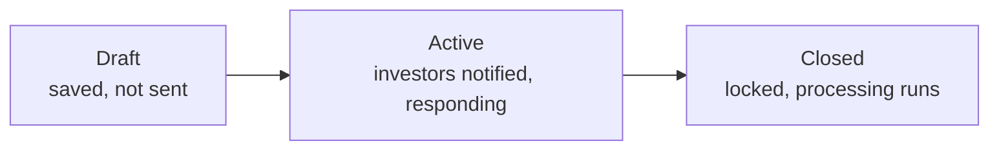
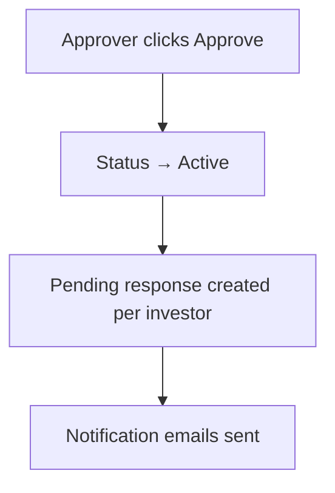
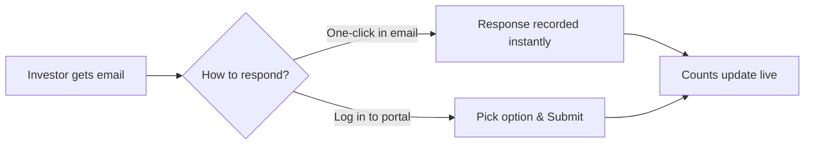

# Approvals User Guide

The **Approvals** system gives you a structured way to collect consent or decisions from investors — drawdown consents, amendment votes, policy sign-offs, and the like. You create an approval request, set a deadline and the response options, then activate it to notify investors. They respond from the portal or with one click from the email (no login needed), and you watch the responses come in live.

This guide covers the whole flow for fund managers, plus what the investor sees.

---

## Table of Contents

1. [What an Approval Is](#what-an-approval-is)
2. [Who Does What (Roles)](#who-does-what-roles)
3. [The Approval Lifecycle](#the-approval-lifecycle)
4. [Creating an Approval](#creating-an-approval)
5. [Tracking Responses](#tracking-responses)
6. [Sending Reminders](#sending-reminders)
7. [Closing an Approval](#closing-an-approval)
8. [What the Investor Sees](#what-the-investor-sees)
9. [Email Notifications](#email-notifications)
10. [Linking an Approval to a Fund or Deal](#linking-an-approval-to-a-fund-or-deal)
11. [Custom Fields](#custom-fields)
12. [Worked Example](#worked-example)
13. [Frequently Asked Questions](#frequently-asked-questions)

---

## What an Approval Is

An approval is a request for a yes/no (or multi-option) decision from a set of investors, with a deadline and a full audit trail of who responded, how, and when. It's the right tool whenever you need documented investor consent.

---

## Who Does What (Roles)

| Role | What they can do |
|------|------------------|
| **Fund Admin** | Create, edit, and delete approvals; manage access and documents; close approvals; send reminders. |
| **Approver** | Everything a fund admin can do, **plus** activate (approve) an approval to send it out. |
| **Investor** | View approvals shared with them and submit or update their response before the deadline. |

> The Approvals feature must be enabled for your account. If you don't see the menu, ask your administrator.

---

## The Approval Lifecycle

| State | What it means |
|-------|---------------|
| **Draft** | Saved but not yet sent. Investors aren't notified. Fully editable. |
| **Active** | Activated by an Approver. Investors are notified and can respond. Still editable until closed or the deadline passes. |
| **Closed** | Locked — no further changes or responses. Any follow-on processing runs (e.g. recording approved amounts on a fund). |

---

## Creating an Approval

The approval page guides you through six steps: **Set up → Add access → Add documents → Activate → Track responses → Send reminders.**

### Step 1 — Set up

Go to **Approvals → New Approval** and complete:

| Field | Required | What it does |
|-------|----------|--------------|
| **Title** | Yes | The request name (e.g. "Q1 2026 Drawdown Consent"). |
| **Due Date** | Yes | The deadline for responses (defaults to 7 days out). Responses and edits are blocked afterwards. |
| **Response Options** | Yes | The choices investors see, comma-separated. Default `Approved, Pending, Rejected` — customise freely (e.g. `Yes, No, Abstain`). |
| **Details** | No | The body of the request — terms, instructions, reference text. |
| **Show KYC in Approval** | No | Displays the investor's KYC details (name, ID) in the email and response page, to confirm identity at the point of consent. |
| **Enable response links in email** | No | Adds one-click response buttons to the email so investors can respond without logging in. The links are securely signed and expire in 7 days. |

Save — the approval is now in **Draft**.

### Step 2 — Add access

Access controls who can see and respond. On the **Access Rights** tab, add individual investors, investor groups, or link the approval to an owner (such as a fund) to inherit its access automatically. When linked to an owner, access is copied across on creation, and any investor added to that owner later automatically gets a response generated for them.

### Step 3 — Add documents

On the **Documents** tab, upload supporting files (offering memoranda, consent forms). These are attached to the notification email, with optional password protection.

### Step 4 — Activate

When ready, an **Approver** clicks **Approve**. You'll be reminded to confirm investors are in the access list. On confirmation, the approval becomes **Active**, a pending response is created for every investor with access, and notification emails go out.

> Activation requires the **Approver** role — a standard admin role can't activate.

---

## Tracking Responses

The **Responses** tab shows:

- **Summary cards** per option (e.g. Approved: 12, Pending: 5, Rejected: 2, All: 19). Click a card to filter.
- A **response table** with investor name, tags, who responded, a colour-coded status badge, and the last-updated time.
- Per-row actions: **Show**, **Edit** (when editable), and a **Quick Response** option.

Response counts update automatically as investors reply. You can export the responses to Excel from this tab.

---

## Sending Reminders

If some investors haven't responded and the deadline hasn't passed, click **Send Reminder** and confirm. A fresh reminder email is sent to everyone still pending. Reminders are available only while the approval is **Active** and before the due date.

---

## Closing an Approval

Click **Close** and confirm. The approval is **locked** — no edits, no new responses. If it's linked to an owner (such as a fund), the follow-on processing runs automatically; for example, a fund can read each investor's approved amount and record it as a commitment.

> A closed approval can't be reopened — create a new one if you need more responses.

---

## What the Investor Sees

Investors see only approvals shared with them (and for which they have approved portal access).

**In the portal:** open **Approvals**, click one to see its title, deadline, description, KYC details (if enabled), and a form to submit or update their response. They pick a non-pending option and click **Submit**; the response is stamped with the time and their name. They can change it any time before the deadline.

**From the email (no login):** if response links are enabled, the email has one-click buttons for each option. Clicking one records the response instantly and shows a confirmation page. The link is signed and expires in 7 days.

---

## Email Notifications

| When | Goes to |
|------|---------|
| Approval activated | All investors with a pending response. |
| Reminder sent | Investors still pending. |
| Investor responds | The investor (a confirmation of their recorded choice). |

Each approval can use a **custom notification template** to override the subject and body, control whether the link and details show, and attach password-protected documents. Without a custom template, a standard email is sent with the title, description, KYC section (if enabled), response buttons (if enabled), and a "View Approval" button.

---

## Linking an Approval to a Fund or Deal

An approval can be tied to an **owner** like a fund or deal. When linked:

- Each response is associated with the investor's specific **folio** in that fund or deal, not just the investor.
- The owner's access list is copied onto the approval automatically.
- On close, the owner's follow-on processing runs — e.g. a fund captures each investor's approved amount and records commitments.

---

## Custom Fields

Approvals and responses support **custom fields** set up at the organisation level, letting you capture extra structured data on the form — for example "Committed Amount" or "Investment Vehicle".

---

## Worked Example

You need drawdown consent from a fund's investors:

1. **Set up:** create "Q1 2026 Drawdown Consent", due in 10 days, options `Approved, Rejected`, with **Show KYC** and **response links in email** both on.
2. **Add access:** link the approval to the fund — all the fund's investors are pulled in automatically.
3. **Add documents:** attach the drawdown notice.
4. **Activate:** the Approver clicks **Approve** — every investor gets an email with one-click Approved / Rejected buttons.
5. **Track:** the Responses tab fills in live — Approved 14, Pending 4, Rejected 1.
6. **Remind:** two days before the deadline, click **Send Reminder** for the 4 still pending.
7. **Close:** after the deadline, click **Close**. Because it's linked to the fund, the approved amounts are recorded as commitments automatically.

---

## Frequently Asked Questions

**Why can't I see the "Approve" button?**
Activating needs the **Approver** role. Ask your administrator to grant it.

**Can an investor change their response after submitting?**
Yes, while the approval is Active and the deadline hasn't passed.

**I added an investor after activating — do they get included?**
Yes. A pending response is created for them automatically and they're emailed.

**Can I reopen a closed approval?**
No. Closed approvals are locked — create a new one if needed.

**The email link says "Invalid link" — why?**
Links expire after 7 days, and a forwarded email from a different address won't work. Ask the investor to respond from the portal, or resend a reminder.

**How do I export responses?**
Use the export option on the Responses tab to download an Excel file.

**What are the default response options?**
`Approved, Pending, Rejected` — customise to any comma-separated labels you need (e.g. `Yes, No, Abstain`).
