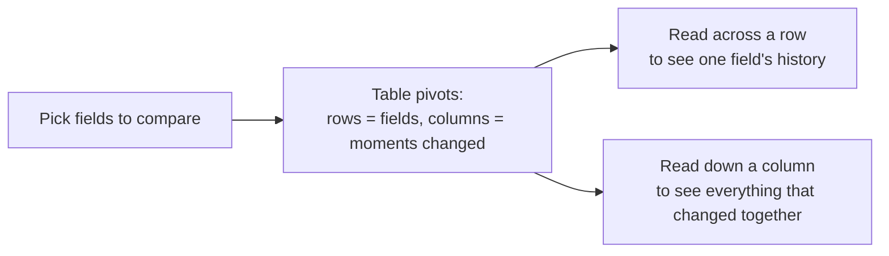

# Audit Trail User Guide

The Audit Trail shows a full history of changes made to your records — who created, updated, or deleted something, when they did it, and exactly what changed. This guide covers where to find it, how to read the Timeline view, how to use the Field History view to compare a handful of fields over time, and how to restore a deleted record from it.

It's written for anyone reviewing changes to their organisation's data — administrators, fund managers, and compliance reviewers.

---

## Table of Contents

1. [Key Concepts](#key-concepts)
2. [Where to Find It](#where-to-find-it)
3. [The Timeline View](#the-timeline-view)
4. [Searching and Filtering](#searching-and-filtering)
5. [Seeing What Changed](#seeing-what-changed)
6. [The Field History View](#the-field-history-view)
7. [Restoring a Deleted Record](#restoring-a-deleted-record)
8. [Frequently Asked Questions](#frequently-asked-questions)

---

## Key Concepts

| Term | Meaning |
|------|---------|
| **Event** | One create, update, or delete action on a record, at a moment in time. |
| **Timeline** | The audit trail's default view — one row per event, newest first. |
| **Field History** | A second view that compares how a handful of chosen fields changed over time. |
| **Attribute / Field** | A single piece of data on a record — for example City, Status, or a custom field. |

---

## Where to Find It

There are two ways to see an audit trail:

- **Company-wide** — the **Audit Trail** link in the top menu shows every change across your organisation. Use the filter bar at the top to narrow it down by record type, record, user, or date range.
- **On a single record** — most record pages (investors, funds, capital commitments, and more) have an **Audit Trail** link or panel that shows that record's own history, already scoped for you.

Narrowing the company-wide view down to one specific record (by filtering to a single record type and record) unlocks the same two views described below, including Field History.

---

## The Timeline View

The Timeline lists every event as a row, newest first:

| Column | What it shows |
|--------|----------------|
| **Action** | A colored badge — green **Create**, blue **Update**, red **Destroy**. |
| **Record** | Which record the event happened to, with a link to it when available. |
| **User** | Who made the change, or **System** for automated changes. |
| **When** | How long ago it happened (hover for the exact date and time). |
| **Changes** | A plain-language summary (e.g. "Changed City and 2 more fields"), plus how many fields changed. |

Click the arrow on the left of a row to expand it and see the individual fields that changed, with their old and new values side by side.

---

## Searching and Filtering

Above the table:

- **Create / Update / Destroy toggles** — untick any of these to hide that kind of event.
- **Search box** — type anything to filter down to matching rows: a user's name, a record name, a field name, or a value. If your search matches something inside a row's expanded details, that row opens automatically so you don't have to click through to find it.

---

## Seeing What Changed

Expanding a row shows a small table of every field that changed in that event, with its value **before** and **after**. Fields that didn't actually change aren't shown, so you're only looking at what's relevant.

For records with custom fields, only the custom fields that changed are listed individually — not the entire custom-fields section.

---

## Field History View

When you're looking at one specific record's audit trail, a second tab — **Field History** — is available next to Timeline. It turns the same history into a comparison table:

- Use **Compare fields** to pick the attributes you want to track (search or select several).
- Each column is a moment in time when *something* you're comparing changed.
- Each row is one attribute, showing its value at that moment and who changed it — a dash means that attribute didn't change at that particular moment.

This is the view to use when you want to answer a question like *"How did this investor's engagement status and city change over the last year, and who made each change?"* — rather than scrolling through every individual event.

---

## Restoring a Deleted Record

If an event's action is **Destroy** and the record is still deleted, a **Restore** button appears on that row — restoring it directly from the audit trail, no need to visit a separate screen. You'll be asked to confirm first.

For the full picture on finding and restoring deleted records more broadly (browsing everything currently deleted for a given record type), see the [Data Recovery guide](data_recovery_user_guide).

---

## Frequently Asked Questions

**Why don't I see the Field History tab?**
It only appears once you've narrowed the audit trail down to one specific record. On the company-wide Audit Trail page, filter down to a single record type and record to unlock it; on a record's own Audit Trail panel, it's always available.

**Why does a field show a dash instead of a value?**
A dash means that field didn't change at that particular moment — it's not missing data, just nothing to report for that column.

**Can I see who deleted a record and when?**
Yes — look for the red **Destroy** event on that record's Timeline. It shows the user and the exact time, and if the record is still deleted, a **Restore** button is right there.

**I searched for something and a row expanded on its own — why?**
When your search matches something inside a row's expanded field details (rather than something visible in the collapsed summary), that row opens automatically so you can see the match without an extra click. Clearing the search collapses it again.

**Does the audit trail affect performance on very active records?**
No — each view is built to only load what it needs: the company-wide page is paginated unless you've filtered to one record, and Field History only loads once you're looking at a single record's history.
