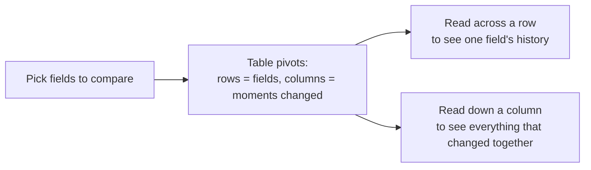

# Audit Trail User Guide

The Audit Trail shows a full history of changes made to your records — who created, updated, or deleted something, when they did it, and exactly what changed. This guide covers where to find it, how to read the Timeline view, how to use the Field History view to compare a handful of fields over time, and how to restore a deleted record from it.

> **Where to find it:** Company menu (the house icon at the top right) → [**Audit Trail / Download Audit Trail**](/audits?filter=true) for changes made by your company's users; a single record's full history is on its own **Audit Trail** link or tab where the page has one, or by adding `?audit_trail=true` to the record's page URL. Company admins see every employee's changes; other users see only their own.

It's written for anyone reviewing changes to their organisation's data — administrators, fund managers, and compliance reviewers.

---

## Table of Contents

1. [Key Concepts](#key-concepts)
2. [Where to Find It](#where-to-find-it)
3. [The Timeline View](#the-timeline-view)
4. [Searching and Filtering](#searching-and-filtering)
5. [Seeing What Changed](#seeing-what-changed)
6. [The Field History View](#field-history-view)
7. [Restoring a Deleted Record](#restoring-a-deleted-record)
8. [Frequently Asked Questions](#frequently-asked-questions)

---

## Key Concepts

| Term | Meaning |
|------|---------|
| **Event** | One create, update, or delete action on a record, at a moment in time. |
| **Timeline** | The audit trail's default view — one row per event, newest first. |
| **Field History** | A second view that compares how a handful of chosen fields changed over time. |
| **Attribute / Field** | A single piece of data on a record — for example City, Status, or a custom field. |

---

## Where to Find It

There are two ways to see an audit trail:

- **Company-wide** — Company menu (the house icon at the top right) → [**Audit Trail / Download Audit Trail**](/audits?filter=true) lists changes made by your company's employees: company admins see every employee's changes, other users see only their own. Automated (**System**) changes and changes by investor logins or CapHive support are not listed there. Use the filter card at the top to narrow it down by record type, record, user, or date range.
- **On a single record** — a few record pages have their own **Audit Trail** link or tab (for example an investor KYC's **Audit Trail** tab, a deal investor's **View Full Audit Trail**, or an allocation's **Audit Trail** button). On other record pages, add `?audit_trail=true` to the end of the page's address in your browser. This shows all changes to that record, including System changes, already scoped for you.

On the company-wide page, the Field History view described below is unlocked only when the page's address itself names one record, with `auditable_type` (e.g. `Investor`) and `auditable_id` query parameters. Setting the same conditions in the filter card does not unlock it.

---

## The Timeline View

The Timeline lists every event as a row, newest first:

| Column | What it shows |
|--------|----------------|
| **Action** | A colored badge — green **Create**, blue **Update**, red **Destroy**. |
| **Record** | Which record the event happened to, with a link to it when available. |
| **User** | Who made the change, or **System** for automated changes (shown on a record's own audit trail; the company-wide page does not list System changes). |
| **When** | How long ago it happened (hover for the exact date and time). |
| **Changes** | A plain-language summary (e.g. "Changed City and 2 more fields"), plus how many fields changed. |

Click the arrow on the left of a row to expand it and see the individual fields that changed, with their old and new values side by side.

---

## Searching and Filtering

Above the table:

- **Create / Update / Destroy toggles** — untick any of these to hide that kind of event.
- **Search box** — type anything to filter down to matching rows: a user's name, a record name, a field name, or a value. If your search matches something inside a row's expanded details, that row opens automatically so you don't have to click through to find it.
- **Download** — does not download in the browser: a background job emails you an Excel file (`audits.xlsx`) of the events matching the filter card's conditions.

---

## Seeing What Changed

Expanding a row shows a small table of every field that changed in that event, with its value **before** and **after**. Fields that didn't actually change aren't shown, so you're only looking at what's relevant.

For records with custom fields, only the custom fields that changed are listed individually — not the entire custom-fields section.

---

## Field History View

When you're looking at one specific record's audit trail (its own panel, or the company-wide Audit Trail page with `auditable_type` and `auditable_id` in the address), a second tab — **Field History** — is available next to Timeline. It turns the same history into a comparison table:

- Use **Compare fields** to pick the attributes you want to track (search or select several).
- Each column is a moment in time when *something* you're comparing changed.
- Each row is one attribute, showing its value at that moment and who changed it — a dash means that attribute didn't change at that particular moment.

This is the view to use when you want to answer a question like *"How did this investor's engagement status and city change over the last year, and who made each change?"* — rather than scrolling through every individual event.

---

## Restoring a Deleted Record

If an event's action is **Destroy** and the record is still deleted, a **Restore** button appears on that row — restoring it directly from the audit trail, no need to visit a separate screen. You'll be asked to confirm first.

For the full picture on finding and restoring deleted records more broadly (browsing everything currently deleted for a given record type), open that type's deleted-records page, for example [deleted documents](/documents/show_deleted); there is no menu link to these pages. See the [Document Management guide](document_management_user_guide) for restoring documents.

---

## Frequently Asked Questions

### Navigation and getting there

**Where do I find the Audit Trail in CapHive?**
Click the house icon at the top right to open the Company menu, then [**Audit Trail / Download Audit Trail**](/audits?filter=true). It opens with the filter card on top and the Timeline of events below, newest first, 10 to a page. See [Where to Find It](#where-to-find-it).

**How do I see the history of one specific record?**
Use the record's own **Audit Trail** link or tab where the page offers one (for example an investor KYC's **Audit Trail** tab, a deal investor's **View Full Audit Trail**, or an allocation's **Audit Trail** button). On other record pages add `?audit_trail=true` to the end of the page's address, which replaces the page body with that record's audit trail.

**How do I open the Field History view?**
It appears as a second tab next to **Timeline** on a single record's audit trail (the record panel above), or on the company-wide page when its address names one record with `auditable_type` and `auditable_id` query parameters. See [Field History View](#field-history-view).

**Who can see the Audit Trail?**
Every user except investor logins has the Company menu item. On the [company-wide Audit Trail](/audits?filter=true), company admins see changes made by any employee of the company; other employees see only changes they made themselves. A record's own audit trail panel shows all changes to that record and its associated records to anyone who can open the record.

**Why is the Audit Trail missing from my Company menu?**
The item is hidden for investor (stakeholder) logins. If you are logged in with an investor role, switch to your company role; otherwise ask your company administrator to check your user.

### Using the audit trail

**How do I filter the company-wide audit trail?**
In the filter card at the top of the [Audit Trail](/audits?filter=true) page, add conditions on **Action**, **Auditable Type** (the record type, e.g. `Investor`), **Auditable Id**, **User Id**, **Created At** and similar fields, then submit. The **Create / Update / Destroy** toggles and the **Search** box above the table narrow the rows already shown. See [Searching and Filtering](#searching-and-filtering).

**How do I see exactly what changed in an event?**
Click the arrow at the left of the row. It expands into a table of every field that changed, with the value **before** and **after**; unchanged fields and unchanged custom fields are left out. See [Seeing What Changed](#seeing-what-changed).

**How do I download the audit trail?**
Click **Download** above the Timeline. The export runs in the background and emails you an Excel file (`audits.xlsx`, subject "Audit Download") with the events your filter-card conditions match; without both a from and a to date on the page it is capped at the most recent 1,000 events.

**How do I restore a deleted record from the audit trail?**
Find its red **Destroy** event (untick **Create** and **Update** to find it faster) and click **Restore** on that row, then confirm. The button shows only if the record is still deleted and its type supports restore. See [Restoring a Deleted Record](#restoring-a-deleted-record).

**How do I find everything that was deleted for a record type?**
Open that type's deleted-records page, for example [deleted documents](/documents/show_deleted) or [deleted folders](/folders/show_deleted); there are no menu links to these pages. Each lists the currently deleted records of that type with a restore action.

**Can I edit or delete audit events?**
No. The audit trail is read-only: there are no create, edit or delete actions for events, so it stays a reliable record of who did what.

### Why use the audit trail

**Why should I use the Audit Trail?**
It answers "who changed this, when, and from what to what" without asking around: every create, update and delete on tracked records is recorded with the user, time and old and new values. That is what auditors, compliance reviews and incident investigations need, and it is also the quickest way to undo an accidental delete.

**What can I do with the Audit Trail?**
Review recent changes across your company, trace one record's history field by field with **Field History**, find who deleted something and restore it, and send filtered history to auditors as an Excel file.

**Who typically uses the Audit Trail?**
Company administrators and compliance reviewers review changes across the company; fund managers and operations staff check the history of an investor, commitment or KYC before acting on it; auditors receive the Excel download as evidence.

**What happens if we don't review the audit trail?**
Nothing stops working, since changes are recorded whether or not anyone looks. But mistaken edits and deletes can go unnoticed until they affect notices, reports or statements, by which time the **Restore** button or the old values may be much harder to act on.

### What happens when I …

**What happens when someone creates, edits or deletes a record?**
CapHive writes one audit event with the action, the user (or none for automated changes), the time and the changed fields with their old and new values. It appears immediately on the company-wide [Audit Trail](/audits?filter=true) for company admins (if the change was made by an employee) and on the record's own audit trail. No one is notified.

**What happens when I click Download?**
A background job builds an Excel file of the audit events you are allowed to see that match the filter card's conditions and emails it to you as `audits.xlsx`. The page shows "Your request is being processed. You will receive an email shortly." Nothing else changes.

**What happens when I click Restore?**
You are asked to confirm; the record and the records deleted along with it (including its document folder, where it has one) are brought back, with related counts corrected. You need the same permission as for deleting that record. The restore itself is recorded as a new event.

**What happens when I open Field History?**
The chosen record's events are pivoted into a table: pick attributes in **Compare fields**, and each column becomes a moment when one of them changed, each row one attribute with its value and who changed it. It only reads history and changes nothing.

### Troubleshooting and edge cases

**Why don't I see the Field History tab?**
It only appears once the audit trail is scoped to exactly one record. On the company-wide page that means the URL must carry `auditable_type` and `auditable_id` (conditions set in the filter card do not unlock it); on a record's own audit trail panel it is always available.

**Why does a field show a dash instead of a value?**
A dash means that field didn't change at that particular moment — it's not missing data, just nothing to report for that column.

**Can I see who deleted a record and when?**
Yes — look for the red **Destroy** event on that record's Timeline. It shows the user and the exact time, and if the record is still deleted, a **Restore** button is right there.

**I searched for something and a row expanded on its own — why?**
When your search matches something inside a row's expanded field details (rather than something visible in the collapsed summary), that row opens automatically so you can see the match without an extra click. Clearing the search collapses it again.

**Does the audit trail affect performance on very active records?**
No — each view is built to only load what it needs: the company-wide page is paginated unless you've filtered to one record, and Field History only loads once you're looking at a single record's history.

**A change I expected is not on the company-wide Audit Trail. Why?**
The company-wide [Audit Trail](/audits?filter=true) lists only changes made by users: company admins see changes by the company's employees and everyone else sees only their own. Automated (System) changes and changes made by investor logins or CapHive support are not listed there; open the record's own audit trail (`?audit_trail=true`) to see them.

**There is no Restore button on a Destroy event. Why?**
Either the record has already been restored, or its type cannot be restored from the audit trail (it was permanently deleted or has no restore action). Ask CapHive support if the record is important.

**Does every field change get recorded?**
Changes to tracked record types are recorded field by field, including custom fields. Some types only track selected fields, and records without tracking do not appear at all, so a missing event does not always mean nothing changed.

## Related Guides

- [Document Management](document_management_user_guide) — restoring [deleted documents](/documents/show_deleted).
- [User Roles](user_role_management_user_guide) — the company admin role that sees every employee's changes.
- [Investor KYC](investor_kyc_user_guide) — the KYC page's Audit Trail tab.
- [Workflow Templates](workflow_templates_user_guide) — a workflow's own audit trail and CSV export.
- [Stakeholders (Investors)](investors_user_guide) — the records whose history you most often need to trace.
- [Custom Fields](custom_fields_user_guide) — how custom field changes appear in an event's details.
