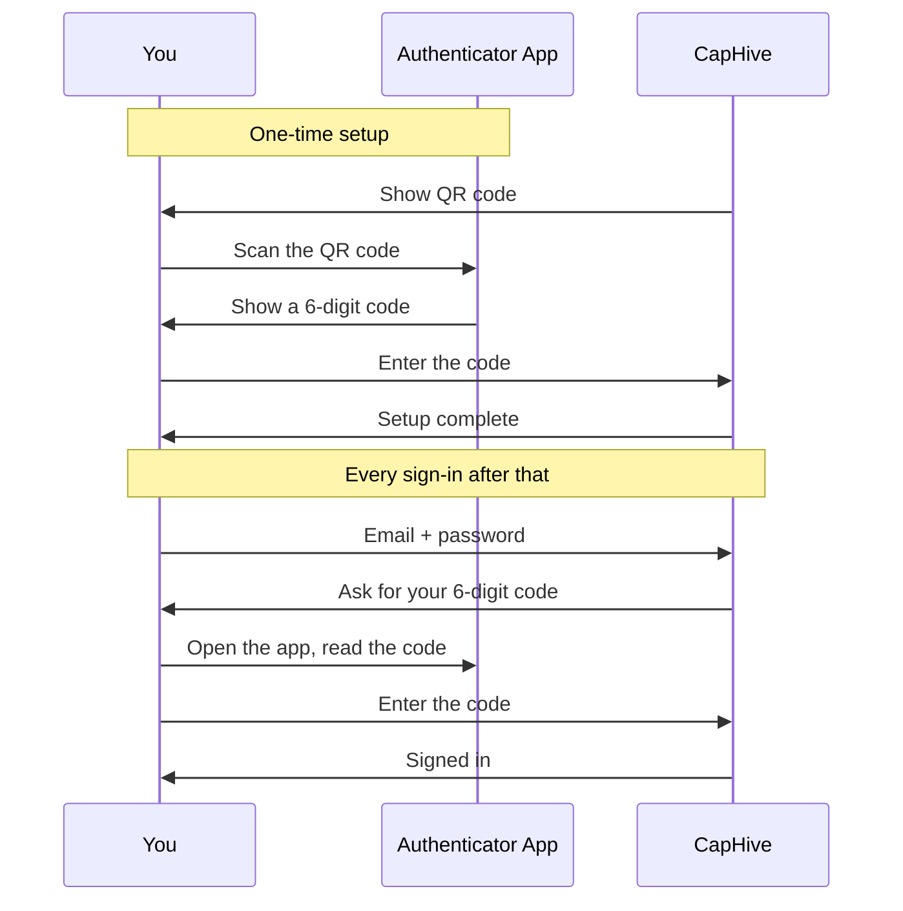

# Authenticator App Setup Guide

New to authenticator apps? This guide explains what they are, which one to install, how to install it, and how to use it to sign in. No prior experience needed — you can follow it start to finish in about five minutes.

If you have already used an authenticator app before, skip to [Add CapHive to Your App](#step-3-add-caphive-to-your-app).

---

## Table of Contents

1. [What Is an Authenticator App?](#what-is-an-authenticator-app)
2. [Step 1: Choose an App](#step-1-choose-an-app)
3. [Step 2: Install It on Your Phone](#step-2-install-it-on-your-phone)
4. [Step 3: Add CapHive to Your App](#step-3-add-caphive-to-your-app)
5. [Step 4: Confirm the Setup](#step-4-confirm-the-setup)
6. [Signing In From Now On](#signing-in-from-now-on)
7. [Troubleshooting](#troubleshooting)
8. [Frequently Asked Questions](#frequently-asked-questions)

---

## What Is an Authenticator App?

An authenticator app is a small, free app on your phone that displays a **6-digit code that changes every 30 seconds**. When you sign in to CapHive, you enter your password *and* the current code from the app.

That second code is what protects you: even if somebody learns your password, they cannot sign in without the phone in your pocket.

A few things people are often surprised to learn:

- **It is free.** Every app recommended below costs nothing.
- **It works without internet or mobile signal.** The codes are calculated on your phone from a secret set up once, not sent to you. An authenticator app works on a plane, in a basement, or abroad with no roaming.
- **Nobody can see your codes.** The app does not send anything anywhere, and CapHive never sees your phone.
- **One app holds everything.** If you already use an authenticator for your bank or your email, add CapHive to that same app — you do not need a second one.

---

## Step 1: Choose an App

Any of these work equally well with CapHive. If you have no preference, **Google Authenticator** is the simplest.

| App | Best for | Notes |
|---|---|---|
| **Google Authenticator** | Most people | Simplest option. Backs up to your Google account so you do not lose codes when you change phone. |
| **Microsoft Authenticator** | Anyone already using Microsoft 365 at work | Also handles Microsoft work sign-ins. Backs up to a Microsoft account. |
| **Twilio Authy** | People who want codes on more than one device | Cloud backup with a password you set; can run on a second phone or tablet. |

> Already use a password manager such as 1Password, Bitwarden, Dashlane or Keeper? They can all store authenticator codes too. Use the QR scanner built into your password manager instead of installing a separate app.

---

## Step 2: Install It on Your Phone

Tap the link for your phone. iPhone and iPad use the App Store link; Samsung, Google Pixel and other Android phones use the Google Play link.

### Google Authenticator

- [Download for iPhone or iPad (App Store)](https://apps.apple.com/app/google-authenticator/id388497605)
- [Download for Android (Google Play)](https://play.google.com/store/apps/details?id=com.google.android.apps.authenticator2)

### Microsoft Authenticator

- [Download for iPhone or iPad (App Store)](https://apps.apple.com/app/microsoft-authenticator/id983156458)
- [Download for Android (Google Play)](https://play.google.com/store/apps/details?id=com.azure.authenticator)

### Twilio Authy

- [Download for iPhone or iPad (App Store)](https://apps.apple.com/app/twilio-authy/id494168017)
- [Download for Android (Google Play)](https://play.google.com/store/apps/details?id=com.authy.authy)

**Not sure which phone you have?** If your phone came from Apple, it is an iPhone — use the App Store links. Everything else is almost certainly Android — use the Google Play links.

Once the app is installed, open it once and accept the initial prompts. Some apps ask for permission to use your camera — say yes, because you need the camera to scan the setup code in the next step.

---

## Step 3: Add CapHive to Your App

Keep the CapHive setup page open on your computer. It shows a black-and-white square QR code.

1. Open the authenticator app on your phone.
2. Tap the **+** button, or **Add account**, or **Scan a QR code** — the wording varies slightly between apps.
3. If asked what kind of account, choose **Other** or **Other account (Google, Facebook, etc.)**.
4. Point your phone's camera at the QR code on your screen.

The app adds an entry called **CapHive** showing a 6-digit code and a small countdown timer. That code changes every 30 seconds — this is normal and expected.

### If You Cannot Scan the Code

Below the QR code the setup page shows a **setup key** — a long string of letters and numbers, printed in groups of four for readability.

1. In your authenticator app, choose **Enter a setup key** or **Enter code manually**.
2. For the account name, type anything you will recognise, such as `CapHive`.
3. Type the setup key exactly as shown. Spaces do not matter and capitalisation does not matter.
4. If the app asks for the type of key, choose **Time based**.

> Treat the setup key like a password. Anyone who has it can generate your codes. Do not photograph it, email it, or paste it into a chat.

---

## Step 4: Confirm the Setup

Back on the CapHive setup page, type the 6-digit code currently shown in your app and select **Confirm & Enable 2FA**.

Watch the countdown timer in your app. If the code is about to expire, wait a few seconds for a fresh one rather than rushing to submit the old one.

If the code is rejected, see [Troubleshooting](#troubleshooting) below — the cause is almost always your phone's clock.

---

## Signing In From Now On

1. Enter your email address and password as usual.
2. CapHive asks for your 6-digit code.
3. Open your authenticator app, read the current CapHive code, and type it in.
4. Select **Verify**.

The whole step takes a few seconds. You will do it every time you sign in.

If your account also has WhatsApp enabled, the sign-in page offers a **Send code via WhatsApp** button as an alternative — useful if your phone is nearby but you cannot open the app for some reason.

---

## Troubleshooting

**My code is always rejected, even though I typed it correctly.**
This is nearly always a clock problem. Authenticator codes are based on the current time, so your phone's clock must be accurate to within about 30 seconds.

- *iPhone:* Settings → General → Date & Time → turn on **Set Automatically**.
- *Android:* Settings → System → Date & time → turn on **Set time automatically**.
- *Google Authenticator specifically:* open the app menu and choose **Time correction for codes** → **Sync now**.

Then try again with a fresh code.

**The code expired while I was typing it.**
Wait for the app to show the next code and use that one. There is no penalty for waiting.

**I get "Invalid code" three times and get sent back to the sign-in page.**
That is the security limit. Sign in with your email and password again, then enter a fresh code.

**My camera will not scan the QR code.**
Check that you granted the app camera permission, clean your camera lens, and increase your screen brightness. Failing that, use the manual setup key method described in [Step 3](#step-3-add-caphive-to-your-app).

**I scanned the code twice by mistake and now have two CapHive entries.**
Harmless — both produce the same codes. Delete one if the clutter bothers you.

---

## Frequently Asked Questions

**Does it cost anything?**
No. All the apps listed here are free.

**Do I need mobile signal or Wi-Fi to get a code?**
No. Codes are generated on your phone, so they work with no signal at all.

**I am getting a new phone. What do I do?**
Set the new phone up *before* wiping the old one. Google Authenticator and Microsoft Authenticator can transfer accounts directly (look for **Transfer accounts** or **Export accounts** in the app menu); Authy restores from its cloud backup. If the old phone is already gone, ask your administrator to reset your two-factor setup so you can enrol the new phone at your next sign-in.

**I lost my phone.**
Contact your CapHive administrator and ask them to reset your two-factor method. For security, nobody can bypass two-factor authentication for you remotely without that reset. There are no backup codes — the administrator reset is the only way back in.

**Can I use one app for CapHive and my other accounts?**
Yes, and you should. One app can hold dozens of accounts.

**Can I use an authenticator on my computer instead of my phone?**
Yes, if you use a password manager that supports authenticator codes. Be aware this is slightly less secure: your password and your code then live on the same device.

**Do I have to use an authenticator app? What about WhatsApp?**
If your administrator has enabled WhatsApp on your account, you can choose to receive codes by WhatsApp instead. It is simpler to set up, but it needs signal and is somewhat less secure. See the [Two-Factor Authentication User Guide](two_factor_authentication_user_guide) for the full comparison.

**Is CapHive able to see my codes?**
No. CapHive verifies the code you type against a shared secret; it never sees your phone or your app.

---

For the complete picture of two-factor authentication in CapHive — including WhatsApp mode, text message mode and turning two-factor on or off — see the [Two-Factor Authentication User Guide](two_factor_authentication_user_guide).
