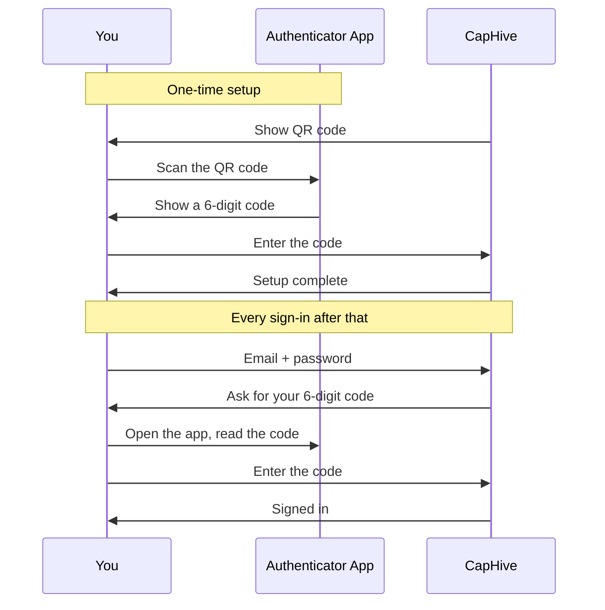

# Authenticator App Setup Guide

New to authenticator apps? This guide explains what they are, which one to install, how to install it, and how to use it to sign in. No prior experience needed — you can follow it start to finish in about five minutes.

> **Where to find it:** Turn on 2FA from the top-right **Profile menu** → **My Profile** → **Edit** → **Enable Two-Factor Authentication**, then choose **Authenticator App** at your next sign-in to get the QR code. Already using another method? Click **Change 2FA Method** on **My Profile** first. Every user can do this for their own account.

If you have already used an authenticator app before, skip to [Add CapHive to Your App](#step-3-add-caphive-to-your-app).

---

## Table of Contents

1. [What Is an Authenticator App?](#what-is-an-authenticator-app)
2. [Step 1: Choose an App](#step-1-choose-an-app)
3. [Step 2: Install It on Your Phone](#step-2-install-it-on-your-phone)
4. [Step 3: Add CapHive to Your App](#step-3-add-caphive-to-your-app)
5. [Step 4: Confirm the Setup](#step-4-confirm-the-setup)
6. [Signing In From Now On](#signing-in-from-now-on)
7. [Troubleshooting](#troubleshooting)
8. [Frequently Asked Questions](#frequently-asked-questions)
9. [Related Guides](#related-guides)

---

## What Is an Authenticator App?

An authenticator app is a small, free app on your phone that displays a **6-digit code that changes every 30 seconds**. When you sign in to CapHive, you enter your password *and* the current code from the app.

That second code is what protects you: even if somebody learns your password, they cannot sign in without the phone in your pocket.

A few things people are often surprised to learn:

- **It is free.** Every app recommended below costs nothing.
- **It works without internet or mobile signal.** The codes are calculated on your phone from a secret set up once, not sent to you. An authenticator app works on a plane, in a basement, or abroad with no roaming.
- **Nobody can see your codes.** The app does not send anything anywhere, and CapHive never sees your phone.
- **One app holds everything.** If you already use an authenticator for your bank or your email, add CapHive to that same app — you do not need a second one.

---

## Step 1: Choose an App

Any of these work equally well with CapHive. If you have no preference, **Google Authenticator** is the simplest.

| App | Best for | Notes |
|---|---|---|
| **Google Authenticator** | Most people | Simplest option. Backs up to your Google account so you do not lose codes when you change phone. |
| **Microsoft Authenticator** | Anyone already using Microsoft 365 at work | Also handles Microsoft work sign-ins. Backs up to a Microsoft account. |
| **Twilio Authy** | People who want codes on more than one device | Cloud backup with a password you set; can run on a second phone or tablet. |

> Already use a password manager such as 1Password, Bitwarden, Dashlane or Keeper? They can all store authenticator codes too. Use the QR scanner built into your password manager instead of installing a separate app.

---

## Step 2: Install It on Your Phone

Tap the link for your phone. iPhone and iPad use the App Store link; Samsung, Google Pixel and other Android phones use the Google Play link.

### Google Authenticator

- [Download for iPhone or iPad (App Store)](https://apps.apple.com/app/google-authenticator/id388497605)
- [Download for Android (Google Play)](https://play.google.com/store/apps/details?id=com.google.android.apps.authenticator2)

### Microsoft Authenticator

- [Download for iPhone or iPad (App Store)](https://apps.apple.com/app/microsoft-authenticator/id983156458)
- [Download for Android (Google Play)](https://play.google.com/store/apps/details?id=com.azure.authenticator)

### Twilio Authy

- [Download for iPhone or iPad (App Store)](https://apps.apple.com/app/twilio-authy/id494168017)
- [Download for Android (Google Play)](https://play.google.com/store/apps/details?id=com.authy.authy)

**Not sure which phone you have?** If your phone came from Apple, it is an iPhone — use the App Store links. Everything else is almost certainly Android — use the Google Play links.

Once the app is installed, open it once and accept the initial prompts. Some apps ask for permission to use your camera — say yes, because you need the camera to scan the setup code in the next step.

---

## Step 3: Add CapHive to Your App

Keep the CapHive setup page open on your computer (you reach it by choosing **Authenticator App** and clicking **Continue** on the **Set Up Two-Factor Authentication** screen at sign-in). It shows a black-and-white square QR code.

1. Open the authenticator app on your phone.
2. Tap the **+** button, or **Add account**, or **Scan a QR code** — the wording varies slightly between apps.
3. If asked what kind of account, choose **Other** or **Other account (Google, Facebook, etc.)**.
4. Point your phone's camera at the QR code on your screen.

The app adds an entry called **CapHive** showing a 6-digit code and a small countdown timer. That code changes every 30 seconds — this is normal and expected.

### If You Cannot Scan the Code

Below the QR code the setup page shows a **setup key** — a long string of letters and numbers, printed in groups of four for readability.

1. In your authenticator app, choose **Enter a setup key** or **Enter code manually**.
2. For the account name, type anything you will recognise, such as `CapHive`.
3. Type the setup key exactly as shown. Spaces do not matter and capitalisation does not matter.
4. If the app asks for the type of key, choose **Time based**.

> Treat the setup key like a password. Anyone who has it can generate your codes. Do not photograph it, email it, or paste it into a chat.

---

## Step 4: Confirm the Setup

Back on the CapHive setup page, type the 6-digit code currently shown in your app and select **Confirm & Enable 2FA**.

Watch the countdown timer in your app. If the code is about to expire, wait a few seconds for a fresh one rather than rushing to submit the old one.

If the code is rejected, see [Troubleshooting](#troubleshooting) below — the cause is almost always your phone's clock.

---

## Signing In From Now On

1. Enter your email address and password as usual.
2. CapHive asks for your 6-digit code.
3. Open your authenticator app, read the current CapHive code, and type it in.
4. Select **Verify**.

The whole step takes a few seconds. You will do it every time you sign in.

In authenticator mode the sign-in page only accepts a code from your app; there is no option to have a code sent by WhatsApp instead. If you would rather receive codes by WhatsApp or text message, click **Change 2FA Method** on **My Profile** and choose a new method.

---

## Troubleshooting

**My code is always rejected, even though I typed it correctly.**
This is nearly always a clock problem. Authenticator codes are based on the current time, so your phone's clock must be accurate to within about 30 seconds.

- *iPhone:* Settings → General → Date & Time → turn on **Set Automatically**.
- *Android:* Settings → System → Date & time → turn on **Set time automatically**.
- *Google Authenticator specifically:* open the app menu and choose **Time correction for codes** → **Sync now**.

Then try again with a fresh code.

**The code expired while I was typing it.**
Wait for the app to show the next code and use that one. There is no penalty for waiting.

**I get "Invalid code" three times and get sent back to the sign-in page.**
That is the security limit. Sign in with your email and password again, then enter a fresh code.

**My camera will not scan the QR code.**
Check that you granted the app camera permission, clean your camera lens, and increase your screen brightness. Failing that, use the manual setup key method described in [Step 3](#step-3-add-caphive-to-your-app).

**I scanned the code twice by mistake and now have two CapHive entries.**
Harmless — both produce the same codes. Delete one if the clutter bothers you.

---

## Frequently Asked Questions

### Navigation and getting there

**Where do I start setting up an authenticator app in CapHive?**
First switch on 2FA: top-right **Profile menu** (your avatar) → **My Profile** → **Edit** → **Enable Two-Factor Authentication**, then save. At your next sign-in choose **Authenticator App** on the **Set Up Two-Factor Authentication** screen to see the QR code.

**Can I open the QR code page directly from a menu?**
No. The QR code is only shown during sign-in, after you choose **Authenticator App** on the method-selection screen. That screen appears when 2FA is on and no method is set yet, or after your method has been reset.

**I already use WhatsApp codes. How do I get to the authenticator setup?**
On **My Profile** click **Change 2FA Method**, confirm your password, tick the acknowledgement and click **Reset 2FA Method**. You are signed out; sign in again and choose **Authenticator App**.

**Can I read this guide when I am locked out of CapHive?**
Yes. It is [available without signing in](/help/authenticator_app_setup_user_guide), and the code screen's **Troubleshoot authenticator codes** link opens its troubleshooting section.

**How can I check that my account uses the authenticator method?**
Open **Profile menu → My Profile**. The **Two-Factor Authentication** row shows a badge with your method, for example **Authenticator**.

### Setting up and managing the app

**How do I add CapHive to my authenticator app?**
In the app tap **+** or **Add account**, choose to scan a QR code and point the camera at the QR code on the CapHive setup page. An entry called **CapHive** appears with a 6-digit code. See [Step 3: Add CapHive to Your App](#step-3-add-caphive-to-your-app).

**How do I add CapHive if I cannot scan the QR code?**
Choose **Enter a setup key** in your app and type the key shown under the QR code, which CapHive prints in groups of four. Spaces and capitalisation do not matter; pick **Time based** if the app asks. See [If You Cannot Scan the Code](#if-you-cannot-scan-the-code).

**How do I finish the setup?**
Type the 6-digit code your app currently shows into the CapHive setup page and click **Confirm & Enable 2FA**. See [Step 4: Confirm the Setup](#step-4-confirm-the-setup).

**How do I move CapHive to a new phone?**
Set up the new phone before wiping the old one: use **Transfer accounts** or **Export accounts** in Google or Microsoft Authenticator, or restore Authy from its backup. If the old phone is already gone, ask your administrator to reset your 2FA method and scan a new QR code at your next sign-in.

**How do I remove CapHive from my authenticator app?**
Delete the **CapHive** entry in the app, but only after 2FA is switched off or your method has been reset. Deleting it while authenticator mode is still active leaves you unable to produce codes.

**How do I switch from the authenticator app to WhatsApp or text messages?**
On **My Profile** click **Change 2FA Method** and complete the reset, then choose the new method at your next sign-in. The phone options only appear if your profile has a mobile number, and WhatsApp also needs WhatsApp enabled on your profile.

### Why use an authenticator app

**Why choose an authenticator app over WhatsApp or text messages?**
Codes are generated on your phone, so they work with no signal, abroad or on a plane, and nothing travels over a network that could be intercepted. It is the most secure option CapHive offers.

**Who should use the authenticator method?**
Anyone who travels, works in places with poor signal, has no WhatsApp on their work number, or already uses an authenticator app for email or banking. Users handling sensitive fund or investor data benefit most from the stronger protection.

**What goes wrong if I skip the confirmation step?**
Until you confirm a code with **Confirm & Enable 2FA**, no method is saved and you are not signed in. At your next sign-in CapHive sends you back to method selection; the scanned entry in your app keeps working if you choose the app again.

### What happens when I…

**What happens when I click Confirm & Enable 2FA with a correct code?**
CapHive saves authenticator as your method, signs you in and shows "Two-factor authentication is now enabled." From then on every sign-in, including magic-link sign-ins, asks for a code from your app. No email is sent.

**What happens when I sign in with a correct code?**
You are signed in and taken to your dashboard, or to the page a magic link pointed to. Each code can be used only once, so wait for the next one if you need to sign in again straight away.

**What happens if I type a wrong code at sign-in?**
You see "Invalid code" and how many attempts are left. After 3 failed attempts you are sent back to the sign-in page and must enter your email and password again.

**What happens when my 2FA method is reset?**
Your CapHive entry in the app stops working immediately and you get an email about the reset. At your next sign-in you choose a method again; if you pick the authenticator app, delete the old entry and scan the new QR code.

**What happens if I switch 2FA off?**
Codes are no longer requested and your authenticator setup is forgotten. If you turn 2FA on again later you receive a new QR code, so delete the old CapHive entry from the app.

### Troubleshooting and edge cases

**Does it cost anything?**
No. All the apps listed here are free.

**Do I need mobile signal or Wi-Fi to get a code?**
No. Codes are generated on your phone, so they work with no signal at all.

**I am getting a new phone. What do I do?**
Set the new phone up *before* wiping the old one. Google Authenticator and Microsoft Authenticator can transfer accounts directly (look for **Transfer accounts** or **Export accounts** in the app menu); Authy restores from its cloud backup.

**I lost my phone.**
Contact your CapHive administrator and ask them to reset your two-factor method. There are no backup codes, so the administrator reset is the only way back in.

**Can I use one app for CapHive and my other accounts?**
Yes, and you should. One app can hold dozens of accounts.

**Can I use an authenticator on my computer instead of my phone?**
Yes, if you use a password manager that supports authenticator codes. Be aware this is slightly less secure: your password and your code then live on the same device.

**Do I have to use an authenticator app? What about WhatsApp?**
No. If WhatsApp is enabled on your profile you can choose WhatsApp codes instead, and text-message codes may also be offered. They are simpler to set up but need signal; see the [Two-Factor Authentication User Guide](two_factor_authentication_user_guide) for the comparison.

**Can I get a WhatsApp code at sign-in if my app is not to hand?**
No. In authenticator mode the code screen only accepts a code from your app and has no send-by-WhatsApp option. To use WhatsApp instead, change your 2FA method, or ask your administrator to reset it if you are locked out.

**Is CapHive able to see my codes?**
No. CapHive verifies the code you type against a shared secret; it never sees your phone or your app.

**My codes are always rejected. What should I check first?**
Your phone's clock: set date and time to automatic, or use **Time correction for codes** in Google Authenticator, then try a fresh code. See [Troubleshooting](#troubleshooting).

**I have two CapHive entries in my app. Which one do I use?**
If both were added from the same QR code they give the same codes, so either works. If one is left over from before a reset or from switching 2FA off and on, only the newest works; delete the old one.

---

For the complete picture of two-factor authentication in CapHive — including WhatsApp mode, text message mode and turning two-factor on or off — see the [Two-Factor Authentication User Guide](two_factor_authentication_user_guide).

## Related Guides

- [Two-Factor Authentication User Guide](two_factor_authentication_user_guide) — turning 2FA on or off, choosing and changing your method.
- [User Role Management](user_role_management_user_guide) — the company admin role that can reset a locked-out user's 2FA method.
- [Audit Trail](audit_trail_user_guide) — where changes to a user's 2FA method are recorded.
