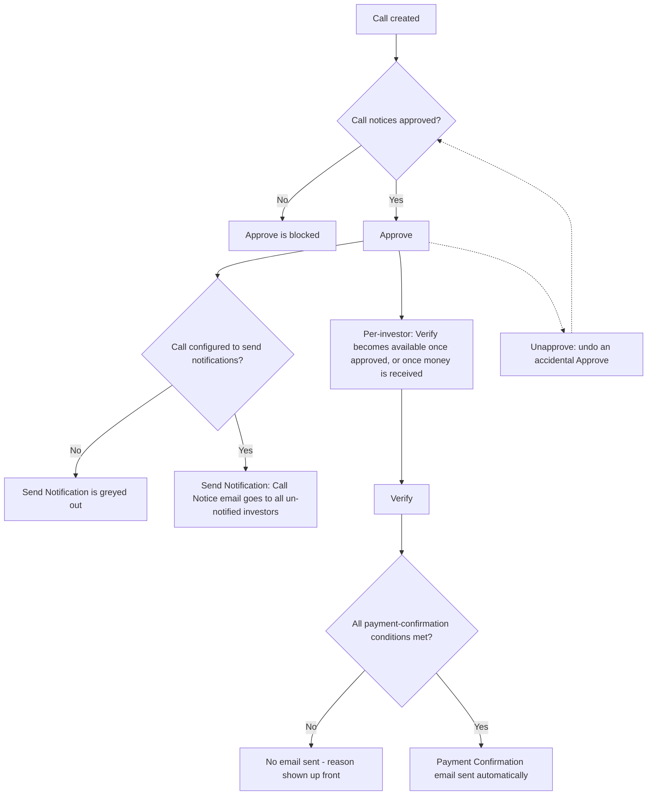

# Capital Call Actions & Notifications — Quick Reference

This is a plain-language reference for everyone who works a capital call end to end: what each button does, when it's available (and when it's greyed out), and exactly what happens with investor emails at each step.

There are **two separate kinds of investor emails** in a capital call, and they're easy to mix up:

1. **Call Notice** — "here's what you owe and by when." Sent at the call level (to everyone at once) or per investor (one at a time).
2. **Payment Confirmation** — "we've received and confirmed your payment." Sent automatically when an investor's payment is verified — there's no separate button for it.

Both kinds of email respect **Sandbox Mode**: if a company account is in Sandbox Mode (used for testing), every email described below is redirected to internal test inboxes instead of the real investor. The screen always shows an orange or red warning when this is active.

---

## 1. Actions on the Capital Call itself

| Button | What it does | When you'll see it | When it's greyed out / hidden | Notes |
|---|---|---|---|---|
| **Approve** | Locks in the call as final and ready to notify investors. Approving does **not** send any email by itself. | Only before the call has been approved. | Hidden if you don't have Approver rights. Blocked (with an error) if any investor's call notice document has been generated but not yet approved — those must be approved first. | This is a one-time gate; once approved, remittances become eligible for Verify and the call-level Send Notification button. |
| **Unapprove** | Reverts an accidentally-approved call back to "not approved," so it can be corrected and approved again. | Only after the call has been approved. Never shown at the same time as Approve. | Hidden if you don't have Approver rights. | If any investor has already been sent a Call Notice email, you'll see a warning that reverting the approval does **not** un-send that email — it already went out. |
| **Send Notification** (a.k.a. "Send Call Notice") | Sends the Call Notice email to every investor on this call who hasn't already received one. | Only after the call is approved. | Greyed out if the call is configured to not send notifications (a setting on the call). | Investors who were already emailed are automatically skipped — this never double-sends the call-level notice. |

---

## 2. Actions on a single Remittance (one investor's slice of the call)

| Button | What it does | When you'll see it | When it's greyed out | Notes |
|---|---|---|---|---|
| **Verify** | Confirms that this investor's payment has been reviewed and accepted as recorded. This is also the trigger point for the Payment Confirmation email (see section 3). | Per remittance, on the remittance page and in the remittance list. | Greyed out when the call has **not** been approved yet **and** no money has been collected for this investor yet. (If either the call is approved, or some money has already come in, Verify stays available.) | Verifying also flags whether the collected amount doesn't match what was called, and warns you before you confirm. |
| **Unverify** | Reverses a Verify — e.g. if it was done by mistake. | Only after the remittance has been Verified. | Not restricted the same way Verify is — reversing is always allowed. | |
| **Send Call Notification** / **Send Call Reminder** | Sends (or re-sends) the Call Notice email to just this one investor. | Per remittance. | Greyed out if **any** of the following is true: the call isn't approved · the call is set up not to send notifications · this investor's commitment record is flagged to skip document generation · the generated call notice for this investor is still waiting on internal approval · no one at this investor is actually subscribed to receive these emails. The screen tells you which of these applies. | Before it's sent once, the button says "Send Call Notification." After that, it becomes "Send Call Reminder" and can be used again any time — repeat sends are allowed on purpose. |

---

## 3. The Payment Confirmation email — no button, happens automatically

There is **no manual "send" button** for the payment confirmation email. It fires automatically the moment a remittance is marked **Verified**, once per payment recorded against that remittance.

For it to actually reach the investor, **all** of these must be true at the moment of Verify:

| Condition | Plain-language meaning |
|---|---|
| The call is approved | Payments can't be confirmed on a call that hasn't been finalized. |
| The call is set up to send payment confirmations | This is a setting on the call — some calls are configured not to send this email at all. |
| At least one payment with a real amount has been recorded | Verifying with nothing recorded has nothing to confirm. |
| That payment hasn't already triggered this email | Each payment only ever sends this confirmation once. |
| Someone at the investor is actually subscribed to receive it | If no contact is set up to receive Capital Call emails, nothing goes out — even though everything else is fine. |

If any of these isn't met, the Verify confirmation screen tells you up front so there are no surprises — you'll know the payment is being recorded, but no email will follow.

---

## 4. At a glance

---

*This page intentionally avoids technical detail. If you need to understand exactly how these rules are implemented, ask engineering to point you to the underlying logic.*
