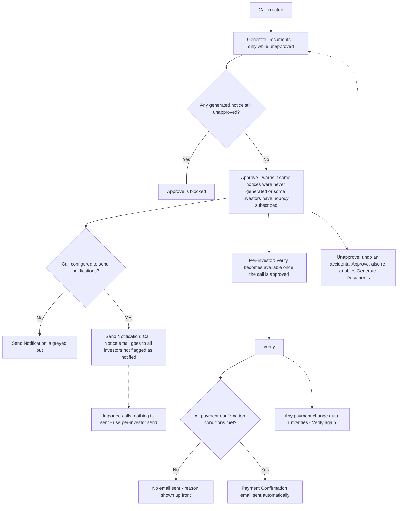

# Capital Call Actions & Notifications — Quick Reference

This is a plain-language reference for everyone who works a capital call end to end: what each button does, when it's available (and when it's greyed out), and exactly what happens with investor emails at each step.

There are **two separate kinds of investor emails** in a capital call, and they're easy to mix up:

1. **Call Notice** — "here's what you owe and by when." Sent at the call level (to everyone at once) or per investor (one at a time). A first send and a repeat send ("reminder") use **different email templates**, so both need to be set up.
2. **Payment Confirmation** — "we've received and confirmed your payment." Sent automatically when an investor's payment is verified — there's no separate button for it.

Both kinds of email respect **Sandbox Mode**: if a company account is in Sandbox Mode (used for testing), every email described below is redirected to internal test inboxes instead of the real investor. Every individual send or verify confirmation screen shows an orange or red warning when this is active. **Exception:** the bulk "Verify Pending Remittances" screen (section 2) does not show the sandbox warning, even though it can trigger payment confirmations.

---

## 1. Actions on the Capital Call itself

| Button | What it does | When you'll see it | When it's greyed out / hidden | Notes |
|---|---|---|---|---|
| **Generate Documents** | Creates the call notice document for every investor on the call, from the fund's call notice template. | Only **before** the call has been approved. | Hidden once the call is approved. To regenerate a notice on an approved call you must Unapprove first. | Regenerating **replaces** the previous notice for that template, and the new notice always comes in as **not yet approved** — so it has to be reviewed and approved again before the call can be approved or sent. |
| **Approve** | Locks in the call as final and ready to notify investors. Approving does **not** send any email by itself. | Only before the call has been approved. | Hidden if you don't have Approver rights. | Three checks run when you click it. **Blocked** if any investor's call notice has been generated but not yet approved. **Warned** (but allowed) if some investors have no generated notice at all — they'll be notified without an attachment. **Warned** (but allowed) if one or more investors on the call have nobody subscribed to Capital Call notifications — added so this is caught here rather than only later, one grey-out at a time, when someone tries to send (see Question 6 below). All three checks are Validation Rules that your company admin can adjust or switch off, so what you see may differ from this default. Once approved, remittances become eligible for Verify and the call-level Send Notification button. |
| **Unapprove** | Reverts an accidentally-approved call back to "not approved," so it can be corrected and approved again. | Only after the call has been approved. Never shown at the same time as Approve. | Hidden if you don't have Approver rights. | Two independent warnings can appear: if any investor has already been sent a Call Notice email, reverting does **not** un-send it; and if fund units have already been allocated for this call, reverting does **not** undo that allocation either. Unapprove is also the only route to Generate Documents again on a call that was already approved. |
| **Send Notification** (a.k.a. "Send Call Notice") | Sends the Call Notice email to every investor on this call who hasn't already received one. | Only after the call is approved. | Greyed out if the call is configured to not send notifications (a setting on the call). | Investors already flagged as notified are skipped — this never double-sends the call-level notice. If any investor's commitment is flagged to skip document generation, the screen tells you up front that they'll be excluded too. **Known gap:** for a call that was created through the **bulk call importer**, this button does nothing — the screen says the send has started, but no email goes out and nothing is greyed out to warn you. Use the per-investor Send Call Notification instead (section 2), which is not affected. |
| **Capital Call Reminder** (on the call's Remittances tab) | Sends the **reminder** email to every investor on the call whose remittance is still Pending or Overdue, all at once. | Only after the call is approved. | Never greyed out once the call is approved. | This is a much blunter tool than Send Notification, and the checks it skips are worth knowing: it **ignores** the call's "send notifications" setting, it **ignores** whether the investor was ever sent the original notice (a never-notified investor gets a "reminder" as their first email), it **ignores** whether the investor's call notice is still pending approval, and it does **not** mark anyone as notified. Investors flagged to skip document generation are the only ones excluded. It is not affected by the imported-call gap above. |

---

## 2. Actions on a single Remittance (one investor's slice of the call)

| Button | What it does | When you'll see it | When it's greyed out | Notes |
|---|---|---|---|---|
| **Verify** | Confirms that this investor's payment has been reviewed and accepted as recorded. This is also the trigger point for the Payment Confirmation email (see section 3). | Per remittance, on the remittance page and in the remittance list. | Greyed out whenever the call has **not** been approved. Having money already collected does **not** unlock it; the call must be approved first. | Verifying also flags whether the collected amount doesn't match what was called, and warns you before you confirm. If the fund has unit pricing set up, it also tells you this remittance becomes eligible for fund unit allocation once verified. |
| **Unverify** | Reverses a Verify — e.g. if it was done by mistake. | Only after the remittance has been Verified. | Never greyed out. | **Watch out:** Unverify is allowed even when fund units have already been allocated against this remittance, and no warning is shown. That leaves units issued against an unverified payment. (By contrast, deleting a payment in that situation *is* blocked.) See Open Question 7. |
| **Recording, editing or deleting a payment** | Not a verify button, but it affects Verify: **any change to a payment automatically un-verifies the remittance.** | Whenever a payment is added, edited or deleted on a verified remittance. | — | Someone has to Verify again afterwards. This matters for payment confirmations: a second payment recorded on a verified remittance flips it back to unverified, so the confirmation for that second payment only goes out once the remittance is re-verified. |
| **Send Call Notification** / **Send Call Reminder** | Sends (or re-sends) the Call Notice email to just this one investor. | Per remittance. | Greyed out if **any** of the following is true: the call isn't approved · the call is set up not to send notifications · this investor's commitment record is flagged to skip document generation · the generated call notice for this investor is still waiting on internal approval · no one at this investor is actually subscribed to receive these emails. The screen tells you which of these applies. | Before it's sent once, the button says "Send Call Notification." After that, it becomes "Send Call Reminder" and can be used again any time — repeat sends are allowed on purpose, and use the separate **reminder** email template. A warning (not a block) also appears if no notice has been generated for this investor. The "no one subscribed" check only looks at subscribed investor users — a CC address on the commitment alone does not count, so an investor with only a CC is still blocked. |
| **Notification Sent** checkbox (on Edit Remittance) | Manually marks or un-marks this investor as having received the Call Notice. | On the remittance's Edit screen. | — | Un-ticking it puts the investor back into the pool that the call-level Send Notification will email, and flips the per-investor button back to "Send Call Notification". This is the supported way to re-include an investor after a correction (see Question 3). |
| **Verify Pending Remittances** (bulk, on the call's Remittances tab) | Verifies every unverified remittance on the call in one go, in the background. Already-verified remittances are left alone. | Whenever the call still has unverified remittances. | **Not greyed out when the call is unapproved** — unlike the per-remittance Verify. If you run it on an unapproved call, every remittance fails and the failures are only reported in the completion email, not on screen. | Fires payment confirmations for each remittance it verifies, same as a single Verify. Does not show the sandbox warning. |
| **Toggle Verify** (bulk, on the remittance search page) | Flips the verified state of every remittance in the current search results, including other pages. | On the remittance search/list page when a filter is applied. | Not greyed out. | Unlike "Verify Pending Remittances", this **also un-verifies** any remittance in the results that was already verified. Use with care. |
| **Mark Notification Unsent** / **Mark Notification Sent** (bulk, on the remittance search page) | Sets the "Notification Sent" flag (the Call Notice one — see section 3 for the separate Payment Confirmation flag) to *unsent* or to *sent* for every remittance in the current search results, including other pages. | On the remittance search/list page when a filter is applied, in the same Bulk Actions dropdown as Toggle Verify. "Notification sent" is one of the filterable fields, so the search can be narrowed to exactly the investors to change. | Not greyed out. | Added so a correction that needs investors re-included in the next Send Notification, or a bounced Call Notice, no longer requires an engineer to un-tick the flag from the console or one remittance at a time — see Question 3. These are deliberately two *set* actions rather than one *toggle*: toggling a mixed selection would silently flip never-notified investors to "sent" and hide them from the next send. **Mark Unsent** is the correction/bounce fix; **Mark Sent** is for investors notified outside the system. Neither touches the Payment Confirmation's "Payment notification sent" flag, which still has no bulk or resend equivalent. |

---

## 3. The Payment Confirmation email — no button, happens automatically

There is **no manual "send" button** for the payment confirmation email. It fires automatically the moment a remittance is marked **Verified** (by a single Verify or by a bulk verify), once per payment recorded against that remittance.

For it to actually reach the investor, **all** of these must be true at the moment of Verify:

| Condition | Plain-language meaning |
|---|---|
| The call is approved | Payments can't be confirmed on a call that hasn't been finalized. Since Verify itself requires the call to be approved (see section 2), this is always satisfied by the time you reach this screen — listed here for completeness. |
| The call is set up to send payment confirmations | This is a setting on the call — some calls are configured not to send this email at all. |
| At least one payment with a real amount has been recorded | Verifying with nothing recorded has nothing to confirm. |
| Not every recorded payment has already had its confirmation sent | Each payment carries its own "Payment notification sent" flag and only ever triggers this confirmation once — once all of them have, there's nothing left to send. |
| Someone at the investor is actually subscribed to receive it | If no contact is set up to receive Capital Call emails, nothing goes out — even though everything else is fine. |

If any of these isn't met, the Verify confirmation screen tells you up front so there are no surprises — you'll know the payment is being recorded, but no email will follow.

**Re-sending a confirmation.** There is no resend button, but there is a manual workaround: open the payment, un-tick its "Payment notification sent" checkbox, then Unverify and Verify the remittance again. The confirmation for that payment goes out once more. See Question 5.

---

## 4. At a glance

---

## 5. Business Decisions & Open Questions

Unapprove exists so someone can fix a mistake on a call, and Verify was recently tightened to strictly require an approved call. Between them, a few real edge cases didn't have a confirmed answer — "fix" is ambiguous (the system doesn't know *what* was wrong, so it doesn't know what else to undo or redo), and "strictly requires approval" runs into existing bulk and import workflows that predate the rule. Each question below lays out the real options, not just a gap.

**Decided (2026-09-04):** Questions 1, 3, 4, and 5 are staying with current/manual behavior — these edge cases are rare enough that the business team can handle them by hand, and adding automatic cascades risks making the common case harder to reason about. The one concrete gap that came out of that discussion — no self-service way to fix a wrongly-set "Notification Sent" flag without an engineer — is now closed by the bulk **Mark Notification Unsent / Sent** actions (section 2). Question 6 is decided as Option B and has been implemented. Questions 2, 7, and 8 remain open.

### 1. What should Unapprove actually undo?

**Decided: Option A — leave everything downstream untouched (no change from current behavior).**

Today Unapprove only flips the call's own approved flag. Everything downstream — verified remittances, collected-amount totals, allocated fund units, sent notices — is left exactly as it was, with only a warning shown. Three ways to handle this:

- **A — Leave everything downstream untouched (current behavior).** Fastest, lowest-risk, but means "Unapprove" doesn't really undo much beyond the flag itself — if the mistake was in the call amount or basis, the money already collected and units already allocated were calculated against the *wrong* numbers, and nothing forces a re-check.
- **B — Cascade-unverify every remittance on the call.** Forces every payment to be re-reviewed once the call is corrected and re-approved. Raises a follow-on question: do fund units already allocated from those remittances get pulled back too, or do they stay allocated even though the remittance behind them is no longer verified? Note that this "units allocated but remittance unverified" state is already reachable today with a single Unverify click (see Question 7), so the answer here should match whatever is decided there.
- **C — Cascade-unverify only if the call's terms actually changed before it's re-approved** (call amount, basis, or due date edited between Unapprove and the next Approve). Most correct in spirit — untouched corrections (e.g. fixing a typo in the call name) don't force needless re-review — but requires detecting "did anything material change," which is more to build and more to get wrong.

### 2. Should bulk-imported historical payments be allowed to mark a remittance Verified even when the call was never approved?

There are three bulk ways to bring in historical, already-settled data, and the strict "Verify requires approval" rule treats them differently:

- The **call importer's "Remittances Verified" option** creates each investor's remittance as already verified. Allowed.
- The **remittance importer's "Verified" column** creates each remittance as already verified. Allowed.
- The **payment importer's "Verified" column** marks an *existing* remittance as verified after its payments are loaded. **Silently dropped** when the call isn't approved — the import reports each row as saved, but the remittance stays unverified.

The capital call importer has no "Approved" column, so an imported call can never be marked approved through import. That makes the payment importer the odd one out: the only historical-data path where "Verified: Yes" doesn't stick.

- **A — Exempt the payment importer from the approval requirement**, matching the other two import paths. All three are backfilling already-settled data through a system process, not a person clicking Verify. This is the more likely intended reading, but wasn't confirmed before the strict rule was decided.
- **B — Require imported calls to be explicitly approved before their payments can be marked Verified**, and for consistency apply the same to the other two import paths. This would need the capital call importer to gain an "Approved" column (or a manual Approve step right after import) — a real change to the existing import workflow.

Either way, the payment importer should at minimum **report** when it couldn't set Verified, instead of reporting success.

A related point still to confirm: whether the call importer's "Remittances Verified" option actually leaves remittances verified once the system creates their backfill payment records, given that any payment change normally un-verifies a remittance (section 2). The only automated check of that option re-verifies the remittances explicitly afterwards, so this hasn't been proven either way.

### 3. If a call is corrected, do investors who were already notified get a corrected notice?

**Decided: Option A — leave it manual (no change from current behavior).** Automatic resets (B/C) were rejected as more complexity than this rare a scenario warrants. The one real gap — the manual un-tick step requiring engineering help when someone forgot, or needing it done one remittance at a time — is now closed by the bulk **Mark Notification Unsent** action on the remittance search page (section 2): filter to the affected remittances (the search can filter on "Notification Sent") and mark them all unsent at once, still fully manual/deliberate, just no longer one-at-a-time or console-only.

Each remittance carries a "Notification Sent" flag. Once set, the call-level Send Notification skips that investor — correction or not. So: someone unapproves a call because the amount was wrong, fixes it, re-approves, clicks Send Notification — and every investor who got the *original, wrong* notice is skipped.

The flag is **not** permanent: it can be un-ticked on the remittance's Edit screen, which puts the investor back in the pool. So the real question is whether that reset should stay manual.

- **A — Leave it manual (current behavior).** Whoever handles the correction either un-ticks "Notification Sent" on each affected remittance and then uses the call-level send, or uses "Send Call Reminder" on each one individually. Both work, but both rely entirely on someone remembering to do it, and the reminder route sends the *reminder* template rather than a fresh notice.
- **B — Reset "Notification Sent" for every remittance whenever a call is Unapproved.** Simple rule, but resets it even when nothing about the notice actually needed to change (e.g. the call was unapproved for an unrelated reason, like fixing a document approval it never should have needed).
- **C — Reset "Notification Sent" only for remittances whose call notice document is regenerated after the correction.** More precise — ties the reset to "the actual notice content changed" rather than "the call was touched at all" — but means notice regeneration and the flag need to be aware of each other, which they currently aren't.

### 4. Do the already-generated call notice PDFs need to be re-reviewed after a correction?

**Decided: Option A — leave it to manual judgment (no change from current behavior).** Automatically reverting notice approval (B/C) was rejected for the same reason as Question 1 and 3 — this is a rare, low-volume scenario, and adding an automatic cascade here would complicate the common Approve/Unapprove flow for everyone else to guard against a mistake the business team is trusted to catch by hand.

If a call is Unapproved to fix something, the call notice documents that were already generated and approved reflect the *old* numbers. Two things are already true today: Generate Documents is only available while the call is unapproved, and regenerating always produces a **new, unapproved** notice — which the existing "notices pending approval" blocker then catches before the call can be re-approved. So *if* someone regenerates, the re-review is enforced. What nothing forces is the regeneration itself: a previously-approved-then-untouched document still satisfies the approval check, and a corrected call can be re-approved and sent with stale attachments.

- **A — Leave it to manual judgment (current behavior).** Whoever corrects the call is trusted to know to regenerate the affected notices before re-approving; the system takes over from there.
- **B — Automatically revert previously-approved notices to "pending approval" when the call is Unapproved.** Forces a second look before the call can be re-approved (the existing blocker would then naturally catch it) — but this fires even for corrections that had nothing to do with the notice content, and a re-approved-but-not-regenerated notice would still show the old numbers.
- **C — Only revert notice approval (or force regeneration) for remittances whose underlying amounts actually changed.** Most targeted, but again requires the system to detect "what changed" rather than just "something changed."

### 5. Is there a way to fix a bounced or missed Payment Confirmation?

**Decided: Option A — leave the workaround as-is; no dedicated resend action for the Payment Confirmation.** A per-payment "Resend Payment Confirmation" button (B) or auto-resend-on-edit (C) were both rejected as more product surface than this rare scenario justifies. Note this decision is specifically about the **Payment Confirmation**'s "Payment notification sent" flag (a column on the payment, not the remittance) — it is unrelated to the bulk **Mark Notification Unsent / Sent** actions added for Question 3 above, which only affect the Call Notice's remittance-level flag. A bounced Payment Confirmation still requires the three-step workaround described below, engineering-only if that workaround itself needs console help.

The Call Notice has a built-in "Send Call Reminder" for exactly this. The Payment Confirmation has no resend button. There *is* a manual workaround — un-tick "Payment notification sent" on the payment, then Unverify and Verify the remittance — but it's three steps across two screens, it un-verifies and re-verifies a payment that was already fine, and nothing on screen tells you it exists.

- **A — Leave the workaround as-is (current behavior).** Document it for the operations team and accept the awkwardness.
- **B — Add a "Resend Payment Confirmation" action per payment**, mirroring the Call Notice's Reminder pattern — consistent with how the rest of the product already handles "notified once, can resend," and avoids touching the verified state.
- **C — Auto-resend whenever a payment record is edited/corrected after its confirmation already went out** — narrower than a manual resend button, but directly addresses the "the confirmation was wrong because the payment record was wrong" case. Note that editing a payment already un-verifies the remittance today, so in practice this would mean "resend on the next Verify" rather than a separate trigger.

### 6. Should a fund manager find out about missing investor subscriptions before they need to send anything?

**Decided and implemented: Option B — proactive check at both trigger points.**

- **Adding a commitment** now checks the investor immediately: if nobody at that investor is subscribed to Capital Call notifications, the "commitment created" confirmation carries a warning naming the investor, right on the same screen. **Importing commitments from a spreadsheet** runs the same check once the whole file is in, and shows one on-screen alert to the person who uploaded it when the import finishes (the same kind of alert as "Import is complete"), listing the affected investors — the first five by name, plus a count. The alert is not repeated later, so note it when it appears.
- **Approving a call** now runs a third Validation Rule alongside the two existing notice-document checks: a warning (not a blocker — it does not stop the call from being approved) listing every investor on the call with nobody subscribed (the first ten by name, plus a count).
- Both are Validation Rules, so your company admin can adjust or switch either off — e.g. for a fund that notifies investors outside the system. Investors whose commitment is flagged to skip document generation are never reported, since no send path would email them anyway.

Option C (making the grey-out message itself actionable, and deciding whether a CC should count as "subscribed") was not part of this round — the grey-out message and the CC-exclusion behavior are unchanged.

"No investor contacts are subscribed to Capital Call notifications" used to only ever show up as a grey-out reason at the exact moment someone tried to notify that investor — never before, and the message doesn't link anywhere to fix it. It also ignores CC addresses on the commitment: an investor whose only recipient is a CC is treated as having nobody.

- **A — Reactive only (current behavior).** Nobody finds out until they try to send and it's blocked — for a call with many investors, this could mean discovering the gap one at a time across many send attempts.
- **B — Add a proactive check surfaced when investors are added to a fund or a call is approved** — "these N investors have no one subscribed to Capital Call emails," so it's caught before it blocks anything downstream.
- **C — Make the grey-out message itself actionable** — link straight to where investor contact subscriptions are managed, so the fix happens in the same flow rather than requiring the user to go find the right screen themselves. Decide at the same time whether a CC on the commitment should count as "someone subscribed."

### 7. Should Unverify be allowed once fund units have been allocated?

Today Unverify never warns and never blocks, even when units have already been issued against the remittance. Deleting a payment in that situation *is* blocked, so the two guardrails disagree.

- **A — Leave it (current behavior).** Trust the person to know units are out there; rely on unit adjustments being handled separately.
- **B — Warn but allow**, mirroring the Unapprove warnings — "units have already been allocated; unverifying will not undo that."
- **C — Block Unverify until the units are adjusted**, mirroring the payment-delete rule. Strictest, and most consistent with treating allocated units as a hard downstream commitment.

### 8. Should call-level Send Notification work for imported calls?

Calls created through the bulk call importer are permanently flagged as "manually generated," and the call-level Send Notification button quietly does nothing for them — while telling the user the send has started. The per-investor Send Call Notification is not affected by this flag, so the two paths disagree and the only signal is investors not receiving anything.

- **A — Keep the block, but show it.** Grey the button out for imported calls with a clear reason, the same way the "not set up to send notifications" case is handled. Smallest change; preserves whatever the original intent of the flag was.
- **B — Lift the block.** Treat imported calls like any other once approved; the existing "skip investors already notified" rule already prevents double-sends. Needs confirmation that no imported call relies on this flag to *prevent* accidental sends of historical calls.
- **C — Lift the block only for calls whose remittances have no "Notification Sent" flag set** — historical calls imported with notifications already marked as sent stay silent, newly imported live calls can send. Most nuanced, most to explain.

---

*This page intentionally avoids technical detail. If you need to understand exactly how these rules are implemented, ask engineering to point you to the underlying logic.*
