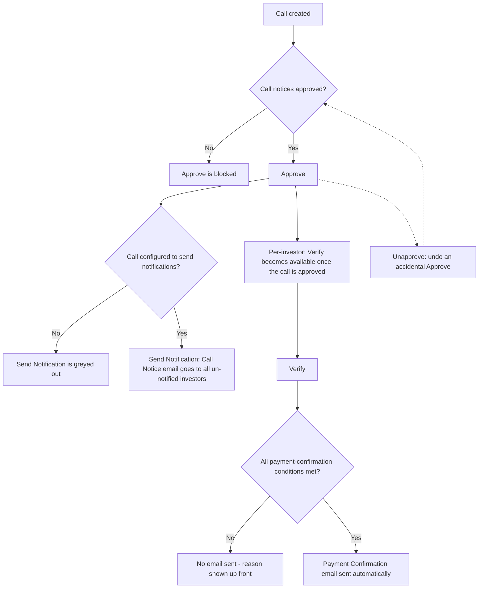

# Capital Call Actions & Notifications — Quick Reference

This is a plain-language reference for everyone who works a capital call end to end: what each button does, when it's available (and when it's greyed out), and exactly what happens with investor emails at each step.

There are **two separate kinds of investor emails** in a capital call, and they're easy to mix up:

1. **Call Notice** — "here's what you owe and by when." Sent at the call level (to everyone at once) or per investor (one at a time).
2. **Payment Confirmation** — "we've received and confirmed your payment." Sent automatically when an investor's payment is verified — there's no separate button for it.

Both kinds of email respect **Sandbox Mode**: if a company account is in Sandbox Mode (used for testing), every email described below is redirected to internal test inboxes instead of the real investor. The screen always shows an orange or red warning when this is active.

---

## 1. Actions on the Capital Call itself

| Button | What it does | When you'll see it | When it's greyed out / hidden | Notes |
|---|---|---|---|---|
| **Approve** | Locks in the call as final and ready to notify investors. Approving does **not** send any email by itself. | Only before the call has been approved. | Hidden if you don't have Approver rights. Blocked (with an error) if any investor's call notice document has been generated but not yet approved — those must be approved first. | This is a one-time gate; once approved, remittances become eligible for Verify and the call-level Send Notification button. |
| **Unapprove** | Reverts an accidentally-approved call back to "not approved," so it can be corrected and approved again. | Only after the call has been approved. Never shown at the same time as Approve. | Hidden if you don't have Approver rights. | Two independent warnings can appear: if any investor has already been sent a Call Notice email, reverting does **not** un-send it; and if fund units have already been allocated for this call, reverting does **not** undo that allocation either. |
| **Send Notification** (a.k.a. "Send Call Notice") | Sends the Call Notice email to every investor on this call who hasn't already received one. | Only after the call is approved. | Greyed out if the call is configured to not send notifications (a setting on the call). | Investors who were already emailed are automatically skipped — this never double-sends the call-level notice. If any investor's commitment is flagged to skip document generation, the screen tells you up front that they'll be excluded too. |

---

## 2. Actions on a single Remittance (one investor's slice of the call)

| Button | What it does | When you'll see it | When it's greyed out | Notes |
|---|---|---|---|---|
| **Verify** | Confirms that this investor's payment has been reviewed and accepted as recorded. This is also the trigger point for the Payment Confirmation email (see section 3). | Per remittance, on the remittance page and in the remittance list. | Greyed out whenever the call has **not** been approved — full stop. Having money already collected does **not** unlock it; the call must be approved first. | Verifying also flags whether the collected amount doesn't match what was called, and warns you before you confirm. If the fund has unit pricing set up, it also tells you this remittance becomes eligible for fund unit allocation once verified. |
| **Unverify** | Reverses a Verify — e.g. if it was done by mistake. | Only after the remittance has been Verified. | Not restricted the same way Verify is — reversing is always allowed. | |
| **Send Call Notification** / **Send Call Reminder** | Sends (or re-sends) the Call Notice email to just this one investor. | Per remittance. | Greyed out if **any** of the following is true: the call isn't approved · the call is set up not to send notifications · this investor's commitment record is flagged to skip document generation · the generated call notice for this investor is still waiting on internal approval · no one at this investor is actually subscribed to receive these emails. The screen tells you which of these applies. | Before it's sent once, the button says "Send Call Notification." After that, it becomes "Send Call Reminder" and can be used again any time — repeat sends are allowed on purpose. |

---

## 3. The Payment Confirmation email — no button, happens automatically

There is **no manual "send" button** for the payment confirmation email. It fires automatically the moment a remittance is marked **Verified**, once per payment recorded against that remittance.

For it to actually reach the investor, **all** of these must be true at the moment of Verify:

| Condition | Plain-language meaning |
|---|---|
| The call is approved | Payments can't be confirmed on a call that hasn't been finalized. Since Verify itself now requires the call to be approved (see section 2), this is always satisfied by the time you reach this screen — listed here for completeness. |
| The call is set up to send payment confirmations | This is a setting on the call — some calls are configured not to send this email at all. |
| At least one payment with a real amount has been recorded | Verifying with nothing recorded has nothing to confirm. |
| Not every recorded payment has already had its confirmation sent | Each payment only ever triggers this confirmation once — once all of them have, there's nothing left to send. |
| Someone at the investor is actually subscribed to receive it | If no contact is set up to receive Capital Call emails, nothing goes out — even though everything else is fine. |

If any of these isn't met, the Verify confirmation screen tells you up front so there are no surprises — you'll know the payment is being recorded, but no email will follow.

---

## 4. At a glance

---

## 5. Open Questions for the Business

Unapprove exists so someone can fix a mistake on a call. But "fix" is ambiguous — the system doesn't currently know *what* was wrong, so it doesn't know what else needs to be undone or redone alongside it. Each question below lays out the real options, not just a gap.

### 1. What should Unapprove actually undo?

Today Unapprove only flips the call's own approved flag. Everything downstream — verified remittances, collected-amount totals, allocated fund units, sent notices — is left exactly as it was, with only a warning shown. Three ways to handle this:

- **A — Leave everything downstream untouched (current behavior).** Fastest, lowest-risk, but means "Unapprove" doesn't really undo much beyond the flag itself — if the mistake was in the call amount or basis, the money already collected and units already allocated were calculated against the *wrong* numbers, and nothing forces a re-check.
- **B — Cascade-unverify every remittance on the call.** Forces every payment to be re-reviewed once the call is corrected and re-approved. Raises a follow-on question: do fund units already allocated from those remittances get pulled back too, or do they stay allocated even though the remittance behind them is no longer verified (a state that shouldn't normally be possible)?
- **C — Cascade-unverify only if the call's terms actually changed before it's re-approved** (call amount, basis, or due date edited between Unapprove and the next Approve). Most correct in spirit — untouched corrections (e.g. fixing a typo in the call name) don't force needless re-review — but requires detecting "did anything material change," which is more to build and more to get wrong.

### 2. If a call is corrected, do investors who were already notified get a corrected notice?

`notification_sent` is a one-way, per-remittance flag — once set, the bulk "Send Notification" will never email that investor again, correction or not. So: someone unapproves a call because the amount was wrong, fixes it, re-approves, clicks Send Notification — and every investor who got the *original, wrong* notice is silently skipped, because they're already marked notified. Three ways to handle this:

- **A — Leave it manual (current behavior).** Whoever handles the correction is responsible for individually using "Send Call Reminder" on each already-notified remittance to get the corrected notice out. Relies entirely on someone remembering to do this.
- **B — Reset `notification_sent` for every remittance whenever a call is Unapproved.** Simple rule, but resets it even when nothing about the notice actually needed to change (e.g. the call was unapproved for an unrelated reason, like fixing a document approval it never should have needed).
- **C — Reset `notification_sent` only for remittances whose call notice document is regenerated after the correction.** More precise — ties the reset to "the actual notice content changed" rather than "the call was touched at all" — but means notice regeneration and Unapprove need to be aware of each other, which they currently aren't.

### 3. Do the already-generated call notice PDFs need to be re-reviewed after a correction?

If a call is Unapproved to fix something, the call notice documents that were already generated and approved reflect the *old* numbers. Nothing today forces those documents to be regenerated or re-approved before the call can be approved again — only the original "not approved" check applies, which a previously-approved-then-untouched document still satisfies.

- **A — Leave it to manual judgment (current behavior).** Whoever corrects the call is trusted to know to regenerate and re-approve the affected notices before sending anything.
- **B — Automatically revert previously-approved notices to "pending approval" when the call is Unapproved.** Forces a second look before the call can be re-approved (the existing "notices pending approval" blocker would then naturally catch it) — but this fires even for corrections that had nothing to do with the notice content.
- **C — Only revert notice approval for remittances whose underlying amounts actually changed.** Most targeted, but again requires the system to detect "what changed" rather than just "something changed."

### 4. Is there a way to fix a bounced or missed Payment Confirmation?

The Call Notice has a built-in "Send Call Reminder" for exactly this. The Payment Confirmation has no equivalent — it fires once, automatically, per payment, ever, with no manual override anywhere in the product.

- **A — Leave it as engineering-only intervention (current behavior).** If an investor says they never got their payment confirmation, someone has to go reset the flag directly rather than through any screen.
- **B — Add a "Resend Payment Confirmation" action per payment**, mirroring the Call Notice's Reminder pattern exactly — consistent with how the rest of the product already handles "notified once, can resend."
- **C — Auto-resend whenever a payment record is edited/corrected after its confirmation already went out** — narrower than a manual resend button, but directly addresses the "the confirmation was wrong because the payment record was wrong" case without adding a new control.

### 5. Should a fund manager find out about missing investor subscriptions before they need to send anything?

"No investor contacts are subscribed to Capital Call notifications" only ever shows up as a grey-out reason at the exact moment someone tries to notify that investor — never before, and the message doesn't link anywhere to fix it.

- **A — Reactive only (current behavior).** Nobody finds out until they try to send and it's blocked — for a call with many investors, this could mean discovering the gap one at a time across many send attempts.
- **B — Add a proactive check surfaced when investors are added to a fund or a call is approved** — "these N investors have no one subscribed to Capital Call emails," so it's caught before it blocks anything downstream.
- **C — Make the grey-out message itself actionable** — link straight to where investor contact subscriptions are managed, so the fix happens in the same flow rather than requiring the user to go find the right screen themselves.

---

*This page intentionally avoids technical detail. If you need to understand exactly how these rules are implemented, ask engineering to point you to the underlying logic.*
