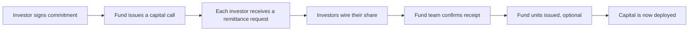
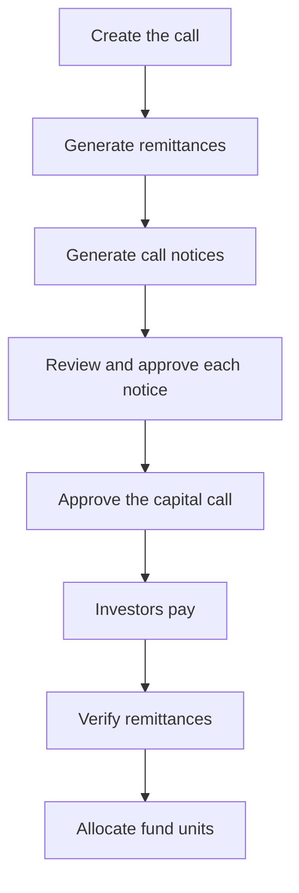
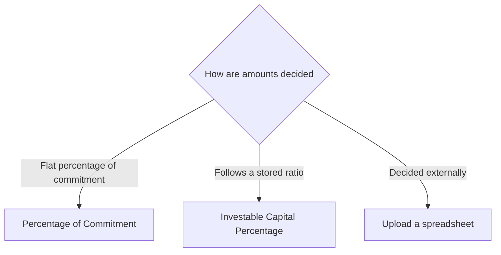
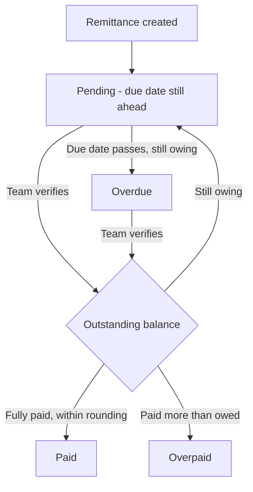
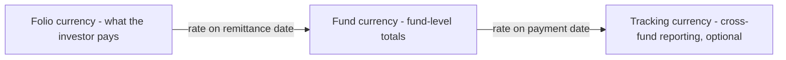

# Capital Calls User Guide

A **capital call** is how a fund draws down the capital that investors have already promised. When the fund is ready to invest or pay expenses, it "calls" a portion of each investor's commitment and asks them to wire the money by a deadline.

This guide walks you through the full journey - issuing a call, working out each investor's share, sending notices, recording the money that comes in, and confirming receipt. No technical background is needed; everything is described in fund-operations terms.

---

## Table of Contents

1. [Where Capital Calls Fit](#where-capital-calls-fit)
2. [Key Terms in Plain English](#key-terms-in-plain-english)
3. [The Capital Call Journey](#the-capital-call-journey)
4. [Creating a Capital Call](#creating-a-capital-call)
5. [How Each Investor's Amount Is Calculated (Call Basis)](#how-each-investors-amount-is-calculated-call-basis)
6. [Calling Different Closes at Different Rates](#calling-different-closes-at-different-rates)
7. [Adding Fees to a Call](#adding-fees-to-a-call)
8. [Generating Investor Remittances](#generating-investor-remittances)
9. [Generating and Approving Call Notices](#generating-and-approving-call-notices)
10. [Approving the Capital Call](#approving-the-capital-call)
11. [Understanding Remittances](#understanding-remittances)
12. [The Remittance Status Lifecycle](#the-remittance-status-lifecycle)
13. [Recording Investor Payments](#recording-investor-payments)
14. [Verifying a Remittance](#verifying-a-remittance)
15. [Working Across Currencies](#working-across-currencies)
16. [Investor Notifications](#investor-notifications)
17. [Allocating Fund Units](#allocating-fund-units)
18. [Refreshing Fees After a Change](#refreshing-fees-after-a-change)
19. [Importing Calls, Remittances and Payments](#importing-calls-remittances-and-payments)
20. [Worked Example, End to End](#worked-example-end-to-end)
21. [Quick Calculation Reference](#quick-calculation-reference)
22. [Frequently Asked Questions](#frequently-asked-questions)

---

## Where Capital Calls Fit

When investors join a fund they sign a **commitment** - a legal promise to provide up to a certain amount of capital over the fund's life. That money usually isn't transferred all at once. Instead, the fund draws it down in instalments as it finds deals and incurs costs. Each instalment is a **capital call** (sometimes called a *drawdown* or *capital drawdown*).

Over a fund's life there are usually many capital calls, each drawing down a slice of the total commitment until the fund is fully called.

---

## Key Terms in Plain English

| Term | What it means |
|------|---------------|
| **Capital Call** | The fund-wide instruction to draw down capital - "we are calling 25% of commitments." |
| **Remittance** | One investor's slice of a capital call - the amount that *this* investor owes for *this* call. There is one remittance per investor commitment. |
| **Remittance Payment** | A single transfer of money an investor makes against their remittance. A remittance can be paid in one or several payments. |
| **Call Fee** | A charge bundled into or alongside the call - for example a management fee or upfront fee. |
| **Folio** | An investor's individual account within the fund, identified by a **Folio ID**. One investor can hold several folios. |
| **Fund Close** | A closing round of the fund (First Close, Second Close, and so on). Investors are grouped by the close they joined. |
| **Call Basis** | The method used to work out each investor's share of the call. |
| **Verified** | The fund team's confirmation that the money has arrived and the remittance is correct. |
| **Committed / Called / Collected** | *Committed* is what the investor promised in total; *called* is what has been requested so far; *collected* is what has actually been received. |

---

## The Capital Call Journey

A capital call moves through a clear sequence of stages. Up to the point of approval you can freely edit it; once approved, it locks so that the figures investors received can never silently change.

> **Why approval locks the call:** once notices have gone out, investors are acting on those numbers. Locking prevents the amounts, due dates, or investor list from changing after the fact, which protects everyone's audit trail.

---

## Creating a Capital Call

Open a **Fund** and click **New Capital Call**.

### Required information

| Field | What to enter |
|-------|---------------|
| **Name** | A unique label for this call within the fund (e.g. "Drawdown 3 - Q2 2026"). Duplicates are not allowed. |
| **Call Date** | The date the call is issued. Defaults to today. Also used as the default exchange-rate date. |
| **Due Date** | The deadline by which investors must pay. Defaults to two weeks out. |
| **Call Basis** | How each investor's amount is worked out - see [Call Basis](#how-each-investors-amount-is-calculated-call-basis). |
| **Fund Closes** | Which closing rounds this call applies to. Required for every basis except "Upload". |
| **Percentage Called** | For the "Percentage of Commitment" basis, the percentage of each investor's commitment to draw (cannot exceed 100%). |

### Optional settings

| Field | What it does |
|-------|--------------|
| **Notes** | Internal notes, not shown to investors. |
| **Send Call Notice** | Email investors when the call is approved. Default **Yes**. |
| **Send Payment Notification** | Email investors when their payment is received and confirmed. Default **Yes**. |
| **Generate Remittances** | Automatically create one remittance per investor on save. Default **Yes**. |
| **Remittances Verified** | Create remittances already marked as paid and verified - useful for loading historical calls that were settled long ago. |
| **Call Fees** | Fees to include in the call - see [Adding Fees](#adding-fees-to-a-call). |
| **Unit Prices** | The per-unit price and premium for each unit class, used when allocating fund units. |

### Rules to keep in mind

- The call name must be unique within the fund.
- Both Call Date and Due Date are required.
- Percentage Called cannot exceed 100%.
- Fund Closes must be chosen for every basis except "Upload".
- If you later change the percentage or total amount, the system re-queues remittance generation automatically.

---

## How Each Investor's Amount Is Calculated (Call Basis)

The **Call Basis** decides how the fund's draw is split among investors. There are three approaches.

### Option 1 - Percentage of Commitment

The most common method: call the same percentage of every investor's commitment.

> **Investor's call = Percentage Called × Committed Amount, plus any fees.**

You enter one percentage (say 25%), and each investor is asked for that share of what they committed. Different closes can be called at different percentages - see the next section.

**Example:** an investor who committed $4,000,000, called at 25%, owes **$1,000,000** before fees.

### Option 2 - Investable Capital Percentage (account-entry basis)

Used when each investor's share should follow a stored ratio rather than a flat percentage of commitment - for example their share of *investable* capital after excused or defaulting investors are removed.

> **Investor's call = Investor's stored share % × Total Amount To Be Called, plus any fees.**

You set one **Total Amount To Be Called** for the whole fund, and each investor's share comes from their most recent "Investable Capital Percentage" figure on or before the due date. If an investor has no such figure, their call is zero.

### Option 3 - Upload

For when amounts are decided outside the system (e.g. supplied by a fund administrator).

- Nothing is calculated automatically.
- You upload a spreadsheet with each investor's exact call amount, fees, and any investment amount.
- The figures from the file are used exactly as given.

---

## Calling Different Closes at Different Rates

A fund often closes in several rounds. Later investors may be "trued up" so that, over time, everyone reaches the same called percentage - which means a single call can apply different rates to different closes.

- When you select specific closes, only investors in those closes receive a remittance.
- You can give each close its own percentage.

**Example:**

| Fund Close | Percentage Called |
|------------|-------------------|
| First Close | 25% |
| Second Close | 10% |
| Third Close | *not included in this call* |

Selecting **All** applies one percentage to every investor in the fund.

---

## Adding Fees to a Call

Call fees let you bundle charges - such as management fees - into a capital call. Each fee is attached to the call and worked out per investor.

### Fee types

| Fee type | How it behaves |
|----------|----------------|
| **Fees Part Of Capital** | Added into the investor's call amount. Counts toward the money they transfer and toward called capital. |
| **Other Fees** | Charged in addition to the call amount and shown as a separate line (e.g. a late-payment charge). |
| **Investment Amount** | A portion of the call earmarked as a direct investment. Added alongside capital fees. |

### How a fee amount is found

The standard approach links a fee to a **named charge** already recorded against each investor. You give the fee a **name**, a **start date**, and an **end date**, and the system adds up every matching charge dated within that window. This is how recurring management fees and one-off upfront fees are typically applied.

> For unusual fee arrangements, your CapHive support team can configure a custom calculation on your behalf. Day-count management-fee calculations are supported.

### Fee transparency

For every investor, the system keeps a full breakdown of exactly which charges made up each fee - name, date, and amount - so any fee figure can be traced back to its components if an investor queries it.

---

## Generating Investor Remittances

When you save a capital call (or change its percentage or total), the system creates one **remittance** per eligible investor.

### Who is "eligible"

An investor receives a remittance when:

- Their commitment belongs to one of the call's selected fund closes, **and**
- They don't already have a remittance for this call. (Generation never creates duplicates - running it again is safe.)

### Generation options

| Setting | Result |
|---------|--------|
| **Generate Remittances = Yes** | Remittances are created automatically when you save (default). |
| **Generate Remittances = No** | You add remittances yourself, manually or by upload. |
| **Remittances Verified = Yes** | Remittances are created already verified and marked Paid, with a matching payment recorded. Use this only for loading settled, historical calls. |

> **Tip:** generation runs in the background. Give it a moment, then refresh the capital call page to see the remittance list.

---

## Generating and Approving Call Notices

A **call notice** is the personalised letter each investor receives telling them how much to pay and by when. Notices must be produced and approved *before* you approve the call.

### Producing notices

**For the whole call:** open the call and choose **Actions → Generate Documents**. The system creates one notice per investor in the background using your fund's **Call Template**.

**For a single investor:** open that remittance and click **Generate Docs**.

### Prerequisites

- A document template tagged **"Call Template"** must exist for the fund (or for the specific commitment).
- The investor must have a verified **KYC record**.
- If your fund is set to send notices "per KYC", investors with several folios receive a single combined notice instead of one per folio.

### Approving each notice

Every generated notice must be reviewed and **approved** individually:

1. Open a remittance and go to its **Documents** tab.
2. Read the notice and click **Approve**.
3. Repeat for every investor.

Only **approved** notices are attached to the investor email. Requiring explicit approval guarantees a person has reviewed each letter before it reaches an investor. Any notice left unapproved will block the call's approval.

---

## Approving the Capital Call

Approval is the formal "go" step. It sends the notices and locks the call.

### Before you approve, confirm

1. Notices have been generated and **every** one is approved.
2. The due date, amounts, and investor list are correct - these cannot be changed afterwards.

### Approving

1. Open the capital call.
2. Choose **Actions → Approve**.
3. The system checks that all notices are approved. If any are outstanding, approval is blocked with a clear message and you'll need to approve those notices first.
4. Once approved, the call locks and records who approved it.

> **If Approve is greyed out:** your organisation may have a review workflow configured for capital call approvals. If so, this call must complete that review before Approve becomes available again. Check the call's Workflow tab to see the review's current status — see the [Workflow Templates guide](workflow_templates_user_guide.md) for details.

### What happens on approval

- If **Send Call Notice** is on, investors with an outstanding remittance receive their notice email (unless that investor is set to skip notices).
- The approved notice document is attached to the email.
- The approved status becomes visible to investors in their portal.
- **Edit, Delete, Refresh Fees, and Generate Documents are disabled.** Allocating fund units remains available.

If a notice needs correcting after approval, that has to be handled outside the system - by then investors already hold the original figures.

---

## Understanding Remittances

A remittance is one investor's record for one capital call. It shows:

- **Call Amount** - what they owe (base call + capital fees + any investment amount).
- **Other Fee** - anything charged separately.
- **Collected Amount** - how much has come in so far.
- **Outstanding Balance** - Call Amount + Other Fee − Collected Amount.
- **Status** - Pending, Paid, Overdue, or Overpaid.

### Key fields

| Field | What it tells you |
|-------|-------------------|
| **Folio ID** | The investor's account in this fund. Appears once per call. |
| **Call Amount** | Total to be transferred (base + capital fees + investment amount). |
| **Capital Fee** | The fee portion bundled into the call amount. |
| **Other Fee** | Anything charged on top of the call amount. |
| **Investment Amount** | Portion of the call earmarked as a direct investment. |
| **Collected Amount** | Running total received. |
| **Outstanding Balance** | What is still owed. |
| **Committed Amount** | The investor's commitment captured at the time the remittance was created. |
| **Remittance Date** | The date used for currency conversion (defaults to the call date). |
| **Payment Date** | The date of the most recent payment received. |
| **Verified** | Whether the team has confirmed receipt. |
| **Notification Sent** | Whether the notice email has gone out. |
| **Arrear Amount** | Any unpaid balance carried over from an earlier call. |
| **Percentage** | The effective percentage of commitment this call represents for the investor. |

### Two currencies, always

Every remittance keeps amounts in two currencies:

- **Folio currency** - the currency the investor committed and pays in. This is what they actually wire.
- **Fund currency** - the fund's base currency, used for fund-level totals. Converted using the exchange rate on the remittance date.

---

## The Remittance Status Lifecycle

| Status | When it applies |
|--------|-----------------|
| **Pending** | Not yet verified, due date today or later. |
| **Overdue** | Not yet verified, due date has passed. |
| **Paid** | Verified and settled (a small rounding tolerance is allowed so tiny currency differences don't block "Paid"). |
| **Overpaid** | Verified, but more was received than was owed. |

A daily background process automatically flips unpaid **Pending** remittances to **Overdue** once their due date passes, so your overdue list is always current without manual effort.

---

## Recording Investor Payments

A payment records actual money received from an investor. A remittance can have several payments if the investor pays in instalments.

### Adding a payment

1. Open the remittance.
2. Click **New Payment**.
3. Enter:

| Field | What to enter |
|-------|---------------|
| **Amount (Folio Currency)** | The amount received, in the investor's currency. This is the main figure. |
| **Payment Date** | When the money was received. |
| **Reference No** | Bank or transaction reference. Must be unique within the fund. |
| **Notes** | Optional internal notes. |
| **Payment Proof** | Attach a bank statement, confirmation, or screenshot. |

### How currency is handled

- Enter the amount in the **folio (investor) currency**.
- The system converts it to the **fund currency** using the exchange rate on the payment date.
- If you supply both currency amounts yourself (typically via import), conversion is skipped.

### Effect on the remittance

- The **Collected Amount** updates automatically - no manual recalculation.
- The remittance's payment date moves to match the most recent payment.

### Deleting a payment

A payment **cannot be deleted** once fund units have been allocated against it. Adjust or remove the unit allocation first. Reference numbers must stay unique within the fund.

---

## Verifying a Remittance

Verification is the team's confirmation that the money arrived and the figures are right.

### To verify

1. Open the remittance.
2. Click **Verify**.
3. The system refreshes the fees, recalculates the call amount, updates the status (Paid / Overdue / Overpaid), sets the payment date, and - if enabled - emails the investor a payment-received confirmation.
4. Clicking **Verify** again removes verification (it's a toggle).

### Automatic re-check on new payments

When you add a payment to an already-verified remittance, the system **un-verifies** it so someone reviews the new total before re-confirming. Just re-verify once you've checked the updated figure.

---

## Working Across Currencies

The system fully supports investors paying in different currencies from the fund's own.

- **Folio currency** - set on the commitment; everything investor-facing uses it.
- **Fund currency** - the fund's base currency; fund totals roll up here.
- **Tracking currency** - an optional reporting currency for dashboards that span multiple funds.

Amounts are stored and shown in each relevant currency, so you never have to convert by hand.

---

## Investor Notifications

The system can email investors automatically at key moments.

### Call notice

- **Sent when:** the call is approved (if **Send Call Notice** is on).
- **To:** each investor with an outstanding remittance, unless their commitment is set to **Skip Call Notice**.
- **Contains:** the fund and call name, the approved notice document, and any documents you attached manually. A custom subject and body are used if your fund has a notification template.

**Reminders:** click **Send Reminder** on the call to re-send to everyone still Pending or Overdue (the subject is prefixed "Reminder:"). You can also remind a single investor from their remittance. Once a notice has been sent to an investor, later sends are treated as reminders automatically.

### Payment-received confirmation

- **Sent when:** a remittance is verified (or a payment is added to an already-verified remittance).
- **To:** the investor.
- **Conditions:** **Send Payment Notification** is on, the remittance is verified, the payment is positive, and a confirmation hasn't already been sent for that payment.

### Skipping notices for an investor

Set **Skip Call Notice = Yes** on a commitment to permanently exclude that investor from call and reminder emails - handy for internal or fund-of-funds investors who don't need these communications.

### Notification summary

| Event | Trigger | Who receives it | Controlled by |
|-------|---------|-----------------|---------------|
| Call issued | Call approved | Investors with outstanding remittances | Send Call Notice + Skip Call Notice |
| Reminder | "Send Reminder" clicked | Pending / Overdue investors | Same as above |
| Single reminder | From a remittance | One investor | Same as above |
| Payment received | Remittance verified | The investor | Send Payment Notification |

---

## Allocating Fund Units

If your fund issues units to investors based on the capital they contribute:

- **For the whole call:** open the call and click **Allocate Units**.
- **For one investor:** open the remittance and click **Allocate Units**.

How much is allocated:

- If the investor has paid **at least** the full call amount, units are allocated for the **call amount** (you can't allocate more than was called).
- If they've paid **less**, units are allocated for the **amount actually collected**.
- Already-allocated amounts are tracked, so partial allocations can build up over time as more money arrives.

Once units are allocated against a payment, that payment can't be deleted until the allocation is undone - and the remittance can't be deleted while any of its payments have units.

---

## Refreshing Fees After a Change

If you correct or backdate the charges behind a fee *after* remittances exist, those remittances can show stale figures. Use **Refresh Fees** (also labelled **Recompute Call**) to bring them up to date.

1. Open the capital call.
2. Click **Refresh Fees**.
3. The system re-reads the charges in each fee's date range, recalculates fees and call amounts, and updates every status.
4. If anything goes wrong, the person who triggered it receives an email with the details.

> **Before refreshing:** if investors have already been told their amounts, decide whether they need to be re-notified of the change. Refresh is not available once a call is approved.

---

## Importing Calls, Remittances and Payments

You can bulk-load data from spreadsheets. This is mainly for onboarding historical activity or working from an administrator's file.

### Importing capital calls

Each row creates a call. Key columns: Fund, Name (unique per fund), Percentage Called (comma-separated for multiple closes), Due Date, Call Date, Fund Closes (blank means All), Generate Remittances (Yes/No), Remittances Verified (Yes/No), Call Basis, optional Unit Price/Premium, Send Call Notice, and Send Payment Notification.

- A duplicate call name in the same fund is rejected.
- If you list several closes and several percentages, they pair up in order (First Close → first percentage, and so on).
- You can include an **Exchange Rates** sheet to set rates for multi-currency funds.

### Importing remittances

Key columns: Stakeholder (investor), Fund, Capital Call, Call Amount in folio currency (inclusive of capital fees), Capital Fees, Other Fees, optional fund-currency overrides, Investment Amount, Remittance Date, Verified, and Folio No. The investor must already have a commitment in that fund under the given folio. Imported remittances use the "Upload" basis.

### Importing payments

Key columns: Stakeholder, Fund, Capital Call, Amount (folio currency), Currency, optional fund-currency amount, Folio No *or* Virtual Bank Account, Verified, Reference No, Payment Date, Notes, and Update Only.

- Either a Folio No or a Virtual Bank Account is required.
- The currency must match the investor's commitment currency.
- Reference numbers must be unique within the fund.
- An identical payment (same fund, remittance, amount, reference, and date) won't be duplicated.
- With **Update Only = Yes**, rows that don't match an existing payment are skipped.

---

## Worked Example, End to End

**Setup**

- Fund: *Acme Growth Fund I*, base currency **USD**.
- Three investors:

| Investor | Close | Commitment | Folio currency |
|----------|-------|-----------|----------------|
| Northwind LP | First Close | $5,000,000 | USD |
| Briar Capital | First Close | $3,000,000 | USD |
| Kestrel Family Office | Second Close | $2,000,000 | EUR (committed €1,850,000) |

**The call**

The fund issues "Drawdown 2", basis *Percentage of Commitment*, calling **First Close at 20%** and **Second Close at 12%**, plus a **1% management fee** as *Fees Part Of Capital*.

**Resulting remittances**

| Investor | Base call | Management fee (1% of commitment) | Total call amount |
|----------|-----------|-----------------------------------|-------------------|
| Northwind LP | 20% × $5.0M = $1,000,000 | $50,000 | **$1,050,000** |
| Briar Capital | 20% × $3.0M = $600,000 | $30,000 | **$630,000** |
| Kestrel (in EUR) | 12% × €1.85M = €222,000 | €18,500 | **€240,500** |

Kestrel pays in euros; their **€240,500** is also shown in USD on the fund's books using the exchange rate on the remittance date.

**Payment and status**

- Northwind wires $1,050,000 → after verification, status **Paid**.
- Briar wires only $600,000 → outstanding $30,000; after the due date it shows **Overdue** until the balance arrives.
- Kestrel wires €240,600 (slightly too much) → after verification, status **Overpaid** by €100.

**Capital raised on this call:** $1,050,000 + $600,000 + USD-equivalent of €240,500.

---

## Quick Calculation Reference

These are the same calculations described above, gathered in one place for reference.

**Percentage-of-commitment call**

> Call amount = (Percentage ÷ 100) × Committed amount + Capital fees + Investment amount

**Account-entry (Investable Capital %) call**

> Call amount = Total amount to be called × (Investor's stored share ÷ 100) + Capital fees + Investment amount

**Upload call**

> Call amount is taken from the file; the effective percentage is back-calculated as Call amount ÷ Committed amount (capped at 100%).

**Outstanding balance**

> Outstanding = Call amount + Other fee − Collected amount

**Percentage raised (call level)**

> Percentage raised = Collected amount ÷ Call amount × 100

**Status (after verification)**

> Fully paid → **Paid** · Paid more than owed → **Overpaid** · Still owing, due date past → **Overdue** · Still owing, due date ahead → **Pending**

Fund-, call-, and commitment-level totals (called and collected) are kept in step automatically as remittances and payments change - you never tally them by hand.

---

## Frequently Asked Questions

**Can I add a remittance for an investor who was missed?**
Yes. On the call's Remittances tab, click **New Remittance** and pick the investor. The amount is worked out automatically from the call basis.

**What if I change the percentage after remittances exist?**
For the percentage-of-commitment basis, the system re-queues generation for missing remittances. Existing remittances aren't changed automatically - use **Refresh Fees** to bring them up to date.

**Can one investor have two remittances on the same call?**
No. Each folio appears once per call.

**What if an investor overpays?**
The remittance shows **Overpaid**. You can record a negative adjustment or carry the excess forward to a future call.

**Can I send the notice without approving the call?**
No. Notices go out on approval (or as a manual reminder afterwards).

**What does "Skip Call Notice" do?**
It permanently stops call and reminder emails for that commitment - useful for internal or fund-of-funds investors.

**Can I edit a call after approval?**
No. Approved calls are fully locked to protect the figures investors received. Corrections after approval must be handled outside the system.

**Can I generate notices after approval?**
No. Notices are produced before approval. The intended order is: generate notices → approve each → approve the call.

**I forgot to approve the notices - what happens?**
Approval is blocked with a message telling you there are unapproved notices. Approve them on each remittance's Documents tab, then try again.

**What's the difference between Call Date and Due Date?**
Call Date is when the call is issued (and the default date for currency conversion). Due Date is the payment deadline - unpaid remittances become Overdue after it.

**Can I delete a capital call?**
Only an unapproved call, and only if none of its remittances have allocated fund units. Remove unit allocations first.

**What exactly does "Refresh Fees" do?**
It re-reads the charges in each fee's date range and recalculates every investor's fees, call amounts, and statuses. Use it after correcting or backdating fee figures. It isn't available on approved calls.
