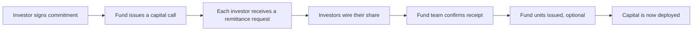
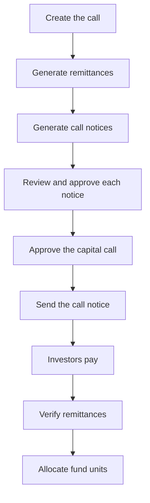
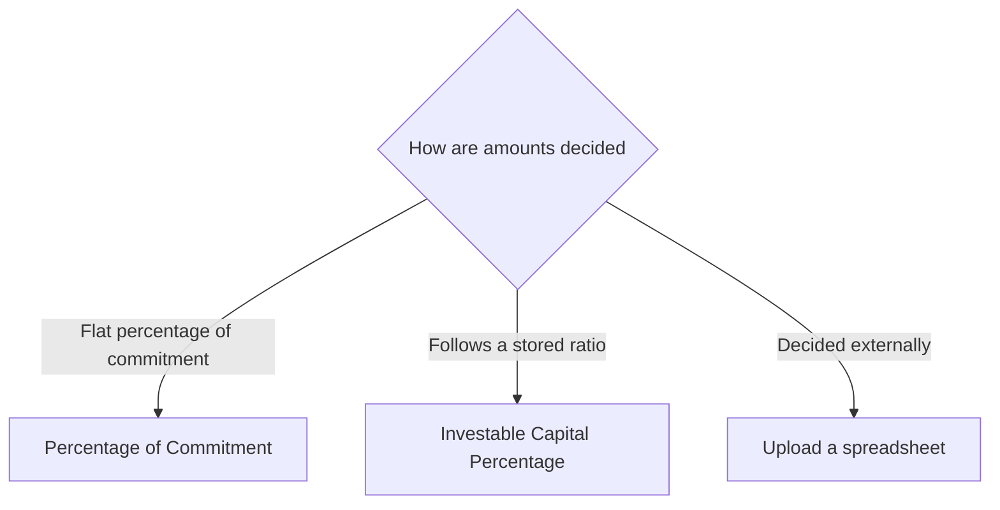
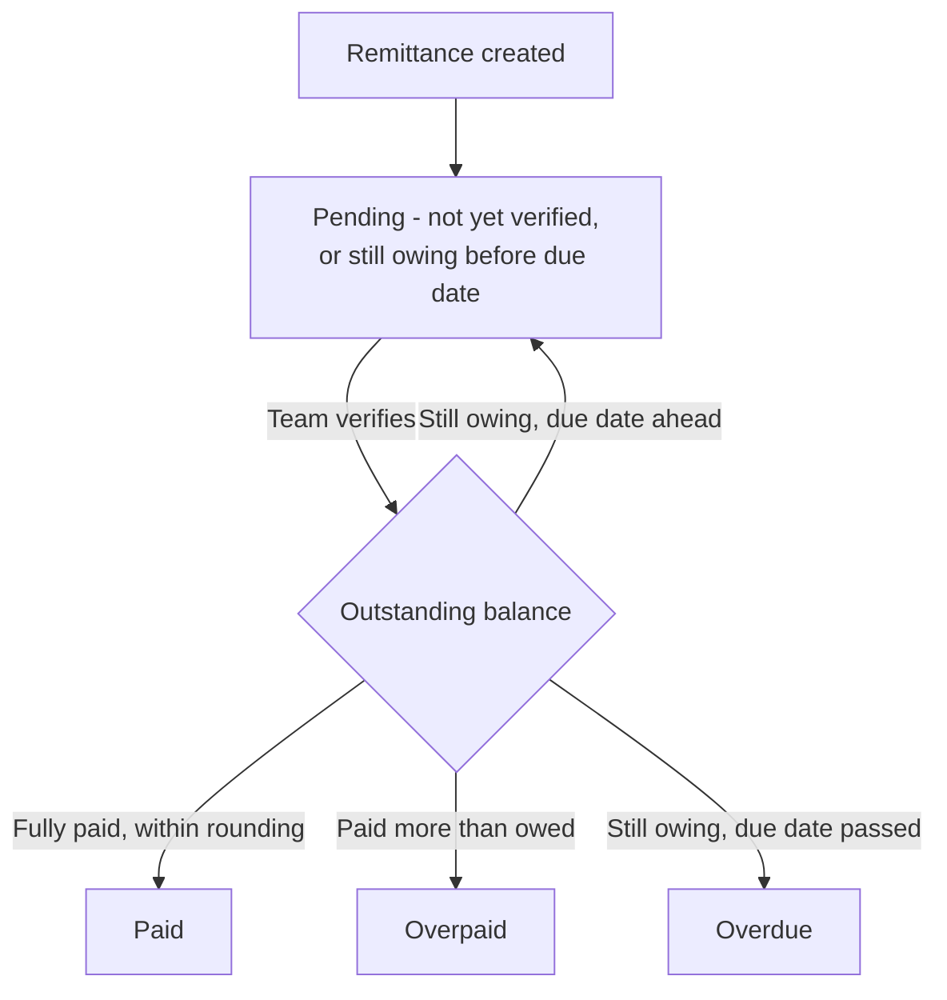
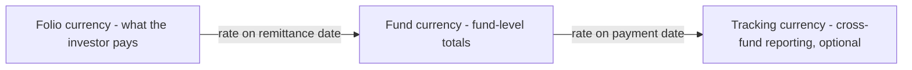
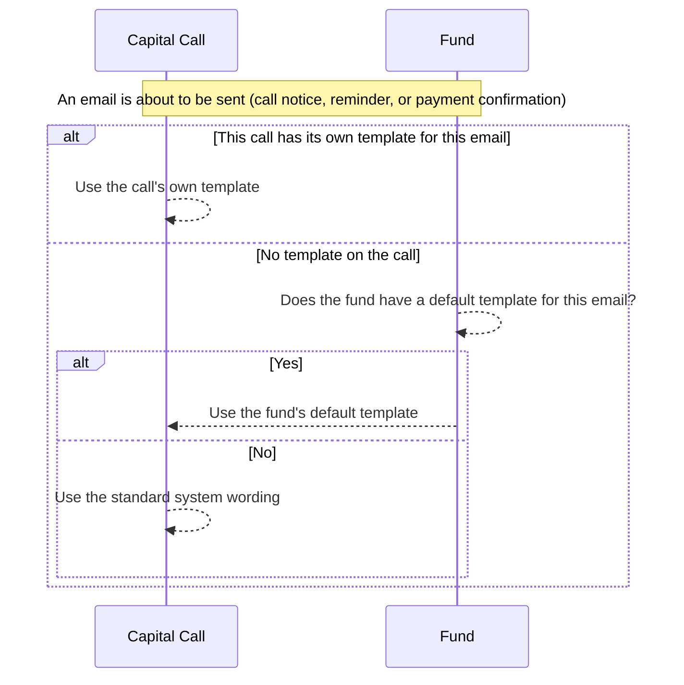

# Capital Calls User Guide

A **capital call** is how a fund draws down the capital that investors have already promised. When the fund is ready to invest or pay expenses, it "calls" a portion of each investor's commitment and asks them to wire the money by a deadline.

> **Where to find it:** Sidebar → [**Funds → Funds**](/funds) → open the fund → **Calls** tab. Create one with **New Call** on that tab; open a call to reach its **Actions** dropdown (Generate Documents, Approve, Send Notification, Allocate Units, Recompute Call). Needs the **Funds** module plus an access right on the fund with create/update permission; approving also needs the **approver** role.

This guide walks you through the full journey - issuing a call, working out each investor's share, sending notices, recording the money that comes in, and confirming receipt. No technical background is needed; everything is described in fund-operations terms.

---

## Table of Contents

1. [Where Capital Calls Fit](#where-capital-calls-fit)
2. [Key Terms in Plain English](#key-terms-in-plain-english)
3. [The Capital Call Journey](#the-capital-call-journey)
4. [Creating a Capital Call](#creating-a-capital-call)
5. [How Each Investor's Amount Is Calculated (Call Basis)](#how-each-investors-amount-is-calculated-call-basis)
6. [Calling Different Closes at Different Rates](#calling-different-closes-at-different-rates)
7. [Adding Fees to a Call](#adding-fees-to-a-call)
8. [Generating Investor Remittances](#generating-investor-remittances)
9. [Generating and Approving Call Notices](#generating-and-approving-call-notices)
10. [Approving the Capital Call](#approving-the-capital-call)
11. [Sending the Call Notice](#sending-the-call-notice)
12. [Understanding Remittances](#understanding-remittances)
13. [The Remittance Status Lifecycle](#the-remittance-status-lifecycle)
14. [Recording Investor Payments](#recording-investor-payments)
15. [Verifying a Remittance](#verifying-a-remittance)
16. [Bulk Actions on Remittances](#bulk-actions-on-remittances)
17. [Working Across Currencies](#working-across-currencies)
18. [Investor Notifications](#investor-notifications)
19. [Allocating Fund Units](#allocating-fund-units)
20. [Refreshing Fees After a Change](#refreshing-fees-after-a-change)
21. [Importing Calls, Remittances and Payments](#importing-calls-remittances-and-payments)
22. [Worked Example, End to End](#worked-example-end-to-end)
23. [Quick Calculation Reference](#quick-calculation-reference)
24. [Frequently Asked Questions](#frequently-asked-questions)

---

## Where Capital Calls Fit

When investors join a fund they sign a **commitment** - a legal promise to provide up to a certain amount of capital over the fund's life. That money usually isn't transferred all at once. Instead, the fund draws it down in instalments as it finds deals and incurs costs. Each instalment is a **capital call** (sometimes called a *drawdown* or *capital drawdown*).

Over a fund's life there are usually many capital calls, each drawing down a slice of the total commitment until the fund is fully called.

---

## Key Terms in Plain English

| Term | What it means |
|------|---------------|
| **Capital Call** | The fund-wide instruction to draw down capital - "we are calling 25% of commitments." |
| **Remittance** | One investor's slice of a capital call - the amount that *this* investor owes for *this* call. There is one remittance per investor commitment. |
| **Remittance Payment** | A single transfer of money an investor makes against their remittance. A remittance can be paid in one or several payments. |
| **Call Fee** | A charge bundled into or alongside the call - for example a management fee or upfront fee. |
| **Folio** | An investor's individual account within the fund, identified by a **Folio ID**. One investor can hold several folios. |
| **Fund Close** | A closing round of the fund (First Close, Second Close, and so on). Investors are grouped by the close they joined. |
| **Call Basis** | The method used to work out each investor's share of the call. |
| **Verified** | The fund team's confirmation that the money has arrived and the remittance is correct. |
| **Committed / Called / Collected** | *Committed* is what the investor promised in total; *called* is what has been requested so far; *collected* is what has actually been received. |

---

## The Capital Call Journey

A capital call moves through a clear sequence of stages. Approval is the formal sign-off: once a call is approved, **Generate Documents** is hidden, and although **Edit**, **Delete** and **Recompute Call** stay available, investors are never re-notified automatically when figures change.

> **Why approval matters:** once notices have gone out, investors are acting on those numbers, so treat an approved call with care; to correct one, an approver can **Unapprove** it first. Approving the call and sending its notice are two separate, deliberate steps — see [Approving the Capital Call](#approving-the-capital-call) and [Sending the Call Notice](#sending-the-call-notice).

---

## Creating a Capital Call

Open a **Fund**, go to its **Calls** tab and click **New Call**.

### Required information

| Field | What to enter |
|-------|---------------|
| **Name** | A unique label for this call within the fund (e.g. "Drawdown 3 - Q2 2026"). Duplicates are not allowed. |
| **Call Date** | The date the call is issued. Defaults to today. Also used as the default exchange-rate date. |
| **Due Date** | The deadline by which investors must pay. Defaults to two weeks out. |
| **Call Basis** | How each investor's amount is worked out - see [Call Basis](#how-each-investors-amount-is-calculated-call-basis). |
| **Fund Closes** (form label **Applicable To**) | Which closing rounds this call applies to. Required for every basis except "Upload". |
| **Percentage Called** | For the "Percentage of Commitment" basis, the percentage of each investor's commitment to draw (cannot exceed 100%). |

### Optional settings

| Field | What it does |
|-------|--------------|
| **Notes** | Internal notes, not shown to investors. |
| **Send Call Notice** | Whether **Send Notification** (after approval) is allowed to email investors at all. Default **Yes**. |
| **Send Payment Notification** | Email investors when their payment is received and confirmed. Default **Yes**. |
| **Generate Remittances** | Automatically create one remittance per investor on save. Default **Yes**; not on the form, so it can only be set to No through the call import. |
| **Remittances Verified** | Create remittances already marked as paid and verified - useful for loading historical calls that were settled long ago. Set only through the call import. |
| **Call Fees** | Fees to include in the call - see [Adding Fees](#adding-fees-to-a-call). |
| **Unit Prices** | The per-unit price and premium for each unit class, used when allocating fund units. |

### Rules to keep in mind

- The call name must be unique within the fund.
- Both Call Date and Due Date are required.
- Percentage Called cannot exceed 100%.
- Fund Closes must be chosen for every basis except "Upload".
- If you later change the percentage, total amount or fund closes, the system re-runs generation for any folio still missing a remittance; existing remittances are not recalculated (use **Recompute Call**).

---

## How Each Investor's Amount Is Calculated (Call Basis)

The **Call Basis** decides how the fund's draw is split among investors. There are three approaches.

### Option 1 - Percentage of Commitment

The most common method: call the same percentage of every investor's commitment.

> **Investor's call = Percentage Called × Committed Amount, plus any fees.**

You enter one percentage (say 25%), and each investor is asked for that share of what they committed. Different closes can be called at different percentages - see the next section.

**Example:** an investor who committed $4,000,000, called at 25%, owes **$1,000,000** before fees.

### Option 2 - Investable Capital Percentage (account-entry basis)

Used when each investor's share should follow a stored ratio rather than a flat percentage of commitment - for example their share of *investable* capital after excused or defaulting investors are removed.

> **Investor's call = Investor's stored share % × Total Amount To Be Called, plus any fees.**

You set one **Total Amount To Be Called** for the whole fund, and each investor's share comes from their most recent "Investable Capital Percentage" figure on or before the due date. If an investor has no such figure, their call is zero.

### Option 3 - Upload

For when amounts are decided outside the system (e.g. supplied by a fund administrator).

- Nothing is calculated automatically.
- You upload a spreadsheet with each investor's exact call amount, fees, and any investment amount.
- The figures from the file are used exactly as given.

---

## Calling Different Closes at Different Rates

A fund often closes in several rounds. Later investors may be "trued up" so that, over time, everyone reaches the same called percentage - which means a single call can apply different rates to different closes.

- When you select specific closes, only investors in those closes receive a remittance.
- You can give each close its own percentage.

**Example:**

| Fund Close | Percentage Called |
|------------|-------------------|
| First Close | 25% |
| Second Close | 10% |
| Third Close | *not included in this call* |

Selecting **All** applies one percentage to every investor in the fund.

---

## Adding Fees to a Call

Call fees let you bundle charges - such as management fees - into a capital call. Each fee is attached to the call and worked out per investor.

### Fee types

| Fee type | How it behaves |
|----------|----------------|
| **Fees Part Of Capital** | Added into the investor's call amount. Counts toward the money they transfer and toward called capital. |
| **Other Fees** | Charged in addition to the call amount and shown as a separate line (e.g. a late-payment charge). |
| **Investment Amount** | A portion of the call earmarked as a direct investment. Added alongside capital fees. |

### How a fee amount is found

The standard approach links a fee to a **named charge** already recorded against each investor. You give the fee a **name**, a **start date**, and an **end date**, and the system adds up every matching charge dated within that window. This is how recurring management fees and one-off upfront fees are typically applied.

> For unusual fee arrangements, your CapHive support team can configure a custom calculation on your behalf. Day-count management-fee calculations are supported.

### Fee transparency

For every investor, the system keeps a full breakdown of exactly which charges made up each fee - name, date, and amount - so any fee figure can be traced back to its components if an investor queries it.

---

## Generating Investor Remittances

When you save a capital call (or change its percentage or total), the system creates one **remittance** per eligible investor.

### Who is "eligible"

An investor receives a remittance when:

- Their commitment belongs to one of the call's selected fund closes, **and**
- They don't already have a remittance for this call. (Generation never creates duplicates - running it again is safe.)

### Generation options

| Setting | Result |
|---------|--------|
| **Generate Remittances = Yes** | Remittances are created automatically when you save (default). |
| **Generate Remittances = No** (import only) | You add remittances yourself, manually or by upload. |
| **Remittances Verified = Yes** (import only) | Remittances are created already verified and marked Paid, with a matching payment recorded. Use this only for loading settled, historical calls. |

> **Tip:** generation runs in the background. Give it a moment, then refresh the capital call page to see the remittance list.

---

## Generating and Approving Call Notices

A **call notice** is the personalised letter each investor receives telling them how much to pay and by when. Notices must be produced and approved *before* you approve the call.

### Producing notices

**For the whole call:** open the call and choose **Actions → Generate Documents**. The system creates one notice per investor in the background using your fund's **Call Template**.

**For a single investor:** open that remittance and choose **Actions → Generate Documents**.

### Prerequisites

- A document template tagged **"Call Template"** must exist for the fund (or for the specific commitment). Add one with the fund's **Actions → Misc → New Template**; see [Document Templates](document_templates_user_guide).
- The investor must have a verified **KYC record**.
- If your fund is set to send notices "per KYC", investors with several folios receive a single combined notice instead of one per folio.

### Approving each notice

Every generated notice must be reviewed and **approved** individually:

1. Open a remittance and go to its **Documents** tab.
2. Read the notice and click **Approve**.
3. Repeat for every investor.

Only **approved** notices are attached to the investor email. Requiring explicit approval guarantees a person has reviewed each letter before it reaches an investor. Any notice left unapproved will block the call's approval.

---

## Approving the Capital Call

Approval is the formal "go" step. Sending the call notice to investors is a
**separate step you trigger afterwards** — see [Sending the Call Notice](#sending-the-call-notice)
below.

### Before you approve, confirm

1. Notices have been generated and **every** one is approved.
2. The due date, amounts, and investor list are correct - investors are not re-notified automatically if they change afterwards.

### Approving

1. Open the capital call.
2. Choose **Actions → Approve**.
3. The system checks that all notices are approved. If any are outstanding, approval is blocked with a clear message and you'll need to approve those notices first.
4. Once approved, the call records who approved it. No email goes out yet.

> **If Approve is greyed out:** your organisation may have a review workflow configured for capital call approvals. If so, this call must complete that review before Approve becomes available again. Check the call's Workflow tab to see the review's current status — see the [Workflow Templates guide](workflow_templates_user_guide.md) for details.

### What happens on approval

- The approved call becomes visible to investors in their portal, and remittances become eligible for **Verify**.
- **Generate Documents** and **Approve** disappear; **Send Notification**, **Allocate Units** (when unit prices are set) and **Unapprove** (approvers only) appear. **Edit**, **Delete** and **Recompute Call** stay available, so treat an approved call with care.
- Nothing is emailed to investors yet — that happens when you separately choose **Send Notification** (below).

If a notice needs correcting after approval, an approver can choose **Actions → Unapprove** (so **Generate Documents** is available again), regenerate and re-approve the notices, and approve the call again. Unapproving undoes nothing else, and investors who were already sent the original notice keep it.

---

## Sending the Call Notice

Once a call is approved, notifying investors is a deliberate second step.

1. Open the approved capital call.
2. Choose **Actions → Send Notification**.
3. Confirm in the dialog. It tells you whether an email will actually go out (it won't if **Send Call Notice** is off for this call) and links to see who will be notified.
4. Investors with an outstanding remittance receive their notice email, with the approved notice document attached, unless that investor is set to skip notices.

Clicking **Send Notification** again is safe — investors already notified are not emailed a second time; it only reaches investors who haven't received their notice yet. Use the **Capital Call Reminder** button on the call's **Remittances** tab (see [Investor Notifications](#investor-notifications)) if you want to re-send to investors already notified.

> **Sandbox mode:** if your organisation has Sandbox Mode turned on for this entity, the confirmation dialog warns you that the email will go to the sandbox address list instead of the real investors. The same warning appears when sending a notice from an individual remittance.

---

## Understanding Remittances

A remittance is one investor's record for one capital call. It shows:

- **Call Amount** - what they owe (base call + capital fees + any investment amount).
- **Other Fee** - anything charged separately.
- **Collected Amount** - how much has come in so far.
- **Outstanding Balance** - Call Amount + Other Fee − Collected Amount.
- **Status** - Pending, Paid, Overdue, or Overpaid.

### Key fields

| Field | What it tells you |
|-------|-------------------|
| **Folio ID** | The investor's account in this fund. Appears once per call. |
| **Call Amount** | Total to be transferred (base + capital fees + investment amount). |
| **Capital Fee** | The fee portion bundled into the call amount. |
| **Other Fee** | Anything charged on top of the call amount. |
| **Investment Amount** | Portion of the call earmarked as a direct investment. |
| **Collected Amount** | Running total received. |
| **Outstanding Balance** | What is still owed. |
| **Committed Amount** | The investor's commitment captured at the time the remittance was created. |
| **Remittance Date** | The date used for currency conversion (defaults to the call date). |
| **Payment Date** | The date of the most recent payment received. |
| **Verified** | Whether the team has confirmed receipt. |
| **Notification Sent** | Whether the notice email has gone out. |
| **Arrear Amount** | Any unpaid balance carried over from an earlier call. |
| **Percentage** | The effective percentage of commitment this call represents for the investor. |

### Two currencies, always

Every remittance keeps amounts in two currencies:

- **Folio currency** - the currency the investor committed and pays in. This is what they actually wire.
- **Fund currency** - the fund's base currency, used for fund-level totals. Converted using the exchange rate on the remittance date.

---

## The Remittance Status Lifecycle

| Status | When it applies |
|--------|-----------------|
| **Pending** | Not yet verified (whatever the due date), or verified but still owing with the due date still ahead. |
| **Overdue** | Verified, still owing, and the due date has passed. |
| **Paid** | Verified and settled (a small rounding tolerance is allowed so tiny currency differences don't block "Paid"). |
| **Overpaid** | Verified, but more was received than was owed. |

A daily background process re-checks **Pending** remittances and flips **verified** ones that still owe money to **Overdue** once their due date passes. Unverified remittances stay Pending whatever the due date, so verify partial payments if you want the overdue list to be accurate.

---

## Recording Investor Payments

A payment records actual money received from an investor. A remittance can have several payments if the investor pays in instalments.

### Adding a payment

1. Open the remittance.
2. On its **Payments** tab, click **New Payment**.
3. Enter:

| Field | What to enter |
|-------|---------------|
| **Amount (Folio Currency)** | The amount received, in the investor's currency. This is the main figure. |
| **Payment Date** | When the money was received. |
| **Reference No** | Bank or transaction reference. Must be unique within the fund. |
| **Notes** | Optional internal notes. |
| **Payment Proof** | Attach a bank statement, confirmation, or screenshot. |

### How currency is handled

- Enter the amount in the **folio (investor) currency**.
- The system converts it to the **fund currency** using the exchange rate on the payment date.
- If you supply both currency amounts yourself (typically via import), conversion is skipped.

### Effect on the remittance

- The **Collected Amount** updates automatically - no manual recalculation.
- The remittance's payment date moves to match the most recent payment.
- Adding, editing or deleting a payment un-verifies the remittance, so it must be verified again.

### Deleting a payment

A payment **cannot be deleted** once fund units have been allocated against it. Adjust or remove the unit allocation first. Reference numbers must stay unique within the fund.

---

## Verifying a Remittance

Verification is the team's confirmation that the money arrived and the figures are right.

### To verify

1. Open the remittance.
2. Choose **Actions → Verify** (the call must be approved first).
3. The system recalculates the call amount, updates the status (Paid / Overpaid / Pending / Overdue) and - if enabled - emails the investor a payment-received confirmation. Fees are not recalculated on verify; use **Recompute Call** for that.
4. Choosing **Unverify** removes verification (it's a toggle).

To verify many remittances at once, see [Bulk Actions on Remittances](#bulk-actions-on-remittances).

### Automatic re-check on new payments

When you add, edit or delete a payment on an already-verified remittance, the system **un-verifies** it so someone reviews the new total before re-confirming. Just re-verify once you've checked the updated figure.

---

## Bulk Actions on Remittances

There are two places to act on many remittances at once.

### Verify Pending Remittances (on a capital call)

Open the call (Sidebar → [**Funds → Funds**](/funds), open the fund, **Calls** tab, click the call); on its **Remittances** tab click **Verify Pending Remittances**. The button appears only when the call is approved, you have update access on the call, and at least one of its remittances is unverified. It opens a dialog that:

- counts the **Eligible** remittances (unverified, with a collected amount greater than 0) and the **Not Eligible** ones (unverified, nothing collected yet — these are always excluded);
- lets you pick specific remittances in **Select Remittances to Verify**, or leave it blank to verify all eligible ones;
- tells you whether payment notifications will be sent (they are only when the call's **Send Payment Notification** is on).

Click **Verify Remittances** (disabled when nothing is eligible). Each selected remittance is verified exactly as **Actions → Verify** would do it — the call amount is re-derived and the status becomes Paid, Overpaid, Pending or Overdue, fees are not recalculated — and a payment-received email goes out for each not-yet-confirmed payment when notifications are on. Already-verified remittances are never touched.

### Bulk Actions on the remittance search page

The [remittance search page](/capital_remittances) lists remittances across all your funds; employees also reach it from the **Remittances** tile at the top of Sidebar → [**Funds → Funds**](/funds). Apply a filter (for example by capital call, commitment or investor) and a **Bulk Actions** dropdown appears; it is not shown on an unfiltered list, nor on a call's or commitment's **Remittances** tab.

| Action (exact label) | What it does | Shown when |
|---|---|---|
| **Toggle Verify** | Flips each remittance: unverified ones become verified (status recalculated, payment-received emails sent as for a single **Verify**) and verified ones become unverified (status back to Pending). Despite the "verify each remittance" confirmation text, it does **not** leave verified rows alone, and it does not check the call's approval the way the single **Verify** button does — filter to unverified remittances of approved calls first. | A filter is applied |
| **Mark Notification Unsent** | Sets **Notification Sent** to No on each remittance, so the next **Send Notification** on the call includes those investors again (for example after a correction or a bounced email). Nothing is emailed. | A filter is applied |
| **Mark Notification Sent** | Sets **Notification Sent** to Yes on each remittance, so **Send Notification** skips those investors (for example when they were notified outside CapHive). Nothing is emailed. | A filter is applied |

Both entry points apply to **every** matching remittance — on the search page that includes rows on other pages — and run in the background: you see "Bulk Action started, please check back in a few mins.", an in-app alert per remittance, and a final "*action* completed for N records" alert. Remittances that fail to save (for example a validation error) are counted in that alert and emailed to you. To undo, run **Toggle Verify** again on the same filtered set (emails already sent are not recalled), or run the opposite **Mark Notification** action; the notification flag changes are not written to the remittance's audit trail.

---

## Working Across Currencies

The system fully supports investors paying in different currencies from the fund's own.

- **Folio currency** - set on the commitment; everything investor-facing uses it.
- **Fund currency** - the fund's base currency; fund totals roll up here.
- **Tracking currency** - an optional reporting currency for dashboards that span multiple funds.

Amounts are stored and shown in each relevant currency, so you never have to convert by hand.

---

## Investor Notifications

The system can email investors automatically at key moments.

### Call notice

- **Sent when:** you choose **Send Notification** on an approved call (if **Send Call Notice** is on) — see [Sending the Call Notice](#sending-the-call-notice). The call must be approved first; none of the notifications on this page can be sent for a call that isn't approved yet.
- **To:** each investor with an outstanding remittance who hasn't already been notified, unless their commitment has the `skip_doc_gen` custom field set to Yes.
- **Contains:** the fund and call name, the approved notice document, and any documents you attached manually. A custom subject and body are used if a notification template applies (see [Custom Notification Templates](#custom-notification-templates) below).

**Reminders:** click **Capital Call Reminder** on the call's **Remittances** tab to re-send straight away to everyone still Pending or Overdue (except `skip_doc_gen` commitments); it ignores **Send Call Notice** and does not check whether the original notice was sent. You can also remind a single investor with **Actions → Send Call Reminder** on their remittance. Once a notice has been sent to an investor, later sends from that investor's remittance are treated as reminders automatically.

### Payment-received confirmation

- **Sent when:** a remittance is verified. A payment added to an already-verified remittance un-verifies it, so its confirmation goes out when the remittance is verified again.
- **To:** the investor.
- **Conditions:** the call is approved, **Send Payment Notification** is on, the remittance is verified, the payment is positive, and a confirmation hasn't already been sent for that payment.

### Skipping notices for an investor

Set the commitment custom field `skip_doc_gen` to Yes (there is no separate "Skip Call Notice" toggle) to exclude that investor from notice generation, call and reminder emails - handy for internal or fund-of-funds investors who don't need these communications.

### Correcting the notification status on a remittance

Each remittance tracks whether its call notice has been sent (shown as **Notification Sent** on the remittance). This flips to Yes automatically the first time a notice goes out, and it's what decides whether the button on that remittance offers to send the initial notice or a reminder. If it's ever wrong — for example a notice was sent outside the system, or a bounced email needs to be resent as if it were new — open the remittance and edit **Notification Sent** directly. To correct many at once, filter the [remittance search page](/capital_remittances) and use **Bulk Actions → Mark Notification Unsent** or **Mark Notification Sent** (see [Bulk Actions on Remittances](#bulk-actions-on-remittances)).

### Notification summary

| Event | Trigger | Who receives it | Controlled by |
|-------|---------|-----------------|---------------|
| Call issued | "Send Notification" clicked on an approved call | Investors with outstanding remittances, not yet notified | Send Call Notice + `skip_doc_gen` |
| Reminder | "Capital Call Reminder" clicked | Pending / Overdue investors | `skip_doc_gen` only |
| Single reminder | "Send Call Reminder" on a remittance | One investor | Send Call Notice + `skip_doc_gen` |
| Payment received | Remittance verified | The investor | Send Payment Notification |

All four require the capital call to be approved first.

### Custom Notification Templates

By default, the call notice, reminder, and payment-received emails use the system's standard wording. You can replace that wording with your own, at two levels:

- **A fund-wide default** — open the fund, go to its **Notifications** tab, and choose **New Call Notification** from the **New Notification** menu. This template becomes the default for whichever email you select (call notice, reminder, or payment confirmation) across **every call in that fund** that doesn't already have its own override.
- **A call-specific override** — open a specific call, go to its own **Notification** tab, and create a notification the same way. This applies only to that one call, for the email you select.

A call's own template, when one exists, always takes priority over the fund's default for that same email. If you set up a call-specific template for an email that already has a fund-wide default, the form warns you that saving it will override the fund's default for that call.

In the template, **For Notification** picks the email: **Notify capital remittance** (call notice), **Reminder capital remittance** (call reminder) or **Notify capital remittance payment** (payment received). Call notice and reminder emails always attach the approved notice and any manually uploaded documents. For placeholders, attachments and the other template fields, see [Custom Notifications](custom_notifications_user_guide).

---

## Allocating Fund Units

If your fund issues units to investors based on the capital they contribute:

- **For the whole call:** open the approved call and choose **Actions → Allocate Units** (shown when unit prices are set).
- **For one investor:** open the verified remittance and choose **Actions → Allocate Fund Units**.

How much is allocated:

- If the investor has paid **at least** the full call amount, units are allocated for the **call amount** (you can't allocate more than was called).
- If they've paid **less**, units are allocated for the **amount actually collected**.
- Already-allocated amounts are tracked, so partial allocations can build up over time as more money arrives.

Once units are allocated against a payment, that payment can't be deleted until the allocation is undone - and the remittance can't be deleted while any of its payments have units.

---

## Refreshing Fees After a Change

If you correct or backdate the charges behind a fee *after* remittances exist, those remittances can show stale figures. Use **Recompute Call** (sometimes called Refresh Fees) to bring them up to date.

1. Open the capital call.
2. Choose **Actions → Recompute Call**.
3. The system re-reads the charges in each fee's date range, recalculates fees and call amounts, and updates every status.
4. If anything goes wrong, the person who triggered it receives an email with the details.

> **Before refreshing:** if investors have already been told their amounts, decide whether they need to be re-notified of the change. Recompute Call stays available on approved calls, and investors are not notified by it.

---

## Importing Calls, Remittances and Payments

You can bulk-load data from spreadsheets. This is mainly for onboarding historical activity or working from an administrator's file.

### Importing capital calls

Each row creates a call. Key columns: Fund, Name (unique per fund), Percentage Called (comma-separated for multiple closes), Due Date, Call Date, Fund Closes (blank means All), Generate Remittances (Yes/No), Remittances Verified (Yes/No), Call Basis, optional Unit Price/Premium, Send Call Notice, and Send Payment Notification.

- A duplicate call name in the same fund is rejected.
- If you list several closes and several percentages, they pair up in order (First Close → first percentage, and so on).
- You can include an **Exchange Rates** sheet to set rates for multi-currency funds.

### Importing remittances

Key columns: Fund, Capital Call, Call Amount in folio currency (inclusive of capital fees), Capital Fees, Other Fees, optional fund-currency overrides, Investment Amount, Remittance Date, Verified, and Folio No. Each row is matched to the investor through the Folio No, so a commitment must already exist in that fund under the given folio. Imported remittances use the "Upload" basis.

### Importing payments

Key columns: Fund, Capital Call, Amount (folio currency), Currency, optional fund-currency amount, Folio No *or* Virtual Bank Account, Verified, Reference No, Payment Date, Notes, and Update Only. Each row is matched to the investor through the Folio No (or Virtual Bank Account).

- Either a Folio No or a Virtual Bank Account is required.
- The currency must match the investor's commitment currency.
- Reference numbers must be unique within the fund.
- An identical payment (same fund, remittance, amount, reference, and date) won't be duplicated.
- With **Update Only = Yes**, rows that don't match an existing payment are skipped.
- **Verified = Yes only works on an approved call.** Verifying requires approval, the same rule that
  greys out the Verify action on screen. If the call isn't approved the payment is still imported —
  the remittance just stays unverified, the row is marked *Success with warnings* in the Results
  file, and the import finishes with a warning naming the calls involved. Approve the call and
  verify the remittances (the **Verify Pending Remittances** bulk action does the lot); there's no
  need to re-upload the file. Note that **Verified** on the *remittance* import behaves differently
  — it creates the remittance already verified, so it works even before approval, which is what
  makes it usable for loading long-settled historical calls.
- **Use the same Verified value on every row for a folio.** Verified belongs to the remittance, not
  to the individual payment, so if you upload three payments for one folio all three rows must
  agree. Rows that disagree leave that remittance unverified and are flagged in the Results file —
  verify it from the screen once the payments are in.

---

## Worked Example, End to End

**Setup**

- Fund: *Acme Growth Fund I*, base currency **USD**.
- Three investors:

| Investor | Close | Commitment | Folio currency |
|----------|-------|-----------|----------------|
| Northwind LP | First Close | $5,000,000 | USD |
| Briar Capital | First Close | $3,000,000 | USD |
| Kestrel Family Office | Second Close | $2,000,000 | EUR (committed €1,850,000) |

**The call**

The fund issues "Drawdown 2", basis *Percentage of Commitment*, calling **First Close at 20%** and **Second Close at 12%**, plus a **1% management fee** as *Fees Part Of Capital*.

**Resulting remittances**

| Investor | Base call | Management fee (1% of commitment) | Total call amount |
|----------|-----------|-----------------------------------|-------------------|
| Northwind LP | 20% × $5.0M = $1,000,000 | $50,000 | **$1,050,000** |
| Briar Capital | 20% × $3.0M = $600,000 | $30,000 | **$630,000** |
| Kestrel (in EUR) | 12% × €1.85M = €222,000 | €18,500 | **€240,500** |

Kestrel pays in euros; their **€240,500** is also shown in USD on the fund's books using the exchange rate on the remittance date.

**Payment and status**

- Northwind wires $1,050,000 → after verification, status **Paid**.
- Briar wires only $600,000 → outstanding $30,000; after the due date it shows **Overdue** until the balance arrives.
- Kestrel wires €240,600 (slightly too much) → after verification, status **Overpaid** by €100.

**Capital raised on this call:** $1,050,000 + $600,000 + USD-equivalent of €240,500.

---

## Quick Calculation Reference

These are the same calculations described above, gathered in one place for reference.

**Percentage-of-commitment call**

> Call amount = (Percentage ÷ 100) × Committed amount + Capital fees + Investment amount

**Account-entry (Investable Capital %) call**

> Call amount = Total amount to be called × (Investor's stored share ÷ 100) + Capital fees + Investment amount

**Upload call**

> Call amount is taken from the file; the effective percentage is back-calculated as Call amount ÷ Committed amount (capped at 100%).

**Outstanding balance**

> Outstanding = Call amount + Other fee − Collected amount

**Percentage raised (call level)**

> Percentage raised = Collected amount ÷ Call amount × 100

**Status (after verification)**

> Fully paid → **Paid** · Paid more than owed → **Overpaid** · Still owing, due date past → **Overdue** · Still owing, due date ahead → **Pending**

Fund-, call-, and commitment-level totals (called and collected) are kept in step automatically as remittances and payments change - you never tally them by hand.

---

## Frequently Asked Questions

**Where do I find capital calls in CapHive?**
Sidebar → [**Funds → Funds**](/funds), open the fund, then click the **Calls** tab on the fund page. The tab lists every call for that fund with its due date, call, collected and due amounts and approval status, and each row opens the call's own page. The [capital calls across all funds](/capital_calls) are also in one list. See [Where Capital Calls Fit](#where-capital-calls-fit).

**What is on a capital call's page?**
The call page shows a stats strip and the call details, then **Edit**, **Delete** and an **Actions** dropdown, then the tabs **Remittances** (default), **Notification** (this call's own email templates), **Workflow** (company admins only, when workflow templates are enabled) and **Reconciliation** (only when the Remittance Reconciliation agent is enabled). See [Understanding Remittances](#understanding-remittances).

**Where are the approve, notify, allocate-units and recompute actions?**
Open the call and click the **Actions** dropdown next to Edit and Delete. It contains **Generate Documents** and **View Generated Documents** (unapproved calls only), **Approve** (or **Unapprove** once approved, approvers only), **Send Notification** (approved calls), **Allocate Units** (approved calls with unit prices), **Recompute Call**, and **Run Call Notice Check** / **Run Reconciliation**, which show a lock icon until the matching support agent is enabled for your company.

**Where do I see and work on the remittances of a call?**
Open the call; its **Remittances** tab (the default tab) lists one row per folio. Click a row to open the remittance, where the **Actions** dropdown offers **Verify / Unverify**, **Allocate Fund Units**, **Generate Documents**, **Send Call Notification / Send Call Reminder** and **Create Arrears Adjustment**, and the **Payments** tab has the **New Payment** button. See [Understanding Remittances](#understanding-remittances).

**Where are the bulk actions for remittances?**
On a capital call, the call's **Remittances** tab has **Verify Pending Remittances**. For everything else use the [remittance search page](/capital_remittances) (also the **Remittances** tile on Sidebar → [**Funds → Funds**](/funds)): apply a filter and open **Bulk Actions** for **Toggle Verify**, **Mark Notification Unsent** and **Mark Notification Sent**. See [Bulk Actions on Remittances](#bulk-actions-on-remittances).

**Why don't I see the Bulk Actions button on the remittances list?**
The **Bulk Actions** dropdown only appears on the [remittance search page](/capital_remittances) after you apply a filter; it is never shown on a call's or commitment's **Remittances** tab. On a call's tab the bulk option is the **Verify Pending Remittances** button instead.

**Why don't I see the bulk Verify Pending Remittances button on a call's remittances?**
It shows only when the call is approved, you have update access on the call, and at least one of the call's remittances is still unverified. Approve the call first; once every remittance is verified the button disappears.

**How do I create a new capital call?**
On the fund's **Calls** tab click **New Call** (shown only if you have update access on the fund). Fill in the name, call date, due date, call basis, fund closes and percentage (plus any fees and unit prices), then save; remittances are generated in the background unless the basis is "Upload" (**Generate Remittances** can only be switched off through the call import). See [Creating a Capital Call](#creating-a-capital-call).

**How do I edit a capital call?**
Open the call from the **Calls** tab and click **Edit**; you need update access on the fund. The button stays available after approval, so treat approved calls with care: investors are never re-notified automatically when figures change. Changing the call date re-dates every remittance and recomputes fees in the background. See [Approving the Capital Call](#approving-the-capital-call).

**How do I delete a capital call?**
Open the call and click **Delete** (needs destroy access on the fund), then confirm. The delete fails if any remittance has payments with fund units allocated, so remove those allocations first. You are returned to the fund's **Calls** tab; there is no on-screen undo, so contact support if you deleted the wrong call. See [Allocating Fund Units](#allocating-fund-units).

**How do I bulk upload or download calls, remittances and payments?**
Calls: on the fund's **Calls** tab use **Upload** (an import of type CapitalCall) and **Download** (Excel). Remittances and payments: open the call's **Remittances** tab and use the **Upload / Download** dropdown, which has **Download**, **Upload Remittances** and **Upload Payments**. **Upload Remittances** is disabled unless the call basis is "Upload" or some remittances are missing. See [Importing Calls, Remittances and Payments](#importing-calls-remittances-and-payments).

**Why were my uploaded payments not marked Verified even though the sheet said Verified = Yes?**
Because the capital call was not approved. **Verified** is a flag on the remittance, not on the payment, and verifying requires an approved call — the same rule that greys out **Actions → Verify** on screen, because verification is what releases payment-received emails and makes the money count towards collected totals. The payments themselves are still imported: those rows are marked *Success with warnings* in the Results file, the reason is spelled out next to each one, and the import finishes with a warning listing the calls involved. Approve the call, then click **Verify Pending Remittances** on its **Remittances** tab — do not re-upload the file, or the payments will be rejected as duplicates. See [Verifying a Remittance](#verifying-a-remittance).

**Why does Verified = Yes work on the remittance upload but not on the payment upload?**
The remittance upload creates the remittance, so it can be born verified; the payment upload has to change a remittance that already exists, which is where the approval rule applies. That difference is deliberate — it is what lets you load long-settled historical calls (with **Remittances Verified = Yes** on the call import, or **Verified** on the remittance import) without approving and notifying calls that closed years ago. See [Importing payments](#importing-payments).

**How do I record a payment from an investor?**
Open the remittance (fund → **Calls** tab → the call → **Remittances** tab → the row), stay on its **Payments** tab and click [**New Payment**](/capital_remittance_payments/new). Enter the amount in the folio currency, the payment date, a reference number that is unique within the fund, notes and proof, then save. For many payments at once use **Upload / Download → Upload Payments** on the call's Remittances tab. See [Recording Investor Payments](#recording-investor-payments).

**How do I verify remittances, singly or in bulk?**
Singly: open the remittance and choose **Actions → Verify** (it toggles to **Unverify** afterwards). In bulk: on an approved call's **Remittances** tab click **Verify Pending Remittances**, optionally pick remittances, and click **Verify Remittances**; it verifies unverified remittances with a collected amount above 0 in the background and leaves verified rows alone. The [remittance search page](/capital_remittances) **Bulk Actions → Toggle Verify** flips every filtered row instead. See [Bulk Actions on Remittances](#bulk-actions-on-remittances).

**How do I bulk verify only some of a call's remittances?**
Click **Verify Pending Remittances** on the call's **Remittances** tab and choose the folios in **Select Remittances to Verify**; only eligible remittances (unverified, collected amount above 0) are offered. Leave the box blank to verify all eligible remittances, then click **Verify Remittances**.

**How do I bulk unverify many remittances at once?**
On the [remittance search page](/capital_remittances), filter to the verified remittances you want to reopen (for example one capital call, verified only), then choose **Bulk Actions → Toggle Verify**. Every matching row flips, so make sure the filter excludes unverified remittances or they will be verified.

**How do I bulk mark remittances as notification sent or unsent?**
On the [remittance search page](/capital_remittances), filter to the remittances (for example one capital call), then choose **Bulk Actions → Mark Notification Unsent** so the next **Send Notification** includes them again, or **Mark Notification Sent** so it skips them. Neither sends an email.

**How do I add a capital call notice template?**
A call notice (drawdown notice) template is a Word file on the fund tagged **Call Template**. Open the fund → **Actions → Misc → New Template**, name it (for example "Drawdown Notice"), set **Document For** to **Call Template**, upload the file and save. **Actions → Generate Documents** on a call then builds one notice per remittance from it. See [Document Templates](document_templates_user_guide) for merge fields.

**How do I change the wording of the call notice document?**
Edit the Word file, then open the fund's **Documents** tab, open the **Call Template** document, click **Edit**, upload the new file and save. Keep the same name and **Document For**. Unapproved calls can then be regenerated with **Actions → Generate Documents**. For the email text instead, see [Custom Notification Templates](#custom-notification-templates).

**What permission do I need to create or manage capital calls?**
You need the **Funds** module enabled for your login and an access right on the fund with the relevant permission (**create** to add, **update** to edit, generate, verify and notify, **destroy** to delete); company admins have all of these automatically. A company admin grants access on the fund page's **Access** tab with **Grant Access**. **Approve** and **Unapprove** additionally need the **approver** user role, assigned on the user's page (Company menu → [**Users**](/users)). If **New Call** is missing, ask your company admin for update access on the fund.

**Why should I run capital calls through CapHive instead of a spreadsheet?**
Each call splits the drawdown across every folio using the commitment data already in the system, keeps fund-currency and folio-currency figures in step, produces and archives a personalised notice per investor, tracks payments and outstanding balances per remittance, and rolls called and collected totals up to the commitment and fund automatically. Investors see the same figures in their portal, so there is one audit trail rather than several files.

**What can I do with a capital call once it exists?**
Generate remittances and notices, have each notice reviewed and approved, approve and lock the call, email investors and remind the ones still pending, record and verify payments (manually or via upload), allocate fund units against verified payments, run bank-statement reconciliation, and pull call analytics from the **Analytics** button on the Calls tab.

**What happens if I skip the call and record collections directly?**
Nothing else can reconcile the money: called and collected amounts on commitments stay at zero, statements and call notices cannot be generated, unit allocation has no verified remittance to work from, and investors see no drawdown history. Even for historic calls it is better to import them with **Remittances Verified = Yes**. See [Generating Investor Remittances](#generating-investor-remittances).

**Who typically works on capital calls?**
Fund operations or finance staff create calls and record payments, a user with the approver role approves the call, and investor-relations staff send notices and reminders. Investors and their advisors only see the approved call and their own remittance in the portal.

**What happens when I save a new capital call?**
The call appears on the fund's **Calls** tab as unapproved. Unless the basis is "Upload" or **Generate Remittances** is No, a background job creates one Pending remittance per commitment in the selected closes, each with its call amount, fees and folio and fund-currency figures, then refreshes the called totals on the commitments and fund. With **Remittances Verified = Yes** the remittances are created verified and Paid, with a payment dated the due date. No one is notified.

**What happens when I edit a capital call?**
The changes save immediately. If you changed the percentage, total amount or fund closes, generation re-runs for any folio still missing a remittance; existing remittances are not recalculated, so use **Recompute Call** for those. If you changed the call date, a background job re-dates every remittance to the new date and then recomputes fees, sending you in-app progress alerts and an error email if any row fails. Investors are not notified of edits.

**What happens when I click Generate Documents?**
A background job builds one call notice per remittance from the fund's documents tagged **Call Template** (or the commitment's own template), replaces any earlier notice with the same template name, and stores the new notice unapproved on the remittance's **Documents** tab. Remittances whose investor KYC is not verified are skipped and the errors are reported to you. Investors receive nothing until you send the notification. See [Generating and Approving Call Notices](#generating-and-approving-call-notices).

**What happens when I approve a capital call?**
Your company's validation rules run first: blockers stop the approval and warnings are added to the success message. If any generated notice is still unapproved, approval is refused. Otherwise the call is marked approved with your name, remittances become eligible for **Verify**, **Send Notification** and **Allocate Units** unlock, **Generate Documents** and **Approve** disappear, and the approved call becomes visible to investors in their portal. No email is sent. See [Approving the Capital Call](#approving-the-capital-call).

**What happens when I click Send Notification?**
A background job takes every remittance whose **Notification Sent** is No and whose commitment does not have `skip_doc_gen` set to Yes, and emails each investor contact subscribed to Capital Call notifications (plus the commitment's CC addresses) the call notice with the approved notice document attached; the message also lands in each recipient's in-app inbox. Each remittance is then flagged Notification Sent. Calls created through the bulk call importer are ignored by this button: use **Send Call Notification** on each remittance instead.

**What happens when I click Capital Call Reminder on the Remittances tab?**
Straight away, the reminder email goes to every subscribed contact of every remittance that is Pending or Overdue, except commitments with `skip_doc_gen` set to Yes. It ignores the call's **Send Call Notice** setting, does not check whether the original notice was ever sent or approved, and does not set Notification Sent. There is no undo once sent. See [Investor Notifications](#investor-notifications).

**What happens when I record a payment?**
The payment is stored on the remittance's **Payments** tab, the remittance's Collected Amount and payment date update automatically, and the fund-currency amount is converted at the exchange rate on the payment date; saving fails with "Exchange rate ... not found" if no rate exists for that date. Any payment change automatically un-verifies the remittance (status back to Pending), so someone must **Verify** again; no email goes to the investor until that re-verification.

**What happens when I verify a remittance?**
Verified flips to Yes, the call amount is re-derived, and the status becomes Paid, Overpaid, Pending or Overdue from the outstanding balance and due date. For each payment not yet confirmed, a payment-received email (and in-app notification) goes to the investor's subscribed contacts if the call is approved and **Send Payment Notification** is on; each payment is then marked so it is confirmed only once. **Unverify** clears the flag and resets the status to Pending but does not recall emails or allocated units.

**What happens when I use Verify Pending Remittances (bulk verify) on a capital call?**
In the background, each chosen remittance that is unverified with a collected amount above 0 is verified as with **Actions → Verify**: the call amount is re-derived, the status becomes Paid, Overpaid, Pending or Overdue, and fees are left unchanged. If the call's **Send Payment Notification** is on, each unconfirmed payment gets a payment-received email to the investor's subscribed contacts. You get in-app alerts and an error email if any fail; use **Unverify** per remittance, or **Toggle Verify** on a filtered set, to reverse.

**What happens when I use Bulk Actions → Toggle Verify on the remittance search page?**
Every remittance matching the filter, on all pages, flips: unverified ones are verified (status recalculated, payment-received emails sent when the call allows) and verified ones are unverified (status back to Pending). It does not check that the call is approved. Rows that fail validation are counted in the final alert and emailed to you; run it again on the same set to flip back, but emails already sent are not recalled.

**What happens when I use Bulk Actions → Mark Notification Unsent on the remittance search page?**
**Notification Sent** is set to No on every matching remittance, including other pages, so the next **Send Notification** on each call emails those investors again. Nothing is sent at the time and statuses are unchanged. The change is not recorded in the remittance's audit trail; **Mark Notification Sent** reverses it.

**What happens when I use Bulk Actions → Mark Notification Sent on the remittance search page?**
**Notification Sent** is set to Yes on every matching remittance, including other pages, so **Send Notification** on the call skips those investors — use it for investors notified outside CapHive. Nothing is emailed and the change is not written to the audit trail; **Mark Notification Unsent** reverses it.

**What happens when I click Allocate Units?**
A background job allocates fund units for every remittance on the call at the call's unit prices - for the full call amount if fully paid, otherwise for the amount collected so far - and alerts you in-app when it finishes. Units appear on each remittance's **Units** tab, on the commitment's **Units** tab and on the fund's **Fund Units** page; from then on the payments behind them cannot be deleted until the allocation is removed. Available only after approval and when unit prices are set. See [Allocating Fund Units](#allocating-fund-units).

**What happens when I click Recompute Call?**
A background job re-reads the charges behind each fee and recalculates fees, call amounts and statuses for every remittance, sending you in-app progress alerts. If any row fails you receive an email listing the errors. Investors are not notified, so if notices have already gone out decide whether to re-send them. See [Refreshing Fees After a Change](#refreshing-fees-after-a-change).

**What happens when I click Unapprove?**
Only the approved flag and approver name are cleared; nothing downstream is undone. Remittances stay verified, allocated units stay allocated and sent notices stay sent (the dialog warns you about the last two), and investors are not told. **Generate Documents** becomes available again, and the call must be approved again before anything further can be verified or sent.

**What happens when I delete a capital call?**
The call is deleted together with its remittances, their payments, allocated units, generated documents and adjustments, and the called and collected totals on the commitments and fund are refreshed. No one is notified. The delete fails if any payment already has units allocated, so remove the allocation first.

**What happens if a folio's investor has no verified KYC?**
Generate Documents skips that remittance with the error "InvestorKyc not verified", so there is no notice to approve or attach. Approval still succeeds but warns that some investors have no generated notice, and Send Notification would email them without an attachment. Verify the KYC first (Sidebar → **Stakeholders → View Stakeholders**, open the stakeholder, **KYC** tab), then generate documents again.

**What happens automatically each night?**
A daily job re-evaluates every Pending remittance whose call date has passed. Only verified remittances change: one that still owes money after the due date becomes **Overdue**. Unverified remittances stay Pending whatever the due date, so verify partial payments if you want the overdue list to be accurate. See [The Remittance Status Lifecycle](#the-remittance-status-lifecycle).

**Can I add a remittance for an investor who was missed?**
Yes, but there is no button for it: only investors in the call's selected fund closes are generated automatically, so first check the closes on the call. To add one by hand use **Upload Remittances** on the call's Remittances tab (you need create access on the fund); CapHive support can also give you a direct link that creates a single remittance for the call. The amount is worked out from the call basis unless you enter it.

**What if I change the percentage after remittances exist?**
For the percentage-of-commitment basis, the system re-queues generation for missing remittances. Existing remittances are not changed automatically - use **Actions → Recompute Call** to bring them up to date. See [Refreshing Fees After a Change](#refreshing-fees-after-a-change).

**Can one investor have two remittances on the same call?**
No. Each folio appears once per call. An investor with several folios gets one remittance per folio.

**What if an investor overpays?**
The remittance shows **Overpaid** after verification. You can record a negative adjustment or carry the excess forward to a future call (for example via **Create Arrears Adjustment** on the remittance's Actions menu).

**Can I send the notice without approving the call?**
No. The call must be approved first. Approving and sending the notice are two separate actions though - approving does not send anything by itself; you choose **Actions → Send Notification** afterwards when you are ready. See [Sending the Call Notice](#sending-the-call-notice).

**If I click Send Notification twice, will investors get duplicate emails?**
No. It only emails investors who have not been notified yet. To deliberately re-send to investors already notified, use the **Capital Call Reminder** button on the call's **Remittances** tab (all Pending/Overdue remittances) or **Send Call Reminder** on a single remittance's Actions menu.

**What does "Skip Call Notice" (skip_doc_gen) do?**
It is a custom field on the commitment, `skip_doc_gen`, set to Yes: that commitment is left out of notice generation, call notifications and reminders - useful for internal or fund-of-funds investors. It is set on the commitment (edit the commitment, or add the field via Company menu → **Customize Forms**), not on the call. See [Investor Notifications](#investor-notifications).

**Can I edit a call after approval?**
The **Edit** button remains available, but investors who already received notices are not re-notified when figures change. If you must correct an approved call, an approver can choose **Actions → Unapprove** first (so **Generate Documents** is available again), make the change, regenerate and re-approve the notices, approve again, and either use **Mark Notification Unsent** in the remittance search page's Bulk Actions before sending again or send **Send Call Reminder** per remittance.

**Can I generate notices after approval?**
No. **Generate Documents** is hidden once the call is approved. The intended order is: generate notices → approve each notice → approve the call → send the notification. Use **Unapprove** if you must regenerate. See [Generating and Approving Call Notices](#generating-and-approving-call-notices).

**I forgot to approve the notices - what happens?**
Approval is blocked with a message telling you there are unapproved notices. Approve them on each remittance's **Documents** tab (or via **Actions → View Generated Documents** on the call), then try again.

**Approve is greyed out or missing - why?**
Either you lack the approver role (the entry only shows for approvers with update access on the fund), or your company has a review workflow on capital calls and this call has not completed it yet - check the call's **Workflow** tab. See [Approving the Capital Call](#approving-the-capital-call).

**Verify on a remittance is greyed out - why?**
The tooltip tells you: verification requires the call to be approved, and while money is owed at least one payment must be recorded on the remittance. Approve the call and add the payment via **New Payment**, then verify. See [Verifying a Remittance](#verifying-a-remittance).

**A remittance bulk action finished but some remittances did not change — why?**
**Verify Pending Remittances** leaves out remittances with nothing collected (they show as **Not Eligible**) and any already verified. A remittance whose save fails validation, for example a duplicate folio, is not changed; the final alert gives the error count and the list, with folio ids, is emailed to you. Payment-received emails are only sent when the call is approved and **Send Payment Notification** is on.

**Does a bulk action on remittances apply to rows on other pages?**
Yes. **Toggle Verify**, **Mark Notification Unsent** and **Mark Notification Sent** apply to every remittance matching the filter on the remittance search page, including other pages. **Verify Pending Remittances** covers every eligible remittance of the call unless you pick specific ones.

**Bulk Toggle Verify unverified some remittances instead of verifying them — why?**
**Toggle Verify** flips each remittance in the filtered results, so rows that were already verified become unverified even though the confirmation says "verify". Run **Toggle Verify** again on just those rows, and next time filter to unverified remittances first or use **Verify Pending Remittances** on the call, which never unverifies.

**Can I undo a bulk action on remittances?**
There is no undo button. Reverse **Toggle Verify** by running it again on the same filtered set, reverse **Verify Pending Remittances** with **Unverify** per remittance or **Toggle Verify**, and swap **Mark Notification Sent** and **Mark Notification Unsent**. Payment-received emails already sent cannot be recalled.

**Send Call Notification on a remittance is greyed out - why?**
The tooltip lists the reason: the call is not approved, the call is set up not to send notices, the commitment has `skip_doc_gen` set to Yes, the generated notice for this remittance is still awaiting approval, or no contact at the investor is subscribed to Capital Call notifications (a CC address alone does not count). Fix the listed reason and the button becomes active.

**The investor never received the payment confirmation - can I resend it?**
There is no resend button. Open the payment, edit it and un-tick **Payment notification sent**, then **Unverify** and **Verify** the remittance again; the confirmation for that payment goes out once more (provided **Send Payment Notification** is on for the call). See [Investor Notifications](#investor-notifications).

**Can I delete or correct a payment?**
Open the payment from the remittance's **Payments** tab and use **Edit** or **Delete**. Either change automatically un-verifies the remittance so it must be verified again. Delete is refused with "Units have already been allocated for this payment" if fund units were issued against it - adjust the units first. See [Recording Investor Payments](#recording-investor-payments).

**What's the difference between Call Date and Due Date?**
Call Date is when the call is issued (and the default date for currency conversion). Due Date is the payment deadline - verified remittances that still owe money become Overdue after it.

**What exactly does "Recompute Call" (Refresh Fees) do?**
It re-reads the charges in each fee's date range and recalculates every investor's fees, call amounts and statuses in the background. Use it after correcting or backdating fee figures. The entry stays available on approved calls, so check whether investors need a corrected notice afterwards.

**How do I use my own email wording for call notices?**
Open the fund's **Notifications** tab and choose **New Notification → New Call Notification** for a fund-wide default, or open the call's own **Notification** tab and choose **New Notification → New Call Notification** for a call-specific override. See [Custom Notification Templates](#custom-notification-templates).

**How do I customise the call notification email (email template for call notices, reminders or payment confirmations)?**
Fund → **Notifications** tab → **New Notification** → **New Call Notification** creates a default for every call in the fund; the call's **Notification** tab → **New Notification** → **New Call Notification** creates one for that call only, which wins over the default. In **For Notification** choose **Notify capital remittance**, **Reminder capital remittance** or **Notify capital remittance payment**, write the subject and body and save. See [Custom Notifications](custom_notifications_user_guide).

**Who gets notified when a call is sent, and can I check before sending?**
Investors with an outstanding remittance who have not yet been notified and whose commitment is not set to `skip_doc_gen`. The Send Notification confirmation dialog includes a **View Who Gets Notified** link so you can check the list first; if Sandbox mode is on for your company the emails go to the sandbox addresses instead.

**How do capital calls interact with commitments and fund units?**
Each remittance is tied to one commitment (folio): the commitment's called and collected amounts are updated from its remittances, and its **Units** tab shows units allocated from those remittances. A call only covers commitments in the closes you selected. See [Allocating Fund Units](#allocating-fund-units).

---

## Related Guides

- [Capital Commitments](capital_commitments_user_guide) - commitments are what a call draws down against and where `skip_doc_gen` and folio currency live.
- [Fund Units](fund_units_user_guide) - units allotted when a call's remittances are verified and allocated.
- [Capital Distributions](capital_distributions_user_guide) - the mirror-image flow for returning money to investors.
- [Fund Commitment Notifications](fund_commitment_notifications_user_guide) - ad-hoc emails to commitment holders sent from the same fund **Notifications** tab.
- [Custom Notifications](custom_notifications_user_guide) - call notice, reminder and payment email templates, placeholders and attachments.
- [Tracking Currency](tracking_currency_guide) - the third currency layer used for cross-fund reporting of call and payment amounts.
- [Investor KYC](investor_kyc_user_guide) - notices are only generated for folios with a verified KYC.
- [Call Notice Agent](agents/call_notice_agent_user_guide) - the AI check run from **Actions → Run Call Notice Check**.
- [Remittance Reconciliation Agent](agents/remittance_reconciliation_agent_user_guide) - bank-statement matching run from **Actions → Run Reconciliation**.
- [Workflow Templates](workflow_templates_user_guide) - review workflows that can gate Approve.
- [Document Templates](document_templates_user_guide) - adding the Call Template Word file that call notices are generated from.
