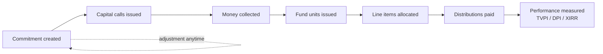
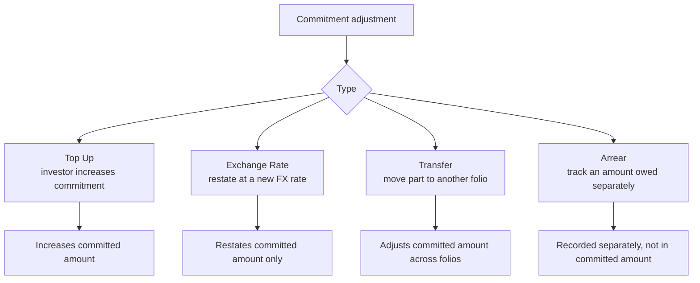
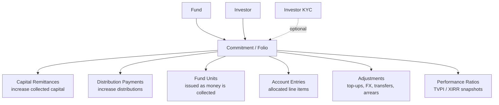

# Capital Commitments User Guide

A **capital commitment** is an investor's legal promise to contribute up to a set amount of capital to a fund over its life. It is the foundation record for everything that follows — capital calls, distributions, fund units, fees, and performance metrics all hang off the commitment.

> **Where to find it:** Sidebar → [**Funds → Funds**](/funds) → open the fund → **Commitments** tab (the default tab). Create one with **New Commitment** on that tab, or bulk-load them with **Upload**. Needs the **Funds** module plus update access on the fund (company admins have it automatically).

This guide explains how to set up and manage commitments: how an investor's account (folio) works, how to handle investors who commit in a foreign currency, the four ways a commitment can be adjusted, how returns (TVPI, DPI, RVPI, XIRR) are measured, and how commitments connect to the rest of the fund.

---

## Table of Contents

1. [What a Commitment Represents](#what-a-commitment-represents)
2. [Key Terms in Plain English](#key-terms-in-plain-english)
3. [The Commitment Lifecycle](#the-commitment-lifecycle)
4. [Creating a Commitment](#creating-a-commitment)
5. [Folio ID and Unit Type](#folio-id-and-unit-type)
6. [Fund Close](#fund-close)
7. [Investors Who Commit in a Foreign Currency](#investors-who-commit-in-a-foreign-currency)
8. [Tracking (Reporting) Currency](#tracking-reporting-currency)
9. [Percentage Ownership](#percentage-ownership)
10. [Adjusting a Commitment](#adjusting-a-commitment)
11. [Account Entries (Allocated Line Items)](#account-entries-allocated-line-items)
12. [Measuring Performance: TVPI, DPI, RVPI, XIRR](#measuring-performance-tvpi-dpi-rvpi-xirr)
13. [How a Commitment Connects to Everything Else](#how-a-commitment-connects-to-everything-else)
14. [Onboarding, E-Signing and Skipping Notices](#onboarding-e-signing-and-skipping-notices)
15. [Importing Commitments](#importing-commitments)
16. [Worked Example](#worked-example)
17. [Frequently Asked Questions](#frequently-asked-questions)

---

## What a Commitment Represents

When an investor (a Limited Partner, or LP) joins a fund, they sign a subscription agreement promising a certain amount of capital — say $5 million. That promise is the **commitment**. The fund then draws the money down over time through capital calls, deploys it, and eventually returns it through distributions.

A commitment is never "closed" while the fund is alive. It stays active throughout, accumulating called capital, distributions, fees, and performance history.

---

## Key Terms in Plain English

| Term | What it means |
|------|---------------|
| **Folio** | An investor's individual account within one fund. One investor can hold several folios (e.g. through different entities or closes). |
| **Folio ID** | The unique reference for that account, e.g. `INV-001-A`. Appears on every notice, statement, and voucher. |
| **Fund Close** | The closing round the investor joined (First Close, Second Close, and so on). |
| **Unit Type** | The class of fund units the investor holds (Class A, Class B, etc.). |
| **Folio Currency** | The currency the investor committed and pays in — which may differ from the fund's own currency. |
| **Committed Amount** | The total promised, expressed in the fund's currency after any adjustments. |
| **Called Amount** | How much has been requested from the investor through capital calls. |
| **Collected Amount** | How much has actually been received and confirmed. |
| **Distribution Amount** | How much has been returned to the investor. |
| **Account Entry** | An allocated line item (e.g. the investor's share of portfolio value or cash) calculated for this folio. |

---

## The Commitment Lifecycle

A commitment can be adjusted at any point after it's created — for example when an investor tops up. The commitment itself remains open for the life of the fund.

---

## Creating a Commitment

Open the fund, go to its **Commitments** tab and click **New Commitment**.

| Field | Notes |
|-------|-------|
| **Investor** | The LP this commitment belongs to. |
| **Investor KYC** | The verified entity actually investing. Optional but strongly recommended. |
| **Folio ID** | Must be unique within the fund. Up to 40 characters. |
| **Fund Close** | The closing round (free text, e.g. "First Close"). |
| **Commitment Date** | The date the legal commitment was made. |
| **Unit Type** | Must be one of the unit classes configured on the fund. |
| **Folio Committed Amount** | The amount promised, in the folio (investor) currency. |
| **Folio Currency** | Defaults to the fund's own currency. The list only offers currencies that have an exchange rate to the fund currency. |

When you save, the system automatically:

- Converts the folio amount into the fund's currency using the exchange rate on the commitment date.
- Locks in the original committed value so it can always be referenced.
- Recalculates each investor's **percentage ownership** of the fund.
- Creates a document folder for the commitment.

> **Important:** to change a committed amount later, add an adjustment — the **folio committed amount** box is locked once it is above zero. The fund-currency equivalent is derived for you — don't try to set it directly, or the figures will fall out of step. Likewise, changing the folio currency after saving does not re-convert the fund-currency amount.

---

## Folio ID and Unit Type

The **Folio ID** is the investor's unique reference within the fund. It appears on call notices, remittance requests, statements, and distribution vouchers, and it names the document folder for the commitment.

- It must be unique within the fund.
- If you rename it later, all linked documents and records (remittances, distributions, allocated line items) follow the new name automatically.

The **Unit Type** must match one of the unit classes set up on the fund (matching is not case-sensitive). Common examples are `Class A`, `Class B`, or `Regular`.

---

## Fund Close

The Fund Close records which closing round the investor joined — for example "First Close", "Second Close", or "Tranche 1". It's free text and is used in reports and statements, and to apply close-specific percentages on capital calls (see the [Capital Calls guide](capital_calls_user_guide)).

---

## Investors Who Commit in a Foreign Currency

An investor may commit in a currency different from the fund's — for example a USD fund accepting a GBP commitment.

The system keeps both:

- The **folio committed amount** — the original figure in the investor's currency, which never changes on its own.
- The **committed amount** — the equivalent in the fund's currency.

When exchange rates move significantly, use an **Exchange Rate adjustment** (below) to restate the fund-currency value without touching the investor's original figure. The system creates these automatically when a new rate is added only if your company has the exchange-rate commitment adjustment option switched on. The commitment search includes a **Foreign Currency Commitment** filter so you can find these folios quickly.

---

## Tracking (Reporting) Currency

If your organisation reports in a single currency across funds — say USD for an INR fund — the system also keeps each commitment's committed, collected, and distributed amounts in that **tracking currency**, converted at the rate on each transaction's date. These appear in the additional-columns view of the commitment list and feed cross-fund dashboards.

---

## Percentage Ownership

Each commitment carries a **percentage** — its share of the fund's total committed capital.

> Percentage = Investor's committed amount ÷ Total committed across the fund × 100

This recalculates automatically whenever a commitment is added, removed, or adjusted. It drives fund-level allocations — for example splitting an expense pro-rata across investors.

---

## Adjusting a Commitment

A **commitment adjustment** changes a commitment's financial figures. There are four kinds, and the system always records the before-and-after values so the change is fully auditable.

### Top Up

Used when an investor increases their commitment. Enter the increase (in folio currency), an **As Of** date (on or after the original commitment date), and a reason. The system converts the increase to the fund currency and adds it to the committed amount.

### Exchange Rate

Used to restate the fund-currency committed amount when rates have moved. The investor's original folio figure stays the same; only the fund-currency equivalent updates.

### Transfer

Records moving part of a commitment to another folio, adjusting the committed amount accordingly.

### Arrear

Records an amount the investor owes that is tracked **separately** from the main commitment — for example penalty interest or a deferred balance. Arrears roll up into their own total and are deliberately kept out of the committed amount.

---

## Account Entries (Allocated Line Items)

Account entries are financial line items calculated for each commitment — usually produced by a **fund formula run** that takes a fund-level value and allocates it down to individual investors. Typical examples:

| Line item | What it represents |
|-----------|--------------------|
| **Portfolio FMV** | The investor's share of the current fair market value of the portfolio. |
| **Cash In Hand** | The investor's pro-rata share of cash held by the fund. |
| **Net Current Assets** | The investor's share of other current assets. |
| **Estimated Carry** | The projected carried interest charged to this investor. |

Each entry has a reporting date, a category (such as income, expense, or asset), and a flag for whether the figure is cumulative or for a single period. Entries can be linked to a portfolio investment, an aggregate position, or another investor. They feed the residual-value side of the performance metrics below.

---

## Measuring Performance: TVPI, DPI, RVPI, XIRR

The system measures each investor's performance as of any chosen date. These are the standard private-fund return metrics.

### What goes into them

| Input | Where it comes from |
|-------|---------------------|
| **Collected** | Confirmed money received from the investor up to the date. |
| **Distributions** | Completed distribution payments up to the date. |
| **Portfolio FMV** | The investor's latest share of portfolio value. |
| **Cash In Hand** | The investor's latest share of fund cash. |
| **Net Current Assets** | The investor's latest share of other current assets. |

The **residual value** is FMV + Cash In Hand + Net Current Assets — what the investor's stake is still worth.

### The metrics

| Metric | Plain meaning | Formula |
|--------|---------------|---------|
| **DPI** (Distributions to Paid-In) | Cash already returned per dollar paid in. | Distributions ÷ Collected |
| **RVPI** (Residual Value to Paid-In) | Value still held per dollar paid in. | Residual value ÷ Collected |
| **TVPI** (Total Value to Paid-In) | Total value — returned plus remaining — per dollar paid in. | (Distributions + Residual value) ÷ Collected |
| **XIRR** | The annualised rate of return, accounting for the timing of every cash flow. | Internal rate of return on money in and money out |

All four read as zero until the investor has paid in capital. Custom **ratio formulas** defined on the fund can extend these standard calculations (see the [Ratio Formulas guide](ratio_formulas_user_guide)). Where a tracking currency is configured, the metrics can also be produced in that currency.

---

## How a Commitment Connects to Everything Else

A commitment sits at the centre of an investor's activity in the fund:

- **Capital remittances** — each capital call creates a remittance per commitment; confirmed remittances increase collected capital.
- **Distribution payments** — completed payments increase distributions returned.
- **Fund units** — issued as capital is collected, when unit tracking is on.
- **Performance ratios** — per-investor snapshots stored at reporting dates.

---

## Onboarding, E-Signing and Skipping Notices

- **Onboarding completed** — a simple Yes/No flag indicating that KYC, documents, and account setup for this investor are all done. Use it to spot folios that still need attention in the search view.
- **Investor Signatory Emails (e-sign)** — the comma-separated emails of the people who sign documents generated for this commitment (such as subscription agreements) wherever the template has an **Investor Signatories** row. It is pre-filled from the investor KYC's field when the commitment is created and is not updated when the KYC changes later. Signers are copied at generation, so regenerate documents after changing it. See [Who Signs](esigning_user_guide#who-signs-signatory-emails-and-labels).
- **Skipping notices** — there is no toggle for this; set the commitment custom field `skip_doc_gen` to Yes to exclude a folio from call notice generation, call and distribution emails and reminders, which is useful when a co-investor arrangement is billed directly outside the system.

---

## Importing Commitments

Commitments can be bulk-loaded from a spreadsheet during onboarding. Imports do not skip the usual automations: after the file is processed, percentages are recalculated, remittances are created for existing calls and access to the fund is granted. No investor email is sent. The import file must include the standard set of columns (investor, folio ID, fund close, commitment date, unit type, folio committed amount, and folio currency).

**Feeder Fund** is an optional column at the end of the sample file, for a master fund whose commitments come in through feeder vehicles. Put the feeder fund's name there exactly as it is on CapHive — it must be a feeder of the fund in the **Fund** column, or the row fails — and the commitment is saved with that feeder fund and flagged as coming from one, the same as ticking **Feeder Fund** and picking it on the commitment form. Leave the cell blank for a direct commitment. Because the column is optional, a file that does not have it at all is still accepted, and on an **Update Only** row it leaves the commitment's existing feeder fund alone; a blank cell in a column that *is* present clears it. The Excel export names the feeder fund too, in a **Feeder Fund** column right after **Fund**, which appears only when one of the exported folios has one.

---

## Worked Example

**Setup**

- Fund: *Acme Growth Fund I*, currency **USD**.
- Investor: *Maple Pension*, committed **€4,000,000**, folio currency **EUR**, on a day when €1 = $1.10.

**On creation**

- Folio committed amount: €4,000,000 (locked as the original).
- Committed amount (fund currency): €4,000,000 × 1.10 = **$4,400,000**.
- If the fund's total commitments are $44,000,000, Maple's ownership = $4.4M ÷ $44M = **10%**.

**A year later — top-up**

Maple adds €1,000,000 when €1 = $1.15.

- Folio committed amount: now €5,000,000.
- Top-up in fund currency: €1,000,000 × 1.15 = $1,150,000.
- Committed amount: $4,400,000 + $1,150,000 = **$5,550,000**. (The original $4.4M tranche keeps its rate; only the new tranche uses the new rate.)

**Performance check (illustrative)**

By the reporting date Maple has paid in $3,000,000, received $900,000 in distributions, and their remaining stake is worth $3,600,000.

- DPI = 900,000 ÷ 3,000,000 = **0.30×**
- RVPI = 3,600,000 ÷ 3,000,000 = **1.20×**
- TVPI = (900,000 + 3,600,000) ÷ 3,000,000 = **1.50×**

So for every dollar paid in, $1.50 of total value exists — $0.30 already returned and $1.20 still held.

---

## Frequently Asked Questions

### Navigation and getting there

**Where do I find capital commitments in CapHive?**
Sidebar → [**Funds → Funds**](/funds), open the fund, and the **Commitments** tab is the first (default) tab on the fund page. Click a row to open the commitment. The [commitments across all your funds](/capital_commitments) are also in one list. See [What a Commitment Represents](#what-a-commitment-represents).

**Can I see all commitments of one stakeholder (investor)?**
Yes. Sidebar → [**Stakeholders → View Stakeholders**](/investors), open the stakeholder and click the **Commitments** tab; it lists that stakeholder's folios across every fund. There is no New Commitment button there, so create commitments from the fund's Commitments tab.

**What is on a commitment's page?**
The commitment page shows a stats strip and the commitment details, then **Edit**, **Delete**, **AI Assistant** (locked unless the Folio Assistant is enabled) and the **Actions** dropdown. Below are the tabs **Documents**, **Remittances**, **Distributions**, **Units** (when units are enabled), **Account Entries** (when account entries are enabled), **Adjustments**, **Ratios**, **Tasks**, **All KYCs** and **Workflow** (company admins, when workflow templates are enabled).

**What is in the commitment's Actions dropdown?**
**LP Account Statement**, **Folio Account Entries** (only if your company has a report of that name), **Add Investor Advisor**, **Generate All Documents** and **Generate [template name]** (only when the KYC is verified and e-signing is not complete), **Generate Investor Statement** (verified KYC only) and **Preview Adhoc Fund Notification** entries for each ad-hoc fund notification.

**Where does an investor see their commitments?**
An investor logs in and uses [**Funds → Commitments**](/capital_commitments?my_commitments=true) in their sidebar, or opens the fund from **Funds** and looks at its sections. They only see their own folios in funds they have been given access to, and the investor view of a commitment has no Edit, Delete or Actions.

### Creating, updating and managing commitments

**How do I create a new commitment?**
On the fund's **Commitments** tab click [**New Commitment**](/capital_commitments/new); if your company has several commitment forms it is a **New Commitment:** dropdown where you pick the form. Choose the stakeholder, commitment date, investor KYC, folio ID, fund close, unit type, folio currency and **Folio Committed Amount**, then **Save**. See [Creating a Commitment](#creating-a-commitment).

**How do I edit a commitment?**
Open the commitment and click **Edit** (needs update access on the fund). The stakeholder cannot be changed once set, and **Folio Committed Amount** is locked once it is above zero; the form links to **Commitment Adjustment** for amount changes. Folio ID, fund close, unit type, KYC, signatory emails, notes, custom fields and **Onboarding Completed** can be edited.

**How do I change who signs a commitment agreement (investor signatory emails)?**
Open the commitment, click **Edit**, change **Investor Signatory Emails** (comma-separated, one signer per address) and save. Documents already generated keep their old signers, so generate the agreement again: delete an approved copy first, and if it was sent a company administrator clicks **Cancel eSignatures** before you delete it. See [eSigning](esigning_user_guide#changing-signers-on-documents-already-generated-or-sent).

**How do I change the committed amount?**
Open the commitment, click the **Adjustments** tab and then [**New Adjustment**](/commitment_adjustments/new). Enter the amount in the folio currency (negative to reduce), pick the **Adjustment Type** (Top Up, Arrear, Exchange Rate or Transfer), the **As Of** date and a reason, then save. See [Adjusting a Commitment](#adjusting-a-commitment).

**How do I delete a commitment?**
Open the commitment and click **Delete** (needs destroy access on the fund), then confirm. You are returned to the fund page. Deleting takes the folio's remittances, distribution payments, units, account entries, ratios and adjustments with it, so check the **Remittances** and **Distributions** tabs first.

**Can I edit or delete an adjustment?**
Adjustments cannot be edited. To correct one, open it from the commitment's **Adjustments** tab, click **Delete** (destroy access needed) and add a new one. Arrear adjustments created from a remittance's **Create Arrears Adjustment** cannot be deleted from here.

**How do I bulk upload or download commitments?**
On the fund's **Commitments** tab click **Upload** (an import of type CapitalCommitment) and use the sample file. Set **Update Only** to Yes on rows that should update an existing folio instead of creating one. **Download** offers **Export All** (Excel) and **Export Visible** (the rows on screen); the export carries a **Feeder Fund** column next to **Fund**, but only when at least one exported folio actually came in through a feeder fund. See [Importing Commitments](#importing-commitments).

**How do I generate commitment agreements or investor statements?**
For one folio open the commitment and choose **Actions → Generate All Documents** or **Generate [template name]** (fund documents tagged **Commitment Template**), or **Actions → Generate Investor Statement** to pick an investor statement template, start and end date and **For** (Commitment or Investing Entity). For every folio use the **Generate** dropdown on the fund's **Commitments** tab.

**How do I add a contribution (commitment agreement) template for capital commitments?**
A contribution agreement, subscription agreement and commitment agreement template are the same thing: a fund template tagged **Commitment Template**. Open the fund → **Actions → Misc → New Template**, name it, set **Document For** to **Commitment Template**, upload the Word file and save. It then appears as **Generate [template name]** on each commitment. See [Document Templates](document_templates_user_guide).

**How do I add an investor statement template?**
Open the fund → **Actions → Misc → New Template**, set **Document For** to **Investor Statement Template**, upload the Word file and save. It is then listed under **Template name** in a commitment's **Actions → Generate Investor Statement**. See [Document Templates](document_templates_user_guide) for the merge fields a statement can use.

**How do I set up a folio that commits in a foreign currency?**
First add an exchange rate from that currency to the fund currency (Company menu → [**Exchange Rates**](/exchange_rates)); the **Folio Currency** list on the commitment form only offers currencies that have a rate to the fund currency. Then create the commitment with that folio currency and the amount in it. See [Investors Who Commit in a Foreign Currency](#investors-who-commit-in-a-foreign-currency).

**How do I skip call and distribution notices for one folio?**
Set the commitment custom field `skip_doc_gen` to Yes (edit the commitment; add the field first via Company menu → [**Customize Forms**](/form_types), if it is not on your form). That folio is then left out of call notice generation, call and distribution emails and reminders.

**How do I transfer part of a folio to another folio?**
Open the source commitment, click the **Units** tab and then **Transfer**. Enter the destination folio, transfer ratio, date and price. The transfer moves units, remittances, distributions and optionally account entries, and records a pair of **Transfer** adjustments. See the [Fund Unit Transfers](fund_unit_transfers_user_guide) guide.

**What permission do I need to work on commitments?**
The **Funds** module must be enabled for your login, plus an access right on the fund: **update** shows **New Commitment**, **Upload**, **Generate**, **Edit** and **Actions**, **create** is needed to save a new commitment or adjustment, and **destroy** to delete. Company admins have all of these automatically. A company admin grants access on the fund page's **Access** tab.

### Why use capital commitments

**Why is the commitment so important?**
It is the record everything else hangs off: capital calls create one remittance per commitment, distributions one payment per commitment, units are issued against it, and fees, account entries and ratios are allocated to it. Without a commitment an investor cannot be called, paid, allocated or reported on in that fund.

**What does a commitment let me do?**
Track each folio's committed, called, collected and distributed amounts in fund, folio and tracking currency; see its percentage of the fund; record top-ups, FX restatements, transfers and arrears with a full before/after trail; generate agreements and investor statements; measure DPI, RVPI, TVPI and XIRR; and give the investor portal access to the fund.

**What happens if I don't set up commitments, or set them up wrongly?**
Calls and distributions generate nothing for the missing investor, and percentages are wrong for everyone else because they are computed from the fund total. A wrong unit type blocks unit allocation, a wrong fund close excludes the folio from close-specific calls, and a wrong folio currency means every call and payment is converted incorrectly.

**Who typically works on commitments?**
Fund operations or investor-relations staff create and maintain commitments and adjustments during onboarding and closings; finance uses them for calls, distributions and statements. Investors and their advisors only view their own commitments in the portal.

### What happens when I …

**What happens when I save a new commitment?**
The commitment appears on the fund's **Commitments** tab and the stakeholder's **Commitments** tab. The folio amount is converted into the fund currency at the rate on the commitment date and locked as the original amount, every folio's percentage in the fund is recalculated, the fund's committed total rises, and the investor is given access to the fund. No email is sent; the success message adds a warning if nobody at the investor is subscribed to Capital Call notifications.

**What happens to capital calls that already exist when I add a commitment?**
A background job creates a remittance for this folio on every existing call that applies to its fund close, except calls with the "Upload" basis. They are created Pending, or Paid and verified if the call was set to generate verified remittances. The investor is not emailed; send notices from the call when ready.

**What happens when I edit a commitment?**
Changes save immediately and no one is notified. If you change the folio ID, the new ID is copied to the folio's remittances, distribution payments and account entries and their document folders are renamed. If the committed amount changed, all percentages in the fund are recalculated. Existing remittances and payments are not recalculated.

**What happens when I add an adjustment?**
The amount is converted to the fund currency at the rate on the **As Of** date and the before and after values are stored. Top Up, Exchange Rate and Transfer adjustments change the committed amount (and the folio committed amount by the folio-currency figure) and trigger a percentage recalculation; Arrear adjustments only add to the arrear total. The adjustment appears on the **Adjustments** tab; no one is notified.

**What happens when I delete an adjustment?**
The adjustment is soft-deleted and the commitment's committed or arrear totals are recomputed without it, with percentages refreshed. Remittances and payments already generated from the old amount are not changed. No one is notified.

**What happens when I delete a commitment?**
The commitment is soft-deleted together with its remittances, remittance payments, distribution payments, fund units, account entries, ratios and adjustments, the fund's totals drop and every remaining folio's percentage is recalculated. No one is notified, and the investor's access to the fund is not removed. It can be restored from the [deleted commitments](/capital_commitments/show_deleted) list (destroy access needed).

**What happens when I click Generate All Documents?**
A background job builds a document from each **Commitment Template** (a commitment-level template overrides a fund template of the same name) using KYC and fund data, deletes earlier unsigned generated copies with that template name, and stores the new document on the commitment's **Documents** tab. It needs a verified KYC; signed documents are never deleted. Investors are not notified; e-signing is a separate step.

**What happens when I upload commitments?**
Each row creates a commitment (or updates one when **Update Only** is Yes; a duplicate folio without it is rejected). After the whole file is processed, percentages are recalculated per fund, remittances are created for existing calls, access to the fund is granted, and you get one alert naming investors with nobody subscribed to Capital Call notifications. No investor email is sent.

**How do I load commitments that come in through a feeder fund?**
Add a **Feeder Fund** column to the upload file (it is the last column of the sample) and put the feeder fund's name in it, spelled as it is on CapHive. The feeder must already exist with the fund in the **Fund** column set as its master fund, otherwise the row is rejected with "Feeder Fund not found" or a message that it is not a feeder of that fund. A blank cell means a direct commitment. Dropping the column from the file is fine — existing commitments keep whichever feeder fund they already had.

**What happens when a new exchange rate is added for a foreign-currency folio?**
Only if your company has the exchange-rate commitment adjustment option switched on: a background job creates an **Exchange Rate** adjustment on each matching folio for the change in fund-currency value of its uncalled amount. Otherwise nothing changes until you add an adjustment yourself.

**What happens if the folio's KYC is not verified?**
The commitment saves, but **Generate All Documents**, **Generate [template name]** and **Generate Investor Statement** do not appear in Actions, and call and distribution notices for this folio are skipped with "KYC not verified". Verify the KYC (Sidebar → **Stakeholders → View Stakeholders**, open the stakeholder, **KYC** tab) and then generate.

### Troubleshooting and edge cases

**I can't see the New Commitment button - why?**
The button, **Upload** and **Generate** only show when you have update access on the fund; ask your company admin to grant it on the fund's **Access** tab. On the stakeholder's Commitments tab and on the [all-funds commitments list](/capital_commitments) there is no fund context, so no New Commitment button is shown.

**Saving fails with "is not allowed. Allowed values" on unit type - why?**
The unit type must be one of the unit classes set on the fund (matching ignores case). Pick one from the list, or edit the fund to add the class first.

**Can I change the folio currency after creating a commitment?**
The form still shows the field, but the fund-currency committed amount was converted once when the commitment was created and is not re-converted, so changing the currency leaves the figures out of step. To correct it, delete the commitment and create it again, then regenerate any linked remittances and distributions.

**The committed amount is wrong. How do I fix it?**
Add a **Top Up** adjustment for the difference (a negative amount reduces it). The **Folio Committed Amount** box is only editable while the commitment amount is still zero. Don't try to overwrite the fund-currency amount directly; that causes inconsistencies.

**My foreign currency is not in the Folio Currency list - why?**
The list only contains currencies that have an exchange rate to the fund's currency. Add the rate under Company menu → [**Exchange Rates**](/exchange_rates), then reopen the form.

**Why doesn't ownership add up to exactly 100%?**
Rounding to two decimals across many investors can leave a tiny remainder. It's expected and doesn't affect any calculations.

**What's the difference between the folio committed amount and the committed amount?**
The folio committed amount is always in the investor's currency; the committed amount is the equivalent in the fund's currency. For same-currency commitments they're identical.

**Can one investor commit to the same fund more than once?**
Yes - each commitment just needs its own folio ID, unique within the fund. Multiple folios are common when an investor uses different entities or joins at different closes.

**How are account entries (allocated line items) created?**
By running fund formulas through an allocation run (fund page **Actions → Account Entries → Allocate Account Entries**), which spreads fund-level values down to each commitment, or by uploading account entries. See the [Carry & Allocation guide](carry_computations_user_guide).

**Can I skip the capital-call notice for one investor?**
Yes - set the commitment's `skip_doc_gen` custom field to Yes. Call notices, call emails, reminders and distribution emails then skip that folio. There is no separate "skip notices" toggle; it is this custom field.

**If I rename a folio ID, do old documents still match?**
Yes. The new ID is copied to the folio's remittances, distribution payments and account entries, and the document folders of the commitment, its remittances and its payments are renamed to match.

**Why does e-sign use the commitment's Investor Signatory Emails and not the KYC's?**
Commitment documents take their **Investor Signatories** signers from the commitment's own **Investor Signatory Emails**. It is copied from the KYC (investing entity) only when the commitment is created, so a later change on the KYC does not reach this commitment. Update the field on the commitment, then generate the document again. See [eSigning](esigning_user_guide#who-signs-signatory-emails-and-labels).

**Generate All Documents is missing from Actions - why?**
It only appears when the commitment has an investor KYC that is verified and e-signing on the commitment is not already complete. Link and verify the KYC, or if documents are already signed, work from the **Documents** tab.

**Why is my commitment agreement template not listed under Generate?**
Only fund documents whose **Document For** is **Commitment Template** are listed. A Word file uploaded with **New Document** on the fund's **Documents** tab has no tag, so edit it and set **Document For**, or add it again with **Actions → Misc → New Template**. See [Document Templates](document_templates_user_guide).

**Can I undo a deleted commitment?**
Yes. There is no menu link; open the [deleted commitments](/capital_commitments/show_deleted) list, find the folio and click **Restore**. Restoring is recursive, so the deleted remittances, payments and units come back with it.

---

## Related Guides

- [Capital Calls](capital_calls_user_guide) - each call creates one remittance per commitment.
- [Capital Distributions](capital_distributions_user_guide) - each distribution creates one payment per commitment.
- [Fund Units](fund_units_user_guide) - units issued and redeemed against a commitment's unit type.
- [Fund Unit Transfers](fund_unit_transfers_user_guide) - moving units and history from one folio to another.
- [Investor KYC](investor_kyc_user_guide) - a verified KYC is needed for agreements, statements and notices.
- [Tracking Currency](tracking_currency_guide) - the reporting-currency copies of committed, collected and distributed amounts.
- [Fund Commitment Notifications](fund_commitment_notifications_user_guide) - ad-hoc emails sent to every commitment's contacts.
- [E-Signing](esigning_user_guide) - sending generated commitment agreements for signature.
- [Document Templates](document_templates_user_guide) - adding the commitment (contribution / subscription) agreement and investor statement templates.
