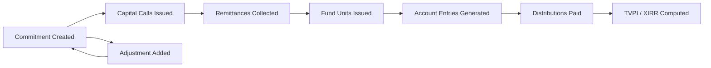
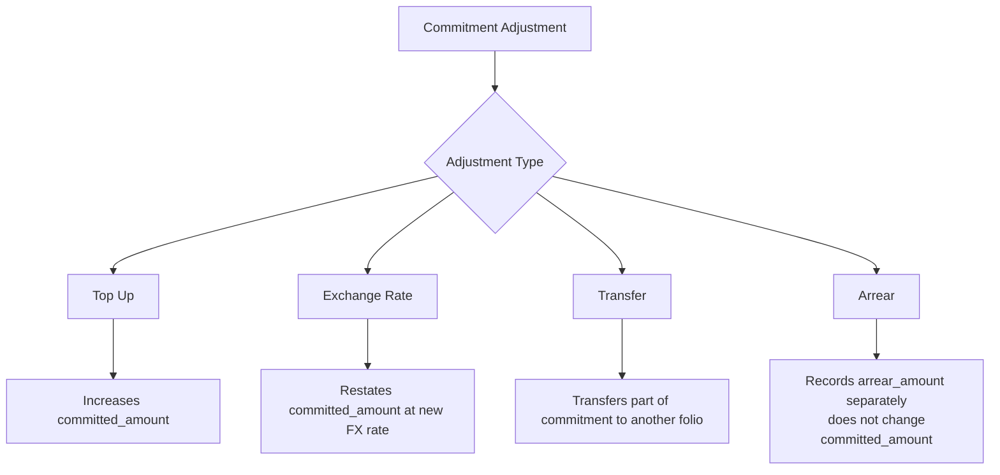
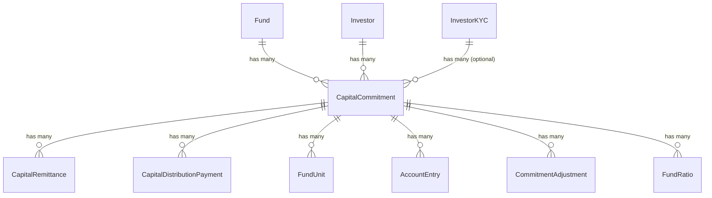

# Capital Commitments User Guide

A capital commitment records an investor's legal obligation to contribute a specified amount of capital to a fund over time. This guide explains how to create and manage commitments, how multi-currency folios work, the four types of commitment adjustments, how performance metrics (TVPI, DPI, RVPI, XIRR) are computed, and how commitments link to capital calls, distributions, fund units, and account entries.

---

## Table of Contents

1. [Key Concepts](#key-concepts)
2. [Commitment Lifecycle](#commitment-lifecycle)
3. [Creating a Commitment](#creating-a-commitment)
4. [Folio ID and Unit Type](#folio-id-and-unit-type)
5. [Fund Close](#fund-close)
6. [Multi-Currency Commitments (Folio Currency)](#multi-currency-commitments-folio-currency)
7. [Tracking Currency](#tracking-currency)
8. [Percentage Ownership](#percentage-ownership)
9. [Commitment Adjustments](#commitment-adjustments)
10. [Account Entries](#account-entries)
11. [Performance Metrics: TVPI, DPI, RVPI, XIRR](#performance-metrics-tvpi-dpi-rvpi-xirr)
12. [Relationships to Other Records](#relationships-to-other-records)
13. [Onboarding Completed Flag](#onboarding-completed-flag)
14. [Investor Signatory (E-Sign)](#investor-signatory-e-sign)
15. [Skipping Call Notices](#skipping-call-notices)
16. [Importing Commitments](#importing-commitments)
17. [Key Fields Reference](#key-fields-reference)
18. [Frequently Asked Questions](#frequently-asked-questions)

---

## Key Concepts

| Term                    | Meaning                                                                                          |
| ----------------------- | ------------------------------------------------------------------------------------------------ |
| **Folio ID**            | Unique alphanumeric identifier for this investor-fund pair (e.g. `INV-001-A`)                    |
| **Fund Close**          | The tranche or closing round the investor joined (e.g. `First Close`, `Second Close`)            |
| **Unit Type**           | Class of fund units issued to this investor (e.g. `Class A`, `Class B`)                          |
| **Folio Currency**      | The currency in which the investor committed and pays (may differ from the fund's base currency) |
| **Committed Amount**    | The total obligation in the fund's base currency after all adjustments                           |
| **Called Amount**       | Amount called from the investor via capital calls                                                |
| **Collected Amount**    | Amount actually received (verified remittances)                                                  |
| **Distribution Amount** | Amount returned to the investor via distributions                                                |
| **Tracking Amount**     | Amounts restated in the entity's tracking/reporting currency                                     |
| **Account Entry**       | A line-item allocation (e.g. Portfolio FMV, Cash In Hand) computed per commitment                |

---

## Commitment Lifecycle



At any point after creation, adjustments can modify the committed amount. The commitment is never "closed" — it remains active throughout the fund's life.

---

## Creating a Commitment

Navigate to **Fund → Capital Commitments → New**.

Required fields:

| Field                      | Notes                                                              |
| -------------------------- | ------------------------------------------------------------------ |
| **Investor**               | The LP whose commitment this is                                    |
| **Investor KYC**           | KYC record used as the investing entity (optional but recommended) |
| **Folio ID**               | Must be unique within the fund. Max 40 characters                  |
| **Fund Close**             | Free text identifying the closing round                            |
| **Commitment Date**        | Date the legal commitment was made                                 |
| **Unit Type**              | Must be one of the unit types configured on the fund               |
| **Folio Committed Amount** | Amount in the folio currency                                       |
| **Folio Currency**         | Leave blank to use the fund's base currency                        |

On save, the system automatically:

- Converts the folio amount to the fund's base currency using the exchange rate on the commitment date
- Sets `orig_committed_amount` (the locked original base-currency value)
- Computes `percentage` ownership across all commitments in the fund
- Creates a document folder for the commitment under `/Funds/{fund}/Commitments/{folio_id}/`

> **Important:** Never edit `committed_amount_cents` directly in the database. Always change `folio_committed_amount_cents`; the system derives base-currency amounts automatically.

---

## Folio ID and Unit Type

The **Folio ID** is the investor's unique identifier within the fund. It appears on call notices, remittance requests, statements, and distribution vouchers.

- Must be unique per fund
- Used as the folder name for all documents related to this commitment
- Changing it after creation renames all linked folder paths and updates remittances, distributions, and account entries automatically

The **Unit Type** must match one of the comma-separated values in the fund's **Unit Types** field (case-insensitive). Common examples: `Class A`, `Class B`, `Regular`.

---

## Fund Close

The Fund Close field identifies which closing round this investor joined. It is free text (e.g. `First Close`, `Second Close`, `Tranche 1`). It is used:

- In reports and statements
- When calculating close-specific capital call percentages (see the Capital Calls guide)

---

## Multi-Currency Commitments (Folio Currency)

An investor may commit in a currency different from the fund's base currency (e.g. a USD fund receiving a GBP commitment).

```
Folio Currency (GBP)  →  fund.currency (USD)
     via exchange rate on commitment_date
```

The system stores both:

- `folio_committed_amount` — the original amount in the investor's currency
- `committed_amount` — the equivalent in the fund's base currency

When exchange rates change, use an **Exchange Rate** commitment adjustment (see below) to restate the base-currency value without changing the folio amount.

A commitment is considered a **foreign currency commitment** when `folio_currency ≠ fund.currency`. The search screen includes a `Foreign Currency Commitment` filter.

---

## Tracking Currency

If the entity has a **Tracking Currency** configured (e.g. USD for an INR fund), the system also stores `tracking_committed_amount`, `tracking_collected_amount`, and `tracking_distribution_amount` in that currency.

Tracking amounts are computed using the exchange rate on the relevant transaction date. They appear in the additional columns view of the commitment list.

---

## Percentage Ownership

Each commitment holds a `percentage` field — its proportional share of the fund's total committed capital.

```
percentage = (committed_amount / total_committed_amount_in_fund) × 100
```

This is **auto-recomputed** every time:

- A commitment is created or destroyed
- The committed amount changes (via adjustment)

The percentage is used in fund-level allocation runs (e.g. for pro-rata expense allocations).

---

## Commitment Adjustments

A commitment adjustment modifies a commitment's financial amounts. There are four types:



### Top Up

Use when an investor increases their commitment. Provide:

- **Folio Amount** — the increase in folio currency
- **As Of** — must be on or after the original commitment date
- **Reason** — description of why the top-up occurred

The system converts the folio amount to the fund's base currency using the exchange rate on the `as_of` date and adds it to `committed_amount`.

### Exchange Rate

Use to restate the base-currency committed amount when the exchange rate has moved significantly. The folio amount remains unchanged; only the fund-currency equivalent is updated.

### Transfer

Records a transfer of part of a commitment to another folio. Like Top Up, it updates `committed_amount`.

### Arrear

Records an amount owed by the investor that is tracked separately from the main commitment. Arrear amounts roll up to `arrear_amount_cents` on the commitment and are not included in `committed_amount`. This is useful for penalty interest or deferred amounts.

**Pre/Post adjustment amounts** are stored automatically so you can see the before and after state.

---

## Account Entries

Account entries are financial line items allocated to a commitment, typically generated by a **Fund Formula** run. They represent things like:

| Entry Name           | What it represents                                                |
| -------------------- | ----------------------------------------------------------------- |
| `Portfolio FMV`      | Current fair market value of portfolio allocated to this investor |
| `Cash In Hand`       | Cash held in the fund allocated pro-rata                          |
| `Net Current Assets` | Other current assets                                              |
| `Estimated Carry`    | Projected carry charged to this investor                          |

Account entries have:

- **Reporting Date** — the as-of date
- **Entry Type** — categorisation (e.g. `Income`, `Expense`, `Asset`)
- **Cumulative** flag — whether the amount is cumulative to date or for the period
- **Parent** — can link to a PortfolioInvestment, AggregatePortfolioInvestment, another Investor, or another AccountEntry (polymorphic)

Account entries drive the RVPI calculation (see below).

---

## Performance Metrics: TVPI, DPI, RVPI, XIRR

All metrics are computed as of a given date using the `CapitalCommitmentCalcs` engine.

### Base Inputs

| Input                | Source                                                                    |
| -------------------- | ------------------------------------------------------------------------- |
| `collected`          | Sum of verified remittance `collected_amount` on or before the date       |
| `distribution`       | Sum of completed distribution payment `net_payable` on or before the date |
| `fmv`                | Latest `Portfolio FMV` account entry on or before the date                |
| `cash_in_hand`       | Latest `Cash In Hand` account entry                                       |
| `net_current_assets` | Latest `Net Current Assets` account entry                                 |

### Formulas

```
DPI  = distribution / collected
RVPI = (fmv + cash_in_hand + net_current_assets) / collected
TVPI = (distribution + fmv + cash_in_hand + net_current_assets) / collected
XIRR = Internal rate of return on collected inflows and distributed outflows
```

All four return `0` when `collected = 0`.

Ratio formulas defined on the fund can override or augment these standard calculations via the `apply_static_formulas` method (see the Ratio Formulas guide).

Metrics can optionally be computed in the **tracking currency** (pass `use_tracking_currency: true`) when tracking currency is configured.

---

## Relationships to Other Records



- **Capital Remittances** — each capital call generates remittances per commitment; verified remittances increment `collected_amount`
- **Capital Distribution Payments** — completed payments increment `distribution_amount`
- **Fund Units** — issued when remittances are verified (if fund unit tracking is enabled)
- **Fund Ratios** — per-investor ratios (e.g. TVPI snapshots) stored at reporting dates

---

## Onboarding Completed Flag

The `onboarding_completed` boolean flag can be set to indicate that all required documents, KYC linkage, and account setup steps for this investor are done. It is used in search/filter views to identify incomplete onboardings.

---

## Investor Signatory (E-Sign)

The `esign_emails` field stores a comma-separated list of email addresses to use as investor signatories when sending documents (e.g. subscription agreements) for e-signing. These override the default investor access user emails for this commitment.

---

## Skipping Call Notices

Setting `json_fields["skip_doc_gen"] = "yes"` on a commitment causes the capital call notice generation job to skip this folio. Useful when a co-investor arrangement requires direct billing outside the system.

---

## Importing Commitments

Commitments can be bulk-imported via an import file. During import, the `imported` flag is set to suppress the normal post-create callbacks (e.g. the InvestorAddedJob). Required import columns match the `STANDARD_COLUMNS` definition.

---

## Key Fields Reference

| Field                         | Type    | Description                                              |
| ----------------------------- | ------- | -------------------------------------------------------- |
| `folio_id`                    | String  | Unique investor identifier in this fund                  |
| `fund_close`                  | String  | Closing round name                                       |
| `unit_type`                   | String  | Class of units issued                                    |
| `commitment_date`             | Date    | Date of legal commitment                                 |
| `folio_currency`              | String  | Currency of investor's payment obligation                |
| `folio_committed_amount`      | Money   | Committed amount in folio currency                       |
| `orig_folio_committed_amount` | Money   | Folio amount before adjustments                          |
| `committed_amount`            | Money   | Committed amount in fund currency (after adjustments)    |
| `orig_committed_amount`       | Money   | Locked base-currency amount at commitment date FX        |
| `collected_amount`            | Money   | Verified remittances received                            |
| `call_amount`                 | Money   | Amount called via capital calls                          |
| `distribution_amount`         | Money   | Distributions paid                                       |
| `adjustment_amount`           | Money   | Cumulative Top Up / Exchange Rate / Transfer adjustments |
| `arrear_amount`               | Money   | Cumulative Arrear adjustments                            |
| `total_units_amount`          | Money   | Total value of issued fund units                         |
| `percentage`                  | Decimal | % ownership of fund                                      |
| `onboarding_completed`        | Boolean | All onboarding steps done                                |
| `esign_emails`                | String  | Comma-separated signatory emails                         |

---

## Frequently Asked Questions

**Q: Can I change the folio currency after a commitment is created?**
No. The folio currency is locked once the original amounts are set. If you need to correct it, destroy the commitment and recreate it. Existing remittances and distributions linked to it will also need to be recreated.

**Q: The committed amount is wrong. How do I fix it?**
Add a **Top Up** or **Exchange Rate** commitment adjustment with the delta amount. Directly editing the committed amount cents field is not supported and will cause data inconsistencies.

**Q: Why does the percentage not add up to exactly 100%?**
Rounding to two decimal places across many commitments can leave a tiny remainder. This is expected and does not affect financial calculations.

**Q: What is the difference between `folio_committed_amount` and `committed_amount`?**
`folio_committed_amount` is always in the investor's folio currency. `committed_amount` is the equivalent in the fund's base currency. For domestic (same-currency) commitments, they are equal.

**Q: Can one investor have multiple commitments to the same fund?**
Yes, but each must have a unique folio ID. Multiple folios for one investor are common when they invest via different KYC entities or at different fund closes.

**Q: How are account entries generated?**
Account entries are created by running a **Fund Formula** (via Allocation Run). The formula defines how fund-level values (e.g. Portfolio FMV) are allocated down to individual commitments. See the Fund Formulas guide.

**Q: What triggers a percentage recompute?**
Any save that changes `committed_amount_cents`, or any commitment being destroyed. The recompute updates all commitments in the fund in a single SQL statement.

**Q: Can I skip a capital call notice for one investor?**
Yes. Set `skip_doc_gen` to `yes` in the commitment's JSON fields. The call notice generation job will exclude this folio.
