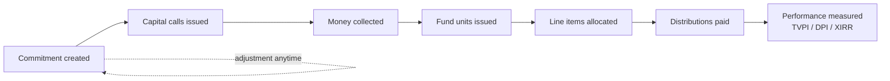
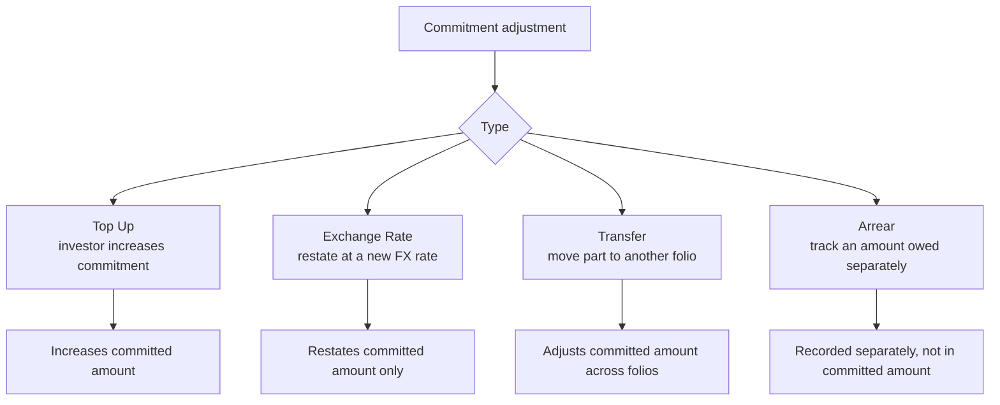
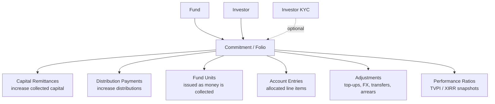

# Capital Commitments User Guide

A **capital commitment** is an investor's legal promise to contribute up to a set amount of capital to a fund over its life. It is the foundation record for everything that follows — capital calls, distributions, fund units, fees, and performance metrics all hang off the commitment.

This guide explains how to set up and manage commitments: how an investor's account (folio) works, how to handle investors who commit in a foreign currency, the four ways a commitment can be adjusted, how returns (TVPI, DPI, RVPI, XIRR) are measured, and how commitments connect to the rest of the fund.

---

## Table of Contents

1. [What a Commitment Represents](#what-a-commitment-represents)
2. [Key Terms in Plain English](#key-terms-in-plain-english)
3. [The Commitment Lifecycle](#the-commitment-lifecycle)
4. [Creating a Commitment](#creating-a-commitment)
5. [Folio ID and Unit Type](#folio-id-and-unit-type)
6. [Fund Close](#fund-close)
7. [Investors Who Commit in a Foreign Currency](#investors-who-commit-in-a-foreign-currency)
8. [Tracking (Reporting) Currency](#tracking-reporting-currency)
9. [Percentage Ownership](#percentage-ownership)
10. [Adjusting a Commitment](#adjusting-a-commitment)
11. [Account Entries (Allocated Line Items)](#account-entries-allocated-line-items)
12. [Measuring Performance: TVPI, DPI, RVPI, XIRR](#measuring-performance-tvpi-dpi-rvpi-xirr)
13. [How a Commitment Connects to Everything Else](#how-a-commitment-connects-to-everything-else)
14. [Onboarding, E-Signing and Skipping Notices](#onboarding-e-signing-and-skipping-notices)
15. [Importing Commitments](#importing-commitments)
16. [Worked Example](#worked-example)
17. [Frequently Asked Questions](#frequently-asked-questions)

---

## What a Commitment Represents

When an investor (a Limited Partner, or LP) joins a fund, they sign a subscription agreement promising a certain amount of capital — say $5 million. That promise is the **commitment**. The fund then draws the money down over time through capital calls, deploys it, and eventually returns it through distributions.

A commitment is never "closed" while the fund is alive. It stays active throughout, accumulating called capital, distributions, fees, and performance history.

---

## Key Terms in Plain English

| Term | What it means |
|------|---------------|
| **Folio** | An investor's individual account within one fund. One investor can hold several folios (e.g. through different entities or closes). |
| **Folio ID** | The unique reference for that account, e.g. `INV-001-A`. Appears on every notice, statement, and voucher. |
| **Fund Close** | The closing round the investor joined (First Close, Second Close, and so on). |
| **Unit Type** | The class of fund units the investor holds (Class A, Class B, etc.). |
| **Folio Currency** | The currency the investor committed and pays in — which may differ from the fund's own currency. |
| **Committed Amount** | The total promised, expressed in the fund's currency after any adjustments. |
| **Called Amount** | How much has been requested from the investor through capital calls. |
| **Collected Amount** | How much has actually been received and confirmed. |
| **Distribution Amount** | How much has been returned to the investor. |
| **Account Entry** | An allocated line item (e.g. the investor's share of portfolio value or cash) calculated for this folio. |

---

## The Commitment Lifecycle

A commitment can be adjusted at any point after it's created — for example when an investor tops up. The commitment itself remains open for the life of the fund.

---

## Creating a Commitment

Go to **Fund → Capital Commitments → New**.

| Field | Notes |
|-------|-------|
| **Investor** | The LP this commitment belongs to. |
| **Investor KYC** | The verified entity actually investing. Optional but strongly recommended. |
| **Folio ID** | Must be unique within the fund. Up to 40 characters. |
| **Fund Close** | The closing round (free text, e.g. "First Close"). |
| **Commitment Date** | The date the legal commitment was made. |
| **Unit Type** | Must be one of the unit classes configured on the fund. |
| **Folio Committed Amount** | The amount promised, in the folio (investor) currency. |
| **Folio Currency** | Leave blank to use the fund's own currency. |

When you save, the system automatically:

- Converts the folio amount into the fund's currency using the exchange rate on the commitment date.
- Locks in the original committed value so it can always be referenced.
- Recalculates each investor's **percentage ownership** of the fund.
- Creates a document folder for the commitment.

> **Important:** to change a committed amount later, always edit the **folio committed amount** or add an adjustment. The fund-currency equivalent is derived for you — don't try to set it directly, or the figures will fall out of step.

---

## Folio ID and Unit Type

The **Folio ID** is the investor's unique reference within the fund. It appears on call notices, remittance requests, statements, and distribution vouchers, and it names the document folder for the commitment.

- It must be unique within the fund.
- If you rename it later, all linked documents and records (remittances, distributions, allocated line items) follow the new name automatically.

The **Unit Type** must match one of the unit classes set up on the fund (matching is not case-sensitive). Common examples are `Class A`, `Class B`, or `Regular`.

---

## Fund Close

The Fund Close records which closing round the investor joined — for example "First Close", "Second Close", or "Tranche 1". It's free text and is used in reports and statements, and to apply close-specific percentages on capital calls (see the [Capital Calls guide](capital_calls_user_guide)).

---

## Investors Who Commit in a Foreign Currency

An investor may commit in a currency different from the fund's — for example a USD fund accepting a GBP commitment.

The system keeps both:

- The **folio committed amount** — the original figure in the investor's currency, which never changes on its own.
- The **committed amount** — the equivalent in the fund's currency.

When exchange rates move significantly, use an **Exchange Rate adjustment** (below) to restate the fund-currency value without touching the investor's original figure. The commitment search includes a **Foreign Currency Commitment** filter so you can find these folios quickly.

---

## Tracking (Reporting) Currency

If your organisation reports in a single currency across funds — say USD for an INR fund — the system also keeps each commitment's committed, collected, and distributed amounts in that **tracking currency**, converted at the rate on each transaction's date. These appear in the additional-columns view of the commitment list and feed cross-fund dashboards.

---

## Percentage Ownership

Each commitment carries a **percentage** — its share of the fund's total committed capital.

> Percentage = Investor's committed amount ÷ Total committed across the fund × 100

This recalculates automatically whenever a commitment is added, removed, or adjusted. It drives fund-level allocations — for example splitting an expense pro-rata across investors.

---

## Adjusting a Commitment

A **commitment adjustment** changes a commitment's financial figures. There are four kinds, and the system always records the before-and-after values so the change is fully auditable.

### Top Up

Used when an investor increases their commitment. Enter the increase (in folio currency), an **As Of** date (on or after the original commitment date), and a reason. The system converts the increase to the fund currency and adds it to the committed amount.

### Exchange Rate

Used to restate the fund-currency committed amount when rates have moved. The investor's original folio figure stays the same; only the fund-currency equivalent updates.

### Transfer

Records moving part of a commitment to another folio, adjusting the committed amount accordingly.

### Arrear

Records an amount the investor owes that is tracked **separately** from the main commitment — for example penalty interest or a deferred balance. Arrears roll up into their own total and are deliberately kept out of the committed amount.

---

## Account Entries (Allocated Line Items)

Account entries are financial line items calculated for each commitment — usually produced by a **fund formula run** that takes a fund-level value and allocates it down to individual investors. Typical examples:

| Line item | What it represents |
|-----------|--------------------|
| **Portfolio FMV** | The investor's share of the current fair market value of the portfolio. |
| **Cash In Hand** | The investor's pro-rata share of cash held by the fund. |
| **Net Current Assets** | The investor's share of other current assets. |
| **Estimated Carry** | The projected carried interest charged to this investor. |

Each entry has a reporting date, a category (such as income, expense, or asset), and a flag for whether the figure is cumulative or for a single period. Entries can be linked to a portfolio investment, an aggregate position, or another investor. They feed the residual-value side of the performance metrics below.

---

## Measuring Performance: TVPI, DPI, RVPI, XIRR

The system measures each investor's performance as of any chosen date. These are the standard private-fund return metrics.

### What goes into them

| Input | Where it comes from |
|-------|---------------------|
| **Collected** | Confirmed money received from the investor up to the date. |
| **Distributions** | Completed distribution payments up to the date. |
| **Portfolio FMV** | The investor's latest share of portfolio value. |
| **Cash In Hand** | The investor's latest share of fund cash. |
| **Net Current Assets** | The investor's latest share of other current assets. |

The **residual value** is FMV + Cash In Hand + Net Current Assets — what the investor's stake is still worth.

### The metrics

| Metric | Plain meaning | Formula |
|--------|---------------|---------|
| **DPI** (Distributions to Paid-In) | Cash already returned per dollar paid in. | Distributions ÷ Collected |
| **RVPI** (Residual Value to Paid-In) | Value still held per dollar paid in. | Residual value ÷ Collected |
| **TVPI** (Total Value to Paid-In) | Total value — returned plus remaining — per dollar paid in. | (Distributions + Residual value) ÷ Collected |
| **XIRR** | The annualised rate of return, accounting for the timing of every cash flow. | Internal rate of return on money in and money out |

All four read as zero until the investor has paid in capital. Custom **ratio formulas** defined on the fund can extend these standard calculations (see the [Ratio Formulas guide](ratio_formulas_user_guide)). Where a tracking currency is configured, the metrics can also be produced in that currency.

---

## How a Commitment Connects to Everything Else

A commitment sits at the centre of an investor's activity in the fund:

- **Capital remittances** — each capital call creates a remittance per commitment; confirmed remittances increase collected capital.
- **Distribution payments** — completed payments increase distributions returned.
- **Fund units** — issued as capital is collected, when unit tracking is on.
- **Performance ratios** — per-investor snapshots stored at reporting dates.

---

## Onboarding, E-Signing and Skipping Notices

- **Onboarding completed** — a simple Yes/No flag indicating that KYC, documents, and account setup for this investor are all done. Use it to spot folios that still need attention in the search view.
- **Investor signatory (e-sign)** — you can list the email addresses that should sign documents (such as subscription agreements) for this commitment. These override the investor's default access emails for signing.
- **Skip call notices** — turn this on to exclude a folio from automatic capital-call notices, which is useful when a co-investor arrangement is billed directly outside the system.

---

## Importing Commitments

Commitments can be bulk-loaded from a spreadsheet during onboarding. Imported commitments skip the usual "new investor" automations so a large load doesn't trigger a flood of notifications. The import file must include the standard set of columns (investor, folio ID, fund close, commitment date, unit type, folio committed amount, and folio currency).

---

## Worked Example

**Setup**

- Fund: *Acme Growth Fund I*, currency **USD**.
- Investor: *Maple Pension*, committed **€4,000,000**, folio currency **EUR**, on a day when €1 = $1.10.

**On creation**

- Folio committed amount: €4,000,000 (locked as the original).
- Committed amount (fund currency): €4,000,000 × 1.10 = **$4,400,000**.
- If the fund's total commitments are $44,000,000, Maple's ownership = $4.4M ÷ $44M = **10%**.

**A year later — top-up**

Maple adds €1,000,000 when €1 = $1.15.

- Folio committed amount: now €5,000,000.
- Top-up in fund currency: €1,000,000 × 1.15 = $1,150,000.
- Committed amount: $4,400,000 + $1,150,000 = **$5,550,000**. (The original $4.4M tranche keeps its rate; only the new tranche uses the new rate.)

**Performance check (illustrative)**

By the reporting date Maple has paid in $3,000,000, received $900,000 in distributions, and their remaining stake is worth $3,600,000.

- DPI = 900,000 ÷ 3,000,000 = **0.30×**
- RVPI = 3,600,000 ÷ 3,000,000 = **1.20×**
- TVPI = (900,000 + 3,600,000) ÷ 3,000,000 = **1.50×**

So for every dollar paid in, $1.50 of total value exists — $0.30 already returned and $1.20 still held.

---

## Frequently Asked Questions

**Can I change the folio currency after creating a commitment?**
No. The folio currency is locked once the original amounts are set. To correct it, delete the commitment and recreate it — note that linked remittances and distributions will also need recreating.

**The committed amount is wrong. How do I fix it?**
Add a **Top Up** or **Exchange Rate** adjustment for the difference. Don't try to overwrite the fund-currency amount directly — that causes inconsistencies.

**Why doesn't ownership add up to exactly 100%?**
Rounding to two decimals across many investors can leave a tiny remainder. It's expected and doesn't affect any calculations.

**What's the difference between the folio committed amount and the committed amount?**
The folio committed amount is always in the investor's currency; the committed amount is the equivalent in the fund's currency. For same-currency commitments they're identical.

**Can one investor commit to the same fund more than once?**
Yes — each commitment just needs its own folio ID. Multiple folios are common when an investor uses different entities or joins at different closes.

**How are account entries (allocated line items) created?**
By running a **fund formula** through an allocation run, which spreads fund-level values down to each commitment. See the [Carry & Allocation guide](carry_computations_user_guide).

**Can I skip the capital-call notice for one investor?**
Yes — turn on **Skip call notices** for that commitment, and call notices will exclude that folio.
