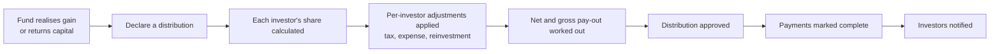
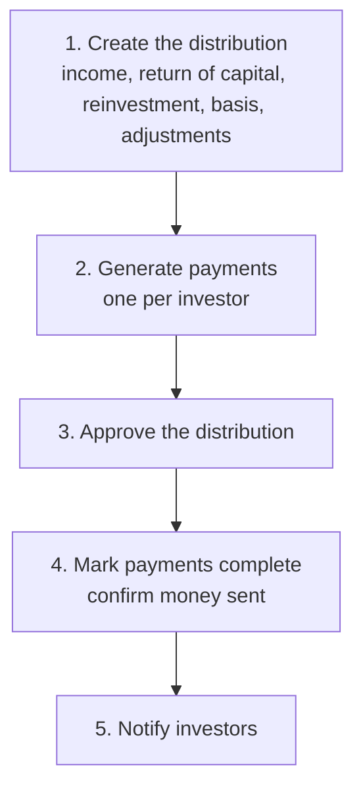
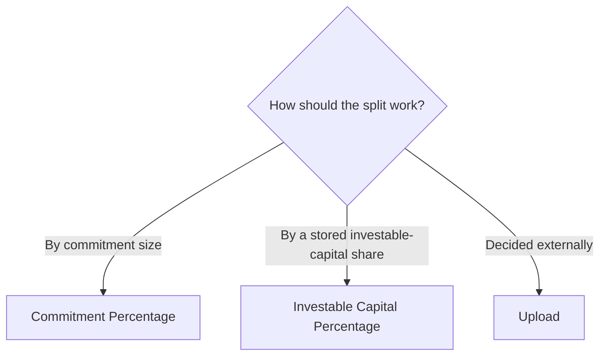
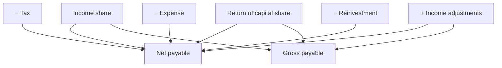
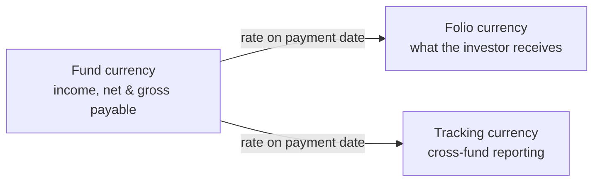
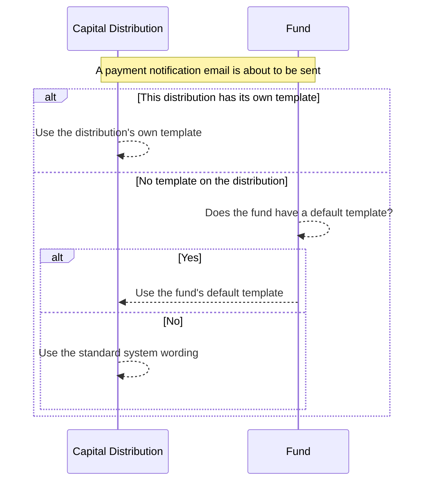

# Capital Distributions User Guide

A **capital distribution** is money flowing the other way — from the fund back to its investors. When the fund realises a gain (for example a portfolio company is sold) or returns capital, it declares a distribution, works out each investor's share, and pays it out.

> **Where to find it:** Sidebar → [**Funds → Funds**](/funds) → open the fund → **Distributions** tab. Create one with **New Distribution** on that tab; open a distribution to reach its **Actions** dropdown (Approve, Mark Payments Completed, Redeem Units, Recompute Fees, Send Payment Notifications, Generate Documents). Needs the **Funds** module plus an access right on the fund with create/update permission (company admins have it automatically).

This guide explains how to declare a distribution, allocate it across investors, apply per-investor adjustments such as tax and reinvestment, understand the difference between gross and net pay-outs, and notify investors. No technical background is needed.

---

## Table of Contents

1. [Where Distributions Fit](#where-distributions-fit)
2. [Key Terms in Plain English](#key-terms-in-plain-english)
3. [The Distribution Journey](#the-distribution-journey)
4. [Creating a Distribution](#creating-a-distribution)
5. [How Each Investor's Share Is Allocated](#how-each-investors-share-is-allocated)
6. [Per-Investor Adjustments (Distribution Fees)](#per-investor-adjustments-distribution-fees)
7. [Generating Distribution Payments](#generating-distribution-payments)
8. [Approving a Distribution](#approving-a-distribution)
9. [Understanding a Distribution Payment](#understanding-a-distribution-payment)
10. [Gross Payable vs Net Payable](#gross-payable-vs-net-payable)
11. [Completing Payments](#completing-payments)
12. [Working Across Currencies](#working-across-currencies)
13. [Investor Notifications](#investor-notifications)
14. [Generating Distribution Notices](#generating-distribution-notices)
15. [Redeeming Fund Units](#redeeming-fund-units)
16. [Refreshing Adjustments After a Change](#refreshing-adjustments-after-a-change)
17. [Linking a Portfolio Company Sale](#linking-a-portfolio-company-sale)
18. [Importing Distributions and Payments](#importing-distributions-and-payments)
19. [Worked Example](#worked-example)
20. [Frequently Asked Questions](#frequently-asked-questions)

---

## Where Distributions Fit

A distribution is the return side of the fund relationship. Capital calls draw money in; distributions send value back out — whether that's profit from an exit, income such as dividends, or a return of the original capital.

Each distribution declares how much **income** (gain) and how much **return of capital** is being paid out, then creates one payment per investor showing their individual share.

---

## Key Terms in Plain English

| Term | What it means |
|------|---------------|
| **Distribution** | The fund-wide event — "we are distributing $10M from the sale of Company X." |
| **Distribution Payment** | One investor's slice of that distribution. |
| **Income** | The gain or income component (e.g. profit on an exit). |
| **Face Value for Redemption (Return of Capital)** | The original cost being handed back to investors — repayment of principal. |
| **Reinvestment** | A portion an investor is treated as earning but which is immediately reinvested rather than paid in cash. |
| **Gross Payable** | The full value being distributed, before per-investor deductions. |
| **Net Payable** | What the investor actually receives after tax, expenses, and reinvestment. |
| **Distribution Basis** | The method for splitting the total among investors. |
| **Completed** | The team's confirmation that the money has been sent. |

---

## The Distribution Journey

---

## Creating a Distribution

Open a **Fund**, go to its **Distributions** tab and click **New Distribution**.

### Required information

| Field | What to enter |
|-------|---------------|
| **Title** | A unique name within the fund (e.g. "Distribution 1 — Company X exit"). |
| **Distribution Date** | The date of the distribution. Drives payment dates and adjustment look-ups. |
| **Distribution Basis** (form label **Distribution on**) | How the total is split across investors — see [the next section](#how-each-investors-share-is-allocated). |

### The amounts (all at fund level)

| Field | What it represents |
|-------|--------------------|
| **Income** | The total gain/income being distributed. |
| **Face Value for Redemption** | The total return of capital (original cost handed back). |
| **Reinvestment** | The total amount being reinvested rather than paid out in cash. |

> These three are **fund-wide totals**. Each investor's individual share is calculated from them using their distribution percentage.

### Optional settings

| Field | What it does |
|-------|--------------|
| **Notes** | Internal notes. |
| **Send Notification** | Allows payment emails to be sent for this distribution when you use a send action. It does not send anything by itself. |
| **Distribution Fees** | Per-investor adjustments such as tax or reinvestment, added with **Add Account Entries** — see [below](#per-investor-adjustments-distribution-fees). |
| **Sold Investments** | Link the company sale(s) that produced the income — see [Linking a Portfolio Company Sale](#linking-a-portfolio-company-sale). |
| **Unit Prices** | Per-unit-class price, used if you're redeeming units. |

### Rules to keep in mind

- The title must be unique within the fund.
- When you link a portfolio company sale, the income and return-of-capital figures are pre-filled from that sale's gain and cost.
- If the basis is "Upload", payments aren't generated automatically — you upload them.
- Once saved, the basis, sold investments, income, face value for redemption and reinvestment are locked.
- **Generate Payments** and **Payments Paid** are not on the form; they can only be set through the distribution import.

---

## How Each Investor's Share Is Allocated

The **Distribution Basis** sets each investor's percentage of the total.

### Option 1 — Commitment Percentage

Each investor receives their share in proportion to their commitment.

> Investor's income = Total income × Investor's commitment % · (and likewise for return of capital and reinvestment)

This is the standard method for most closed-ended funds.

### Option 2 — Investable Capital Percentage

Each investor's share follows their stored "Investable Capital Percentage" as of the distribution date — useful when investors carry different effective shares (for example after excused or defaulting investors are accounted for). If an investor has no such figure, the system falls back to their commitment percentage.

### Option 3 — Upload

Payment amounts are decided outside the system and loaded from a spreadsheet, exactly as given.

---

## Per-Investor Adjustments (Distribution Fees)

Despite the name "fees", these are **adjustment rules**, not charges. Each rule looks up amounts already recorded against an investor (such as accrued tax or a management-fee credit) and adjusts that investor's pay-out.

### What each adjustment type does

| Adjustment type | Effect on the investor's pay-out |
|-----------------|----------------------------------|
| **Income** | Adds to income. Increases **both** net and gross payable. |
| **FV For Redemption** | Adds to return of capital. Increases **both** net and gross payable. |
| **Tax** | Subtracts from income. Reduces **net** payable only (not gross). |
| **Expense** | Subtracts from income. Reduces **net** payable only (not gross). |
| **Reinvestment** | Marks part as reinvested. Reduces **net** payable only (not gross). |
| **Display Only** | Appears on the notice for transparency. Changes **nothing**. |

> **The key idea:** tax, expense, and reinvestment reduce what the investor *receives* (net) but not what the fund *distributes* (gross). That distinction is what keeps DPI and TVPI based on the full value handed out.

### Configuring an adjustment

On the distribution form, click **Add Account Entries** and set:

| Field | What to enter |
|-------|---------------|
| **Name** | Must match a line item already recorded on the investor's commitment. |
| **Start Date / End Date** | The window of line items to total up. |
| **Fee Type** | Income, FV For Redemption, Tax, Expense, Reinvestment, or Display Only. |
| **Notes** | Internal notes. |

You can add several adjustments; they're applied in a consistent order. For each investor, the system keeps a full breakdown of which line items fed each adjustment, so any figure can be traced back to its source.

---

## Generating Distribution Payments

Unless the basis is "Upload", saving the distribution creates one payment per investor in the background:

1. Work out each investor's distribution percentage.
2. Split the income, return of capital, and reinvestment by that percentage.
3. Apply the per-investor adjustments.
4. Calculate net and gross payable.
5. If the distribution was imported with **Payments Paid = Yes**, create them already Completed.

Generation never creates duplicates — if a payment already exists for an investor, it's skipped, so re-running is safe. For an "Upload" basis distribution (or an import with **Generate Payments = No**) payments are loaded by import; the manual payment form saves only the income, so load face value for redemption and reinvestment through a payment upload.

---

## Approving a Distribution

Approval is a formal confirmation step:

1. Open the distribution.
2. Choose **Actions → Approve**. The system records who approved it.

Investors can only be emailed **after** the distribution is approved. Approval does not control what investors can see: an investor with access to the fund sees their payment as soon as it is generated.

---

## Understanding a Distribution Payment

A payment is one investor's record. Its main figures:

| Field | What it tells you |
|-------|-------------------|
| **Folio ID** | The investor's account in this fund. Appears once per distribution. |
| **Income** | The investor's share of the fund's income, before adjustments. |
| **Return of Capital** | The investor's share of returned capital, before adjustments. |
| **Reinvestment** | The investor's share of reinvestment, before adjustments. |
| **Income With Adjustments** | Income after adding income-type and subtracting tax/expense adjustments. |
| **Net Payable** | What the investor actually receives. |
| **Gross Payable** | The value distributed before deductions — used for fund totals and DPI/TVPI. |
| **Folio Amount** | Net payable converted to the investor's own currency. |
| **Payment Date** | Defaults to the distribution date. |
| **Percentage** | The investor's distribution percentage. |
| **Completed** | Whether the money has been confirmed sent. |
| **Notification Sent** | Whether the investor has been emailed. |

---

## Gross Payable vs Net Payable

This is the single most important concept in distributions.

- **Net Payable** = income + income adjustments − tax − expense + return of capital − reinvestment. This is the cash the investor gets.
- **Gross Payable** = income + income adjustments + return of capital. This is the full value distributed, before per-investor deductions.

Fund-level distribution totals and performance ratios (DPI, TVPI) use **gross**; the actual cash payment to the investor uses **net**.

### Worked illustration

An investor's share of a distribution is income 1,000, return of capital 500, reinvestment 200, plus two adjustments on their commitment: tax of 100 and a management-fee income credit of 50.

| Step | Calculation | Running result |
|------|-------------|----------------|
| Starting shares | income 1,000, return of capital 500, reinvestment 200 | — |
| Apply tax (−100, net only) | net adjustments = −100 | net −100, gross 0 |
| Apply income credit (+50, both) | net adjustments = −50; gross adjustments = +50 | net −50, gross +50 |
| **Net Payable** | 1,000 − 50 + 500 − 200 | **1,250** |
| **Gross Payable** | 1,000 + 50 + 500 | **1,550** |

The $300 gap between gross (1,550) and net (1,250) is the tax withheld plus the amount reinvested.

---

## Completing Payments

"Completing" a payment confirms the cash has been sent to the investor.

- **One payment:** open the payment and choose **Actions → Mark Payment Completed**.
- **All payments at once:** open the approved distribution and choose **Actions → Mark Payments Completed** — the system completes them in turn and reports how many succeeded.

When a payment completes, the distribution's completed total updates. No email is sent: use **Send Payment Notifications** afterwards.

---

## Working Across Currencies

- All distribution amounts are held in the **fund currency**.
- The **folio amount** is the net payable converted to the investor's own currency on the payment date.
- A **tracking currency** version supports cross-fund reporting.

Fund totals roll up the **gross** figures (and the tracking-currency net for completed payments) automatically.

---

## Investor Notifications

A distribution email is sent to an investor when **all** of these are true:

| Condition | Set on |
|-----------|--------|
| The payment is **Completed** | The payment |
| The distribution is **Approved** | The distribution |
| **Send Notification** = Yes | The distribution |
| The distribution was not loaded as a manual/historical import | The distribution |
| The investor is **not** set to skip notices (`skip_doc_gen` not Yes) | The commitment |
| The email hasn't already been sent (unless you force it) | The payment |

**Ways to send:**

- **In bulk** — choose **Actions → Send Payment Notifications** on the distribution to email everyone who hasn't yet been notified; the system reports the totals and emails you any errors.
- **Force-send one** — on a single payment, choose **Actions → Send Notification** (or **Resend Notification**). This only skips the "already sent" check; every other condition above still applies.

Completing a payment never sends an email on its own.

**The email** uses the subject "Capital Distribution: [Fund Name]", attaches the approved distribution notice and any manually added documents, honours a custom template if one applies (see [Custom Notification Templates](#custom-notification-templates) below), and copies the commitment's CC addresses. Investors set to **skip notices** receive nothing (this setting is shared with capital-call notices).

### Custom Notification Templates

By default, the payment notification email uses the system's standard wording. You can replace it with your own, at two levels:

- **A fund-wide default** — open the fund, go to its **Notifications** tab, and choose **New Distribution Notification** from the **New Notification** menu. This becomes the default template used by **every distribution in that fund** that doesn't already have its own override.
- **A distribution-specific override** — open a specific distribution, go to its own **Notification** tab, and create a notification the same way. This applies only to that one distribution.

A distribution's own template, when one exists, always takes priority over the fund's default. If you set up a distribution-specific template when a fund-wide default already exists, the form warns you that saving it will override the fund's default for that distribution.

In the template, **For Notification** is **Send notification** (the distribution payment email). The email always attaches the approved notice and any manually uploaded documents. For placeholders such as `{{net_payable_amount}}`, attachments and the other template fields, see [Custom Notifications](custom_notifications_user_guide).

---

## Generating Distribution Notices

The system can produce a personalised distribution notice document per payment.

- **For all payments:** open the distribution and choose **Actions → Generate Documents** — it uses your fund's **Distribution Template**.
- **For one payment:** open that payment and choose **Actions → Generate Documents**. (Blocked if the investor is set to skip notices.)
- **Per investor (per KYC):** if your fund is set to issue notices per KYC, investors with several folios get one combined notice.

A **Distribution Template** must exist (at fund or commitment level; add one with the fund's **Actions → Misc → New Template**, see [Document Templates](document_templates_user_guide)), the investor must have a verified **KYC record**, and notices must be approved before they're attached to notification emails.

---

## Redeeming Fund Units

When a distribution represents a partial or full redemption of fund units:

1. Open the distribution.
2. Choose **Actions → Redeem Units** (shown only when unit prices are set).
3. The system records the unit redemptions against each completed payment in the background.

Per-unit-class prices for the redemption are set on the distribution.

---

## Refreshing Adjustments After a Change

If line items behind an adjustment are added or corrected after payments exist, choose **Actions → Recompute Fees** on the distribution. The system re-reads each adjustment's line items and recalculates net and gross payable for every payment, emailing you any errors.

---

## Linking a Portfolio Company Sale

A distribution can be tied to one or more **portfolio company sales**, recording that the income came from those exits.

- **When creating:** pick the relevant sales under **Sold Investments** (locked once saved). The system sets **income** to the total gain and **return of capital** to the total cost of those investments, and tags those sales with this distribution.
- **When deleting:** the linked sales are simply unlinked (not deleted); the distribution and its payments are soft-deleted.

---

## Importing Distributions and Payments

You can bulk-load from spreadsheets, mainly for historical data.

**Distributions** — key columns: Fund, Title (unique per fund), Income, Date, Generate Payments, Payments Paid, Reinvestment, Distribution Basis, Face Value for Redemption, and Send Notification. A duplicate title in the same fund is rejected, exchange rates can be supplied for multi-currency funds, and imported distributions never email investors, whichever send action you use.

**Payments** — key columns: Fund, Capital Distribution (title), Income, Payment Date, Completed, Folio No, Face Value for Redemption, and Reinvestment. Each row is matched to the investor through the Folio No, so a commitment must already exist under the given folio; the investor's percentage is captured at import, and adjustments are applied automatically. Each folio appears once per distribution.

---

## Worked Example

**Setup**

- Fund: *Acme Growth Fund I*, currency **USD**, basis *Commitment Percentage*.
- *Company X* is sold for a **$10,000,000 gain** on **$6,000,000 of original cost** → income $10M, return of capital $6M.
- Three investors:

| Investor | Commitment % | Income share | Return of capital share |
|----------|-------------|--------------|--------------------------|
| Northwind LP | 50% | $5,000,000 | $3,000,000 |
| Briar Capital | 30% | $3,000,000 | $1,800,000 |
| Kestrel Family Office | 20% | $2,000,000 | $1,200,000 |

**Add an adjustment:** a 10% withholding **tax** on income for Kestrel only (a tax line item of $200,000 on Kestrel's commitment).

| Investor | Gross payable | Tax (net only) | Net payable |
|----------|---------------|----------------|-------------|
| Northwind LP | $8,000,000 | — | $8,000,000 |
| Briar Capital | $4,800,000 | — | $4,800,000 |
| Kestrel | $3,200,000 | −$200,000 | $3,000,000 |

**Totals:** the fund records **$16,000,000 gross** distributed (used for DPI/TVPI), while Kestrel's *cash* is $3,000,000 because $200,000 was withheld for tax.

---

## Frequently Asked Questions

### Navigation and getting there

**Where do I find distributions in CapHive?**
Sidebar → [**Funds → Funds**](/funds), open the fund, then click the **Distributions** tab on the fund page. The tab lists every distribution with its name, distribution date, gross payable and approval status; click a row to open it. The [list of distributions across all your funds](/capital_distributions) shows them together. See [Where Distributions Fit](#where-distributions-fit).

**What is on a distribution's page?**
The distribution page shows a stats strip and a collapsible details card (amounts, fees, attributes, unit prices), then the **Edit** and **Delete** buttons and the **Actions** dropdown, then the tabs **Payments** (default), **Portfolio Investments** (only when sold investments are linked) and **Notification** (this distribution's own email templates).

**Where are the approve, complete, redeem, notify and recompute actions?**
Open the distribution and click the **Actions** dropdown next to Edit and Delete. It holds **Approve** (until approved), **Mark Payments Completed** and **Send Payment Notifications** (approved distributions only), **Redeem Units** (only when unit prices are set), **Recompute Fees**, **Generate Documents**, **Run Readiness Check** (locked until the Distribution Readiness agent is enabled), and **Clone** / **Create With Fees**.

**Where do I see and work on the individual payments?**
Open the distribution; its **Payments** tab lists one row per folio. Click a row to open the payment, which has **Edit**, **Delete** and an **Actions** dropdown with **Mark Payment Completed**, **Preview Notification**, **Send Notification** (shown once the payment is completed; **Resend Notification** after a send) and **Generate Documents**. Its **Documents** tab holds the notice and its **Units** tab any redeemed units. See [Understanding a Distribution Payment](#understanding-a-distribution-payment).

**Where does an investor see their distributions?**
An investor with access to the fund opens it from **Funds** in their sidebar and expands the **Distributions** section, which lists their own payments with gross payable, net payable, payment date and completed flag. On the fund manager side, the same payments also appear on the commitment's **Distributions** tab.

### Creating, updating and managing distributions

**How do I create a new distribution?**
On the fund's **Distributions** tab click [**New Distribution**](/capital_distributions/new). Enter the title, distribution basis, any **Sold Investments**, income, face value for redemption, reinvestment, distribution date and unit prices, add adjustment rows with **Add Account Entries**, then **Save**. Payments are generated in the background unless the basis is "Upload". See [Creating a Distribution](#creating-a-distribution).

**How do I edit a distribution?**
Open the distribution and click **Edit** (needs update access on the fund). Only the title, distribution date, unit prices, completed flag, **Send Notification** setting, notes, custom fields and adjustment rows can change: the basis, sold investments, income, face value for redemption and reinvestment are locked once the distribution is saved. Changing the date opens a **Change Distribution Date** confirmation first.

**How do I delete a distribution?**
Open the distribution and click **Delete** (needs destroy access on the fund), then confirm. You are returned to the fund page. The distribution and its payments are soft-deleted and any linked sold investments are unlinked. See the delete question under *What happens when I …* below.

**How do I add, edit or delete a single payment?**
To edit or delete, open the payment from the **Payments** tab and use **Edit** or **Delete**; only the payment date and **Completed** can be edited, the amounts are locked. There is no button to add a single payment; the new-payment form can only be opened by address for a specific distribution (create access needed), so ask CapHive support for it, or for an "Upload" basis distribution use **Upload** on the Payments tab.

**How do I bulk upload or download distributions and payments?**
Distributions: on the fund's **Distributions** tab use **Upload** (an import of type CapitalDistribution) and **Download** (Excel). Payments: on the distribution's **Payments** tab use **Upload** (enabled only when the basis is "Upload") and **Download**. Generate Payments and Payments Paid can only be set through the distribution import. See [Importing Distributions and Payments](#importing-distributions-and-payments).

**How do I approve a distribution?**
Open the distribution and choose **Actions → Approve**, then confirm "This will mark the distribution as approved". The entry is shown to anyone with update access on the fund while the distribution is unapproved; no separate approver role is checked. See [Approving a Distribution](#approving-a-distribution).

**How do I mark payments as completed?**
All at once: open the approved distribution and choose **Actions → Mark Payments Completed**; the notice tells you how many payments were completed. One at a time: open the payment and choose **Actions → Mark Payment Completed**, or **Edit** it and tick **Completed**. See [Completing Payments](#completing-payments).

**How do I email investors about their distribution?**
After the distribution is approved and its payments are completed, choose **Actions → Send Payment Notifications** on the distribution to email everyone not yet notified. For one investor open the payment and choose **Actions → Send Notification** (or **Resend Notification**). Use **Actions → Preview Notification** on a payment to see the email first. See [Investor Notifications](#investor-notifications).

**How do I generate distribution notices?**
Choose **Actions → Generate Documents** on the distribution for every payment, or on a single payment for just that folio. A document tagged **Distribution Template** must exist on the fund or the commitment, and the folio's KYC must be verified. A user with the approver role then opens each notice from the payment's **Documents** tab and clicks **Approve**, so it is attached to the email. See [Generating Distribution Notices](#generating-distribution-notices).

**How do I add a distribution notice template?**
A distribution notice template is a Word file on the fund tagged **Distribution Template**. Open the fund → **Actions → Misc → New Template**, set **Document For** to **Distribution Template**, upload the file and save. **Actions → Generate Documents** on a distribution then builds one notice per payment. See [Document Templates](document_templates_user_guide) for merge fields.

**How do I redeem fund units with a distribution?**
Enter a unit price per unit class on the distribution (form fields named "[class] Unit Price"), complete the payments, then choose **Actions → Redeem Units**. The entry only appears when unit prices are set. See [Redeeming Fund Units](#redeeming-fund-units).

**How do I start the next distribution from this one?**
Open the distribution and choose **Actions → Clone** (copies title with "(Copy)", basis, amounts, unit prices, notification setting, notes and fee rows into a new form) or **Actions → Create With Fees** (a blank form with only the fee rows copied). Nothing is saved until you click **Save** on the new form.

**How do I use my own email wording for distribution emails?**
Open the fund's **Notifications** tab and choose **New Notification → New Distribution Notification** for a fund-wide default, or open the distribution's own **Notification** tab and choose **New Notification → New Distribution Notification** for a distribution-specific override. See [Custom Notification Templates](#custom-notification-templates).

**How do I customise the distribution notification email (distribution email template)?**
Fund → **Notifications** tab → **New Notification** → **New Distribution Notification** creates a default for every distribution in the fund; the distribution's **Notification** tab → **New Notification** → **New Distribution Notification** creates one for that distribution only, which wins over the default. **For Notification** is **Send notification**; write the subject and body and save. See [Custom Notifications](custom_notifications_user_guide).

**What permission do I need to work on distributions?**
The **Funds** module must be enabled for your login, plus an access right on the fund: **create** to add or clone, **update** to edit, approve, complete, generate, notify, redeem and recompute, **destroy** to delete. Company admins have all of these automatically. A company admin grants access on the fund page's **Access** tab; without create access the **New Distribution** button is still shown but the form refuses to open.

### Why use distributions

**Why should I record distributions in CapHive rather than in a spreadsheet?**
The system splits the fund-level amounts across every folio, applies each investor's tax, expense and reinvestment adjustments from line items already on their commitment, keeps gross and net separate so DPI and TVPI stay correct, produces a personalised notice per payment, tracks which payments are complete and which investors were emailed, and shows the same figures to investors in their portal.

**What can I do with a distribution once it exists?**
Generate payments, review each investor's gross and net, approve, mark payments complete (singly or all at once), email investors with the approved notice attached, redeem fund units at the prices set on the distribution, recompute adjustments after corrections, run a readiness check, and clone it as the starting point for the next distribution.

**What happens if I don't record distributions here?**
Distributed amounts on commitments and the fund stay at zero, so DPI, TVPI and RVPI are wrong, distribution notices and statements cannot show the pay-out, fund units are never redeemed, and investors see no distribution history in the portal.

**Who typically uses distributions?**
Fund finance or operations staff create and approve them and confirm payments; investor-relations staff generate notices and send the emails. Investors and their advisors see only their own payments in the portal.

**Why does the basis matter?**
It decides each folio's percentage. **Commitment Percentage** uses the commitment's share of the fund; **Investable Capital Percentage** uses the latest account entry of that name on or before the distribution date (falling back to the commitment percentage); **Upload** generates nothing and takes amounts from your spreadsheet. The basis cannot be changed after saving. See [How Each Investor's Share Is Allocated](#how-each-investors-share-is-allocated).

### What happens when I …

**What happens when I save a new distribution?**
The distribution appears unapproved on the fund's **Distributions** tab, and any sold investments you picked are tagged with it. Unless the basis is "Upload", a background job creates one payment per commitment in the fund, skipping folios that already have one, applies the adjustments and updates distributed totals on the distribution, commitments and fund. You get an in-app alert when it finishes, and an email listing any failed folios. No investor is notified.

**What happens when I edit a distribution?**
The changes save immediately and no one is notified. Existing payments are not recalculated for new adjustment rows or unit prices; use **Recompute Fees** for adjustments. If you changed the distribution date, a background job re-dates every payment to the new date and then recomputes fees, sending you in-app progress alerts and an error email if any payment fails.

**What happens when I approve a distribution?**
The distribution is marked approved with your name. **Approve** disappears and **Mark Payments Completed** and **Send Payment Notifications** appear in the Actions menu, and payment emails become possible. No email is sent to anyone, and there is no Unapprove action on a distribution.

**What happens when I click Mark Payments Completed?**
Every payment on the distribution is marked completed one by one, with its adjustments, net and gross recomputed on save; the notice reports "N payments out of M marked as completed". The distribution's completed amount and the fund's tracking-currency distributed amount update. As the confirmation dialog says, no notification is sent: use **Send Payment Notifications** afterwards.

**What happens when I mark a single payment completed?**
The payment's **Completed** flag is set, its adjustments, net and gross are recomputed, and the distribution's completed amount updates. No email goes out automatically, even with **Send Notification** on; the **Send Notification** entry now appears on the payment. You can un-tick **Completed** again via **Edit**.

**What happens when I click Send Payment Notifications?**
A background job checks every payment not yet notified. It emails a payment only if the payment is completed, the distribution is approved with **Send Notification** on, the distribution was not imported, and the commitment does not have `skip_doc_gen` set to Yes; each sent payment is flagged Notification Sent. You receive an in-app summary of successes and failures, and an email listing failures. Already-notified investors are not emailed again.

**Who receives the distribution email, and by what channel?**
Every stakeholder (investor) user with approved investor access whose notification tags are blank or include "Distribution" and who can see the fund, plus the commitment's CC addresses. The email has the subject "Capital Distribution: [fund name]", attaches the approved generated notice and any manually added documents, and also lands in each recipient's in-app inbox (**My Inbox**).

**What happens when I click Send Notification or Resend Notification on one payment?**
The email goes straight away to that investor's recipients, even if it was sent before, and Notification Sent is set. The other conditions still apply: if the payment is not completed, the distribution is unapproved, **Send Notification** is off or the distribution was imported, you get a message listing the reason and nothing is sent. With `skip_doc_gen` Yes on the commitment it is refused outright. Sent emails cannot be recalled.

**What happens when I click Generate Documents?**
A background job builds one notice per payment from the **Distribution Template** and stores it on the payment's **Documents** tab as a generated, unapproved document. Payments whose folio KYC is not verified, or that already have an approved or signed notice, are skipped and listed in an error email. You get in-app progress alerts; investors receive nothing.

**What happens when I click Redeem Units?**
A background job creates a negative fund unit entry for each completed payment with a positive face value for redemption whose commitment has a unit type and no units yet on this payment: quantity is face value for redemption (with adjustments) divided by that class's unit price. Units show on the payment's **Units** tab, the commitment's **Units** tab and the fund's **Fund Units** page. Re-running skips payments already redeemed; errors are emailed to you.

**What happens when I click Recompute Fees?**
A background job re-reads the line items behind each adjustment and recalculates income with adjustments, net payable, gross payable and folio amount for every payment, updating the distribution, commitment and fund totals. You get in-app progress alerts and an email listing any failed payments. Investors are not notified, so decide whether completed or notified investors need a corrected notice. See [Refreshing Adjustments After a Change](#refreshing-adjustments-after-a-change).

**What happens when I delete a distribution?**
The distribution and all its payments are soft-deleted, their redeemed fund units are removed, distributed totals on the commitments and fund are reduced, and linked sold investments are unlinked so they can be picked for another distribution. No one is notified and emails already sent stay sent. A deleted distribution can be restored from [deleted distributions](/capital_distributions/show_deleted), but the sold-investment links are not restored.

**What happens when I delete a single payment?**
The payment is soft-deleted together with any fund units redeemed against it, and the distribution, commitment and fund totals drop by its amounts. The investor is not told. It can be restored from [deleted distribution payments](/capital_distribution_payments/show_deleted) (destroy access needed).

**What happens when I upload a distribution through Import?**
Each row creates a distribution marked as imported (a duplicate title in the fund is rejected). Payments are generated only when **Generate Payments** is Yes, and created already completed when **Payments Paid** is Yes. Imported distributions never email investors, whatever the **Send Notification** column says, because every send path skips imported distributions.

**What happens if the folio's KYC is not verified?**
Generate Documents skips that payment with "Investor Kyc not verified", so there is no notice to approve or attach. The payment itself can still be completed and emailed, just without a generated notice. Verify the KYC first (Sidebar → **Stakeholders → View Stakeholders**, open the stakeholder, **KYC** tab), then generate documents again.

### Troubleshooting and edge cases

**Mark Payments Completed or Send Payment Notifications is missing from the Actions menu - why?**
Both only appear once the distribution is **approved** and you have update access on the fund. **Redeem Units** only appears when unit prices are set on the distribution, and **Send Notification** on a single payment only appears after that payment is completed.

**I completed the payments but investors got no email - why?**
Completing never sends email on its own. Choose **Actions → Send Payment Notifications** on the distribution. If some investors still receive nothing, check the error summary: the distribution may be imported, **Send Notification** may be off, the commitment may have `skip_doc_gen` Yes, or the investor may have no approved user subscribed to Distribution notifications.

**Can I undo an approval or a completed payment?**
There is no Unapprove action on a distribution; contact support if it was approved by mistake. A completed payment can be reversed by opening it, clicking **Edit** and un-ticking **Completed**, but an email already sent cannot be recalled, so tell the investor directly.

**Why can't I change the income or basis after saving?**
The basis, sold investments, income, face value for redemption and reinvestment fields are disabled on the edit form because payments were already split from them. To correct them, delete the distribution and create it again (or **Clone** it, fix the figures and delete the original).

**Can I add a payment for an investor who was missed?**
Check first: Commitment Percentage and Investable Capital Percentage generate a payment for every commitment in the fund, so a missed folio usually means the commitment was added later or failed (see the error email). Add the missing payment on the new-payment form for that distribution (there is no button for it; ask CapHive support for the form) and pick the investor, folio, income and payment date; this form only saves the income, so load face value for redemption and reinvestment through a payment upload instead.

**Can two investors get different percentages in one distribution?**
Yes. Under the Investable Capital Percentage basis each folio's share comes from its own stored figure, and under the Upload basis each row carries its own amounts.

**What's the difference between gross and net payable?**
Gross is the full value distributed before per-investor deductions; net is the actual cash the investor receives. Fund totals and DPI/TVPI use gross; the investor payment uses net. See [Gross Payable vs Net Payable](#gross-payable-vs-net-payable).

**Why would gross be higher than net?**
Because tax, expense and reinvestment adjustments reduce net but not gross. The gap is what was withheld from, or reinvested for, the investor.

**What does reinvestment do?**
It is an amount the investor is treated as earning but which is immediately reinvested rather than paid in cash. It reduces net payable and shows as its own line on the notice. The **Create Account Entry** link under Reinvestment on the distribution page pre-fills a fund account entry for it.

**What is "Display Only" for?**
It puts an informational line on the notice (for example a breakdown of accrued fees) without changing any amount. See [Per-Investor Adjustments (Distribution Fees)](#per-investor-adjustments-distribution-fees).

**When is "Payments Paid" useful?**
For loading historical distributions through the import: it creates every generated payment already completed so you don't complete them one by one. It is not on the on-screen form, and imported distributions never email investors.

**Does approving a distribution send notifications?**
No. Approval sends nothing; it only unlocks **Mark Payments Completed** and **Send Payment Notifications**. Emails go out only when you use one of the send actions on completed payments. See [Investor Notifications](#investor-notifications).

**Can investors see a distribution before I approve it?**
Yes. The investor's **Distributions** list on the fund is not filtered by approval or completion, so an investor with access to the fund sees their payment as soon as it is generated. Check figures before generating, or generate payments when you are ready to share them.

**I corrected a tax line item after payments were generated - what now?**
Open the distribution and choose **Actions → Recompute Fees**. Every payment's adjustments, net and gross are recalculated and any errors are emailed to you. See [Refreshing Adjustments After a Change](#refreshing-adjustments-after-a-change).

**Generate Documents on a payment says notice cannot be generated - why?**
The commitment has `skip_doc_gen` set to Yes, which blocks both notice generation and emails for that folio from the payment page. Edit the commitment to clear it if the investor should receive notices.

**The Upload button on the Payments tab is disabled - why?**
Payment upload is only allowed for distributions whose basis is "Upload"; the tooltip says so. For other bases the payments are generated by the system, so fix amounts through adjustments and **Recompute Fees** instead.

---

## Related Guides

- [Capital Commitments](capital_commitments_user_guide) - each payment belongs to a commitment, where `skip_doc_gen`, CC addresses and folio currency live.
- [Capital Calls](capital_calls_user_guide) - the mirror-image flow for drawing money in.
- [Fund Units](fund_units_user_guide) - units redeemed by **Redeem Units** at the distribution's unit prices.
- [Portfolio Investments](portfolio_investments_user_guide) - the sold investments whose gain and cost pre-fill income and face value for redemption.
- [Fund Commitment Notifications](fund_commitment_notifications_user_guide) - ad-hoc emails to commitment holders sent from the same fund **Notifications** tab.
- [Custom Notifications](custom_notifications_user_guide) - distribution payment email templates, placeholders and attachments.
- [Tracking Currency](tracking_currency_guide) - the reporting currency used for tracking net payable totals.
- [Investor KYC](investor_kyc_user_guide) - notices are only generated for folios with a verified KYC.
- [Distribution Readiness Agent](agents/distribution_readiness_agent_user_guide) - the AI check run from **Actions → Run Readiness Check**.
- [Document Templates](document_templates_user_guide) - adding the Distribution Template Word file that notices are generated from.
