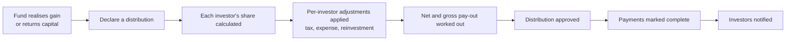
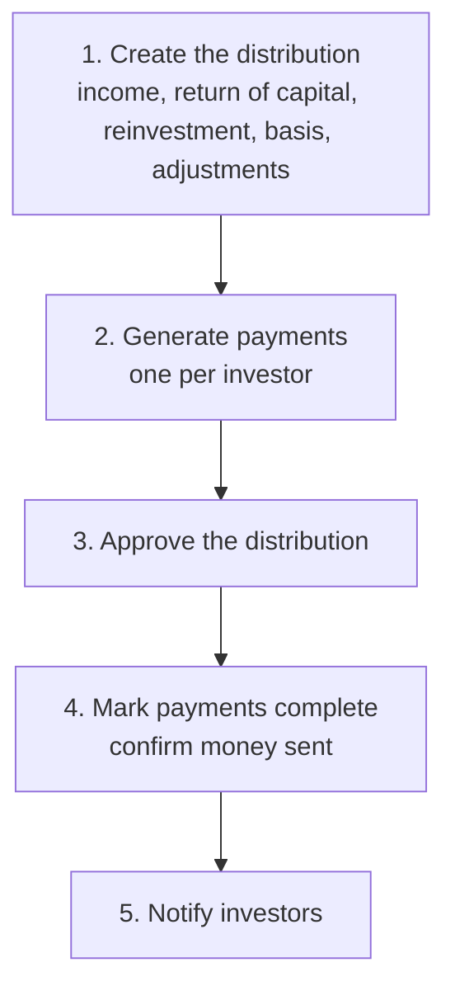
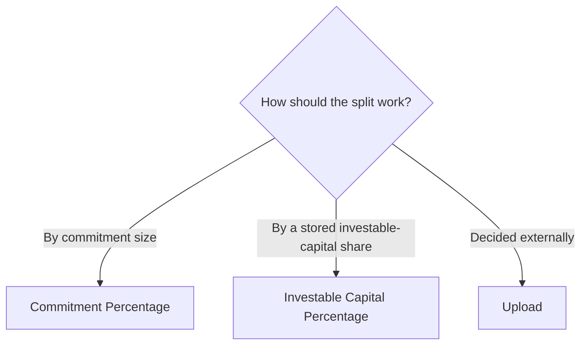
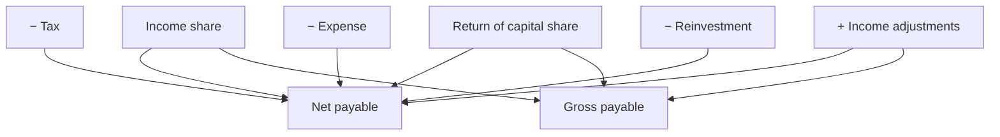
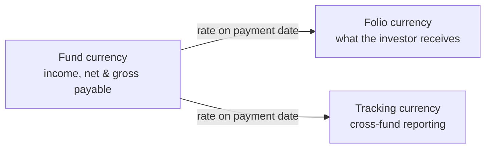
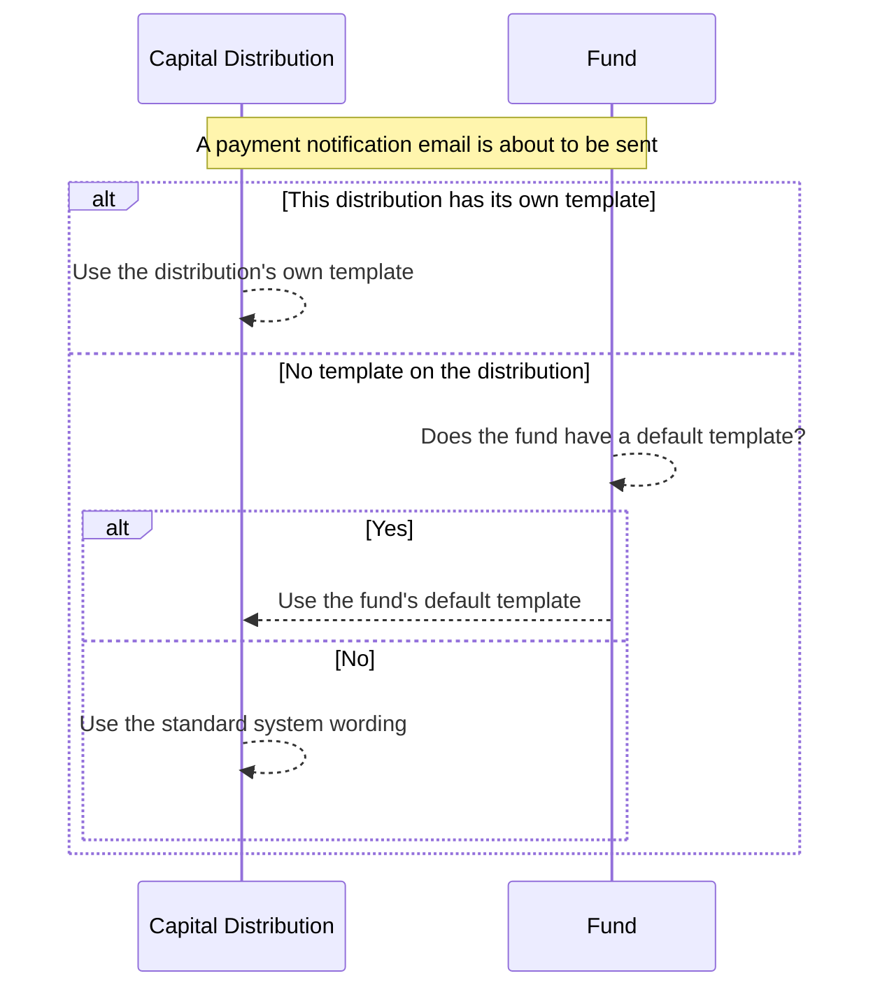

# Capital Distributions User Guide

A **capital distribution** is money flowing the other way — from the fund back to its investors. When the fund realises a gain (for example a portfolio company is sold) or returns capital, it declares a distribution, works out each investor's share, and pays it out.

This guide explains how to declare a distribution, allocate it across investors, apply per-investor adjustments such as tax and reinvestment, understand the difference between gross and net pay-outs, and notify investors. No technical background is needed.

---

## Table of Contents

1. [Where Distributions Fit](#where-distributions-fit)
2. [Key Terms in Plain English](#key-terms-in-plain-english)
3. [The Distribution Journey](#the-distribution-journey)
4. [Creating a Distribution](#creating-a-distribution)
5. [How Each Investor's Share Is Allocated](#how-each-investors-share-is-allocated)
6. [Per-Investor Adjustments (Distribution Fees)](#per-investor-adjustments-distribution-fees)
7. [Generating Distribution Payments](#generating-distribution-payments)
8. [Approving a Distribution](#approving-a-distribution)
9. [Understanding a Distribution Payment](#understanding-a-distribution-payment)
10. [Gross Payable vs Net Payable](#gross-payable-vs-net-payable)
11. [Completing Payments](#completing-payments)
12. [Working Across Currencies](#working-across-currencies)
13. [Investor Notifications](#investor-notifications)
14. [Generating Distribution Notices](#generating-distribution-notices)
15. [Redeeming Fund Units](#redeeming-fund-units)
16. [Refreshing Adjustments After a Change](#refreshing-adjustments-after-a-change)
17. [Linking a Portfolio Company Sale](#linking-a-portfolio-company-sale)
18. [Importing Distributions and Payments](#importing-distributions-and-payments)
19. [Worked Example](#worked-example)
20. [Frequently Asked Questions](#frequently-asked-questions)

---

## Where Distributions Fit

A distribution is the return side of the fund relationship. Capital calls draw money in; distributions send value back out — whether that's profit from an exit, income such as dividends, or a return of the original capital.

Each distribution declares how much **income** (gain) and how much **return of capital** is being paid out, then creates one payment per investor showing their individual share.

---

## Key Terms in Plain English

| Term | What it means |
|------|---------------|
| **Distribution** | The fund-wide event — "we are distributing $10M from the sale of Company X." |
| **Distribution Payment** | One investor's slice of that distribution. |
| **Income** | The gain or income component (e.g. profit on an exit). |
| **Face Value for Redemption (Return of Capital)** | The original cost being handed back to investors — repayment of principal. |
| **Reinvestment** | A portion an investor is treated as earning but which is immediately reinvested rather than paid in cash. |
| **Gross Payable** | The full value being distributed, before per-investor deductions. |
| **Net Payable** | What the investor actually receives after tax, expenses, and reinvestment. |
| **Distribution Basis** | The method for splitting the total among investors. |
| **Completed** | The team's confirmation that the money has been sent. |

---

## The Distribution Journey

---

## Creating a Distribution

Open a **Fund** and click **New Capital Distribution**.

### Required information

| Field | What to enter |
|-------|---------------|
| **Title** | A unique name within the fund (e.g. "Distribution 1 — Company X exit"). |
| **Distribution Date** | The date of the distribution. Drives payment dates and adjustment look-ups. |
| **Distribution Basis** | How the total is split across investors — see [the next section](#how-each-investors-share-is-allocated). |

### The amounts (all at fund level)

| Field | What it represents |
|-------|--------------------|
| **Income** | The total gain/income being distributed. |
| **Face Value for Redemption** | The total return of capital (original cost handed back). |
| **Reinvestment** | The total amount being reinvested rather than paid out in cash. |

> These three are **fund-wide totals**. Each investor's individual share is calculated from them using their distribution percentage.

### Optional settings

| Field | What it does |
|-------|--------------|
| **Notes** | Internal notes. |
| **Generate Payments** | Create one payment per investor on save. Default **Yes**. |
| **Payments Paid** | Create payments already marked Completed — for loading historical distributions. |
| **Send Notification on Complete** | Email investors when their payment is completed. Default **Yes**. |
| **Distribution Fees** | Per-investor adjustments such as tax or reinvestment — see [below](#per-investor-adjustments-distribution-fees). |
| **Portfolio Investments** | Link the company sale(s) that produced the income — see [Linking a Portfolio Company Sale](#linking-a-portfolio-company-sale). |
| **Unit Prices** | Per-unit-class price, used if you're redeeming units. |

### Rules to keep in mind

- The title must be unique within the fund.
- When you link a portfolio company sale, the income and return-of-capital figures are pre-filled from that sale's gain and cost.
- If the basis is "Upload", payments aren't generated automatically — you upload them.

---

## How Each Investor's Share Is Allocated

The **Distribution Basis** sets each investor's percentage of the total.

### Option 1 — Commitment Percentage

Each investor receives their share in proportion to their commitment.

> Investor's income = Total income × Investor's commitment % · (and likewise for return of capital and reinvestment)

This is the standard method for most closed-ended funds.

### Option 2 — Investable Capital Percentage

Each investor's share follows their stored "Investable Capital Percentage" as of the distribution date — useful when investors carry different effective shares (for example after excused or defaulting investors are accounted for). If an investor has no such figure, the system falls back to their commitment percentage.

### Option 3 — Upload

Payment amounts are decided outside the system and loaded from a spreadsheet, exactly as given.

---

## Per-Investor Adjustments (Distribution Fees)

Despite the name "fees", these are **adjustment rules**, not charges. Each rule looks up amounts already recorded against an investor (such as accrued tax or a management-fee credit) and adjusts that investor's pay-out.

### What each adjustment type does

| Adjustment type | Effect on the investor's pay-out |
|-----------------|----------------------------------|
| **Income** | Adds to income. Increases **both** net and gross payable. |
| **FV For Redemption** | Adds to return of capital. Increases **both** net and gross payable. |
| **Tax** | Subtracts from income. Reduces **net** payable only (not gross). |
| **Expense** | Subtracts from income. Reduces **net** payable only (not gross). |
| **Reinvestment** | Marks part as reinvested. Reduces **net** payable only (not gross). |
| **Display Only** | Appears on the notice for transparency. Changes **nothing**. |

> **The key idea:** tax, expense, and reinvestment reduce what the investor *receives* (net) but not what the fund *distributes* (gross). That distinction is what keeps DPI and TVPI based on the full value handed out.

### Configuring an adjustment

On the distribution form, click **Add Distribution Fee** and set:

| Field | What to enter |
|-------|---------------|
| **Name** | Must match a line item already recorded on the investor's commitment. |
| **Start Date / End Date** | The window of line items to total up. |
| **Adjustment Type** | Income, FV For Redemption, Tax, Expense, Reinvestment, or Display Only. |
| **Notes** | Internal notes. |

You can add several adjustments; they're applied in a consistent order. For each investor, the system keeps a full breakdown of which line items fed each adjustment, so any figure can be traced back to its source.

---

## Generating Distribution Payments

With **Generate Payments = Yes**, saving the distribution creates one payment per investor in the background:

1. Work out each investor's distribution percentage.
2. Split the income, return of capital, and reinvestment by that percentage.
3. Apply the per-investor adjustments.
4. Calculate net and gross payable.
5. If **Payments Paid = Yes**, create them already Completed.

Generation never creates duplicates — if a payment already exists for an investor, it's skipped, so re-running is safe. With **Generate Payments = No**, you add payments yourself or by import.

---

## Approving a Distribution

Approval is a formal confirmation step:

1. Open the distribution.
2. Click **Approve**. The system records who approved it.

Investors can only be notified **after** the distribution is approved.

---

## Understanding a Distribution Payment

A payment is one investor's record. Its main figures:

| Field | What it tells you |
|-------|-------------------|
| **Folio ID** | The investor's account in this fund. Appears once per distribution. |
| **Income** | The investor's share of the fund's income, before adjustments. |
| **Return of Capital** | The investor's share of returned capital, before adjustments. |
| **Reinvestment** | The investor's share of reinvestment, before adjustments. |
| **Income With Adjustments** | Income after adding income-type and subtracting tax/expense adjustments. |
| **Net Payable** | What the investor actually receives. |
| **Gross Payable** | The value distributed before deductions — used for fund totals and DPI/TVPI. |
| **Folio Amount** | Net payable converted to the investor's own currency. |
| **Payment Date** | Defaults to the distribution date. |
| **Percentage** | The investor's distribution percentage. |
| **Completed** | Whether the money has been confirmed sent. |
| **Notification Sent** | Whether the investor has been emailed. |

---

## Gross Payable vs Net Payable

This is the single most important concept in distributions.

- **Net Payable** = income + income adjustments − tax − expense + return of capital − reinvestment. This is the cash the investor gets.
- **Gross Payable** = income + income adjustments + return of capital. This is the full value distributed, before per-investor deductions.

Fund-level distribution totals and performance ratios (DPI, TVPI) use **gross**; the actual cash payment to the investor uses **net**.

### Worked illustration

An investor's share of a distribution is income 1,000, return of capital 500, reinvestment 200, plus two adjustments on their commitment: tax of 100 and a management-fee income credit of 50.

| Step | Calculation | Running result |
|------|-------------|----------------|
| Starting shares | income 1,000, return of capital 500, reinvestment 200 | — |
| Apply tax (−100, net only) | net adjustments = −100 | net −100, gross 0 |
| Apply income credit (+50, both) | net adjustments = −50; gross adjustments = +50 | net −50, gross +50 |
| **Net Payable** | 1,000 − 50 + 500 − 200 | **1,250** |
| **Gross Payable** | 1,000 + 50 + 500 | **1,550** |

The $300 gap between gross (1,550) and net (1,250) is the tax withheld plus the amount reinvested.

---

## Completing Payments

"Completing" a payment confirms the cash has been sent to the investor.

- **One payment:** open the payment and click **Mark Completed**.
- **All payments at once:** open the distribution and click **Mark All Payments Completed** — the system completes them in turn and reports how many succeeded.

When a payment completes, the distribution's completed total updates, and — if notifications are on — the investor receives a distribution email.

---

## Working Across Currencies

- All distribution amounts are held in the **fund currency**.
- The **folio amount** is the net payable converted to the investor's own currency on the payment date.
- A **tracking currency** version supports cross-fund reporting.

Fund totals roll up the **gross** figures (and the tracking-currency net for completed payments) automatically.

---

## Investor Notifications

A distribution email is sent to an investor when **all** of these are true:

| Condition | Set on |
|-----------|--------|
| The payment is **Completed** | The payment |
| The distribution is **Approved** | The distribution |
| **Send Notification on Complete** = Yes | The distribution |
| The distribution was not loaded as a manual/historical import | The distribution |
| The investor is **not** set to skip notices | The commitment |
| The email hasn't already been sent (unless you force it) | The payment |

**Ways to send:**

- **Automatically** — each time you mark a payment Completed, if the conditions above hold.
- **In bulk** — click **Send Notifications** on the distribution to email everyone who hasn't yet been notified; the system reports the totals and emails you any errors.
- **Force-send one** — on a single payment, click **Send Notification** to send regardless of prior sends.

**The email** uses the subject "Capital Distribution: [Fund Name]", attaches the approved distribution notice and any manually added documents, honours a custom template if one applies (see [Custom Notification Templates](#custom-notification-templates) below), and copies the commitment's CC addresses. Investors set to **skip notices** receive nothing (this setting is shared with capital-call notices).

### Custom Notification Templates

By default, the payment notification email uses the system's standard wording. You can replace it with your own, at two levels:

- **A fund-wide default** — open the fund, go to its **Notifications** tab, and choose **New Distribution Notification** from the **New Notification** menu. This becomes the default template used by **every distribution in that fund** that doesn't already have its own override.
- **A distribution-specific override** — open a specific distribution, go to its own **Notification** tab, and create a notification the same way. This applies only to that one distribution.

A distribution's own template, when one exists, always takes priority over the fund's default. If you set up a distribution-specific template when a fund-wide default already exists, the form warns you that saving it will override the fund's default for that distribution.

---

## Generating Distribution Notices

The system can produce a personalised distribution notice document per payment.

- **For all payments:** open the distribution and click **Generate Docs** — it uses your fund's **Distribution Template**.
- **For one payment:** open that payment and click **Generate Docs**. (Blocked if the investor is set to skip notices.)
- **Per investor (per KYC):** if your fund is set to issue notices per KYC, investors with several folios get one combined notice.

A **Distribution Template** must exist (at fund or commitment level), the investor must have a verified **KYC record**, and notices must be approved before they're attached to notification emails.

---

## Redeeming Fund Units

When a distribution represents a partial or full redemption of fund units:

1. Open the distribution.
2. Click **Redeem Units**.
3. The system records the unit redemptions against each payment in the background.

Per-unit-class prices for the redemption are set on the distribution.

---

## Refreshing Adjustments After a Change

If line items behind an adjustment are added or corrected after payments exist, click **Recompute Fees** on the distribution. The system re-reads each adjustment's line items and recalculates net and gross payable for every payment, emailing you any errors.

---

## Linking a Portfolio Company Sale

A distribution can be tied to one or more **portfolio company sales**, recording that the income came from those exits.

- **When creating:** pick the relevant sales. The system sets **income** to the total gain and **return of capital** to the total cost of those investments, and tags those sales with this distribution.
- **When deleting:** the linked sales are simply unlinked (not deleted); the distribution and its payments are removed.

---

## Importing Distributions and Payments

You can bulk-load from spreadsheets, mainly for historical data.

**Distributions** — key columns: Fund, Title (unique per fund), Income, Date, Generate Payments, Payments Paid, Reinvestment, Distribution Basis, Face Value for Redemption, and Send Notification. A duplicate title in the same fund is rejected, exchange rates can be supplied for multi-currency funds, and imported distributions don't auto-send notifications.

**Payments** — key columns: Stakeholder (investor), Fund, Capital Distribution (title), Income, Payment Date, Completed, Folio No, Face Value for Redemption, and Reinvestment. The investor must already have a commitment under the given folio, their percentage is captured at import, and adjustments are applied automatically. Each folio appears once per distribution.

---

## Worked Example

**Setup**

- Fund: *Acme Growth Fund I*, currency **USD**, basis *Commitment Percentage*.
- *Company X* is sold for a **$10,000,000 gain** on **$6,000,000 of original cost** → income $10M, return of capital $6M.
- Three investors:

| Investor | Commitment % | Income share | Return of capital share |
|----------|-------------|--------------|--------------------------|
| Northwind LP | 50% | $5,000,000 | $3,000,000 |
| Briar Capital | 30% | $3,000,000 | $1,800,000 |
| Kestrel Family Office | 20% | $2,000,000 | $1,200,000 |

**Add an adjustment:** a 10% withholding **tax** on income for Kestrel only (a tax line item of $200,000 on Kestrel's commitment).

| Investor | Gross payable | Tax (net only) | Net payable |
|----------|---------------|----------------|-------------|
| Northwind LP | $8,000,000 | — | $8,000,000 |
| Briar Capital | $4,800,000 | — | $4,800,000 |
| Kestrel | $3,200,000 | −$200,000 | $3,000,000 |

**Totals:** the fund records **$16,000,000 gross** distributed (used for DPI/TVPI), while Kestrel's *cash* is $3,000,000 because $200,000 was withheld for tax.

---

## Frequently Asked Questions

**Can I add a payment for an investor who was missed?**
Yes. On the distribution's Payments tab, click **New Payment**, pick the investor, and enter their income, return of capital, and reinvestment. Adjustments are applied automatically on save.

**What's the difference between gross and net payable?**
Gross is the full value distributed before per-investor deductions; net is the actual cash the investor receives. Fund totals and DPI/TVPI use gross; the investor payment uses net.

**What does reinvestment do?**
It's an amount the investor is treated as earning but which is immediately reinvested rather than paid in cash. It reduces net payable and shows as its own line on the notice.

**Can I delete a distribution after payments have gone out?**
Yes, but it removes all the payments too. Linked portfolio sales are just unlinked, not deleted. Review any unit redemptions first.

**Why would gross be higher than net?**
Because tax and expense deductions reduce net but not gross. The gap is what was withheld from the investor.

**What is "Display Only" for?**
It puts an informational line on the notice (e.g. a breakdown of accrued fees) without changing any amount.

**Can two investors get different percentages in one distribution?**
Yes, under the Investable Capital Percentage basis each investor's share comes from their own stored figure.

**When is "Payments Paid" useful?**
For loading historical distributions — it marks every generated payment Completed at once so you don't complete them one by one.

**Does approving a distribution send notifications?**
No. Notifications are triggered when payments are marked **Completed**. Approval is just a prerequisite.
