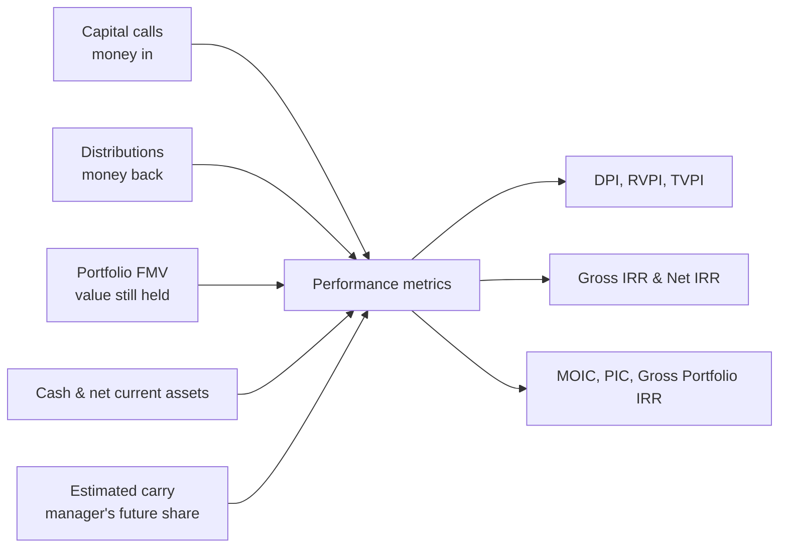
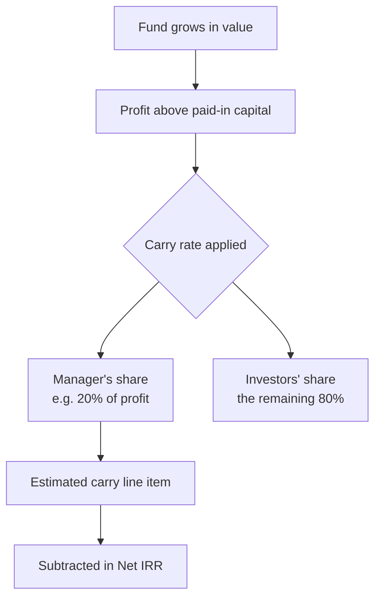
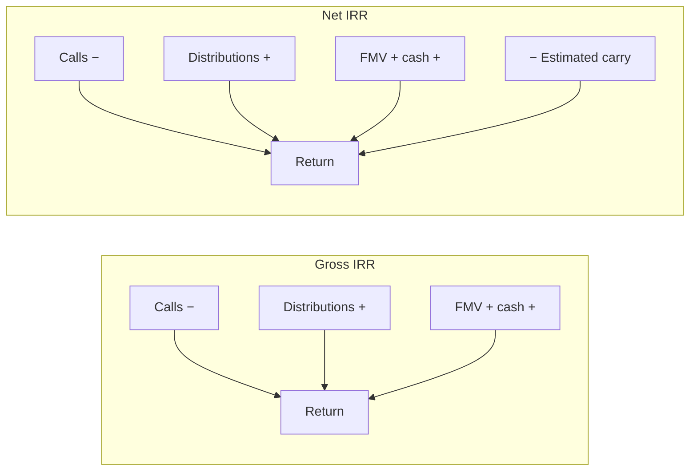

# Carry & Performance Metrics User Guide

This guide explains how the fund's performance is measured — XIRR (gross and net of carry), DPI, RVPI, TVPI, MOIC, PIC, and Gross Portfolio IRR — and, most importantly, how **carried interest (carry)** is factored into those numbers so investors see returns *after* the manager's profit share.

> **Where to find it:** Sidebar → [**Funds → Funds**](/funds) → open the fund → **Ratios** tab, where **Compute Ratios** opens the generate form. Carry % lives under the fund's **Actions → Fund Unit Settings**, shown only when fund units are enabled for your company. Both need update rights on the fund (fund **Access** tab or company admin).

It's written for fund managers and finance teams. The metrics themselves are also covered in the [Fund Ratios User Guide](fund_ratios_user_guide); here the focus is on what feeds them and how carry changes the picture.

---

## Table of Contents

1. [The Big Picture](#the-big-picture)
2. [Key Terms in Plain English](#key-terms-in-plain-english)
3. [What Feeds the Metrics](#what-feeds-the-metrics)
4. [The Performance Metrics](#the-performance-metrics)
5. [Carry, Step by Step](#carry-step-by-step)
6. [Net IRR vs Gross IRR](#net-irr-vs-gross-irr)
7. [A Worked Carry Example](#a-worked-carry-example)
8. [Where Carry % Is Configured](#where-carry--is-configured)
9. [The Estimated Carry Line Item](#the-estimated-carry-line-item)
10. [Fund-Level vs Investor-Level Metrics](#fund-level-vs-investor-level-metrics)
11. [Reporting in a Tracking Currency](#reporting-in-a-tracking-currency)
12. [Customising Metrics](#customising-metrics)
13. [Metric Reference Card](#metric-reference-card)
14. [Frequently Asked Questions](#frequently-asked-questions)

---

## The Big Picture

Performance is calculated from the real activity already recorded in the fund:

Metrics can be produced at two levels: the **fund** as a whole, or each **investor** (folio) individually.

---

## Key Terms in Plain English

| Term | What it means |
|------|---------------|
| **Paid-In Capital** | What investors have actually transferred to the fund (confirmed call payments). |
| **Distributions** | What has actually been returned to investors (completed distribution payments). |
| **FMV** | Fair market value — the current worth of investments not yet sold. |
| **Cash in Hand / Net Current Assets** | Liquid balances the fund still holds. |
| **Carried Interest (Carry)** | The manager's (GP's) share of profits — typically 20%. |
| **Estimated Carry** | The manager's expected share of the value not yet realised. Used to turn gross returns into net returns. |
| **Carry %** | The carry rate for a unit class, recorded in the fund's unit settings. |
| **End Date** | The "as of" date for the calculation — everything up to and including this date is counted. |

---

## What Feeds the Metrics

### Cash flows for IRR

For rate-of-return measures, each event is a dated cash flow with a direction:

| Event | Counts as | Why |
|-------|-----------|-----|
| Capital call payments | **Money out** (−) | Investor put it in. |
| Distributions received | **Money in** (+) | Investor got it back. |
| Reinvested portion of a distribution | **Money out** (−) | Effectively put back in, not received. |
| Portfolio FMV at the end date | **Money in** (+) | Value still held. |
| Cash in hand / net current assets | **Money in** (+) | Liquid value still held. |
| **Estimated carry** at the end date | **Money out** (−) | The manager's share — *only* for Net IRR. |

> Reinvestment counts as money *out* because, although it came from a distribution, the investor didn't pocket it — it went back to work in the fund.

### Inputs for the multiples

- **Paid-in** (the denominator for DPI, RVPI, TVPI) = confirmed call payments up to the end date.
- **Distributions** (DPI's value side) = completed distribution payments up to the end date.
- **Residual value** (RVPI's value side) = FMV + cash in hand + net current assets.

---

## The Performance Metrics

| Metric | Plain meaning | Formula |
|--------|---------------|---------|
| **DPI** | Cash returned per dollar paid in. | Distributions ÷ Paid-in |
| **RVPI** | Value still held per dollar paid in. | Residual value ÷ Paid-in |
| **TVPI** | Total value per dollar paid in. | DPI + RVPI |
| **Gross IRR** | Annualised fund return, before carry. | IRR of all cash flows |
| **Net IRR** | Annualised return after the manager's carry. | IRR with estimated carry deducted |
| **MOIC** | Value created on money invested in companies. | (Sale proceeds + FMV) ÷ Amount invested |
| **PIC** | Share of commitments drawn down. | Paid-in ÷ Committed |
| **Gross Portfolio IRR** | Return on the investments themselves, before fund fees and carry. | IRR of company buys, sells, income, and FMV |

DPI, RVPI, TVPI, and IRR are produced at both fund and investor level. MOIC and Gross Portfolio IRR are fund-level only. (For the full definitions and worked numbers, see the [Fund Ratios User Guide](fund_ratios_user_guide).)

---

## Carry, Step by Step

Carry is the manager's reward for generating profit — usually a percentage (often 20%) of the gains above the investors' original capital, sometimes subject to a hurdle rate.

In the system, carry affects performance through one mechanism: the **Estimated Carry** line item, which is subtracted from the value still held when computing **Net IRR**. The **Carry %** on a unit class is reference information for reports — it does not, by itself, deduct carry from any calculation.

---

## Net IRR vs Gross IRR

Both are the same calculation, with one difference: Net IRR removes the manager's estimated share from the value still held.

| | Gross IRR | Net IRR (investor's view) |
|--|-----------|----------------------------|
| Capital calls | Money out | Money out |
| Reinvestment | Money out | Money out |
| Distributions | Money in | Money in |
| FMV, cash, net current assets | Money in | Money in |
| Estimated carry | — | **Subtracted** |
| Shows | The fund's full return | The return investors keep after carry |

---

## A Worked Carry Example

*Acme Growth Fund I* as of the reporting date:

| Input | Amount |
|-------|--------|
| Paid-in capital | $40,000,000 |
| Distributions to date | $10,000,000 |
| Portfolio FMV | $60,000,000 |
| Cash in hand | $2,000,000 |
| Carry rate | 20% |

**Estimate the carry.** Total value = distributions + FMV + cash = $72,000,000. Profit above paid-in = $72M − $40M = **$32,000,000**. Estimated carry = 20% × $32M = **$6,400,000**.

**Value still held, the two ways:**

| | Value still held |
|--|------------------|
| Gross IRR | FMV $60M + cash $2M = **$62,000,000** |
| Net IRR | $62M − $6.4M carry = **$55,600,000** |

Both IRRs then annualise the same dated cash flows, but Net IRR uses the lower ending value — so it always comes out below Gross IRR. The gap is the manager's expected share of the upside.

(TVPI here, for reference: ($10M + $62M) ÷ $40M = **1.80×** gross of carry.)

---

## Where Carry % Is Configured

Each unit class can record a **Carry %** on the fund's **Actions → Fund Unit Settings** page (shown only when fund units are enabled for your company), alongside its management fee and setup fee.

| Field | Meaning |
|-------|---------|
| **Carry %** | The manager's profit share for this class (e.g. 20). |
| **Management Fee %** | The annual management fee. |
| **Setup Fee %** | A one-time setup/placement fee. |

These percentages are **reference figures**: generated notices receive them as the `fund_unit_setting` template field, and allocation formulas can read them (for example `fund_unit_setting.carry`). They are not automatically deducted from distributions or baked into IRR — the **Estimated Carry** line item is what actually moves Net IRR. You can also bulk-load unit settings (including Carry %) by spreadsheet; see the [Fund Units User Guide](fund_units_user_guide).

---

## The Estimated Carry Line Item

The **Estimated Carry** line item is how carry enters the Net IRR calculation.

- It's an amount recorded against the fund (for fund-level Net IRR) or an investor folio (for that investor's Net IRR), representing the manager's expected share of value not yet realised.
- It's an account entry named exactly `Estimated Carry` (non-cumulative), normally produced by an **allocation formula** rather than typed in by hand — the formula derives it from current FMV, distributions to date, any hurdle rate, and the carry rate from unit settings.
- It is used **only** in Net IRR, where it's subtracted from the ending value.

> **In short:** Gross IRR ignores it; Net IRR subtracts it. Keep it refreshed — run the fund's **Actions → Account Entries → Allocate Account Entries** for the period, then **Compute Ratios** (nothing is recomputed automatically) — so Net IRR stays accurate as valuations change.

---

## Fund-Level vs Investor-Level Metrics

The same metrics are calculated at two scopes:

| | Fund level | Investor (folio) level |
|--|-----------|------------------------|
| Cash flows | All investors' calls and distributions | Only this investor's |
| FMV, cash, net current assets | The fund's totals | This investor's share |
| Estimated carry | The fund's | This investor's |
| Ratio formulas | Fund-level rules | Folio-level rules |

This is why an investor's DPI or XIRR can differ from the fund's — each investor joined at a different time and was called and distributed on a different schedule. MOIC and Gross Portfolio IRR are computed only at the fund level.

---

## Reporting in a Tracking Currency

Every metric can also be produced in the fund's **tracking (reporting) currency** instead of its base currency. When you do this, each call payment and distribution is taken at its tracking-currency value, and FMV, cash, and other balances are converted at the rate on the end date. An exchange rate from the fund's base currency to the tracking currency on the end date must exist, or the calculation can't run.

---

## Customising Metrics

If a metric needs to account for something the standard calculation doesn't — a fee rebate, a sidecar investment, an expense that should reduce the return — use **ratio formulas**. They fold specific recorded amounts into a ratio's value side or capital side, on top of the standard components (they add to, never replace, the defaults).

> Full details, including every action and a decision guide, are in the **[Ratio Formulas User Guide](ratio_formulas_user_guide)**.

---

## Metric Reference Card

| Metric | What goes in |
|--------|--------------|
| **DPI** | Completed distributions ÷ confirmed paid-in capital. |
| **RVPI** | (FMV + cash in hand + net current assets) ÷ paid-in capital. |
| **TVPI** | (Distributions + residual value) ÷ paid-in capital, i.e. DPI + RVPI. |
| **Gross IRR** | Dated cash flows: calls (−), reinvestment (−), distributions (+), and ending FMV/cash/net current assets (+). |
| **Net IRR** | The same, with estimated carry subtracted from the ending value. |
| **MOIC** | (Company sale proceeds + remaining FMV) ÷ amount invested in companies; stock conversions netted out. |
| **PIC** | Confirmed paid-in capital ÷ total committed capital. |
| **Gross Portfolio IRR** | Company buys (−), sells (+), portfolio income (+), and ending FMV (+); fund-level only. |

All IRRs are reported as an annualised percentage; the rest as a multiple.

---

## Frequently Asked Questions

**Where do I see the fund's performance metrics (XIRR, DPI, RVPI, TVPI, MOIC) in CapHive?**
Sidebar → [**Funds → Funds**](/funds), open the fund, then click the **Ratios** tab. This shows the fund-level ratios. Use the **Actions** dropdown on that tab to switch to **Filter: Folios** (per-investor metrics), **Filter: Portfolio Company**, **Filter: Instrument** or **Filter: Fund Only**. See [Fund-Level vs Investor-Level Metrics](#fund-level-vs-investor-level-metrics).

**How do I recompute the metrics as of a new date?**
On the fund's **Ratios** tab click **Compute Ratios**. It opens the generate form where you set the **End Date**, optionally tick **Generate For Each Folio** to produce investor-level ratios too, and press **Generate**. The computation runs in the background and can take a few minutes; refresh the tab to see the new rows. The button is only shown to users who can edit the fund.

**Where is the Carry % configured?**
Sidebar → [**Funds → Funds**](/funds), open the fund, then **Actions → Fund Unit Settings**. Each row is one unit class; click **Show** on the row, then **Edit**, and fill in the **Carry** field (a percentage, e.g. `20`) alongside **Management fee** and **Setup fee**. The same page is also reachable from the fund card's **Actions** menu on the [Funds list](/funds). See [Where Carry % Is Configured](#where-carry--is-configured).

**How do I create, edit or delete a unit class's carry setting?**
On the **Fund Unit Settings** page click **New** to add a unit class (choose the **Class / Series / Unit Type** from the fund's configured unit types, then set **Carry**, **Management fee**, **Setup fee**, **ISIN** and whether these are **GP units**). To change a value click **Show** on the row and then **Edit**; the **Delete** button on the same page removes the class. Deleting a unit setting does not delete any account entries or fund units already created for that class.

**Can I bulk-upload carry and fee percentages for many unit classes?**
Yes. On the **Fund Unit Settings** page click **Upload** (an Import Upload of type FundUnitSetting) and use the sample spreadsheet linked on the next screen; **Download** exports the current settings as Excel. Bulk uploads are listed under the Company menu → [**Imports**](/import_uploads). See the [Fund Units User Guide](fund_units_user_guide).

**I can't see Fund Unit Settings in the Actions menu. Why?**
The **Fund Unit Settings** and **Fund Units** items only appear when the fund-units feature (`enable_units`) is switched on for your company and you have edit rights on the fund. Ask your company admin or CapHive support to enable units. Users with an investor login never see this menu.

**What permission do I need to change carry settings or compute ratios?**
You must be logged in as an employee of the fund's company and either be a company admin or hold an access right on the fund with the matching permission (create, update or destroy). Access rights are granted on the fund's **Access** tab. Computing ratios needs update rights on the fund; viewing the **Ratios** tab needs only read access.

**How do I record or refresh the Estimated Carry line item?**
Estimated Carry is an account entry named exactly `Estimated Carry` (non-cumulative) on the fund or on an investor folio. It is normally produced by an allocation formula: open the fund, then **Actions → Account Entries → Allocation Formulas** to see the formula, and **Actions → Account Entries → Allocate Account Entries** to run it for a period. You can also add one by hand from **Actions → Account Entries → Fund Account Entries** → **New Account Entry**, or bulk-load it with the fund page's **Import** button. See [The Estimated Carry Line Item](#the-estimated-carry-line-item).

**Which Estimated Carry entry is used when there are several?**
The latest non-cumulative `Estimated Carry` entry whose reporting date is on or before the ratio's end date. Fund-level Net IRR reads the fund's own entry; folio-level Net IRR reads that folio's entry. If no entry exists, Net IRR equals Gross IRR.

**What happens when I save or change a unit class's Carry %?**
Only the unit-setting row changes (the edit is recorded in the audit trail); no one is notified, no ratios are recomputed and no account entries are created. The new value is picked up the next time an allocation formula that reads `fund_unit_setting.carry` runs, and by the next distribution or commitment document generated for a folio of that class, which receive the setting as the `fund_unit_setting` template field. Existing ratio rows keep their old values until you recompute.

**What happens when I delete a unit setting?**
The row is removed after a confirmation prompt (users with destroy rights on the fund only). Existing fund units, commitments and account entries for that class are untouched, but allocation formulas that look up the class's setting find nothing for those folios, and notices for those folios lose their carry, management-fee and setup-fee fields, so recreate the class before the next run.

**What happens when I upload a unit-settings spreadsheet?**
Each row creates a new unit class, or, when its **Update Only** column is `Yes`, updates the existing class with the same name; a row naming a class that is not in the fund's unit types is rejected. The upload is processed in the background and a results file with per-row errors appears on the import row under Company menu → [**Imports**](/import_uploads). No one else is notified.

**What happens when I press Generate on the Compute Ratios form?**
Any validation rules configured for fund ratios are evaluated first; a blocker stops the run with a message. Otherwise a background job deletes the existing ratio rows for that fund (and each folio, if ticked) with the same end date, recomputes them from calls, distributions, valuations and account entries, flags the newest set as latest, and sends you an in-app alert with **View Generated Ratios** / **View All Ratios** links. No email is sent and investors are not notified.

**What happens if I tick Generate For Each Folio?**
The job additionally computes XIRR, DPI, RVPI and TVPI for every commitment in the fund (folios marked "skip doc gen" on a KYC-level fund are skipped) and posts an in-app alert per folio as it completes. These rows appear under **Actions → Filter: Folios** on the **Ratios** tab and on each commitment's page, and are what investors see on the LP portal if the fund is set to show ratios to LPs.

**What happens if I tick Return Cash Flows?**
For every XIRR, IRR, MOIC and Gross Portfolio IRR computed, the job also saves a CSV of the dated cash flows (including the `Estimated Carry` outflow) as a document on the ratio, in a **FundRatios** folder on the fund. Use it to reconcile a Net IRR figure line by line; leave it unticked for routine runs, as it creates one document per ratio.

**What happens when I run the allocation that produces Estimated Carry?**
Running **Allocate Account Entries** for a period evaluates the fund's allocation formulas in order and creates account entries, including the `Estimated Carry` entry on the fund and/or each folio, visible under **Fund Account Entries** and on the commitment's page. Nothing is recomputed automatically: press **Compute Ratios** afterwards so Net IRR reflects the new carry figure. Allocation runs can be locked, and re-running a period replaces the entries it generated.

**What happens if I never set a Carry % or never generate Estimated Carry?**
A formula that reads `fund_unit_setting.carry` produces zero (or fails if the class has no setting at all), so either no `Estimated Carry` entry is created or it is zero, and Net IRR silently equals Gross IRR on every statement and dashboard. Distribution notices built from the `fund_unit_setting` template field show a blank carry percentage.

**Are investors (stakeholders) notified or shown anything when I change carry or recompute ratios?**
No. Neither action sends any notification. Investors only ever see ratio rows, and only when **Show fund ratios to LPs** is ticked on **Actions → Edit Fund**; Carry % and account entries are never shown on the LP portal.

**Why should I bother setting up carry and Net IRR at all?**
Because investors judge the fund on what they keep, not on the gross return. Without an Estimated Carry entry, the Net IRR shown on statements and dashboards is identical to Gross IRR and overstates investor returns. Keeping carry refreshed gives LPs, auditors and your IR team one consistent after-carry figure across statements, the **Ratios** tab and the LP portal.

**What can I do with these metrics once they are computed?**
They feed the fund's **Ratios** tab and its **Analytics** panel, investor statements and notices (as template fields), dashboards, the Fund Assistant, and the per-folio view on each commitment. You can also export them with **Actions → Download** on the Ratios tab or filter by folio, company or instrument.

**Who typically uses this?**
Fund finance and fund administration teams compute and check the ratios; the IR team and fund managers read them; investors see their own folio-level figures on the LP portal when the fund's ratios are made visible to investors.

**What's the difference between DPI and TVPI?**
DPI counts only cash actually distributed. TVPI adds the remaining value (FMV + cash), so TVPI = DPI + RVPI. See [The Performance Metrics](#the-performance-metrics).

**Why does Net IRR differ from Gross IRR?**
Net IRR subtracts the Estimated Carry from the ending value before computing the return, reflecting the manager's expected profit share. It's the figure investors care about most. See [Net IRR vs Gross IRR](#net-irr-vs-gross-irr).

**Where does the Estimated Carry figure come from?**
From an "Estimated Carry" account entry on the fund (for fund-level Net IRR) or the investor folio (for folio-level), usually generated by an allocation formula and refreshed periodically. See [A Worked Carry Example](#a-worked-carry-example) for how the number is derived.

**Is carry automatically deducted from distributions?**
No. The Carry % on unit settings is informational. Actual carry paid to the manager is recorded as its own transaction; the Estimated Carry line item is the only thing that changes computed Net IRR.

**Why might DPI be negative?**
Almost always a data issue — a distribution or call payment recorded as a negative amount. Check the underlying figures on the fund's **Calls** and **Distributions** tabs.

**Can RVPI be computed without FMV?**
Yes — FMV defaults to zero if there's no valuation, so RVPI would reflect only cash and net current assets and understate true residual value. Record a valuation on the portfolio company to fix it.

**Why do fund-level and investor-level metrics differ?**
Because each investor was called and distributed on their own schedule, and holds their own share of value. Fund metrics aggregate everyone; folio metrics isolate one investor. See [Fund-Level vs Investor-Level Metrics](#fund-level-vs-investor-level-metrics).

**What happens to IRR with no ending value (FMV)?**
It still computes, using only realised cash flows. For a fund with no exits and no valuation yet, that usually shows a negative IRR until value is recorded.

**Can ratio formulas remove a standard component like Cash in Hand?**
No — formulas are additive on top of the standard components. To exclude a default, contact your administrator. Ratio formulas are managed from the fund's **Actions → Account Entries → Ratio Formulas** menu; see [Customising Metrics](#customising-metrics).

**The Compute Ratios button warns about Cash in Hand and Net Current Assets. What should I check?**
The computation takes the latest portfolio FMV and the latest `Cash in Hand` and `Net Current Assets` account entries dated on or before the end date. Before generating, make sure valuations are current and those two entries exist for the period; otherwise residual value, RVPI, TVPI and both IRRs will be understated.

**Can I undo a ratio computation?**
Computed rows are ordinary fund ratio records. Re-running **Compute Ratios** for the same end date replaces the values; a single ratio row can be deleted from its **Show** page, and the **Bulk Actions → Delete** button on the Ratios tab removes every row in the current filter, by a user with create rights on the fund. Nothing else (account entries, valuations) is changed by a computation.

**How do I compute the metrics in the tracking currency?**
When a tracking (reporting) currency is set up for the fund, the **Ratios** tab shows a **Currency** selector; the values are converted using the exchange rate on the end date, so an exchange rate for that date must exist (Company menu → [**Exchange Rates**](/exchange_rates)). See [Reporting in a Tracking Currency](#reporting-in-a-tracking-currency).

**Can I schedule or repeat these computations across several funds?**
Yes. Sidebar → [**Funds → Ratio Templates**](/fund_ratio_run_templates) lets you save the filters once and trigger them with **Run All** or **Run by Tag**; [**Funds → Ratio Runs**](/fund_ratio_runs) shows the history. See the [Fund Ratio Run Templates User Guide](fund_ratio_run_templates_user_guide).

**The Compute Ratios button is missing from the Ratios tab. Why?**
It is rendered only for users who can update the fund (company admins, or an access right on the fund with update permission). Users with read-only access, and investor logins, see the ratios but not the button. Ask a company admin to grant update rights on the fund's **Access** tab.

**I chose a unit class on the New Fund Unit Setting form and got "is not allowed". Why?**
The **Class / Series / Unit Type** must be one of the unit types defined on the fund itself (**Actions → Edit Fund**, unit types field), and each class can have only one setting per fund. Add the class to the fund's unit types first, then create the setting.

**Compute Ratios finished but Net IRR still equals Gross IRR. What should I check?**
Confirm an account entry named exactly `Estimated Carry` (non-cumulative) exists on the fund, dated on or before the end date, under **Actions → Account Entries → Fund Account Entries**; for folio-level Net IRR it must sit on that folio. If the entry is dated after the end date or belongs to another owner it is ignored. Re-run the allocation for the period and then **Compute Ratios** again.

**I recomputed ratios but the old numbers are still showing.**
The computation runs in the background and can take several minutes on a large fund; wait for the in-app alert, then reload the **Ratios** tab. If an error alert appears instead, the previous rows for that end date have already been deleted, so fix the cause (usually a missing exchange rate or valuation) and run again.

**Can I edit a computed ratio value by hand?**
No. Computed rows have no **Edit** button; only rows that came from a spreadsheet import can be edited, and support users can edit any row. To change a computed figure, fix the underlying data (valuation, account entry, exchange rate) and recompute.

**Does a bulk Delete on the Ratios tab notify anyone or affect account entries?**
It sends you an in-app alert per deleted row and records each deletion in the audit trail; no one else is notified and no account entries, valuations or unit settings are touched. The **Bulk Actions** button appears only after you have applied a filter, and rows you lack destroy rights on are skipped with an error message.

## Related Guides

- [Fund Ratios](fund_ratios_user_guide) — full definitions, cross-fund and cross-company runs, import and pivot views for the same metrics.
- [Ratio Formulas](ratio_formulas_user_guide) — fold extra amounts into a ratio's value or paid-in side.
- [Fund Units](fund_units_user_guide) — the unit classes whose settings hold Carry %, and how to bulk-load them.
- [Allocation Run Templates](allocation_run_templates_user_guide) — run the allocation formulas that produce Estimated Carry across funds in one action.
- [Fund Ratio Run Templates](fund_ratio_run_templates_user_guide) — save and re-trigger cross-fund ratio runs.
- [Tracking Currency](tracking_currency_guide) — exchange rates needed when reporting the metrics in a second currency.
- [Capital Distributions](capital_distributions_user_guide) — the distributions that feed DPI and the notices that print Carry %.
