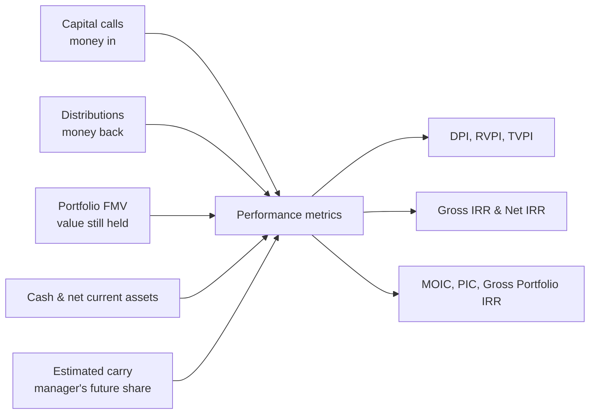
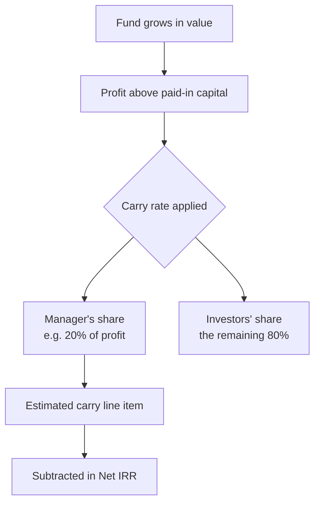
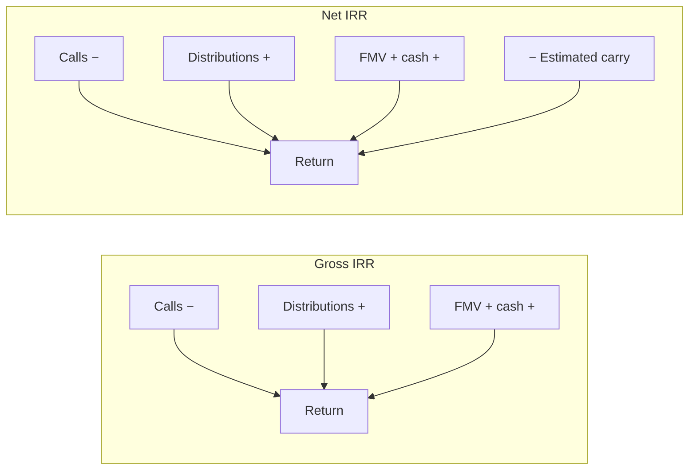

# Carry & Performance Metrics User Guide

This guide explains how the fund's performance is measured — XIRR (gross and net of carry), DPI, RVPI, TVPI, MOIC, PIC, and Gross Portfolio IRR — and, most importantly, how **carried interest (carry)** is factored into those numbers so investors see returns *after* the manager's profit share.

It's written for fund managers and finance teams. The metrics themselves are also covered in the [Fund Ratios User Guide](fund_ratios_user_guide); here the focus is on what feeds them and how carry changes the picture.

---

## Table of Contents

1. [The Big Picture](#the-big-picture)
2. [Key Terms in Plain English](#key-terms-in-plain-english)
3. [What Feeds the Metrics](#what-feeds-the-metrics)
4. [The Performance Metrics](#the-performance-metrics)
5. [Carry, Step by Step](#carry-step-by-step)
6. [Net IRR vs Gross IRR](#net-irr-vs-gross-irr)
7. [A Worked Carry Example](#a-worked-carry-example)
8. [Where Carry % Is Configured](#where-carry--is-configured)
9. [The Estimated Carry Line Item](#the-estimated-carry-line-item)
10. [Fund-Level vs Investor-Level Metrics](#fund-level-vs-investor-level-metrics)
11. [Reporting in a Tracking Currency](#reporting-in-a-tracking-currency)
12. [Customising Metrics](#customising-metrics)
13. [Metric Reference Card](#metric-reference-card)
14. [Frequently Asked Questions](#frequently-asked-questions)

---

## The Big Picture

Performance is calculated from the real activity already recorded in the fund:

Metrics can be produced at two levels: the **fund** as a whole, or each **investor** (folio) individually.

---

## Key Terms in Plain English

| Term | What it means |
|------|---------------|
| **Paid-In Capital** | What investors have actually transferred to the fund (confirmed call payments). |
| **Distributions** | What has actually been returned to investors (completed distribution payments). |
| **FMV** | Fair market value — the current worth of investments not yet sold. |
| **Cash in Hand / Net Current Assets** | Liquid balances the fund still holds. |
| **Carried Interest (Carry)** | The manager's (GP's) share of profits — typically 20%. |
| **Estimated Carry** | The manager's expected share of the value not yet realised. Used to turn gross returns into net returns. |
| **Carry %** | The carry rate for a unit class, recorded in the fund's unit settings. |
| **End Date** | The "as of" date for the calculation — everything up to and including this date is counted. |

---

## What Feeds the Metrics

### Cash flows for IRR

For rate-of-return measures, each event is a dated cash flow with a direction:

| Event | Counts as | Why |
|-------|-----------|-----|
| Capital call payments | **Money out** (−) | Investor put it in. |
| Distributions received | **Money in** (+) | Investor got it back. |
| Reinvested portion of a distribution | **Money out** (−) | Effectively put back in, not received. |
| Portfolio FMV at the end date | **Money in** (+) | Value still held. |
| Cash in hand / net current assets | **Money in** (+) | Liquid value still held. |
| **Estimated carry** at the end date | **Money out** (−) | The manager's share — *only* for Net IRR. |

> Reinvestment counts as money *out* because, although it came from a distribution, the investor didn't pocket it — it went back to work in the fund.

### Inputs for the multiples

- **Paid-in** (the denominator for DPI, RVPI, TVPI) = confirmed call payments up to the end date.
- **Distributions** (DPI's value side) = completed distribution payments up to the end date.
- **Residual value** (RVPI's value side) = FMV + cash in hand + net current assets.

---

## The Performance Metrics

| Metric | Plain meaning | Formula |
|--------|---------------|---------|
| **DPI** | Cash returned per dollar paid in. | Distributions ÷ Paid-in |
| **RVPI** | Value still held per dollar paid in. | Residual value ÷ Paid-in |
| **TVPI** | Total value per dollar paid in. | DPI + RVPI |
| **Gross IRR** | Annualised fund return, before carry. | IRR of all cash flows |
| **Net IRR** | Annualised return after the manager's carry. | IRR with estimated carry deducted |
| **MOIC** | Value created on money invested in companies. | (Sale proceeds + FMV) ÷ Amount invested |
| **PIC** | Share of commitments drawn down. | Paid-in ÷ Committed |
| **Gross Portfolio IRR** | Return on the investments themselves, before fund fees and carry. | IRR of company buys, sells, income, and FMV |

DPI, RVPI, TVPI, and IRR are produced at both fund and investor level. MOIC and Gross Portfolio IRR are fund-level only. (For the full definitions and worked numbers, see the [Fund Ratios User Guide](fund_ratios_user_guide).)

---

## Carry, Step by Step

Carry is the manager's reward for generating profit — usually a percentage (often 20%) of the gains above the investors' original capital, sometimes subject to a hurdle rate.

In the system, carry affects performance through one mechanism: the **Estimated Carry** line item, which is subtracted from the value still held when computing **Net IRR**. The **Carry %** on a unit class is reference information for reports — it does not, by itself, deduct carry from any calculation.

---

## Net IRR vs Gross IRR

Both are the same calculation, with one difference: Net IRR removes the manager's estimated share from the value still held.

| | Gross IRR | Net IRR (investor's view) |
|--|-----------|----------------------------|
| Capital calls | Money out | Money out |
| Reinvestment | Money out | Money out |
| Distributions | Money in | Money in |
| FMV, cash, net current assets | Money in | Money in |
| Estimated carry | — | **Subtracted** |
| Shows | The fund's full return | The return investors keep after carry |

---

## A Worked Carry Example

*Acme Growth Fund I* as of the reporting date:

| Input | Amount |
|-------|--------|
| Paid-in capital | $40,000,000 |
| Distributions to date | $10,000,000 |
| Portfolio FMV | $60,000,000 |
| Cash in hand | $2,000,000 |
| Carry rate | 20% |

**Estimate the carry.** Total value = distributions + FMV + cash = $72,000,000. Profit above paid-in = $72M − $40M = **$32,000,000**. Estimated carry = 20% × $32M = **$6,400,000**.

**Value still held, the two ways:**

| | Value still held |
|--|------------------|
| Gross IRR | FMV $60M + cash $2M = **$62,000,000** |
| Net IRR | $62M − $6.4M carry = **$55,600,000** |

Both IRRs then annualise the same dated cash flows, but Net IRR uses the lower ending value — so it always comes out below Gross IRR. The gap is the manager's expected share of the upside.

(TVPI here, for reference: ($10M + $62M) ÷ $40M = **1.80×** gross of carry.)

---

## Where Carry % Is Configured

Each unit class can record a **Carry %** in **Fund → Fund Unit Settings**, alongside its management fee and setup fee.

| Field | Meaning |
|-------|---------|
| **Carry %** | The manager's profit share for this class (e.g. 20). |
| **Management Fee %** | The annual management fee. |
| **Setup Fee %** | A one-time setup/placement fee. |

These percentages are **reference figures** used in distribution notices and reports. They are not automatically deducted from distributions or baked into IRR — the **Estimated Carry** line item is what actually moves Net IRR. You can also bulk-load unit settings (including Carry %) by spreadsheet; see the [Fund Units User Guide](fund_units_user_guide).

---

## The Estimated Carry Line Item

The **Estimated Carry** line item is how carry enters the Net IRR calculation.

- It's an amount recorded against the fund (for fund-level Net IRR) or an investor folio (for that investor's Net IRR), representing the manager's expected share of value not yet realised.
- It's normally produced by a **fund formula** rather than typed in by hand — the formula derives it from current FMV, distributions to date, any hurdle rate, and the carry rate from unit settings.
- It is used **only** in Net IRR, where it's subtracted from the ending value.

> **In short:** Gross IRR ignores it; Net IRR subtracts it. Keep it refreshed (re-run the fund formula periodically) so Net IRR stays accurate as valuations change.

---

## Fund-Level vs Investor-Level Metrics

The same metrics are calculated at two scopes:

| | Fund level | Investor (folio) level |
|--|-----------|------------------------|
| Cash flows | All investors' calls and distributions | Only this investor's |
| FMV, cash, net current assets | The fund's totals | This investor's share |
| Estimated carry | The fund's | This investor's |
| Ratio formulas | Fund-level rules | Folio-level rules |

This is why an investor's DPI or XIRR can differ from the fund's — each investor joined at a different time and was called and distributed on a different schedule. MOIC and Gross Portfolio IRR are computed only at the fund level.

---

## Reporting in a Tracking Currency

Every metric can also be produced in the fund's **tracking (reporting) currency** instead of its base currency. When you do this, each call payment and distribution is taken at its tracking-currency value, and FMV, cash, and other balances are converted at the rate on the end date. An exchange rate from the fund's base currency to the tracking currency on the end date must exist, or the calculation can't run.

---

## Customising Metrics

If a metric needs to account for something the standard calculation doesn't — a fee rebate, a sidecar investment, an expense that should reduce the return — use **ratio formulas**. They fold specific recorded amounts into a ratio's value side or capital side, on top of the standard components (they add to, never replace, the defaults).

> Full details, including every action and a decision guide, are in the **[Ratio Formulas User Guide](ratio_formulas_user_guide)**.

---

## Metric Reference Card

| Metric | What goes in |
|--------|--------------|
| **DPI** | Completed distributions ÷ confirmed paid-in capital. |
| **RVPI** | (FMV + cash in hand + net current assets) ÷ paid-in capital. |
| **TVPI** | (Distributions + residual value) ÷ paid-in capital, i.e. DPI + RVPI. |
| **Gross IRR** | Dated cash flows: calls (−), reinvestment (−), distributions (+), and ending FMV/cash/net current assets (+). |
| **Net IRR** | The same, with estimated carry subtracted from the ending value. |
| **MOIC** | (Company sale proceeds + remaining FMV) ÷ amount invested in companies; stock conversions netted out. |
| **PIC** | Confirmed paid-in capital ÷ total committed capital. |
| **Gross Portfolio IRR** | Company buys (−), sells (+), portfolio income (+), and ending FMV (+); fund-level only. |

All IRRs are reported as an annualised percentage; the rest as a multiple.

---

## Frequently Asked Questions

**What's the difference between DPI and TVPI?**
DPI counts only cash actually distributed. TVPI adds the remaining value (FMV + cash), so TVPI = DPI + RVPI.

**Why does Net IRR differ from Gross IRR?**
Net IRR subtracts the Estimated Carry from the ending value before computing the return, reflecting the manager's expected profit share. It's the figure investors care about most.

**Where does the Estimated Carry figure come from?**
From an "Estimated Carry" line item on the fund (for fund-level Net IRR) or the investor folio (for folio-level), usually generated by a fund formula and refreshed periodically.

**Is carry automatically deducted from distributions?**
No. The Carry % on unit settings is informational. Actual carry paid to the manager is recorded as its own transaction; the Estimated Carry line item is the only thing that changes computed Net IRR.

**Why might DPI be negative?**
Almost always a data issue — a distribution or call payment recorded as a negative amount. Check the underlying figures.

**Can RVPI be computed without FMV?**
Yes — FMV defaults to zero if there's no valuation, so RVPI would reflect only cash and net current assets and understate true residual value. Record a valuation to fix it.

**Why do fund-level and investor-level metrics differ?**
Because each investor was called and distributed on their own schedule, and holds their own share of value. Fund metrics aggregate everyone; folio metrics isolate one investor.

**What happens to IRR with no ending value (FMV)?**
It still computes, using only realised cash flows. For a fund with no exits and no valuation yet, that usually shows a negative IRR until value is recorded.

**Can ratio formulas remove a standard component like Cash in Hand?**
No — formulas are additive on top of the standard components. To exclude a default, contact your administrator.
