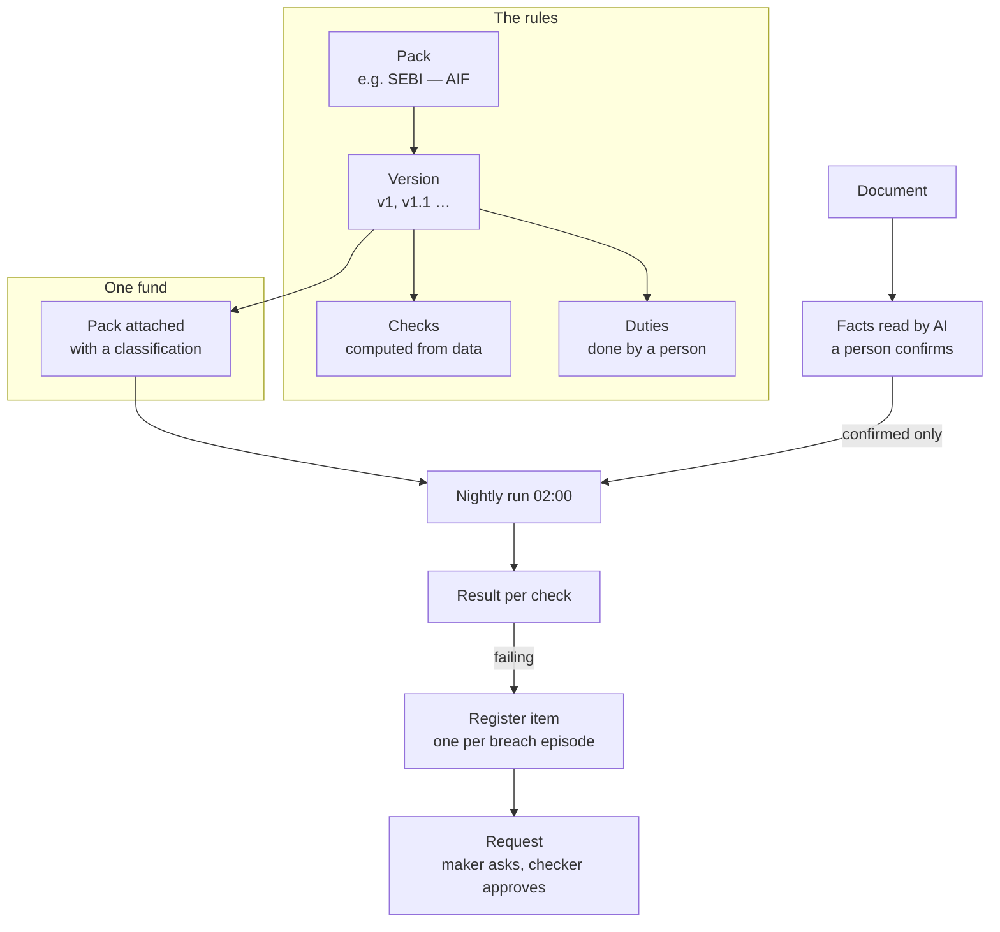
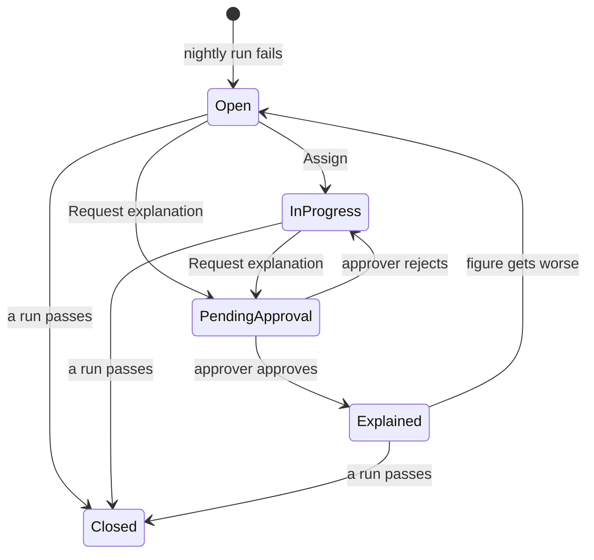
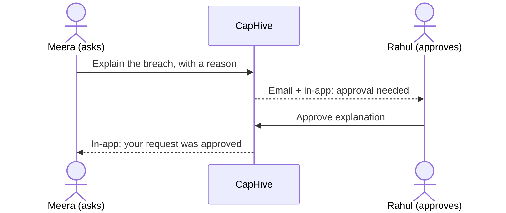

# Compliance Monitoring User Guide

Compliance Monitoring checks each of your funds every night against rule packs — CapHive's regulator packs (such as SEBI — AIF) and your own fund-agreement rules — and keeps a register of breaches, duties and document facts that people work to closure.

> **Where to find it:** Company menu (house icon, top right) → [**Compliance**](/compliance). Each fund also has a **Compliance** tab on its page. You need the **Compliance** permission on your user and your firm; editing needs **Compliance Edit** (or company admin) and approving needs **Compliance Approve** (or company admin).

## Key concepts

| Concept | What it means for you | Example |
|---|---|---|
| Pack | A set of rules from one source, attached to funds | "SEBI — AIF" from CapHive; "Horizon — fund agreement", your own |
| Locked pack | A CapHive regulator pack: you use it as published; per fund you may only make a limit stricter | 25% → 20% for one fund is allowed; 30% is refused |
| Version | A dated edition of a pack; the old one stays readable | SEBI v1 today, v1.1 from its effective date |
| Classification | Which part of a pack applies to a fund | "Category II" → 25% concentration limit |
| Input | Something the packs need that CapHive cannot guess; mapped once for your firm | "Sponsor/manager" = investors in category "Sponsor" |
| Check | One rule tested from your data every night | Largest company ≤ 25% of investable funds |
| Result | What a check found on one night, with the arithmetic | ₹72.00 cr ÷ ₹270.00 cr = 26.67% > 25% — Breach |
| Register item | One breach from the night it starts to the night it clears — not one per night | "Concentration — open since 5 Nov, fix by 5 Dec" |
| Maker–checker | A change that weakens monitoring needs two people: one asks, another approves | Meera asks to explain a breach; Rahul approves |
| Duty | Something a person must do and prove, which data cannot show | "Quarterly SEBI report filed", due 15 days after the quarter |
| Fact | A value the AI read from a document; it counts only after a person confirms it | "Amount approved ₹15.00 cr (page 2)" |

**The four results of a check**

| Result | Means |
|---|---|
| Pass | Within the limit |
| Breach | Outside the limit — a register item opens |
| Needs review | A person must look; never counted as a pass |
| Could not check | Something is missing (an input, a rate, a date) — the result names it; never a pass |

## The screens

| Screen | How to get there | What you do there |
|---|---|---|
| Compliance home | [**Compliance**](/compliance) | See every fund, its packs and open items; cards for breaches, needs review, overdue items and stale runs |
| Fund dashboard | A fund's **Compliance** tab, or **View** on the home page | The latest result of every check, one tab per pack; **Run now**; **Preview** an upcoming version |
| Result | Click a check on the fund dashboard | The verdict, each step of the working with its source, what gets it back within the limit, the records that fail, and the setup used that day |
| Register | [**Compliance → Register**](/compliance/register) | Open, Closed and All tabs; **Filter**, search, **Download**; open an item |
| Register item | **View** on a register row | Working, **Assign**, **Request explanation**, **Approve explanation** / **Reject explanation**; **Actions** → Request override, Disable check |
| Duties | [**Compliance → Duties**](/compliance/duties) | **Filter**, search; **Mark done** with a note and evidence |
| Facts to confirm | [**Compliance → Facts to confirm**](/compliance/facts) | Open a document, check each fact against its quote and page, correct it, **Confirm facts** |
| Fund packs | Compliance home → **Manage → Fund packs** | Which pack each fund carries; **Attach pack** |
| Rule library | Compliance home → **Manage → Rule library** | Packs and their versions; **New entity pack**; a version's **Checks**, **Duties**, **Definition** and **Publish** tabs; **Describe in words** |
| Setup | Compliance home → **Manage → Setup** | Inputs, monitoring on/off, owner, AI drafting and AI document reading switches |

### A breach, start to finish

### Maker–checker

## Bulk Actions

The compliance grids have no bulk actions. Use **Filter** and search to narrow a grid, and **Download** on the register for a spreadsheet.

| Action (exact label) | What it does | Shown when |
|---|---|---|
| **Download** (Register) | Builds an Excel file of results and register items for a period you choose, for the funds you can see | Always on the register |

## Frequently Asked Questions

### Navigation and getting there

**Where do I find Compliance?**
Open the Company menu (house icon, top right) and choose [**Compliance**](/compliance). Each fund also shows a **Compliance** tab on its own page with that fund's results, one tab per pack.

**Why don't I see Compliance in the Company menu?**
Your user needs the **Compliance** permission and your firm must have Compliance switched on. Investors and investor advisors never see Compliance, and a user who is currently acting in their investor role is refused until they switch back to their staff role.

**How do I open the compliance register?**
Go to [**Compliance**](/compliance) and click **Register**, or go straight to [the register](/compliance/register). It opens on the **Open** tab; use **Closed** or **All** to see more.

**Where do I see one fund's results?**
Open the fund from [**Funds**](/funds) and choose its **Compliance** tab, or click **View** next to the fund on the Compliance home page. Each attached pack has its own tab with the latest result of every check.

### Creating, updating and managing compliance checks

**How do I attach a pack to a fund?**
Go to **Compliance → Manage → Fund packs**, click **Attach pack**, choose the fund and the pack, and enter the classification (or leave it blank to use the fund's Category). You need **Compliance Edit** or company admin. The fund is checked from the next nightly run.

**How do I map inputs such as "Sponsor/manager"?**
Open **Compliance → Manage → Setup**. The **Inputs** card lists every input your attached packs need, with ✓ when mapped and ✗ when missing. Until an input is mapped, the checks that need it show **Could not check**.

**How do I turn monitoring on?**
Open **Compliance → Manage → Setup** and click **Turn monitoring on** in the **Monitoring** card. From then on every attached fund is checked each night at 02:00 in your firm's time zone.

**How do I create our own rules (an entity pack)?**
Open **Compliance → Manage → Rule library**, click **New entity pack**, give it a name and a source (for example LPA) and click **Create pack**. It starts with a draft version: add checks with **Describe in words** or on the **Definition** tab, test it on a fund, then publish it on the **Publish** tab.

**How do I describe a check in words?**
Open a draft version from the **Rule library** and click **Describe in words**. Write the rule with its source, for example "No more than 15% of investable funds in any one sector — LPA clause 8.2", and click **Draft check**. Review each field, correct anything marked **Assumed**, click **Test run** on a fund, then **Save check**.

**How do I assign a register item?**
Open the item from the register and click **Assign**, choose a user of your firm and click **Assign** in the popup. The person is emailed and in-app notified, and the item moves to **In progress**.

**How do I explain a breach?**
Open the item and click **Request explanation**. Write your explanation and a reason of at least 10 characters, then click **Send for approval**. The item shows **Pending approval** until an approver other than you decides.

**How do I mark a duty done?**
Open [**Duties**](/compliance/duties) and click **Mark done** on the row. Add a note and attach the evidence file, then click **Mark done** in the popup. Some duties require evidence and refuse Done without a file.

**How do I confirm facts the AI read from a document?**
Open [**Facts to confirm**](/compliance/facts) and click **View** on the document. Check each value against its quote and page, correct the box if the AI misread it, and click **Confirm facts**. Only compliance editors can confirm.

**How do I record that a paper IC note was signed?**
Open the IC-note result from the fund's **Compliance** tab. In **Records that fail**, click **Mark signed** on the row, enter the date written on the signed copy and click **Mark signed**. The date cannot be in the future.

**How do I filter the register?**
Click **Filter** on the register and add conditions such as Fund, Pack, Check, Status, Closed reason, Opened on, Fix by, Overdue, Assigned to or Escalated on, then search. A status condition in the filter replaces the Open/Closed/All tab, so the two never disagree.

**How do I download the register?**
On the register click **Download**, choose the period and click **Download**. The Excel file covers the funds you can see and is built when you click; it is not stored.

**How do I read a result's working?**
Open the result from the fund's **Compliance** tab. The first line says what was found and against which limit. Below it each step lists a figure, how it was worked out and where it came from — click the source to see the records. For a breach of a percentage limit, the page shows how far to reduce the largest item, or how far the total must grow, to get back within the limit.

### Why use compliance monitoring

**Why use compliance monitoring instead of a spreadsheet?**
Limits such as single-company concentration can be breached with no action on your part — for example when investable funds shrink. The nightly run catches those, keeps the arithmetic of every result, and keeps one register item per breach until the data clears it.

**Why is a fund marked "Not monitored"?**
It has no pack attached, so nothing is checked. CapHive never shows an unmonitored fund as compliant. Attach a pack from **Compliance → Manage → Fund packs**.

**Why do some changes need a second person (maker–checker)?**
Overriding a limit, disabling a check, detaching a pack, explaining a breach, adopting a version early and changing a fund's classification all weaken or exempt monitoring, so an approver other than the requester must approve. If your firm has exactly one approver, they may approve their own request and it is labelled "Self-approved — single approver".

### What happens when I …

**What happens each night?**
At 02:00 in your firm's time zone every fund with an active pack is checked and new results are written; nothing is overwritten. At 08:00 overdue items are escalated once to the owner and approvers, and the daily digest is emailed to users tagged **Compliance**.

**What happens when a check fails?**
A register item opens with a fix-by date (the run date plus the check's time to fix). While the check keeps failing it stays one item. When a later run passes, the item closes by itself as **Cleared by data**.

**What happens when I click Run now?**
CapHive queues a run of every check for that fund today and shows "Running". Results appear when it finishes — refresh the page after a minute. Past dates are never re-run.

**What happens when an explanation is approved?**
The item shows **Explained** and the requester is notified in-app. If a later run finds the figure worse than when it was approved, the item reopens. A rejected explanation returns the item to **In progress**.

**What happens when a nightly run fails?**
The fund's results stay on the last successful run and show "results may be out of date" after 26 hours. The fund's compliance owners are notified and CapHive support is emailed.

**What happens when I confirm facts?**
The facts count from the next nightly run. A correction keeps the AI's value and yours in the fact's history. Facts that are not confirmed never count in any check.

### Troubleshooting and edge cases

**Why does a check say "Could not check"?**
Something it needs is missing — an unmapped input, an exchange rate for the run date, a fund start date or a document fact. The result names what is missing. Fix that and the next run checks it; it is never shown as a pass.

**Why can't I approve my own request?**
Maker–checker requires an approver other than the person who asked. Ask another user with **Compliance Approve** (or a company admin). Only a firm with exactly one eligible approver may self-approve, and it is labelled.

**Why is Save check greyed out on a drafted check?**
A draft can be saved only after a test run since its last change. Click **Test run** on a fund, then **Save check**. Any field change clears the test run.

**Why don't I see Mark done on a duty?**
The duty is already done, or you do not have **Compliance Edit** (or company admin). Done duties show the date and who marked them.

**Why are documents waiting to be read?**
Reading is off for that document type, the monthly reading cap is reached, or the document was uploaded less than an hour ago. Turn reading on per document type in **Setup**; over the cap, documents wait for next month.

## Related Guides

- [Fund ratios](fund_ratios_user_guide) — the fund page tabs, next to which the Compliance tab sits.
- [Document management](document_management_user_guide) — uploading the IC notes and other documents the checks read.
- [E-signing](esigning_user_guide) — e-signed documents count as signed automatically.
- [Approvals](approvals_user_guide) — other approval flows in CapHive.
- [AI features](ai_features_user_guide) — how AI is used and controlled across CapHive.
